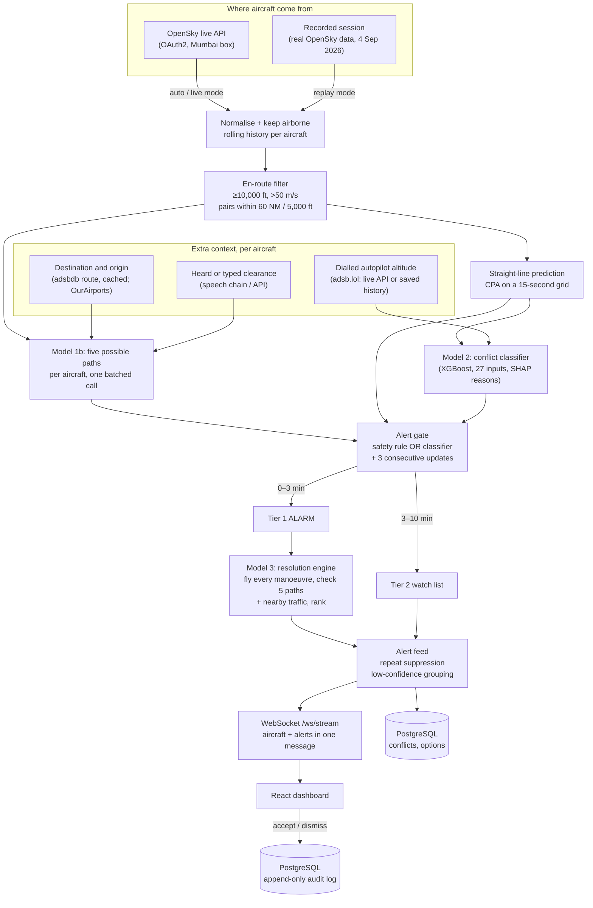
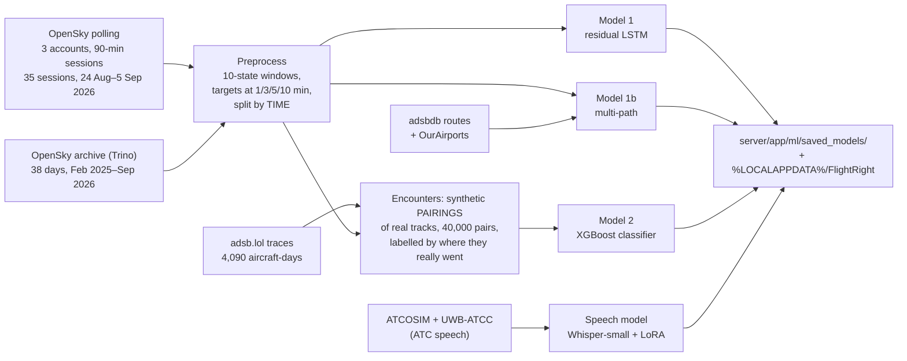
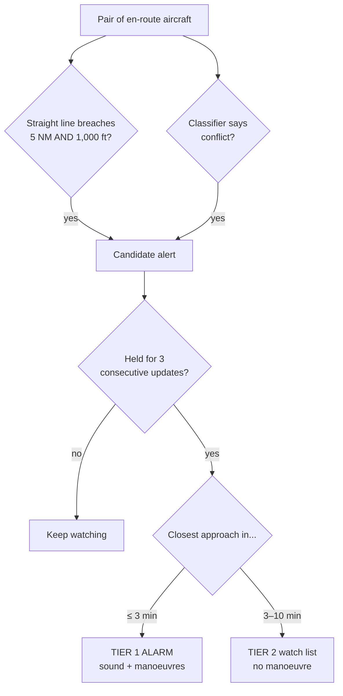
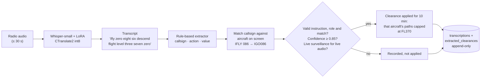
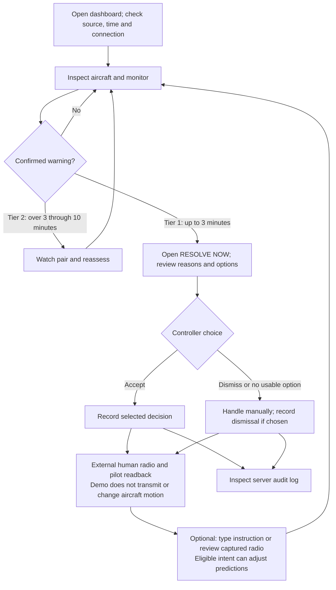

# Flight Right

Agents contributing to this repository must read [AGENTS.md](AGENTS.md) before every
task. It is the maintained home for project-editing rules, including evaluation and
report updates.

**An AI-assisted decision-support dashboard for air traffic controllers, built around Mumbai
airspace.** It watches real aircraft, predicts which pairs are heading for a loss of
separation (getting closer than the legal minimum distance), explains why, suggests costed
ways out, listens to controller radio, and records every decision in a log that cannot be
edited afterwards.

The controller always decides. Accept and dismiss actions are recorded; leaving a suggestion
untouched does not record an explicit decision to ignore it. Nothing is ever sent to an aircraft.

> **Prototype: decision support, not automation.** This is a final-year engineering project
> (KJ Somaiya). It is not a certified ATC system, it does not control aircraft, and it does not
> replace a controller. Its data comes from free, uncertified public feeds; real use would need
> certified surveillance, flight plans, weather, NOTAMs and regulatory approval.

---

**New to the demo? Start with the [controller walkthrough](#a-controllers-complete-walkthrough).**

## Contents

1. [The headline result](#the-headline-result)
2. [Why this project exists](#why-this-project-exists)
3. [What it does, in one minute](#what-it-does-in-one-minute)
4. [Six words you need](#six-words-you-need)
5. [How data flows through the system](#how-data-flows-through-the-system)
6. [Where the data comes from](#where-the-data-comes-from)
7. [The models, and what each one is for](#the-models-and-what-each-one-is-for)
8. [How a conflict becomes an alarm](#how-a-conflict-becomes-an-alarm)
9. [The speech chain (radio → clearance)](#the-speech-chain-radio--clearance)
10. [What is on the screen, and where each panel gets its data](#what-is-on-the-screen-and-where-each-panel-gets-its-data)
11. [Live demo: controller walkthrough and backend](#the-demo-live-or-recorded-and-the-script)
12. [Running it](#running-it)
13. [Technology, and why each piece was chosen](#technology-and-why-each-piece-was-chosen)
14. [How the results are checked](#how-the-results-are-checked)
15. [Honest limitations](#honest-limitations)
16. [Repository layout](#repository-layout)
17. [API](#api)
18. [Documentation map](#documentation-map)
19. [Data sources, licences and credits](#data-sources-licences-and-credits)

---

## The headline result

> **95.1% of conflicts are caught with at least three minutes of warning**
> (270 of 284 real conflicts in held-out test data). Through the whole running system, which is
> what a controller actually gets, the figure is **95.4%** (271 of 284).

**Why three minutes.** It is the smallest warning a controller can use. After an alarm, about
38 seconds pass before an aircraft starts to move: 15 s for the controller to decide, 15 s for
the radio call and readback, and 8 s for the pilot to react. A 1,000 ft climb then takes about
40 s, and a 30° turn at cruise speed about 96 s. We confirmed this by simulating every possible
manoeuvre: with 90 seconds left, none of them works in time.

| Method, same held-out test data | Caught with ≥ 3 min warning |
|---|---|
| Simple rule at the legal minimum (5 NM / 1,000 ft) | 81.7% |
| Simple rule on a wider alert zone (8 NM / 1,500 ft) | 87.3% |
| Our classifier, position and motion only (served until 26 Sep 2026) | 94.0% |
| **Our classifier + the altitude each crew has dialled into the autopilot** | **95.1%** |

"Held-out" means the test data comes from **later days than anything the models learned
from**, and is scored against where the real aircraft actually went. Full metrics, charts and
the experiments that failed are in [docs/evaluation.md](docs/evaluation.md).

---

## Why this project exists

**The problem.** Indian air traffic is growing fast, and Mumbai (VABB) is one of the country's
busiest and most constrained airports: two crossing runways, dense arrivals and departures, a
mix of airline and other traffic, and monsoon weather. Controllers already receive radar
tracks, flight plans and radio, but from separate systems. Deciding whether two aircraft will
get too close in the next few minutes, and what to do about it, is still largely done in the
controller's head.

**What exists elsewhere.** European centres run two kinds of automated help, both described by
EUROCONTROL:
- **STCA (Short-Term Conflict Alert):** a safety net that fires about two minutes ahead.
- **MTCD (Medium-Term Conflict Detection):** a planning aid that looks further ahead.

These systems are built on certified data, including the level each aircraft has been
*cleared* to fly at. None of this is publicly available for Indian airspace.

**What we set out to show.** That a single dashboard, using only free public data, can:

1. **Predict** where each aircraft will be in 1, 3, 5 and 10 minutes, including several
   possible paths when the future is genuinely uncertain.
2. **Detect** which pairs will lose separation, early enough to act (≥ 3 minutes).
3. **Explain** every alert: which facts made the model worry.
4. **Recommend** manoeuvres that have been simulated, checked against other traffic, and
   costed in delay and fuel.
5. **Listen** to controller radio and use a heard instruction ("descend to flight level 370")
   to sharpen the prediction.
6. **Record** every suggestion and decision in an audit log the system itself cannot alter.

**Why these design choices.** Every learned model sits on top of a simple, predictable method
that still works if the model fails or is removed:
- plain straight-line physics under the trajectory model;
- a geometric distance rule under the conflict classifier;
- recorded data under the live feed;
- a local database under the main one.

A safety tool should get worse gracefully, not fail silently.

---

## What it does, in one minute

1. Every **10 seconds** it reads every aircraft over the Mumbai region, either live or from a
   recording.
2. For each aircraft it predicts **five possible future paths** with probabilities, using its
   recent motion, where the flight is going, and any instruction heard on the radio.
3. For each nearby pair it asks two questions:
   - Does the **straight-line prediction** breach the legal minimum? This is a fixed safety rule.
   - Does the **conflict classifier** say this pair will really lose separation?
4. A pair that stays flagged for three updates in a row becomes:
   - an **alarm**, if closest approach is within 3 minutes, with available suggested manoeuvres.
   - a **watch-list entry**, if it is 3 to 10 minutes away. No manoeuvre is suggested.
5. For an alarm, it **flies every candidate manoeuvre in simulation**, rejects any that fail or
   would cause a new conflict with a third aircraft, and ranks the rest.
6. The controller accepts or dismisses. That decision, with the model versions that produced
   the advice, goes into the **append-only audit log**.

---

## Six words you need

| Word | Meaning |
|---|---|
| **Separation** | The minimum distance two aircraft must keep. Here: 5 nautical miles sideways **or** 1,000 ft vertically. Losing both at once is a *loss of separation*, which we call a *conflict*. |
| **CPA** (closest point of approach) | The moment in the future when two aircraft will be nearest each other, and how near. |
| **Flight level (FL)** | Altitude in hundreds of feet: FL370 is 37,000 ft. |
| **Clearance** | An instruction from a controller: "climb to FL370", "turn heading 090". |
| **Callsign** | The name an aircraft uses on the radio: IGO086 is spoken "IndiGo zero eight six" (telephony "IFLY"). |
| **En-route** | Aircraft cruising between airports, above 10,000 ft here. Aircraft landing or taking off are spaced by different rules. |

---

## How data flows through the system

### Live path: what happens every 10 seconds



### Offline path: how the models were built



**Time split, never random.** Training data ends 2 Sep 2026. The test data runs 4 Sep 08:01 to
5 Sep 09:28 IST. Mixing days would let a model "remember" the very aircraft it is tested on.

---

## Where the data comes from

| Source | What we take from it | Used for | Live or offline |
|---|---|---|---|
| **OpenSky Network REST API** | Position, altitude, speed, heading, climb rate and callsign of every aircraft in the Mumbai box (lat 16–23.5°, lon 68–77.5°), every 10 s | The live picture, and the 35 recorded sessions | Both |
| **OpenSky historical archive** (Trino) | Full days of past Mumbai traffic | 400,000 extra training windows for the path model. Indian low-altitude coverage only starts in Jan 2025, which we measured | Offline |
| **adsb.lol** | `nav_altitude_mcp`: the altitude the crew has **dialled into the autopilot** (OpenSky does not carry it) | 3 inputs to the conflict classifier | Live API in live mode; saved history in replay |
| **adsbdb** | Each callsign's route (origin → destination) | 4 destination inputs to the path model | Looked up once per callsign, then cached |
| **OurAirports** | Airport coordinates; Mumbai's runways (09/27, 14/32) with threshold positions | Distance and bearing to destination; the runway panel and the runways on the map | Offline file |
| **METAR** (official half-hourly airport weather report) | Wind, visibility, cloud, temperature, QNH for VABB | Top bar, flight list, map weather overlay; runway in use when no movement is seen yet | Live: aviationweather.gov (NOAA). Replay: the Iowa Environmental Mesonet archive, cached by `scripts/fetch_metar_archive.py` |
| **adsb.lol** (aircraft details) | Registration, type, squawk | Flight details drawer | Replay: saved trace headers (97% of 1,721 airframes have a type). Live: the same adsb.lol feed |
| **ATCOSIM, UWB-ATCC** | Real and simulated European controller speech with transcripts | Training the speech model | Offline |
| **ATCO2 test set** | Real radio with annotated clearances | **Testing only** (762 clips never trained on) | Offline |
| **Svarah** (AI4Bharat) | Real Indian-accented English | **Testing only**: how the speech model handles Indian accents | Offline |
| **Indic Parler-TTS** (AI4Bharat) | Indian-accented synthetic speech | Training/practice audio and a separately labelled generated-voice diagnostic; never evidence of real-radio performance | Offline |
| **FAA JO 7340.2, OpenFlights** | Airline radio names (IGO → "IFLY") | Matching a heard callsign to an aircraft | Offline |

**How the recordings were collected.** We polled OpenSky from three accounts, in scheduled
90-minute sessions at 10-second intervals, within a budget of 4,000 credits per rolling 24
hours. The scripts are in `ml_pipeline/ingestion/`. The result: **627,344 airborne position
reports from 1,730 aircraft over 12 days**.

---

## The models, and what each one is for

Every learned model has a simple method underneath that still works without it.

| | Question it answers | How it works | Result on held-out data | Underneath it |
|---|---|---|---|---|
| **Model 1: trajectory** | Where will this aircraft be in 1, 3, 5, 10 min? | 2-layer LSTM (hidden 128) predicting a **correction** to straight-line extrapolation. A zero correction reproduces the physics; a learned correction can still be wrong. Loss SmoothL1 (β = 0.05), never mean-squared error | 10 min, within 5 NM: **61.3%** vs straight line 50.5% (a non-neural tree benchmark reaches 65.7%, and we say so) | Straight-line extrapolation |
| **Model 1b: multi-path** | What are the **five** most likely futures, and how likely is each? | 40 learned route patterns (KMeans) → a classifier picks the likely patterns → per-aircraft offset regressors predict each path. Inputs: 83 motion features + destination (adsbdb). Probabilities calibrated by temperature scaling | Arrivals, 10 min: one of five paths within 5 NM **76.5%**; single best guess **47.2%**; within 5 NM **and** 1,000 ft **48.8%**; height error 889 ft (all traffic) | Straight line |
| **Model 2: conflict classifier** | Will these two aircraft **really** lose separation? | XGBoost over 24 pair features computed from the straight-line prediction, plus 3 dialled-altitude inputs. The label comes from where the two real aircraft actually went. SHAP explains every alert | **95.1%** caught with ≥ 3 min warning; recall 0.954; 98 false alarms per 1,000 pairs | The geometric safety rule, which always runs and can raise an alarm on its own |
| **Model 3: resolution engine** | What should the controller do? | Rules plus physics. Each candidate climb, descent, turn or speed change is **flown** second by second: nothing moves for 38 s, then real turn and climb rates. Kept only if it restores separation against the other aircraft's five predicted paths **and** all nearby traffic. Ranked by safety 0.60 / delay 0.15 / fuel 0.10 / workload 0.10 / confidence 0.05 | Offers no manoeuvre when doing nothing is already safe, or when nothing can work in time | None: rules are the method |
| **Speech model** | What did the controller say? | Whisper-small with ATC adaptation, followed by validation-selected continuation/weight averaging (`uniform_soup3`); fixed instruction extraction and callsign matching against visible aircraft | Current selected model, measured 10 Nov 2026: **21 of 31** whole instructions; mixed corpus-level results and limitations in [the speech history](docs/evaluations/asr_small_atc_p1.md) | Typed clearances through the same API |

**Why these techniques and not bigger ones.** We measured the alternatives and they did not
help:
- A bidirectional LSTM did not help.
- A longer input window did not help.
- Very different models (a tree and an LSTM) landed within 2 points of each other.

The limit is the *information* available, not model size. Two aircraft in identical situations
end up **7.9 NM apart on average** after ten minutes, because the outcome depends on a
controller instruction we do not see. That is why the path model offers five possibilities
instead of one guess, and why the speech chain exists.

---

## How a conflict becomes an alarm



- **The safety rule outranks the model.** If the straight line breaches the legal minimum, the
  alarm is raised whatever the classifier says.
- **Three consecutive updates** stop a single noisy position report from making an alarm
  flicker.
- **Tier 2 never suggests a manoeuvre.** A ten-minute prediction is not good enough to justify
  turning an aircraft.
- **The alert feed changes display prominence and repeat notifications, never what is detected.**
  A pair already on screen does not interrupt again unless something gets worse. Low-confidence
  watch-list entries are grouped into one counted row. Every confirmed pair stays on the active
  list on every update: there is no code path that removes one. On replayed traffic this cut
  interruptions by about 74%, with **zero pairs lost**.

---

## The speech chain (radio → clearance)



- **Heard and typed instructions take the same route.** `POST /api/clearances` accepts a typed
  one; the speech chain submits through the same service.
- **An instruction reshapes that aircraft's predicted paths; it never switches an alarm off.**
  A level instruction caps the predicted altitude, which is how EUROCONTROL STCA uses the
  cleared level. A heading instruction removes paths that contradict it.
- **The 0.85 floor**, historically measured on 24 real heard clearances, applied 12 correct instructions and
  0 wrong ones. It was Archit's decision.
- **Indian accents:** the selected continuation/weight-average model was measured on
  10 November 2026, including everyday Indian English and generated practice radio calls.
  Neither measures real Mumbai controller radio performance. The gains were small and mixed
  across real-radio corpora; [the speech history](docs/evaluations/asr_small_atc_p1.md) and
  [current comparison](docs/evaluation.md) retain the exact measurement basis and limitations.

---

## What is on the screen, and where each panel gets its data

| Panel | Shows | Comes from |
|---|---|---|
| **Top bar** | VABB runway in use (derived from observed movements or METAR wind), weather, data-time clock, configured controller identity, radio-monitor shortcut, theme/AI controls and notifications | `/api/airport`, `/api/health`, alert feed |
| **Data source bar** | LIVE or REPLAY, which recording, aircraft count, pairs assessed and how long it took, and the permanent strip "PROTOTYPE · DECISION SUPPORT · CONTROLLER DECIDES" | `/api/aircraft/source`, WebSocket |
| **Conflict banner** | The most urgent tier 1 alarm, with a **RESOLVE NOW** button | Alert feed `attention` |
| **Flight list** | Every aircraft, searchable; the METAR strip (raw and decoded, with its source and issue time) | `/ws/stream` aircraft, `/api/airport` |
| **Map / radar sweep** | Aircraft positions and conflict pairs over Mumbai; selected aircraft's observed trail and most probable predicted path when available | `/ws/stream`, `/api/aircraft/history`, `/api/aircraft/trajectory` |
| **Flight detail drawer** | Route, type/registration, altitude, speed, vertical rate, distance/bearing from VABB, estimated ETA for VABB-bound flights and received squawk; **ISSUE CLEARANCE** records typed intent. Supported altitude/heading effects can reshape predictions; speed is recorded only | `/ws/stream`, `POST /api/clearances` |
| **AI suggestions** | Ranked manoeuvres with explanation, confidence and cost | Model 3 via the alert feed |
| **Resolve dialog** | Review/select an available option; **ACCEPT, RECORD DECISION**. The first available option may already be selected; acceptance is disabled when no option exists | Alert snapshot's resolution options → `/api/actions/accept` |
| **Watch list** | Tier 2 pairs, plus the counted low-confidence group | Alert feed `active` |
| **Metrics row** | Aircraft tracked, en-route count, alarms, watch list, assessment time | Backend tick metrics |
| **Timeline** | Predicted closest approaches on a time axis | Alert feed |
| **Radio panel** | Start/stop passive listening, inspect/review captured text and intent; `/radio` also offers labelled sample recordings | `/api/speech/*` |
| **Audit trail / Logs page** | Recorded actions/decisions; refresh, search/filter and export server logs or view separate browser-tab records | `/api/audit` (PostgreSQL, or reported SQLite fallback) |
| **Runway panel** | Mumbai's real runways; landings and departures **observed** in the tracks over the last 45 min, arrivals **estimated** for the next 30 min | `/api/airport` (derived; see `airport_service.py`) |
| **Map / radar overlays** | The OpenSky query box, a 50 NM ring, the real runways with a 10 NM extended centreline on the runway in use; for an alarm, each aircraft's straight-line position at the predicted closest approach | `/api/airport`, alert feed |

The five candidate paths support tiering, conflict probability and manoeuvre checks. The
selected-flight display draws the most probable one, rather than the whole candidate fan.

---

## The demo: live or recorded, and the script

**Checked against repository code: 11 November 2026.** The local backend health URL was
unreachable during this documentation check. This describes implemented behaviour and
configured defaults; no new running demo, physical radio capture or model evaluation was
performed. Environment overrides and installed files can change a running session.

### What does "live demo" mean?

A working demonstration can use recorded or current aircraft. Both run backend calculations;
replay does not substitute pre-written alert cards. Read the source bar before presenting.

| Mode | What appears | What to expect |
|---|---|---|
| **replay** | Real recorded aircraft reports | Default for `scripts/start_demo.ps1`. The loader selects the local recording with the newest modification time, not a hard-coded date/pair, and seeks near an encounter by default. Aircraft follow the recording regardless of clicks |
| **live** | Current Mumbai-region reports from OpenSky | Needs credentials, internet and available feed credits. Explicit live mode reports feed failure without switching to replay. A conflict might never appear during a short demo |
| **auto** | Live when available, otherwise replay | Backend default without a mode override. Falls back when no live aircraft are obtained, including feed errors/credit limits. Read the actual source label |

In replay the top-bar clock is historical data time; the source bar's "updated" time is
receipt time on the computer. A recording received just now is still a recording.
Restarting the backend resets its replay clock; refreshing the browser does not. Replay
speed/seek settings and the chosen recording can change which encounter appears and when.

### Start and check the session

For this already installed Windows checkout, run from the repository root:

```powershell
powershell -ExecutionPolicy Bypass -File scripts/start_demo.ps1
```

The existing helper starts PostgreSQL, restarts this project's backend on port 8000 in
replay mode, starts the frontend if needed, opens <http://localhost:5173>, and rotates the
model trace. Restarting clears in-memory conversation and active instructions; do it
before presenting. The helper also accepts `-Mode live` or `-Mode auto`.

The dashboard opens directly. This prototype has no controller login or shift-handover
workflow. The displayed controller identity is the server's configured audit identity,
not proof of an authenticated user. VABB means Mumbai airport.

1. Check **LIVE / REPLAY / NO DATA**, connection state, data time and errors.
2. Open <http://127.0.0.1:8000/api/health>. Inspect `aircraft.source`,
   `models.missing_models` and `store`. `ok: true` alone does not establish that all models
   or live surveillance are available. PostgreSQL enforces audit protection at database
   level; SQLite fallback does not provide the same enforcement.
3. If using speech, check <http://127.0.0.1:8000/api/speech/status> for the actual model,
   readiness and errors. Speech warms separately; aircraft monitoring can work without it.

### A controller's complete walkthrough

1. **Understand the screen.** The left flight list and central map show received aircraft.
   The right panels show counts, suggestions, the watch list, runway summary and radio
   monitor; scroll that column for lower panels. The top shows airport/weather,
   notifications and controls. The bottom timeline expands predicted encounter times.
   "Tracked" means visible aircraft. "En-route" means aircraft passing assessment filters
   with sufficient history. Live aircraft need ten distinct reports, roughly 90-100 seconds
   at the default cadence; replay can load past reports to shorten that wait.
2. **Inspect an aircraft.** Search/filter the list and click an entry or map aircraft.
   The detail drawer shows altitude, ground speed, vertical rate (climb/descent), direction
   and route/type/registration when available. Unknown fields remain unknown. Use
   **MAP VIEW / RADAR SWEEP** to switch displays and **METAR** to see the airport weather
   report with source/time. Neither changes monitoring decisions.
3. **Read the lines correctly.** The selected aircraft's observed trail shows received past
   positions. Its predicted line, when available, is the most probable candidate at 1, 3,
   5 and 10 minutes. It is not a filed route or instruction. The engine can assess five
   candidate futures even though the selected-flight display draws one. Short history
   or an unavailable multi-path model can mean no predicted line.
4. **Monitor early warnings.** A tier 2 watch entry means predicted closest approach is
   more than three and up to ten minutes away. Read the pair/reason and keep monitoring.
   No manoeuvre is offered for these earlier warnings. A low-confidence group counts
   less prominent entries rather than pretending they do not exist.
5. **Review an urgent alarm.** A confirmed tier 1 alarm is within three minutes of
   predicted closest approach. Press **RESOLVE NOW**. Check the two callsigns, predicted
   horizontal and vertical gaps, countdown and reasons. Closest approach means "when they
   are expected to be nearest," not a guaranteed collision time.
6. **Compare options.** Read **WHY THIS OPTION?**, confidence, score, estimated fuel/delay
   and resulting separation. The first available option can already be selected; inspect
   it before accepting. There can be fewer than three options or none: candidates may
   fail, time may be insufficient, or the resolution simulation may find doing nothing
   already safe. These are estimates, not guaranteed outcomes.
7. **Record your decision.** **ACCEPT - RECORD DECISION** records the selected option on
   the server. **DISMISS - HANDLE MANUALLY** records dismissal. The window's X also
   follows the dismissal path. Suggestion cards have their own accept/dismiss controls.
   These actions do not transmit, create a clearance, move aircraft or clear the alarm.
8. **Perform the human communication step.** A controller would verify the instruction,
   speak over the normal external radio, hear the pilot repeat it and check compliance.
   The prototype cannot contact a pilot. In replay, explain that step or use labelled
   sample audio; the recorded aircraft will not react to a decision.
9. **Optionally record an instruction for prediction.** Select the aircraft, open
   **ISSUE CLEARANCE**, choose CLIMB, DESCEND, TURN or SPEED, enter the displayed unit and
   press **RECORD**. A clearance is a controller instruction. Enter `33000` feet for
   FL330 (33,000 ft), not `330`. Turn value `90` means heading 090 degrees, approximately
   east. Check the response: altitude/heading instructions can adjust candidate paths;
   SPEED is currently recorded only. This is separate from accepting a recommendation
   and sends nothing outside the application.
10. **Keep monitoring.** Later received positions and fresh assessments determine whether
    the pair remains concerning. Adjusted predictions do not prove pilot compliance.
    Replay positions remain historical. Accepted/dismissed suggestion cards may be hidden
    for their episode in this page session while monitoring continues. The queue's
    **RESOLVED** counter counts accepted cards, not verified restored separation.
11. **Inspect the record.** Open `/logs`, choose **Server (append-only)**, refresh and
    search/filter by callsign/action. Export JSON if needed. Decisions include details
    and server-stamped conflict-model versions; transcription records identify the speech
    model. **This tab** is a separate browser log; clearing it does not delete server
    audit records. Verify the server record if a request failed or a card disappeared.



### Radio: what the controller can do

In **LIVE RADIO MONITOR**, also on `/radio`, select receiver/line-in/virtual cable or
shared browser audio. A default device could be the computer microphone; confirm the
actual source. For a shared channel use **Mixed pilot + ATCO radio**. ATCO means air
traffic controller. Choose ATCO-only/pilot-only only if the upstream audio separates them.

Press **Start listening**, allow browser capture, enable Share audio if using a tab and
check the level meter. Adjust the transmission threshold if static triggers capture or
quiet speech is missed. Completed transmissions are processed automatically. Read the
text, aircraft match, extracted actions, role hint, confidence, application/rejection
reason and readback status. A readback is the pilot repeating an instruction; mismatches
or an "unable" response still need the controller's attention.

Use **Review captured information**, correct text and speaker, then **Use reviewed
information**. The correction links to the original record. Mixed-channel controller
hints require review; pilot requests/readbacks never create new controller instructions.
The confidence floor remains 0.85 alongside match, role, value and validity checks;
high confidence does not guarantee correct text. Reviews older than two minutes cannot
apply intent.

**Live audio can change intent only with live surveillance.** Today's radio is not
applied to yesterday's replay. For the separate offline demonstration route, `/radio`
also offers **SAMPLE RECORDINGS** labelled recorded or synthetic. Choose the actual speaker
role and click **Process as ...**. **Use cached transcript** skips recognition when a
matching cached result exists; that is not fresh inference. Results vary with samples,
active model, visible aircraft and role; old September clip results are not promises.

**Stop listening** releases capture and clears queued audio. It cannot undo processing
already begun on the server or withdraw an existing instruction. The latest 20 captured
segments remain only in browser memory for playback after stopping. Current conversation,
readback and active instructions are not restored after backend restart; persistent
transcription/audit records remain. See [the radio guide](docs/live-radio.md) for limits.

### How the backend works, in plain technical terms

The **frontend** is the browser interface. The **backend** is the Python service reading
data, calculating predictions and storing records. **Machine learning** uses patterns
learned from examples; **inference** means using an already trained model to predict.
The demo does not train models while the controller works.

| Step | Simple explanation | Current technical behaviour |
|---|---|---|
| Receive reports | Read where aircraft were reported | OpenSky or replay, normalize units, retain recent history. The loop waits 10 seconds after each completed update; processing adds to actual update spacing |
| Add context | Use available route, selected altitude and instructions | Cached route/aircraft services, adsb.lol dialled autopilot altitude, accepted unexpired clearances. Dialled altitude is not proof of a controller clearance |
| Choose pairs | Focus on nearby en-route aircraft | Current airborne aircraft with ten reports, altitude at least 10,000 ft, speed over 50 m/s; pair gaps under 60 NM and 5,000 ft; nearest pairs first, at most 120 per update by default. This is not an exhaustive check of all visible traffic |
| Predict futures | Estimate several ways each aircraft might continue | Multi-path model creates up to five weighted paths at 1/3/5/10 minutes in one batch. Accepted level/heading instructions can adjust them. The residual LSTM is a separate available single-path model, not the source of the selected-flight multi-path line |
| Assess pairs | Work out how close aircraft may get | Straight-line physics on a 15-second grid, candidate-path combinations, and an XGBoost classifier using pair features and selected-altitude inputs. Model reasons explain its verdict |
| Confirm/prioritize | Avoid warnings from one noisy report | Straight-line 5 NM/1,000 ft breach takes priority, otherwise the classifier's saved threshold. Without its verdict, probability fallback uses tier thresholds. Three consecutive qualifying updates confirm an entry: tier 1 up to 180 s; tier 2 over 180 through 600 s |
| Search for actions | Try manoeuvres in a computer first | Confirmed tier 1 alarms reach a rule/physics resolution engine. It simulates a 38-second response delay, checks the other aircraft's paths and nearby eligible traffic, rejects ineffective/new-conflict candidates and ranks survivors by safety and estimated costs |
| Deliver/store | Refresh the picture and retain decisions | Alert feed reduces repeat interruptions and groups low-confidence entries without dropping confirmed pairs from active output. Server stores conflicts and sends aircraft/alerts together over one WebSocket. Accept/dismiss/instruction calls create separate audit records |

**Example with invented numbers, only for explanation:** aircraft predicted to pass 3 NM
sideways and 600 ft vertically apart breach both of this project's 5 NM/1,000 ft limits.
At 1,500 ft vertically apart, that same horizontal gap does not breach both. NM means
nautical mile: 1 NM = 1.852 km. One foot is 0.3048 m; 5 NM is about 9.26 km and 1,000 ft
about 305 m. These are prototype en-route assumptions, not all rules for all flight phases.
A predicted loss of separation is not certainty of collision.

An instruction normally expires after ten minutes or is replaced by a newer instruction
on the same control axis. Level instructions cap candidate altitudes; turns filter paths.
If all paths contradict a heading, the existing fallback preserves paths. SPEED and DIRECT
(fly toward a named navigation point) can be recorded but do not currently adjust paths.
An altitude cap can leave already-compatible paths unchanged. Measured positions and the
straight-line safety rule remain independent of these prediction adjustments.

**Speech default checked on 11 November:** `server/app/config.py` selects `uniform_soup3`
at `checkpoints/voice_20261110/ct2/local__uniform_soup3__int8_float16` if its required
runtime files exist. Otherwise the default falls back to the previous P1 folder under
`%LOCALAPPDATA%/FlightRight/voice/models/`. `FLIGHT_RIGHT_ASR_MODEL_ID` overrides this.
Check `/api/speech/status` for a running server's choice. Experiments and mixed measured
results are in [the speech history](docs/evaluations/asr_small_atc_p1.md).

### Which manual tasks does the system help manage?

| Controller task | Help provided now | What remains with the person or another system |
|---|---|---|
| Maintain traffic picture | Map, list, recent trails and flight details | Check freshness, coverage and missing facts |
| Mentally project movement | Candidate futures and closest-approach estimates | Judge uncertainty and real operational context |
| Scan for conflicts | Filtered pair checks, watch list and urgent alarms | Review alerts; monitor excluded/unsupported traffic |
| Work out a response | Simulated, explained and ranked options | Choose an appropriate instruction; candidate search is not exhaustive |
| Issue instructions and confirm them | Typed record, passive transcription and readback comparison | Speak over external radio; resolve unclear/wrong/unconfirmed messages |
| Monitor compliance | Reassess later received positions | Verify actual compliance and restored separation |
| Keep records | Server audit, search and JSON export | Check recording succeeded; tab logs are separate |
| Manage airport/sector | Weather/runway observations for context | Flight-plan management, handover, runway assignment, arrival sequencing and holding control are not implemented |

The **AI assist** switch currently covers the suggestions panel in this browser. It does
not stop backend inference, disable the conflict banner, clear alerts or stop radio capture.
The runway panel describes observations/estimates; it cannot assign runways or issue
landing/take-off clearances. The system supports parts of a controller's work, rather than
managing every manual duty end to end.

### Missing data and failure cases

| What you see | Meaning / what to check |
|---|---|
| No alerts | Could be quiet traffic, short history, excluded aircraft or missing models. Check source, eligible/pair counts and health; silence does not prove all visible aircraft are safe |
| Polling | Browser requests updates every five seconds while trying to restore streaming |
| BACKEND UNREACHABLE | Previously drawn information can remain; read connection/error/update indicators instead of assuming freshness |
| Live failure or replay in auto | Explicit live reports missing data; auto may substitute a recording. Read the actual source |
| Missing predicted line | Short history or unavailable multi-path model. Missing model files are reported; rule support remains where available. Corrupt/incompatible models are not guaranteed to fall back |
| No resolution option | Read the reason: ineffective candidates, insufficient time or do-nothing already safe in simulation. Handle manually |
| Instruction accepted, paths unchanged | Check actual effect report: already-satisfied cap, heading fallback, unsupported speed/direct action or no eligible assessment |
| Speech unavailable/rejected | Check model, audio source, match, confidence, role, age and live/replay compatibility; surveillance can continue without speech |
| SQLite store | Application append-only behaviour does not have PostgreSQL's database-enforced audit permissions |
| Decision request fails | It is not a successfully recorded decision. Inspect server records; a hidden/dismissed card alone is not evidence |

### A short presentation route

Show source/time, inspect an aircraft, follow a watch entry into an alarm if one occurs,
compare options, record a decision and find it in `/logs`. Demonstrate typed intent and
labelled sample audio, including rejection reasons. For current traffic use the startup
mode or interactive API docs: `POST /api/aircraft/mode` with `{"mode":"live"}`. Switching
is an operator/API action, not a dashboard mode-picker; it is audited. Live radio needs
corresponding live surveillance to apply intent.

The helper's historical estimate is a watch entry around 3.5 minutes and alarm around
four minutes; it is not a fixed schedule. IGO086/FDB1346 was a previously demonstrated
pair. Current recording/settings determine today's encounter. No click changes replay's
actual aircraft motion. For accuracy questions use [current evaluation](docs/evaluation.md)
and distinguish classifier results from full-system results.

---

## Running it

Use the helper above, or separate PowerShell terminals from the repository root:

```powershell
# Terminal 1: database, then backend
venv\Scripts\python.exe scripts/postgres.py start
$env:FLIGHT_RIGHT_DATA_MODE="replay"
venv\Scripts\python.exe -m uvicorn server.app.main:app --port 8000
```

```powershell
# Terminal 2: frontend
Set-Location client
npm.cmd run dev
```

Open <http://localhost:5173>. Interactive API docs are at <http://127.0.0.1:8000/docs>.
A first-time machine also needs a Python virtual environment, Node, dependencies and
local model/recording artifacts. Cloning Git does not supply ignored weights and datasets.

```powershell
# First-time dependencies, after creating venv
venv\Scripts\python.exe -m pip install -r server/requirements.txt
npm.cmd --prefix client install
# If PostgreSQL is not already installed/initialized for this project
venv\Scripts\python.exe scripts/postgres.py install
venv\Scripts\python.exe scripts/postgres.py init
venv\Scripts\python.exe scripts/postgres.py verify
```

`server/app/config.py` defines defaults/environment overrides. Backend models are in
`server/app/ml/saved_models/`; replay files in `ml_pipeline/data/raw/` unless the data
root is overridden. Speech paths are described above. PostgreSQL uses
`%LOCALAPPDATA%/FlightRight/`; SQLite defaults to `server/audit.sqlite3`.
`server/logs/model_trace.log` records model steps and `server/logs/backend.log` service
activity. Keep credentials out of documentation. Training is separate from demo operation;
see [ml_pipeline/README_TRAINING.md](ml_pipeline/README_TRAINING.md).

To trace the implementation behind this guide, start with
[dashboard actions](client/src/pages/HomePage.jsx),
[the update loop](server/app/main.py),
[pair selection and assessment](server/app/services/conflict_service.py),
[model inference](server/app/ml/inference.py),
[alert gates](ml_pipeline/utils/cpa_conflict_detection.py),
[clearance handling](server/app/services/clearance_service.py),
[speech/review handling](server/app/services/speech_service.py) and
[API routes](server/app/api/routes.py).

---

## Technology, and why each piece was chosen

| Layer | Technology | Why this one |
|---|---|---|
| Backend | **FastAPI** (Python) | ML models, the WebSocket stream and the OpenSky client in one process and one language; automatic API docs |
| Streaming | **One WebSocket** (`/ws/stream`) | An alert quotes a distance and a time that are only true for the positions it was computed from. One message carries both, so they cannot arrive out of order |
| Database | **PostgreSQL 17** (SQLite fallback) | The app's role is granted `INSERT, SELECT` only on the audit tables, so the **database** refuses edits and deletions. Under SQLite that was just a promise in the code |
| Trajectory | **PyTorch** LSTM | A residual design over physics. SmoothL1 loss, because squared error destroyed the near-perfect predictions (measured: 6.4% vs 27.7% within 1 NM) |
| Multi-path | **scikit-learn** KMeans + HistGradientBoosting | Route patterns plus per-aircraft offsets; temperature scaling for honest probabilities |
| Conflict | **XGBoost** + native SHAP | Explainable, fast on tabular features; per-alert reasons for the controller |
| Speech | **Whisper-small with ATC adaptation**, selected continuation/weight average, **faster-whisper / CTranslate2**, rapidfuzz | Local speech recognition plus inspectable instruction/callsign rules. Check speech status for device/model readiness; prior latency measurements are not fresh timing for the latest runtime |
| Frontend | **React 19**, Vite, Tailwind, Framer Motion, **MapLibre GL**, Recharts | Existing dashboard, wired to real data. No mock data remains for anything a model produces |
| Data | OpenSky (OAuth2), adsb.lol, adsbdb, OurAirports | Free and public. Each source's coverage was **measured** before being relied on |

---

## How the results are checked

```bash
python ml_pipeline/utils/verify_pipeline.py      # 111 checks, loads every saved model cold
python -m pytest ml_pipeline/tests/test_units.py # 24 unit tests
python ml_pipeline/utils/reevaluate_models.py    # re-scores every model from its saved file
python ml_pipeline/utils/offsets_ab_test.py      # the running system on 4,690 labelled pairs
python scripts/consolidate_evaluations.py --verify  # verifies consolidated model histories
```

- **The known traps are tested on every run.** The conflict label must not be computable from
  the model's own inputs: it once was, and the model scored a meaningless "perfect". The test
  data must be later than the training data. Every model must beat plain physics on the same
  data.
- **No number is typed by hand.** Evaluation documents are generated from saved files.
- **Decisions to change what a controller sees** were written as pass/fail rules *before* the
  numbers were looked at. For example, the destination inputs were adopted only after passing
  11 pre-set checks.
- **Failures are kept.** Rejected ideas and the measurements that rejected them are in
  [docs/evaluation.md](docs/evaluation.md) and [docs/CLAUDE.md](docs/CLAUDE.md).

---

## Honest limitations

- **En-route only, above 10,000 ft.** Applied to landing traffic, the en-route rule flags
  something in 91–94% of snapshots, because arrivals are legitimately close together.
  Terminal-area conflicts need their own rules.
- **No authoritative flight-plan/clearance feed.** Dialled autopilot altitude supplies intent
  context but is not a verified clearance. Typed or eligible heard instructions can add intent;
  they are not a complete record of everything the aircraft was told.
- **False alarms are real.** About 100 in every 1,000 test pairs raise a false alert. Most are silent watch-list rows. Tier 1 false alarms on test: 20, against 28 real.
- **Best-of-5 is not accuracy.** "One of five paths within 5 NM" (76.5%) and "the single best
  guess" (47.2%) measure different things; both are reported.
- **Speech:** measured on European radio, simulator speech, everyday Indian English and
  separately labelled generated voices. These checks do not establish performance on real
  Mumbai controller radio or physically verify receiver capture.
- **Not yet built:** scenario-simulation mode, drawing the five paths on the map, a
  machine-learned manoeuvre ranker, and login (a single configured controller identity,
  `FLIGHT_RIGHT_CONTROLLER_ID`, is used).
- **Derived, not official:** the runway in use and runway movements are inferred from the tracks
  (an aircraft low and lined up with a runway), not read from ATC. No ATIS is shown, because none
  is published in a form we can read. Arrival times are distance ÷ ground speed.
- **Current workflow limits and failure cases:** see the
  [demo walkthrough](#the-demo-live-or-recorded-and-the-script) and
  [radio guide](docs/live-radio.md). The project context retains historical issue discussions.

---

## Repository layout

```
client/                          React dashboard
  src/components/                 panels (map, lists, banner, resolve dialog, radio, audit)
  src/lib/api.js, adapters.js     backend calls and payload mapping
server/app/                      FastAPI backend
  main.py                         app, 10-second ingest loop, /ws/stream
  config.py                       every setting, overridable by environment variable
  api/routes.py                   REST endpoints
  services/                       OpenSky client, replay, aircraft, conflicts, intent (adsb.lol),
                                  clearances, speech, database
  ml/inference.py                 loads every model; assess_pair() runs the full chain
  ml/saved_models/                trained model files (gitignored)
ml_pipeline/
  ingestion/                      OpenSky collection scripts (credit-aware, checkpointed)
  training/trajectory/            preprocessing, Model 1, Model 1b, evaluation, tree benchmark
  training/conflict_classifier/   encounter generation, Model 2
  voice/                          speech: audio cache, training, extraction, callsigns, evaluation
  utils/                          CPA detection, resolution engine, alert feed, route features,
                                  verification, re-scoring, ablations
  tests/                          unit tests, smoke test on fake data
  reports/                        dated JSON of every measurement
scripts/                         PostgreSQL manager, archive and adsb.lol downloaders
docs/                            documentation, figures, consolidated model evaluations
```

---

## API

| Method | Path | Purpose |
|---|---|---|
| GET | `/api/aircraft/latest` · `/api/aircraft/history` | Current aircraft; one aircraft's recent states |
| GET | `/api/aircraft/trajectory` | Selected aircraft's most probable candidate path, readiness and model version |
| GET · POST | `/api/aircraft/source` · `/api/aircraft/mode` | Which data mode is live; switch it |
| GET | `/api/conflicts/active` | The alert feed: `active` (render all of it), `notifications`, counts |
| GET | `/api/conflicts/history` | Conflicts raised, from the database |
| POST | `/api/predict/conflicts` | Force a fresh assessment |
| GET | `/api/recommend/resolution` | Model 3's options for one pair |
| POST | `/api/actions/accept` · `/api/actions/dismiss` | Record a controller decision |
| POST · GET · DELETE | `/api/clearances` | Typed clearances: submit, list, clear |
| GET · POST | `/api/speech/status` · `/clips` · `/clips/{id}/audio` · `/hear` · `/transcriptions` | The speech chain |
| GET · POST | `/api/speech/conversation` · `/api/speech/review` | Current radio conversation/readback/intent view; review captured information |
| GET · POST | `/api/audit` | The append-only audit log |
| GET | `/api/health` | Models, versions, store, feeds (with adsb.lol ODbL credit) |
| WS | `/ws/stream` | Aircraft and alerts, pushed together every tick |

---

## Documentation map

| File | Read it for |
|---|---|
| [Demo walkthrough](#the-demo-live-or-recorded-and-the-script) / [Running it](#running-it) | Controller steps, backend, setup and troubleshooting |
| [docs/live-radio.md](docs/live-radio.md) | Audio capture, review and live/replay isolation |
| [docs/evaluation.md](docs/evaluation.md) | Current best supported comparisons, measurement basis and served/candidate status |
| [Model evaluation histories](docs/evaluations/source_inventory.json) | One ledger per model; experiments, metrics and source checksums |
| [docs/claims.md](docs/claims.md) | What may and may not be claimed, each number with its source |
| [docs/CLAUDE.md](docs/CLAUDE.md) | The full decision log: every choice and the measurement behind it |
| [ml_pipeline/README_TRAINING.md](ml_pipeline/README_TRAINING.md) | Training the models end to end |

---

## Data sources, licences and credits

- **OpenSky Network**: aircraft positions. M. Schäfer et al., *Bringing up OpenSky: A
  large-scale ADS-B sensor network for research*, IPSN 2014.
- **adsb.lol**: dialled altitudes. *Contains data from adsb.lol, made available under the
  Open Database License (ODbL 1.0).*
- **adsbdb**: callsign routes. **OurAirports**: airport data (public domain).
- **ATCOSIM**, **UWB-ATCC** (CC BY-NC-SA 4.0) and the **ATCO2** test set: ATC speech. Our
  speech model was trained on UWB-ATCC, so treat it as **non-commercial**.
- **Svarah** (CC BY 4.0) and **Indic Parler-TTS** (Apache 2.0): AI4Bharat.
- **OpenAI Whisper**: the base speech model.
- **EUROCONTROL** STCA guidelines and **ICAO** Doc 4444 / Doc 9432 phraseology: design
  references. Every other source is cited where it is used, in [docs/CLAUDE.md](docs/CLAUDE.md).
