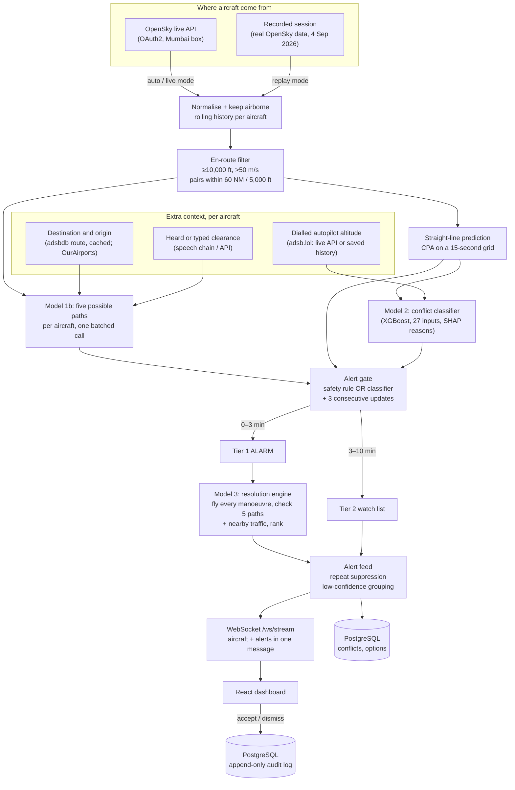
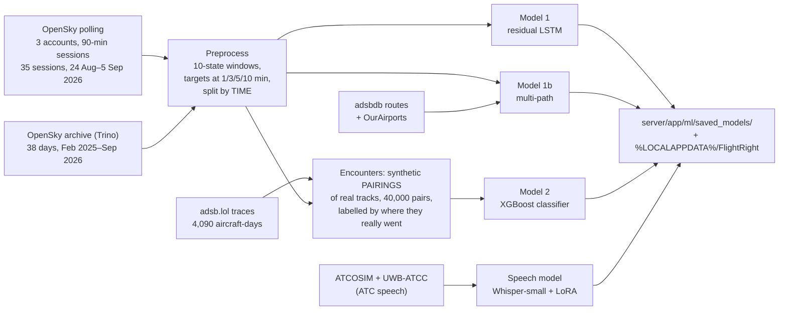
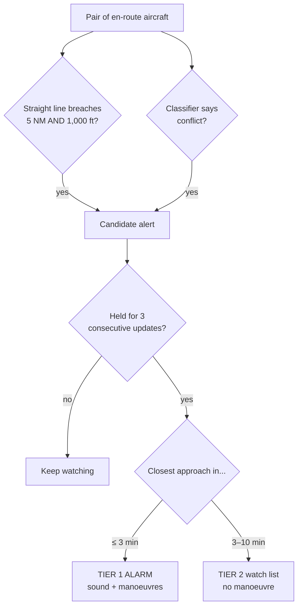
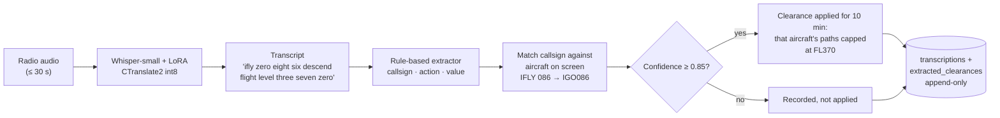

# Flight Right

**An AI-assisted decision-support dashboard for air traffic controllers, built around Mumbai
airspace.** It watches real aircraft, predicts which pairs are heading for a loss of
separation (getting closer than the legal minimum distance), explains why, suggests costed
ways out, listens to controller radio, and records every decision in a log that cannot be
edited afterwards.

The controller always decides. Every suggestion can be accepted, dismissed or ignored, and
that choice is logged. Nothing is ever sent to an aircraft.

> **Prototype: decision support, not automation.** This is a final-year engineering project
> (KJ Somaiya). It is not a certified ATC system, it does not control aircraft, and it does not
> replace a controller. Its data comes from free, uncertified public feeds; real use would need
> certified surveillance, flight plans, weather, NOTAMs and regulatory approval.

---

## Contents

1. [The headline result](#the-headline-result)
2. [Why this project exists](#why-this-project-exists)
3. [What it does, in one minute](#what-it-does-in-one-minute)
4. [Six words you need](#six-words-you-need)
5. [How data flows through the system](#how-data-flows-through-the-system)
6. [Where the data comes from](#where-the-data-comes-from)
7. [The models, and what each one is for](#the-models-and-what-each-one-is-for)
8. [How a conflict becomes an alarm](#how-a-conflict-becomes-an-alarm)
9. [The speech chain (radio → clearance)](#the-speech-chain-radio--clearance)
10. [What is on the screen, and where each panel gets its data](#what-is-on-the-screen-and-where-each-panel-gets-its-data)
11. [The demo: live or recorded, and the script](#the-demo-live-or-recorded-and-the-script)
12. [Running it](#running-it)
13. [Technology, and why each piece was chosen](#technology-and-why-each-piece-was-chosen)
14. [How the results are checked](#how-the-results-are-checked)
15. [Honest limitations](#honest-limitations)
16. [Repository layout](#repository-layout)
17. [API](#api)
18. [Documentation map](#documentation-map)
19. [Data sources, licences and credits](#data-sources-licences-and-credits)

---

## The headline result

> **95.1% of conflicts are caught with at least three minutes of warning**
> (270 of 284 real conflicts in held-out test data). Through the whole running system, which is
> what a controller actually gets, the figure is **95.4%** (271 of 284).

**Why three minutes.** It is the smallest warning a controller can use. After an alarm, about
38 seconds pass before an aircraft starts to move: 15 s for the controller to decide, 15 s for
the radio call and readback, and 8 s for the pilot to react. A 1,000 ft climb then takes about
40 s, and a 30° turn at cruise speed about 96 s. We confirmed this by simulating every possible
manoeuvre: with 90 seconds left, none of them works in time.

| Method, same held-out test data | Caught with ≥ 3 min warning |
|---|---|
| Simple rule at the legal minimum (5 NM / 1,000 ft) | 81.7% |
| Simple rule on a wider alert zone (8 NM / 1,500 ft) | 87.3% |
| Our classifier, position and motion only (served until 26 Sep 2026) | 94.0% |
| **Our classifier + the altitude each crew has dialled into the autopilot** | **95.1%** |

"Held-out" means the test data comes from **later days than anything the models learned
from**, and is scored against where the real aircraft actually went. Full metrics, charts and
the experiments that failed are in [docs/evaluation.md](docs/evaluation.md).

---

## Why this project exists

**The problem.** Indian air traffic is growing fast, and Mumbai (VABB) is one of the country's
busiest and most constrained airports: two crossing runways, dense arrivals and departures, a
mix of airline and other traffic, and monsoon weather. Controllers already receive radar
tracks, flight plans and radio, but from separate systems. Deciding whether two aircraft will
get too close in the next few minutes, and what to do about it, is still largely done in the
controller's head.

**What exists elsewhere.** European centres run two kinds of automated help, both described by
EUROCONTROL:
- **STCA (Short-Term Conflict Alert):** a safety net that fires about two minutes ahead.
- **MTCD (Medium-Term Conflict Detection):** a planning aid that looks further ahead.

These systems are built on certified data, including the level each aircraft has been
*cleared* to fly at. None of this is publicly available for Indian airspace.

**What we set out to show.** That a single dashboard, using only free public data, can:

1. **Predict** where each aircraft will be in 1, 3, 5 and 10 minutes, including several
   possible paths when the future is genuinely uncertain.
2. **Detect** which pairs will lose separation, early enough to act (≥ 3 minutes).
3. **Explain** every alert: which facts made the model worry.
4. **Recommend** manoeuvres that have been simulated, checked against other traffic, and
   costed in delay and fuel.
5. **Listen** to controller radio and use a heard instruction ("descend to flight level 370")
   to sharpen the prediction.
6. **Record** every suggestion and decision in an audit log the system itself cannot alter.

**Why these design choices.** Every learned model sits on top of a simple, predictable method
that still works if the model fails or is removed:
- plain straight-line physics under the trajectory model;
- a geometric distance rule under the conflict classifier;
- recorded data under the live feed;
- a local database under the main one.

A safety tool should get worse gracefully, not fail silently.

---

## What it does, in one minute

1. Every **10 seconds** it reads every aircraft over the Mumbai region, either live or from a
   recording.
2. For each aircraft it predicts **five possible future paths** with probabilities, using its
   recent motion, where the flight is going, and any instruction heard on the radio.
3. For each nearby pair it asks two questions:
   - Does the **straight-line prediction** breach the legal minimum? This is a fixed safety rule.
   - Does the **conflict classifier** say this pair will really lose separation?
4. A pair that stays flagged for three updates in a row becomes:
   - an **alarm**, if closest approach is within 3 minutes. Sound plus suggested manoeuvres.
   - a **watch-list entry**, if it is 3 to 10 minutes away. No manoeuvre is suggested.
5. For an alarm, it **flies every candidate manoeuvre in simulation**, rejects any that fail or
   would cause a new conflict with a third aircraft, and ranks the rest.
6. The controller accepts or dismisses. That decision, with the model versions that produced
   the advice, goes into the **append-only audit log**.

---

## Six words you need

| Word | Meaning |
|---|---|
| **Separation** | The minimum distance two aircraft must keep. Here: 5 nautical miles sideways **or** 1,000 ft vertically. Losing both at once is a *loss of separation*, which we call a *conflict*. |
| **CPA** (closest point of approach) | The moment in the future when two aircraft will be nearest each other, and how near. |
| **Flight level (FL)** | Altitude in hundreds of feet: FL370 is 37,000 ft. |
| **Clearance** | An instruction from a controller: "climb to FL370", "turn heading 090". |
| **Callsign** | The name an aircraft uses on the radio: IGO086 is spoken "IndiGo zero eight six" (telephony "IFLY"). |
| **En-route** | Aircraft cruising between airports, above 10,000 ft here. Aircraft landing or taking off are spaced by different rules. |

---

## How data flows through the system

### Live path: what happens every 10 seconds



### Offline path: how the models were built



**Time split, never random.** Training data ends 2 Sep 2026. The test data runs 4 Sep 08:01 to
5 Sep 09:28 IST. Mixing days would let a model "remember" the very aircraft it is tested on.

---

## Where the data comes from

| Source | What we take from it | Used for | Live or offline |
|---|---|---|---|
| **OpenSky Network REST API** | Position, altitude, speed, heading, climb rate and callsign of every aircraft in the Mumbai box (lat 16–23.5°, lon 68–77.5°), every 10 s | The live picture, and the 35 recorded sessions | Both |
| **OpenSky historical archive** (Trino) | Full days of past Mumbai traffic | 400,000 extra training windows for the path model. Indian low-altitude coverage only starts in Jan 2025, which we measured | Offline |
| **adsb.lol** | `nav_altitude_mcp`: the altitude the crew has **dialled into the autopilot** (OpenSky does not carry it) | 3 inputs to the conflict classifier | Live API in live mode; saved history in replay |
| **adsbdb** | Each callsign's route (origin → destination) | 4 destination inputs to the path model | Looked up once per callsign, then cached |
| **OurAirports** | Airport coordinates; Mumbai's runways (09/27, 14/32) with threshold positions | Distance and bearing to destination; the runway panel and the runways on the map | Offline file |
| **METAR** (official half-hourly airport weather report) | Wind, visibility, cloud, temperature, QNH for VABB | Top bar, flight list, map weather overlay; runway in use when no movement is seen yet | Live: aviationweather.gov (NOAA). Replay: the Iowa Environmental Mesonet archive, cached by `scripts/fetch_metar_archive.py` |
| **adsb.lol** (aircraft details) | Registration, type, squawk | Flight details drawer | Replay: saved trace headers (97% of 1,721 airframes have a type). Live: the same adsb.lol feed |
| **ATCOSIM, UWB-ATCC** | Real and simulated European controller speech with transcripts | Training the speech model | Offline |
| **ATCO2 test set** | Real radio with annotated clearances | **Testing only** (762 clips never trained on) | Offline |
| **Svarah** (AI4Bharat) | Real Indian-accented English | **Testing only**: how the speech model handles Indian accents | Offline |
| **Indic Parler-TTS** (AI4Bharat) | Indian-accented synthetic speech | Training audio for an accent pass. **Never** used for scoring | Offline |
| **FAA JO 7340.2, OpenFlights** | Airline radio names (IGO → "IFLY") | Matching a heard callsign to an aircraft | Offline |

**How the recordings were collected.** We polled OpenSky from three accounts, in scheduled
90-minute sessions at 10-second intervals, within a budget of 4,000 credits per rolling 24
hours. The scripts are in `ml_pipeline/ingestion/`. The result: **627,344 airborne position
reports from 1,730 aircraft over 12 days**.

---

## The models, and what each one is for

Every learned model has a simple method underneath that still works without it.

| | Question it answers | How it works | Result on held-out data | Underneath it |
|---|---|---|---|---|
| **Model 1: trajectory** | Where will this aircraft be in 1, 3, 5, 10 min? | 2-layer LSTM (hidden 128) predicting a **correction** to straight-line extrapolation. A zero output *is* the physics, so it cannot do worse than plain arithmetic. Loss SmoothL1 (β = 0.05), never mean-squared error | 10 min, within 5 NM: **61.3%** vs straight line 50.5% (a non-neural tree benchmark reaches 65.7%, and we say so) | Straight-line extrapolation |
| **Model 1b: multi-path** | What are the **five** most likely futures, and how likely is each? | 40 learned route patterns (KMeans) → a classifier picks the likely patterns → per-aircraft offset regressors predict each path. Inputs: 83 motion features + destination (adsbdb). Probabilities calibrated by temperature scaling | Arrivals, 10 min: one of five paths within 5 NM **76.5%**; single best guess **47.2%**; within 5 NM **and** 1,000 ft **48.8%**; height error 889 ft (all traffic) | Straight line |
| **Model 2: conflict classifier** | Will these two aircraft **really** lose separation? | XGBoost over 24 pair features computed from the straight-line prediction, plus 3 dialled-altitude inputs. The label comes from where the two real aircraft actually went. SHAP explains every alert | **95.1%** caught with ≥ 3 min warning; recall 0.954; 98 false alarms per 1,000 pairs | The geometric safety rule, which always runs and can raise an alarm on its own |
| **Model 3: resolution engine** | What should the controller do? | Rules plus physics. Each candidate climb, descent, turn or speed change is **flown** second by second: nothing moves for 38 s, then real turn and climb rates. Kept only if it restores separation against the other aircraft's five predicted paths **and** all nearby traffic. Ranked by safety 0.60 / delay 0.15 / fuel 0.10 / workload 0.10 / confidence 0.05 | Offers no manoeuvre when doing nothing is already safe, or when nothing can work in time | None: rules are the method |
| **Speech model** | What did the controller say? | Whisper-small fine-tuned with LoRA on 17 h of ATC speech, then fixed rules (ICAO phraseology) to pull out the instruction, then fuzzy matching of the callsign against aircraft on screen | Whole clearance right **20 of 31** on real European radio it never heard (best published model: 11 of 31) | Typed clearances through the same API |

**Why these techniques and not bigger ones.** We measured the alternatives and they did not
help:
- A bidirectional LSTM did not help.
- A longer input window did not help.
- Very different models (a tree and an LSTM) landed within 2 points of each other.

The limit is the *information* available, not model size. Two aircraft in identical situations
end up **7.9 NM apart on average** after ten minutes, because the outcome depends on a
controller instruction we do not see. That is why the path model offers five possibilities
instead of one guess, and why the speech chain exists.

---

## How a conflict becomes an alarm



- **The safety rule outranks the model.** If the straight line breaches the legal minimum, the
  alarm is raised whatever the classifier says.
- **Three consecutive updates** stop a single noisy position report from making an alarm
  flicker.
- **Tier 2 never suggests a manoeuvre.** A ten-minute prediction is not good enough to justify
  turning an aircraft.
- **The alert feed changes only what is shown and what makes a sound, never what is detected.**
  A pair already on screen does not interrupt again unless something gets worse. Low-confidence
  watch-list entries are grouped into one counted row. Every confirmed pair stays on the active
  list on every update: there is no code path that removes one. On replayed traffic this cut
  interruptions by about 74%, with **zero pairs lost**.

---

## The speech chain (radio → clearance)



- **Heard and typed instructions take the same route.** `POST /api/clearances` accepts a typed
  one; the speech chain submits through the same service.
- **An instruction reshapes that aircraft's predicted paths; it never switches an alarm off.**
  A level instruction caps the predicted altitude, which is how EUROCONTROL STCA uses the
  cleared level. A heading instruction removes paths that contradict it.
- **The 0.85 floor**, measured on 24 real heard clearances, applied 12 correct instructions and
  0 wrong ones. It was Archit's decision.
- **Indian accents: being measured now (27 Sep 2026).** The model is being scored on Svarah,
  which is real Indian speakers. Synthetic Indian-accented radio calls are awaiting a human
  listening check before any are used for training. Generated audio is never used for scoring.

---

## What is on the screen, and where each panel gets its data

| Panel | Shows | Comes from |
|---|---|---|
| **Top bar** | VABB runway in use (derived from observed landings, or the METAR wind), METAR wind and QNH, the clock **of the data on screen** (the recording's own UTC time in replay), the controller identity the server records, a microphone that runs the speech chain, and the alert feed's notifications | `/api/airport`, `/api/health`, `/api/speech/hear`, alert feed |
| **Data source bar** | LIVE or REPLAY, which recording, aircraft count, pairs assessed and how long it took, and the permanent strip "PROTOTYPE · DECISION SUPPORT · CONTROLLER DECIDES" | `/api/aircraft/source`, WebSocket |
| **Conflict banner** | The most urgent tier 1 alarm, with a **RESOLVE NOW** button | Alert feed `attention` |
| **Flight list** | Every aircraft, searchable; the METAR strip (raw and decoded, with its source and issue time) | `/ws/stream` aircraft, `/api/airport` |
| **Map / radar sweep** | Aircraft positions and conflict pairs over Mumbai (MapLibre / canvas) | `/ws/stream` |
| **Flight detail drawer** | Route (adsbdb lookup), type and registration (adsb.lol), altitude, speed, vertical rate, distance and bearing from VABB, ETA only for VABB-bound flights (an estimate, labelled), squawk when received; **ISSUE CLEARANCE** records a typed instruction that reshapes the aircraft's predicted paths | `/ws/stream`, `POST /api/clearances` |
| **AI suggestions** | Ranked manoeuvres with explanation, confidence and cost | Model 3 via the alert feed |
| **Resolve dialog** | Choose an option; **ACCEPT, RECORD DECISION**. The button stays disabled until an option is picked | `/api/recommend/resolution` → `/api/actions/accept` |
| **Watch list** | Tier 2 pairs, plus the counted low-confidence group | Alert feed `active` |
| **Metrics row** | Aircraft tracked, en-route count, alarms, watch list, assessment time | Backend tick metrics |
| **Timeline** | Predicted closest approaches on a time axis | Alert feed |
| **Radio panel** | Play a clip; see transcript → instruction → matched aircraft → applied or not | `/api/speech/*` |
| **Audit trail / Logs page** | Every suggestion and decision, with model versions | `/api/audit` (PostgreSQL) |
| **Runway panel** | Mumbai's real runways; landings and departures **observed** in the tracks over the last 45 min, arrivals **estimated** for the next 30 min | `/api/airport` (derived; see `airport_service.py`) |
| **Map / radar overlays** | The OpenSky query box, a 50 NM ring, the real runways with a 10 NM extended centreline on the runway in use; for an alarm, each aircraft's straight-line position at the predicted closest approach | `/api/airport`, alert feed |

The five predicted paths are used for tiering, conflict probability and manoeuvre checks. They
are **not yet drawn on the map**.

---

## The demo: live or recorded, and the script

### Which data does the demo use?

| Mode (`FLIGHT_RIGHT_DATA_MODE`) | What the audience sees | When to use it |
|---|---|---|
| **`replay`** (recommended) | Real aircraft recorded from OpenSky over Mumbai on **4 Sep 2026, 20:45–22:15 UTC** (5 Sep, 02:15–03:45 IST; the newest session, `session_c_20260904_204503`, named in UTC). It falls inside the **held-out test period**, so the models never trained on this traffic. Dialled altitudes, aircraft types and routes come from saved adsb.lol and adsbdb data; the weather is the METAR actually issued at that time | **The main demo.** Works offline, identical every run, and starts three minutes before a genuine encounter in the recording |
| `live` | Aircraft over Mumbai **right now**, from OpenSky (needs `OPENSKY_CLIENT_ID` / `OPENSKY_CLIENT_SECRET` in `.env` and internet). Dialled altitudes from the adsb.lol live API every 30 s | A short segment proving the system works on live data. **Live traffic usually has no conflict on cue**; say so |
| `auto` (default) | Live, falling back to replay if OpenSky is down or credits drop below 200 | Day-to-day running |

**Recorded data is not fake data.** Replay plays back real OpenSky reports of real aircraft,
10 seconds apart, exactly as they arrived. It is the same kind of data the models are scored on.
A scripted "scenario simulation" mode (invented emergencies, weather) is **not built**.

You can switch modes while the system runs: `POST /api/aircraft/mode` with body
`{"mode": "live"}`. The switch itself is written to the audit log.

### Before the audience arrives

```bash
python scripts/postgres.py start                                    # the database
FLIGHT_RIGHT_DATA_MODE=replay python -m uvicorn server.app.main:app --port 8000
cd client && npm run dev                                            # second terminal
```

Open <http://localhost:5173>. The backend log names the pair the replay has jumped to. **The
first alarm arrives about 3½–4 minutes after the backend starts** (measured 27 Sep: the pair joins
the watch list at ~3 min 20 s and becomes an alarm at ~3 min 45 s). Replay starts three minutes
before the encounter on purpose, so use that time for steps 1 and 2. On PowerShell, set the mode with
`$env:FLIGHT_RIGHT_DATA_MODE="replay"` first.

### The demo script (about 10 minutes)

1. **Where the data comes from.** Point at the data source bar: REPLAY, the recording's date,
   about 35 real aircraft, and the prototype strip. Say plainly that this is recorded real
   traffic, and why.
2. **The picture.** Pan the map over Mumbai. Open one aircraft in the detail drawer.
3. **An encounter develops.** Two real aircraft, **IGO086 and FDB1346**, appear on the watch
   list, then become a **tier 1 alarm**: predicted 2.6 NM and 950 ft apart in 3 minutes.
   Point out the three-consecutive-updates rule, and the reasons attached to the alarm (which
   facts pushed the classifier).
4. **What to do.** Press **RESOLVE NOW**. Show the ranked options (for example, a descent and a
   30° turn), each with an explanation, confidence, and a delay and fuel estimate. Explain that
   each was *flown* in simulation, including the 38-second response delay, and checked against
   the other aircraft's five possible paths and nearby traffic. Select one and **ACCEPT**.
5. **Nothing is transmitted.** The button records a decision; it never contacts an aircraft.
6. **The audit trail.** Open the Logs page: the decision, the time, the confidence and the
   exact model versions. Then show that the log cannot be edited:
   `python scripts/postgres.py verify` → *UPDATE / DELETE refused by the database*.
7. **The radio.** In the radio panel, play a recorded clip. The screen shows the transcript,
   the extracted instruction and the callsign match. The clips are real European radio, so no
   Mumbai aircraft matches, and the panel says so. Then submit a typed clearance for IGO086
   (`POST /api/clearances`, e.g. `{"callsign":"IGO086","action":"DESCEND","value":37000}`)
   and show that the aircraft's predicted altitude is now capped.
8. **Too late is too late.** Let the encounter run on. Near closest approach the resolve dialog
   offers **nothing**, because no manoeuvre can work in the time left. Explain that this is the
   honest answer.
9. **Optional: live.** `POST /api/aircraft/mode {"mode":"live"}` and show today's real traffic.
10. **Evidence.** Close with the headline table, and [docs/evaluation.md](docs/evaluation.md)
    for anyone who asks "how do you know?"

**Questions to be ready for**
- *"How accurate is it?"* Say **"95% of conflicts caught with 3 minutes of warning"**. Never
  say "95% accurate": accuracy is meaningless when 93.5% of pairs are not conflicts.
- *"What about false alarms?"* On the test pairs, about 1 in 6 raises an alert, and about 6
  in 10 of those alerts are for conflicts that never happen. Loud tier 1 alarms are right about
  6 times in 10 (28 real, 20 false). Most false alarms are silent watch-list rows, and repeat suppression cuts
  interruptions by about three quarters.
- *"Is the data real?"* Yes: real aircraft, recorded or live. Only the **pairings** used to
  *train* the conflict classifier are synthetic. Two real tracks are placed so they meet, but
  the flying inside each track is untouched.

---

## Running it

Full detail, every setting and troubleshooting: **[docs/RUNNING.md](docs/RUNNING.md)**.

**First time**

```bash
pip install -r server/requirements.txt
cd client && npm install && cd ..
python scripts/postgres.py install   # official PostgreSQL 17.2 binaries, once, no admin rights
python scripts/postgres.py init      # cluster, roles, schema, grants; writes DATABASE_URL to .env
python scripts/postgres.py verify    # proves the audit log is append-only
```

**Every time:** `python scripts/postgres.py start`, then the backend
(`python -m uvicorn server.app.main:app --port 8000`), then the dashboard (`cd client && npm run dev`).
Interactive API documentation is at <http://127.0.0.1:8000/docs>.

**Where things live.** Trained models are in `server/app/ml/saved_models/`. Speech models, the
speech data and the database are under `%LOCALAPPDATA%\FlightRight\`, not in the project folder,
because the project sits inside OneDrive and a database inside a syncing folder is slow and can
be corrupted. None of these are in git. Rebuild the trajectory and conflict models with
`python ml_pipeline/run_pipeline.py` ([ml_pipeline/README_TRAINING.md](ml_pipeline/README_TRAINING.md)).
The speech steps are in [docs/RUNNING.md](docs/RUNNING.md).

**Hardware used:** a Windows laptop with an RTX 4050 (6 GB). Everything *runs* on CPU; the GPU
is used for training and for fast speech recognition.

---

## Technology, and why each piece was chosen

| Layer | Technology | Why this one |
|---|---|---|
| Backend | **FastAPI** (Python) | ML models, the WebSocket stream and the OpenSky client in one process and one language; automatic API docs |
| Streaming | **One WebSocket** (`/ws/stream`) | An alert quotes a distance and a time that are only true for the positions it was computed from. One message carries both, so they cannot arrive out of order |
| Database | **PostgreSQL 17** (SQLite fallback) | The app's role is granted `INSERT, SELECT` only on the audit tables, so the **database** refuses edits and deletions. Under SQLite that was just a promise in the code |
| Trajectory | **PyTorch** LSTM | A residual design over physics. SmoothL1 loss, because squared error destroyed the near-perfect predictions (measured: 6.4% vs 27.7% within 1 NM) |
| Multi-path | **scikit-learn** KMeans + HistGradientBoosting | Route patterns plus per-aircraft offsets; temperature scaling for honest probabilities |
| Conflict | **XGBoost** + native SHAP | Explainable, fast on tabular features; per-alert reasons for the controller |
| Speech | **Whisper-small + LoRA** (PEFT), **faster-whisper / CTranslate2 int8**, rapidfuzz | Small enough to run in real time (0.04 s per second of audio); rules for extraction, because ATC phraseology is strict and rules can be checked line by line |
| Frontend | **React 19**, Vite, Tailwind, Framer Motion, **MapLibre GL**, Recharts | Existing dashboard, wired to real data. No mock data remains for anything a model produces |
| Data | OpenSky (OAuth2), adsb.lol, adsbdb, OurAirports | Free and public. Each source's coverage was **measured** before being relied on |

---

## How the results are checked

```bash
python ml_pipeline/utils/verify_pipeline.py      # 111 checks, loads every saved model cold
python -m pytest ml_pipeline/tests/test_units.py # 24 unit tests
python ml_pipeline/utils/reevaluate_models.py    # re-scores every model from its saved file
python ml_pipeline/utils/offsets_ab_test.py      # the running system on 4,690 labelled pairs
python ml_pipeline/utils/ablation.py             # regenerates docs/ablation.md
```

- **The known traps are tested on every run.** The conflict label must not be computable from
  the model's own inputs: it once was, and the model scored a meaningless "perfect". The test
  data must be later than the training data. Every model must beat plain physics on the same
  data.
- **No number is typed by hand.** Evaluation documents are generated from saved files.
- **Decisions to change what a controller sees** were written as pass/fail rules *before* the
  numbers were looked at. For example, the destination inputs were adopted only after passing
  11 pre-set checks.
- **Failures are kept.** Rejected ideas and the measurements that rejected them are in
  [docs/evaluation.md](docs/evaluation.md) and [docs/CLAUDE.md](docs/CLAUDE.md).

---

## Honest limitations

- **En-route only, above 10,000 ft.** Applied to landing traffic, the en-route rule flags
  something in 91–94% of snapshots, because arrivals are legitimately close together.
  Terminal-area conflicts need their own rules.
- **No flight plans or cleared levels.** We see where aircraft are, not what they were told. The
  dialled autopilot altitude is the closest public substitute, and it usually marks one step of a
  descent rather than the final level.
- **False alarms are real.** About 100 in every 1,000 test pairs raise a false alert. Most are silent watch-list rows. Tier 1 false alarms on test: 20, against 28 real.
- **Best-of-5 is not accuracy.** "One of five paths within 5 NM" (76.5%) and "the single best
  guess" (47.2%) measure different things; both are reported.
- **Speech:** tested on European radio and simulator speech. Indian-accent results (Svarah) are
  being measured now. No public recording of real Indian ATC radio exists.
- **Not yet built:** scenario-simulation mode, drawing the five paths on the map, a
  machine-learned manoeuvre ranker, and login (a single configured controller identity,
  `FLIGHT_RIGHT_CONTROLLER_ID`, is used).
- **Derived, not official:** the runway in use and runway movements are inferred from the tracks
  (an aircraft low and lined up with a runway), not read from ATC. No ATIS is shown, because none
  is published in a form we can read. Arrival times are distance ÷ ground speed.
- **Known issues** found by testing the running system are listed in
  [docs/ISSUES.md](docs/ISSUES.md).

---

## Repository layout

```
client/                          React dashboard
  src/components/                 panels (map, lists, banner, resolve dialog, radio, audit)
  src/lib/api.js, adapters.js     backend calls and payload mapping
server/app/                      FastAPI backend
  main.py                         app, 10-second ingest loop, /ws/stream
  config.py                       every setting, overridable by environment variable
  api/routes.py                   REST endpoints
  services/                       OpenSky client, replay, aircraft, conflicts, intent (adsb.lol),
                                  clearances, speech, database
  ml/inference.py                 loads every model; assess_pair() runs the full chain
  ml/saved_models/                trained model files (gitignored)
ml_pipeline/
  ingestion/                      OpenSky collection scripts (credit-aware, checkpointed)
  training/trajectory/            preprocessing, Model 1, Model 1b, evaluation, tree benchmark
  training/conflict_classifier/   encounter generation, Model 2
  voice/                          speech: audio cache, training, extraction, callsigns, evaluation
  utils/                          CPA detection, resolution engine, alert feed, route features,
                                  verification, re-scoring, ablations
  tests/                          unit tests, smoke test on fake data
  reports/                        dated JSON of every measurement
scripts/                         PostgreSQL manager, archive and adsb.lol downloaders
docs/                            documentation, figures, metrics.json
```

---

## API

| Method | Path | Purpose |
|---|---|---|
| GET | `/api/aircraft/latest` · `/api/aircraft/history` | Current aircraft; one aircraft's recent states |
| GET · POST | `/api/aircraft/source` · `/api/aircraft/mode` | Which data mode is live; switch it |
| GET | `/api/conflicts/active` | The alert feed: `active` (render all of it), `notifications`, counts |
| GET | `/api/conflicts/history` | Conflicts raised, from the database |
| POST | `/api/predict/conflicts` | Force a fresh assessment |
| GET | `/api/recommend/resolution` | Model 3's options for one pair |
| POST | `/api/actions/accept` · `/api/actions/dismiss` | Record a controller decision |
| POST · GET · DELETE | `/api/clearances` | Typed clearances: submit, list, clear |
| GET · POST | `/api/speech/status` · `/clips` · `/clips/{id}/audio` · `/hear` · `/transcriptions` | The speech chain |
| GET · POST | `/api/audit` | The append-only audit log |
| GET | `/api/health` | Models, versions, store, feeds (with adsb.lol ODbL credit) |
| WS | `/ws/stream` | Aircraft and alerts, pushed together every tick |

---

## Documentation map

| File | Read it for |
|---|---|
| [docs/RUNNING.md](docs/RUNNING.md) | Running everything; settings; the speech pipeline; troubleshooting |
| [docs/evaluation.md](docs/evaluation.md) | Every metric beside its baseline, with charts, and the rejected experiments |
| [docs/ablation.md](docs/ablation.md) | Generated table: what each addition bought |
| [docs/claims.md](docs/claims.md) | What may and may not be claimed, each number with its source |
| [docs/ISSUES.md](docs/ISSUES.md) | Known issues found by testing the running system |
| [docs/DECISIONS_FOR_ARCHIT.md](docs/DECISIONS_FOR_ARCHIT.md) | What is waiting on a decision |
| [docs/PROJECT_STATUS.md](docs/PROJECT_STATUS.md) | Plain-English walkthrough, file by file |
| [docs/phase2_findings.md](docs/phase2_findings.md) | What data exists for India, measured |
| [docs/CLAUDE.md](docs/CLAUDE.md) | The full decision log: every choice and the measurement behind it |
| [ml_pipeline/README_TRAINING.md](ml_pipeline/README_TRAINING.md) | Training the models end to end |

---

## Data sources, licences and credits

- **OpenSky Network**: aircraft positions. M. Schäfer et al., *Bringing up OpenSky: A
  large-scale ADS-B sensor network for research*, IPSN 2014.
- **adsb.lol**: dialled altitudes. *Contains data from adsb.lol, made available under the
  Open Database License (ODbL 1.0).*
- **adsbdb**: callsign routes. **OurAirports**: airport data (public domain).
- **ATCOSIM**, **UWB-ATCC** (CC BY-NC-SA 4.0) and the **ATCO2** test set: ATC speech. Our
  speech model was trained on UWB-ATCC, so treat it as **non-commercial**.
- **Svarah** (CC BY 4.0) and **Indic Parler-TTS** (Apache 2.0): AI4Bharat.
- **OpenAI Whisper**: the base speech model.
- **EUROCONTROL** STCA guidelines and **ICAO** Doc 4444 / Doc 9432 phraseology: design
  references. Every other source is cited where it is used, in [docs/CLAUDE.md](docs/CLAUDE.md).
