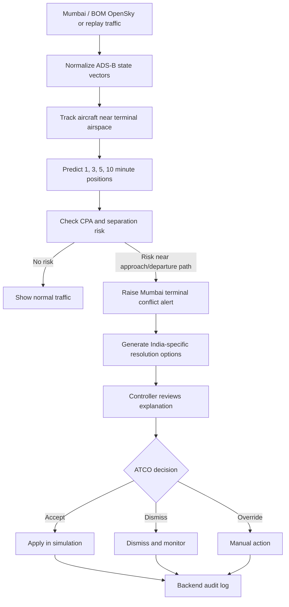
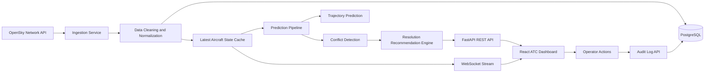
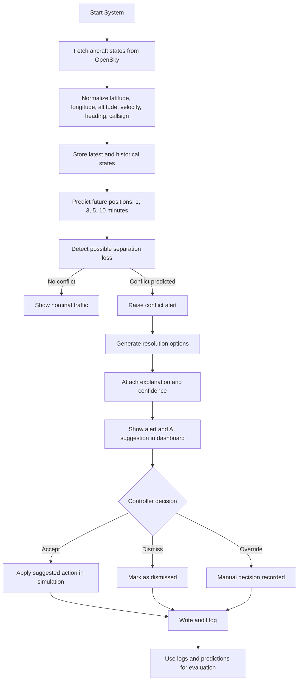
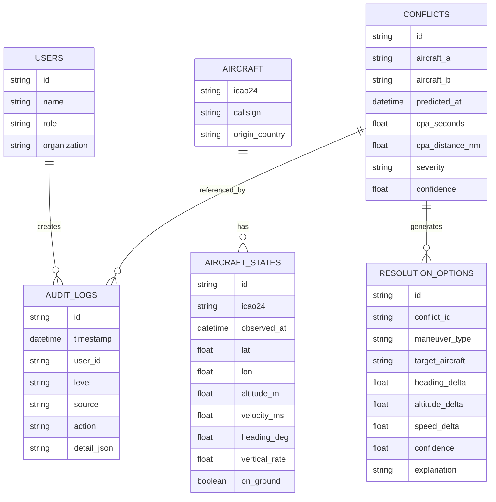
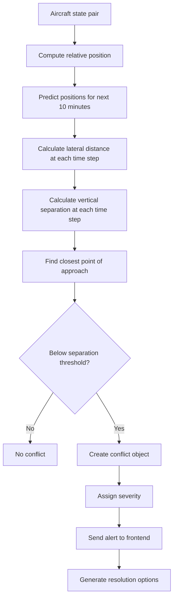
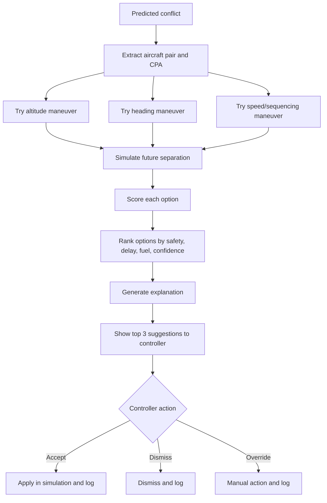
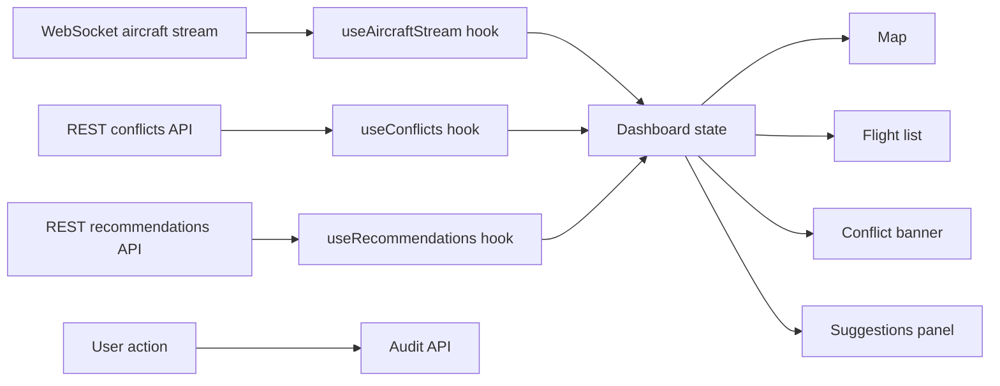
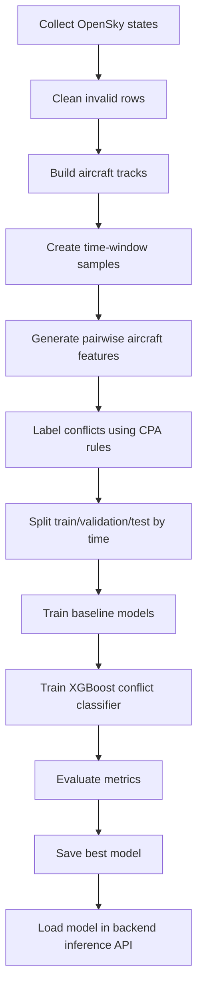
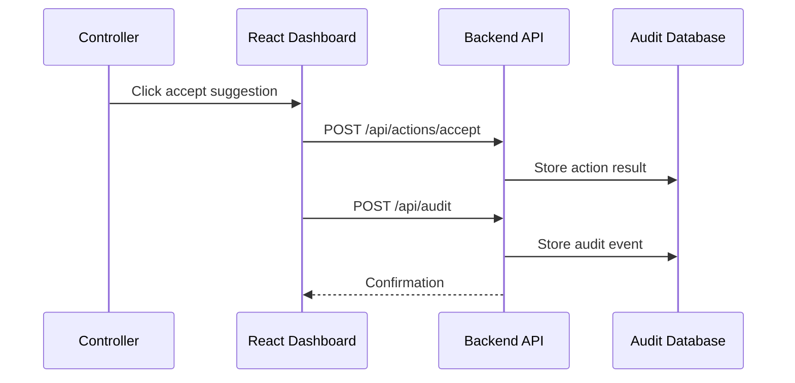
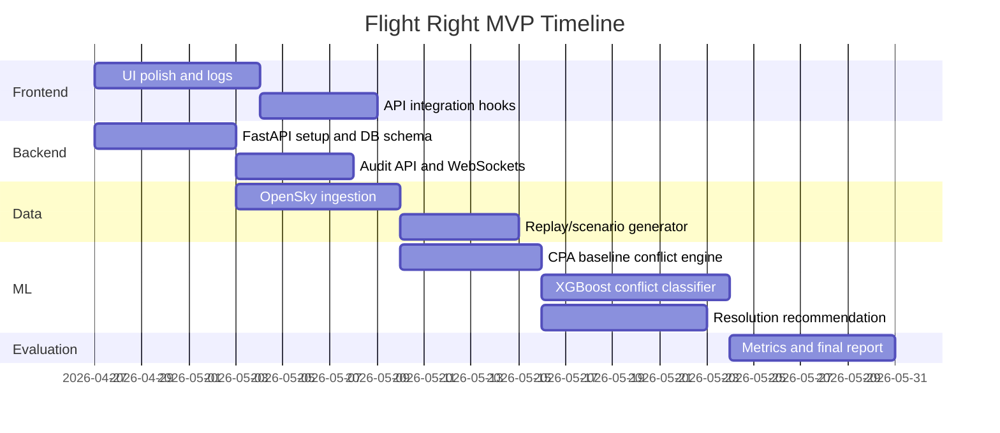

# Flight Right

AI-assisted air traffic monitoring, conflict prediction, and controller decision-support dashboard for the Indian ATC context.

> Current project status: the frontend dashboard works with mock scenario data. This README explains how to convert it into a real MVP using OpenSky data, a backend API, and practical ML models suitable for a final-year engineering project evaluation.

---

## 1. Project Summary

Flight Right is a prototype AI assistant for air traffic controllers. It is not meant to replace ATCOs. It is designed to support them by monitoring live aircraft data, predicting possible conflicts, recommending safe resolution options, and maintaining an audit trail of user actions.

The current UI already demonstrates:

- Live-style traffic dashboard
- Aircraft list and detail drawer
- Map/radar visualization
- Conflict alert banner
- AI suggestion cards
- Runway utilization panel
- NLP/datalink transcript mock
- Timeline and audit trail
- Session logs page

The next step is to connect the dashboard to a real backend and ML pipeline.

---

## 2. Problem Statement

Indian airspace is becoming denser and more complex. Controllers need to monitor many flights, runway queues, weather changes, conflict alerts, and communication threads at once. Current systems such as ADS-B, MSSR, FDPS, OLDI, and VCCS provide important data, but they do not usually provide integrated AI-driven prediction, prioritization, explanation, and workflow automation in one interface.

This project focuses on a realistic MVP:

> Build an AI-assisted ATC decision-support dashboard that consumes aircraft surveillance data, predicts near-term conflicts, recommends explainable resolution actions, and records every operator action in an audit log.

---

## 3. Why This Project Matters

Key ATC challenges this project addresses:

- High controller workload during peak traffic
- Manual monitoring of multiple aircraft and possible conflicts
- Lack of integrated conflict prediction and resolution recommendation
- Emergency handling where the controller must focus on one critical aircraft while the system manages non-critical workload
- India-specific complexity: mixed surveillance, civil/military corridors, weather, dense metro traffic, and diverse phraseology/accent patterns

This is especially relevant for airports and airspace around DEL, BOM, MAA, BLR, HYD, and other high-density Indian regions.

---

## 4. Current State vs Target MVP

| Area | Current Project | Target Real MVP |
|---|---|---|
| Data | Mock aircraft data in frontend | Live or near-live OpenSky ADS-B data |
| Backend | Placeholder Express server | Real API service with ingestion, storage, prediction, and audit endpoints |
| ML | Mock AI suggestions | Conflict prediction model + trajectory baseline + rule/ML resolution ranking |
| Frontend | React dashboard | Same UI connected to real API/WebSocket streams |
| Logging | Browser session logs | Backend audit logs with user/session/action metadata |
| Evaluation | Visual demo | Quantitative metrics: detection rate, false alarm rate, warning time, prediction error |

---

## 5. Research Papers Considered

The project is grounded in the following research areas:

| Paper / Source | What We Learn | How We Apply It |
|---|---|---|
| Insights into Conflict Detection and Resolution Integration in AI-Enhanced ATC Systems (AWARE / ASA) | CD&R should be integrated into controller workflows, not isolated as a black-box model. Explainability and controller authority are important. | We design a dashboard where alerts, suggestions, explanations, and audit logs live in one workflow. |
| A Machine Learning Framework for Predicting ATC Conflict Resolution Strategies (Guleria et al.) | Conflict resolution can be treated as a multi-output prediction problem: aircraft, maneuver type, timing, and magnitude. | Our MVP can start with rule-based recommendations and later train a classifier/ranker for maneuver type and magnitude. |
| Machine Learning Experiments for Design Purposes in Air-Traffic Conflict-Detection Tool (XGBoost on ADS-B) | XGBoost and engineered ADS-B features can work well for conflict detection and are easier to explain than deep learning. | We use XGBoost/LightGBM as the main practical conflict detection model for MVP. |
| Four-Dimensional Aircraft Trajectory Prediction Based on Generative Deep Learning (CTGAN / C-CTGAN) | Generative models can predict trajectory distributions, but they are advanced and data-hungry. | CTGAN/C-CTGAN is kept as a stretch goal. MVP uses constant-velocity and LSTM/GRU baselines first. |
| M2ATS Dataset | Multimodal ATC situation understanding can combine speech, text, and trajectory information. | We keep NLP/datalink as a future layer; MVP can simulate transcript intent extraction. |
| AI4ATM Survey | AI in ATM must be human-in-the-loop, explainable, and safety-aware. | We keep ATCO final authority, show confidence/explanation, and log all operator actions. |

Reference links:

1. https://www.mdpi.com/2226-4310/13/3/213
2. https://www.sesarju.eu/sites/default/files/documents/sid/2021/papers/SIDs_2021_paper_85.pdf
3. https://www.sciencedirect.com/science/article/pii/S2352146523012176
4. https://arc.aiaa.org/doi/10.2514/1.I011333
5. https://dl.acm.org/doi/10.1145/3581783.3613759
6. https://link.springer.com/article/10.1007/s44196-024-00671-w

---

## 5A. India and Mumbai Airport Specific Adaptation

Most research papers in this area are based on European, US, or generalized ATM assumptions. Those papers are valuable, but directly copying them is not enough for an Indian ATC-focused final-year project. Flight Right adapts the research direction to Indian operational constraints, especially a Mumbai/BOM-style terminal area demo.

### Why Mumbai Airport Is a Strong MVP Case

Mumbai is a good focus region because it is one of India's busiest and most constrained airport environments. For an MVP, it gives a realistic story:

- High arrival and departure density around a metro airport
- Complex sequencing pressure during peak hours
- Strong weather impact during monsoon and low-visibility periods
- Dense traffic mix: domestic, international, cargo, business aviation, and regional flights
- Route compression near terminal airspace
- Holding, approach, and runway sequencing decisions are operationally important
- Controller workload can increase quickly during conflict, weather, runway change, or emergency scenarios

For evaluation, this lets us say:

> We are not only building a generic aircraft map. We are designing a Mumbai-focused ATC decision-support MVP where the system helps with monitoring, conflict prediction, sequencing, emergency workload handling, and auditability.

### How Flight Right Helps a Mumbai/BOM ATC Scenario

| Mumbai/BOM Challenge | How Flight Right Helps |
|---|---|
| Heavy approach/departure workload | Prioritizes aircraft, highlights conflicts, and reduces scanning load |
| Dense terminal airspace | Predicts future positions and warns before separation becomes critical |
| Monsoon/weather disruptions | Can flag weather cells and suggest deviation/sequence adjustments in future versions |
| Runway utilization pressure | Shows runway sequencing and can recommend workload-balancing actions |
| Emergency aircraft handling | Lets controller focus on emergency aircraft while system tracks non-critical traffic |
| Mixed route structures | Allows India-specific scenario rules instead of assuming only European/US route design |
| Need for accountability | Logs every AI suggestion, controller action, accept/dismiss/override, and conflict event |

### Example Mumbai MVP Scenario

Demo scenario:

1. Live or replayed OpenSky data is shown around Mumbai region.
2. Two aircraft converge near an approach/arrival path.
3. The backend predicts a closest point of approach within the next 5-10 minutes.
4. The dashboard raises a loss-of-separation alert.
5. The system recommends options:
   - altitude change
   - heading change
   - speed/sequencing change
6. The controller accepts, dismisses, or overrides.
7. The action is stored in audit logs.
8. Evaluation metrics show warning time, predicted CPA, false alarm behavior, and whether the recommendation resolved the conflict in simulation.



### How This Is Modified Beyond the Research Papers

The research papers give important model and system ideas, but Flight Right modifies them into an end-to-end Indian ATC MVP.

| Research Direction | Typical Paper Focus | Flight Right Modification |
|---|---|---|
| AWARE / CD&R integration | Conceptual integration of conflict detection and resolution into AI-enhanced ATC | We turn the concept into a working dashboard with alert banner, suggestions, modal workflow, and logs |
| Guleria et al. resolution strategy prediction | Predicting conflict resolution strategy from ATC patterns | We start with explainable rule-based options, then add ML ranking as future work because final authority must stay with ATCO |
| XGBoost conflict detection | Conflict detection using ADS-B features, often in controlled datasets | We adapt the feature engineering to OpenSky + Mumbai/replay/synthetic traffic and evaluate warning time + false alerts |
| CTGAN / C-CTGAN trajectory prediction | Advanced probabilistic trajectory generation | We keep it as Phase 4/5 because MVP needs reliable baselines first: constant velocity, CPA, then LSTM/GRU |
| M2ATS multimodal benchmark | Multimodal ATC situation understanding | We include an NLP/datalink panel roadmap but keep MVP focused on surveillance + conflict workflow |
| AI4ATM survey | Broad AI-in-ATM review | We implement the survey principles: human-in-the-loop, explainability, auditability, and non-autonomous decision support |

Important defense point:

> We are not claiming our model is scientifically better than these papers. We are saying our project is more MVP-oriented and India-adapted: it combines live/replay data, dashboard UI, backend architecture, conflict prediction, recommendation workflow, and audit logs into one practical system for a Mumbai-style ATC scenario.

### Why European/US Assumptions Do Not Fully Transfer to Mumbai

Many international ATM papers assume mature datasets, stable sector structures, or European/US operational contexts. Indian metro airspace can differ in:

- traffic growth rate
- route density around metro airports
- monsoon disruption patterns
- mixed surveillance availability
- civil/military/restricted airspace interaction
- airport capacity pressure
- English phraseology/accent variation for future NLP
- limited public availability of Indian ATC datasets

So the project must use a hybrid method:

```text
OpenSky live/replay data
+ Mumbai-focused scenario generator
+ simplified Indian terminal-area rules
+ explainable conflict detection
+ human-in-the-loop resolution workflow
+ audit trail
```

This makes the project realistic for a final-year MVP without pretending to be a certified ATC product.

### What To Say In Evaluation

Short answer:

> The papers mostly give individual research components: conflict detection, resolution prediction, trajectory generation, multimodal datasets, and AI4ATM principles. Our modification is to adapt these ideas into an India/Mumbai-focused MVP. We use OpenSky and replay scenarios for Mumbai-style traffic, start with explainable CPA and XGBoost baselines, keep ATCO authority, and integrate the model into a full dashboard with audit logs. So the contribution is practical integration and Indian operational adaptation, not claiming a certified production system.

---

## 6. MVP Goal

The final-year MVP should be realistic, demonstrable, and defensible in evaluation.

### Core MVP

1. Fetch aircraft data from OpenSky Network.
2. Normalize aircraft state vectors into a backend database.
3. Show live aircraft on the dashboard map.
4. Predict short-term aircraft positions using a baseline trajectory model.
5. Detect possible conflicts using separation rules and/or an ML classifier.
6. Generate explainable resolution suggestions.
7. Allow controller actions: accept, dismiss, override, inspect aircraft.
8. Store audit logs for all important user/system events.
9. Export logs and prediction results for evaluation.

### Stretch Goals

1. Train LSTM/GRU trajectory prediction.
2. Train XGBoost/LightGBM conflict classifier.
3. Add weather-aware features.
4. Add NLP intent extraction from ATC transcript text.
5. Add emergency handling mode for squawk 7700 / Mayday simulation.
6. Add multi-airport or multi-sector support.

---

## 7. Recommended Tech Stack

### Frontend

Current frontend stack:

- React 19
- Vite
- Tailwind CSS
- Framer Motion
- Leaflet / React Leaflet
- Lucide icons
- React Router

Keep this frontend. It already fits the dashboard use case.

### Backend

Recommended backend for ML-heavy MVP:

- Python FastAPI for API and ML integration
- WebSocket endpoint for live aircraft updates
- PostgreSQL for aircraft history, users, logs, predictions
- Redis optional for caching latest state
- Celery / APScheduler optional for scheduled ingestion jobs

Alternative:

- Keep Express for simple API routing, but call a Python ML microservice.

Best final-year approach:

> Use FastAPI as the main backend because it is easier to connect Python ML models, OpenSky ingestion, and WebSocket streaming in one service.

### ML / Data Science

Recommended libraries:

- pandas
- numpy
- scikit-learn
- xgboost or lightgbm
- geopy or custom haversine functions
- pyproj optional for coordinate transforms
- PyTorch optional for LSTM/GRU stretch goal
- joblib for saving classical ML models
- MLflow optional for experiment tracking

### Data Source

Primary source:

- OpenSky Network REST API
- OpenSky historical data if accessible

Optional sources:

- OurAirports for airport metadata
- Open-Meteo for weather features
- Simulated scenario generator for dense traffic / emergency cases

---

## 8. System Architecture



---

## 9. End-to-End Workflow



---

## 10. Data Pipeline With OpenSky

OpenSky gives aircraft state vectors such as:

- ICAO24 address
- Callsign
- Origin country
- Timestamp
- Longitude
- Latitude
- Barometric altitude
- Geometric altitude
- Velocity
- True track / heading
- Vertical rate
- On-ground flag

### Ingestion Steps

1. Call OpenSky API every 5-15 seconds.
2. Filter by geographic bounding box.
3. Keep only valid aircraft with latitude, longitude, altitude, velocity, and heading.
4. Convert units if required.
5. Store latest state in cache.
6. Store historical state in database for training/evaluation.
7. Send latest state to frontend through WebSocket.

### Suggested Indian Bounding Boxes

For MVP, use a region around Mumbai or Delhi instead of all India.

Example Mumbai FIR demo box:

```text
lat_min = 16.0
lat_max = 23.5
lon_min = 68.0
lon_max = 77.5
```

Example Delhi demo box:

```text
lat_min = 25.0
lat_max = 31.5
lon_min = 74.0
lon_max = 80.5
```

### OpenSky Limitations

OpenSky is useful for a final-year MVP, but evaluators may ask about limitations:

- It may have missing aircraft.
- It may have latency.
- It does not provide ATC intent, clearances, or flight plans.
- It may not include all military/restricted traffic.
- Free API access may have rate limits.
- Live data is not enough to train a robust model quickly; you may need historical collection and simulation.

Answer:

> We use OpenSky for surveillance-like ADS-B data in MVP. For production ATC, certified surveillance feeds, flight plans, weather, NOTAMs, and sector constraints would be required.

---

## 11. Backend API Design

Suggested API endpoints:

| Method | Endpoint | Purpose |
|---|---|---|
| GET | `/api/aircraft/latest` | Latest normalized aircraft states |
| GET | `/api/aircraft/history?icao24=...` | Aircraft history for charts/training |
| GET | `/api/conflicts/active` | Active predicted conflicts |
| POST | `/api/predict/conflicts` | Run conflict prediction on latest states |
| POST | `/api/recommend/resolution` | Generate resolution options for a conflict |
| POST | `/api/actions/accept` | Accept an AI suggestion |
| POST | `/api/actions/dismiss` | Dismiss an AI suggestion |
| POST | `/api/audit` | Store operator/system audit event |
| GET | `/api/audit` | Query audit logs |
| WS | `/ws/aircraft` | Stream aircraft state updates |
| WS | `/ws/alerts` | Stream conflict alerts |

---

## 12. Suggested Database Schema



---

## 13. ML Plan

The ML plan should be practical. Do not start with the hardest model. Start with baselines, then improve.

### Model 1: Trajectory Prediction

Goal:

Predict where each aircraft will be after 1, 3, 5, and 10 minutes.

#### MVP Baseline: Constant Velocity Model

Use current position, speed, heading, and vertical rate to extrapolate future position.

Why:

- Easy to implement
- Easy to explain
- Works as a strong baseline
- Required before training deep learning models

Features:

- latitude
- longitude
- altitude
- speed
- heading
- vertical rate
- time delta

Outputs:

- future latitude
- future longitude
- future altitude

Evaluation:

- Mean Absolute Error
- Root Mean Squared Error
- Cross-track error in nautical miles
- Along-track error
- Altitude error

#### Improved Model: LSTM / GRU

Use sequence data from aircraft history.

Input:

- last N states of aircraft
- time gap
- speed
- heading
- vertical rate

Output:

- future trajectory points

Why LSTM/GRU:

- Good for time-series sequence prediction
- Easier than CTGAN
- Suitable for final-year scope

#### Stretch Model: CTGAN / C-CTGAN

Use generative deep learning to model trajectory uncertainty.

Why not MVP:

- Needs more data
- Harder to train and explain
- More difficult to evaluate

Use it as a future enhancement inspired by the 4D trajectory prediction paper.

---

### Model 2: Conflict Detection

Goal:

Predict whether two aircraft may violate separation minima.

Standard separation idea:

- Lateral separation: usually 5 NM in many en-route contexts
- Vertical separation: often 1000 ft below FL290, higher rules depend on airspace/RVSM

For MVP:

> A conflict exists if predicted closest point of approach is below lateral/vertical thresholds within the next 5-10 minutes.

#### Baseline: Rule-Based CPA Calculation

Calculate closest point of approach using predicted trajectories.

Inputs:

- aircraft A future positions
- aircraft B future positions
- lateral distance over time
- vertical distance over time

Outputs:

- conflict true/false
- time to CPA
- minimum lateral distance
- minimum vertical distance
- severity

Why:

- Deterministic
- Explainable
- Good for safety-critical demonstrations

#### ML Model: XGBoost / LightGBM Conflict Classifier

Train a binary classifier:

```text
0 = no conflict
1 = potential conflict
```

Features:

- relative distance
- relative altitude
- relative speed
- relative heading
- closing speed
- time to CPA
- predicted minimum separation
- vertical convergence rate
- route/sector if available
- weather flag if added

Labels:

- Generated from historical/simulated data using separation rules
- Or manually labeled scenarios for demo

Why XGBoost/LightGBM:

- Strong on tabular engineered features
- Works with smaller datasets
- Faster to train
- Easier to explain using feature importance / SHAP
- Matches research direction from the XGBoost ADS-B conflict detection paper

Evaluation:

- Recall: very important, because missed conflicts are dangerous
- Precision: important to reduce false alarms
- False Alarm Rate
- Warning time before CPA
- F1 score
- ROC-AUC / PR-AUC

For ATC, recall is more important than raw accuracy.

---

### Model 3: Resolution Recommendation

Goal:

When a conflict is predicted, recommend safe maneuver options.

#### MVP: Rule-Based Resolution Engine

Generate 3 options:

1. Altitude change
2. Heading change
3. Speed change / sequencing

Each option should include:

- target aircraft
- maneuver type
- magnitude
- expected separation after maneuver
- estimated delay/fuel impact
- confidence
- explanation

Example:

```text
Option 1: Descend AI6302 to FL260.
Reason: Increases vertical separation to 1000+ ft and avoids lateral CPA below threshold.
Confidence: 0.91
Tradeoff: +2 min delay
```

Why rule-based for MVP:

- Easier to defend
- Safer than unsupported black-box recommendations
- Evaluators can inspect the logic

#### Improved Model: ML Ranking Model

Train a classifier/ranker that predicts which maneuver is likely to be selected.

Labels:

- simulated controller decisions
- rule-generated best options
- manually annotated scenarios

Possible model:

- XGBoost multi-class classifier
- Random Forest
- LightGBM ranker

Outputs:

- maneuver type: altitude / heading / speed / hold
- target aircraft
- magnitude bucket
- confidence

Research link:

This maps to Guleria et al., where resolution is treated as a multi-output decision problem.

---

### Model 4: NLP / ATC Intent Extraction

This should be stretch, not core MVP.

Goal:

Convert ATC transcript text into structured intent:

```text
"AI6302 descend flight level 260"
```

Output:

```json
{
  "callsign": "AI6302",
  "intent": "altitude_change",
  "target_altitude": "FL260"
}
```

MVP approach:

- Use rule-based phrase matching
- Use regex for callsign, altitude, heading, speed

Future approach:

- Fine-tune small transformer model
- Use M2ATS-style multimodal dataset direction

---

## 14. Conflict Detection Logic



Severity example:

| Severity | Condition |
|---|---|
| Critical | CPA less than 3 NM or vertical separation less than 700 ft within 3 min |
| High | CPA less than 5 NM within 5 min |
| Medium | CPA less than threshold within 10 min |
| Low | Potential convergence but not immediate |

---

## 15. Resolution Engine Flow



Scoring formula for MVP:

```text
score = safety_score * 0.60
      + delay_score * 0.15
      + fuel_score * 0.10
      + controller_workload_score * 0.10
      + confidence_score * 0.05
```

---

## 16. Frontend Plan

The current frontend is already a good base. The main work is replacing mock state with API/WebSocket state.

### Existing UI Components

| Component | Role |
|---|---|
| `FlightListPanel` | Aircraft list, filters, selected flight |
| `FlightDetailDrawer` | Aircraft detail and quick actions |
| `FlightRadarMap` | Leaflet map with aircraft markers |
| `RadarCanvas` | Radar-style visualization |
| `ConflictBanner` | Loss-of-separation alert |
| `ResolveModal` | Conflict resolution options |
| `AISuggestionsPanel` | AI recommendations queue |
| `RunwayStatusPanel` | Runway sequencing mock |
| `NLPCommsPanel` | ATC transcript / datalink mock |
| `TimelinePanel` | Schedule / sequencing timeline |
| `AIAuditTrail` | AI decision history |
| `LogsPage` | Session logs and audit viewer |

### Frontend Improvements Needed

1. Replace `mockData.js` aircraft list with API data.
2. Add `useAircraftStream()` hook for WebSocket updates.
3. Add `useConflicts()` hook for active alerts.
4. Add `useAuditLogger()` hook that sends audit logs to backend.
5. Add loading and offline states.
6. Add role/user display in top bar.
7. Add "simulation mode" vs "live data mode" indicator.
8. Add downloadable evaluation report page.

### Frontend Data Flow



---

## 17. Backend Implementation Plan

Recommended backend folder:

```text
server/
  app/
    main.py
    config.py
    api/
      aircraft.py
      conflicts.py
      recommendations.py
      audit.py
      websocket.py
    services/
      opensky_client.py
      ingestion_service.py
      trajectory_service.py
      conflict_service.py
      resolution_service.py
      audit_service.py
    models/
      schemas.py
      db_models.py
    ml/
      train_conflict_model.py
      train_trajectory_model.py
      inference.py
      saved_models/
    db/
      database.py
      migrations/
  requirements.txt
```

If keeping Node/Express:

```text
server/
  server.js
  routes/
  services/
  python-ml-service/
```

But for this project, Python FastAPI is the cleaner option.

---

## 18. Training Data Strategy

OpenSky live data alone may not immediately contain enough close conflicts, because real conflicts are rare. Use three sources:

### 1. Real OpenSky Data

Collect normal aircraft movement around selected region.

Use for:

- trajectory prediction
- traffic visualization
- normal behavior baseline

### 2. Synthetic Conflict Scenarios

Generate artificial pairwise conflict scenarios.

Use for:

- conflict classifier training
- resolution engine testing
- UI demo

Example synthetic scenario generation:

- choose two aircraft near same region
- assign headings that converge
- vary altitude difference
- vary speed and time to CPA
- label as conflict/non-conflict using separation rules

### 3. Manual Demo Scenarios

Curated scenarios for final presentation:

- head-on conflict
- converging arrival traffic
- runway congestion
- emergency squawk 7700
- weather deviation

This lets the demo work even if live OpenSky has no interesting event during evaluation.

---

## 19. Model Training Pipeline



Important rule:

> Split data by time, not random rows, to avoid data leakage between adjacent aircraft states.

---

## 20. Evaluation Metrics

### Trajectory Prediction

| Metric | Meaning |
|---|---|
| MAE | Average prediction error |
| RMSE | Penalizes large prediction errors |
| Cross-track error | Lateral route deviation |
| Along-track error | Forward/backward timing error |
| Altitude error | Flight level prediction error |

### Conflict Detection

| Metric | Meaning |
|---|---|
| Recall | How many real conflicts were detected |
| Precision | How many alerts were actually useful |
| False Alarm Rate | Important for alert fatigue |
| Warning Time | How early the system warned the controller |
| F1 Score | Balance of precision and recall |
| PR-AUC | Useful when conflicts are rare |

### Resolution Recommendation

| Metric | Meaning |
|---|---|
| Separation maintained | Did the suggestion solve the conflict? |
| Delay impact | Extra minutes caused by maneuver |
| Fuel proxy | Extra distance or speed change |
| Controller acceptance | Was the suggestion accepted in demo/simulation? |
| Explanation quality | Can the reason be understood? |

---

## 21. Audit and Safety Plan

Because this is high-risk software, every important action must be logged.

Audit events should include:

- timestamp
- user/controller id
- session id
- source component
- action name
- aircraft callsign if applicable
- conflict id if applicable
- before/after state
- accepted/dismissed/overridden decision
- model version
- confidence score

Current frontend already logs many actions in the `/logs` page. Real MVP should send audit logs to backend:



Important note:

> Browser-only logs are useful for demo, but real safety-critical audit logs must be server-side, append-only, authenticated, and tamper-evident.

---

## 22. Security and Reliability

For final-year MVP:

- use login or a fixed demo controller profile
- validate all backend inputs
- never trust frontend-only decisions
- store all actions server-side
- keep model version in each prediction
- show confidence and explanation
- keep manual override always available
- add fallback if OpenSky is down: replay stored scenario

For production:

- certified data sources
- strict authentication and role-based access control
- tamper-evident logs
- model assurance and monitoring
- fail-safe behavior
- regulatory compliance
- human-in-the-loop approval

---

## 23. Demo Modes

Use three modes for evaluation:

### Mode 1: Live OpenSky Mode

Shows real aircraft around selected Indian region.

Best for:

- proving real data integration
- map visualization
- aircraft tracking

Risk:

- may not show conflicts during demo

### Mode 2: Recorded Replay Mode

Replays previously collected OpenSky data.

Best for:

- stable evaluation demo
- repeatable testing

### Mode 3: Scenario Simulation Mode

Injects controlled conflict/emergency/weather scenarios.

Best for:

- showing AI conflict prediction
- showing resolution modal
- showing audit logs

Recommended:

> Use all three. Start with live data, then switch to replay/scenario mode to demonstrate conflict prediction and resolution.

---

## 24. Implementation Roadmap

### Phase 1: Frontend Stabilization

- Polish UI layout and responsiveness
- Keep mock scenarios working
- Ensure `/logs` shows all user actions
- Add live/simulation mode indicator
- Add aircraft detail drawer

Deliverable:

- polished dashboard demo

### Phase 2: Backend Foundation

- Replace placeholder server with FastAPI
- Add `/api/aircraft/latest`
- Add `/api/audit`
- Add WebSocket stream
- Add PostgreSQL schema

Deliverable:

- frontend reads aircraft from backend

### Phase 3: OpenSky Integration

- Build OpenSky ingestion service
- Store latest aircraft states
- Filter for Mumbai/Delhi region
- Stream aircraft to UI
- Add replay fallback

Deliverable:

- live aircraft map

### Phase 4: Conflict Detection

- Implement CPA rule-based conflict detection
- Generate active conflicts API
- Show conflict banner from backend
- Store conflict events

Deliverable:

- real/simulated conflict alerts

### Phase 5: ML Conflict Classifier

- Build pairwise features
- Generate labels from CPA rules
- Train XGBoost/LightGBM
- Compare against rule baseline
- Add model inference endpoint

Deliverable:

- ML conflict prediction results and metrics

### Phase 6: Resolution Recommendation

- Implement rule-based resolution options
- Simulate each option
- Rank by safety/delay/fuel/confidence
- Show explanations in UI

Deliverable:

- explainable AI resolution options

### Phase 7: Evaluation and Report

- Run recorded test scenarios
- Export predictions and logs
- Calculate metrics
- Prepare project evaluation slides

Deliverable:

- final report, dashboard demo, and metrics table

---

## 25. MVP Timeline



---

## 26. What We Can Honestly Claim

Good final-year project claim:

> We built an AI-assisted ATC decision-support MVP that integrates aircraft surveillance data, short-term trajectory prediction, conflict detection, explainable resolution recommendation, and controller audit logging in a real-time dashboard.

Do not claim:

- certified ATC system
- production-ready safety-critical automation
- replacement for ATCOs
- guaranteed conflict resolution in real airspace

Correct wording:

- prototype
- decision-support
- human-in-the-loop
- simulation-backed
- OpenSky-based live demo
- research-informed architecture

---

## 27. Expected Evaluation Questions and Answers

### Q1. Why did you use OpenSky?

OpenSky provides accessible ADS-B style aircraft state data suitable for academic prototypes. It gives latitude, longitude, altitude, speed, heading, and callsign-like information, which is enough to demonstrate live ingestion, visualization, trajectory prediction, and basic conflict detection.

Important limitation:

> OpenSky is not a certified ATC feed. For production, the system would require certified surveillance feeds, flight plans, weather, NOTAMs, sector constraints, and regulatory validation.

### Q2. Why not directly use CTGAN?

CTGAN/C-CTGAN is advanced, data-hungry, and harder to explain. For an MVP, we first need a reliable baseline. So we start with:

1. Constant-velocity trajectory prediction
2. CPA-based conflict detection
3. XGBoost/LightGBM classifier for tabular conflict features
4. LSTM/GRU as an optional trajectory upgrade

CTGAN is a research-backed future enhancement for probabilistic trajectory prediction, not the first MVP model.

### Q3. Which ML model is best for conflict detection?

For final-year MVP, XGBoost or LightGBM is the best practical choice because conflict detection features are mostly tabular:

- relative distance
- relative altitude
- relative speed
- heading difference
- closing speed
- time to CPA
- predicted minimum separation
- vertical convergence rate

These models train quickly, perform well on structured features, need less data than deep learning, and provide feature importance for explainability.

### Q4. How do you handle rare conflict data?

Real conflicts are rare because air traffic systems are designed to avoid them. Waiting for real unsafe events is not practical or ethical.

We handle this using three data sources:

- OpenSky normal traffic for realistic aircraft movement
- rule-based CPA labeling to identify potential conflicts
- synthetic conflict scenario generation for controlled training and demo cases

This gives us enough data to test detection logic while staying safe.

### Q5. How do you ensure safety?

The MVP is human-in-the-loop. It does not directly control aircraft. It only:

- monitors traffic
- predicts possible conflicts
- recommends options
- explains why the option was suggested
- logs every controller/system action

The ATCO/controller keeps final authority and can accept, dismiss, or override every recommendation.

### Q6. What is the role of explainability?

Explainability is essential because controllers cannot trust a black-box suggestion in a high-risk environment.

Each recommendation should show:

- aircraft involved
- predicted CPA time and distance
- separation threshold being violated
- proposed maneuver
- expected improvement after maneuver
- confidence score
- reason in controller-friendly language

This follows the AWARE/AI4ATM direction: AI should support controller cognition, not hide decisions.

### Q7. How is this India-specific?

The project is India-specific because the problem framing and demo scenarios focus on Indian metro airport constraints, especially a Mumbai/BOM-style terminal airspace demo.

For Mumbai specifically, the system is useful because it can support:

- dense arrival/departure traffic around a high-pressure metro airport
- runway and sequencing workload during peak periods
- monsoon/weather disruption scenarios
- aircraft prioritization during emergency or conflict events
- controller workload reduction through alert prioritization
- audit logging of every AI suggestion and controller response
- future Indian English ATC phraseology handling for NLP

The MVP may use OpenSky data, but the workflow is designed around Indian ATC needs: high-density metro traffic, rapid growth, mixed airspace constraints, and human-in-the-loop decision support.

### Q7A. How is your work different from research papers based on other countries?

Most papers focus on one research component: conflict detection, trajectory prediction, resolution strategy prediction, multimodal datasets, or general AI4ATM principles. Our project converts those ideas into a practical India/Mumbai-focused MVP.

The difference is:

- We combine frontend dashboard, backend ingestion, prediction, recommendation, and audit logs in one workflow.
- We adapt the demo to Mumbai-style dense terminal traffic instead of assuming only European/US airspace patterns.
- We keep the first model stack practical: CPA baseline + XGBoost/LightGBM + rule-based resolution.
- We treat CTGAN/C-CTGAN as future research, not the first MVP dependency.
- We include replay/simulation mode because public Indian ATC datasets and real conflict labels are limited.
- We keep ATCO final authority and log every action.

So we are not claiming to outperform those papers scientifically. We are adapting their ideas into a buildable, demonstrable Indian ATC decision-support MVP.

### Q7B. Why choose Mumbai/BOM as the main demonstration region?

Mumbai is a strong MVP case because it is operationally easy to explain:

- busy Indian metro airport
- dense arrival/departure flows
- limited runway/terminal capacity pressure
- weather and monsoon impact
- strong need for sequencing and conflict awareness
- good evaluation story for controller workload reduction

Even if exact certified ATC data is unavailable, OpenSky live/replay data plus synthetic Mumbai-style scenarios can show how the system would work in a realistic high-density Indian setting.

### Q8. What if OpenSky is down during demo?

The system should support three modes:

1. Live OpenSky mode
2. Recorded replay mode
3. Scenario simulation mode

So even if OpenSky is unavailable or live traffic has no conflict, we can replay a stored dataset or inject a conflict scenario to demonstrate the complete workflow.

### Q9. Why is audit logging important?

Audit logging is critical in high-risk software because we must know:

- what the system predicted
- what the controller saw
- what action was taken
- who took the action
- when it happened
- whether the AI suggestion was accepted, dismissed, or overridden
- what model version/confidence was involved

This supports traceability, debugging, post-event analysis, and safety assurance.

### Q10. What is the biggest technical risk?

The biggest risks are:

- OpenSky data quality and missing values
- rare conflict labels
- validating recommended maneuvers
- avoiding false confidence in AI output
- demo dependency on live data

We reduce risk by starting with deterministic CPA baselines, using replay/scenario modes, adding ML only where it improves measurable results, and keeping the controller in control.

### Q11. What exactly is the MVP deliverable?

The MVP deliverable is not a certified ATC automation system. It is a working decision-support prototype with:

- real or replayed aircraft ingestion
- live dashboard map
- aircraft detail panel
- conflict prediction
- AI suggestion queue
- explainable resolution options
- accept/dismiss/override workflow
- backend audit logging
- evaluation metrics

This is realistic for a final-year project and still technically meaningful.

### Q12. Why do we need both rule-based logic and ML?

Rule-based logic gives a safe and explainable baseline. ML helps improve prediction and prioritization when patterns become complex.

For example:

- CPA rules can detect whether separation may be violated.
- XGBoost can learn which combinations of relative speed, heading, altitude, and closing geometry are risky.
- Rule-based resolution ensures recommendations stay understandable.

This hybrid approach is better for an MVP than using only a black-box model.

### Q13. Why is accuracy not enough for conflict detection?

Conflicts are rare, so a model can show high accuracy by predicting "no conflict" most of the time. That would be useless and unsafe.

Better metrics are:

- recall, because missed conflicts are dangerous
- precision, because too many false alerts cause alarm fatigue
- false alarm rate
- warning time before CPA
- PR-AUC for imbalanced data

For ATC, recall and warning time matter more than simple accuracy.

### Q14. How will you generate labels for ML training?

For MVP, labels can be generated using CPA-based rules:

```text
conflict = predicted lateral separation < threshold
           AND predicted vertical separation < threshold
           within lookahead window
```

This creates consistent labels from trajectories. Later, real controller decisions or validated ATC datasets could improve label quality.

### Q15. What separation standards are you using?

For MVP, we use simplified configurable thresholds, such as:

- lateral threshold: 5 NM
- vertical threshold: 1000 ft
- lookahead window: 5-10 minutes

These are not claimed as complete regulatory separation rules. They are simplified academic thresholds for demonstrating conflict detection logic.

### Q16. How do you avoid too many false alerts?

We reduce false alerts by:

- requiring both lateral and vertical risk checks
- using a lookahead window
- ranking alerts by severity
- using confidence scores
- suppressing duplicate alerts for the same aircraft pair
- evaluating false alarm rate

The UI should prioritize only the most urgent alerts instead of overwhelming the controller.

### Q17. Why did you choose FastAPI for backend?

FastAPI is suitable because:

- it is Python-based, so ML integration is simple
- it supports REST APIs and WebSockets
- it is fast enough for MVP real-time streaming
- it works well with pandas, scikit-learn, XGBoost, and PyTorch
- API documentation is automatically generated through OpenAPI/Swagger

The current Express server can be replaced or kept as a gateway, but FastAPI is cleaner for ML-heavy development.

### Q18. Why not keep everything in the frontend?

Frontend-only logic is okay for mock demos but not for a real project.

A backend is needed for:

- OpenSky ingestion
- database storage
- model inference
- audit logs
- user/session management
- replay datasets
- consistent prediction results
- future deployment

Also, frontend logs can be modified by users. Real audit logs must be server-side.

### Q19. How does the frontend change from mock to real data?

The UI components can stay mostly the same. We replace static `mockData.js` with:

- REST calls for initial aircraft/conflict data
- WebSocket stream for aircraft updates
- API calls for accept/dismiss/resolve actions
- backend audit logging

This means the frontend is already a useful prototype shell. The next work is connecting it to real services.

### Q20. What happens if the ML model is wrong?

The system should not blindly execute model output. If the model is wrong:

- the controller can reject or override
- the action is logged
- the model confidence and explanation are visible
- rule-based safety checks can block unsafe suggestions
- replay/evaluation data can be used to improve the model

This is why the project is decision-support, not autonomous control.

### Q21. How will you evaluate the resolution recommendation engine?

Resolution recommendations can be evaluated by simulation:

- apply suggested maneuver to predicted trajectory
- recompute separation
- check whether conflict is resolved
- estimate delay/fuel proxy
- compare options by safety and operational cost

Useful metrics:

- percentage of conflicts resolved
- average separation improvement
- average delay penalty
- number of unsafe suggestions blocked
- controller acceptance rate in demo scenarios

### Q22. What is the difference between trajectory prediction and conflict detection?

Trajectory prediction estimates where aircraft will be in the future.

Conflict detection uses those predicted positions to decide whether two aircraft may violate separation minima.

So trajectory prediction answers:

> Where will the aircraft go?

Conflict detection answers:

> Will two aircraft become too close?

### Q23. Why do we need replay/simulation if we have live data?

Live data is unpredictable. During evaluation, there may be no conflict, no emergency, or OpenSky may have missing data.

Replay/simulation gives:

- repeatable demo
- controlled conflict scenarios
- known ground truth
- fair model evaluation
- stable presentation flow

Live mode proves integration. Replay/simulation proves the full AI workflow.

### Q24. What will be stored in the database?

The database should store:

- aircraft states
- predicted trajectories
- conflict events
- resolution options
- user actions
- audit logs
- model versions and confidence scores

This supports analytics, debugging, model evaluation, and final report generation.

### Q25. How is this project different from a normal flight radar dashboard?

A normal flight radar dashboard mainly visualizes aircraft positions.

Flight Right adds:

- conflict prediction
- explainable AI suggestions
- resolution workflow
- controller audit logging
- runway/workload panels
- replay/simulation mode
- evaluation metrics

So it is not only visualization; it is an AI-assisted decision-support system.

### Q26. What are the final-year project boundaries?

In scope:

- OpenSky ingestion
- dashboard visualization
- conflict prediction
- basic trajectory prediction
- rule-based resolution suggestions
- XGBoost/LightGBM classifier
- audit logs
- evaluation report

Out of scope for MVP:

- certified ATC deployment
- real aircraft control
- full regulatory compliance
- guaranteed operational safety
- production-grade NLP/ASR
- CTGAN production model

This boundary keeps the project achievable and honest.

### Q27. How will you explain the project in one minute?

Flight Right is an AI-assisted ATC decision-support dashboard. It takes aircraft surveillance-like data from OpenSky, predicts short-term aircraft movement, detects possible separation conflicts, recommends explainable resolution options, and logs every controller action. The system is human-in-the-loop, so it supports ATCO decisions instead of replacing them. For the MVP, we use OpenSky/replay/simulated data, CPA-based conflict detection, and XGBoost-style ML for risk classification.

### Q28. What is the strongest part of the project?

The strongest part is the complete workflow:

```text
data ingestion -> prediction -> conflict detection -> recommendation -> controller decision -> audit log -> evaluation
```

Many projects only show a model or only show a UI. This project connects the model, backend, dashboard, and human workflow.

### Q29. What is the weakest part or limitation?

The main limitation is that OpenSky is not certified operational ATC data and real conflict labels are rare. The MVP addresses this with replay and synthetic scenarios, but production use would need certified data, regulatory validation, and much deeper safety assurance.

Being clear about this limitation makes the project more credible.

### Q30. What should be completed first if time is limited?

If time is limited, prioritize:

1. FastAPI backend with OpenSky/replay aircraft API
2. WebSocket aircraft stream to existing React dashboard
3. CPA-based conflict detection
4. Rule-based resolution suggestions
5. Backend audit logging
6. Evaluation metrics on replay/synthetic scenarios

XGBoost and LSTM can be added after the deterministic baseline works.

---

## 28. How To Run Current Frontend

```bash
cd client
npm install
npm run dev
```

Build:

```bash
cd client
npm run build
```

Current routes:

```text
/       dashboard
/logs   session logs and audit viewer
```

---

## 29. Suggested Next Development Steps

1. Replace the placeholder Express server with FastAPI.
2. Create PostgreSQL schema for aircraft states, conflicts, recommendations, and audit logs.
3. Add OpenSky ingestion endpoint and scheduled job.
4. Add WebSocket streaming from backend to React.
5. Replace frontend `mockData.js` aircraft state with backend aircraft stream.
6. Implement CPA-based conflict detection.
7. Implement rule-based resolution recommendations.
8. Train XGBoost conflict classifier on synthetic + collected data.
9. Add backend audit logging and connect current frontend logs to `/api/audit`.
10. Prepare replay scenarios for evaluation.

---

## 30. Final MVP Definition

The project is successful if we can demonstrate:

- real aircraft data ingestion from OpenSky
- live aircraft display on the dashboard
- conflict prediction on live/replayed/simulated traffic
- explainable resolution suggestions
- controller accept/dismiss/override workflow
- audit logs for all critical actions
- quantitative model evaluation
- clear explanation of research grounding and limitations

This makes Flight Right a realistic final-year AI + aviation + full-stack engineering project, while staying honest about safety and production limitations.