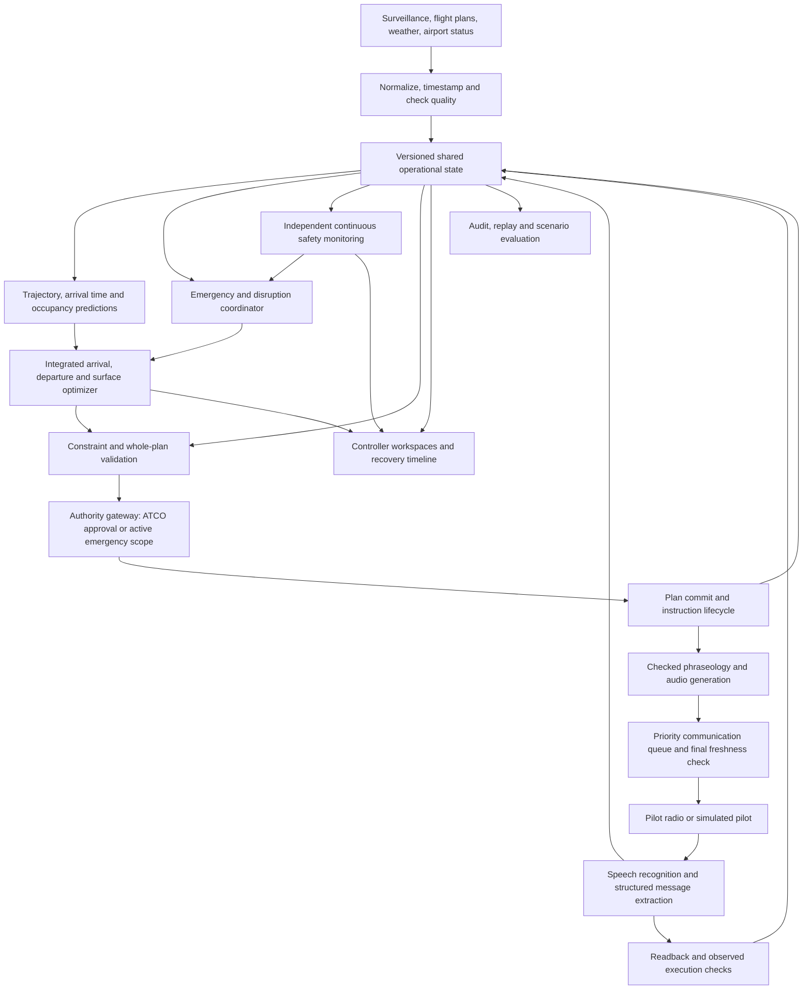

# Flight Right controller assistant: responsibilities, emergency automation and interface research

Research date: 12 November 2026. Status: responsibilities researched; emergency recovery, integrated scheduling, architecture, voice and interface proposals added. Proposals are not implemented or operationally validated.

**Current product direction:** an ATCO assistant, not a controller replacement. Normal operation requires explicit ATCO authorization before anything is conveyed to aircraft. During qualifying emergencies, the intended system manages traffic and communications automatically within its established operating scope, while the ATCO can immediately take over or amend its actions. Sections 20–25 specify this latest clarification and the requested strip/map interactions; they supersede earlier replacement-oriented framing.

## 1. Purpose and scope

This is the persistent research reference for exploring what Flight Right would need to automate controller work. The intended sequence is: understand responsibilities; identify required capabilities and data; design how components and ML fit together; then change backend, UI and UX. This document covers responsibility discovery and a proposed design direction. Implementation remains a later step.

The initial research explored complete automation to discover the full responsibility set. The current goal retains the ATCO and uses that inventory to design assistance and emergency automation. Pilots, aircraft flight controls, airline dispatch, firefighting and neighbouring units remain external actors unless the scope is explicitly expanded. Emergency automation is a proposed capability, not an existing operational mode.

This is a functional research inventory, not an operational procedure or evidence that autonomous ATC is approved or achievable with the present models. Requirements depend on jurisdiction, airspace class, service offered, aircraft capabilities and local agreements. No universal separation numbers or executable clearance rules are prescribed here.

## 2. Confirming the people and roles

The initial intuition is partly correct: **Clearance Delivery, Ground and Tower** are common tower positions. But **Approach/Departure** and **Area/En-route Control** are additional functions. They are not all necessarily in the tower, nor is there necessarily one person for each function. Positions may be combined or split with workload; sectors can have executive/radar, planning/associate and coordination support. A person handling passing aircraft is normally working a defined sector, not all passing aircraft around an airport. An overflight can also cross terminal airspace depending on its route and altitude. [FAA team-position responsibilities](https://www.faa.gov/Air_Traffic/publications/atpubs/atc_html/chap2_section_10.html).

| Function | Plain-language responsibility | Boundary to remember |
| --- | --- | --- |
| Clearance Delivery / flight data | Prepare and communicate the approved departure clearance and maintain flight information | A route clearance is not takeoff permission |
| Ground movement control | Organize movement on assigned taxiways/manoeuvring areas | Runway access needs explicit coordination/authority |
| Tower / local control | Manage runways and delegated aerodrome traffic | Does not own every flight near the airport |
| Approach / Departure | Manage arriving and departing airborne flows in terminal airspace | Connects tower operations to the en-route network |
| Area / En-route | Separate and organize controlled flights in assigned sectors, including overflights | Responsibility transfers between sectors |
| Planning, coordination and supervision | Coordinate restrictions, workload, traffic and abnormal operations | Staffing and titles vary by facility |

The table is a functional decomposition, not a Mumbai staffing chart. The FAA overview explicitly separates tower, terminal approach and en-route facilities. [FAA controller facility/position overview](https://www.faa.gov/sites/faa.gov/files/2021-11/FY21_Controller_Workforce_Plan.pdf).

### Scheduling is several different responsibilities

Airline timetable planning and airport slot coordination differ from tactical ATC sequencing. India's C-ATFM balances demand against capacity; local ATC manages actual movement and clearances within those constraints. A scheduled departure time is not permission to push back, taxi or take off. [AAI AIP India ENR 1.9, consulted March 2026 edition](https://aim-india.aai.aero.in/eaip/eaip-v2-03-2026/eAIP/IN-ENR%201.9-en-GB.html).

Apron/stand movement, turnaround readiness, gate allocation and ground handling involve airport operators, airlines and handlers. Responsibility for apron control varies locally. Full ATC automation therefore needs interfaces to those parties; it should not silently assume their authority. [EUROCONTROL A-CDM specification, section 4](https://www.eurocontrol.int/sites/default/files/2025-01/eurocontrol-specification-for-acdm.pdf).

## 3. Responsibility inventory

These are functional tasks to investigate and implement under the applicable local rules. The source links establish the operational responsibilities; proposed software decomposition appears separately in section 5.

### R01 — Establish the traffic picture and applicable service

- Identify aircraft and associate surveillance tracks with the correct flight information.
- Maintain position, altitude, movement and track continuity; recognize uncertain identity or lost contact.
- Determine jurisdiction, airspace/service context and relevant aircraft capabilities.
- Prioritize separation and safety alerts over throughput; avoid treating every traffic advisory service as identical to controlled separation.
- Monitor actual movement, not only the planned route.

Source: [FAA general control, especially 2-1-1, 2-1-2 and safety-alert provisions](https://www.faa.gov/air_traffic/publications/atpubs/atc_html/chap2_section_1.html).

### R02 — Prepare departures and manage flight clearances

- Receive and process flight-plan information and amendments.
- Check the proposed departure against approved routes, procedures and restrictions.
- Issue the applicable route, clearance limit, initial level and other required departure information.
- Coordinate releases, restrictions and changes with the next responsible unit.
- Maintain the distinction between filed intention, issued clearance and actual flight.

Departure control is an approach-control function responsible for separating departures; clearance and release procedures connect preflight planning to that airborne service. [FAA departure procedures](https://www.faa.gov/air_traffic/publications/atpubs/aim_html/chap5_section_2.html).

### R03 — Manage surface movement and runway access

- Issue taxi routes and applicable holding instructions.
- Control movement of aircraft and authorized vehicles within the assigned area.
- Coordinate crossings and other runway access with the runway controller.
- Track holding positions, taxi progress and whether a runway has been vacated.
- Detect ambiguity about location or clearance before authorizing a conflicting movement.
- Obtain required runway hold-short readbacks.

Apron-to-manoeuvring-area boundaries must be defined locally. A taxi instruction and a runway crossing/takeoff clearance are distinct permissions. [FAA airport operations](https://www.faa.gov/air_traffic/publications/atpubs/aim_html/chap4_section_3.html).

### R04 — Manage runway and aerodrome traffic

- Sequence arrivals and departures against the runway's availability.
- Issue, amend or cancel landing, line-up and takeoff permissions as applicable.
- Account for runway occupancy, crossing traffic, applicable wake requirements and interacting runways.
- Handle go-arounds, missed approaches and rejected takeoffs through coordination with other positions.
- Monitor nearby aerodrome traffic and equipment/runway restrictions.

This function also requires continuous awareness of hazards around the airport and urgent dissemination of windshear/microburst warnings. [FAA terminal airport traffic control](https://www.faa.gov/air_traffic/publications/atpubs/ATC_html/chap3_section_1.html). Exact runway procedures and minima require further airport-specific research.

### R05 — Control terminal arrivals and departures

- Organize arrival streams, descents and approach sequencing.
- Separate departures and arrivals within the delegated terminal area.
- Issue applicable headings, levels, speeds, holding and approach clearances.
- Coordinate arrival delivery to Tower and departing traffic to Area Control.
- Accommodate procedure changes and traffic that cannot accept the intended clearance.

These are terminal airborne functions, not just a tower radio task. [FAA air traffic services overview](https://www.faa.gov/air_traffic/publications/aim_html/chap4_section_1.html), [FAA holding, approach and departure procedures](https://www.faa.gov/Air_traffic/Publications/atpubs/aip_html/part2_enr_section_1.5.html).

### R06 — Control en-route traffic

- Maintain separation and orderly traffic in each assigned sector.
- Coordinate route, altitude and speed changes, sector entry/exit and restrictions.
- Handle crossing, climbing, descending and overflying traffic together.
- Maintain flight progress data and coordinate with adjacent sectors.
- Support procedural/nonradar operation where applicable.

These duties can be distributed across a sector team; automation must cover the coordination/data work as well as radio instructions. Source: [FAA team-position responsibilities](https://www.faa.gov/Air_Traffic/publications/atpubs/atc_html/chap2_section_10.html).

### R07 — Transfer control, identification, information and communications

- Identify the receiving unit and coordinate before boundary crossing.
- Pass identity, assigned level, heading/speed restrictions and other relevant conditions.
- Obtain acceptance and comply with agreed transfer restrictions.
- Transfer communications at the appropriate point and detect unsuccessful contact.
- Handle rejected/delayed transfers, changes during handoff and uncertain identification.

A radio-frequency change, identification handoff and transfer of control are related but distinct events. Selecting a different UI tab does not perform any of them. [FAA transfer of radar identification](https://www.faa.gov/air_traffic/publications/atpubs/atc_html/chap5_section_4.html).

### R08 — Communicate and close the instruction loop

- Address the correct aircraft using appropriate phraseology and identifiers.
- Distinguish requests, instructions, acknowledgements, corrections and reports.
- Listen to readbacks, check the items repeated and correct discrepancies.
- Handle similar callsigns, unclear/blocked transmissions and requests to repeat.
- Maintain ground-to-ground coordination as well as air-ground radio/data-link exchanges.

Producing a transcript is only one part of this duty. Understanding a clearance does not establish that it was delivered, correctly acknowledged or followed. [FAA radio communications](https://www.faa.gov/air_traffic/publications/atpubs/atc_html/chap2_section_4.html).

### R09 — Manage weather and operational information

- Stay aware of relevant observed/forecast weather and pilot reports.
- Pass significant hazards and updates to affected aircraft and units.
- Coordinate deviations and changed capacity when weather disrupts planned flows.
- Keep relevant restrictions and information available to the operational positions.

Weather impacts both immediate instructions and the feasibility of future plans. [FAA weather information](https://www.faa.gov/Air_Traffic/publications/atpubs/atc_html/chap2_section_6.html).

### R10 — Balance demand and capacity

- Estimate traffic demand against airport and sector capacities.
- Coordinate flow restrictions, ground delays and timing measures with the network.
- Update plans when capacity, readiness or expected arrival/departure times change.
- Reconcile local sequencing with network restrictions and operational priorities.

This is a collaborative service rather than one controller independently rewriting airline schedules. [AAI ENR 1.9](https://aim-india.aai.aero.in/eaip/eaip-v2-03-2026/eAIP/IN-ENR%201.9-en-GB.html), [EUROCONTROL airport collaborative decision-making](https://www.eurocontrol.int/concept/airport-collaborative-decision-making).

### R11 — Handle emergencies, failures and unexpected behaviour

- Recognize declared or suspected distress, urgency and abnormal loss of contact.
- Gather relevant information, prioritize assistance and coordinate affected traffic.
- Coordinate rescue/emergency services and alerting/search-and-rescue interfaces as applicable.
- Replan around disabled aircraft, diversions and changing emergency needs.
- Apply lost-communications procedures and attempt suitable alternative contact.
- Account for pilot emergency actions that differ from the previous plan.

Sources: [FAA emergency assistance](https://www.faa.gov/air_traffic/publications/atpubs/atc_html/chap10_section_2.html), [FAA two-way radio failure](https://www.faa.gov/Air_Traffic/publications/atpubs/atc_html/chap10_section_4.html). Specific Indian alerting and contingency procedures remain to be researched.

### R12 — Maintain records, readiness and operational continuity

- Keep flight progress and issued/received instructions current.
- Share weather, NOTAMs, restrictions and equipment status with relevant positions.
- Maintain continuity when positions are combined, split or relieved.
- Detect unavailable equipment and support applicable fallback procedures.

Sources: [FAA team-position duties](https://www.faa.gov/Air_Traffic/publications/atpubs/atc_html/chap2_section_10.html), [AAI general rules](https://aim-india.aai.aero.in/eaip/eaip-v2-02-2026/eAIP/IN-ENR%201.1-en-GB.html). The latter is Indian context, not a complete facility operations manual.

## 4. Surface automation deserves its own capability set

EUROCONTROL separates A-SMGCS into **surveillance, airport safety support, routing and guidance**. This is a useful existing decomposition: knowing where traffic is, checking dangerous situations, assigning a route and guiding movement are separate jobs. The specification supports aerodrome implementation; it does not establish that these services replace all controller judgement. [EUROCONTROL A-SMGCS services specification](https://www.eurocontrol.int/publication/eurocontrol-specification-smgcs-services).

Project implication: an airborne conflict classifier plus a ground map cannot be treated as a surface-control system. Surface research must include vehicles, non-cooperative obstacles, positional uncertainty, runway/taxiway geometry and airport equipment interfaces. These are proposed requirements to investigate, not measured capabilities of Flight Right.

## 5. Preliminary software implications — engineering synthesis

Everything in this section is a proposed decomposition inferred from the responsibilities above, not an approved design or a claim from an aviation authority.

| Proposed capability | Responsibilities supported | Likely ML contribution | Other essential components |
| --- | --- | --- | --- |
| Shared operational state | R01–R12 | Track association/anomaly assistance | Authoritative identity, timestamps, provenance, quality and ownership |
| Flight-plan/clearance service | R02, R07, R08, R12 | Structured intent extraction | Versioned plans, procedure constraints, clearance lifecycle |
| Surface planner and monitor | R03, R04 | Taxi/occupancy-time prediction | Airport graph, runway reservations, vehicle state, conflict checks |
| Terminal/en-route planner | R05, R06, R10 | Trajectory and demand prediction | Multi-aircraft planning, aircraft feasibility and applicable separation rules |
| Communications manager | R07, R08, R11 | ASR, intent recognition, speech synthesis | Addressing, message lifecycle, readback comparison, retry/escalation |
| Independent safety monitor | R01, R03–R06 | Supplementary risk scoring | Constraint checks independent of planner and model confidence |
| Coordination/flow service | R07, R10 | ETA/capacity forecasting | Accepted handoffs, restrictions, external-system agreements |
| Contingency/assurance service | R09, R11, R12 | Failure/anomaly detection | Degraded modes, recovery, logs, replay and configuration control |

Suggested instruction lifecycle for investigation: proposed ‚Üí checked ‚Üí issued ‚Üí delivered ‚Üí acknowledged/readback-verified ‚Üí execution observed ‚Üí completed, amended or cancelled. These states must remain separate: a database write is not delivery, a readback is not execution, and a predicted path is not a clearance. Exact transitions and timeout behaviour require design and validation.

The central loop is: observe ‚Üí establish state and authority ‚Üí plan ‚Üí check constraints ‚Üí communicate ‚Üí verify understanding ‚Üí monitor execution ‚Üí replan. Every iteration needs explicit handling of unknown, stale or contradictory information.

## 6. Relation to Flight Right today

Repository context consulted: [README](README.md), [project context](docs/CLAUDE.md), and [controller workspace notes](docs/controller-workspace.md). This is a documentation-based assessment, not a fresh implementation audit.

- Existing trajectory, conflict, resolution-assistance, speech and audit components are potential inputs to the loop above. Their reported benchmarks do not measure complete ATC competence.
- Tower/Ground/Clearance workspace views do not establish real operational responsibility or inter-unit control transfer.
- Public aircraft tracks and route lookup are not a complete surface picture or authoritative filed/cleared flight plan.
- Radio transcription and recorded instructions do not constitute an operational transmit/readback/execution loop.
- Surface coverage, airport permissions/equipment integration, terminal/en-route coordination and autonomous abnormal-case handling need separate evidence.

The workspace notes describe an evolving implementation and may lag concurrent changes. Verify current code before converting these observations into a feature backlog. No models, thresholds, evaluation results, deployment or UI behaviour were changed for this research.

## 7. Questions to resolve before architecture and implementation

1. **Operational boundary:** one simulated airport, terminal area, en-route sectors or an entire network? Which traffic classes and flight rules?
2. **Local authority:** obtain the effective Indian AIP, airport-specific AD procedures, current AAI manuals and local letters of agreement. Confirm Mumbai positions, jurisdiction and apron/runway boundaries with authoritative facility information.
3. **Data:** establish access, licensing, coverage, freshness and failure behaviour for surveillance, filed plans, clearances, vehicles, weather, NOTAMs, airport geometry and equipment state.
4. **Communications:** define simulated versus operational interfaces, aircraft addressing, ambiguous-message handling and evidence of delivery/understanding.
5. **Failures:** define behaviour for track loss, GNSS interference, radio outage, conflicting reports, failed handoff, unsafe model output and an aircraft unable to comply.
6. **Validation:** construct normal/abnormal scenario coverage, separation and runway-incursion checks, constraint-feasibility checks, wrong-recipient/readback tests and recovery tests. Set acceptance criteria before measuring candidates.
7. **Deployment scope:** distinguish autonomous simulation, shadow evaluation, controller assistance and any future operational service. Determine applicable assurance and approval requirements in a separate jurisdiction-specific study.

Suggested next deliverable: a requirement matrix with an identifier, responsible function, trigger, inputs, constraints, permitted outputs, acknowledgement evidence, completion condition, failure response and validation scenario for every responsibility. Only then select model interfaces and UI workflows.

## 8. Research provenance and limits

All external references above were searched or opened on 12 November 2026. FAA material explains operational functions but is US-specific; EUROCONTROL material supplies European system/coordination concepts. Neither automatically defines Indian procedures. The linked AAI AIP pages are dated editions, not confirmation of the latest effective AIRAC cycle or current Mumbai local procedures.

AAI's Manual of Air Traffic Services Part 1, edition 6.2, appeared in search results, but opening the full PDF failed after a redirect. No detailed requirement here relies on having read that manual. The accessible Indian AIP pages support the Indian-context observations. No regulator, airport or controller was contacted, and no airport-specific staffing count was verified.

This inventory is broad rather than legally exhaustive. Detailed separation/wake rules, surveillance/non-surveillance procedures, low-visibility operations, mixed VFR/IFR traffic, helicopters, military coordination, TCAS resolution-advisory handling and local emergency procedures require further primary-source study before implementation. No performance, autonomy or certification claim is made.

Future findings should be added here with source, edition/date, affected responsibility IDs, confirmed fact versus engineering inference, and unresolved questions. Keep proposed work distinct from implemented and validated capability.

## 9. Clarified goal: keep the whole operation manageable during disruption

**User's design brief, clarified 12 November 2026:** build an ATCO assistant combining prediction, conflict warnings, resolution and speech with arrival/departure optimization. Keep suggestions editable and require explicit ATCO authorization for normal outbound communications. During an emergency, manage the emergency and remaining traffic automatically, with immediate controller takeover and amendments available. Preserve safety before reducing delay and disruption. Provide digital scheduling strips, convenient map gestures, selected-flight past/predicted tracks and existing flight details. Sections 20–25 elaborate this clarification. Include every applicable safety rule in requirements and verification.

Beginner translation: the predictor estimates what may happen; the scheduler chooses an achievable order and timing; the safety checker rejects unacceptable actions; the communications system conveys the checked instruction; monitoring verifies what actually happens. None of these can substitute for all the others.

The proposed first operational boundary for development is **one airport and its simulated terminal traffic, with simulated interfaces to neighbouring sectors, airport operations and pilots**. This is a recommendation, not a user-imposed limit on the long-term goal. Autonomous closed-loop simulation is the first demonstration target. Existing real-data monitoring remains a separate mode. A replay of recorded flights cannot demonstrate that pilots followed new instructions: the recorded aircraft will continue their historical paths.

An emergency need not result in chaos or many go-arounds: controllers already train for unusual situations. The engineering hypothesis is that coordinated replanning can reduce secondary disruption and workload. That benefit must be measured, not assumed.

## 10. Research that informs the design

The references below include research papers, official technical descriptions and first-party explanatory articles. They are preferable to unattributed blogs for this design. Each entry states what was actually consulted and what it does **not** establish. Access date for this expansion: 12 November 2026.

| ID | Source and evidence consulted | Finding relevant to Flight Right | Limit |
| --- | --- | --- | --- |
| S01 | [NASA: What is ATD-2?](https://www.nasa.gov/centers-and-facilities/ames/what-is-the-airspace-technology-demonstration-2/), explanatory article, 2021 | Integrated arrival/departure/surface planning and virtual departure queues coordinate surface traffic with surrounding airspace | Demonstrates a coordination concept, not autonomous emergency ATC |
| S02 | [NASA: transfer of IADS tools to FAA](https://www.nasa.gov/news-release/nasa-transfers-air-traffic-management-tool-updates-to-faa/), 28 September 2021, official article | Scheduling spans ramp, tower, terminal and centre facilities; shared information matters | Reported field benefits belong to that project, not ours |
| S03 | [Beasley, Krishnamoorthy, Sharaiha and Abramson: Scheduling Aircraft Landings—The Static Case](https://pubsonline.informs.org/doi/abs/10.1287/trsc.34.2.180.12302), Transportation Science 34(2), 2000; publisher abstract | Assign landing times inside feasible windows while respecting sequence-dependent separation; single/multiple runway optimization | Static mathematical problem; publisher abstract consulted, not paywalled full text |
| S04 | [Montoya, Wood and Rathinam: Runway Scheduling Using Generalized Dynamic Programming](https://ntrs.nasa.gov/api/citations/20140013217/downloads/20140013217.pdf), NASA-hosted paper, 2014; abstract/model description | Joint treatment of delay, throughput, crossings, wake and departure queues; alternatives to one weighted objective | Limited modeled scenarios and assumptions; no airport-wide emergency guarantee |
| S05 | [Pang, Zhao, Hu and Liu: Machine Learning-Enhanced Aircraft Landing Scheduling under Uncertainties](https://arxiv.org/html/2311.16030v1), 2023 preprint; abstract and formulation/case-study sections | ML timing uncertainty can inform a mathematical scheduling problem | Case-study evidence; does not authorize learned replacement of regulatory minima |
| S06 | [NASA ATD-2 Surface Scheduling and Metering Concept](https://ntrs.nasa.gov/archive/nasa/casi.ntrs.nasa.gov/20170004722.pdf), 2017; repository abstract | Data exchange, surface modeling, scheduling and metering are separate integrated functions | Repository summary consulted; not a complete design for our airport |
| S07 | [EUROCONTROL ITWP Baseline HMI Description](https://www.eurocontrol.int/sites/default/files/2020-10/eurocontrol-itwp-baseline-hmi-description-v1.0.pdf), edition 1.0, September 2020; sections 2.3–2.6 and figure references | Role-specific strips/bays and explicit planning/control states are established interface concepts | Research/baseline HMI; not proof of Mumbai's current screen layout |
| S08 | [FAA TFDM electronic flight strips](https://www.faa.gov/air_traffic/technology/tfdm/efs), page updated 15 September 2025 | Electronic strips combine flight, surface, arrival, clearance and flow information with memory aids | US implementation; configuration and rollout vary |
| S09 | [FAA STARS overview](https://www.faa.gov/air_traffic/technology/tamr), official system overview | Terminal radar workstations support surveillance and controller preferences | Does not define Indian display conventions |
| S10 | [Parke et al.: Human Factors Impact of Different Ramp Controller Scheduling Advisories](https://ntrs.nasa.gov/api/citations/20205001862/downloads/Parke_AIAA_2020_final.pdf), AIAA 2020; abstract and conclusion | In that simulation, presenting both gate and spot advisories increased workload and reduced situation awareness relative to a single advisory type | Simplified ramp/radio conditions lowered workload; results cannot be assumed to generalize |
| S11 | [EUROCONTROL Safety Nets Guide](https://www.eurocontrol.int/publication/safety-nets-guide), 2017 | Conflict, terrain/altitude, airspace-proximity and approach-path safety nets have different purposes | Technical alerts require operational procedures and training as well |
| S12 | [FAA emergency responsibilities](https://www.faa.gov/air_traffic/publications/atpubs/atc_html/chap10_section_1.html), online manual | Assistance and coordination remain central during distress; not all emergencies follow the same script | US procedures, used as functional research |
| S13 | [AI4Bharat Indic Parler-TTS model card](https://huggingface.co/ai4bharat/indic-parler-tts), first-party documentation | A possible research speech-generation component with controllable voice description | No aviation command-delivery assurance is established by its model card |
| S14 | [SESAR automation roadmap](https://www.sesarju.eu/node/4820) and [EASA AI roadmap](https://www.easa.europa.eu/en/domains/research-innovation/ai), official programme pages | Automation is scoped, staged and tied to human-performance and assurance work | Roadmaps are not approval of this proposed system |

The older EUROCONTROL emergency-training guidelines include ASSIST: acknowledge, separate, silence, inform, support and time. This is a useful reminder to protect crew attention, not a universal executable emergency checklist. [EUROCONTROL catalogue entry, edition 2.0, 31 July 2003](https://learningzone.eurocontrol.int/ilp/pages/mediacontent.jsf?catalogId=765152&mediaId=767119). The [SKYbrary-hosted copy](https://skybrary.aero/sites/default/files/bookshelf/15.pdf) exposed the relevant excerpt in search, but direct full-document access returned 403; it was not fully reviewed.

## 11. What the current backend can contribute

This section was checked against local code on 12 November 2026. It supersedes section 6's documentation-only assessment where more specific. No execution, model evaluation or exhaustive code audit was performed. Existing pending code belongs to the working tree and was preserved.

| Existing component | What it contributes | What must not be inferred |
| --- | --- | --- |
| [AircraftService](server/app/services/aircraft_service.py), normalizer and replay | Feed snapshots, histories and source/mode handling | Public surveillance is not complete operational coverage |
| [Inference engine](server/app/ml/inference.py) | Residual trajectory prediction, alternative paths, classifier and deterministic geometry; resolution engine integration | A likely path is not a controllable, guaranteed future trajectory |
| [ConflictService](server/app/services/conflict_service.py) | Eligible-aircraft assessment, alert feed and nearby traffic considered for resolution candidates | Pair assessments do not implement a global airport schedule or complete surface protection |
| [TrajectoryService](server/app/services/trajectory_service.py) | Selected-aircraft candidate display at existing prediction horizons | Display predictions are not an arrival sequencing service |
| [ClearanceService](server/app/services/clearance_service.py) | Validates/matches/records structured instructions and uses supported effects in predictions | Its `applied` means applied to application intent, not delivered to a pilot. Some supported instructions are recorded without adjusting paths |
| [SpeechService](server/app/services/speech_service.py) | Recognition, extraction, role/uncertainty handling and comparison with active instructions for readbacks | Readback matching is not authenticated delivery or proof of compliance; full runway/taxi vocabulary needs separate coverage |
| [WorkspaceService](server/app/services/workspace_service.py) | Demo strip claims, versioned changes, pending/acknowledged position handoffs and annotations | It now has recorded demo ownership, beyond the earlier workspace notes; these are not certified operational control transfers |
| [AirportService](server/app/services/airport_service.py) | Runway reference information, weather context and traffic observations | Inferred runway use is not authoritative runway clearance, closure or occupancy state |
| [Database](server/app/services/database.py) and [API routes](server/app/api/routes.py) | Decisions, alerts, instruction/transcription records and dashboard integration | Accepting a suggestion records a decision; it does not command an aircraft |
| [Speech generation](ml_pipeline/voice/synthesize.py), [demo clips](ml_pipeline/voice/demo_clips.py) | Indic Parler-TTS synthesis for research training/demo material in a separate environment | No operational outbound command service, transmission interface or measured command-intelligibility benchmark was found in the inspected runtime paths |

Keep the existing conflict warnings as one protective layer while adding planning. Do not silently reinterpret a recorded instruction, demo handoff or ASR confidence as operational permission. Do not assume a model trained on routine airborne tracks generalizes to emergency manoeuvres or taxiing.

## 12. Proposed architecture and data flow

**Engineering proposal:** start as modules around the existing backend rather than immediately splitting into many network services. Keep the slow optimization work and speech synthesis from blocking surveillance and urgent alert processing. Separate queues/workers can be introduced where timing/isolation measurements justify them. The diagram describes logical responsibilities, not a selected deployment stack.

### Shared state: the facts every module agrees on

Maintain separate records for **observed movement**, **filed plan**, **issued instruction**, **acknowledged instruction**, **predicted movement** and **proposed schedule**. Each needs identity, source, observation time, reception time, validity/uncertainty and revision. A schedule target must never overwrite the observation that the aircraft is elsewhere.

Add explicit resources: runway direction/configuration, crossing/intersection conflict areas, taxi segments, holding points, approach/departure corridors, gates when in scope, and emergency vehicle access. A reservation means planned resource use; it does not prove the resource is physically clear.

An emergency case should store the aircraft, reported problem and evidence, declared/confirmed/uncertain status, pilot requests/capabilities, restrictions, responsible position and updates. Fuel remaining, landing capability and alternate suitability may be unknown: do not manufacture them from ADS-B tracks.

### One update through the loop

1. A track, weather change, pilot message or runway-status event arrives. Preserve the original input and its time.
2. Validate source quality and aircraft identity. Uncertain extraction creates a review/clarification task, not an automatic fact.
3. Publish a new state revision. Detect which plans, resources and instructions are affected.
4. Run immediate safety monitoring independently of the schedule calculation. Urgent checks cannot wait for a globally optimal answer.
5. Predict feasible movement/time ranges, including existing clearances and uncertainties. A hypothetical action needs a suitable dynamics model, not just reuse of an unchanged historical trajectory.
6. Optimize affected traffic with unchanged commitments represented explicitly. Generate a candidate plan and explanation of changed slots/actions.
7. Validate the entire affected plan against current constraints, neighbouring traffic and plausible deviations. Reject infeasible candidates.
8. Commit only if state, rule and plan revisions are still current. One authoritative writer serializes conflicting runway/resource commitments.
9. Convert the next required action into a structured, checked instruction. Recheck it immediately before delivery; cancel queued stale actions.
10. Compare pilot readback, then observed execution, with the instruction. An unable response, missing acknowledgement or unexpected movement triggers a new event and replanning.

Use unique event, plan and instruction IDs. Duplicate requests must not create duplicate clearances. Recover after restart by reconciling stored events with current traffic and outstanding communications, not by replaying old audio. “Latest message wins” is insufficient where messages are delayed or concern different control axes.

## 13. Normal-operation scheduling proposal

An **arrival manager** chooses an achievable arrival sequence/time; a **departure manager** organizes readiness and release; a **surface manager** routes/meters ground traffic. They must share runway and downstream constraints. NASA IADS [S01–S02] is the motivation for integrating them rather than optimizing each independently.

The system should decide: which runway/configuration is usable; arrival/departure order and target times; departure gate/spot release; applicable taxi route; and any needed upstream delay. It should propose feasible actions to achieve those targets, rather than assuming an aircraft can instantly move to its slot. Runway configuration changes are coordinated operational decisions, not something to flip for every small predicted benefit.

### Optimization in plain language

Use mathematical optimization first: choose an order and time satisfying explicit constraints. **MILP** means mixed-integer linear programming: some decisions are yes/no or ordered choices, and others are quantities such as time. Dynamic programming builds larger plans from smaller decisions. The papers [S03–S05] justify investigating these approaches; none selects the winner for this project.

An illustrative planning constraint is `time(j) >= time(i) + required_gap(i, j, context)` when movement i precedes movement j on conflicting resources. Each flight also has an earliest/latest feasible window. The gap depends on the relevant approved rules, movement types, aircraft categories and geometry; it is not one airport-wide constant. These simple inequalities are a teaching sketch, not a complete separation model. Independent runways, crossing runways, approach paths and go-arounds need different conflict/resource constraints.

Safety and legal feasibility are mandatory conditions, not weighted costs that a sufficiently large delay saving can outweigh. Among feasible plans, compare emergency needs, total/maximum delay, fairness, fuel/airborne holding and the number of changed instructions. Define policy priorities explicitly; do not assign an invented monetary value to human life or claim a universal “minimum loss” objective.

**Rolling horizon** means repeatedly updating the near-future plan as new information arrives. Start with configurable horizons appropriate to available data, not invented operational timing promises. Protect already issued commitments and near-term manoeuvres; penalize needless reorderings so flights do not receive constantly changing instructions. Relax commitments only through an explicit, validated cancellation/amendment workflow when necessary for safety.

Report a solver result as feasible, optimal for the stated model with a proved bound, timed out with a feasible candidate, or infeasible/unknown. “Best optimized” cannot mean globally optimal for an unknown future. If a solver times out, use a previously validated plan only while still valid, or a separately validated fallback procedure. Never relax mandatory separation just to make the solver return an answer.

ML should initially estimate arrival/taxi/runway-occupancy times and uncertainty. The optimizer selects the schedule; the rules define permissions. S05 studies learned timing/separation estimates, but our proposal keeps approved minima as an independent lower bound. A statistical interval is not an absolute safety guarantee, especially for unfamiliar emergency behaviour.

## 14. Emergency response and recovery proposal

Maintain two linked views of one shared plan: **emergency support** and **remaining traffic recovery**. This lets a controller focus on the emergency while automation continuously assesses the rest. They must not be independent planners issuing inconsistent instructions.

Proposed case lifecycle: suspected ‚Üí acknowledged/clarified ‚Üí active response ‚Üí stabilized ‚Üí recovery ‚Üí closed. A reported urgent need may require immediate assistance before every field is confirmed. Multiple simultaneous emergencies require explicit priority/coordination policy; a new emergency must not automatically erase an earlier one.

| Stage | Proposed system work | Evidence needed before acting |
| --- | --- | --- |
| Detect and understand | Combine pilot report, transponder/status information and controller input; distinguish distress from a request or ambiguous recognition | Identity, original report, timing and uncertainty |
| Protect immediate traffic | Identify affected runway, approach, departure and surface conflicts; block new conflicting commitments | Current observed state and applicable procedure |
| Support the emergency flight | Coordinate suitable runway/route options, emergency services and relevant units; reduce unnecessary radio demands | Pilot capability/request, airport status and local emergency procedures |
| Replan remaining traffic | Compare ground delay, upstream spacing, holding, go-around/resequence and coordinated diversion options | Aircraft feasibility, fuel constraints when reported, alternate capacity and neighbour acceptance |
| Deliver necessary changes | Cancel obsolete queued actions; prioritize urgent communications and verify readbacks | Valid instruction, proper owner/recipient and current plan revision |
| Recover gradually | Retain capacity restrictions until runway/airport availability is explicitly confirmed; rebuild a stable sequence | Operational reopening/status evidence, not an estimated expiry alone |

Not every disruption requires go-arounds. Holding departures on the ground may prevent extra airborne demand, but gate conflicts and emergency vehicle routes can make even that choice constrained. A go-around protects an immediate approach but creates another airborne path that can conflict with departures or another missed approach. A diversion requires a suitable destination, fuel/performance feasibility, pilot/operator coordination and receiving capacity; choosing the closest airport on a map is insufficient.

Pilot authority and ability to comply remain external realities. The system must accept “unable”, emergency deviation and onboard collision-avoidance actions, and replan other traffic around them. FAA's TCAS provision explicitly prohibits instructions contrary to a reported resolution advisory; the applicable Indian procedure must be obtained before implementation. [FAA 2-1-28](https://www.faa.gov/air_traffic/publications/atpubs/atc_html/chap2_section_1.html).

### Illustrative simulator scenario, not an operational instruction

An arrival reports a technical emergency while another arrival is approaching and two departures are waiting. The system opens a case, identifies runway/approach/resource implications and alerts the responsible positions. It checks whether existing movements can safely continue, protects needed access for responders and reschedules uncommitted departures. It considers spacing or holding the following arrival; a go-around is selected only when the actual situation/procedures require it, with its path checked against all relevant traffic. If runway unavailability grows, it requests the information and coordination needed for diversion options. Reopening needs an explicit status update. The simulator measures how many new conflicts, delays, communications and workload changes resulted. No numerical outcome is claimed here.

## 15. Generated voice instructions: proposed closed loop

**ASR** converts heard speech to text. **TTS** converts text into audio. Existing ASR and demo TTS are useful building blocks, but spoken command generation needs its own contract and validation.

Proposed path: `validated structured action ‚Üí phraseology template ‚Üí pronunciation expansion ‚Üí speech synthesis ‚Üí audio checks ‚Üí priority queue ‚Üí final state/authority check ‚Üí delivery ‚Üí readback comparison ‚Üí observed execution`.

- Generate text from constrained templates and typed fields: aircraft ID, action, value/unit, runway/fix, restrictions, rule version and originating plan. Do not let unrestricted text generation invent operational commands.
- Preserve the exact meaning across text and speech. Test callsigns, runway designators, headings, levels, frequencies, negatives and multi-part instructions; ordinary pleasant-sounding speech is not sufficient.
- Try the existing Indic Parler-TTS as a research baseline, alongside deterministic/recorded-phrase or other TTS alternatives if appropriate. Choose through intelligibility, omission/substitution, latency, reproducibility and failure tests. No model is selected for operational use in this document.
- Keep synthesis isolated from urgent detection. Bound generation time, detect empty/truncated output and prevent stale/cancelled instructions from being transmitted after a slow synthesis completes.
- Model the radio channel: frequency/channel ownership, busy/blocked calls, interruptions, priority, duplicate suppression and acknowledgement. One shared frequency cannot carry every generated instruction simultaneously.
- Link every readback to a specific instruction revision. An old or partial readback cannot confirm a new amendment. A request is not a readback; silence is not acceptance.
- Re-recognition of generated audio can catch some errors, but the same ASR may share mistakes; use independent listening/semantic tests and diverse speakers/listeners. Synthetic loopback alone cannot validate real pilot communication.
- The research interface delivers audio to a simulator or local preview. Actual aviation-band transmission, approved data link, pilot addressing and authorizations require separately established operational interfaces. Browser playback is not evidence of pilot delivery.

Measure both time to generate and total time until correct readback; separate cold start, queue delay, playback duration and recognition time. Preserve failed messages and corrections for analysis. Do not add radio noise to outbound speech merely because the training-data script uses it to simulate recordings.

## 16. Controller UI/UX research and proposal

There is no single universal ATCO screen. A tower needs the aerodrome picture, strips and runway state; terminal/area positions emphasize airspace tracks, labels and coordination. S07 documents configurable electronic strips and bays, including runway-position examples (printed page 15, figure 4) and ground bays (section 2.6.2). S08 describes operational electronic-strip data integration and memory aids. S09 is a radar-platform reference. These support familiar workflows, not a claim that we have inspected or reproduced the current Mumbai workstation.

### Proposed workspace composition

| Area | What the controller sees | Purpose |
| --- | --- | --- |
| Persistent header | Position/jurisdiction, UTC clock, source/data age, mode, automation scope and system health | Always know what information and authority the screen represents |
| Main traffic display | Role-appropriate airspace/surface view, target labels, cleared versus actual values and optional predicted paths | Preserve the traffic picture while inspecting a problem |
| Electronic strip bays | State/sequence, ownership, incoming coordination and concise flight details | Keep planning and coordination close to familiar strip work |
| Runway timeline | Arrivals, departures, crossings, reserved/closed intervals and current occupancy evidence | See why a slot exists and how disruptions affect it |
| Communications panel | Addressed instruction, pending audio/delivery, readback and mismatch/timeout status | See which instructions are merely planned and which are confirmed |
| Emergency/recovery panel | Case facts, immediate hazards, affected flights, proposed changes and unresolved coordination | Support the emergency without hiding the rest of the operation |

These placements are our design proposal, not copied requirements from S07. Provide Tower, Ground, Clearance and eventually Approach/Area workspaces appropriate to implemented scope. A shared overview can show the operation, but must not imply one user owns every sector.

Interaction proposals:

- Selecting a track highlights its strip, schedule slot and related communications; keep the main traffic display visible.
- Use stable, locally validated symbols/abbreviations, units and label placement. A nautical mile is a distance unit; feet/flight levels express altitude differently. Display distinctions explicitly for beginners without changing professional meaning.
- Label observed, inferred, planned, issued and confirmed values. Unknown surface coverage must not resemble an empty/clear runway.
- Preserve urgent warnings across every position and overlay. Group correlated warnings without hiding distinct hazards. Acknowledged means seen, not resolved.
- Use severity text/symbols as well as colour; choose colours and audible priorities through controller testing. Avoid inventing a “standard ATC palette” from a screenshot.
- Present a schedule change as a concise before/after explanation: affected flights, reason, constraints, expected impacts, assumptions and remaining conflicts. Avoid forcing emergency decisions through long modal dialogs.
- For simulation automation, allow explicit per-function delegation and visible pause/takeover status. Taking over cancels/reconciles pending automation; switching a tab alone does not transfer authority.
- Avoid competing instructions from controller and automation. Show who owns the next action and which changes need adjacent-position acceptance.
- Provide keyboard-efficient operations and stable strip ordering. Confirm high-consequence actions with a workflow proportionate to the action, established through user testing.

S10 is especially relevant: more simultaneous advisories can worsen workload. Our inference is to show one actionable next timing recommendation per position, with supporting alternatives available on demand, rather than every optimizer output at once. This is a hypothesis for testing, not a universal UI rule.

Before claiming familiarity, compare prototypes with the actual target facility's equipment/procedures and run task-based sessions with qualified controllers. Measure identification/handoff errors, time to find urgent traffic, missed warnings, unnecessary interactions, workload and situation awareness (understanding the traffic picture). Include simultaneous emergencies and automation failure, not just a smooth demonstration. Familiarity cannot be established through visual resemblance alone.

## 17. Safety rules: complete coverage as a requirement, not an unsupported claim

The user's “every safety rule” requirement means **every rule applicable to the defined operation must be traced into requirements, implementation and verification**. A general Markdown survey cannot honestly assert legal completeness. Numeric minima, exceptions and equipment-dependent procedures must come from effective authoritative documents and local agreements, and be reviewed by operational specialists.

### Source hierarchy and applicability

Obtain current Indian rules/DGCA requirements and AAI ATS manuals; effective AIP India GEN/ENR and the airport AD section/charts; amendments, supplements and NOTAMs; local unit instructions, emergency plans and letters of agreement; and the relevant ICAO provisions and notified national differences. Treat their precedence/applicability explicitly rather than assuming a simple “take the strictest number” merge. FAA/EASA material in this document supplies examples and research context, not Indian operating authority.

ICAO describes [PANS-ATM Doc 4444](https://store.icao.int/en/procedures-for-air-navigation-services-air-traffic-management-doc-4444) as detailed procedures complementary to Annexes 2 and 11. This research consulted the official description, not the full licensed document or every amendment. Other relevant source families to obtain include Annex 10 (communications/surveillance), Annex 14 (aerodromes), Annex 3 (meteorology) and applicable instrument-procedure/performance material. Applicable editions and clauses remain unverified.

The dated [AAI ENR 1.6 surveillance-procedure page](https://aim-india.aai.aero/eaip/eaip-v2-05-2025/eAIP/IN-ENR%201.6-en-GB.html) illustrates that wake and holding/surveillance conditions are separate from basic distance minima. Search excerpts were consulted; this is not a current operational rule pack.

### Safety coverage checklist for the future rule register

Every row below is a required area to resolve, not a declaration that its full rule set was retrieved or implemented.

| Rule family | Conditions the design must represent | Proposed check location |
| --- | --- | --- |
| Airspace/service authority | IFR/VFR, class, controlled/uncontrolled service, jurisdiction, delegation and flight priority | State ingestion and action authorization |
| Aircraft identification | Track/flight association, duplicate/similar callsigns, uncertain identity, altitude validation and lost contact | Surveillance and communications gateways |
| Airborne separation | Applicable lateral/vertical/longitudinal or procedural minima; surveillance quality; climb/descent, crossings and holding interactions | Planner constraints and independent continuous monitor |
| Wake turbulence | Approved category scheme, leader/follower order, movement type, runway spacing/configuration and local application | Sequence/resource validator |
| Terrain/obstacles | Minimum vectoring/sector altitudes, protected procedures, obstacle clearance and aircraft performance | Trajectory/action validator and altitude safety net |
| Arrival/departure procedures | Published routes/restrictions, navigation capability, approach clearance conditions and missed-approach/departure interaction | Procedure and trajectory validation |
| Runway conflicts | Occupancy, exits, crossings, line-up, takeoff/landing, interacting/parallel/opposite-direction runways and protected areas | Resource lock/validation and surface safety net |
| Surface movement | Explicit movement authority, holding points, vehicle/tow traffic, taxi geometry, restricted routes and jet-blast/clearance issues | Surface routing and conformance monitoring |
| Stop bars/lighting | Lighting status, clearance consistency, unserviceability procedure and low-visibility protections | Equipment gateway and runway authority check |
| Weather/visibility | Wind/runway suitability, windshear, thunderstorms, visibility/RVR, low-visibility procedures and instrument-sensitive areas | Configuration/capacity update and action checks |
| Runway condition/performance | Declared distances, contamination/braking reports, closures/works, aircraft/operator capability and landing/takeoff feasibility | Airport/aircraft feasibility interface; do not infer from tracks |
| Communications | Required phraseology/readbacks, recipient/frequency, conditional/negative/amended messages, busy channel and failed contact | Instruction gateway and message lifecycle |
| Coordination/transfer | Identification, accepted conditions, boundary timing, transfer of control versus communications and rejected handoff | Coordination state machine |
| Emergency/urgency | Priority, crew limitations, emergency vehicles, fuel reports, communication failures, unlawful interference and alerting/SAR | Emergency coordinator with procedure-specific checks |
| Onboard safety actions | TCAS/ACAS advisories, windshear escape and pilot-initiated emergency manoeuvres | Immediate inhibit/replan logic; preserve other-flight protection |
| Restricted/special operations | Prohibited/restricted/danger areas, military coordination, helicopter/UAS/mixed-performance traffic and special approvals | Airspace/procedure applicability checks |
| Capacity/flow | Airport/sector limits, network restrictions and readiness; do not confuse a slot with movement clearance | Integrated scheduler and release validation |
| Degraded operation | Surveillance/radio/weather/power/network loss, GNSS anomalies, clock problems and unavailable equipment | Health monitor, explicit degraded modes and contingency procedures |
| Human/organizational safeguards | Responsibility, relief, supervision, training, workload, takeover and approval scope | Authority model, UI and operational procedures |
| Software/data assurance | Stale/out-of-order inputs, unit/datum mistakes, race conditions, incorrect configuration, access control and auditable recovery | All component boundaries and independent assurance tests |

Stop bars are an example of a physical safeguard that cannot be replaced by a scheduler flag. The [EUROCONTROL/Flight Safety Foundation Global Action Plan for the Prevention of Runway Incursions](https://www.eurocontrol.int/sites/default/files/2024-08/eurocontrol-fsf-global-action-plan-prevention-runway-incursions-gappri.pdf), Appendix B recommendation ANSP28, discusses control, use and unserviceability procedures. Recommendations are distinct from binding local rules. [EASA's 2025 stop-bar bulletin summary](https://www.easa.europa.eu/en/newsroom-and-events/news/easa-publishes-safety-information-bulletin-continuous-use-runway-stop-bars) is another safety reference, not an Indian rule.

### Proposed machine-readable rule record

For each rule record: unique ID; source title/clause/edition/hash; effective dates; jurisdiction; mandatory/recommended/local-policy status; applicability; required inputs and freshness; units/reference datum; constraint; exceptions and who may invoke them; fail/unknown behaviour; affected actions; explanation; reviewer; positive, negative and boundary tests. Store parameters in versioned configuration rather than scattered constants. Record the rule version used for every plan/instruction.

Return **pass, fail or unknown** for each applicable check. Missing inputs cannot silently become pass. Not applicable needs an explicit reason. An emergency is not a blanket switch that turns rules off: any necessary exceptional handling must be covered by the applicable procedure, justified, visible and logged.

Independent monitoring must check hazards that the optimizer misses, including terrain/airspace and surface conflicts, not only the existing pairwise warning. S11 distinguishes STCA, MSAW, APW and approach-path monitoring. Independence requires analyzing common failures too: two components reading the same wrong runway map are not two reliable safeguards merely because they run separately.

If no feasible plan exists, return the blocking constraints and uncertainty. Preserve protective action and invoke the defined contingency/escalation process. Do not output a nominally optimal but unsafe schedule. No fixed fallback such as “make everyone hold” is universally safe; fuel, available airspace and current commitments constrain fallback actions too.

## 18. Data and validation needed before claiming benefit

Required data extends beyond aircraft positions: authoritative flight plans and amendments; issued instructions/readbacks; aircraft capabilities and pilot-reported limitations; airport/runway/lighting/vehicle state; timestamped weather and operational notices; local geometry/procedures; readiness/flow restrictions; neighbour acceptance and alternate-airport suitability/capacity. Every source needs access terms, measured coverage and freshness. Simulation-only fields must be visibly labelled.

Use a closed-loop simulator in which aircraft follow feasible dynamics and pilot agents can delay, mishear, reject or deviate from instructions. Add a surface/vehicle simulator and emergency events. Keep the evaluator's movement/ground-truth logic sufficiently independent of the planner so matching the planner's own assumptions does not masquerade as safety evidence.

Compare against at least: a valid first-come-first-served schedule, a deterministic constraint-based schedule, and the current assistance-only workflow where comparable. Use identical scenarios and repeat with varied seeds, uncertainty and traffic levels. Separate normal operations from emergency recovery and each emergency type. Reusing a repeatedly inspected test set must be disclosed.

| Question | Measure, with denominator/conditions recorded |
| --- | --- |
| Did safety degrade? | Separation infringements, runway conflicts/incursions, terrain/airspace violations, invalid/contradictory instructions and missed hazards per scenario and exposure |
| Was the emergency supported? | Time to acknowledge/protect required resources; unmet pilot requests; secondary conflicts; unsupported assumptions |
| Did schedules improve? | Mean, tail and maximum arrival/departure delay; airborne versus ground delay; runway throughput within constraints |
| Did recovery stabilize? | Time to feasible stable plan, resequencing/clearance changes, repeated go-arounds and recovery time |
| Did voice work? | Correct recipient/action/value delivery, intelligibility, missing/incorrect readbacks, stale/duplicate commands and end-to-end timing |
| Could it cope with uncertainty? | Prediction interval coverage, invalidated plans, missed updates, solver timeout/infeasibility and contingency success |
| Did controllers benefit? | Workload, traffic-picture understanding, task/error rates, intervention/takeover time and trust calibration |

Zero observed violations in a finite test set does not prove zero risk. Delay gains are meaningful only alongside safety outcomes and scenario limitations. Do not claim global optimality, casualty minimization or certified autonomy from simulation results. Establish acceptance thresholds with domain experts before testing; no invented score or performance target is presented here.

## 19. Proposed build order and deliverables

1. **Scope and rule/data register:** convert R01–R12 and section 17 into traceable requirements. Resolve local procedure sources, missing data and authority boundaries.
2. **Operational state and simulation:** separate observations/plans/instructions, add resources, event/version handling and closed-loop scenarios. Preserve the existing replay mode for observation.
3. **Normal integrated scheduling:** implement a deterministic feasible baseline, then compare MILP/dynamic-programming or heuristic candidates. Add timing ML only where independently validated.
4. **Independent checking and failure handling:** verify planned and actual traffic, stale data, resource conflicts and restart/timeout behaviour. Keep this alongside scheduler development, not an afterthought.
5. **Emergency recovery:** add case handling, multi-aircraft replanning, responders/neighbour interfaces and alternative scenarios, including no-feasible-plan cases.
6. **Voice loop:** constrained phraseology, measured synthesis, simulated radio delivery, instruction-linked readbacks and execution monitoring. Test urgent and cancelled messages under load.
7. **Familiar workspaces:** prototype role displays, strips, timelines and emergency recovery explanations against the requirements; refine with qualified controller input. Test workflows throughout development.
8. **Integrated evidence:** run held-out normal/abnormal scenarios and human-in-the-loop studies. Record unsuccessful trials as well as improvements in the existing evaluation ledgers when experiments begin.

Each stage needs an explicit evidence-based completion gate before broader automation is claimed. The target is assistance in normal operation and controller-overridable emergency automation, not eventual removal of the ATCO. Operational deployment would still require a separately defined assurance and authorization programme. EASA/SESAR roadmaps [S14] inform staging, but Indian applicability must be established independently.

For future agents: sections 9–25 record the design proposal, with sections 20–25 providing the latest authority and interaction requirements. Preserve the responsibility research and recheck current implementation and source editions before editing code. No runtime behaviour, evaluation result, model artifact or deployment changed in this research expansion.

## 20. Current authority model: assistance normally, automation during emergencies

The product must make it obvious **who may act, on which flights/resources, and whether a message may leave the system**. The following is an engineering proposal to implement the user's revised goal, not a documented current operational capability.

| Mode | System may do automatically | Outbound instructions | Controller interaction |
| --- | --- | --- | --- |
| Normal assistance | Monitor, warn, predict, optimize, draft alternatives and prepare previews | Only after explicit ATCO authorization of the current instruction/defined batch | Edit, reject, pin preferences or approve; editing/reordering is not permission to send |
| Emergency active | Replan and execute within the pre-established emergency scope, including other affected traffic and communications | Automatically, after authority, rule, feasibility and freshness checks; no per-message approval required inside that scope | Persistent takeover, per-flight/function intervention and editable next actions |
| Controller takeover | Continue monitoring, warning and proposing recovery options | New automatic issue is stopped for the taken-over scope; ATCO authorizes subsequent instructions | Show pending, sending, sent and acknowledged instructions before resuming |
| Degraded/unsupported | Detect limitations, maintain available protections and apply the defined contingency process | Only actions permitted by the applicable degraded-mode policy | Clearly show loss of capability and unresolved responsibilities |

An **authority policy** is a versioned agreement specifying the airport/airspace, functions, flights/resources, allowed instruction types, activation conditions and stop conditions covered by automation. For the intended emergency mode, it is established before the emergency rather than asking the ATCO to approve every action while managing the incident. Outside that scope, the system must identify what it cannot control and coordinate/escalate it; it cannot acquire authority over an adjacent sector by relabelling an aircraft.

Proposed activation: a controller-declared emergency or a qualifying verified emergency event under the established policy can automatically enter emergency mode. Publish the reason, case ID, scope and exact mode transition immediately. Ambiguous ASR, a single uncertain classifier result or high traffic alone must not silently authorize outbound control. The precise triggers, evidence requirements and treatment of suspected-but-urgent events remain design questions to validate with controllers. They are not universal rules inferred from this research.

Emergency closure and handback are separate events. After the emergency flight lands, the runway can still be occupied and traffic recovery can still be unstable. Show a handback summary and outstanding commitments; never return to normal by replaying queued emergency audio or dropping active instructions. Startup/reconnection must restore or reconcile authority explicitly rather than assume emergency transmit permission survived correctly.

### Easy override, with meaningful effects

- Keep **Take over** visible without opening a menu. A deliberate click/keyboard action stops new automated issuance in the selected scope; do not make takeover wait for a scheduling solver or an audit write. Display whether stopping actually succeeded.
- Distinguish global takeover, take over this flight, pause scheduling changes and mute local preview. Muting sound does not cancel a pilot instruction or stop a radio transmitter.
- Cancel unissued drafts/queued instructions on takeover, change of authority or plan invalidation. Already-sent instructions remain commitments until properly amended/cancelled and acknowledged; they cannot be undone by deleting a UI row.
- Resolve the race where the controller takes over as a message is being sent: record the final transport outcome and flag uncertain delivery for reconciliation. Do not blindly retry a possibly delivered instruction.
- Keep every suggestion editable in a structured form: action, recipient, level/speed/heading/runway/time and constraints as applicable. Revalidate the edit, show the effect on other flights, and distinguish controller preference from transmitted clearance.
- Do not have automation immediately “optimize away” the controller's change. Respect a visible pin/constraint, and request attention if it becomes infeasible. Keep safety monitoring active even when automation is paused.
- Override of a recommendation is not suppression of evidence. If a revised plan fails a mandatory check, display the conflict/unknown and invoke the defined exceptional procedure where applicable; do not mark it safe merely because a human clicked override.

### Research support and its boundary

[Veyrié et al., *Eliciting operational requirements for transparent adaptive automation strategies in air traffic control*, Cognition, Technology & Work, published 23 June 2026](https://link.springer.com/article/10.1007/s10111-026-00884-3) studies explicit mode logic, authority contracts and inspectable delegation with expert-controller workshops. Its CODA scope is **non-critical support**; it explicitly excludes emergency handling and separation-linked instructions from delegation. Therefore it informs our transparency/takeover design but does not validate autonomous emergency control. Our emergency capability requires separate evidence and approval. This distinction is essential: emergency conditions are harder, not automatically a suitable first deployment of unvalidated autonomy.

## 21. Digital scheduling strips: drag to propose a safe new sequence

An electronic flight strip is a compact flight record; a scheduler also needs timed, validated relationships between movements. Simply moving a strip visually does not create a feasible departure or arrival. Existing demo strip stages/ownership in [WorkspaceService](server/app/services/workspace_service.py) do not implement an arrival/departure schedule.

**Proposed interaction:** display arrival and departure bays plus a shared runway timeline. A controller can drag a strip earlier/later within its sequence, or drag its slot along the timeline. Show an insertion marker and a preview of affected times/constraints while moving; calculate feasibility and delay changes before committing the schedule. Changing runway must be an explicit action, not an accidental consequence of dropping between adjacent columns.

1. Select or grab a flight using a drag handle so ordinary selection still opens details.
2. Preview a target sequence/time. Keep the original slot visible as a reference.
3. Show the resulting order, time changes, conflicts, wake/resource constraints and affected flights. An infeasible drop explains the blocker and offers nearest feasible alternatives; it does not silently reduce separation.
4. Save a versioned schedule change only after server-side validation. In normal mode this updates the planning state, not the outbound message authorization. Proposed instructions remain pending ATCO approval.
5. Allow draft undo/redo and cancellation. A rollback after actual instruction issue becomes a new amendment workflow, not a rewind of aircraft movement.

Support moving one flight before/after another, entering a target time and keyboard controls as alternatives. [W3C's explanation of WCAG 2.2 SC 2.5.7](https://www.w3.org/WAI/WCAG22/Understanding/dragging-movements) calls for a non-drag single-pointer alternative where dragging is not essential. This also helps when precise drag placement is difficult under workload.

Keep arrival and departure effects coupled: moving a departure can consume a gap needed by an arrival; postponing an arrival may require a feasible flight-path change, not merely a later timestamp. Surface position, queue accessibility, readiness and gates also restrict sequence changes. An aircraft deep in a physical taxi queue may not be able to overtake the flight ahead.

In emergency mode, show automatic changes as highlighted revisions with reason and history. A controller drag/edit should explicitly claim the relevant planning decision or set a constraint before the emergency optimizer replans around it. It should not silently disable all emergency management or fight the optimizer on every refresh.

Proposed schedule fields: flight-instance ID, movement type, runway/resource, observed readiness, earliest/target/latest time, sequence relationship, assigned position, pin/lock, reason, source, revision and communication status. Use a combined airport-plan revision, not only per-strip versions, to prevent two controllers from independently accepting conflicting slots. During a drag, live updates continue but cannot reorder the item under the pointer; validate against the newest state on drop.

The [FAA TFDM electronic-strip description](https://www.faa.gov/air_traffic/technology/tfdm/efs) supports shared real-time flight information and memory aids. It does not establish that arbitrary drag/drop edits are valid clearances or that all facilities use the same gestures. Our exact strip layout and interaction remain proposals for controller testing.

## 22. Central map: broad zoom, two-finger gestures and stable orientation

Local code inspection found [FlightRadarMap](client/src/components/FlightRadarMap.tsx) sets `zoom=8`, `minZoom=7`, `maxZoom=11` and geographic bounds `[66,10]` to `[82,25]`. These constrain exploration regardless of available map imagery. It disables drag rotation/pitch but touchscreen rotation needs its own check. The conflict-framing helper automatically fits a newly changed alarm pair; this can move the view even though it does not refit on every update. No gesture behaviour was tested on physical devices in this research.

[MapLibre's touch zoom documentation](https://maplibre.org/maplibre-gl-js/docs/API/classes/TwoFingersTouchZoomRotateHandler/) supports touchscreen pinch zoom and disabling rotation while preserving zoom. [Map options](https://maplibre.org/maplibre-gl-js/docs/API/type-aliases/MapOptions/) define zoom/bounds limits. This makes the request technically plausible, but installed-version behaviour and the React wrapper still need verification. Touchscreen pinch and laptop trackpad pinch are different browser input paths and must be tested separately.

Proposed requirements:

- Allow smooth two-finger zoom from broad regional traffic context to useful airport detail; choose and disclose limits based on map projection, source detail and performance. “As much as possible” means useful supported range, not infinite zoom.
- Use a north-up, flat view by default. Prevent accidental twist/pitch while zooming; include explicit orientation/reset controls if another orientation is enabled.
- Keep wheel/trackpad support, zoom buttons, keyboard controls, range scale, airport reset and fit-selected-track actions. Avoid triggering whole-page browser zoom or strip movement when the intended action is map zoom.
- Preserve camera position through traffic updates, aircraft selection and panel opening. Auto-follow and auto-fit should be explicit; after manual pan/zoom, do not repeatedly pull the controller away from their chosen area. Keep urgent off-screen traffic visible through indicators and a locate action.
- Distinguish viewed area from monitored airspace. Zooming out does not expand surveillance acquisition or control jurisdiction. Show the monitored boundary and off-screen warnings.
- Prevent clicks after a pinch/drag from accidentally selecting a plane or changing a schedule. Maintain usable target hit areas and label decluttering at every range.
- High zoom cannot improve a poor position estimate or turn a public basemap into an authoritative airport surface chart. Show data age/accuracy limits; add operational geometry from an appropriate source before claiming surface-control precision.
- The [RadarCanvas fallback](client/src/components/RadarCanvas.jsx) uses its own range/drawing logic; gesture navigation and click selection cannot be assumed to work because the MapLibre view supports them. Define explicit fallback navigation or label its restrictions.

## 23. Click an aircraft: observed path, predicted path and flight details

**What already exists:** [useFlightTrack](client/src/hooks/useFlightTrack.js) requests `/api/aircraft/history` and `/api/aircraft/trajectory` when a flight is selected. The MapLibre view draws recent history as solid segments and the selected prediction as a dashed line. [flightTrackSegments](client/src/lib/flightTrack.js) leaves time gaps rather than pretending missing reports are observed straight-line movement. The fallback canvas also draws selected history/prediction, but equivalent pointer interaction was not verified.

**Correction to the database assumption:** [AircraftService.history](server/app/services/aircraft_service.py) returns a process-local rolling buffer; [config](server/app/config.py) sets `HISTORY_LENGTH=24`. [The API](server/app/api/routes.py) reads that buffer, not a historical-position database. The inspected [database schema](server/app/services/database.py) stores audit/conflict/speech/instruction information, not a complete continuous position history. A source replay file is another data source, not proof that live tracks are persisted. The visible duration depends on report frequency, and restart/removal can lose history. No broader deployment/database inspection was performed.

To display the path covered throughout the monitored airspace visit, add a persistent observation store distinct from the short model-input buffer. Proposed fields: flight-instance/session ID, ICAO24/callsign-at-time, position, altitude/reference, speed/track, observation and reception timestamps, provider/source, quality flags and live/replay identity. An airframe address can recur on different flights; do not join all visits into one trajectory.

Query by flight instance, time range and optional viewport/airspace, with limits/pagination and suitable indexes. Preserve actual sample points/gaps and use level-of-detail rendering for long tracks. “Within monitored airspace”, “within current viewport” and “entire available flight history” are different filters; offer an explicit choice without deleting the stored observations when the map pans. Provider access/license and retention policy still apply.

### Proposed selection experience

- One click highlights the aircraft, its strip, schedule slot and related instructions, and opens the existing side details while leaving the map usable.
- Show **observed history** (solid), **current reported position**, **model forecast** (dashed, with horizon/time markers) and optionally **proposed/cleared route** (separately labelled). Never merge these into one apparently certain trajectory.
- Retain route lookup, altitude, ground speed, vertical speed, aircraft/type/registration, transponder report, derived phase, distance/bearing and existing ETA where available, with provenance. Current `HDG` is described by the code as track over ground; distinguish track from actual aircraft heading in future labels.
- Add reported versus cleared level/speed/route where genuinely known, next planned runway/time, owning position, emergency state, pending/readback state, active conflicts and last update. Unknown fuel, capabilities or filed route remain unknown.
- Offer history interval and forecast visibility controls, a legend, fit-track, close/deselect and optional limited comparison with another flight. Do not clutter every aircraft with every possible path by default.
- Prediction warming, missing, stale or failed states must be visible. Sparse forecast points are not a precise turn-by-turn path. A displayed candidate probability is conditional on the model/candidate set, not a probability that the flight is safe.
- Support identity-safe updates: discard late responses for a previous selection, reset on replay/source changes and do not include future replay observations in history. Preserve prediction timestamps and make disagreement with observed movement visible.

## 24. Other interaction and operational issues to include

| Issue | Proposed behaviour |
| --- | --- |
| Mode confusion | Persistent text showing NORMAL: ATCO APPROVAL REQUIRED or EMERGENCY AUTOMATION ACTIVE, plus exact scope, reason and takeover state; colour alone is insufficient |
| Approval ambiguity | Separate Save plan, Preview audio and Authorize issue; approval binds recipient, content and revision. Edits or materially changed state invalidate stale approval |
| Batch changes | Show every affected flight and communication; allow selective edits/authorization and clearly report partial success |
| Multiple emergencies | Link cases to shared resources, show priority conflicts and unmet needs rather than letting the latest case overwrite another |
| Controller collaboration | Enforce ownership/accepted handoff and shared plan concurrency; demo position tabs are not authenticated users |
| Automation resumes after takeover | Show current issued commitments and require an explicit, understood handback policy; do not surprise the controller by resuming on a new feed tick |
| Alert fatigue | Preserve severity and actionable reason, distinguish seen from resolved, and keep critical alerts visible while editing or zooming |
| Connection loss | Distinguish stale display, failed save, lost authority synchronization and uncertain message delivery; reconcile rather than blindly retry |
| Screen/layout | Retain details without covering traffic, preserve map context on resize and make critical controls reachable by keyboard |
| Time/data semantics | Use UTC and visible source/replay time; label inferred ETA, planned runway and observed runway use separately |
| Feedback/undo | Immediate local preview but visible server validation; drafts can be undone, sent communications require amendments |
| Security/assurance | A real authority system needs authenticated roles, transport permissions and audit guarantees beyond the current fixed demo user |

These are additional design requirements inferred from the user workflow and inspected architecture, not verified current features. The existing section 17 safety register applies to manual edits and emergency automation alike.

## 25. Revised implementation and acceptance priorities

This task changes research/context only. Recommended next work, when implementation is requested:

1. Establish the normal/emergency authority policy and simulator boundary; define activation, takeover, partial override, reconciliation and handback cases before connecting any outbound channel.
2. Extend the existing selected-flight/map experience: useful zoom range, device-tested gestures, persistent track history where needed, clear past/future/plan styling and retained details. Reuse existing working paths rather than rebuilding them.
3. Add a real shared schedule model and constraint-validation API, then drag/drop plus non-drag edits, previews, pins, concurrency handling and draft undo. Keep plan commit separate from instruction authorization.
4. Integrate recovery planning and the speech delivery/readback loop under the authority gateway. Start automatic emergency execution in closed-loop simulation, including other affected traffic, not only the emergency aircraft.
5. Validate with qualified controllers and scenario evidence. Emergency automation remains a research target until its scope, procedures, communication interfaces and assurance are established.

Acceptance scenarios must include: no normal-mode transmission without explicit current authorization; normal edit/drag/pinch never transmitting; valid emergency activation issuing automatically without per-action approval inside its scope; false/ambiguous activation; per-flight/global takeover while audio is queued or transmitting; invalid manual reorder; competing controller changes; a pin becoming infeasible; two emergencies; restart/link loss; physical touchscreen and trackpad gestures; off-screen alerts; missing/history gaps; source/replay changes; and retention of existing flight details. Passing these software scenarios would not by itself establish operational safety or new ML accuracy.

Additional sources consulted for sections 20–25: Veyrié et al. (2026), FAA TFDM EFS, MapLibre official API and W3C SC 2.5.7, linked beside their findings. They inform design; none is evidence that the proposed autonomous emergency mode is ready for operational use. No ATCO interviews, device gesture tests or live database coverage study were performed in this research update.

## 26. Implementation checkpoint ó 13 November 2026

The first implementation stages are now present; sections above retain the design research. This is a partial implementation, not completion of every proposed capability.

| Stage | Implemented and checked | Remaining limits |
| --- | --- | --- |
| Map and selection | Map zoom 2ñ20, explicit zoom/reset and locate-alert controls, north-up pinch configuration; removed automatic alert camera movement. Selected recent/predicted track and details retained; track-over-ground label corrected. Canvas fallback gains range controls and aircraft click selection | Physical touchscreen/trackpad verification and controller usability studies remain pending; canvas uses fixed-centre navigation |
| Display history | Separate SQLite observation store, duplicate suppression, source/time cutoff and latest-visit query (30-minute gap boundary, maximum 2000 reports); rolling model windows unchanged | Persistence begins with new ingestion; no complete historical backfill, retention UI, pagination or authoritative flight-instance correlation. Gap-based visit detection is an approximation |
| Scheduling | Expandable scheduling sandbox below the traffic display: manually entered arrivals/departures, drag/arrow reorder, target seconds, pins, atomic server validation, plan revisions and draft undo | Single runway, earliest-feasible sequence rather than global optimization. The 120-second gap is an EDUCATIONAL resource constraint, not regulatory separation. No operational wake/terrain/fuel/readiness validation or airport schedule integration |
| Authority and voice | Normal sandbox delivery needs explicit authorization; one emergency case reprioritizes traffic and automatically journals simulated advisories; takeover stops automatic delivery; normal handback cancels drafts. Local browser speech preview | No operational transmission, model-resolution execution, actual pilot readback or aircraft dynamics. This is a planning-state simulator, not the proposed closed-loop flight simulator. Multiple emergencies, per-flight takeover and all safety-rule coverage remain future work |

Checks: 42 Python tests passed across planning/history, workspace, API contracts, trajectory display and radio API. Expected mocked failure traces are not runtime failures. Frontend production build passed, with the existing large map-chunk warning. First store tests caught unclosed SQLite connections; connection cleanup was corrected and tests passed. A subsequent sandbox build was blocked by filesystem access; the approved outside-sandbox build passed. Targeted lint was used for the new planning workspace and modified canvas. Backend/frontend HTTP smoke succeeded on replay; core models and speech loaded, persistent history returned recorded reports. These checks do not establish improved accuracy, latency or operational safety.

Frontend runs at http://127.0.0.1:5173 and backend at http://127.0.0.1:8000 for review, using the bundled replay and demo runtime stores. Earlier browser verification was blocked by unavailable browser-host/URL-policy access; browser visual and gesture verification must not be claimed without a successful new observation. No model, decoder, feature, alert-threshold or evaluation-harness changes were made. No new ML score, weight replacement, commit or push.

Browser recheck on 13 November: creating an in-app tab for the local dashboard failed because the browser access host is unavailable. No browser screen, drag action or physical pinch gesture was observed. Final production build and the 42-test suite passed after the source/session history isolation change; targeted planning/canvas lint passed. Replay session identity now isolates stored display tracks as well as provider/source. Operational automation and browser UX verification remain incomplete.

### Browser inspection update ó 13 November 2026

Brave desktop access now works, despite the separate browser host remaining unavailable. The actual screen was inspected and a flight strip selection visibly opened coordination. Confirmed layout issues prompted flight-details-first ordering, collapsible coordination, retained/labelled stale selection with instruction entry disabled, and repositioned map navigation. Basemap loading is not confirmed fixed: failures now display a warning and fall back to a local reference background. Final explicit positioning changes passed build but were not rechecked visually, limiting further computer use at the user's request. Eighteen planning/trajectory-display tests passed; no accuracy measurement. The isolated scheduling sandbox is still not the requested fully integrated scheduling/emergency system.

## 27. Integrated controller-workspace checkpoint ó 13 November 2026

This checkpoint replaces the separate bottom scheduling sandbox with the main-screen sequence workflow. It supersedes section 26's placement/interaction description; its operational limits still apply.

- The shared sequence appears in the left flight-strip pane, above observed traffic. Selecting a current flight exposes arrival/departure planning actions beside its details. Already-airborne flights cannot be queued for another takeoff. Future departures can be manually entered with readiness explicitly unverified.
- Targets display UTC. Arrival readiness uses the existing distance/ground-speed estimate when available, explicitly not ML-derived landing clearance. Drag or arrow movement produces an order preview before server check/save. Time edits, pins, draft undo and removal persist. The earliest-ready baseline keeps emergency priority and pins; it does not claim global optimality.
- The top planning authority bar exposes normal authorization, emergency priority, immediate takeover and handback. Plan communications/history and local voice preview live in the side panel. The old PlanningWorkspace component was removed rather than kept as a competing control surface. Flight/model/alert APIs remain in use as before.
- Planning storage is partitioned by source, recording, date and replay cycle. Old sandbox records are preserved in their old table, not silently imported. Stale edits and wrong scopes are rejected. Takeover can interrupt using a stale revision in the same scope. Backend restart returns an active emergency plan to takeover rather than restoring transmit authority. One emergency case remains the supported demonstration scope.
- Map style readiness now follows style.load as well as load. Bundled Natural Earth land GeoJSON provides a coarse offline geographic reference; detailed Carto imagery is opt-in, with a fallback/error label. Nautical scale and Fit selected are available alongside zoom and Airport reset. Source/provenance and SHA-256 are in client/public/maps/provenance.json. [Natural Earth terms](https://www.naturalearthdata.com/about/terms-of-use/) state the data is public domain. It is not an airport surface chart.

Verification: 48 targeted Python tests pass across planning/history, workspace, API contracts, trajectory display and radio API, including new scope/restart, arrival timing, already-airborne departure, urgent stale-revision takeover and emergency-no-order-change cases. Targeted frontend lint passes with one existing constants-export Fast Refresh warning in ControllerWorkspace. Production build passes with existing large-chunk warnings. Running replay health and planning endpoints return HTTP 200; the frontend serves the exact hashed offline map asset. README contains usage instructions. No new model accuracy/latency result is claimed.

Desktop access was reset when the user asked to stop it. No further browser capture or input was used in this checkpoint. The latest integrated screen and physical gestures have therefore NOT had a final visual verification. Earlier screenshots identified real layout problems but do not verify these later changes.

Still not implemented or established: operational pilot transport, full closed-loop aircraft/pilot dynamics, multiple simultaneous emergencies, complete current Indian/local rule packs, validated surface occupancy, fuel/performance feasibility and globally optimal airport/network scheduling. The demonstrated emergency changes the planning sequence and records simulated advisories; it does not move real or recorded aircraft. Existing ML predictions/warnings remain decision support. These limits are explicit to avoid equating a working UI and backend with operational ATC automation.

## 28. Frontend review checkpoint - 14 November 2026

Refreshed context from AGENTS.md, docs/CLAUDE.md and this record, then restarted the bundled replay API and Vite frontend. The dashboard is served at http://127.0.0.1:5173. The user authorized a relevant Brave check; this attempt could not inspect Brave. Computer-use inventory reported a missing native pipe (Windows error 2) and an unavailable browser host. Supported native-helper initialization also returned the missing-pipe error. No screenshot, click, drag or gesture was observed. This is a connection failure, not evidence that the user withheld permission. Further desktop retries were stopped.

Code review corrected two pending-edit issues:

- The sequence editor now remounts when the backend plan scope changes, clearing old drag proposals, target editors and manually typed departures when a different replay/session plan appears. Revision numbers can repeat across scopes, so a revision-only check was insufficient for those local drafts.
- Target editing includes the UTC date as well as time, preserving the date of slots after midnight. An open target editor binds to its plan revision. If the plan changes, Save is disabled and the controller must reopen the target. Server slot/revision validation remains in use.

Checks in this checkpoint: production build passed with the existing large-chunk warning; targeted lint on SequencePanel, ControllerWorkspace and usePlanning returned zero errors and the existing constants-export warning. HTTP checks returned 200 for the dashboard, health, planning, latest aircraft, one observed aircraft's history and trajectory endpoints, conflicts, workspace and airport. Endpoint success does not establish that every flight has a usable forecast or that all controls work. The offline geographic asset matches its recorded SHA-256. No new Python suite run was needed for these frontend-only edits; section 27 retains the dated prior result.

Still pending: final Brave visual inspection of the integrated layout, actual sequence dragging/editing, selection/track overlays, emergency/takeover interactions and physical two-finger zoom. API/build checks do not substitute for those observations. No model/evaluation changes, new accuracy claim, operational transmission, commit or push.

## 29. Rendered browser review and frontend corrections - 14 November 2026

The user explicitly authorized an isolated Playwright/Chromium test browser after the ChatGPT browser host failed for both the extension and in-app browser. The application was successfully rendered and inspected at 1440x900, with additional checks at 1366x768, 1024x768, 768x1024 and 390x844. This replaces the earlier lack of rendered verification for the workflows below. It is not inspection of the user's existing Chrome/Brave session or a physical gesture test. Existing tabs, profiles and personal content were not accessed.

Confirmed defects and corrections:

- The offline map's worker requested a nonexistent Vite dependency URL and returned 404. Explicitly import/emit the installed MapLibre module worker through Vite and configure its URL. The actual offline coastline, range ring and runway overlays now render. The reference remains coarse and is not an airport surface chart.
- Selecting a flight collapsed its embedded detail card into a thin line because flex layout allowed it to shrink. Preserve all side-panel card heights, wrap the detail header and show long fields on multiple lines. Provide explicit empty/removed-selection and planned-only movement details without inventing an observed aircraft.
- Use a responsive workspace grid: three columns on wider screens; full-width traffic picture above supporting panels below 1200px; one supporting column on phones. Compact the mobile header, source bar and position/authority controls. All measured viewport widths avoided horizontal document overflow; the map retained at least 300px height in these checks.
- Keep the basemap toggle within the wrapping information header, combine alert locating with navigation and lift the conflict card above that navigation. Round displayed marker speeds. Improve dark text contrast and remove the decorative scanline layer.
- Report connecting, disconnected, feed-error and stale-data states instead of treating absence of alerts as evidence of nominal operation. The display uses a 45-second freshness indicator, freezes an unavailable/stale data clock and follows replay speed. This is a display policy, not a changed model/alert threshold. Label the suggestions switch by its actual visibility-only effect.
- Failed accept/dismiss actions now show an error toast; failed dismissals retain their suggestion, and failed modal decisions remain open. Errors no longer use green success styling. Instruction recording disables its submit control while a request is pending.
- Reorder previews show current/proposed UTC slots and blockers for the existing sandbox readiness/pin/time-window constraints before server validation. Added four unit tests for timing changes, immutability and blockers. Compact planning-limit prose; background connection recovery clears connection errors without silently erasing a rejected-edit error. Pending-request accounting retains the takeover exception.

Verification evidence is local under `checkpoints/ui_review_20261114/`: `verify.cjs`, `results.json`, screenshots, preserved earlier harness attempts and HomePage lint output. Sixteen browser scenarios passed with no uncaught page errors. These cover selection, map navigation/filtering, radar/METAR, positions/search, temporary planning movements, arrow and real drag reordering, UTC edits with visible server rejection, pins/undo, simulated authorization/emergency/takeover/handback, themes, four narrower viewports, timeline/radio/log navigation, unavailable/stale surveillance, failed-decision feedback and planning reconnection. Fault-injected alert/outage cases are explicitly UI fixtures, not fresh model inference or operational evidence. Temporary QAUI101/QAUI102 movements were removed and their remaining draft undo cleared; their simulated event/message history remains as an honest record of testing. No airborne instruction was submitted and no microphone/receiver was started. Final dark-contrast CSS received a further settled screenshot check.

Final production build passes with the existing large-chunk warning and explicitly emits the worker asset. A static built-asset preview returned HTTP 200 for that worker and rendered the geographic layers without a warning. Full built-preview/backend integration was not established: port 5174 is outside the backend's configured origins, and a subsequent route-fulfilled preview hit Chromium loopback-access checks. No browser protections or backend origin settings were changed to force that check through. The full sixteen-scenario integration result is against the running Vite frontend on port 5173. Changed supporting JS/JSX components/hooks lint with zero errors and one existing ControllerWorkspace constants-export warning; HomePage still has three pre-existing set-state-in-effect errors and dependency warnings. No claim of a clean repository-wide lint run. The report appendix was appended as UTF-8 bytes because this historical file already contains invalid UTF-8 bytes; its prior bytes were preserved exactly.

Remaining requirements include physical two-finger gestures, detailed airport/surface data, a shared scheduling timeline, multi-emergency/per-flight authority, closed-loop aircraft/pilot behaviour and operational communication/readback. Those are not established by this frontend review. The frontend/API remain available at ports 5173/8000 for user review. No evaluation report, model feature/preprocessing/decoder, weights, alert gate or served model choice changed. Recorded classifier catches remain the historical 270/284 (95.1%), not remeasured. No commit or push.

## 30. Controller workflow, map and ML integration — 16 November 2026

Implemented the requested practical controller workspace improvements. Full stepwise
checklist, source references, implementation, measured UI results and remaining limits:
[docs/frontend-workflow.md](docs/frontend-workflow.md).

The map now requests labelled street tiles and retains a clearly labelled coarse
offline fallback. Aircraft remain at reported coordinates/track, with distinct hover
and selection states, callsign labels, report timestamps and instruction tooltips.
Map-only trackpad wheel panning and pinch/Ctrl-wheel zoom preserve normal browser
scrolling outside the canvas. A wheel-mode selector handles driver differences.
Flight details render independently of cached/deduplicated track and forecast loads.

Observed-flight picking, named remove, undo, numbered queue rows, drag feedback,
arrow alternatives and UTC impact previews simplify sequencing. A bounded transcript
consumer connects existing speech role/callsign/confidence output to the demonstration
plan. Reviewed/identified ATCO instructions can update it; pilot/unknown/low-confidence,
stale, takeover and auto-off cases await review. Conditional/negative/ambiguous and
unsupported commands do not silently change the queue. No pilot transmission occurs.
Instruction history is correlated with the traffic session and server run; earlier or
unlinked records remain separate. Last accepted altitude/direction source and time are
visible with selected details rather than being confused with observed altitude/track.

The ML overview shows actual core model identities/readiness, speech status, assessment
time/counts, eligible scope and selected forecast. Existing alarms, watch list, ranked
suggestions, explanations, confidence/score, decision recording and failure feedback
remain integrated. Suggestion flight chips select the relevant aircraft; the resolution
dialog is readable and scrollable on desktop/phone. Model candidate weight is labelled
separately from measured accuracy. No model weights, features, calibration, prediction
acceptance or alert thresholds were changed.

Verification: 66 relevant Python and 14 JavaScript tests passed; 11 isolated Chromium
scenarios plus a focused desktop/phone ML dialog recheck passed. Real replay marker
coordinates/track and Mercator placement matched within 2px. Final local detail display
check was 104ms while history/forecast APIs were delayed by 2200ms; this is UI timing,
not ML inference latency. Production build passed with its existing bundle warning.
Changed JS/JSX lint has zero errors and one existing Fast Refresh warning; dashboard
and modal effect-state lint errors were corrected without suppression. Screenshots
and browser results are retained in checkpoints/ui_review_20261116/. Test movements
were removed and test-only undo cleared; simulated planning journals were retained.

The browser used a fresh isolated Chromium profile, accessing only the app and its
required assets. Initial sandbox network restrictions caused tile fallback; authorized
network access confirmed street-tile HTTP 200. No personal tabs/profiles were accessed.
Physical trackpad/touchscreen and live microphone/receiver checks remain unperformed;
no new ASR/model accuracy evaluation is claimed. Public tiles require connectivity;
the replay remains historical and the scheduling gap remains educational.

Integration evidence is appended to the existing full_alert_chain and asr_small_atc_p1
ledgers and registered in source_inventory.json. The verifier passes 18 ledgers,
295 evidence records and all 11 artifact fingerprints. Every previous ledger byte
prefix and docs/evaluation.md are unchanged; no accuracy headline was remeasured.
Local replay servers remain running at http://127.0.0.1:5173 and
http://127.0.0.1:8000. No commit, push or hosted publication was performed.

## 31. Responsive, less crowded workspace — 16 November 2026

The user reported that the prior dashboard felt crowded. Replaced its four header
rows and simultaneous sidebars/cards with a compact header, task navigation and one
tool panel. Wide screens show map + chosen panel; narrower screens show a full-width
map or focused tool, with Back to map. Selecting a flight opens its details. ML,
sequence, radio and airport information remain integrated but are shown on demand.
Urgent conflict alerts and feed problems stay visible independently of the tools.
Layer/filter controls, callsign labels and duplicate conflict cards are optional;
map pan/zoom and selection remain available. Added map-container resize handling and
preserved mounted tool state across navigation. Very short screens can scroll.

Ten isolated Chromium scenarios pass across 12 viewport sizes, plus focused final
phone/header checks; screenshots were visually inspected. Build passes with the
existing bundle warning. Changed JS/hook lint: zero errors, one existing Fast Refresh
warning. No personal browser profile/tabs or unrelated files were accessed. Tests
used actual replay rendering and explicitly labelled fault/alert fixtures. No new
model evaluation, weight/threshold/deployment change or pilot instruction occurred.
Existing local servers remain running. No commit/push. Full measurements, checklist
and limits: docs/frontend-workflow.md, Responsive workspace correction. Local evidence:
checkpoints/ui_declutter_20261116/.

## 32. Separate strips, details and panel recovery — 16 November 2026

Fixed the user's report that selection replaced the traffic strips and that closed
details were hard to recover. Traffic and inspector now have independent visibility.
Desktop shows strips/map/details in separate columns; tablet pairs the two panels;
phone stacks compact strips above details with independent scroll. Selection keeps
the source list available. Permanent Show traffic and Show details/right panel
controls restore hidden panels; navigation controls also remain available. Closing
does not clear the selected flight, and clicking the same flight reopens its details.
Selection clearing is a separate action. Last-tool/radio draft, search/scroll and
keyboard focus are preserved. Nine isolated browser scenarios across ten sizes pass,
including rectangle non-overlap and close/reopen flows. Build passes; changed JS/hook
lint has zero errors and one existing export warning. See docs/frontend-workflow.md's
Independent traffic and details panels; local evidence checkpoints/ui_panels_20261116/.
Backend, models, thresholds and evaluation files unchanged. Servers remain running;
no personal profile access, operational instruction, commit or push.

## 33. Dark theme readability and consistency — 16 November 2026

Reviewed and refined the dark theme: layered slate surfaces, readable neutral and
status text, calmer accents, visible input borders/selection, native dark controls,
and consistent map/menu/alert/model/resolution colours. The online raster basemap
uses dark backgrounds/light labels; reported aircraft and overlays are not inverted.
The app's own theme preference persists across reload/navigation and is applied
before React startup. Local speech-model names replace long path displays only.
Nine isolated browser cases pass, including 320/390px phone panels, tool recovery,
contrast samples, dark alert/resolution fixtures, radio/log pages and light-mode
regression. Ten text colour samples pass 4.5:1, with minimum about 6.49:1; not a full
accessibility audit. Build and changed JS lint pass; existing bundle warning remains.
No backend/model/threshold/evaluation/deployment changes or personal browser access.
Servers remain running; no commit/push. See docs/frontend-workflow.md's Dark theme
refinement and checkpoints/ui_dark_20261116/ for baseline/final evidence.

## 34. Route lookup availability and cached misses — 16 November 2026

Investigated live missing destinations. Initial 26/33 aircraft had cached route
metadata; some lacked callsigns or had absent/404 lookups. Fixed the metadata-layer
ten-minute unknown cache masking newly available disk results: missing/partial/error
display values re-read after 10s, complete values retain 600s. No extra fetch/network
or ML route-feature input change. Three unit tests pass; live restart verified both
example routes (IGO147/CLX9931) now display. The live feed does not supply filed
destinations; adsbdb lookup coverage and schedule/cache freshness remain limited.
Track/ten-minute forecasts do not prove a destination. Full context and primary
sources: docs/frontend-workflow.md, Route availability and display freshness. Servers
remain live; no weights/thresholds/evaluation changes or commit/push.

## 35. ATCO review corrections — 17 November 2026

Applied checkpoints/atco_live_review_20261116/REPORT.md recommendations: immediate
offline and service-specific errors, per-report freshness and withheld stale ETA,
forecast warm-up progress, local traffic scope, overlapping identity chooser,
estimated-runway/metadata provenance, coverage/gate explanations and distinct
resolution probability/heuristic/rank definitions with establishment timing margin.
Fixed React remount socket retention and polling/stalled-stream recovery. Added
overdue plan reconciliation and explicit persistent Completed/Cancelled close-out
without shifting remaining targets or losing history. Sequence review uses a bounded
dialog with reachable actions; typed instruction bounds validate before submission.
Main details precede history and paired phone strips retain usable list space.
Logs report SQLite append-only convention rather than database-enforced immutability.

Build and targeted lint pass (existing bundle/export warnings); 21 Node, 75 backend
and 14 isolated Chromium checks pass. Live streaming/coverage inspected; all fault,
historical-alert and close-out UI mutations use labelled fixtures, persistence tests
use temporary DBs. Existing live r8 movement 8014DA retained. No model accuracy run,
weight/threshold/input/decision changes, evaluation-file update, backup/failover
certification, commit or push. Both servers stopped after final checks as requested;
ports 5173/8000 verified closed. Full changes, evidence and remaining data limits:
checkpoints/atco_review_fixes_20261117/REPORT.md; docs/frontend-workflow.md.
