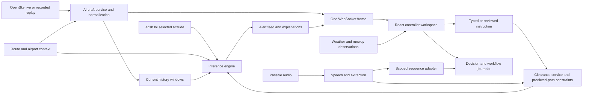
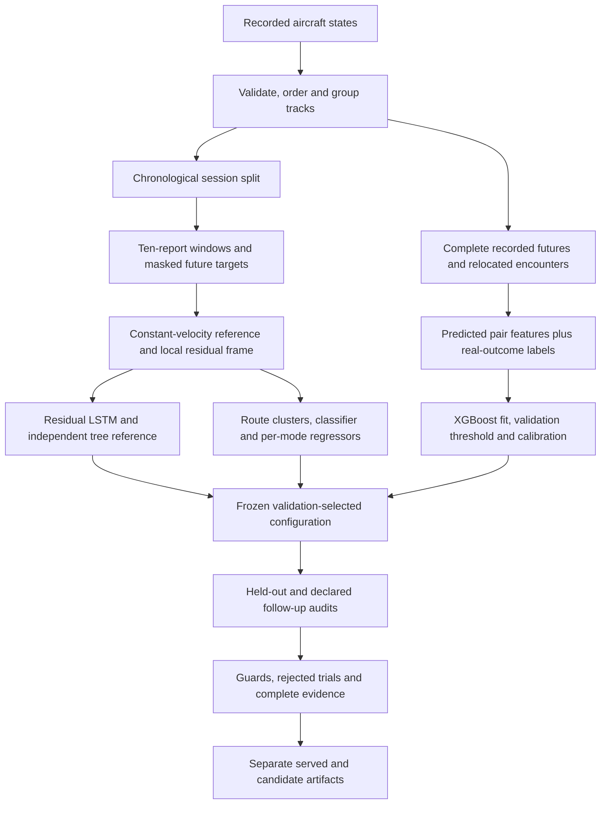
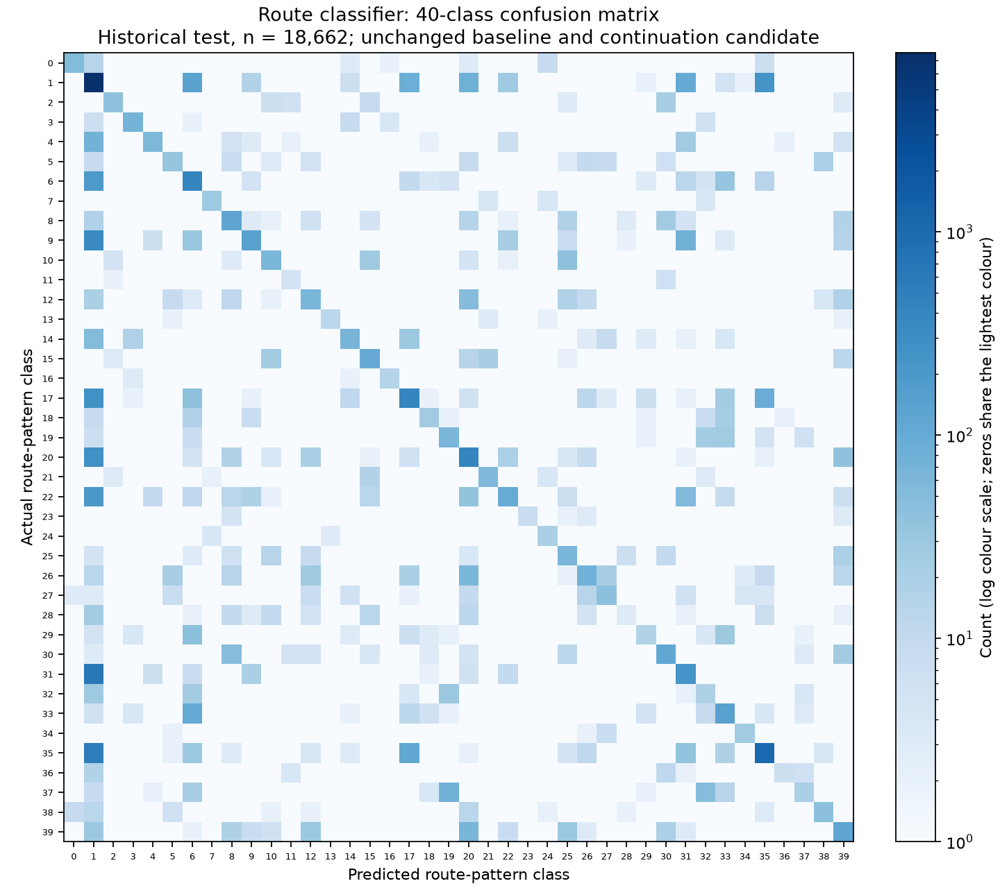
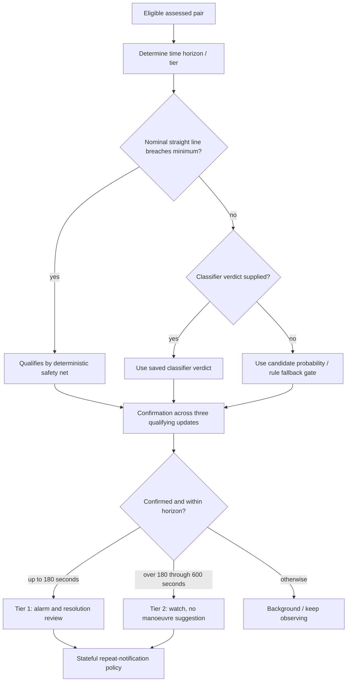
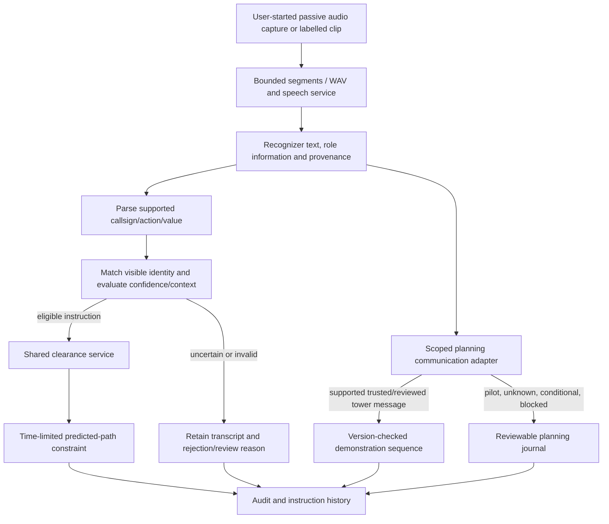

# FlightRight: project handbook and development history

**Documentation snapshot: 17 November 2026.** Project and interface name: **FlightRight**. Academic context: final-year engineering project at KJ Somaiya.

This document explains what was built, how it works, how the data and models evolved, what the measured iterations showed, and why the interface changed. It covers the recorded history from the initial repository through the November controller-workflow improvements.

This is a dated explanatory handbook, not a second evaluation publisher. [evaluation.md](evaluation.md) remains the maintained cross-model comparison; the [individual model ledgers](evaluations/source_inventory.json) retain every experiment and original evidence. Numbers below are historical measurements with their original basis, **not new measurements on 17 November**. “Served” means the recorded/default runtime configuration when its artifacts are installed; “candidate” means evaluated but not activated. Local working-tree improvements need not already exist in a remote checkout.

## Contents

1. [Purpose and scope](#1-purpose-and-scope)
2. [What the application currently provides](#2-what-the-application-currently-provides)
3. [Terms and measurement rules](#3-terms-and-measurement-rules)
4. [The project timeline](#4-the-project-timeline)
5. [Architecture and technology stack](#5-architecture-and-technology-stack)
6. [Data sources and their limits](#6-data-sources-and-their-limits)
7. [How the datasets evolved](#7-how-the-datasets-evolved)
8. [Training and evaluation flow](#8-training-and-evaluation-flow)
9. [Runtime surveillance and prediction flow](#9-runtime-surveillance-and-prediction-flow)
10. [Model inventory](#10-model-inventory)
11. [Single-position trajectory model: evolution and results](#11-single-position-trajectory-model-evolution-and-results)
12. [Multi-path model: evolution and results](#12-multi-path-model-evolution-and-results)
13. [Conflict classifier and alert-chain evolution](#13-conflict-classifier-and-alert-chain-evolution)
14. [False-alert and path-confidence experiments](#14-false-alert-and-path-confidence-experiments)
15. [Resolution engine: design, changes and results](#15-resolution-engine-design-changes-and-results)
16. [Speech models: data, iterations and outcomes](#16-speech-models-data-iterations-and-outcomes)
17. [Instruction extraction, callsigns, VAD and synthetic voice](#17-instruction-extraction-callsigns-vad-and-synthetic-voice)
18. [Radio-to-instruction and radio-to-sequence flow](#18-radio-to-instruction-and-radio-to-sequence-flow)
19. [Controller workflow, sequencing and authority](#19-controller-workflow-sequencing-and-authority)
20. [UI and UX evolution](#20-ui-and-ux-evolution)
21. [Storage, audit, artifacts and reproducibility](#21-storage-audit-artifacts-and-reproducibility)
22. [APIs and source-code map](#22-apis-and-source-code-map)
23. [Setup, operation and troubleshooting](#23-setup-operation-and-troubleshooting)
24. [Verification history and remaining gaps](#24-verification-history-and-remaining-gaps)
25. [Lessons, unfinished work and evidence index](#25-lessons-unfinished-work-and-evidence-index)

## 1. Purpose and scope

FlightRight combines aircraft surveillance, near-term prediction, conflict assessment, explainable manoeuvre suggestions, radio transcription and a controller workflow in one interface. The geographical demonstration centres on Mumbai airport, VABB, with a wider surrounding surveillance region.

The central research question is whether public aircraft data and inspectable machine learning can help identify developing losses of separation early enough to be useful. The project's recorded headline asks: **what proportion of eligible conflicts were detected with at least three minutes of warning?**

The recorded served classifier result is **270/284 = 95.07%**, commonly rounded to 95.1%. The recorded full alert-chain result is **271/284 = 95.42%**. These are different measurements; neither is “the accuracy of the entire application.” The test encounters are constructed from real recorded flight futures, including relocated tracks. They are not 284 independently observed operational near misses. [Source: comparison and classifier history](evaluation.md).

The controller retains authority. Selecting a flight, accepting a suggestion, recording a typed instruction, changing a sequence or entering an emergency planning case changes application records and/or prediction assumptions. **The application has no link that transmits an instruction to an aircraft.** The prototype does not establish runway permission, authenticated operational control, certified separation, or complete airport-surface surveillance.

The tower-oriented interface and the en-route conflict model solve different parts of the demonstration. A low-level arrival can be shown, inspected and placed in a demonstration sequence while remaining outside the model's en-route conflict-assessment domain.

## 2. What the application currently provides

| Capability | What the implementation does | Boundary |
| --- | --- | --- |
| Surveillance | Displays live OpenSky states or recorded replay, with source, time, connection and individual report age | Public coverage can be delayed, incomplete or inconsistent |
| Map and radar | Reported aircraft coordinates/headings, observed trails, selected model forecast, overlap chooser, offline geographic reference | A marker is a received report, not an independently verified current position |
| Flight details | Altitude, speed, vertical rate, track, identity, type/registration, route lookup, ETA basis and instruction history | Lookup route is not a filed flight plan; selected altitude is not a confirmed clearance |
| ML assistance | Model readiness, warm-up, coverage/exclusions, alarms, watch entries, explanations and ranked simulations | Readiness/counts do not measure accuracy; no alert does not establish safety |
| Controller workspace | Tower/Ground/Clearance views, strip ownership records, handoff acknowledgement and coordination notes | One shared demonstration session, without authenticated controller roles |
| Runway sequence | Arrival/departure picker, manual movements, reorder/drag, pins, target review, overdue warnings and close-out history | A 120-second educational scheduling constraint, not operational wake or runway clearance |
| Radio | Passive local audio capture, speech recognition, transcript review, instruction parsing and readback records | Needs an actual audio source; no radio transmission capability |
| Communications to sequence | Supported reviewed/identified tower phrases can propose or update a scoped demonstration plan | Conditional, uncertain, unmatched or incompatible messages require review |
| Audit | Server journal plus separate browser-tab logs, filtering and export | Protection depends on the actual backend; SQLite does not enforce PostgreSQL permissions |

The practical workflow is: establish the source and freshness, choose a working view, inspect a report, review assistance and its basis, make an explicit recorded decision, and inspect the resulting history. [Current UI behavior](frontend-workflow.md).

## 3. Terms and measurement rules

| Term | Meaning in this project |
| --- | --- |
| ATCO | Air traffic controller |
| ADS-B | Aircraft broadcast data received by the public surveillance providers |
| ICAO24 / callsign | Airframe address versus flight/radio identity; a missing callsign can be displayed as an address |
| NM / kt / ft / FL | Nautical miles; nautical miles per hour; feet; flight-level-style display in hundreds of feet |
| CPA | Predicted closest point of approach, with lateral distance, vertical gap and time |
| Nominal / alternative path | Straight-line prediction versus another future supplied by the multi-path model |
| ETA | Here, a distance/ground-speed estimate for an appropriate lookup destination, not an arrival clearance or sequenced slot |
| Train / validation / test | Fit parameters; choose a configuration/threshold; audit the frozen choice |
| Mean error / RMSE / MAE | Average horizontal error; squared-error-sensitive horizontal measure; average absolute error such as altitude error |
| Within 5 NM | Horizontal prediction hit rate at a stated horizon; not a classifier's accuracy |
| Best-of-five | At least one of five candidates hits the target; it does not say the most probable candidate was correct |
| Joint 3-D hit | The **same** candidate is within 5 NM horizontally and 1,000 ft vertically |
| Recall / precision | Fraction of real positives detected; fraction of predicted positives that were real positives |
| F1 / F-beta2 | Combined precision/recall metrics; beta2 weights recall more heavily |
| Early catch | Positive encounter detected with at least 180 seconds of warning; denominator differs from all-positive recall |
| FA per 1,000 pairs | False-positive count divided by all evaluated pairs, multiplied by 1,000; not automatically the false-positive rate among negative pairs |
| WER | Word error rate: substitutions + deletions + insertions divided by reference words; lower is better |
| Raw / numeral-normalized WER | Literal transcription errors versus errors after the recorded spoken-numeral normalization |
| Candidate weight | Model-assigned weight on a predicted route/path; not measured accuracy or calibrated operational risk |
| Manoeuvre heuristic / ranking score | Simulation-derived margin/timing/risk heuristic versus weighted ranking utility; neither is classifier probability |

A result must stay attached to its corpus, split, horizon, denominator, checkpoint and selection method. A score on synthetic voice is not a score on real Indian ATC radio. A test pass is not an accuracy improvement. Re-scoring cached predictions is not fresh inference or a fresh latency benchmark. Historical test sets used repeatedly are acknowledged as exploratory audits.

## 4. The project timeline

Dates below come from repository history and dated decision/experiment records. A commit date documents the change in the repository, not necessarily the exact time an experiment was measured.

| Period | Major development | What followed |
| --- | --- | --- |
| 29 January 2026 | Initial repository commit | Earliest retained version-control starting point |
| March 2026 | Dashboard panels, conflict banner/modal, dark/light themes, radar resizing, Leaflet map, trajectory/conflict graphics, toasts and audit UI | Interface-first prototype; controls/graphics did not establish a functioning ML backend |
| April 2026 | Geist typography, routing and client audit logging; aircraft-fetch integration; Node/Express collection, CPA-labelled logistic-regression and PyTorch MLP training paths | Early model integration scaffolding, with rule-derived labels |
| 3 May 2026 | MapLibre replaced Leaflet | Foundation for the later map implementation |
| 30 August 2026 | Python data/ML pivot; legacy Express implementation retired from the branch tip; collection and en-route-domain investigation | Public-data coverage and invalid terminal assumptions became explicit |
| 1–2 September 2026 | Residual trajectory rewrite, interpolated/masked labels, dense-grid CPA and larger chronological datasets | Per-horizon, per-regime evaluation replaced a misleading pooled loss |
| 5–6 September 2026 | Larger retrain, five-path model, real-outcome encounter labels, rebuilt XGBoost classifier, calibration and resolution simulation | A reproducible pipeline and meaningful conflict-warning measurements |
| 7–8 September 2026 | Surrounding-traffic checks, notification suppression, FastAPI live/replay backend, one multiplexed stream, PostgreSQL support and batched prediction | The dashboard became connected decision support rather than a scripted display |
| 21–24 September 2026 | Served-artifact audits; actual runtime gate checked; per-mode offsets studied; safety net restored to straight-line geometry | Model-only and full-chain results separated; per-mode model activated after checks |
| 25–27 September 2026 | Archive data, selected-altitude context, route features, speech comparisons, typed/heard intent, runway/weather/metadata integration | Archive + destination path bundle and selected-altitude classifier served; own ATC speech model selected |
| 28 September–30 October 2026 | Demo/radio tooling, trace logging, corpus comparisons and saved-artifact re-evaluations | Better reproducibility and a clearer account of limitations |
| 1–2 November 2026 | LSTM and multi-path candidates; threshold/filter studies; all-pairs path-confidence experiment; observed/forecast track display | Useful candidates retained separately; unsafe trade-offs and failed gates rejected; shadow experiment rolled back |
| 9–11 November 2026 | Canonical artifact paths and consolidated ledgers; speech continuation/model soup; pretrained fresh-clone demo | Selected speech average activated; original speech fallback retained; CPU demo packaging verified |
| 12–14 November 2026 | Controller-role research, strip/workflow records, sequencing, emergency/takeover planning and isolated browser inspection | Controller-oriented workflow, with explicit demonstration authority boundaries |
| 16 November 2026 | Map gestures/identity and selection speed, communications-to-sequence, instruction history, ML workspace, responsive decluttering, independent panels and dark-theme refinements | Less overlap and hidden-state friction; better separation of observation, intent and prediction |
| 17 November 2026 IST | Live-review corrections: freshness, warm-up, overdue close-out, local scope, overlap selection, coverage/gates, resolution-score/timing explanations and honest audit protection | More usable and truthful presentation; model weights and decision thresholds unchanged |

Sources: [decision log](CLAUDE.md), `git log`, [UI workflow](frontend-workflow.md), and the model-specific sections below.

## 5. Architecture and technology stack

### 5.1 Overall design

The browser and Python backend are separate processes. The backend owns surveillance ingestion, history, inference, alert state and durable journals. React renders those results and submits explicit workflow or decision requests. Training is an offline activity separate from running the pretrained app.



The single WebSocket carries aircraft and conflict assessments together. HTTP polling is the browser transport fallback. This reduces the chance of combining an alert with unrelated positions, but it is not a distributed transaction or a certified real-time delivery guarantee.

### 5.2 Stack by responsibility

| Layer | Technologies in this repository | Role |
| --- | --- | --- |
| Frontend | React 19, JavaScript/JSX and TypeScript/TSX, Vite 7, React Router 7 | Dashboard state, tools, routes and development/production build |
| UI | Tailwind CSS 3, custom CSS variables/workspace CSS, Geist Variable, Lucide, Radix primitives, Framer Motion, Recharts | Layout, readable themes, controls, restrained transitions and charts |
| Map | MapLibre GL 6, attributed OpenStreetMap raster tiles, local geographic reference, Canvas radar | Geographic display, map-local gestures, markers and offline context |
| Backend | Python, FastAPI, Uvicorn, WebSockets, Pydantic | APIs, validation, ingest loop, status and multiplexed stream |
| Data processing | NumPy, pandas, PyArrow/Parquet, requests, SciPy, joblib | Collection, transformations, model arrays, persistence formats and numerical work |
| Single trajectory | PyTorch residual LSTM | One corrected physics prediction per horizon |
| Multiple trajectories | scikit-learn KMeans and histogram gradient boosting | Route modes, route classification, per-mode residual regression and temperature calibration |
| Conflict classification | XGBoost, logistic Platt calibration, native contribution/SHAP output | Calibrated pair probability, saved operating threshold and explanations |
| Resolution | Deterministic Python geometry/simulation and fixed weighted ranking | Simulated altitude/turn/speed options and rejection reasons |
| Speech training | Whisper-small, Transformers, PEFT/LoRA, Accelerate, PyTorch | ATC adaptation and independent continuation studies |
| Speech runtime | faster-whisper, CTranslate2, Silero VAD, soundfile, rapidfuzz; browser Web Audio/AudioWorklet | Local decoding, speech gating, matching and bounded passive capture |
| Synthetic voice | Indic Parler-TTS in a separate environment | Labelled Indian-accent practice/training audio |
| Storage | PostgreSQL with restricted audit permissions where configured; SQLite demonstration/fallback stores | Audit, decisions, transcriptions, extracted instructions, strip events, plans and observed tracks |
| Delivery and verification | Git/Git LFS, `start.py`, pinned demo dependencies, Python unittest/FastAPI TestClient, Node tests, Playwright Chromium, ESLint | Pretrained artifacts, reproducibility, API/logic tests and visual checks |

Package declarations are in [client/package.json](../client/package.json), [server requirements](../server/requirements.txt), [pinned demo requirements](../server/requirements-demo.txt), and [ML requirements](../ml_pipeline/requirements.txt). Version families here describe checked-in configuration, not recommendations about the latest available packages.

The portable demo targets Python 3.13 and the launcher documents Node.js 22 or newer. It can run the shipped models on CPU. Recorded training hardware includes an RTX 4050 laptop GPU; older setup documents mention an RTX 4060 target. Hardware-specific timings below must not be generalized between machines.

## 6. Data sources and their limits

| Source | Information used | Where it enters | Main qualification |
| --- | --- | --- | --- |
| OpenSky REST | Position, callsign/address, speed, track, vertical rate, altitude, on-ground flag | Live surveillance and original recording collection | Public reception, quotas, stale/unknown fields; no filed-plan feed |
| OpenSky historical/Trino | Additional dated Mumbai-region trajectories | Offline training/archive studies | Recorded Indian low-altitude coverage investigation found usable coverage beginning January 2025 |
| adsb.lol API/history | Selected autopilot altitude, aircraft type/registration/squawk and replay traces | Intent features, metadata and shareable demo | Selected level is not proof of ATC clearance; ODbL attribution applies |
| adsbdb | Callsign origin/destination lookup | Four destination-related path features and display metadata | Can be absent, cached, outdated or incorrect for a particular flight/date |
| OurAirports | Airport coordinates, runway endpoints | Destination geometry and airport/map context | Published reference geometry, not live runway authority |
| NOAA aviationweather.gov / Iowa Environmental Mesonet | Live or archived METAR | Weather, wind-based runway estimate and historical context | Issued weather report is distinct from current surveillance time |
| ATCOSIM | Human aviation phraseology in simulation | ASR training and speaker-disjoint evaluation | Simulation speech, not live Mumbai radio |
| UWB-ATCC | Recorded ATC speech and transcripts | ASR training/validation/recording-disjoint tests | Speaker identities unavailable; CC BY-NC-SA research-data constraints |
| ATCO2 test set | Radio audio and available instruction annotations | ASR/extraction testing only for our model | Some published comparator models saw overlapping training material |
| Svarah | Ordinary Indian English | Test-only accent/generalization diagnostic | Not aviation radio; vocabulary specialization confounds an accent-only interpretation |
| Indic Parler-TTS | Generated Indian-accent calls | Training/practice and labelled synthetic diagnostics | Does not substitute for real Indian controller recordings |
| Airline/callsign reference files | Airline radio names and code mappings | Callsign parsing/matching | Helps identity matching, not recognition of authoritative operational intent |

The application keeps **report time, feed receipt time, historical replay time, forecast horizons, metadata provenance and recorded instruction time** conceptually separate. A fresh HTTP/WebSocket response can contain a three-minute-old aircraft report. A replay fetched now is still historical.

Route availability was a recurring source of confusion. The November display fix shortened unknown/partial/error metadata cache entries from 600 seconds to 10 seconds, while complete entries retain 600 seconds. It did not change model feature construction or make a missing filed destination available. The on-disk lookup policy can still retain 404 responses. [Route and display history](frontend-workflow.md).

## 7. How the datasets evolved

### 7.1 From sparse recordings to chronological windows

The original collection used scheduled OpenSky sessions, typically 90 minutes at approximately ten-second intervals, with credit-aware collection. Historical notes report a rolling 24-hour credit budget rather than a midnight reset. These are recorded conditions, not a promise about current provider entitlements.

| Recorded stage | Data change | Consequence |
| --- | --- | --- |
| Early collection / August | Public reports included terminal and questionable ground states | Applying the en-route distance rule broadly produced flags in 91–94% of snapshots; en-route eligibility became explicit |
| 1 September preprocessing rewrite | Real bracketing observations interpolated at each target; per-horizon masks introduced | Retained windows increased **73,254 → 151,613**; short remaining tracks no longer vanished merely because a ten-minute future was unavailable |
| 2 September | 23 raw collection files, merged into 21 session blocks; 424,414 airborne states | **198,537** windows: 143,117 train / 27,552 validation / 27,868 test |
| 5 September | 36 raw files, merged into 33 chronological blocks; 627,344 airborne states | **291,008** windows: 205,757 train / 45,637 validation / 39,614 test |
| 5 September conflict rebuild | Real tracks with complete observed ten-minute futures, relocated to create developing encounters | 40,000 pairs, 2,581 positive labels; training uses predicted facts, outcomes use recorded futures |
| 25–26 September archive study | 400,000 additional training windows from historical archive dates | Multi-path training becomes **605,757** windows; validation/test remain separate |
| 27 September route-feature study | Cached destination context joined to windows | Destination known for 87.8% of training windows; missing values remain unknown |
| November follow-up audits | Two later dates, 10 and 20 September | **213,482** windows, including 120,679 valid ten-minute targets; shared exploratory follow-up, not an independent new test for every experiment |
| 11 November portable demo | Publicly distributable adsb.lol replay prepared independently of training benchmarks | **5,548** bucketed measured reports from **98** aircraft, 4 September 20:45–22:15 UTC; demonstration input, not a new evaluation split |

Raw-file count, merged-session count, model windows, valid targets and encounter pairs are different denominators. This is why nearby historical documents can mention 33 sessions, 35 recordings or 36 files without those being interchangeable sample counts. The precise split used by a result is in its ledger.

### 7.2 Preprocessing changes that mattered

**Fixing the target:** earlier nearest-observation snapping allowed a time mismatch of up to 30 seconds. The September investigation estimated mean 0.42 NM and p95 1.40 NM of one-minute label displacement from this alone. Interpolation uses real observations bracketing a target, with a maximum 120-second bracket, without extrapolating a missing future. A measured constant-velocity one-minute mean changed from 0.62 to 0.21 NM on that study's data; that was a label-quality change, not an earned neural-model improvement.

**Retaining incomplete horizons:** each window has a per-horizon validity mask. Invalid numeric placeholders must never be scored. On the later historical split, valid target counts are 38,110 / 32,324 / 27,587 / 18,662 at 1 / 3 / 5 / 10 minutes. Requiring all horizons would disproportionately remove arrivals ending near the airport.

**Using a useful coordinate frame:** absolute regional latitude/longitude scaling hid small motion. Shared framing code now expresses observed motion and residual targets in local along-track, cross-track and altitude coordinates. Track wraparound is handled; the same transformations are used in training, evaluation and inference.

**Preventing leakage:** an old conflict label could be reconstructed from its own CPA feature values for **40,000/40,000 rows**. The rebuild separated predicted features from actual recorded outcomes. A guard rejects near-perfect rule reconstruction; real future values are not fed in as inference features.

**Separating data by time:** whole-session chronological splits replace random overlap between nearby windows. Later training/selection studies document extra chronological separation, repeated test use and aircraft-cluster uncertainty diagnostics rather than treating every correlated window as an independent flight.

Sources: [trajectory history](evaluations/trajectory_lstm.md), [multi-path history](evaluations/multipath.md), [classifier history](evaluations/conflict_classifier.md), [demo provenance](../demo/provenance.json), and [dated preprocessing decisions](CLAUDE.md).

## 8. Training and evaluation flow



Model weights, normalizers, feature order, label construction and decoder settings are part of a configuration. Changing one can invalidate a comparison even when the model name stays the same. Candidate promotion is a separate decision: a lower test error alone does not activate new served weights.

The training runner's main stages are environment check, trajectory preprocessing, LSTM training, tree benchmark, multi-path fitting, encounter generation and XGBoost fitting. It records dated logs/reports. Speech training and its corpus preparation are a separate pipeline. [Training entry point](../ml_pipeline/run_pipeline.py), [training guide](../ml_pipeline/README_TRAINING.md).

## 9. Runtime surveillance and prediction flow

1. **Choose the source.** `replay` reads recorded reports; `live` requests OpenSky; `auto` is configured to try live and use replay on a live-source failure. The actual source remains visible. The browser's polling fallback is a different mechanism from backend source fallback.
2. **Normalize reports.** Convert metres to feet, metres/second to knots, vertical rate to the required units, preserve position timestamps and valid coordinates, and enrich available identity/route context. Missing or inferred fields remain labelled.
3. **Record scoped history.** Store current observations for display and maintain rolling model history by airframe address. Duplicate position timestamps do not create extra model reports. The default rolling buffer is 24 states; model inference needs ten.
4. **Keep model-ready input separate from display coverage.** Short histories still appear on screen and in warm-up accounting. They do not become learned-model input merely to make an assessment count look larger.
5. **Select eligible pairs.** Current model-domain policy is airborne, altitude at least 10,000 ft, speed greater than 50 m/s. Pair prefilter: less than 60 NM laterally and 5,000 ft vertically; closest candidates capped at 120 per update. These are project defaults/configuration, not operational sector boundaries.
6. **Predict once per airspace.** The multi-path model supplies candidate futures in a batch. Known accepted instruction constraints can modify that aircraft's candidates. Neighbour futures support secondary-conflict checks.
7. **Assess a pair.** Run deterministic straight-line geometry, candidate-combination geometry, the saved conflict classifier and its explanation, tier/qualifying gates, persistence and any resolution simulation. The XGBoost input uses straight-line CPA; it does not directly consume the five-path fan.
8. **Manage presentation.** The alert feed keeps confirmed active pairs and decides which state changes deserve a new interruption. It is not an alternative learned detector.
9. **Publish and journal.** Broadcast aircraft and conflicts together; persist relevant conflict/audit/decision records. Other slower-changing information, including airport and speech status, has dedicated API refreshes.
10. **Render without inventing motion.** Reported positions, observed trails and forecast lines have different visual meanings. Selection shows existing feed details immediately; history and forecast requests load independently. The client shows stale/unknown report age and forecast warm-up/error separately from connection health.

The typical ingest cadence is ten seconds, while HTTP fallback polls every five seconds. Opening a socket alone is not a successful data update. The November client starts polling until the first valid update, clears closed socket references on development remounts, and resumes polling for missing/stalled stream frames. The display's 60-second old-track threshold does not change model eligibility or measured model scores.

Implementation: [aircraft service](../server/app/services/aircraft_service.py), [conflict service](../server/app/services/conflict_service.py), [inference](../server/app/ml/inference.py), [client subscription](../client/src/hooks/useLiveData.js), [selected forecast](../server/app/services/trajectory_service.py).

## 10. Model inventory

“Model 1/1b/2/3” are project component names. Not every numbered component is a trained neural network, and the whole alert chain is an integration evaluation rather than another trained model.

| Component | Method and role | Recorded status at this snapshot |
| --- | --- | --- |
| Legacy logistic baseline / small MLP | CPA-derived pair classification in the earlier Node/Python prototype | Retired scaffolding; no comparable retained real-outcome score established here |
| Legacy absolute-position Bi-LSTM | Earlier trajectory formulation with problematic target/input scaling | Retired; published pooled error was not an adequate horizon-specific comparison |
| Constant velocity | Deterministic future from current position, speed, track and vertical rate | Baseline and independent rule support |
| Residual LSTM, Model 1 | Two-layer, hidden-128 recurrent encoder with four residual output heads | Served baseline artifact; guarded ten-minute-head candidate remains undeployed |
| Tree trajectory reference | Separate histogram gradient-boosted residual regressors | Benchmark; saved test predictions retained, fitted estimators not retained |
| Multi-path bundle, Model 1b | 40 KMeans route modes, mode classifier, temperature calibration and per-mode offsets | Archive + destination bundle served; `continue_800` retained as undeployed candidate |
| Conflict classifier, Model 2 | XGBoost over 24 pair features + 3 selected-altitude features; Platt calibration | Selected-altitude version served |
| Secondary conflict filter | Conservative separately fitted XGBoost veto combined with a threshold proposal | Evaluated, undeployed; cannot replace the classifier by renaming its file |
| Resolution engine, Model 3 | Deterministic simulation and fixed weighted ranking | Implemented; proposed learned ranker remains untrained/deferred |
| Alert feed | Stateful notification suppression and prominence | Implemented deterministic presentation component |
| Path-confidence shadow policy | All-pairs candidate-path monitor and alternative display gates | Rejected/rolled back as a served-policy replacement |
| Whisper-small base | Untouched recognizer comparator | Reference baseline |
| Whisper-small ATC P1 / continuations / soup | Own LoRA adaptation followed by validation-selected weight averaging | `uniform_soup3` default since 11 November; P1 fallback retained |
| Whisper-medium / medium-ATCOSIM / large-v3 ATC | Untouched and published ATC recognizer comparisons | References, with corpus-overlap qualifications |
| Clearance/callsign extractor | Deterministic text/radio-name rules plus matching | Implemented; not a trained NER or language model |
| Indic Parler-TTS | Pretrained generated voice | Synthetic training/demo source; no objective TTS quality benchmark recorded |
| Silero VAD | Pretrained speech gate | Runtime support; no labelled VAD-quality benchmark recorded |

## 11. Single-position trajectory model: evolution and results

### 11.1 Why the initial formulation was replaced

The retired model predicted absolute latitude/longitude with regional-scale normalization and reported error pooled across horizons. Useful aircraft motion was small relative to the normalization scale, while easy one-minute predictions could hide ten-minute failures. The recorded investigation found it worse than constant velocity across horizons; a comparable trustworthy per-horizon numeric score for that retired artifact is not established in the retained current summary.

The replacement predicts **corrections to constant velocity** in metres in a heading-aligned local frame. The served network has two unidirectional LSTM layers, hidden size 128, dropout 0.3, a shared block and separate one-/three-/five-/ten-minute heads. It combines the observed sequence with window-level scalar features. A zero residual returns the deterministic baseline; a nonzero learned residual can still be wrong.

The evidenced reason for the rewrite is the framing/scaling and evaluation failure. Bidirectionality by itself does not prove leakage: a bidirectional encoder can legitimately process a completely observed past window. The present implementation simply uses a unidirectional encoder.

SmoothL1 beta 0.05 was retained because large quadratic regions behaved like squared error and sacrificed near-perfect predictions to shrink the error tail. In an early beta-1.0 diagnostic, ten-minute mean reached 6.84 NM but within-one-NM coverage fell from the baseline's 32.6% to 12.9%; beta 0.05 recovered 30.6% on that study's data. These are loss-design diagnostics, not the later historical split's headline.

### 11.2 Data-growth iterations

| Recorded iteration | Test basis | Ten-minute CV mean / 5-NM hit | LSTM mean / 5-NM hit | Tree mean / 5-NM hit | Outcome |
| --- | --- | --- | --- | --- | --- |
| 1 September residual rewrite | 20,611 test windows; three held-out sessions | 10.21 NM / 52.8% | 6.85 NM / 61.6% | Mean not quoted in that table / 69.7% | Residual approach beats physics; independent trees still better |
| 2 September retrain | 27,868 test windows; 14,030 ten-minute targets | 11.02 NM / 51.8% | 6.41 NM / 64.5% | 5.65 NM / 66.7% | More data, but a changed/harder split prevents treating the percentage change as a controlled gain |
| September served artifact, verified again 30 October | 39,614 test windows; 18,662 ten-minute targets | 10.30497 NM / 50.50370% | 6.40931 NM / 61.31176% | 5.56803 NM / 65.66284% | Served reference; tree remains a stronger ten-minute point benchmark |

An early 5 September narrative quoted 60.9% for the LSTM on the enlarged split. The later saved-artifact re-evaluations consistently record **61.31176%**. This handbook uses the artifact-verified result for that configuration and preserves the distinction rather than silently treating all historical prose as equally current.

The served artifact's other horizons, measured on the historical split:

| Horizon | Valid targets | Mean NM | RMSE NM | Within 5 NM | Altitude MAE |
| --- | --- | --- | --- | --- | --- |
| 1 minute | 38,110 | 0.45025 | 1.73104 | 98.46497% | 98.63 ft |
| 3 minutes | 32,324 | 1.37553 | 3.10388 | 91.95953% | 304.26 ft |
| 5 minutes | 27,587 | 2.68787 | 5.37193 | 82.90499% | 509.58 ft |
| 10 minutes | 18,662 | 6.40931 | 10.46734 | 61.31176% | 1,108.57 ft |

A short-horizon hit rate near 98% and a ten-minute hit rate near 61% are not contradictory; predicting farther ahead is a different task. Sharp turns, substantial vertical manoeuvres and near-airport traffic remained harder than level cruise.

### 11.3 November fine-tuning: better averages were not enough

All three studies start from the served checkpoint and retain the original data split: 205,757 training windows, 45,637 validation windows and 39,614 test windows. The selected configuration is frozen on validation, then repeated at seeds 42/43/44. Historical test reuse and overlapping windows remain limitations.

| Study / selected configuration | Seed-42 historical ten-minute mean | RMSE | Within 5 NM | Altitude MAE | Decision and reason |
| --- | --- | --- | --- | --- | --- |
| Baseline | 6.40931 NM | 10.46734 NM | 61.31176% | 1,108.57 ft | Remains served |
| Initial broader tuning: `adam_lr1e4`, epoch 6 | 6.27981 NM | 10.28647 NM | 61.83153% | 1,099.69 ft | Not accepted: every confirmation seed fails the five-minute sharp-turn regime guard |
| Isolated ten-minute head: `last_head_adam_lr1e4`, epoch 4 | 6.34813 NM | 10.39758 NM | 61.38678% | 1,103.95 ft | Selected guarded candidate; all three test seeds pass, earlier heads remain fixed; undeployed |
| Broader refinement: `adam_lr3e5`, epoch 6 | 6.28576 NM | 10.29088 NM | 61.86368% | 1,101.55 ft | Does not establish an all-guards/all-seeds replacement: seed 42 fails the historical sharp-turn check; seed 44 fails validation guards |

The initial search also tested AdamW/weight decay and heads-only updates. Its validation objectives were −0.01003 (Adam 1e-4), −0.01000 (AdamW 1e-4), −0.00961 (AdamW 3e-4) and −0.00925 for a heads-only trial that failed guards. The ten-minute-only search tested learning rates 1e-4, 3e-4 and 1e-3; 1e-4 had the best recorded guarded validation objective, −0.00228. The refinement tested low-rate Adam and checkpoint averaging; neither justified replacing the selected guarded head-only candidate.

The head-only candidate's ten-minute means across seeds are **6.3481 / 6.3503 / 6.3492 NM**, with all reported historical guards passing. On the shared later-date audit, its seed-42 ten-minute mean is **6.6277 versus 6.6726 NM**, and 5-NM coverage is **60.52089% versus 60.39162%**, with 120,679 valid targets. These small gains are real measurements but not evidence of a new deployed alert-chain improvement.

The broader refinement also improved later-date averages, yet that did not erase a failed historical acceptance check. This is why “lowest average test error” is not the project's model-promotion rule.

Sources: [LSTM ledger, including every trial and guard](evaluations/trajectory_lstm.md), [constant-velocity ledger](evaluations/constant_velocity.md), [tree-reference ledger](evaluations/tree_reference.md). The repeated September/October re-evaluations are confirmations of saved artifacts, not seven newly trained models.

## 12. Multi-path model: evolution and results

### 12.1 Why one answer was insufficient

A point predictor averages futures that may differ because of a turn, a new level or another unobserved instruction. The multi-path bundle represents several plausible futures instead. It clusters residual route shapes into 40 modes, predicts mode weights, and supplies five candidates to the conflict geometry and resolution checks.

The bundle evolved from a **pattern residual table** to **per-aircraft/per-mode offset regressors**. The latter use 83 motion-derived features plus the mode identifier; the destination version adds four route/airport features: destination distance, destination bearing sine/cosine relative to track, and origin distance. The route classifier's probabilities are temperature-scaled. The bundle's components must be evaluated together; knowing the true future mode is only an oracle ceiling, not a deployable result.

### 12.2 September sequence on the historical ten-minute test

| Configuration | All traffic: top-1 / best-5 within 5 NM | Near-airport “arrivals”: top-1 / best-5 within 5 NM | What happened |
| --- | --- | --- | --- |
| Original table, seed 42 | 64.00% / 83.00% | 38.62% / 63.56% | Initial multi-path baseline |
| Per-mode offsets, original data, seed 42 | 66.65% / 86.58% | 44.17% / 71.47% | Measured 23 September; activated after runtime/gate checks on 24 September |
| Archive-augmented per-mode bundle, seed 42 | 67.80% / 88.06% | 46.84% / 75.44% | Additional 400,000 training windows; four-seed study; served 26 September |
| Archive + destination, recorded served baseline | 68.06880% / 88.43104% | 47.21177% / 76.46254% | Destination features passed recorded checks and were served 27 September |

All-traffic ten-minute n is 18,662; near-airport n is 2,923. “Arrivals” is the pre-existing distance-under-40-NM bucket, not a separately validated arrival/departure classifier. Each row is a recorded configuration, not a mixture of the best metrics from different seeds.

For the served destination bundle, ten-minute top-1 altitude MAE is **889.19 ft** across all traffic and **1,289.82 ft** near the airport. Joint best-of-five 3-D coverage is **68.19205%** all traffic and **48.78549%** near the airport. Horizontal best-of-five coverage alone would hide these vertical limitations.

Four-seed checks supported the per-mode effect: original-data arrivals best-of-five ranged approximately **71.47–72.43%**; archive-augmented arrivals ranged **74.89–76.12%**. This establishes variability for that whole-bundle training study, not independent replication of the later deterministic continuation.

Destination information helped, but it created a dependency: the recorded all-destination-unknown diagnostic fell to about **73.0% best-of-five / 45.6% top-1** near the airport, below the preceding archive model's 75.4% / 46.8%. Unknown-route handling is therefore a model limitation as well as a display issue.

### 12.3 Context ideas that did not earn deployment

Selected altitude, wind, aircraft type, traffic context and their combination were tested as trajectory context. Their small coverage changes were within the recorded seed spread, or worsened other metrics. They were not adopted on the strength of a single improved cell.

In particular, treating the dialled autopilot level as a ten-minute ceiling was harmful. In a recorded context diagnostic, ten-minute top-1 height error rose **1,673 → 5,068 ft** when capped at that selected level. Aircraft were often subsequently re-cleared: 77.5% of the relevant ten-minute targets were more than 1,000 ft past the earlier selected level. This differs from an explicitly accepted, time-limited instruction constraint and explains why selected altitude was more useful as classifier context than as a long-horizon destination.

### 12.4 November continuation study

Only the ten-minute along-track/cross-track/altitude regressors changed; route clusters/classifier, temperature, destination inputs, earlier horizons and conflict thresholds stayed fixed.

| Trial | Fitted trees: along / cross / altitude | Validation objective | Outcome |
| --- | --- | --- | --- |
| `continue_600` | 600 / 600 / 468 | −0.00217 | Passed measured trajectory checks, but unselected; no test/alert audit for this trial |
| `continue_800` | 800 / 800 / 468 | −0.00320 | Validation-selected; trajectory, alert-chain, later-date, pair-identity and cost checks passed; packaged candidate, undeployed |
| `regularized31` | 265 / 400 / 292 | +0.03038 | Fresh refit failed altitude, coverage, energy-score and regime guards; rejected |

The selected continuation retains seed 0 and the original identical warm-start training data. It is not an independently retrained multi-seed result.

| Ten-minute historical audit | Served baseline | `continue_800` candidate |
| --- | --- | --- |
| All-traffic top-1 mean | 5.53280 NM | 5.49463 NM |
| All-traffic top-1 within 5 NM | 68.06880% | 68.26707% |
| All-traffic best-5 within 5 NM | 88.43104% | 88.64538% |
| All-traffic best-5 joint 3-D | 68.19205% | 68.31529% |
| Near-airport top-1 mean | 9.93943 NM | 9.89244 NM |
| Near-airport best-5 within 5 NM | 76.46254% | 76.90729% |
| Near-airport best-5 joint 3-D | 48.78549% | 49.02497% |

On the shared later-date cohort, all-traffic top-1 mean changed **5.77170 → 5.74494 NM**, best-five horizontal coverage **87.86119 → 88.03189%**, and best-five 3-D coverage **73.89355 → 74.01951%**. Some P90 errors slightly worsened. Passing practical guards does not mean every cell improved.

The candidate preserved the historical full-chain decisions: **290 TP / 478 FP / 13 FN / 3,909 TN**, early catches **271/284**, tier-1 real/false **28/20**. It was a trajectory improvement without a demonstrated conflict-detection improvement.

Recorded isolated inference cost, with four CPU threads, batch 64, two warmups and seven interleaved measurements: median **350.48 → 390.30 ms**; model size **116.0 → 121.8 MiB**. This is not full-ingest latency. Route-mode classification stayed unchanged: macro F1 **0.4413**, weighted F1 **0.6100**, NLL **1.30870**, Brier **0.50224**, top-1 calibration error **0.06370**.

Five-path weights are normalized over retained candidates; joint pair weights use an independence approximation. Temperature calibration of route classes does not establish calibrated real-world conflict probabilities. [Complete multi-path history and evidence](evaluations/multipath.md).

### 12.5 Route classifier confusion matrix

This is a **40-class route-pattern classification** matrix, not the binary conflict matrix. Rows are actual future-residual cluster IDs 0–39; columns are predicted cluster IDs. It contains 18,662 historical test windows. The baseline and continuation share this unchanged route classifier.



The colour scale is logarithmic for readability; exact unnormalized counts, including zeros, are in the [complete 40×40 CSV matrix](handbook_assets/route_classifier_confusion_40class.csv). [Provenance](handbook_assets/route_classifier_confusion_provenance.json) pins the preserved original source report. This is an export of existing results, not new inference.

## 13. Conflict classifier and alert-chain evolution

### 13.1 Legacy baselines and the label problem

The April prototype provided Node logistic-regression and GPU-ready PyTorch MLP training paths over CPA-derived pair labels. These established collection/feature/training plumbing, but no comparable retained real-outcome score for those legacy artifacts was established during this documentation review. Historical setup examples are not benchmark results.

The later early synthetic encounter generator also had a circular target: two CPA feature distances directly determined the label, reconstructible for **100% of 40,000 rows**. An apparent PR-AUC of **1.0** did not demonstrate predictive skill. That dataset and result were superseded as meaningful conflict evidence.

The September rebuild uses two real recorded futures. One aircraft's complete track is rigidly moved/rotated to create an encounter, retaining its real turns, climbs and speed changes. Placement uses time-zero prediction, not the answer in the actual future. Developing encounters are required; pairs already in the alert volume are rejected. The resulting data are constructed encounters with real-outcome labels, not entirely natural recorded near misses.

### 13.2 Classifier input and selection

The original rebuilt model has 24 pair features: present geometry and motion, straight-line predicted CPA distance/vertical gap/time, convergence and recent manoeuvre summaries. The served version adds each aircraft's selected-altitude delta and selected-level separation, bringing the count to 27. Missing selected levels stay unknown.

The classifier does **not** directly see all five predicted paths. Those paths influence another stage of the system. New filter studies tested path summaries separately; it is inaccurate to describe the served classifier as a 25-path neural model.

The original encounter split contains 28,746 training, 6,564 validation and 4,690 test pairs. The test has **303 positives**, with **284** eligible for the three-minute-warning denominator. Thresholds are selected on validation. Native model contribution values provide per-alert feature explanations; Platt calibration changes the interpretation of the score, not the fact that a threshold decision is still required.

### 13.3 Major classifier iterations

| Iteration | Recorded test result | Decision / consequence |
| --- | --- | --- |
| Geometric minimum reference | Early catches **81.7%**; recall **0.8251**, precision **0.6203** | Deterministic reference and safety support, not a learned classifier |
| Wider geometric alert-volume reference | Early catches **87.3%**; recall **0.8812**, precision **0.4356** | More recall at a false-alert cost |
| Rebuilt XGBoost, 5 September, raw threshold about 0.0984 | Early catches **93.7%**; recall **0.9406**, precision **0.4113**, F-beta2 **0.7480**, PR-AUC **0.8024** | Beat the wider rule; failed the declared 0.95 recall gate, which was not silently tuned away |
| Full real-data run, 6 September; raw threshold 0.08512286096811295 | Early catches **267/284 = 94.01%**; recall **0.943894**, precision **0.386486**, F1 **0.548418** | Served original 24-input classifier; recall gate still below 0.95 |
| Selected-altitude classifier, 26 September; raw threshold 0.07465646415948868 | Early catches **270/284 = 95.07%**; recall **0.953795**, precision **0.385848**, F1 **0.549430** | Served after the user's equal-false-alarm operating-point decision; declared recall gate passed |
| Saved-artifact refresh, 30 October | Reproduced the served selected-altitude measurements | Re-evaluation, not a newly improved model |

On the final historical test, the served classifier has **289 TP, 460 FP, 14 FN and 3,927 TN**. Its precision of about 38.6% means false alerts remain substantial despite high recall. The independent full chain has a different confusion matrix because the safety net can raise an alert separately.

Calibration in the September run improved classifier Brier **0.0298 → 0.0236** and calibration error **0.0322 → 0.0074**, preserving the same 740 classifier alerts in that measurement. The operating threshold is not a generic 50%. Comparing a calibrated displayed probability to an unrelated raw threshold, or applying multi-path thresholds to the classifier, is wrong.

The selected-altitude study also examined four seeds and matched false-alarm cost. Reported recall at that matched cost ranged **0.9505–0.9571**, while early catches ranged **269–271/284**. A selected autopilot level adds useful intent context; it does not establish which clearance ATC actually issued.

### 13.3a Confusion matrices for classifier configurations

All binary matrices in this section use **rows = actual non-conflict / actual conflict** and **columns = predicted no-alert / predicted alert**:

```text
                 Predicted no-alert   Predicted alert
Actual negative          TN                  FP
Actual positive          FN                  TP
```

The historical test has **4,690 pairs: 4,387 negatives and 303 positives**. Early-warning recall uses a different denominator, 284; it must not be calculated by substituting 284 into these matrices.

**Served 27-input selected-altitude XGBoost classifier** — measured 26 September, reproduced in the 30 October saved-artifact refresh:

| Actual class | Predicted no-alert | Predicted alert |
| --- | --- | --- |
| Non-conflict | TN **3,927** | FP **460** |
| Conflict | FN **14** | TP **289** |

**Earlier served 24-input XGBoost classifier** — 6 September configuration, preserved in the 8 September re-evaluation:

| Actual class | Predicted no-alert | Predicted alert |
| --- | --- | --- |
| Non-conflict | TN **3,933** | FP **454** |
| Conflict | FN **17** | TP **286** |

**Other recorded classifier/rule configurations**, on the same historical test:

| Configuration | Matrix `[[TN, FP], [FN, TP]]` | Status / interpretation |
| --- | --- | --- |
| Deterministic minimum reference | `[[4234, 153], [53, 250]]` | Rule baseline, not a learned model |
| Deterministic wider alert-volume reference | `[[4041, 346], [36, 267]]` | Rule baseline, not a learned model |
| Threshold-only XGBoost proposal | `[[3943, 444], [14, 289]]` | Undeployed; same true positives as served classifier |
| Refined XGBoost + conservative filter | `[[3947, 440], [14, 289]]` | Undeployed combined classifier decision; not the filter's standalone accuracy |

For comparison, **the served full alert chain**, including its independent safety net, has:

| Actual class | System no-alert | System alert |
| --- | --- | --- |
| Non-conflict | TN **3,909** | FP **478** |
| Conflict | FN **13** | TP **290** |

The full-chain threshold proposal is `[[3924, 463], [13, 290]]`; the refined full-chain proposal is `[[3928, 459], [13, 290]]`. These are integration matrices, not replacements for the classifier-only matrix.

The first learned-filter study also retained these **post-filter full-chain** matrices:

| Filter trial | Matrix `[[TN, FP], [FN, TP]]` | Recorded disposition |
| --- | --- | --- |
| Existing inputs, depth 2 | `[[3947, 440], [14, 289]]` | Unselected diagnostic; one original true case lost |
| Existing inputs, depth 3 | `[[3991, 396], [17, 286]]` | Frozen selection, rejected; four original true cases lost |
| Existing inputs, depth 4 | `[[3944, 443], [13, 290]]` | Unselected diagnostic |
| Added multi-path inputs, depth 2 | `[[3965, 422], [15, 288]]` | Unselected diagnostic; two original true cases lost |
| Added multi-path inputs, depth 3 | `[[3983, 404], [15, 288]]` | Frozen selection, rejected; two original true cases lost |
| Added multi-path inputs, depth 4 | `[[3927, 460], [13, 290]]` | Unselected diagnostic |

No verified confusion matrix is invented for the retired legacy logistic/MLP models. The 40-class route classifier is a different multiclass task; its results belong with the multi-path bundle, not this binary conflict comparison. Sources: [classifier history](evaluations/conflict_classifier.md), [filter history](evaluations/conflict_filter.md), and the preserved `reevaluation_20260908_093417.json` / `reevaluation_20261030_155729.json` evidence records.

### 13.4 How an assessed pair becomes an interruption



The project defaults use a 5-NM/1,000-ft separation minimum and a wider 8-NM/1,500-ft alert volume. These are simplified academic constants, not a certified local rulebook. Three consecutive qualifying updates reduce one-report flicker. The classifier and safety net have distinct roles; a rule breach is not vetoed by a low classifier score.

### 13.5 Integration defects and corrections

| Recorded stage | What was discovered / changed | Measured consequence |
| --- | --- | --- |
| Dense CPA grid, September | Four named horizons missed closest approaches between them; switched to 15-second grid over 0–600 seconds | In a 4,000-pair synthetic diagnostic, sparse method labelled 856 versus 1,089 on the dense grid; different measurement from real-outcome test recall |
| Runtime-gate audit, September | The classifier was measured in isolation but did not initially govern runtime escalation as intended | Earlier documentation's roughly 94% model claim could coexist with roughly 87.3% runtime early catches |
| Full multi-path audit, 24 September | Straight-line-only runtime scoring had omitted the model path stage; safety net was checking inappropriate representative model geometry | Prior actual full-chain early catches were **268/284 = 94.4%**, not the incomplete straight-line-only 269/284 figure |
| Safety-net geometry fix + per-mode deployment, 24 September | Safety net judged the nominal straight line again; candidate path geometry retained its separate role | Full chain **269/284 = 94.7%**, about 101.1 false alerts per 1,000 pairs; tier 1 **28 real / 17 false** |
| Archive model + selected-altitude classifier, 26 September | Both served configurations changed | Full chain **271/284 = 95.4%**; tier-1 false count increased to 21 in the recorded intermediate configuration |
| Destination bundle, 27 September | Route context activated after checks | Same **271/284**; tier-1 false count **21 → 20**, real tier-1 count 28 |

The served complete-chain historical matrix is **[[3,909, 478], [13, 290]]**, with rows actual non-conflict/conflict and columns no-alert/alert. Recall is **0.957096**, precision **0.377604**, F1 **0.541550**. Early catches are **271/284**. These values do not replace the classifier-only headline of 270/284.

### 13.6 Notification suppression is a different improvement

The alert feed suppresses repeated interruptions and groups lower-confidence distant watch entries while retaining confirmed active pairs. Two recorded replays changed interruption counts **680 → 179 (73.7%)** and **909 → 235 (74.1%)**, with **zero pairs lost**. This measures interruption management, not a 74% reduction in wrongly predicted conflicts.

Sources: [classifier ledger](evaluations/conflict_classifier.md), [full-chain ledger](evaluations/full_alert_chain.md), [alert-feed ledger](evaluations/alert_feed.md), [actual gate code](../ml_pipeline/utils/cpa_conflict_detection.py).

## 14. False-alert and path-confidence experiments

### 14.1 November threshold-only proposal

The served raw classifier threshold is 0.07465646415948868. A validation-selected proposal uses **0.07932812720537186**, retaining each baseline true-positive validation pair. It does not change weights or probability calibration.

| Historical test decision | TP | FP | FN | TN | Early catches | Status |
| --- | --- | --- | --- | --- | --- | --- |
| Served classifier | 289 | 460 | 14 | 3,927 | 270/284 | Served |
| Threshold proposal, classifier | 289 | 444 | 14 | 3,943 | Unchanged | Undeployed proposal |
| Served full chain | 290 | 478 | 13 | 3,909 | 271/284 | Served |
| Threshold proposal, full chain | 290 | 463 | 13 | 3,924 | 271/284 | Undeployed proposal; 3.14% fewer false pairs |

One classifier false positive removed by the threshold still triggers the safety net, explaining why classifier FP falls by 16 while system FP falls by 15. Tier-1 real/false remains 28/20.

Six first-round learned filters tested existing inputs versus additional path summaries. The frozen existing-input depth-3 choice reached **286 TP / 396 FP**, but lost four previously detected real pairs. The frozen path-summary depth-3 choice reached **288 TP / 404 FP**, losing two. Both were rejected. Other test-favourable rows were not promoted after inspecting test results.

### 14.2 Conservative refinement

A follow-up declared 28 configurations: 18 path-conjunction rules, four conservative ensembles and six classifier fits/continuations. The selected `refit_unweighted` filter is a separate 400-tree, depth-3 XGBoost model, learning rate 0.04, minimum child weight 20, L2 20, subsample 0.9, seed 42. It uses the original 27 inputs and original training split.

It may veto a classifier alert only below its own raw score **0.00928506813943386**, combined with the threshold proposal. The straight-line safety net bypasses it. This raw filter output is not a calibrated conflict probability.

| Full-chain configuration | TP / FP / FN / TN | Precision / recall / F1 | Real / false tier 1 | Outcome |
| --- | --- | --- | --- | --- |
| Served | 290 / 478 / 13 / 3,909 | 0.377604 / 0.957096 / 0.541550 | 28 / 20 | Baseline |
| Threshold-only proposal | 290 / 463 / 13 / 3,924 | 0.385126 / 0.957096 / 0.549242 | 28 / 20 | Retains detected pair identities |
| Refined filter proposal | 290 / 459 / 13 / 3,928 | 0.387183 / 0.957096 / 0.551331 | 28 / 19 | 3.97% fewer false pairs; selected candidate, not served |

The refined classifier/filter alone gives **289 TP / 440 FP / 14 FN / 3,947 TN**, F1 **0.560078**. Both original classifier and chain true-pair identities were preserved in the recorded audits. The chain still misses 13 labelled conflicts; “no additional loss” is not “no missed conflict.” These are repeated historical-benchmark studies, not a new independent future-traffic guarantee.

### 14.3 All-pairs five-path confidence experiment

This separate shadow monitor removed the spatial/pair-cap shortlist for its supplied eligible aircraft and examined all unordered pairs. Three scores, nine thresholds and five policy variants produced **135 configurations**. It ran outside the served alert feed.

No exclusive path-confidence gate satisfied the no-lost-real-case constraint on validation. Fifteen originally detected validation cases had no breaching candidate combination, ten of them not rescued by the nominal safety net. No confidence threshold can reveal a path the model never predicted.

Illustrative **rejected** test rows at total mass 0.2:

| Policy | TP | FP | Previously detected real cases lost | Early catches |
| --- | --- | --- | --- | --- |
| Served baseline | 290 | 478 | 0 | 271/284 |
| Path-only gate | 279 | 311 | 12 | 260/284 |
| Safety net + path gate | 282 | 355 | 9 | 263/284 |
| Served classifier constrained by path gate | 281 | 255 | 9 | 262/284 |
| Keep served alerts and add path alerts | 291 | 578 | 0 | 272/284 |

Higher F1 or a smaller false-alert count was insufficient when true cases were lost. Additive policies could preserve existing alerts but increased false alerts. A six-snapshot replay verified worker state, 120–153 assessed pairs and 3,000–3,825 combinations, at recorded **0.520–0.775 seconds per snapshot**. That replay had no outcome labels and did not validate accuracy or large-airspace scalability. The experiment was rolled back as a live-policy change.

Sources: [secondary-filter history](evaluations/conflict_filter.md), [classifier studies](evaluations/conflict_classifier.md), [path-confidence history](evaluations/path_confidence.md).

## 15. Resolution engine: design, changes and results

Model 3 is **not a trained recommendation network**. It enumerates aircraft-specific altitude, heading and speed changes, simulates them, rejects unsuitable candidates and ranks retained options with fixed project weights.

The main candidate set is ±1,000/2,000 ft, ±15/30/45 degrees, and −40/−20/+20 kt for either aircraft: 26 manoeuvres per encounter. Simulation uses one-second steps and a 38-second response delay before motion. Bounds and rates are project assumptions, not a complete aircraft performance model.

Ranking weights are safety **0.60**, delay **0.15**, fuel **0.10**, workload **0.10**, confidence heuristic **0.05**. Delay and fuel are coarse proxies, not measured fuel consumption or an airline operating-cost forecast.

### 15.1 Major engineering iterations

| Iteration | Change | Consequence |
| --- | --- | --- |
| Initial September engine | Added response delay, finite turn/climb rates, bounds, fixed ranking and tier-1-only suggestions | Replaced buttons or invented recommendations with reproducible candidate simulations |
| Predicted-future and neighbour checks | Compare a manoeuvring aircraft against the other aircraft's candidate futures and nearby traffic | A manoeuvre cannot be justified solely by improving the original pair's straight line |
| “Do nothing is already safe” correction | Check that a simulated loss actually needs prevention before offering a change | Avoids recommending fuel/delay-inducing movement for a trivially safe baseline |
| September gate/geometry revisions | Model 3 remains linked to confirmed alarm state while nominal and multi-path evidence stay distinct | Suggestions inherit the consequences of detection/gate changes rather than being an independent classifier |
| November UI review | Distinguish rank/heuristic/probability; show establishment margin, residual risk and explanation | Better review of existing engine output; no changed acceptance thresholds or physics |

### 15.2 Recorded evaluation snapshots

| Re-evaluation | Encounters | Manoeuvres simulated | Instructions offered | On real / false conflicts |
| --- | --- | --- | --- | --- |
| 8 September | 41 | 1,066 | 76 | 38 / 38 |
| 24 September | 41 | 1,066 | 46 | 35 / 11 |
| 26 September and 30 October served refresh | 45 | 1,170 | 46 | 35 / 11 |

The last snapshot contains 27 real and 18 false tier-1 encounters. It records one unsafe and 923 ineffective candidates rejected, 21 encounters with offered instructions and 24 without options. Zero secondary-conflict rejections were counted in that harness **because surrounding traffic was absent**; that zero does not validate the runtime domino check.

A historical live payload later showed a 78-second full-establishment estimate against 75-second CPA, option heuristic 70%, classifier probability 39% and rank 0.965. The engine can test separation improvement during a partially completed manoeuvre; full establishment before CPA is not its standalone acceptance gate. The UI now shows the **−3-second assessment-time margin**, the caveat and residual candidate risk rather than treating those three scores as interchangeable confidence. This is explanatory UI work, not proof that the recommendation is operationally viable.

No trained resolution ranker or objective controller-agreement score exists. [Resolution ledger](evaluations/resolution.md), [simulation/ranking code](../ml_pipeline/utils/resolution_engine.py).

## 16. Speech models: data, iterations and outcomes

### Latest best-supported speech configuration

**`uniform_soup3` is the latest validation-selected configuration, measured 10 November 2026 and activated as the default on 11 November.** The same checkpoint supplies every row below; these are not the best individual scores cherry-picked from different checkpoints.

| Evaluation corpus | Clips | Latest selected-model raw WER | Spoken-numeral-normalized WER |
| --- | --- | --- | --- |
| ATCO2 primary clean | 762 | **27.95%** | **27.95%** |
| ATCO2 comparator-overlap subset | 109 | **17.34%** | **17.34%** |
| ATCOSIM held-out speakers | 1,712 | **4.80%** | **4.80%** |
| UWB held-out recordings | 2,814 | **15.33%** | **15.33%** |
| Svarah Indian English | 6,656 | **31.46%** | **27.22%** |

Complete ATCO2 primary-clean instructions: **21/31 = 67.74%**. Separately labelled generated-voice diagnostic: **16.60% WER on 416 calls**. Neither is a measurement of live Mumbai controller-radio performance.

“Best supported” follows the recorded real-validation selection rule. The original P1 UWB test result was better at 15.11%, and that regression is retained below. It would be misleading to publish P1's UWB score as though the new selected model produced it. The dated current comparison and all original results remain in [evaluation.md](evaluation.md) and [the speech ledger](evaluations/asr_small_atc_p1.md).

### 16.1 What the recognizer does

Whisper turns audio into text. Separate deterministic components identify a callsign, action and value, match a visible aircraft and decide whether an instruction is eligible to influence predictions. Better WER need not mean better complete-instruction extraction, and a recognized instruction is not a transmitted clearance.

The application's recognizer began with comparisons of untouched/published models. The project then adapted **openai/whisper-small** with LoRA and later continued/averaged its weights. The served November model is a single ordinary recognizer, not three models voted at inference time.

### 16.2 Corpus construction

| Corpus / partition in November study | Clips | Hours | Use / separation |
| --- | --- | --- | --- |
| ATCOSIM train | 7,330 | 7.765 | Speakers sm1/sm2/sm4/zf1/zf2 |
| ATCOSIM validation | 516 | 0.636 | Speakers gm1/gf1 |
| ATCOSIM test | 1,712 | 2.045 | Speakers sm3/zf3/gm2, not used in own-model training |
| UWB train | 10,172 | 9.485 | Recorded training material after exclusions |
| UWB validation | 1,116 | 1.048 | Recording-based selection; speaker IDs unavailable |
| UWB test | 2,814 | 2.428 | Recording-disjoint; overlapping recording excluded |
| ATCO2 test | 871 | 0.987 | 762 primary clean + 109 comparator-overlap clips; no ATCO2 training for our model |
| Svarah test | 6,656 | 9.614 | Test-only ordinary Indian English |
| Generated Indian-accent train | 3,341 | 4.933 | Labelled synthetic practice calls |
| Generated validation/diagnostic | 416 | 0.599 | Separate aircraft identities and three held-out generated voices |

The November audit found 34,944 usable distinct decoded waveforms, no exact cross-split duplicates, valid audio bounds/durations and no over-limit training targets. This does not exclude every possible near-duplicate or unobserved shared speaker. ATCO2 mirror duplicates were excluded as recorded in the corpus audit.

ATCO2's “contaminated” name refers to exact recordings seen by a particular published comparator, not recordings used to train our model. The published large ATC model also shares airports/days with the primary clip-held-out set. ATCOSIM scores for published models trained on all its speakers are training-contaminated and cannot be ranked as clean generalization tests.

### 16.3 Original P1 adaptation

P1 uses LoRA rank 32, 12,976,128 trainable parameters, learning rate 0.0005, batch 8 with accumulation 2, and ATCOSIM/UWB training data. The table below is **training-monitor validation**, using 200 clips per corpus and a decoder different from the final exported production test decoder.

| Update | ATCOSIM monitoring WER | UWB monitoring WER | Mean |
| --- | --- | --- | --- |
| 0 | 83.76% | 93.47% | 88.62% |
| 500 | 18.99% | 20.90% | 19.95% |
| 1,000 | 19.22% | 18.80% | 19.01% |
| 1,500 | 13.84% | 16.41% | 15.12% |
| 2,000 | 13.95% | 13.42% | 13.68% |
| 2,500 | 13.84% | 13.62% | 13.73% |
| 3,000 | 12.91% | 12.87% | 12.89% |
| 3,282 | 12.98% | 12.12% | 12.55% |

The merged/exported P1 model was evaluated through faster-whisper/CTranslate2 and selected for the application in September. Training-monitor step-zero WER is not the same measurement as the untouched-model production-decoder baseline in the next table.

### 16.4 Cross-model comparison: keep raw and normalized scores distinct

Each cell is **raw WER / spoken-numeral-normalized WER**, percent. Lower is better. These are recorded September/October baseline comparisons and the 10 November selected-model evaluation, not newly timed inference for this handbook.

| Checkpoint | ATCO2 primary clean, n=762 | ATCOSIM test, n=1,712 | UWB test, n=2,814 | Svarah, n=6,656 |
| --- | --- | --- | --- | --- |
| Untouched Whisper-small | 75.20 / 59.18 | 65.95 / 27.54 | 91.02 / 73.88 | 9.30 / 8.47 |
| Untouched Whisper-medium | 62.55 / 44.72 | 61.87 / 24.03 | 78.23 / 58.43 | Not measured in this comparison |
| Published Whisper-medium-ATCOSIM | 39.51 / 39.51 | 0.14 / 0.14 **(contaminated)** | 53.04 / 53.05 | Not measured |
| Published Whisper-large-v3 ATC | 25.88 / 25.87 **(clip-held-out overlap caveat)** | 14.69 / 14.69 **(contaminated)** | 46.94 / 46.94 | Not measured |
| Own Whisper-small ATC P1 | 28.29 / 28.29 | 4.88 / 4.88 | 15.11 / 15.11 | 33.17 / 28.90 |
| Own `uniform_soup3`, selected default | 27.95 / 27.95 | 4.80 / 4.80 | 15.33 / 15.33 | 31.46 / 27.22 |

For the additional 109 ATCO2 comparator-overlap clips: original P1 raw WER is 17.40%, selected soup 17.34%, and the published large comparator 15.95%. That last value is not held-out evidence for the published comparator.

P1's poor Svarah result relative to untouched small is important: ATC adaptation improved specialized radio speech while degrading general-English behavior. Svarah does not isolate real Indian aviation accent performance. No real Mumbai-controller radio benchmark was established.

### 16.5 November continuations and the selected weight average

Two independent continuations start from the original P1 adapter, not from each other. Both use seed 42, LoRA rank 32 / alpha 64 / dropout 0.05, AdamW weight decay 0.01, gradient clipping 1, FP16, batch 8 accumulated twice, and up to 300 updates. Checkpoint monitoring uses the real-corpus mean, not synthetic WER.

| Trial | Change from P1 | Monitoring result | Outcome |
| --- | --- | --- | --- |
| `continue_lr1e4` | Real ATCOSIM/UWB, LR 1e-4, 300 updates | Mean real monitoring WER **12.55 → 12.34%**; update 300 retained | Did not beat original on full production-decoder validation; unselected |
| `indian_mix_lr5e5` | Generated calls plus a 25% per-epoch sample of each recorded corpus, LR 5e-5 | At updates 100/200/300: real mean **12.54 / 12.85 / 12.93%**, generated WER **5.39 / 3.67 / 3.49%** | Update 100 retained; later synthetic gains accompanied worse real validation; unselected alone |
| `uniform_soup3` | Equal full-weight average of original P1 and both independently retained continuations | Lowest recorded eligible real-corpus validation mean | Selected before new test inference; activated 11 November |

The validation-only model-soup amendment came after the real-only continuation failed to beat the original and the accent continuation showed forgetting. Original source tensors/hashes were preserved; 287 identical tensors remained exact, 192 were averaged, and tied weights stayed tied.

Full validation used all **1,632 real clips** with the unchanged production decoder: English transcription, beam 5, temperature 0, no timestamps, no prior-text conditioning and no VAD. Each real corpus could regress at most 0.5 percentage points under the declared selection guard.

| Configuration | ATCOSIM validation WER | UWB validation WER | Selection |
| --- | --- | --- | --- |
| Original P1 | 12.10% | 10.64% | Retained as eligible baseline/fallback |
| Real-only continuation | 12.08% | 10.79% | Unselected |
| Generated-mix continuation | 12.67% | 10.99% | Unselected |
| Equal weight average | **11.92%** | **10.41%** | Selected |

Only the selected winner received new full test inference, on **12,053 clips**. Original predictions were cached and re-scored with the same normalizer; 256 fresh original-model controls matched cached normalized text and log-probability. This was not a fresh isolated latency benchmark.

The selected soup improved ATCO2, ATCOSIM and Svarah point estimates but worsened UWB **15.11 → 15.33%**. Complete ATCO2 instructions improved **20/31 (64.52%) → 21/31 (67.74%)**. The generated-voice diagnostic improved **24.62 → 16.60% WER** on 416 calls; this does not measure real Indian controllers.

Uncertainty was recorded rather than hidden. ATCO2 WER change was −0.3406 percentage points with paired-cluster interval **[−0.8250, +0.1593]**; UWB change +0.2171 with interval **[−0.0797, +0.4924]**. Both intervals include zero. ATCOSIM has only three held-out test speakers. The observed gains are small and not evidence of universal improvement.

### 16.6 What was not adopted

Real-only and generated-mix candidates were not separately selected for deployment. Later accent checkpoints were not selected by their better generated WER. Multi-worker and batch speed experiments were not adopted: some batching probes changed transcripts, and matching worker outputs did not yield a consistent speed gain. Scores remain attached to the unchanged sequential production decoder.

The app chooses the complete `uniform_soup3` CTranslate2 folder by default when available, retains P1 as fallback, and permits an explicit model override. Live runtime VAD/recording conditions differ from offline no-VAD evaluation. Readiness or two reproduced transcripts validates loading, not a new corpus-wide score.

Sources: [own-model complete ledger](evaluations/asr_small_atc_p1.md), [Whisper-small](evaluations/asr_small.md), [Whisper-medium](evaluations/asr_medium.md), [medium-ATCOSIM](evaluations/asr_medium_atcosim.md), [large ATC comparator](evaluations/asr_large_atc.md), [current corpus comparison](evaluation.md).

## 17. Instruction extraction, callsigns, VAD and synthetic voice

### 17.1 Extraction is a separate, inspectable component

The parser normalizes aviation phraseology and numbers, identifies supported actions/values, maps airline radio names, and matches a callsign against candidate aircraft. It is a deterministic parser/matcher, not a trained named-entity model or an LLM. A proxy aircraft list used in evaluation is not identical to a real contemporaneous radar list.

| Evaluation / iteration | Complete clearance result | Callsign result | Outcome |
| --- | --- | --- | --- |
| Human transcripts, ATCO2 primary clean | **77.42%** on 31 eligible instructions | **93.90%** with proxy lists on 328 eligible cases | Parser upper-bound diagnostic, not ASR accuracy |
| Original own-ASR P1 chain | **64.52% = 20/31** | **70.43%** with proxy lists | Shows extra error introduced by recognition/matching |
| Rejected September number-rule change | Own-model clearance **61.29%**; human-transcript clearance **74.19%** | Own-model callsign **64.63%**; human-transcript callsign **82.62%** | Rolled back; raw ASR WER was unchanged |
| Selected November recognizer with retained extraction | **67.74% = 21/31** | Detailed fields retained in speech evidence | One more complete instruction; small denominator, not end-to-end alert benefit |

The instruction-application confidence floor is 0.85 by project configuration. In the historical 24-clearance demonstration it accepted 12 correct instructions and no wrong ones; 0.90 accepted ten correct/no wrong, while 0.60 accepted 18 correct/one wrong. That small example motivated a chosen trade-off, not a calibrated guarantee of zero incorrect application.

Typed inputs carry their explicit provenance and enter the same clearance service. Invalid, unmatched, low-confidence or incompatible instructions are recorded with reasons. Supported altitude constraints cap relevant paths; heading constraints remove contradictory candidates; speed/direct entries can be recorded without a supported prediction effect. The effect report matters more than a successful HTTP response.

### 17.2 Synthetic voice generation

Indic Parler-TTS supplies labelled practice/training speech, not a model of real Mumbai radio accuracy. Generation was initially very slow under float32, excessive generation length and GPU memory contention. The September optimization introduced float16 on CUDA, supported attention acceleration, word-count batching, bounded token budgets, incremental manifests and sharding support.

Recorded isolated post-fix probe: **64 calls in 193 seconds**, about **2.57 seconds per call**, no runaway generations. The earlier roughly 400-fold speed comparison included memory contention and differing conditions, so it should not be advertised as a controlled model-throughput benchmark. Read-back WER by another recognizer is not objective TTS quality.

The completed practice corpus has **3,757 calls**, roughly **5.5 hours**, 21 voices, with three generated voices held out. The November manifest supplies 3,341 training calls and 416 validation/diagnostic calls. Noise augmentation draws from recorded training audio, not test radio.

### 17.3 Voice activity detection

Silero VAD, supplied through faster-whisper, helps detect speech in the live service. Browser segmentation and queue bounds are additional engineering controls. No labelled VAD accuracy/failure-rate benchmark or VAD fine-tuning was found. A pretrained supporting component should not be assigned an invented score merely to fill a model-results table.

Sources: [extractor ledger](evaluations/clearance_extractor.md), [TTS ledger](evaluations/indic_parler_tts.md), [VAD ledger](evaluations/silero_vad.md), [voice utilities](../ml_pipeline/voice/extract.py), [radio guide](live-radio.md).

## 18. Radio-to-instruction and radio-to-sequence flow



These are two related consumers, not one unrestricted command channel:

- **Prediction intent:** aircraft-matched supported instructions may alter candidate-path assumptions for a limited period, normally 600 seconds. The deterministic nominal safety path remains independent.
- **Planning communication:** supported tower messages can add or reorder demonstration movements, under role, confidence, exact-identity, age, source/session, mode, pin and version checks. Idempotency prevents the same transcription from repeatedly adding a movement.

Supported sequencing phrases include cleared to land, taxi/line up/hold short/cleared for takeoff, number 1–100, and follow/behind a known queued callsign. Unsupported, negated, conditional, ambiguous or uncertain text is not an authorization. Pilot requests are not silently converted into tower commands. Corrected text entry does not run ASR again unless audio is separately processed.

Live radio cannot automatically mutate replay intent merely because callsigns happen to match. Instruction displays use airframe, callsign, server-run and traffic-scope metadata to distinguish current records from older/unlinked history. A transcript review records a correction; it is not proof that the recognizer originally heard it correctly.

The project supports passive microphone/device input; it does not open a radio transmitter. Physical receiver capture, complete readback correctness, real-world role identification and authorization remain separate validation needs. [Speech service](../server/app/services/speech_service.py), [clearance service](../server/app/services/clearance_service.py), [planning adapter](../server/app/services/planning_radio.py).

## 19. Controller workflow, sequencing and authority

### 19.1 Three views over one demonstration session

Tower, Ground and Clearance are working-position views. Persistent strip records support assume/offer/acknowledge/cancel handoff, recorded stages, and notes. This is a useful workflow simulation, but it is not a login system or a verified handover between authenticated controllers. Global alerts remain visible independently of the selected view.

Ground visibility follows received surface information and the relevant view scope. No ground reports means **coverage absent or no reports**, not “airport surface clear.” The shareable replay is not a complete surface-movement recording. No certified taxi routing, runway-crossing authorization or stop-bar control is implemented.

### 19.2 Sequence lifecycle

1. Add an observed flight through the arrival/departure picker, or enter an explicit manual movement. Already airborne aircraft cannot be queued for a future departure through that flow.
2. Retain readiness provenance: observation/ETA-derived planning estimate or unverified manual readiness. A looked-up destination alone does not prove operational intent.
3. Reorder with drag or named earlier/later controls. Review proposed UTC targets before saving; the server checks revision, pins and constraints.
4. Pin or explicitly edit target time. The 120-second resource gap is an educational scheduling rule, not a wake-turbulence or runway-occupancy guarantee.
5. Use emergency/takeover planning modes where appropriate to the demonstration. They change planning authority/state; they do not implement every real airborne emergency procedure.
6. Journal simulated plan advisories separately from actual radio. Local speech-synthesis preview is a preview; authorizing a demonstration advisory does not transmit it.
7. Reconcile overdue target times against the observed/missing aircraft report. Do not auto-complete a movement from ambiguous public surveillance.
8. Explicitly close as Completed or Cancelled. Preserve original row/target, outcome, revision and close time. Other pending targets remain unchanged. Final close-out cannot be resurrected by draft undo; ordinary draft Remove/Undo remains a separate edit workflow.

Planning is scoped by traffic source/session/day/replay cycle and uses optimistic version checks. A plan from another source or an older revision is not silently accepted. Restart recovery and scope protection are implemented, but the broader system is not certified for simultaneous-controller operation or production disaster recovery.

### 19.3 A controller's practical reading order

Read source/time/connection first; choose local versus full surveillance; select a strip or map identity; check report age and main values; review actual recorded instructions; inspect route/phase/ETA provenance; then use sequence or ML tools. For an alarm, read the qualifying gate and relevant geometry before interpreting classifier probability or a ranked option. A successful recorded decision is different from an aircraft following it.

Sources: [workspace code](../server/app/services/workspace_service.py), [planning service](../server/app/services/planning_service.py), [current workflow](frontend-workflow.md), [controller workspace context](controller-workspace.md).

## 20. UI and UX evolution

### 20.1 From presentation prototype to connected dashboard

| Stage | Earlier behavior / problem | Change | Result and qualification |
| --- | --- | --- | --- |
| March prototype | Demonstration panels, fixed scenarios and illustrative conflict graphics | Added conflict review modal, theme toggle, resizing radar, map, toasts and audit components | Established interaction design; visible buttons were not evidence of working backend actions |
| April–May | Early map/framework and scattered navigation | Geist typography, React Router, navigation logging; Leaflet replaced by MapLibre | More consistent UI and a reusable geographic rendering layer |
| September backend integration | Screen had been written against mock-shaped data | Shared backend subscription and payload adapters connected aircraft, alerts, suggestions and decisions | Preserved useful components while replacing invented model output |
| September provenance cleanup | Placeholder route/type/fuel/waypoint, airport details and unused action buttons could imply knowledge the system lacked | Real metadata/weather/runways, explicit unknowns and derived phase; unsupported fake actions removed | Interface became a view of actual sources and supported backend behavior |
| Early November tracks | Selection lacked a trustworthy observed path / useful forecast distinction | Solid observed history plus most-probable dashed model candidate | Past reports, a model forecast and a filed flight plan became distinct concepts |
| 12–14 November controller workspace | Monitoring panels did not cover practical strip/sequence work | Tower/Ground/Clearance views, persisted coordination events, sequence editing and isolated browser review | More controller-oriented operation, with demonstration authority boundaries |
| 16 November practical map | Overlapping identifiers, slow detail fetch, map gestures competing with browser scrolling | Reported-position plane icons, hover/focus identity, heading/altitude instruction context, map-local pinch/zoom and two-finger pan | User can navigate the map without altering normal behavior outside it; physical device/driver differences remain |
| 16 November selection speed | Details waited for history/forecast work and could show late responses | Immediate feed details, independent requests, bounded caches, deduplication and scope/revision keys | Removes unnecessary loading coupling; this is not a newly measured model inference speedup |
| 16 November sequencing and ML | Manual identifier typing, difficult ordering, disconnected model information | Observed-flight picker, ARR/DEP controls, drag/arrows, preview, transcript adapter, selected instruction history and dedicated ML view | Less repetitive entry; supported communication processing remains gated and auditable |
| 16 November decluttering | Too many panels simultaneously visible | Task navigation: Map, Traffic, Sequence, Details, ML, Radio and Airport; collapsed secondary map controls | Persistent urgent alerts stay outside optional tools; hidden tools retain drafts/state |
| 16 November overlap/recovery fix | Details replaced/overlapped strips; closed right pane could not easily return | Independent traffic and inspector state, separate layout areas, explicit show/hide/reopen controls | Desktop three regions, tablet separate columns, phone stacked scrollable panels |
| 16 November dark theme | Near-black/brown/neon contrast, inconsistent controls/map | Layered slate surfaces, readable status colors, native-control/focus styling, calmer map and saved theme | Theme tested across tools and failure fixtures; not merely a dark background toggle |
| 16 November route-cache fix | A newly known route could remain hidden behind an earlier unknown display cache | Short 10-second lifetime for unknown/partial/error entries | Reduced one concrete metadata race; provider coverage and old on-disk lookup records remain limits |
| 17 November review fixes | Connected feed hid old tracks; indefinite forecast status; overdue plans; authoritative-looking runway; ambiguous ML numbers | Per-report freshness, warm-up progress, explicit close-out, local filters, overlap chooser, estimated runway, coverage/gate/timing/score definitions | More honest and usable presentation without changing model weights or alert thresholds |

### 20.2 Current layout principles

The user can keep traffic strips and selected details open independently. On a large screen, strips, map and inspector occupy separate regions. On tablet, tools receive usable columns rather than overlapping the map. On phone, strips and inspector stack with their own scrolling; the user can hide either and return to map-only mode. A narrow screen cannot show every field simultaneously, so persistent controls and deliberate scrolling replace squeezed panels.

Main reported values precede planning actions and instruction history. Sources for route/type/ETA sit beside those values. Report age is prominent; unknown-age or older-than-60-second positions are marked old and their ETA is withheld. Compact phone strips retain freshness even when secondary phase text is collapsed.

The map keeps plane icons at received coordinates. When icons overlap in screen space, a separate chooser lists identities; it does not spread aircraft to invented locations. Selecting an off-screen aircraft brings it into view once while preserving later manual panning. Default local strips cover 50 NM with 25/50/100/All options, while map context remains broader.

Sequence review uses a bounded dialog with scrollable content, reachable footer actions, keyboard focus containment and Escape cancellation. Instruction inputs show context-specific units/bounds before submission. Resolution review keeps actions available and distinguishes nominal/alternative geometry, classifier probability, path weight, manoeuvre heuristic and ranking score.

### 20.3 Why the last live review mattered

The 16 November review first saw forecasts warming and zero assessed pairs. Follow-up found working forecasts and assessments after startup: the first observation was not proof of broken models. The fix exposes history progress and exclusions rather than claiming a model repair without evidence.

The review also saw a three-minute-old low-altitude track still labelled LANDING with ETA about one minute; an old planned target lacked overdue reconciliation; SQLite logs claimed database-enforced immutability; a historical resolution showed establishment after CPA with ambiguous confidence labels. Those findings drove the changes described above.

Browser fault checks additionally found closed-socket retention across React development remounts. Clearing the reference, polling until a valid frame, and watching for stalled frames fixed a real transport-lifecycle issue. Restoring browser connectivity now differs clearly from a backend provider failover, which was not verified by that test.

Sources: [complete frontend workflow/history](frontend-workflow.md), [original live review](../checkpoints/atco_live_review_20261116/REPORT.md), [implemented review changes and screenshots](../checkpoints/atco_review_fixes_20261117/REPORT.md). Checkpoint evidence paths are local working evidence and may be absent in a fresh clone.

## 21. Storage, audit, artifacts and reproducibility

The server audit store records decisions, events, transcriptions and extracted instructions. PostgreSQL deployments use restricted application permissions for stronger append-only protection. The easy launcher uses SQLite; its append-only behavior is an application convention, not database-enforced immunity from edits/deletion. `/api/health` and the audit page report the actual backend/protection/fallback state.

Plans and strip events have persistent SQLite journals with scope/version checks. A separate observed-track store supports display history. These stores are not identical to transient model input windows or in-memory active instructions. A durable record of an instruction does not mean its prediction constraint survives indefinitely; normal instruction validity is time-limited and runtime state can reset on restart.

Model reproducibility includes weights, normalizers, saved feature columns, calibration parameters, raw thresholds and preprocessing/decoder versions. Shared arrays/artifacts use [artifact_registry.json](../ml_pipeline/artifact_registry.json) and [artifact_paths.py](../ml_pipeline/artifact_paths.py), including checksum pins. Similar filenames or sizes are not proof of equivalence.

November cleanup preserved configurations/results/source evidence before retiring rejected or redundant files. A removed unselected weight file does not erase its experiment. A candidate with a different metadata wrapper can have a different whole-file hash despite equivalent model content; equivalence must be checked and recorded. The selected multi-path candidate and useful speech originals/continuations remain separate from served defaults.

The evaluation system has one current comparison and 18 component/model ledgers with lossless source capsules and checksums. Historical standalone paths may have been consolidated; restoration tooling can recover original input bytes when needed. Do not run an old training/publishing command just to read its archived report. No new evaluation or model activation was performed to write this handbook.

Git LFS supplies served pretrained binaries for the portable demo. Training datasets, runtime databases, private credentials and many local checkpoints are ignored; Git is not a backup for those files. Demo licensing/provenance is recorded separately. [Demo manifest](../demo/manifest.json), [third-party terms](../demo/THIRD_PARTY.md), [source inventory](evaluations/source_inventory.json).

## 22. APIs and source-code map

| Route / source | Responsibility |
| --- | --- |
| `/api/aircraft/latest`, `/source`, `/mode` | Surveillance snapshot, source/mode state and explicit source switching |
| `/api/aircraft/history`, `/trajectory` | Scoped observations and selected candidate forecast/readiness |
| `/api/conflicts/active`, `/history`, `/api/recommend/resolution` | Current assessments/explanations, recorded conflicts and options |
| `/api/actions/accept`, `/dismiss` | Record controller decisions; no aircraft transmission |
| `/api/clearances` | Submit/list/withdraw prediction intent while retaining the recorded history |
| `/api/workspace`, `/event` | Strip coordination, ownership/handoff/stage/note records |
| `/api/planning`, `/event`, `/radio/sync`, `/communication` | Versioned plan, explicit edits/close-out and communication adapter |
| `/api/speech/status`, `/clips`, `/hear`, `/transcriptions`, `/conversation`, `/review` | Recognition readiness, labelled clips, captured audio, transcript/intent/readback review |
| `/api/airport` | Reference runways, METAR and inferred/observed movement context |
| `/api/audit`, `/api/health` | Journal and backend/feed/model/storage status |
| `/ws/stream` | Aircraft and assessments in one update frame |

| Repository area | Start here |
| --- | --- |
| Dashboard/tool layout | [HomePage.jsx](../client/src/pages/HomePage.jsx), [workspace.css](../client/src/workspace.css) |
| Transport, selection and display policy | [useLiveData.js](../client/src/hooks/useLiveData.js), [useFlightTrack.js](../client/src/hooks/useFlightTrack.js), [trafficPresentation.js](../client/src/lib/trafficPresentation.js) |
| Map and controller tools | [FlightRadarMap.tsx](../client/src/components/FlightRadarMap.tsx), [ControllerWorkspace.jsx](../client/src/components/ControllerWorkspace.jsx), [SequencePanel.jsx](../client/src/components/SequencePanel.jsx) |
| Ingestion / runtime orchestration | [main.py](../server/app/main.py), [aircraft service](../server/app/services/aircraft_service.py), [configuration](../server/app/config.py) |
| Model loading / pair assessments | [inference.py](../server/app/ml/inference.py), [conflict service](../server/app/services/conflict_service.py) |
| Geometry / escalation / suggestions | [CPA gates](../ml_pipeline/utils/cpa_conflict_detection.py), [resolution engine](../ml_pipeline/utils/resolution_engine.py), [alert feed](../ml_pipeline/utils/alert_feed.py) |
| Training | [trajectory training](../ml_pipeline/training/trajectory/train_trajectory.py), [multi-path training](../ml_pipeline/training/trajectory/multipath.py), [XGBoost training](../ml_pipeline/training/conflict_classifier/train_xgboost.py), [speech training](../ml_pipeline/voice/train_whisper.py) |
| Evaluation maintenance | [consolidate_evaluations.py](../scripts/consolidate_evaluations.py), [AGENTS.md](../AGENTS.md) |

## 23. Setup, operation and troubleshooting

The quick path runs pretrained assets rather than retraining. Install the documented Python 3.13 / Node / Git LFS prerequisites, clone the project branch and run:

```powershell
py -3.13 start.py
```

This launches the shareable replay, API on `127.0.0.1:8000` and frontend on `127.0.0.1:5173`. `Ctrl+C` in the launch terminal stops both. `--check` checks setup without starting the servers; `--no-browser` suppresses browser opening; `--no-install` uses installed dependencies/assets; `--use-current-python` uses a compatible existing environment.

For live mode, place your own OpenSky client credentials in the ignored `.env` using `.env.example`, then run `py -3.13 start.py --mode live`. Replay needs no OpenSky credentials. `--mode auto` permits the configured live-to-replay source fallback; always read the actual displayed source. The app's radio requires its own audio input. No personal browser profile or extension is required.

| Symptom | Interpretation / next check |
| --- | --- |
| All models loaded, no pair assessed | Check eligible/warming/excluded counts and pair shortlist; readiness is not completed processing |
| Forecast warming | Ten distinct reports needed; duplicates do not advance progress; observe the counter/reason |
| Feed fresh, aircraft old | Source is delivering a stale individual report; read its age, not just connection state |
| Route/type unknown | Check source availability and cache; do not substitute a guessed destination |
| Polling instead of streaming | HTTP fallback is active; it does not mean a replay or fabricated traffic source |
| Decision/plan request rejected | No successful write established; inspect the reason, revision/scope and server journal |
| No options | Candidate set may be ineffective, baseline already safe, or time/context inadequate; no fake option is supplied |
| Speech unavailable | Inspect model path/device/load error, audio capture and source/role compatibility independently of surveillance |
| Map detail unavailable | Offline geographic reference and radar can still provide context; not a complete airport surface chart |
| SQLite shown | Database-enforced PostgreSQL audit protection is not active |

This documentation work does not start the servers. Training is a separate deliberate activity; older training instructions contain historical machine assumptions and should be checked against the current environment before use.

## 24. Verification history and remaining gaps

Different checks answer different questions:

| Check type | What it can establish | What it cannot establish |
| --- | --- | --- |
| Model benchmark | Measured prediction behavior on a stated split/configuration | Certified future-traffic performance |
| Full-chain audit | Interaction of path geometry, classifier, gates and recorded acceptance checks | Complete live timing/persistence behavior if the harness holds geometry constant |
| Unit/API tests | Validation, scope/version behavior, parsing, persistence and expected failures | A new accuracy improvement |
| Browser rendering/fixtures | Layout, visibility, selection, error/recovery and interaction behavior | Independent truth of the intercepted data or physical receiver/touch-device operation |
| Packaging/load check | Assets/dependencies load and a sample executes in the tested environment | Full held-out accuracy or portable performance on every machine |
| Evidence/hash verification | Source bytes and artifact identities match recorded values | A new inference run or a proof of methodological independence |

Recorded milestones include 80 pipeline checks after the September real-data run; later expanded integration checks; speech activation/load tests; fresh CPU demo packaging; and the November isolated UI suites. Counts from different suites/dates should not be added together as a universal coverage percentage.

For the last UI implementation, **75 backend tests, 21 Node tests and 14 isolated Chromium workflow scenarios passed**, with no uncaught errors in that final browser run. A further built-CSS Chromium check verified paired-phone report-age visibility without restarting a server. Production build passed with the existing large-bundle warning; targeted JavaScript lint had zero errors and an existing Fast Refresh export warning. These are recorded implementation checks, not new ML scores. The actual live plan remained revision 8 with movement 8014DA; QA planning/close-out mutations were intercepted or used temporary databases. Both servers were then stopped and their ports verified closed.

The live UI review only partially observed backup-related behavior: offline map and browser recovery. It did not verify live-to-replay failover, model-to-physics failover, PostgreSQL failover, durable backup restoration or full disaster recovery. Those claims remain unproven.

While preparing this handbook, the ordinary evaluation verifier encountered a pre-existing invalid UTF-8 byte in the full-chain ledger's narrative. Independent reading also found inventory references without matching ledger capsules. Those original files were preserved. Direct checks passed for **292 embedded evidence records**, **2,295 binary metric/count consistency checks**, and **10 model/deployment artifact hashes**; local handbook links also passed. This is partial independent provenance verification, not a successful run of the standard verifier or a new model benchmark. The unresolved encoding/inventory issues should be repaired separately with the original evidence retained.

## 25. Lessons, unfinished work and evidence index

### 25.1 What the development established

The largest advances were often changes in information and measurement: real-outcome labels instead of circular rules, correct target timing/masks, local residual coordinates, a runtime gate that actually used the classifier, selected-altitude context, and clearer observation-versus-prediction presentation. Larger models and lower aggregate loss did not automatically solve missing intent or false alarms.

The project also learned to preserve costs: false positives beside recall, top-1 beside best-of-five, altitude beside horizontal hits, general-English regression beside ATC speech gains, and processing coverage beside “models loaded.” UI improvements reduced controller effort and misleading certainty without being presented as new model accuracy.

### 25.2 Work still not established or completed

- A verified operational flight-plan, complete clearance, active-runway/ATIS or airport-surface feed.
- Certified terminal/approach, wake, runway-occupancy or surface-conflict models; the existing en-route model is not their substitute.
- A real Indian ATC-radio benchmark and complete physical receiver/capture validation.
- Trained resolution ranking against controller decisions, operationally validated fuel/performance assumptions, and end-to-end manoeuvre safety acceptance.
- Broad independent new-date/new-airport encounter evaluation beyond repeatedly inspected historical and shared follow-up cohorts.
- Authenticated multi-controller permissions, production handover, sustained-load certification and independently exercised backup restoration/failover.
- Activation reviews for the retained LSTM head-only, `continue_800` path and conservative conflict-filter candidates; their measured benefits are not current served behavior.
- A full accessibility/physical gesture-device certification. Sampled layouts and automated interaction checks are useful but limited.

### 25.3 Authoritative reading map

| Question | Source |
| --- | --- |
| Current supported benchmark comparison | [evaluation.md](evaluation.md) |
| Constant-velocity and tree reference results | [constant_velocity.md](evaluations/constant_velocity.md), [tree_reference.md](evaluations/tree_reference.md) |
| Every point-trajectory experiment | [trajectory_lstm.md](evaluations/trajectory_lstm.md) |
| Every path bundle / continuation | [multipath.md](evaluations/multipath.md) |
| Classifier and conservative filter | [conflict_classifier.md](evaluations/conflict_classifier.md), [conflict_filter.md](evaluations/conflict_filter.md) |
| Integrated behavior and rejected shadow policy | [full_alert_chain.md](evaluations/full_alert_chain.md), [path_confidence.md](evaluations/path_confidence.md) |
| Notification and resolution studies | [alert_feed.md](evaluations/alert_feed.md), [resolution.md](evaluations/resolution.md) |
| Own speech checkpoints and complete continuations | [asr_small_atc_p1.md](evaluations/asr_small_atc_p1.md) |
| Untouched and published speech comparisons | [asr_small.md](evaluations/asr_small.md), [asr_medium.md](evaluations/asr_medium.md), [asr_medium_atcosim.md](evaluations/asr_medium_atcosim.md), [asr_large_atc.md](evaluations/asr_large_atc.md) |
| Supporting parser, voice generation and VAD | [clearance_extractor.md](evaluations/clearance_extractor.md), [indic_parler_tts.md](evaluations/indic_parler_tts.md), [silero_vad.md](evaluations/silero_vad.md) |
| Evidence ownership/checksums | [source_inventory.json](evaluations/source_inventory.json) |
| Full decisions and historical context | [CLAUDE.md](CLAUDE.md) |
| UI implementation and radio workflow | [frontend-workflow.md](frontend-workflow.md), [live-radio.md](live-radio.md) |
| Pretrained demo contents, origin and terms | [manifest](../demo/manifest.json), [provenance](../demo/provenance.json), [third-party terms](../demo/THIRD_PARTY.md) |
| Editing/evaluation maintenance rules | [AGENTS.md](../AGENTS.md) |

This handbook ends at the recorded 17 November 2026 implementation state. New experiments belong in their existing model ledgers; new interface/runtime changes should update the workflow documentation and this explanatory snapshot deliberately, without replacing preserved experiment history.

