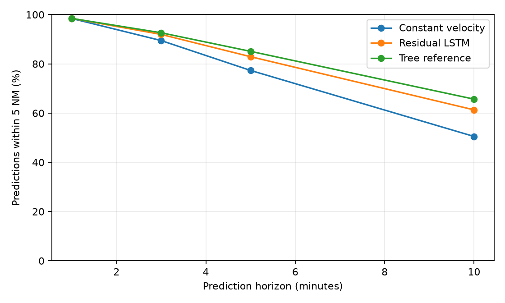
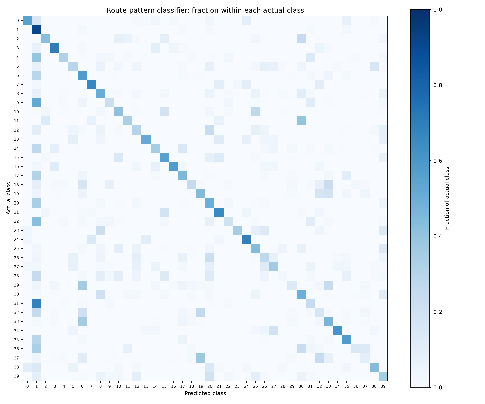
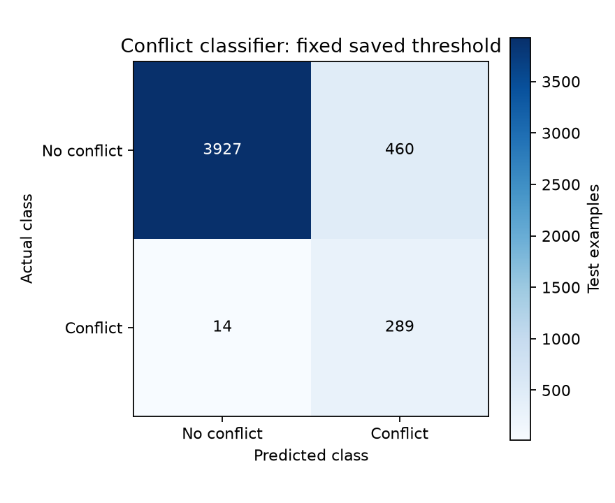
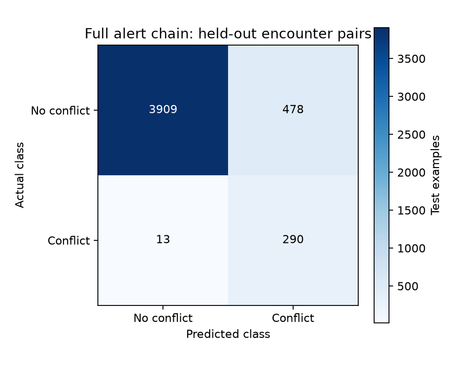

# Flight Right — Evaluation

Refreshed 2026-10-30T16:35:09.245308+00:00. Saved artifacts were evaluated without retraining or changing thresholds.

**Headline: 95.07% (270/284) of eligible conflicts caught with at least three minutes of warning.** The full alert chain catches 95.42% (271/284).

Speech evaluations are maintained separately and are intentionally excluded from this document and `metrics.json`.

## Earlier evaluations and reproducibility

- [Previous evaluation, preserved verbatim](evaluation-history/20261030_before_refresh/evaluation.md), with its original metrics, figures and ablations in the same directory.
- [Initial training report](../ml_pipeline/reports/training_report_20260906_140317.md).
- [Earlier saved-model evaluation](../ml_pipeline/reports/reevaluation_20260908_093417.json). All earlier dated reports remain available.
- [Current machine-readable results](metrics.json), including full confusion matrices, per-class metrics and SHA-256 fingerprints of the model files.

- reevaluation: [ml_pipeline/reports/reevaluation_20261030_155729.json](../ml_pipeline/reports/reevaluation_20261030_155729.json)
- multipath: [ml_pipeline/reports/multipath_3d_20261030_212632.json](../ml_pipeline/reports/multipath_3d_20261030_212632.json)
- runtime: [ml_pipeline/reports/offsets_ab_20261030_163306.json](../ml_pipeline/reports/offsets_ab_20261030_163306.json)

Reproduce the scoring, then publish the resulting dated report paths:

```powershell
venv\Scripts\python.exe ml_pipeline/utils/reevaluate_models.py
venv\Scripts\python.exe ml_pipeline/utils/multipath_3d_eval.py
venv\Scripts\python.exe ml_pipeline/utils/offsets_ab_test.py
venv\Scripts\python.exe scripts/update_evaluation.py --reevaluation PATH --multipath PATH --runtime PATH
```

## What each component is evaluated on

| Component | Evaluation | Interpretation |
|---|---|---|
| Model 1: residual LSTM | Horizontal mean, RMSE, median, 90th percentile; altitude MAE; within-distance rates, per horizon and regime | Predicts a single future position |
| Tree reference | Same trajectory metrics from saved test predictions | Comparison benchmark; not served |
| Model 1b: multi-path | Top-1 and best-of-5 coverage, horizontal and vertical, calibration; cluster confusion matrix and precision/recall/F1 | Five candidates cover alternatives; best-of-5 is not single-guess accuracy |
| Model 2: conflict classifier | Precision, recall, F1, F2, confusion matrix, PR-AUC, calibration, warning time | Conflict is the positive class |
| Full alert chain | Same binary metrics, warning rate and alarm tiers, including multi-path geometry | Evaluates the served decision logic on encounter pairs |
| Model 3: deterministic resolution engine | Candidates simulated, rejected, offered; real/false-alarm coverage | No learned class labels; classification F1 is not applicable |
| Alert feed | Interruptions before/after and pairs retained | Display suppression, not another predictive model |

The trajectory test set contains 39,614 windows, with a mask selecting available future targets. The conflict test set contains 4,690 pairs. Both splits follow collection time. Encounter labels use the recorded futures of real tracks, with one track relocated to create encounters; these are not observed real-world near misses. The warning metric is a subset of conflict recall, restricted to conflicts with at least 180 seconds until their recorded closest approach.

## Model 1 and the tree reference

Lower errors are better; higher within-distance rates are better. NM means nautical miles. MAE means mean absolute error.

| Model | Horizon | n | Mean NM | RMSE NM | Median NM | P90 NM | Within 1 NM | Within 5 NM | Altitude MAE ft |
|---|---|---|---|---|---|---|---|---|---|
| Constant velocity | 1 min | 38110 | 0.492 | 1.769 | 0.080 | 1.111 | 89.08% | 98.43% | 119.9 |
| Constant velocity | 3 min | 32324 | 1.688 | 3.684 | 0.270 | 5.239 | 67.90% | 89.46% | 471.3 |
| Constant velocity | 5 min | 27587 | 3.654 | 7.162 | 0.832 | 11.152 | 52.02% | 77.33% | 910.5 |
| Constant velocity | 10 min | 18662 | 10.305 | 16.862 | 4.865 | 29.180 | 28.99% | 50.50% | 2231.1 |
| Residual LSTM | 1 min | 38110 | 0.450 | 1.731 | 0.073 | 0.967 | 90.28% | 98.46% | 98.6 |
| Residual LSTM | 3 min | 32324 | 1.376 | 3.104 | 0.235 | 4.182 | 71.71% | 91.96% | 304.3 |
| Residual LSTM | 5 min | 27587 | 2.688 | 5.372 | 0.672 | 7.779 | 56.11% | 82.90% | 509.6 |
| Residual LSTM | 10 min | 18662 | 6.409 | 10.467 | 3.234 | 17.152 | 24.73% | 61.31% | 1108.6 |
| Tree reference | 1 min | 38110 | 0.432 | 1.705 | 0.065 | 0.908 | 90.75% | 98.46% | 94.8 |
| Tree reference | 3 min | 32324 | 1.271 | 2.963 | 0.197 | 3.912 | 73.35% | 92.63% | 294.7 |
| Tree reference | 5 min | 27587 | 2.390 | 5.017 | 0.504 | 7.069 | 60.06% | 85.08% | 511.7 |
| Tree reference | 10 min | 18662 | 5.568 | 9.510 | 2.332 | 15.276 | 33.07% | 65.66% | 1080.0 |



The LSTM beats constant velocity at every horizon on the within-5-NM gate: **True**. The tree row re-scores saved predictions rather than refitting a new benchmark. Detailed turn, vertical-motion and airport-distance breakdowns are in `metrics.json`.

## Model 1b: multi-path trajectories

A 3-D hit requires the **same candidate** to be within both 5 NM horizontally and 1,000 ft vertically at ten minutes. Arrivals are the existing near-airport evaluation bucket; all-traffic includes those arrivals.

| Method | Group | n | Top-1 within 5 NM | Best-of-5 within 5 NM | Top-1 3-D hit | Best-of-5 3-D hit |
|---|---|---|---|---|---|---|
| Constant velocity | arrivals | 2923 | 15.81% | 15.81% | 14.68% | 14.68% |
| Constant velocity | all | 18662 | 50.50% | 50.50% | 41.86% | 41.86% |
| Previous table offsets | arrivals | 2923 | 41.33% | 64.25% | 16.66% | 20.25% |
| Previous table offsets | all | 18662 | 65.27% | 84.09% | 35.83% | 42.62% |
| Served per-mode offsets + destination | arrivals | 2923 | 47.21% | 76.46% | 34.45% | 48.79% |
| Served per-mode offsets + destination | all | 18662 | 68.07% | 88.43% | 55.90% | 68.19% |

### Route-pattern classification

This internal classifier selects among 40 learned route clusters, using 18,662 test windows with ten-minute targets. The target cluster is assigned from the actual future horizontal residual by the saved KMeans model. These scores describe cluster selection, not conflict detection or final trajectory accuracy.

| Average | Precision | Recall | F1 |
|---|---|---|---|
| macro avg | 0.5155 | 0.4147 | 0.4413 |
| weighted avg | 0.6170 | 0.6355 | 0.6100 |

Top-1 cluster accuracy / micro precision, recall and F1: **0.6355**. Macro averages give every cluster equal weight; weighted averages use the true cluster frequencies. All cluster labels, including those absent from test, are retained and zero-division metrics are zero.



[Full 40 × 40 counts as CSV](figures/confusion_route_clusters.csv); per-class scores are in `metrics.json`. Rows are actual classes and columns are predicted classes. The heatmap divides each row by its support so frequent clusters do not hide rare-cluster errors; the CSV retains the unnormalized integer counts. Classes absent from the test split have zero rows.

Temperature: 1.0646. Cluster calibration error (lower is better), before → after: arrivals 0.022 → 0.017; all traffic 0.015 → 0.011. This measures cluster-probability calibration, not the probability of a conflict.

## Model 2 and the full alert chain

Precision is the share of alerts that are real conflicts. Recall is the share of real conflicts caught. F1 balances both; F2 puts more weight on recall. All scores below use the saved operating threshold, not a threshold selected on this test set.

| Decision | Precision | Recall | F1 | F2 | TN | FP | FN | TP | Caught ≥3 min |
|---|---|---|---|---|---|---|---|---|---|---|
| Conflict classifier | 0.3858 | 0.9538 | 0.5494 | 0.7369 | 3927 | 460 | 14 | 289 | 270/284 |
| Rule 8 NM / 1,500 ft | 0.4356 | 0.8812 | 0.5830 | 0.7315 | 4041 | 346 | 36 | 267 | 248/284 |
| Rule 5 NM / 1,000 ft | 0.6203 | 0.8251 | 0.7082 | 0.7740 | 4234 | 153 | 53 | 250 | 232/284 |
| Full served alert chain | 0.3776 | 0.9571 | 0.5415 | 0.7323 | 3909 | 478 | 13 | 290 | 271/284 |

TN = correctly quiet; FP = false alarm; FN = missed conflict; TP = caught conflict.

Saved raw threshold: **0.07465646**. PR-AUC (average precision): **0.8064**. Brier score, raw → calibrated: 0.0304 → 0.0234; calibration error: 0.0318 → 0.0086. Calibration preserves the alert set: True.





Full-chain tier 1: 28 real / 20 false; tier 2: 262 real / 458 false. False alarms per 1,000 pairs: 101.92.

The full-chain test checks the actual escalation decision against its measured implementation on every pair. It assumes unchanged geometry for three updates to satisfy persistence. It is an encounter-level offline evaluation, not a timing or end-to-end live-surveillance test. The geometry-only runtime block retained in the JSON is diagnostic and omits multi-path geometry.

## Model 3: resolution engine

Evaluated 45 classifier-triggered tier-1 candidate encounters (27 real, 18 false). Simulated 1170 manoeuvres; blocked 1 unsafe candidates, rejected 923 ineffective and 0 secondary-conflict candidates. Offered 46 instructions across 21 encounters; 24 received none. Instructions on real conflicts: 35; on false alarms: 11.

This harness reconstructs the pair's instantaneous geometry; it does not supply all surrounding traffic or the complete multi-path alert stream. A zero secondary-conflict rejection count therefore does not establish runtime domino-check effectiveness. These are simulation outcomes, not proof that a manoeuvre is safe in actual operations. Precision, recall and confusion matrices are not defined for the engine's ranked manoeuvre outputs.

## Alert-feed display suppression

| Recorded session | Frames | Notifications before | After | Reduction | Pairs lost |
|---|---|---|---|---|---|
| 05 Sep, 00:30 IST | 536 | 680 | 179 | 73.7% | 0 |
| 03 Sep, 20:45 IST | 540 | 909 | 235 | 74.1% | 0 |

This replay uses rule-generated assessments to isolate the display filter. It does not measure the full learned alert chain, controller workload, or reduction in real-world errors. A pair retained in the active list can produce fewer repeated notifications.

## Limits and interpretation

- These are repeated measurements on the existing test split, not new independent test data. Improvements developed against this split need a fresh held-out evaluation before a generalization claim.
- No model weights, target definitions, thresholds or alert decisions were changed by this refresh.
- Per-class support, all trajectory regime breakdowns, probability diagnostics and model fingerprints are in `metrics.json`.
- [Historical ablation study](ablation.md) contains its original experiment comparisons; it is a dated study, not a new multi-seed experiment from this refresh.
