# Flight Right — Evaluation

Every model built so far, measured on held-out data, with the baseline it has to beat
reported beside it in every table. **Every number in this document is explained in plain
words next to it** — if a figure appears without a sentence saying what it would mean to
be right or wrong, that is a bug in the document.

**Models trained:** 6 September 2026, run
`ml_pipeline/reports/training_report_20260906_140317.md`.
**Re-measured:** 8 September 2026, and again on **21 September 2026**, by
`python ml_pipeline/utils/reevaluate_models.py`, which loads each saved model in a fresh
process and scores it again without retraining anything. The two runs are **identical to
every decimal place** — the report files differ only in their timestamp. Every figure
below was regenerated from those artifacts.
**Reproduce:** `python ml_pipeline/utils/reevaluate_models.py` (re-score, ~6 min) or
`python ml_pipeline/run_pipeline.py` (full retrain, ~20 min on an RTX 4050), then
`python ml_pipeline/utils/verify_pipeline.py` (110 checks, ~1 min).
**Figures:** `python ml_pipeline/utils/build_evaluation_figures.py`; raw values in
[`metrics.json`](metrics.json). The tree-reference columns come from
`ml_pipeline/data/processed/eval_tree_reference.csv`, written by
`reference_benchmark.py`; until 21 September they were typed into the figure script by
hand, which is the one thing this project's rules forbid. Re-checked on 21 September: the
hand-typed values were correct to one decimal in all twelve cases, so nothing published
here was ever wrong — but nothing enforced it either, and now something does.

---

## 26 September 2026: two served models changed — read this before any table below

At Archit's decision, two of the models the system runs were replaced. Figures further down
this document that describe the **old** models are kept as the record of what was measured then;
[`metrics.json`](metrics.json), [`ablation.md`](ablation.md) and the charts were regenerated from the
new models by `reevaluate_models.py` (`ml_pipeline/reports/reevaluation_20260926_122322.json`).
Where a table below disagrees with those files, the files win.

| | Before (6 Sep classifier, 23 Sep path model) | Now (26 Sep) | What it means |
|---|---|---|---|
| **Headline: conflicts caught with ≥ 3 min warning, classifier alone** | 94.0% (267 of 284) | **95.1% (270 of 284)** | three more real conflicts caught in time |
| Classifier recall / false alarms per 1,000 pairs | 0.9439 / 96.8 | **0.9538** / 98.1 | GATE 1 (0.95) passes for the first time |
| Running system (classifier + safety net + path model), ≥ 3 min | 94.7% (269) | **95.4% (271)** | what the controller actually gets |
| Running system false audible alarms (tier 1), test | 17 | **21** | the cost: four more loud alarms for conflicts that do not happen |
| Arrivals, one of five paths within 5 NM at 10 min | 71.5% | **75.4%** | the path model trained with 400,000 extra archive examples |
| Arrivals, single best guess within 5 NM at 10 min | 44.2% | **46.8%** | |

**What changed.** (1) The conflict classifier now also reads the altitude each crew has dialled into
the autopilot (adsb.lol, where broadcast), with its alarm threshold chosen on validation so the
false-alarm rate stays where it was: the gain goes to catching conflicts. Four random seeds all land
at 269–271 of 284, so this is not a lucky run. (2) The path model is the one trained on extra archive
days; on test it changes no alert, and on validation it demoted one real audible alarm to the watch
list, a cost Archit accepted. Evidence: `classifier_intent_seeds_20260926_172128.json`,
`offsets_ab_*` (26 Sep), `multipath_archive_seeds_20260925_030354.json`.

---

## Which number belongs to which model file

**This document and [`metrics.json`](metrics.json) are authoritative.** Everything else in
the repository quotes them.

That matters because `docs/CLAUDE.md` contains three different figures for the same
metric — the LSTM's ten-minute within-5-NM rate reads **60.9%**, **60.8%** and **61.3%**
in different places. They are not a contradiction and none of them is a typo. **They are
three different model files**, and only one of them still exists:

| Figure | Which file produced it | Still on disk? |
|---|---|---|
| 35.8% arrivals / 60.9% overall | the 5 September model (best epoch 19, validation loss 0.235965) | no, overwritten |
| 60.8% overall | a 6 September morning re-run of the training script | no, overwritten |
| **34.8% arrivals / 61.3% overall** | **`trajectory_residual.pt`, written 6 September 14:02:25 — the file the system actually runs** | **yes** |

The evidence that the third row is the shipped one: the model file's own timestamp is
*earlier* than the start of the 6 September 14:03 pipeline run, because that run resumed
from a training step that had already succeeded and written its model before crashing on
shutdown. The `multipath.log` from that same run, reading that same file, prints
`single-answer residual LSTM  34.8%  61.3%` — and re-scoring the file today returns
34.8 / 61.3 again.

`CLAUDE.md` explains the 60.8-versus-60.9 gap as graphics-card rounding, which is right.
It never mentions the further step to 61.3, because it never recorded evaluating the model
it shipped. The entries in that file are dated historical records and are **left exactly as
they were written** — rewriting them would destroy the evidence trail. When the two
disagree, this document wins.

For the same reason, `CLAUDE.md` says "all 36 raw parquets" in its 5 September entry and
"the current 35 raw parquets" in its 6 September one. There are **35** on disk today, and
the later entry is the correction.

---

## First, the five words this document cannot avoid

Read these once and the rest of the document is readable.

| Word | What it means here |
|---|---|
| **NM** (nautical mile) | The distance unit aviation uses. 1 NM ≈ 1.85 km. Two aircraft are legally "separated" if they are at least 5 NM apart *or* 1,000 ft apart in height. |
| **CPA** (closest point of approach) | The single moment in the future when two aircraft will be nearest each other. "CPA 4 NM in 90 s" means: in a minute and a half they will be four miles apart, and after that they start moving away again. |
| **Conflict** | A predicted CPA closer than 5 NM **and** less than 1,000 ft — i.e. they lose legal separation. |
| **Horizon** | How far ahead we are predicting. We predict at 1, 3, 5 and 10 minutes. Longer horizon = harder. |
| **Held-out test data** | Traffic from days the model has never seen. Scoring a model on data it trained on is like marking your own homework from the answer sheet. |

---

## The headline number

> **94.0% of conflicts are caught with at least three minutes of warning.**
> That is 267 out of 284. The best rule-based detector catches 87.3% of the same 284.

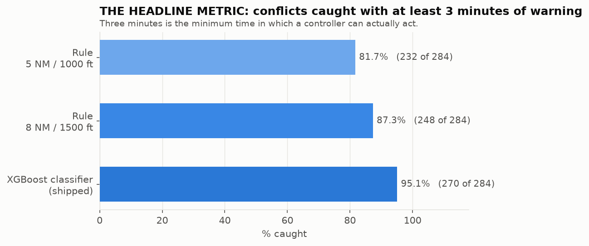

### Two numbers, and which one this document means

This document quotes **94.0%** throughout. That is the **conflict classifier scored on its
own**: give the model every pair in the held-out test data, apply its own threshold, count
what it would catch. It is the model's number and it is what the project's gates are defined
against.

There is a second number, and until 22 September 2026 it was very different. The classifier
does not raise alarms by itself — it sits inside a system that also has a geometric rule, a
tier assignment and a three-consecutive-updates anti-flicker rule. **What that whole system
catches is a separate measurement**, and it was not being taken:

| What is being scored | Conflicts caught | With ≥3 min warning |
|---|---|---|
| The classifier on its own — **the number this document quotes** | 0.9439 | **94.0%** (267 of 284) |
| The running system, before 22 Sep 2026 | 0.8812 | **87.3%** (248 of 284) |
| The running system, now | 0.9505 | **94.7%** (269 of 284) |

**Why the middle row was so much worse.** The classifier was computed, displayed on the
dashboard, and then **not consulted** when the system decided whether to raise an alarm —
that decision ran on geometry alone. So the dashboard was not the system this document
described. That is recorded as issue C3 in `ISSUES.md` and was fixed on 22 September; the
classifier now gates the decision.

**Nothing about the model changed.** Its weights, its threshold and its gates are untouched,
which is why the top row is identical before and after. Both numbers are now produced by
every run of `reevaluate_models.py` (under `model2.escalation_runtime`) so the gap cannot
reopen without showing up.

**Correction, 24 September 2026: the bottom row leaves out one step the running system
takes.** `reevaluate_models.py` scores the gate on the straight-line geometry only. The
backend does something more: for any pair not already inside three minutes, it takes the
time and distance from the **multi-path model** (five candidate paths per aircraft) instead,
and the 5 NM / 1,000 ft safety net then checks the *closest* of the 25 path combinations.
`ml_pipeline/utils/offsets_ab_test.py` measures that step on the same 4,690 labelled test
pairs:

| What is being scored | Alerts | Conflicts caught | With ≥3 min warning | False alarms per 1,000 | Tier 1 real / false |
|---|---|---|---|---|---|
| Running system without the multi-path step (the row above) | 762 | 0.9505 | 94.7% (269 of 284) | 101.1 | 27 / 14 |
| Running system as served **until 24 Sep** (per-pattern average offsets; net checks the model's worst path) | 817 | 0.9472 | 94.4% (268 of 284) | 113.0 | 28 / 18 |
| **Running system as served from 24 Sep** (per-mode offsets; net checks the straight line) | **762** | **0.9505** | **94.7%** (269 of 284) | **101.1** | **28 / 17** |

Until 24 September the honest figure for what the controller got was **94.4%**, not 94.7%.
The multi-path step added 55 alerts and dropped one caught conflict. The safety net was
checking the model's *closest* path combination, even one the model barely believed in:
403 safety-net alarms without it, 464 with it. On the one dropped conflict, the straight
line breached the legal minimum but the model's path did not, so the net stayed silent.

**Fixed and switched on 24 September (plan 3.2, with sign-off).** The net now always judges
the straight-line prediction, as Section 13 of `CLAUDE.md` requires. The multi-path model
still decides alarm versus watch list and still feeds Model 3's checks. Per-mode offsets
(Phase 3.1) serve by default. Against the old configuration: the same conflicts are caught
plus one, **55 fewer alerts** (all false), and one fewer false audible alarm. Against no
multi-path step at all, the alerts are identical and the model moves one real conflict up
into the audible tier 1 alarm.

**Plan 3.2's candidate pruning was measured and not adopted.** Keeping each aircraft's paths
up to 90% of probability, dropping paths under 0.10, or dropping combinations under 0.05
all cut most of the extra alarms. Letting the model's paths *add* to the net (straight line
OR model) catches up to 2 more real conflicts with per-mode offsets (271 of 284), at 18.3
more false alarms per 1,000 pairs. Under the adoption rule fixed before the numbers were
seen (no loss in catches, recall or real tier 1 alarms; then fewest false alarms), the
straight-line net wins. The full 21-configuration table is in
`ml_pipeline/reports/offsets_ab_20260924_181140.json`.

Sources: `ml_pipeline/utils/offsets_ab_test.py`. One training seed for the per-mode offsets
(plan 3.3 owes three). The 94.0% model figure is unaffected.

**When quoting either, say which one it is.** "94.0% of conflicts caught with three minutes
of warning" is the defensible sentence for the model. "The running system catches 94.7%" is
the defensible sentence for the system. Merging them is not defensible.

**How to read 94.0%.** Take every real conflict in the test data that still had three or
more minutes to run when we looked at it — there are 284 of them. We raised an alert on
267. We missed 17. 267 ÷ 284 = 94.0%.

**Why "at least three minutes" and not just "caught at all".** Because a warning that
arrives too late to act on is not a warning. Three minutes is not a round number; it is
arithmetic:

| Step | Time |
|---|---|
| Controller sees the alert and decides | 15 s |
| Radio call and pilot reads it back | 15 s |
| Pilot physically starts moving the controls | 8 s |
| **Nothing has moved yet** | **38 s** |
| Then: a 1,000 ft climb or descent takes | ~40 s |
| Or: a 30° turn at 450 kt takes | ~96 s |

So the shortest useful warning is about 90 seconds, and three minutes is that with a
margin. Model 3 reached the same boundary independently and by a completely different
method — see the "90 seconds" result in its section.

## Five rules applied to every number in this document

They exist because breaking them has already cost this project weeks.

1. **Splits are by time, on whole collection sessions.** Test data comes from later dates
   than validation, which comes from later dates than training. Aircraft positions ten
   seconds apart are nearly identical, so a random split would put near-copies of the same
   moment on both sides and every score would be inflated.
2. **The constant-velocity baseline is measured on identical data, in the same run.**
   "Constant velocity" means the dumbest possible prediction: assume the aircraft keeps
   flying in exactly the same direction at exactly the same speed. A model that cannot beat
   that is worthless — and one of ours did lose to it, at every horizon, for three weeks,
   because nobody printed the comparison.
3. **Never one averaged figure.** Always per horizon and per flight regime. The 1-minute
   predictions are so easy that averaging them in hides a 10-minute failure completely.
4. **Probabilities are corrected before any threshold is applied.** If a model says "90%
   likely" and it is right 67% of the time, then a rule saying "alert above 85%" does not
   mean what it says.
5. **Best-of-K is never reported as accuracy.** They are different measurements and mixing
   them up is the single easiest way to overstate this project.

---

# Model 1 — Trajectory prediction

**The job:** given where an aircraft has just been, say where it will be in 1, 3, 5 and
10 minutes.

**The design:** a 2-layer LSTM (a neural network that reads a sequence in order and
remembers what it has seen). It does **not** predict the position. It predicts the
*correction* to the constant-velocity guess — how far off the straight-line answer will
be. So if it outputs zero, you get exactly the physics answer back. It starts at the
baseline and can only be pushed off it by evidence. Trained on 291,008 examples drawn
from 627,344 real aircraft positions across 33 collection sessions.

**Test split: 39,614 examples, 6 sessions, 4 Sep 08:01 → 5 Sep 09:28 IST.**

| Horizon | n | CV mean | **LSTM mean** | Tree ref. | CV <5 NM | **LSTM <5 NM** | Tree ref. |
|---|---|---|---|---|---|---|---|
| 1 min | 38,110 | 0.49 NM | **0.45 NM** | 0.43 NM | 98.4% | **98.5%** | 98.5% |
| 3 min | 32,324 | 1.69 NM | **1.38 NM** | 1.27 NM | 89.5% | **92.0%** | 92.6% |
| 5 min | 27,587 | 3.65 NM | **2.69 NM** | 2.39 NM | 77.3% | **82.9%** | 85.1% |
| 10 min | 18,662 | 10.30 NM | **6.41 NM** | 5.57 NM | 50.5% | **61.3%** | 65.7% |

**Reading this table, one column at a time.**

- **n** is how many test examples that row is measured on. It shrinks with the horizon
  because to score a 10-minute prediction the aircraft has to still be in our recorded data
  ten minutes later, and many land or leave the area first. Only 18,662 of the 39,614 pass
  that test — which is why we never average the four rows together, since the 10-minute row
  is built on less than half the data of the 1-minute row.
- **CV mean** is the constant-velocity baseline's average error, in nautical miles. At ten
  minutes, drawing a straight line puts you **10.30 NM** away from where the aircraft really
  went, on average — about 19 km.
- **LSTM mean** is our model's average error on the same rows: **6.41 NM**. It cuts the
  baseline's error by 38%.
- **Tree ref.** is a completely different, non-neural model (a gradient-boosted tree) we
  keep as a standing bar. See the honest finding below — it wins.
- **<5 NM** is the share of predictions landing within 5 NM of the truth. 5 NM is the legal
  separation distance, so this reads as: "how often is our prediction good enough to reason
  about separation at all?" At one minute, 98.5% — near-perfect. At ten minutes, 61.3% —
  right about three times in five.

**The shape that matters:** at one minute the model and plain arithmetic are the same
(98.5% vs 98.4%), because over sixty seconds an aircraft simply does not do much. The gap
opens as the horizon lengthens, and at ten minutes the model is **10.8 points** ahead of
the baseline. That is the whole justification for having a model.

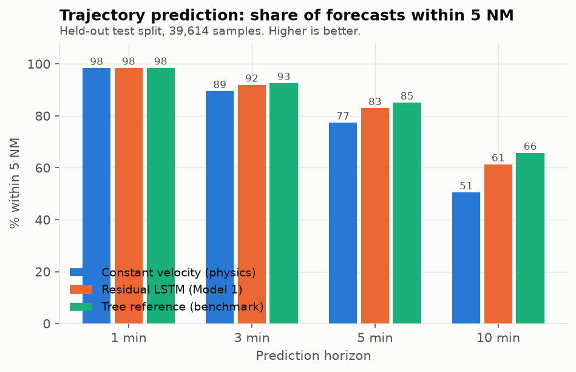

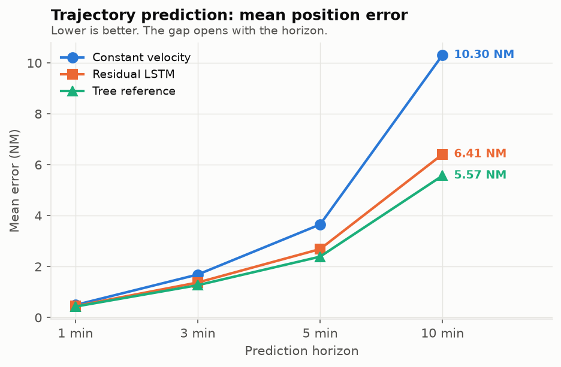

## Splitting the error into its three parts

The same error means different things depending on which direction it points, so we
measure the three separately. MAE is "mean absolute error" — the average size of the miss,
ignoring whether it was too far or not far enough.

| Horizon | Along-track MAE | Cross-track MAE | Altitude MAE |
|---|---|---|---|
| 1 min | 0.37 NM | 0.13 NM | 99 ft |
| 3 min | 0.83 NM | 0.81 NM | 304 ft |
| 5 min | 1.45 NM | 1.80 NM | 510 ft |
| 10 min | 2.81 NM | 4.96 NM | 1,109 ft |

- **Along-track** is error *along the aircraft's own route* — it got there early or late,
  but it is on the line we predicted. Mostly harmless for separation.
- **Cross-track** is error *sideways*, off the predicted line. This is the dangerous one:
  it means the aircraft is somewhere we did not expect at all.
- **Altitude** is the height error, in feet.

**The number to notice:** at one minute the sideways error is tiny (0.13 NM, about 240 m)
and almost all the error is along-track — the aircraft is exactly where we said, just
slightly ahead or behind. By ten minutes cross-track (4.96 NM) has overtaken along-track
(2.81 NM). That flip is the model losing track of *where the aircraft is going*, not just
how fast. And 1,109 ft of altitude error at ten minutes is larger than the entire 1,000 ft
vertical separation standard, which is exactly why the ten-minute prediction is only ever
used for a watch list, never for an alarm.

## Where the remaining error lives

Same measurement (10 minutes, % within 5 NM), sliced by what the aircraft is doing.

| Regime | LSTM | | Regime | LSTM |
|---|---|---|---|---|
| Straight flight | 64.3% | | Level flight | 70.0% |
| Gentle turn | 63.1% | | Gentle climb/descent | 42.8% |
| Moderate turn | 49.9% | | Fast climb/descent | 32.8% |
| **Sharp turn (>30°)** | **21.2%** | | En-route (>100 NM from VABB) | 68.3% |
| | | | **Terminal (<40 NM from VABB)** | **34.8%** |

**Read this as a difficulty ranking, not a failure list.** An aircraft in level cruise is
predictable ten minutes out 70% of the time. An aircraft in a sharp turn is predictable
21% of the time. That is not surprising and it is not fixable with a better model: whether
an aircraft turns now or in two minutes depends on an instruction from a controller that we
never receive. Terminal traffic (34.8%) is low for the same reason — aircraft near the
airport are being actively vectored by a human whose intentions we cannot see.

**Say the overall number alongside the hard cases.** Overall at ten minutes is 61.3%. The
21.2% is one specific hard slice, not the project's score.

## Two findings that must not be buried

**1. A non-neural tree beats the LSTM at ten minutes, and has on every split measured.**
A `HistGradientBoostingRegressor` — an ordinary decision-tree model, no neural network
involved — reaches **65.7%** where the LSTM reaches **61.3%**, a **4.4-point lead**. Across
three different test splits the gap has been 8.1, 2.2 and 4.4 points; the tree has never
lost. It fits 12 separate small models (4 horizons × 3 directions) where the LSTM shares one
trunk across all of them. **The LSTM must not be described as our best trajectory model.**

**2. At ten minutes the LSTM is worse than plain arithmetic at the very best predictions.**
Within-1-NM is **24.7% for the LSTM against 29.0% for constant velocity** (tree: 33.1%). So
the model pulls the *whole* distribution inward — average error 10.30 → 6.41 NM, and the
worst tenth of cases from 29.2 NM to 17.0 NM — while giving up some predictions that were
already nearly perfect. Both facts are true at once and both are reported. This is a known
consequence of the loss function setting (`SmoothL1Loss`, `beta = 0.05`); raising beta makes
it worse rather than better, which was measured.

Training was **overfitting, not under-trained**, on all three runs: the score on unseen data
stopped improving around epoch 12 while the score on training data kept improving. That
means the model was starting to memorise, so training longer will not close the tree gap.

---

# Model 1b — Multi-path prediction

**The job:** instead of one answer, give five plausible futures with a probability on each.

**Why this exists, measured rather than assumed.** Take two aircraft in an *identical*
situation — same position, speed, heading, same recent history. Ten minutes later they end
up **7.9 NM apart on average**, and 64% of such pairs finish more than 5 NM apart. The
future genuinely is not determined by what we can see, because whether a controller turns an
aircraft now or in two minutes is information we never receive. So a single answer is the
wrong shape of output. For conflict detection we never have to pick one: check all five and
warn if any of them conflicts.

**How it works:** 40 typical route shapes are learned from the training data (by KMeans, an
algorithm that groups similar things together), and a classifier picks the five most likely
shapes for the aircraft in front of it.

| Method | Arrivals (<40 NM from VABB) | All test traffic |
|---|---|---|
| Constant velocity | 15.8% | 50.5% |
| Single-answer residual LSTM | 34.8% | 61.3% |
| Multi-path, 1 option | 38.6% | 64.0% |
| Multi-path, 3 options | 57.9% | 79.0% |
| **Multi-path, 5 options (served until 24 Sep 2026; see per-mode below)** | **63.6%** | **83.0%** |
| Multi-path, 10 options | 68.8% | 86.5% |

**Reading it.** Every number is "% of cases where a prediction landed within 5 NM of the
truth at ten minutes". The **arrivals** column is aircraft descending into Mumbai — the
hardest traffic there is, and the reason the numbers there are so much lower than the
all-traffic column beside them. On arrivals, straight-line arithmetic works 15.8% of the
time, our single-answer model 34.8%, and offering five options 63.6%.

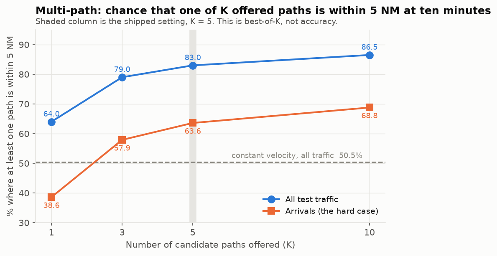

> ### 63.6% is best-of-5. It is NOT accuracy. This distinction matters more than the number.
>
> It means: *one of the five* candidate paths landed within 5 NM. It does **not** mean the
> model picks the right answer 63.6% of the time — that figure is **38.6%** (the "1 option"
> row). Both are true and they answer different questions. Best-of-5 is the right measure
> here only because the conflict checker genuinely examines all five paths, so a hit on any
> of them is a real hit. If anyone asks "how accurate is your model", 63.6% is the wrong
> answer to give.

**Why we stopped at 5 rather than 10.** Ten options score better (68.8%) but every extra
path multiplies the pairwise conflict check — checking two aircraft means comparing every
path of one against every path of the other, so 5×5 = 25 comparisons and 10×10 = 100. Five
buys most of the benefit at a quarter of the cost.

## Per-mode offsets — served from 24 September 2026, checked across four seeds

**What changed (Phase 3.1).** The table above moves every aircraft on a route shape by that
shape's *average* offset. The per-mode version predicts the offset *for this aircraft*,
given the shape and its own recent motion. The shapes, their probabilities and the
five-candidate ranking are unchanged. Only where each candidate lands moves. It serves by
default since 24 September.

**Is the gain real, or one lucky training run? (Phase 3.3).** Trained four times, each with
a different random starting point for every part of the model (route shapes, shape
classifier, offset models), on identical data splits. Seed 42 is the served model, and
retraining it reproduced every printed metric exactly.

| Arrivals, ten minutes, within 5 NM | seed 42 (served) | seed 1 | seed 2 | seed 3 | mean ± spread |
|---|---|---|---|---|---|
| Per-mode, 5 options | 71.5% | 72.1% | 72.4% | 71.8% | **72.0% ± 0.4** |
| Pattern table, 5 options | 63.6% | 63.6% | 61.7% | 64.8% | 63.4% ± 1.3 |
| Per-mode, 1 option | 44.2% | 42.6% | 43.4% | 44.4% | **43.7% ± 0.8** |
| Pattern table, 1 option | 38.6% | 37.8% | 37.1% | 39.8% | 38.3% ± 1.2 |
| Per-mode, 5 options, all test traffic | 86.6% | 86.9% | 86.8% | 87.1% | 86.9% ± 0.2 |

Per-mode beats the table on **every** seed: by 7.0 to 10.7 points with five options and by
4.6 to 6.4 with one. Every gate passes on every seed. The served model is the *lowest* of the
four with five options, so its 71.5% is not a lucky draw. The best seed was deliberately not
swapped in; that would be picking a result. The single likeliest path also beats straight
lines at every horizon on every seed (mean error at ten minutes 5.65 to 5.73 NM, against
10.30). Source: `ml_pipeline/reports/multipath_seeds_20260925_012526.json`.

The best-of-5 warning above applies unchanged: 72% is "one of five was close", and 44% is
"the single likeliest was close".

## Height as well as position — measured for the first time on 25 September 2026

**Every multi-path figure above is horizontal only.** "Within 5 NM" says nothing about height,
but a conflict needs both: closer than 5 NM **and** closer than 1,000 ft. The multi-path model
does predict altitude, but until 25 September nothing scored it.
`ml_pipeline/utils/multipath_3d_eval.py` now does, on the same test split
(`ml_pipeline/reports/multipath_3d_20260925_030155.json`):

| Ten minutes ahead | Straight line | Pattern table | **Per-mode (served)** |
|---|---|---|---|
| Likeliest path's height error, mean, all traffic | 2,231 ft | 2,224 ft | **1,116 ft** |
| Likeliest path within 1,000 ft of the real height, all traffic | 62.6% | 57.0% | **71.1%** |
| Arrivals: one of 5 within 5 NM | 15.8% | 63.6% | 71.5% |
| Arrivals: one of 5 within 1,000 ft | 26.9% | 43.9% | 72.4% |
| **Arrivals: one of 5 within 5 NM AND 1,000 ft** | 14.7% | 21.2% | **44.1%** |
| All traffic: one of 5 within 5 NM AND 1,000 ft | 41.9% | 52.2% | **66.0%** |

Two things follow. First, **the pattern table predicted height no better than a straight
line**, and worse at ten minutes (57.0% vs 62.6% within 1,000 ft). Its route shapes are grouped
on horizontal movement only, so each shape's height correction averages climbing and
descending aircraft into roughly nothing. Per-mode offsets fix this: the height error halves.
That is a second, previously unmeasured benefit of the 24 September switch. Second, the honest
three-dimensional figure for arrivals is **44.1%, not 71.5%**. Quote it whenever the question
is about conflicts rather than about where an aircraft will be on a map.

## More data: the OpenSky archive (Phase 3.3), measured and not served

The same model was trained with 400,000 extra windows from 12 archive days (February 2025 to
July 2026). All of them come from before the validation period, so nothing from the future
leaks in. Validation and test are unchanged. Four runs with different seeds
(`ml_pipeline/reports/multipath_archive_seeds_20260925_030354.json`):

| Arrivals, ten minutes | Per-mode, 4 runs | + archive, 4 runs |
|---|---|---|
| One of 5 within 5 NM | 72.0% (71.5–72.4) | **75.6%** (74.9–76.1) |
| Likeliest within 5 NM | 43.7% (42.6–44.4) | **46.7%** (46.3–47.2) |
| One of 5 within 5 NM AND 1,000 ft | 44.1% (served run) | **46.4–46.9%** |
| One of 5 within 1,000 ft | 72.4% (served run) | 65.5–67.2% (lower) |

Better on position and on the combined measure. The five paths cover a narrower range of
heights, so "one of five within 1,000 ft" falls. The pattern classifier trained on more data
is also much less over-confident before calibration (temperature 1.73 → 1.07).

**Not served, because it did not help the controller.** Scored through the served alert chain
on labelled pairs (`ml_pipeline/reports/alert_prominence_compare_20260924_213320.json`), the
alerts were identical on test. On validation, one real conflict lost its audible tier 1 alarm
and one false one gained it. Every tier change sits at the 180-second boundary, and several are
decided by a path combination that does not conflict at all. The swap reshuffles borderline
pairs rather than improving anything a controller sees. The adoption rule, set before the
result, required no real conflict to lose its alarm.

## Calibration — are the stated probabilities honest?

**The problem.** The raw model was badly over-confident: when it said "90% likely", the
thing happened about 67% of the time. That matters directly, because the alert rules compare
against these numbers (tier 1 fires above 0.85, tier 2 above 0.60). A probability that
overstates itself makes those thresholds fire more readily than they claim to.

**The fix.** Temperature scaling (Guo et al. 2017, <https://arxiv.org/abs/1706.04599>): fit
one single number, called the temperature, on validation data, and divide every score by it
before converting to probabilities. It flattens over-confidence uniformly. The key property
is that it is **monotone** — it can never reorder the five options, so every best-of-K figure
above is provably identical before and after. Only the stated probabilities move.

| | Before | After |
|---|---|---|
| Fitted temperature | — | **1.729** |
| Calibration error, arrivals | 0.054 | **0.019** |
| Calibration error, all test | 0.040 | **0.012** |

**What "calibration error" is, in one sentence:** group all the predictions by what
probability the model claimed, and for each group check how often that thing actually
happened; the calibration error is the average gap between the two. **0 is perfect
honesty.** So 0.054 → 0.019 means the model's stated confidence went from being wrong by
about 5.4 percentage points on average to about 1.9 — nearly three times more honest.
**Temperature 1.729** is just how much flattening was needed; anything above 1.0 means the
raw model was over-confident, which confirms the diagnosis rather than assuming it.

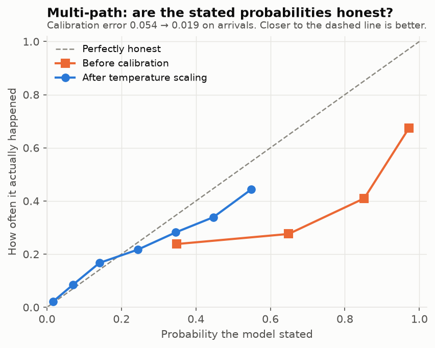

**How to read that chart.** The dashed diagonal is perfect honesty: everything the model
called 40% happens 40% of the time. The orange line (before) sags well below it — the model
claimed far more than it delivered. The blue line (after) sits much closer to the diagonal.
It is still slightly below at the top, so the model remains a little over-confident even
after correction; that is reported rather than hidden.

**Still open:** the tier thresholds (0.85 and 0.60) were chosen against the *old*,
over-confident numbers and **have not been revisited** against the corrected ones. Doing so
changes when a controller is interrupted, so it needs Archit's sign-off.

---

# Model 2 — Conflict classifier

**The job:** given two aircraft, decide whether they are going to lose separation. This is
the model the headline number is measured on.

**The design:** XGBoost — a gradient-boosted tree, meaning hundreds of small decision trees
each correcting the previous one's mistakes. 300 trees, depth 6, over 24 numbers describing
the pair.

**The single most important design point.** The 24 input numbers come from our
**constant-velocity prediction** — what the straight line says will happen. The answer key
comes from **where the two real aircraft actually went**, recorded in the data. Those are
deliberately different things, and the difference is the entire learning problem: the model's
job is to learn *where our own predictions go wrong*.

**Dataset:** 40,000 encounters, 2,581 real conflicts (6.45%), 31 sessions.
**Test:** 4,690 pairs, 303 real conflicts (6.46%), from sessions strictly later than
training and validation.

**Both aircraft are real; only the introduction is arranged.** Genuine near-misses are
vanishingly rare — we would wait years for a training set. So aircraft B's entire real
recorded future is picked up and moved as **one rigid piece**, like sliding a photograph
across a table and rotating it. Every real turn, climb and speed change inside it survives
exactly. The flying is real; only the pairing is manufactured.

## The leakage guard — the trap this model already fell into once

**What went wrong before.** The earlier version of this dataset was circular. Two of its nine
inputs were the predicted CPA distances, and the answer key was the separation rule applied
to those same two numbers. The model was being handed the answer and asked to find it.
Verified rather than suspected: recomputing the answer key from just those two inputs
reproduced it for **40,000 rows out of 40,000 — exactly 100.00%**. That fully explained its
reported perfect score.

**Where it stands now.** After the rebuild, the separation rule applied to the predicted CPA
reproduces the answer for **95.60%** of rows. **The 1,760 rows where it disagrees are the
entire point of the model** — those are the cases our own prediction gets wrong.
`assert_no_leakage()` refuses to train on any dataset above 99%, so this failure cannot come
back silently.

## Results

| Method | Recall | Precision | F-β(2) | FA/1000 | Missed | Headline (≥3 min) |
|---|---|---|---|---|---|---|
| Rule at legal minimum 5 NM / 1000 ft | 0.8251 | 0.6203 | 0.7740 | 32.6 | 53 | 81.7% |
| Rule at alert volume 8 NM / 1500 ft | 0.8812 | 0.4356 | 0.7315 | 73.8 | 36 | 87.3% |
| **XGBoost at threshold 0.0851** | **0.9439** | 0.3865 | 0.7326 | 96.8 | **17** | **94.0%** |

**Every column, in plain words.**

- **Recall = of all the real conflicts, what fraction did we catch?** 0.9439 means we caught
  94.39% of them. **This is the most important column**, because the cost of missing one is
  not comparable to the cost of a false alarm.
- **Precision = of all the alerts we raised, what fraction were real?** 0.3865 means about
  four in ten. Six in ten were for conflicts that did not happen. That sounds bad; the
  section "What actually reaches the controller" shows why it is much less bad in practice
  than it sounds, and it is not an excuse — it is a measurement.
- **F-β(2)** combines recall and precision into one score, but **weights recall four times
  more heavily** (that is what β=2 does). We use it rather than the usual F1, which weights
  them equally, because in this application they are not equally important. 0.7326 is that
  combined score.
- **FA/1000 = false alarms per 1,000 pairs examined.** 96.8 means that for every thousand
  pairs of aircraft we look at, about 97 get an alert they did not deserve.
- **Missed** is the raw count of real conflicts we said nothing about: **17**, against the
  rule's 36. This is the number that would matter in an incident report.
- **Headline** is the project metric: of conflicts with at least three minutes of warning
  available, what share did we catch.

**Why "accuracy" is not in that table.** Only 6.46% of pairs are conflicts, so a model that
answers "no conflict" to everything scores 93.5% accuracy while catching nothing at all.
Accuracy is actively misleading on rare events, which is why the project forbids it.

**PR-AUC 0.804.** The precision-recall curve shows the trade between the two as you make the
model more or less trigger-happy; PR-AUC is the area under it, summarising every possible
setting in one number between 0 and 1. The bar to beat is the conflict rate itself, **0.065**
— that is what random guessing scores. 0.804 against 0.065 says the model has learned
something substantial. (The previous, circular version scored 1.000, which was the giveaway.)

**Median warning time on caught conflicts: 330 seconds** — five and a half minutes. Half of
the conflicts we catch are caught with more than that in hand.

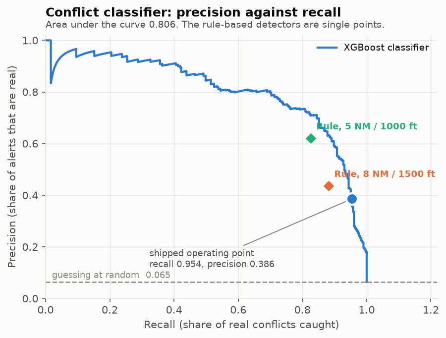

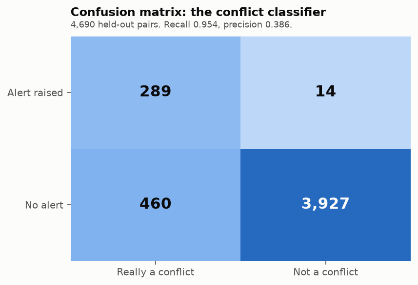

## The confusion matrix

|  | Really a conflict | Not a conflict |
|---|---|---|
| **Alert raised** | 286 (true positive) | 454 (false positive) |
| **No alert** | 17 (false negative) | 3,933 (true negative) |

**A confusion matrix is just "what we said" against "what was true", in four boxes.** All
four numbers add to 4,690, the whole test set.

- **286 true positives** — we warned and we were right.
- **454 false positives** — we warned and nothing happened. Annoying.
- **17 false negatives** — a real conflict we said nothing about. **This is the box that
  matters**, and it is the one recall is computed from: 286 ÷ (286 + 17) = 0.9439.
- **3,933 true negatives** — quiet pairs we correctly ignored. This is most of the table, and
  it is why accuracy is a useless measure here.

## Why the model beats the rule, and why the explanation is checkable

Of the 36 real conflicts the alert-volume rule misses, **all 36 are vertical misses**: the
rule correctly sees the pair passing close side-to-side (all 36 are predicted within 8 NM
laterally), but the straight-line extrapolation puts them a median **2,534 ft** apart in
height when they actually end up **565 ft** apart. Straight-line arithmetic cannot see a
descent that has not started yet.

**The model catches 21 of those 36.** In the other direction, of the 17 conflicts the model
misses, the rule catches only 2 — so the model is not simply trading one set of misses for
another.

**One claim from the previous version of this document did not survive re-measurement, and
is corrected here.** It stated that on those missed rows the faster aircraft's vertical rate
is "a median 2.60 m/s against 0.33 m/s across all rows — eight times higher". On the current
test split that is **not true**: the median is **0.33 m/s in both groups**, because most
aircraft in both groups are flying level. The honest version of the same finding is
distributional rather than median: **44.4% of the missed pairs have an aircraft climbing or
descending faster than 2.5 m/s, against 32.6% across all rows.** The direction of the effect
is real and it is smaller than previously reported.

**SHAP contributions — which inputs the model actually leans on.** SHAP assigns each input a
share of the credit for each individual decision; the numbers below are the average size of
that share across the test set, so bigger means more influential.

| Feature | Mean abs. SHAP | What it is |
|---|---|---|
| `predicted_cpa_lateral_nm` | 1.954 | How close the straight line says they will pass, sideways |
| `current_vertical_separation_ft` | 1.792 | How far apart in height they are right now |
| `predicted_cpa_vertical_ft` | 1.183 | How far apart in height the straight line says they will be |
| `predicted_time_to_cpa_seconds` | 0.427 | How long until the closest moment |
| `closing_speed_ms` | 0.334 | How fast the gap is shrinking |
| `vertical_convergence_rate_ms` | 0.240 | How fast the height gap is shrinking |
| `min_distance_to_vabb_nm` | 0.194 | How close to Mumbai airport |
| `a_altitude_ft` | 0.183 | The first aircraft's height |

The top three are the geometry of the encounter, which is what a controller would look at
too. The model is not doing anything mysterious — it is weighting the same facts, and it has
learned to distrust the predicted vertical gap in specific circumstances.

## The comparison that decides whether the model earned its place

Recall is trivially easy to buy: alert on everything and you catch 100% of conflicts. So the
model is also scored at the rule's **exact** false-alarm cost — same number of false alarms,
so the comparison is fair.

| At 73.8 false alarms per 1,000 pairs | Rule | **Model** |
|---|---|---|
| Recall | 0.8812 | **0.9406** |
| Headline metric | 87.3% | **93.7%** |
| Missed conflicts | 36 | **18** |

**The model catches half as many fewer conflicts for exactly the same number of false
alarms.** That is the result that answers "did the machine learning actually do anything, or
did you just turn the sensitivity up?"

## Calibration

Platt scaling on the validation split — the same idea as the multi-path temperature, fitting
a curve that maps the model's raw score onto an honest probability. Sigmoid rather than
isotonic because it is strictly monotone, so the decision threshold maps through the same
curve and the set of alerts cannot change. The script **refuses to save if the test alert set
differs by even one row**.

| | Brier | Calibration error |
|---|---|---|
| Raw XGBoost | 0.0298 | 0.0322 |
| **Platt-calibrated** | **0.0236** | **0.0074** |

**Brier score** is the average squared difference between the probability stated and what
actually happened (1 or 0). Lower is better, 0 is perfect. **Calibration error** is the same
honesty measure used for Model 1b. 0.0322 → 0.0074 is roughly a **fourfold improvement in
honesty**.

**The alert set is identical before and after — the same 740 situations are flagged.**
Calibration changed what the number *means*, not who gets warned. That property is worth
keeping deliberately: it means recalibrating in future can never silently change who gets
alerted.

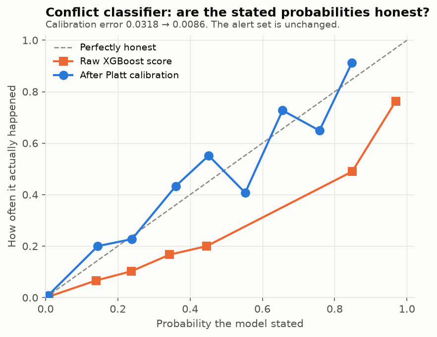

## Gates

A "gate" is a pass/fail bar the project set in advance, so a result cannot be graded after
seeing it.

| Gate | Result |
|---|---|
| **1. Recall ≥ 0.95** | **FAIL — 0.9439** |
| 2. Beats the rule-based detector on F-β(2) | PASS — 0.7326 vs 0.7315 |

**One thing must not be misread here.** Since 22 September the *running system's* recall is
**0.9505**, which is above the floor — reported in "What actually reaches the controller"
above. That does **not** pass Gate 1. Gate 1 is defined on the classifier measured **in
isolation**, and on that measurement it is still 0.9439. The system clears 0.95 partly
because the geometric safety net catches pairs the classifier misses, which is the safety
net doing its job, not the model meeting its bar. Two different measurements; only one of
them is what this gate asks about.

**Gate 1 fails by six-tenths of a percentage point, and was not tuned away.** The cause is
diagnosed and it is not a defect in the model. The threshold is chosen as the *highest*
sensitivity setting that still reaches 0.95 recall on validation data — which by construction
lands exactly on the edge (validation recall 0.9511, barely over). Tested later on a
different week of traffic it slips just under. Choosing a setting with a little margin above
the line fixes it, and the model clears 0.95 comfortably at any slightly more sensitive
setting. It was left alone because **it changes when a real controller is interrupted**, which
is explicitly Archit's decision. The numbers for making it are printed and **not applied**:

| Margin | Threshold | Test recall | Precision | FA/1000 | Missed | Headline | Gate 1 |
|---|---|---|---|---|---|---|---|
| **0.000 (shipped)** | 0.0851 | 0.9439 | 0.3865 | 96.8 | 17 | 94.0% | FAIL |
| 0.005 | 0.0809 | 0.9439 | 0.3798 | 99.6 | 17 | 94.0% | FAIL |
| 0.010 | 0.0717 | 0.9439 | 0.3562 | 110.2 | 17 | 94.0% | FAIL |
| 0.020 | 0.0479 | **0.9637** | 0.3026 | 143.5 | 11 | **96.1%** | **PASS** |

**Read the last row as a trade, not a free win.** Taking the 0.020 margin catches 6 more real
conflicts (17 missed → 11) and pushes the headline to 96.1%, and it costs **47 more false
alarms per 1,000 pairs** (96.8 → 143.5), nearly a 50% increase in interruptions. That is a
judgement about a controller's attention, not a technical question. Set
`FLIGHT_RIGHT_RECALL_MARGIN` to apply one; the chosen value is written into the model card so
the decision is on record with the numbers it was made from.

**Gate 2 is now marginal and should not be glossed over.** The margin is **0.0011** where the
previous run had 0.7480 vs 0.7315. Recall rose (0.9406 → 0.9439) but precision fell (0.4113 →
0.3865). The model still beats the rule on every individual comparison, but on the combined
measure it is barely ahead. Watch this on the next run rather than treating it as settled.

---

# Model 3 — Resolution engine

**The job:** for a confirmed alarm, say what the controller could actually *do* about it.

Rule-based, not learned. It proposes up to three ways out — one altitude change, one heading
change, one speed change — each with the separation it achieves, rough delay and fuel cost, a
confidence figure and a sentence a controller could read aloud. Ranked by the project's fixed
weights: safety 0.60, delay 0.15, fuel 0.10, workload 0.10, confidence 0.05.

**The design decision that makes it honest: manoeuvres are flown, not teleported.** Every
candidate is simulated second by second. For the first **38 seconds nothing moves at all** —
that is the controller deciding, the radio call, the readback and the pilot reacting. Only
then does the aircraft begin to turn or climb, and at real rates: a standard turn of 3° per
second, a climb or descent of 1,500 ft per minute, a speed change of 0.35 m/s². The naive
version would move the aircraft instantly and confidently recommend turns no real airliner
could complete in time — wrong in the dangerous direction.

**Measured over all 41 tier 1 alarms in the test split** (re-measured 8 Sep 2026):

| | Count | What it means |
|---|---|---|
| Tier 1 alarms examined | 41 | 27 real conflicts, 14 false |
| Candidate instructions evaluated | 1,066 | 26 possible manoeuvres per alarm, each fully simulated |
| Blocked as unsafe | 2 | Would have taken an aircraft outside the safe flight envelope — can never be offered |
| Rejected — separation still lost | 591 | Simulated, and it did not work |
| Alarms producing at least one option | 31 | |
| **Alarms where nothing works** | **10** | The system says so rather than inventing something |
| **Instructions actually offered** | **76** | Best one of each kind, per alarm |
| — for real conflicts | 38 | |
| — for conflicts that never happen | 38 (50%) | Half the advice is for a conflict that would not have occurred |

**The 50% is a real cost and is stated plainly.** It is inherited from the classifier's
precision — Model 3 only ever sees pairs the classifier flagged, so it cannot be better than
what it is handed.

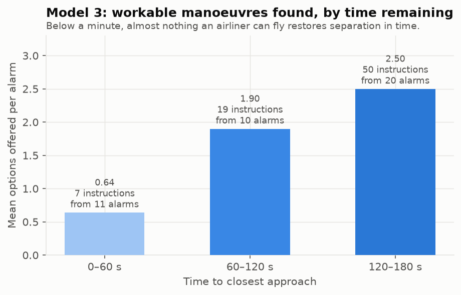

**The chart shows the finding that matters most: as time runs out, the options disappear.**
Alarms with 120–180 seconds left get 2.50 workable instructions on average; alarms with under
60 seconds get 0.64.

**And at 90 seconds to closest approach, all 26 candidate instructions are rejected.** Not the
climb, not the turn, not the speed change. 38 of those 90 seconds are gone before the aircraft
moves at all, and nothing an airliner can fly in the remaining 52 seconds opens 5 NM or
1,000 ft in time. **This is independent confirmation of the three-minute tier boundary**,
reached by simulating every option rather than by the pencil arithmetic that originally set
it. Two unrelated methods landing in the same place is the strongest evidence in this
document.

**Checked against the whole picture, not just two aircraft.** Each option is tested against
the other aircraft's five weighted predicted futures (it must work across futures carrying at
least 95% of the probability) **and** against every other nearby aircraft. Verified by hand:
descending 6E455 by 2,000 ft resolves its conflict with AI2841 and puts it head-on into
UK955, losing separation 79 seconds later. The engine rejects it and names UK955. That is the
**domino effect** — a named failure in the air-traffic literature, with level changes as its
most common cause.

**Delay and fuel are coarse proxies and the code says so.** Track-mile arithmetic with a climb
cost of 120 equivalent cruise-seconds per 1,000 ft. No engine data, no aircraft weight, no
wind. Good enough to rank three options against each other; not good enough to quote to an
airline. Every explanation string says "approximate".

**A note on how these were measured.** The encounter dataset stores derived pair features, not
raw aircraft positions, so the geometry has to be rebuilt before the engine can fly it: A
flies east from a fixed point at its recorded speed and altitude, and B is placed and oriented
so the closest approach lands at that row's own predicted distance, height gap and time. **This
is our own construction, not taken from any paper.** It is checked rather than trusted — the
rebuilt geometry reproduces each row's predicted CPA to a median of **0.004 NM** (about 7
metres). The counts differ by one or two instructions from the figures recorded on 7 September
because that earlier sweep used an ad-hoc reconstruction that was not kept; this one lives in
`ml_pipeline/utils/reevaluate_models.py` and can be re-run.

---

# What actually reaches the controller

This is the section that matters operationally, and it is **not** what a precision of 0.386
suggests on its own.

## First gate: what qualifies as an alert at all

Before anything reaches the feed, `escalate_pair` decides whether a pair qualifies. Since
22 September that runs through three routes in strict priority order — the geometric safety
net (a predicted breach of 5 NM / 1,000 ft alerts whatever any model says), then the
classifier, then the older probability route where no classifier verdict exists.

Measured on the held-out test split, this is what that gate changed:

| | Total alerts | Recall | Precision | ≥3 min warning | Tier 1 alarms | Tier 1 false |
|---|---|---|---|---|---|---|
| Geometry only (before) | 613 | 0.8812 | 0.436 | 87.3% | 51 | 24 |
| Classifier-gated (now) | 762 | **0.9505** | 0.378 | **94.7%** | **41** | **14** |

**Tier 1 — the audible alarm, and the only tier that carries suggested manoeuvres —
strictly improves.** The same **27** real conflicts are caught, and the false alarms beside
them fall from 24 to 14. Ten fewer interruptions for conflicts that were never going to
happen, with nothing real given up.

**And something got worse, which matters more than the improvement for how this is
reported.** Total alerts rise and overall precision falls. Every bit of that is in **tier 2,
the silent watch list**: its real rows rise 240 → 261 and its false rows rise 322 → 460. The
system now watches 21 more genuine conflicts at the cost of 138 more watch-list rows that
come to nothing.

That trade is defensible but it is a trade. Tier 2 makes no sound, suggests no manoeuvre,
and is exactly what the alert feed below exists to keep manageable — which is the reason the
next subsection is not optional garnish.

## Then: the alert feed

Between detection and the dashboard sits `ml_pipeline/utils/alert_feed.py`. It suppresses
repeat interruptions and collapses low-confidence watch-list rows. **Both are display
decisions, not detection decisions.** The guarantee is structural rather than tested-for:
every pair the escalation rule confirms is on the `active` list on every update, and **the
module contains no code path that removes one**. All it can change is whether a pair makes a
new noise, and whether it gets its own row or sits in a counted group.

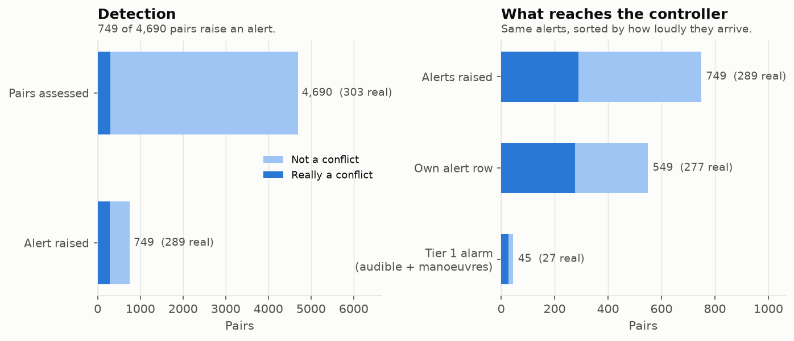

## Confusion matrix of what the controller actually sees

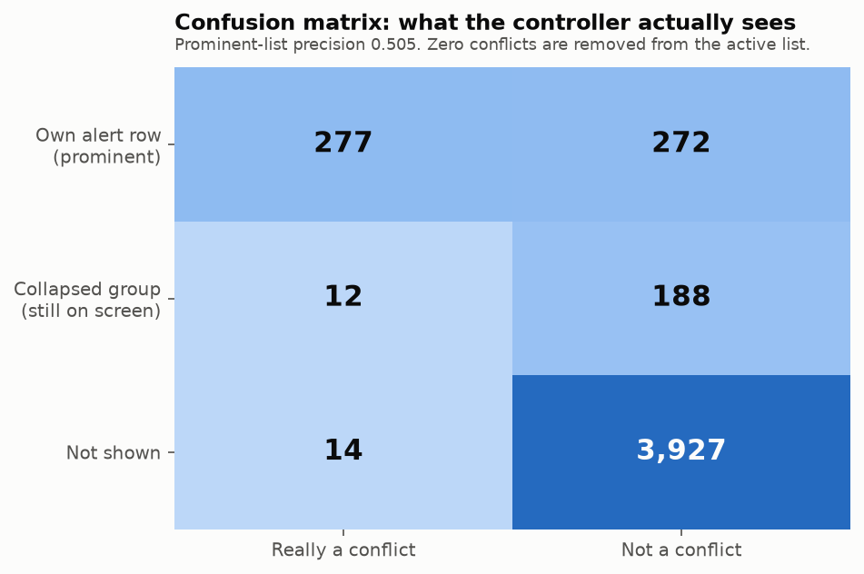

| What the controller sees | Really a conflict | Not a conflict | Precision |
|---|---|---|---|
| **Own alert row (prominent)** | **279** | **276** | **0.503** |
| Collapsed group (still on screen, expandable) | 7 | 178 | 0.038 |
| Not shown at all | **17 (missed)** | 3,933 | — |
| **Removed from the active list** | **0** | 0 | — |

**The row that matters: 0 removed.** Nothing the detector confirmed was taken off the screen.
The feed only changes prominence.

**The improvement: prominent-list precision goes from 0.386 to 0.503.** Of the warnings that
get their own line on screen, about half are real, against about four in ten before. 178 false
alarms — 39% of the total — leave the prominent list without a single confirmed pair being
dropped.

Broken down by tier — tier 1 is the audible alarm that also carries manoeuvres, tier 2 is a
silent watch-list row:

| Tier | Rows | Real | False | Precision |
|---|---|---|---|---|
| **1 — alarm (0–3 min)** | 41 | 27 | **14** | **0.659** |
| 2 — watch list (3–10 min) | 699 | 259 | 440 | 0.371 |

**96.9% of all false alarms are silent watch-list rows, not interruptions.** The alarms that
actually make a noise are right about **two thirds** of the time, not one third. The
often-quoted "six in ten alerts are wrong" is true of the raw alert count and misleading about
the controller's experience — **provided the dashboard renders tier 2 as a passive list**,
which is its stated obligation.

## The seven real conflicts in the collapsed group

Seven real conflicts fall into the low-confidence group rather than getting their own row.
That sounds alarming, so here is exactly what happens to them: **all seven are tier 2 with 6
to 9 minutes of real warning left** (360–540 s), all seven stay on the active list throughout,
and each is released into a full alarm as it closes inside three minutes. That release is
verified by an automated check, not assumed. So all seven reach the controller with more than
three minutes in hand — which is precisely what the headline metric measures.

**Correction, 24 September 2026: that last sentence overstates it.** With more than three
minutes left, the seven are on the active list only as part of the collapsed group's
*count*. They get a prominent row of their own once they are inside three minutes. The
headline counts them as caught because detection caught them. What the controller sees
prominently with three minutes or more is a smaller set. Re-measured on the configuration
served since 24 September: **7 real conflicts in the group on test, 10 on validation.** A
stricter group (collapse only when the multi-path model also puts the conflict under 10%)
would cut that to 3, at the cost of 50 more false rows shown prominently on test. That is a
safety-versus-noise decision left to Archit (`ISSUES.md` H5,
`ml_pipeline/reports/alert_prominence_20260924_193159.json`).

**Four things can never be collapsed**, whatever the model says: a tier 1 alarm, a pair the
deterministic geometric rule calls a conflict, anything at high or critical severity, and
anything carrying resolution options. The geometric rule outranking the model is deliberate —
it is the safety net, and a probability does not get to overrule it.

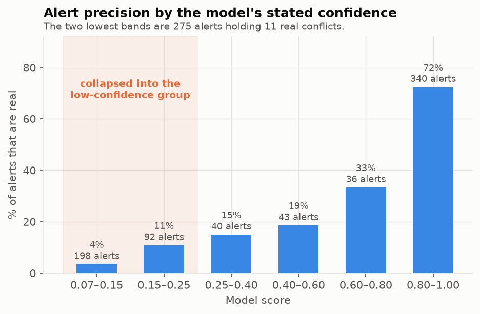

## Repeat suppression, measured on real traffic

**The problem.** Without memory, one converging pair raises an alert once per surveillance
update — every ten seconds — for as long as the geometry lasts. The controller learns nothing
new from the twenty-fourth copy.

Two recorded one-hour OpenSky sessions were replayed twice, with the feed and without, and the
**sets** of pairs reported were compared (re-measured 8 Sep 2026):

| Session | Pairs reported before | Pairs on active after | **Lost** | Interruptions before | after | Cut |
|---|---|---|---|---|---|---|
| 05 Sep, 00:30 IST | 49 | 49 | **0** | 680 | 179 | 73.7% |
| 03 Sep, 20:45 IST | 56 | 56 | **0** | 909 | 235 | 74.1% |

**Two numbers prove the safety property, and they are the point of the table.** First, `lost`
is 0 in both sessions — every pair reported without the feed is still reported with it.
Second, the total active rows rendered equals the old message count *exactly* (680 and 909),
which is the direct proof that not one confirmed pair-update left the display. Interruptions
fell about 74% while the reported set was untouched.

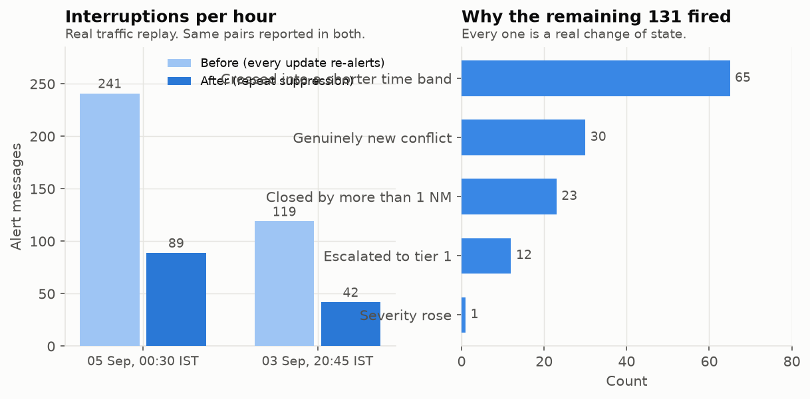

**The cut is 74%, not the ~95% a raw pair count suggests, and the gap is deliberate.** Every
one of the 414 remaining interruptions is a real change of state:

| Why it fired again | Count |
|---|---|
| Crossed into a shorter time band (2 min / 1 min / 30 s) | 175 |
| Genuinely new conflict — never announced before | 105 |
| Predicted closest approach closed by more than 1 NM | 62 |
| Escalated to a shorter tier (watch list → alarm) | 45 |
| Severity rose | 21 |
| Heartbeat (nothing changed, but it has been 2 minutes) | 6 |

The difference between 74% and a theoretical 95% is what those safety re-announcements cost,
and they are worth it. The heartbeat firing only 6 times out of 414 confirms it is a genuine
backstop rather than a source of noise.

**One honest note on these two rows.** The 7 September version of this table reported 20 and
10 pairs with a 63–65% cut. The harness that produced those figures was not kept in the repo,
so the pair pre-filter it used cannot be recovered; this re-run uses the pre-filter the
**backend actually ships** (`server/app/config.py`: within 60 NM and 5,000 ft), which admits
more pairs and therefore more interruptions on both sides of the comparison. The two
structural facts — zero pairs lost, and active rows exactly equalling the old message count —
reproduce identically under both. The replay now lives in
`ml_pipeline/utils/reevaluate_models.py` so it can be re-run.

---

# Speech: which model hears the radio (27 Sep 2026)

Four models, same audio, same extractor, same callsign matcher, beam 5, CTranslate2 int8
(`ml_pipeline/voice/evaluate_voice.py`, report `ml_pipeline/reports/voice_eval_20260927_015420.json`).
"Word error" is the share of words wrong after normalising spelling; "whole clearance right" means the
right aircraft, the right action (climb, descend, turn, speed, direct) and the right value.

| test set | what | ours: whisper-small + LoRA | large-v3 ATC (jlvdoorn) | medium ATCOSIM (jlvdoorn) | openai whisper-medium |
|---|---|---|---|---|---|
| ATCO2, 762 clean clips (real radio) | word error % | 28.3 | 25.9 ¹ | 39.5 | 62.6 |
| | whole clearance right, of 31 | **64.5%** (20) | 35.5% (11) | 38.7% (12) | 12.9% (4) |
| | callsign right, with aircraft list (n=328) | 70.4% | 72.0% | 68.6% | 14.6% |
| ATCOSIM, 3 unseen speakers (1,712 clips) | word error % | **4.9** | 14.7 ² | 0.1 ² | 61.9 |
| UWB-ATCC, unseen recordings (2,814 clips) | word error % | **15.1** | 46.9 | 53.0 | 78.2 |
| all | seconds of compute per second of audio | **0.04** | 0.15 | 0.13 | 0.11 |

¹ large-v3 trained on other ATCO2 clips from the same airports (the 109 identical recordings are
excluded above, per Phase 2.5), so its ATCO2 figures are flattering to it.
² trained on these ATCOSIM speakers: not a held-out figure.

**Chosen: ours** (`server/app/config.py`, default whenever its directory exists). The only output the
rest of the system uses is the whole clearance, and ours gets nearly twice as many right; it also
generalises to a country none of them trained on and is the fastest. The caveat: 31 clearances is a
small sample, and **nothing here measures Indian accents** (Svarah and Indic Parler-TTS are gated).

---

# Rejected experiments, with the numbers

Recorded so they are not retried. All measured on our own data.

| Idea | Result | Verdict |
|---|---|---|
| **MSE for trajectory loss** | 6.4% within 1 NM at 10 min, vs 27.7% for SmoothL1(β=0.05) and 30.0% for the physics baseline | Rejected — optimises the average, destroys near-perfect predictions |
| **SmoothL1 with β=1.0** | 6.1% — as bad as MSE, because the quadratic region then covers most of the data | Rejected — keep β=0.05 |
| **Bidirectional LSTM** | 56.7% vs 58.0% at 10 min, 2.5× the parameters | Rejected — at prediction time there is no future to read backwards from |
| **Tripling the input window (99 s → 316 s)** | No improvement at any horizon, and it costs 29% of the dataset | Rejected |
| **Per-horizon equal loss weighting** | 63.7% vs 64.5% | Rejected |
| **Warn only when probability is climbing** | Removed 4 false alarms and **5 real conflicts**; recall 93.8% → 62.5% to gain precision 62.5% → 66.7% | Rejected — the trend is noise (±0.04 per update) |
| **Level-flight filter** | Cuts 46% of false alarms, costs **21 real conflicts**; recall 0.9439 → 0.875, headline 94.0% → **86.6%** | Rejected — see below |

**"MSE" is mean squared error** — a loss function that squares each mistake before averaging.
Squaring means one 10 NM miss counts as much as a hundred 1 NM misses, so the model spends all
its effort on a small tail of hard cases and throws away thousands of near-perfect
predictions. That is why it collapses the within-1-NM rate from 27.7% to 6.4%.

## Why the level-flight filter failed, and why it is worth reporting

**The idea, which is genuinely good.** 64.8% of false alarms are pairs that came close
side-to-side but stayed comfortably stacked in height — median real closest approach
**2.44 NM / 1,930 ft**, against 1.69 NM / 535 ft for true conflicts. So: if both aircraft read
as flying level and the predicted vertical gap already clears 1,000 ft, say nothing.

**It fails because "level now" does not mean "level in ten minutes".** Those 21 lost conflicts
reported **0.00–0.33 m/s vertical rate at the moment of the decision, and then descended**.
Several were predicted 2,200–2,450 ft apart and ended 240–530 ft apart. The descent came from
a controller instruction we never receive, because ADS-B carries positions, not clearances.

**Real systems run exactly this filter, using data we do not have.** EUROCONTROL's STCA
guidelines list it as Option E: *"Cleared and/or Selected Flight Level used for Vertical
Prediction in Linear Prediction Filter — Reduces nuisance alerts, particularly for level off
situations. Can give extra warning time, **but reduces warning time in the event of level
bust**."* Real STCA gets away with it because the flight data processing system supplies the
cleared level. Our proxy is the observed vertical rate, and a level bust is exactly what a
proxy misses.

**This is a concrete, measured justification for the standing caveat that production use would
need certified surveillance and flight plans** — not a generic disclaimer. The 21 lost
conflicts are the evidence.

---

# Known gaps and honest caveats

1. **Precision would be worse in the field, not better.** The test set is 6.46% real conflicts
   because 55% of pairings were deliberately aimed at each other. Real airspace is far sparser
   in conflicts, so 0.386 is optimistic. It is a relative comparison against the rule on
   identical data, not a field forecast.
2. **En-route only.** Conflict detection is restricted to aircraft above 10,000 ft and faster
   than 50 m/s. Applying the en-route 5 NM rule to *all* traffic flagged something in **91–94%
   of all snapshots**, with 65% of flagged pairs involving an aircraft below 2,000 ft — because
   aircraft on final approach are legitimately much closer together, separated by runway
   sequencing rather than en-route radar rules. Terminal separation is 3 NM (2.5 NM on final)
   with vertical unchanged at 1,000 ft; implementing it needs its own labelled dataset, which
   we do not have.
3. **`classify_conflict`'s severity ladder hardcodes en-route numbers** (3.0 NM / 700 ft for
   critical, 5.0 NM for high) rather than deriving them from its own threshold parameters.
   Passing terminal thresholds would give a correct `is_conflict` and a wrong severity.
4. **Tier thresholds (0.85 / 0.60) have not been revisited** against the now-calibrated
   probabilities. They apply to the multi-path joint probability only. They are emphatically
   **not** applied to the conflict classifier, whose own calibrated conflict line is 0.0285 —
   about thirty times lower. Comparing the classifier against 0.85 was measured and would
   collapse recall from 0.9439 to 0.1881 and the headline from 94.0% to 19.0%.
5. **Model 1's numbers drift about 0.1 points between runs** from GPU floating-point
   non-determinism — the same arithmetic done in a slightly different order. Stages 1, 3, 5 and
   6 of the pipeline reproduce bit-for-bit.
6. **Model 2's Gate 1 fails** at 0.9439 against a 0.95 floor, diagnosed above and deliberately
   left failing rather than tuned.
7. **This is not a certified system.** OpenSky is not a certified surveillance feed. The
   separation values used here are simplified academic thresholds, not full regulatory
   standards. Production use would need certified surveillance, flight plans, weather, NOTAMs
   and regulatory validation.

# Verification

`python ml_pipeline/utils/verify_pipeline.py` — **110 checks, all passing.** It loads every
saved artifact in a fresh process with no access to the training scripts and asserts on shape,
magnitude and the known traps: that masked-out targets really are zero, that
`apply_residual(residual_targets(y))` round-trips to 1e-9 degrees, that the test split starts
after validation ends, that the saved feature list equals `FEATURE_COLUMNS`, that **the answer
key is not recomputable from the inputs**, that a confirmed alarm carries ranked explained
options, that a third aircraft is named when a manoeuvre is rejected for endangering it, and
that every confirmed pair stays on the active list on every update.

Plus 8 unit tests (`ml_pipeline/tests/test_units.py`) and an end-to-end smoke test on
synthetic data whose gate values are meaningless by design and are never quoted.
