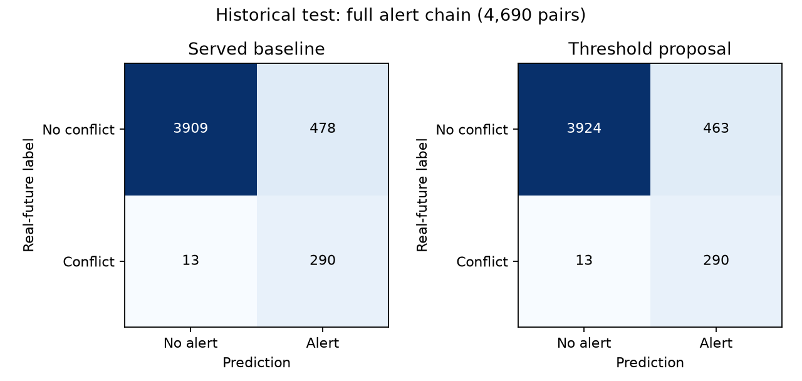
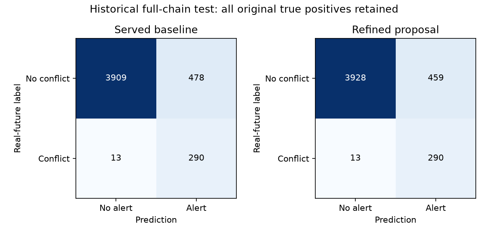

# Secondary XGBoost conflict filter: evaluation and testing

Experimental learned veto, six initial depth/input variants, ensembles, refits and continuations. Not deployed.

[Latest comparison](../evaluation.md) · [Every original source and cleanup status](source_inventory.json)

This is the single maintained history for this model/component. Records preserve the original bytes, including every numeric field, trial, seed, protocol, selection and caveat. Shared reports are included in each relevant ledger. No fresh inference is implied by consolidation.

## Study: conflict_false_alerts_20261101

Historical narrative below retains the recorded results; statements about being uncommitted describe the study date. All studies are now preserved in the checkpoint commit. Links to removed originals now lead to their ledger source register; the evidence appendix retains the exact original prose and links.

# Conflict false-alert experiments — 1 November 2026

The full-chain historical test's three-minute catch remains **271/284 (95.42%)**.
A validation-selected operating threshold reduces false alerts **478 → 463 (3.14%)**,
retaining the **same 290 true-positive pairs**, including all 28 real tier-1 alerts.
The learned multi-path filter chosen on validation failed the no-lost-true-pair audit;
it is rejected. Everything here is local and uncommitted. The served system is unchanged.

## What actually enters conflict detection

The served XGBoost classifier receives **27 numerical inputs**: current aircraft-pair
geometry and motion; straight-line predicted closest-approach distance, vertical gap
and time; recent turning/acceleration summaries; and three selected-altitude inputs.
It does **not** receive the five predicted paths or summaries of those paths.
See [inference](../../server/app/ml/inference.py), `InferenceEngine.assess_pair`.

The multi-path predictor separately supplies five paths per aircraft. The geometry
code evaluates **25 path combinations**, with interpolation at 15-second intervals.
That geometry affects alert tiering and resolution checks. The classifier is explicitly
built using `rule_cpa`, the straight-line CPA, rather than multi-path CPA.
The deterministic straight-line 5 NM / 1,000 ft safety net can independently raise an
alert. It remains intact in every experiment. It accounts for **153 false alerts and
250 true alerts** on this test, so classifier-only changes cannot remove those 153.

## Threshold result

No weights were changed for this proposal. The raw threshold changes from
**0.074656464159 → 0.079328127205**. The existing Platt mapping
is retained; the corresponding calibrated threshold is 0.027143828104.
The inclusive threshold is the smallest baseline true-positive score on validation:
the highest threshold retaining every baseline classifier true-positive validation pair.
The separately tested full-system preservation criterion picked the same value.
Test labels were not used to choose the value.

| Historical test | TP | FP | FN | TN | Precision | Recall | F1 |
|---|---:|---:|---:|---:|---:|---:|---:|
| Served classifier | 289 | 460 | 14 | 3927 | 38.585% | 95.380% | 0.549430 |
| Proposed classifier | 289 | 444 | 14 | 3943 | 39.427% | 95.380% | 0.557915 |
| Served full chain | 290 | 478 | 13 | 3909 | 37.760% | 95.710% | 0.541550 |
| Proposed full chain | 290 | 463 | 13 | 3924 | 38.513% | 95.710% | 0.549242 |

The standalone classifier loses **zero** previously detected true pairs as well.
Its false positives fall 460 → 444; one removed classifier false positive still triggers
the independent safety net, explaining why system false positives fall by 15, not 16.
Full-chain tier-1 counts stay **28 real / 20 false**. This improves detection counts,
not merely display prominence or collapsing rows. Ranking PR-AUC/ROC-AUC and probability
calibration do not change when only an operating threshold changes.
Validation system false alerts fall 705 → 679, with the same 433 true positives.



## Learned conflict filters with multi-path summaries

To test new multi-path inputs without training a stacked classifier on upstream models'
own training examples, the upstream served trajectory model and classifier were frozen.
Early validation sessions **21–23** supplied **3,375 fitting pairs** (239 positive);
later sessions **24–25** supplied **3,189 selection pairs** (211 positive), separated by
more than the 600-second prediction horizon. Thus the classifier's original 28,746
training pairs were not reused for fitting the new filters. This smaller fitting set
is a limitation; it is not a like-for-like replacement training run.

Six XGBoost filters were fitted: depths 2/3/4 with stronger minimum-child and L2
regularization, 150/250/300 trees, learning rate .04, seed 42. Each of three settings was
tested with existing inputs plus the frozen classifier raw score (28 columns), and
again with four multi-path summaries added (32 columns):

- Probability mass of the 25 combinations breaching the alert volume.
- Probability mass breaching the legal separation minimum.
- Probability mass breaching the alert volume within 180 seconds.
- Time of the multi-path representative closest approach.

These are inference-time predicted summaries; no actual-future distance or outcome time
enters a learned feature. Top-five weights are normalized and joint weights are products
of aircraft path probabilities. They are model-derived summaries, not calibrated real
conflict probabilities. The served original multi-path artifact is used, keeping the
candidate trajectory update out of this ablation.

A filter can veto only a baseline classifier alert; it cannot veto the hard safety net.
Each filter's inclusive score threshold retains every safety-net-unprotected true pair
in the later selection sessions. Configurations are ranked on selection false alerts;
the winner is frozen before loading the historical test. This is a learned downstream
filter experiment, not in-place fine-tuning of the served classifier's weights.

| Experiment | Threshold | Selection FP* | Test FP | Test TP | Lost test true pairs | Test precision | Test recall | Test F1 | Status |
|---|---:|---:|---:|---:|---:|---:|---:|---:|---|
| threshold_classifier | 0.079328127 | 679 | 463 | 290 | 0 | 0.385126 | 0.957096 | 0.549242 | Threshold proposal |
| threshold_system | 0.079328127 | 679 | 463 | 290 | 0 | 0.385126 | 0.957096 | 0.549242 | Threshold proposal |
| existing_inputs_depth2 | 0.031376667 | 313 | 440 | 289 | 1 | 0.396433 | 0.953795 | 0.560078 | Unselected diagnostic |
| existing_inputs_depth3 | 0.033277754 | 265 | 396 | 286 | 4 | 0.419355 | 0.943894 | 0.580711 | Frozen selection; rejected |
| existing_inputs_depth4 | 0.021695804 | 313 | 443 | 290 | 0 | 0.395634 | 0.957096 | 0.559846 | Unselected diagnostic |
| multipath_depth2 | 0.021982910 | 299 | 422 | 288 | 2 | 0.405634 | 0.950495 | 0.568608 | Unselected diagnostic |
| multipath_depth3 | 0.020438127 | 277 | 404 | 288 | 2 | 0.416185 | 0.950495 | 0.578894 | Frozen selection; rejected |
| multipath_depth4 | 0.012492881 | 316 | 460 | 290 | 0 | 0.386667 | 0.957096 | 0.550807 | Unselected diagnostic |

*Threshold-only rows use the entire validation split; learned rows use only later
selection sessions, so their selection FP counts cannot be compared directly.
Every row reports full-chain counts. Full classifier and system confusion matrices,
precision/recall/F1, ranking metrics, and lost-pair indices are retained in raw results.
Full-validation scores for learned filters mix fitting and selection rows and must not
be presented as held-out model performance.

The best learned existing-input filter (`existing_inputs_depth3`) loses four true test
conflicts. The best multi-path filter (`multipath_depth3`) loses two.
Both fail the user's constraint. Some unselected depth-4 diagnostics retain all test
true pairs, but choosing them because of their test results would tune on test; they
are not promoted. No test-led retry was used to claim a learned winner.

## Verification, limits and reproduction

The original historical test contains 4,690 pairs / 303 positive labels. It has been
examined in earlier project studies, so this is a shared historical audit, not a new
independent dataset. Scenarios relocate real aircraft tracks and obtain labels from
their real future movements; they are not a corpus of observed operational near misses.
Zero observed lost true pairs on these data cannot guarantee zero loss on future traffic.
Additional dates with labelled encounters are needed before deployment.

The [production gate audit (archived source)](conflict_classifier.md#source-register)
regenerates served five-path geometry, then checks the baseline and threshold proposal
against actual `escalate_pair` on every validation and test pair. It holds geometry for
three updates, matching the earlier evaluations; it does not evaluate live persistence
transitions. Source served classifier and trajectory SHA-256 hashes remain identical.
All 37 unit checks pass, including three new recall-constraint/counting checks.
Input files, source scripts and cached summary tables have recorded SHA-256 fingerprints
in the [reproducibility manifest (archived source)](conflict_classifier.md#source-register).

Commands, from the project root with its virtual environment:

```powershell
venv\Scripts\python.exe scripts/experiment_conflict_false_alerts.py
venv\Scripts\python.exe scripts/audit_conflict_false_alerts.py
venv\Scripts\python.exe scripts/report_conflict_false_alerts.py
```

Retained artifacts: [protocol (archived source)](conflict_classifier.md#source-register),
[frozen selection (archived source)](conflict_classifier.md#source-register),
[complete results (archived source)](conflict_classifier.md#source-register),
[threshold proposal (archived source)](conflict_classifier.md#source-register),
and exact source snapshot in the same report directory. All six learned filters and
prediction arrays remain in `ml_pipeline/data/processed/conflict_experiments/20261101/`.
The original evaluation and its initial archived version are preserved.

Method reference: scikit-learn's [decision-threshold guidance](https://scikit-learn.org/stable/modules/classification_threshold.html)
requires separate fitting and threshold-selection data. This study uses chronological
sessions for that separation rather than random cross-validation.


## Study: conflict_refinement_20261101

Historical narrative below retains the recorded results; statements about being uncommitted describe the study date. All studies are now preserved in the checkpoint commit. Links to removed originals now lead to their ledger source register; the evidence appendix retains the exact original prose and links.

# Further false-alert experiments — 1 November 2026

Full-chain early catches remain **271/284 (95.42%)**. The validation-selected refined
proposal reduces historical test false alerts **478 → 459 (3.97%)**, improving on the
previous threshold-only proposal's 463. It retains exactly the same **290 full-chain
true-positive pairs** and **289 classifier true-positive pairs**. False tier-1 alarms
fall **20 → 19**, with **all 28 real tier-1 alarms retained**. Existing missed cases remain:
the full chain still misses 13 of the 303 labelled conflicts.

This is a **local, uncommitted, undeployed experiment**. Served weights, thresholds,
safety net and alert behaviour are unchanged. The initial evaluation and
[first false-alert study (archived source)](conflict_classifier.md#source-register) remain intact.

## Problem and proposed change

False alerts interrupt a controller even when aircraft subsequently stay separated.
This is a real detection problem. Hiding alerts or removing repeated notifications
does not fix a wrongly predicted conflict, so this study measures pair-level decisions.

The new proposal keeps the earlier raw classifier threshold
0.079328127205, then adds a conservative second learned filter.
The selected filter (`refit_unweighted`) is trained from scratch on the original 28,746 classifier
training pairs, using the same 27 inputs. It uses 400 depth-3 XGBoost trees, learning
rate .04, minimum child weight 20, L2 regularization 20, subsample .9 and seed 42.
Positive training examples receive no extra class weighting, unlike the original model.

Only when this filter's score is below **0.009285068139** may it suppress a
baseline classifier alert. This score is half the lowest filter score among the
original classifier's true-positive validation pairs; the fixed half-score margin
is deliberately more conservative than suppressing up to that observed boundary.
The straight-line legal-separation safety net always bypasses this filter.
These raw scores are ranking outputs, **not calibrated real-world conflict probabilities**.
The filter cannot replace the production classifier by copying its file; it requires
the specified combined decision rule and deployment review.

**Source:** The conservative veto design, score margins and multi-path conjunctions
are our own design. They are not a published no-loss guarantee. Their support is the
paired validation/historical-test measurements below. XGBoost's
[official API](https://xgboost.readthedocs.io/en/stable/python/python_api.html) documents
continuing training with `xgb_model`; its [parameter documentation](https://xgboost.readthedocs.io/en/stable/parameter.html)
defines class weights and the regularization controls used in the training experiments.

## All approaches tried

**28 configurations** were declared before loading the test for this batch:

- **18 multi-path conjunction rules:** require both low original classifier score and
  low predicted path-combination conflict mass before suppressing an alert. Three
  probability summaries × six mass cutoffs; raw-score ceilings use an .8 validation
  safety factor and a .25 cap. These rules add no reduction beyond the prior proposal.
- **4 conservative ensembles:** combine the three earlier depth-2/3/4 filters with
  either a maximum or mean score, with and without multi-path inputs. A maximum keeps
  the alert if any filter remains concerned. They use half the minimum protected
  validation score. Earlier filters fit early validation sessions; only later sessions
  rank these ensembles. Full-validation summaries include those fitting rows and are
  not held-out performance for this family.
- **6 classifier training configurations:** two continuations of the original model
  with 150 additional depth-3 trees, and four fresh fits testing depths 2/3/4 and
  weighted versus unweighted training. These fit only the original training split;
  the entire validation split is separate for threshold selection and family ranking.

One candidate per family is frozen on validation before opening this batch's test.
Every candidate must retain each original classifier and full-system true-positive
validation pair, rather than merely retain the same number. No test scores are used
to choose family winners.

| Family | Validation-selected candidate | Test false alerts | Test true alerts | Lost true pairs |
|---|---|---:|---:|---:|
| classifier_training | `refit_unweighted` | 459 | 290 | 0 |
| conservative_ensembles | `ensemble_existing_max` | 463 | 290 | 0 |
| multipath_rules | `rule_mp_p_alert_volume_0` | 463 | 290 | 0 |

Some unselected ensembles remove another one or two false test alerts. They are
reported as diagnostics, not selected using their test results. The original test
was already examined in earlier rounds, so this entire follow-up is an **exploratory
repeated-benchmark study**, not a fresh independent confirmation.

## Evaluation

| Historical test | TP | FP | FN | TN | Precision | Recall | F1 |
|---|---:|---:|---:|---:|---:|---:|---:|
| Served full chain | 290 | 478 | 13 | 3909 | 37.760% | 95.710% | 0.541550 |
| Previous threshold proposal | 290 | 463 | 13 | 3924 | 38.513% | 95.710% | 0.549242 |
| Refined full-chain proposal | 290 | 459 | 13 | 3928 | 38.718% | 95.710% | 0.551331 |
| Served classifier | 289 | 460 | 14 | 3927 | 38.585% | 95.380% | 0.549430 |
| Refined classifier/filter | 289 | 440 | 14 | 3947 | 39.643% | 95.380% | 0.560078 |

The refined proposal loses zero original true-pair identities on both validation and
test, for both the standalone classifier and the full chain. Validation full-chain
false alerts fall 705 → 671; its 433 true detections and
411/428 early catches remain intact. Test early catches are unchanged at 271/284.
Real tier-1 detections remain 28, while false tier-1 alarms fall 20 → 19.
This improvement changes which false pairs are detected, not merely their display.



The full-chain confusion matrix is **[[3928, 459], [13, 290]]**, with rows actual
non-conflict/conflict and columns no-alert/alert. Full confusion counts, precision,
recall, F1 and lost-pair indices for every configuration are retained in raw JSON and
the [all-trial CSV (archived source)](conflict_classifier.md#source-register).
The hard safety net still accounts for 153 false alerts and cannot be suppressed here.

## Tiering and resolution checks, simply

**Tiering means urgency.** If a predicted closest approach is within three minutes,
the pair is tier 1: after the alert gate and persistence checks pass, it may sound an
alarm and offer manoeuvre suggestions. From three to ten minutes it is tier 2: a
watch-list warning. Outside ten minutes it is tier 0, not a controller notification.
A tier alone is not sufficient to notify; the pair must also qualify and persist.

**Resolution checks mean testing a possible way out.** For a confirmed tier-1 alert,
the engine simulates candidate instructions such as a turn, climb or descent. It
checks whether the change clears the original pair and whether it creates another
conflict with nearby aircraft, using available predicted paths for the other traffic.
For example, a right turn may clear aircraft B but approach aircraft C, so that turn
should be rejected. These are suggestions for a controller, not automatic aircraft control.

The conflict classifier still receives straight-line CPA plus current/history/selected
altitude inputs. Five paths per aircraft are evaluated separately as 25 combinations
for geometry/tiering and resolution checks. The selected refined filter uses the same
27 classifier features; the multi-path-input approaches did not win this round.

## Verification and limitations

The [actual production-gate audit (archived source)](conflict_classifier.md#source-register)
recomputes served five-path geometry and compares the proposal with `escalate_pair` on
every validation and test pair. It assumes the geometry persists for three updates,
as in earlier evaluations; it is not a live alert-transition replay. Source served
model hashes remain unchanged. All 40 unit checks pass, including three new checks
for conservative-rule protection and threshold boundaries.

There is no mathematical guarantee of never losing a future conflict. Real-future
labels on relocated-track scenarios differ from observed operational incidents, and
reusing the historical benchmark limits generalization claims. A fresh labelled
encounter cohort is needed before treating this small improvement as deployment-ready.
Probability calibration for the combined filtered output is also not established.

Reproduce from the project root:

```powershell
venv\Scripts\python.exe scripts/experiment_conflict_refinement.py
venv\Scripts\python.exe scripts/audit_conflict_refinement.py
venv\Scripts\python.exe scripts/report_conflict_refinement.py
```

The training script refuses to overwrite completed results. Use a distinct experiment
directory for a new run. [Protocol (archived source)](conflict_classifier.md#source-register),
[frozen selection (archived source)](conflict_classifier.md#source-register),
[complete results (archived source)](conflict_classifier.md#source-register),
[candidate card (archived source)](conflict_classifier.md#source-register),
and [source/artifact fingerprints (archived source)](conflict_classifier.md#source-register)
are preserved. Encounter and cached-input fingerprints are in the
[first study's input manifest (archived source)](conflict_classifier.md#source-register).
The exact experiment source snapshot is retained alongside the new reports.
Weights and decision arrays remain local under
`ml_pipeline/data/processed/conflict_experiments/20261101_refinement/`.


## Complete iteration register

| Recorded run | Recorded sections | Details |
| --- | --- | --- |
| ml_pipeline/reports/conflict_false_alerts_20261101/results.json | protocol, selected_veto, selected_multipath_veto, baselines, candidates, test_safety_net, hashes_after | Exact configuration, validation/test numbers, guards and rejected trials in evidence record below |
| ml_pipeline/reports/conflict_refinement_20261101/results.json | protocol, winners, candidates, baselines, hashes_after | Exact configuration, validation/test numbers, guards and rejected trials in evidence record below |

## Source register

| Original path | SHA-256 | Bytes |
| --- | --- | --- |
| docs/experiments/conflict_false_alerts_20261101.md | 47b3748d4cabe3d7f4e00bf639c3e481a4ead7f7cc80bdf91e8bf28b1182735e | 9827 |
| docs/experiments/conflict_refinement_20261101.md | 95cfc133f4d55941796115df78c376913853591d56268436b380a6d625844640 | 10053 |
| ml_pipeline/reports/conflict_false_alerts_20261101/input_source_manifest.json | f033a7074324d515e61a1af683e74e9e5d11d9ed5dab101a3ade4eeb6ed1f52d | 1501 |
| ml_pipeline/reports/conflict_false_alerts_20261101/production_gate_audit.json | 3645d0f002e756b74b707d478ab6364703b73259ce36f44678d876ea45c9a380 | 448 |
| ml_pipeline/reports/conflict_false_alerts_20261101/protocol.json | 3803e0bf27704f58074e03b8709723bd6cddcfda1f5af84de677f40794065121 | 2190 |
| ml_pipeline/reports/conflict_false_alerts_20261101/results.json | c3bdf670d8ef45e1cdea22075912776091e01ae27f2ad0fc64ab3457d2e15e64 | 44213 |
| ml_pipeline/reports/conflict_false_alerts_20261101/selection.json | bd71a8f7d29edcb823a4a9afc359aef53b2b01fa74e6a1e29caf3950de2ed48f | 18031 |
| ml_pipeline/reports/conflict_false_alerts_20261101/source_snapshot.txt | a9558064236c2087eccba3c5f0257360e8a3e19a6387471dd1cfb880a596b7c5 | 10493 |
| ml_pipeline/reports/conflict_false_alerts_20261101/threshold_proposal.json | 4cf776eb74f9e0f606d49651bea1526fd8d228a3dfb7e554000ec850342a6fb7 | 3021 |
| ml_pipeline/reports/conflict_refinement_20261101/all_trials.csv | 2e5a41c38921624ef220820c96206d181b5308f55dd9eaa216c9a2da400417d1 | 4619 |
| ml_pipeline/reports/conflict_refinement_20261101/candidate_model_card.json | adc28a81db27655389507d37788cc09fb2044086b469b1b15d66174a8a721007 | 4013 |
| ml_pipeline/reports/conflict_refinement_20261101/production_gate_audit.json | d32916f960c1b138a2af0a8e7ec49f7a849482bf7dab69a7ade61f2dc5b20ab2 | 572 |
| ml_pipeline/reports/conflict_refinement_20261101/protocol.json | 5f71a2927a1ff51adce95e74890438554fc6c95ff0f2067e357060c16e114d1b | 2235 |
| ml_pipeline/reports/conflict_refinement_20261101/results.json | 182df94391558c5f1fedb4743520e25601910327cc256f6b299605037bff9e31 | 93628 |
| ml_pipeline/reports/conflict_refinement_20261101/selection.json | 106a6acf5c07f0a34c4a1d04b04269329a681d0cd1bee95a3a7322ad436eb09c | 50380 |
| ml_pipeline/reports/conflict_refinement_20261101/source_artifact_manifest.json | f492ba57a80a11d2ed3cdd622590455872549ed1c85e794e11c33c7450452c88 | 1032 |
| ml_pipeline/reports/conflict_refinement_20261101/source_snapshot.txt | e01bf9dd191f5b73a52e635ca67bec8799c4d21fcfc72a117a5e38d618d15b2b | 10297 |

## Lossless evidence

Machine-readable JSON envelope. `content` is exact UTF-8 text or base64 bytes; numeric payloads remain unchanged, including historical JSON NaN. Use the maintenance script to verify or restore a source.

<!-- evaluation-evidence-v1 -->
```json
{
  "model": "conflict_filter",
  "records": [
    {
      "path": "docs/experiments/conflict_false_alerts_20261101.md",
      "sha256": "47b3748d4cabe3d7f4e00bf639c3e481a4ead7f7cc80bdf91e8bf28b1182735e",
      "bytes": 9827,
      "encoding": "utf-8",
      "content": "# Conflict false-alert experiments \u2014 1 November 2026\r\n\r\nThe full-chain historical test's three-minute catch remains **271/284 (95.42%)**.\r\nA validation-selected operating threshold reduces false alerts **478 \u2192 463 (3.14%)**,\r\nretaining the **same 290 true-positive pairs**, including all 28 real tier-1 alerts.\r\nThe learned multi-path filter chosen on validation failed the no-lost-true-pair audit;\r\nit is rejected. Everything here is local and uncommitted. The served system is unchanged.\r\n\r\n## What actually enters conflict detection\r\n\r\nThe served XGBoost classifier receives **27 numerical inputs**: current aircraft-pair\r\ngeometry and motion; straight-line predicted closest-approach distance, vertical gap\r\nand time; recent turning/acceleration summaries; and three selected-altitude inputs.\r\nIt does **not** receive the five predicted paths or summaries of those paths.\r\nSee [inference](../../server/app/ml/inference.py), `InferenceEngine.assess_pair`.\r\n\r\nThe multi-path predictor separately supplies five paths per aircraft. The geometry\r\ncode evaluates **25 path combinations**, with interpolation at 15-second intervals.\r\nThat geometry affects alert tiering and resolution checks. The classifier is explicitly\r\nbuilt using `rule_cpa`, the straight-line CPA, rather than multi-path CPA.\r\nThe deterministic straight-line 5 NM / 1,000 ft safety net can independently raise an\r\nalert. It remains intact in every experiment. It accounts for **153 false alerts and\r\n250 true alerts** on this test, so classifier-only changes cannot remove those 153.\r\n\r\n## Threshold result\r\n\r\nNo weights were changed for this proposal. The raw threshold changes from\r\n**0.074656464159 \u2192 0.079328127205**. The existing Platt mapping\r\nis retained; the corresponding calibrated threshold is 0.027143828104.\r\nThe inclusive threshold is the smallest baseline true-positive score on validation:\r\nthe highest threshold retaining every baseline classifier true-positive validation pair.\r\nThe separately tested full-system preservation criterion picked the same value.\r\nTest labels were not used to choose the value.\r\n\r\n| Historical test | TP | FP | FN | TN | Precision | Recall | F1 |\r\n|---|---:|---:|---:|---:|---:|---:|---:|\r\n| Served classifier | 289 | 460 | 14 | 3927 | 38.585% | 95.380% | 0.549430 |\r\n| Proposed classifier | 289 | 444 | 14 | 3943 | 39.427% | 95.380% | 0.557915 |\r\n| Served full chain | 290 | 478 | 13 | 3909 | 37.760% | 95.710% | 0.541550 |\r\n| Proposed full chain | 290 | 463 | 13 | 3924 | 38.513% | 95.710% | 0.549242 |\r\n\r\nThe standalone classifier loses **zero** previously detected true pairs as well.\r\nIts false positives fall 460 \u2192 444; one removed classifier false positive still triggers\r\nthe independent safety net, explaining why system false positives fall by 15, not 16.\r\nFull-chain tier-1 counts stay **28 real / 20 false**. This improves detection counts,\r\nnot merely display prominence or collapsing rows. Ranking PR-AUC/ROC-AUC and probability\r\ncalibration do not change when only an operating threshold changes.\r\nValidation system false alerts fall 705 \u2192 679, with the same 433 true positives.\r\n\r\n\r\n\r\n## Learned conflict filters with multi-path summaries\r\n\r\nTo test new multi-path inputs without training a stacked classifier on upstream models'\r\nown training examples, the upstream served trajectory model and classifier were frozen.\r\nEarly validation sessions **21\u201323** supplied **3,375 fitting pairs** (239 positive);\r\nlater sessions **24\u201325** supplied **3,189 selection pairs** (211 positive), separated by\r\nmore than the 600-second prediction horizon. Thus the classifier's original 28,746\r\ntraining pairs were not reused for fitting the new filters. This smaller fitting set\r\nis a limitation; it is not a like-for-like replacement training run.\r\n\r\nSix XGBoost filters were fitted: depths 2/3/4 with stronger minimum-child and L2\r\nregularization, 150/250/300 trees, learning rate .04, seed 42. Each of three settings was\r\ntested with existing inputs plus the frozen classifier raw score (28 columns), and\r\nagain with four multi-path summaries added (32 columns):\r\n\r\n- Probability mass of the 25 combinations breaching the alert volume.\r\n- Probability mass breaching the legal separation minimum.\r\n- Probability mass breaching the alert volume within 180 seconds.\r\n- Time of the multi-path representative closest approach.\r\n\r\nThese are inference-time predicted summaries; no actual-future distance or outcome time\r\nenters a learned feature. Top-five weights are normalized and joint weights are products\r\nof aircraft path probabilities. They are model-derived summaries, not calibrated real\r\nconflict probabilities. The served original multi-path artifact is used, keeping the\r\ncandidate trajectory update out of this ablation.\r\n\r\nA filter can veto only a baseline classifier alert; it cannot veto the hard safety net.\r\nEach filter's inclusive score threshold retains every safety-net-unprotected true pair\r\nin the later selection sessions. Configurations are ranked on selection false alerts;\r\nthe winner is frozen before loading the historical test. This is a learned downstream\r\nfilter experiment, not in-place fine-tuning of the served classifier's weights.\r\n\r\n| Experiment | Threshold | Selection FP* | Test FP | Test TP | Lost test true pairs | Test precision | Test recall | Test F1 | Status |\r\n|---|---:|---:|---:|---:|---:|---:|---:|---:|---|\r\n| threshold_classifier | 0.079328127 | 679 | 463 | 290 | 0 | 0.385126 | 0.957096 | 0.549242 | Threshold proposal |\r\n| threshold_system | 0.079328127 | 679 | 463 | 290 | 0 | 0.385126 | 0.957096 | 0.549242 | Threshold proposal |\r\n| existing_inputs_depth2 | 0.031376667 | 313 | 440 | 289 | 1 | 0.396433 | 0.953795 | 0.560078 | Unselected diagnostic |\r\n| existing_inputs_depth3 | 0.033277754 | 265 | 396 | 286 | 4 | 0.419355 | 0.943894 | 0.580711 | Frozen selection; rejected |\r\n| existing_inputs_depth4 | 0.021695804 | 313 | 443 | 290 | 0 | 0.395634 | 0.957096 | 0.559846 | Unselected diagnostic |\r\n| multipath_depth2 | 0.021982910 | 299 | 422 | 288 | 2 | 0.405634 | 0.950495 | 0.568608 | Unselected diagnostic |\r\n| multipath_depth3 | 0.020438127 | 277 | 404 | 288 | 2 | 0.416185 | 0.950495 | 0.578894 | Frozen selection; rejected |\r\n| multipath_depth4 | 0.012492881 | 316 | 460 | 290 | 0 | 0.386667 | 0.957096 | 0.550807 | Unselected diagnostic |\r\n\r\n*Threshold-only rows use the entire validation split; learned rows use only later\r\nselection sessions, so their selection FP counts cannot be compared directly.\r\nEvery row reports full-chain counts. Full classifier and system confusion matrices,\r\nprecision/recall/F1, ranking metrics, and lost-pair indices are retained in raw results.\r\nFull-validation scores for learned filters mix fitting and selection rows and must not\r\nbe presented as held-out model performance.\r\n\r\nThe best learned existing-input filter (`existing_inputs_depth3`) loses four true test\r\nconflicts. The best multi-path filter (`multipath_depth3`) loses two.\r\nBoth fail the user's constraint. Some unselected depth-4 diagnostics retain all test\r\ntrue pairs, but choosing them because of their test results would tune on test; they\r\nare not promoted. No test-led retry was used to claim a learned winner.\r\n\r\n## Verification, limits and reproduction\r\n\r\nThe original historical test contains 4,690 pairs / 303 positive labels. It has been\r\nexamined in earlier project studies, so this is a shared historical audit, not a new\r\nindependent dataset. Scenarios relocate real aircraft tracks and obtain labels from\r\ntheir real future movements; they are not a corpus of observed operational near misses.\r\nZero observed lost true pairs on these data cannot guarantee zero loss on future traffic.\r\nAdditional dates with labelled encounters are needed before deployment.\r\n\r\nThe [production gate audit](../../ml_pipeline/reports/conflict_false_alerts_20261101/production_gate_audit.json)\r\nregenerates served five-path geometry, then checks the baseline and threshold proposal\r\nagainst actual `escalate_pair` on every validation and test pair. It holds geometry for\r\nthree updates, matching the earlier evaluations; it does not evaluate live persistence\r\ntransitions. Source served classifier and trajectory SHA-256 hashes remain identical.\r\nAll 37 unit checks pass, including three new recall-constraint/counting checks.\r\nInput files, source scripts and cached summary tables have recorded SHA-256 fingerprints\r\nin the [reproducibility manifest](../../ml_pipeline/reports/conflict_false_alerts_20261101/input_source_manifest.json).\r\n\r\nCommands, from the project root with its virtual environment:\r\n\r\n```powershell\r\nvenv\\Scripts\\python.exe scripts/experiment_conflict_false_alerts.py\r\nvenv\\Scripts\\python.exe scripts/audit_conflict_false_alerts.py\r\nvenv\\Scripts\\python.exe scripts/report_conflict_false_alerts.py\r\n```\r\n\r\nRetained artifacts: [protocol](../../ml_pipeline/reports/conflict_false_alerts_20261101/protocol.json),\r\n[frozen selection](../../ml_pipeline/reports/conflict_false_alerts_20261101/selection.json),\r\n[complete results](../../ml_pipeline/reports/conflict_false_alerts_20261101/results.json),\r\n[threshold proposal](../../ml_pipeline/reports/conflict_false_alerts_20261101/threshold_proposal.json),\r\nand exact source snapshot in the same report directory. All six learned filters and\r\nprediction arrays remain in `ml_pipeline/data/processed/conflict_experiments/20261101/`.\r\nThe original evaluation and its initial archived version are preserved.\r\n\r\nMethod reference: scikit-learn's [decision-threshold guidance](https://scikit-learn.org/stable/modules/classification_threshold.html)\r\nrequires separate fitting and threshold-selection data. This study uses chronological\r\nsessions for that separation rather than random cross-validation.\r\n"
    },
    {
      "path": "docs/experiments/conflict_refinement_20261101.md",
      "sha256": "95cfc133f4d55941796115df78c376913853591d56268436b380a6d625844640",
      "bytes": 10053,
      "encoding": "utf-8",
      "content": "# Further false-alert experiments \u2014 1 November 2026\r\n\r\nFull-chain early catches remain **271/284 (95.42%)**. The validation-selected refined\r\nproposal reduces historical test false alerts **478 \u2192 459 (3.97%)**, improving on the\r\nprevious threshold-only proposal's 463. It retains exactly the same **290 full-chain\r\ntrue-positive pairs** and **289 classifier true-positive pairs**. False tier-1 alarms\r\nfall **20 \u2192 19**, with **all 28 real tier-1 alarms retained**. Existing missed cases remain:\r\nthe full chain still misses 13 of the 303 labelled conflicts.\r\n\r\nThis is a **local, uncommitted, undeployed experiment**. Served weights, thresholds,\r\nsafety net and alert behaviour are unchanged. The initial evaluation and\r\n[first false-alert study](conflict_false_alerts_20261101.md) remain intact.\r\n\r\n## Problem and proposed change\r\n\r\nFalse alerts interrupt a controller even when aircraft subsequently stay separated.\r\nThis is a real detection problem. Hiding alerts or removing repeated notifications\r\ndoes not fix a wrongly predicted conflict, so this study measures pair-level decisions.\r\n\r\nThe new proposal keeps the earlier raw classifier threshold\r\n0.079328127205, then adds a conservative second learned filter.\r\nThe selected filter (`refit_unweighted`) is trained from scratch on the original 28,746 classifier\r\ntraining pairs, using the same 27 inputs. It uses 400 depth-3 XGBoost trees, learning\r\nrate .04, minimum child weight 20, L2 regularization 20, subsample .9 and seed 42.\r\nPositive training examples receive no extra class weighting, unlike the original model.\r\n\r\nOnly when this filter's score is below **0.009285068139** may it suppress a\r\nbaseline classifier alert. This score is half the lowest filter score among the\r\noriginal classifier's true-positive validation pairs; the fixed half-score margin\r\nis deliberately more conservative than suppressing up to that observed boundary.\r\nThe straight-line legal-separation safety net always bypasses this filter.\r\nThese raw scores are ranking outputs, **not calibrated real-world conflict probabilities**.\r\nThe filter cannot replace the production classifier by copying its file; it requires\r\nthe specified combined decision rule and deployment review.\r\n\r\n**Source:** The conservative veto design, score margins and multi-path conjunctions\r\nare our own design. They are not a published no-loss guarantee. Their support is the\r\npaired validation/historical-test measurements below. XGBoost's\r\n[official API](https://xgboost.readthedocs.io/en/stable/python/python_api.html) documents\r\ncontinuing training with `xgb_model`; its [parameter documentation](https://xgboost.readthedocs.io/en/stable/parameter.html)\r\ndefines class weights and the regularization controls used in the training experiments.\r\n\r\n## All approaches tried\r\n\r\n**28 configurations** were declared before loading the test for this batch:\r\n\r\n- **18 multi-path conjunction rules:** require both low original classifier score and\r\n  low predicted path-combination conflict mass before suppressing an alert. Three\r\n  probability summaries \u00d7 six mass cutoffs; raw-score ceilings use an .8 validation\r\n  safety factor and a .25 cap. These rules add no reduction beyond the prior proposal.\r\n- **4 conservative ensembles:** combine the three earlier depth-2/3/4 filters with\r\n  either a maximum or mean score, with and without multi-path inputs. A maximum keeps\r\n  the alert if any filter remains concerned. They use half the minimum protected\r\n  validation score. Earlier filters fit early validation sessions; only later sessions\r\n  rank these ensembles. Full-validation summaries include those fitting rows and are\r\n  not held-out performance for this family.\r\n- **6 classifier training configurations:** two continuations of the original model\r\n  with 150 additional depth-3 trees, and four fresh fits testing depths 2/3/4 and\r\n  weighted versus unweighted training. These fit only the original training split;\r\n  the entire validation split is separate for threshold selection and family ranking.\r\n\r\nOne candidate per family is frozen on validation before opening this batch's test.\r\nEvery candidate must retain each original classifier and full-system true-positive\r\nvalidation pair, rather than merely retain the same number. No test scores are used\r\nto choose family winners.\r\n\r\n| Family | Validation-selected candidate | Test false alerts | Test true alerts | Lost true pairs |\r\n|---|---|---:|---:|---:|\r\n| classifier_training | `refit_unweighted` | 459 | 290 | 0 |\r\n| conservative_ensembles | `ensemble_existing_max` | 463 | 290 | 0 |\r\n| multipath_rules | `rule_mp_p_alert_volume_0` | 463 | 290 | 0 |\r\n\r\nSome unselected ensembles remove another one or two false test alerts. They are\r\nreported as diagnostics, not selected using their test results. The original test\r\nwas already examined in earlier rounds, so this entire follow-up is an **exploratory\r\nrepeated-benchmark study**, not a fresh independent confirmation.\r\n\r\n## Evaluation\r\n\r\n| Historical test | TP | FP | FN | TN | Precision | Recall | F1 |\r\n|---|---:|---:|---:|---:|---:|---:|---:|\r\n| Served full chain | 290 | 478 | 13 | 3909 | 37.760% | 95.710% | 0.541550 |\r\n| Previous threshold proposal | 290 | 463 | 13 | 3924 | 38.513% | 95.710% | 0.549242 |\r\n| Refined full-chain proposal | 290 | 459 | 13 | 3928 | 38.718% | 95.710% | 0.551331 |\r\n| Served classifier | 289 | 460 | 14 | 3927 | 38.585% | 95.380% | 0.549430 |\r\n| Refined classifier/filter | 289 | 440 | 14 | 3947 | 39.643% | 95.380% | 0.560078 |\r\n\r\nThe refined proposal loses zero original true-pair identities on both validation and\r\ntest, for both the standalone classifier and the full chain. Validation full-chain\r\nfalse alerts fall 705 \u2192 671; its 433 true detections and\r\n411/428 early catches remain intact. Test early catches are unchanged at 271/284.\r\nReal tier-1 detections remain 28, while false tier-1 alarms fall 20 \u2192 19.\r\nThis improvement changes which false pairs are detected, not merely their display.\r\n\r\n\r\n\r\nThe full-chain confusion matrix is **[[3928, 459], [13, 290]]**, with rows actual\r\nnon-conflict/conflict and columns no-alert/alert. Full confusion counts, precision,\r\nrecall, F1 and lost-pair indices for every configuration are retained in raw JSON and\r\nthe [all-trial CSV](../../ml_pipeline/reports/conflict_refinement_20261101/all_trials.csv).\r\nThe hard safety net still accounts for 153 false alerts and cannot be suppressed here.\r\n\r\n## Tiering and resolution checks, simply\r\n\r\n**Tiering means urgency.** If a predicted closest approach is within three minutes,\r\nthe pair is tier 1: after the alert gate and persistence checks pass, it may sound an\r\nalarm and offer manoeuvre suggestions. From three to ten minutes it is tier 2: a\r\nwatch-list warning. Outside ten minutes it is tier 0, not a controller notification.\r\nA tier alone is not sufficient to notify; the pair must also qualify and persist.\r\n\r\n**Resolution checks mean testing a possible way out.** For a confirmed tier-1 alert,\r\nthe engine simulates candidate instructions such as a turn, climb or descent. It\r\nchecks whether the change clears the original pair and whether it creates another\r\nconflict with nearby aircraft, using available predicted paths for the other traffic.\r\nFor example, a right turn may clear aircraft B but approach aircraft C, so that turn\r\nshould be rejected. These are suggestions for a controller, not automatic aircraft control.\r\n\r\nThe conflict classifier still receives straight-line CPA plus current/history/selected\r\naltitude inputs. Five paths per aircraft are evaluated separately as 25 combinations\r\nfor geometry/tiering and resolution checks. The selected refined filter uses the same\r\n27 classifier features; the multi-path-input approaches did not win this round.\r\n\r\n## Verification and limitations\r\n\r\nThe [actual production-gate audit](../../ml_pipeline/reports/conflict_refinement_20261101/production_gate_audit.json)\r\nrecomputes served five-path geometry and compares the proposal with `escalate_pair` on\r\nevery validation and test pair. It assumes the geometry persists for three updates,\r\nas in earlier evaluations; it is not a live alert-transition replay. Source served\r\nmodel hashes remain unchanged. All 40 unit checks pass, including three new checks\r\nfor conservative-rule protection and threshold boundaries.\r\n\r\nThere is no mathematical guarantee of never losing a future conflict. Real-future\r\nlabels on relocated-track scenarios differ from observed operational incidents, and\r\nreusing the historical benchmark limits generalization claims. A fresh labelled\r\nencounter cohort is needed before treating this small improvement as deployment-ready.\r\nProbability calibration for the combined filtered output is also not established.\r\n\r\nReproduce from the project root:\r\n\r\n```powershell\r\nvenv\\Scripts\\python.exe scripts/experiment_conflict_refinement.py\r\nvenv\\Scripts\\python.exe scripts/audit_conflict_refinement.py\r\nvenv\\Scripts\\python.exe scripts/report_conflict_refinement.py\r\n```\r\n\r\nThe training script refuses to overwrite completed results. Use a distinct experiment\r\ndirectory for a new run. [Protocol](../../ml_pipeline/reports/conflict_refinement_20261101/protocol.json),\r\n[frozen selection](../../ml_pipeline/reports/conflict_refinement_20261101/selection.json),\r\n[complete results](../../ml_pipeline/reports/conflict_refinement_20261101/results.json),\r\n[candidate card](../../ml_pipeline/reports/conflict_refinement_20261101/candidate_model_card.json),\r\nand [source/artifact fingerprints](../../ml_pipeline/reports/conflict_refinement_20261101/source_artifact_manifest.json)\r\nare preserved. Encounter and cached-input fingerprints are in the\r\n[first study's input manifest](../../ml_pipeline/reports/conflict_false_alerts_20261101/input_source_manifest.json).\r\nThe exact experiment source snapshot is retained alongside the new reports.\r\nWeights and decision arrays remain local under\r\n`ml_pipeline/data/processed/conflict_experiments/20261101_refinement/`.\r\n"
    },
    {
      "path": "ml_pipeline/reports/conflict_false_alerts_20261101/input_source_manifest.json",
      "sha256": "f033a7074324d515e61a1af683e74e9e5d11d9ed5dab101a3ade4eeb6ed1f52d",
      "bytes": 1501,
      "encoding": "utf-8",
      "content": "{\r\n  \"scripts\\\\experiment_conflict_false_alerts.py\": {\r\n    \"bytes\": 10493,\r\n    \"sha256\": \"a9558064236c2087eccba3c5f0257360e8a3e19a6387471dd1cfb880a596b7c5\"\r\n  },\r\n  \"scripts\\\\audit_conflict_false_alerts.py\": {\r\n    \"bytes\": 3465,\r\n    \"sha256\": \"15218548b0be1712841ac71c1d3236421963dccf112f0a6c6dfcaba541b432a4\"\r\n  },\r\n  \"scripts\\\\report_conflict_false_alerts.py\": {\r\n    \"bytes\": 13258,\r\n    \"sha256\": \"ad333e119915980758ce1c192595d07537655275f886fcdfc012bcaccde1ea88\"\r\n  },\r\n  \"ml_pipeline\\\\data\\\\processed\\\\multipath_experiments\\\\20261101\\\\alert_tables\\\\alert_prominence_test_baseline.parquet\": {\r\n    \"bytes\": 68713,\r\n    \"sha256\": \"3852e76b9cc8ad7466abf371f1f72df2a7df6a546c45ac320b396bc61c174e20\"\r\n  },\r\n  \"ml_pipeline\\\\data\\\\processed\\\\multipath_experiments\\\\20261101\\\\alert_tables\\\\alert_prominence_val_baseline.parquet\": {\r\n    \"bytes\": 92406,\r\n    \"sha256\": \"01b0cb9f812018df68391b97ebc937e54b2935632e1ad720334094f7671381d7\"\r\n  },\r\n  \"server\\\\app\\\\ml\\\\saved_models\\\\xgboost_conflict_model_card.json\": {\r\n    \"bytes\": 6112,\r\n    \"sha256\": \"c86df5f6d3e523248a58d0a4b418eb622d3fc742fc7e162de8fd6af18b32d0d6\"\r\n  },\r\n  \"ml_pipeline\\\\data\\\\processed\\\\encounters_with_intent.parquet\": {\r\n    \"bytes\": 6155389,\r\n    \"sha256\": \"4b97db9f9599ed5925307a9886b5a36df6f8f2842473dda4165b188fc647918d\"\r\n  },\r\n  \"ml_pipeline\\\\data\\\\synthetic\\\\encounters_real_outcome_20260906_083724.parquet\": {\r\n    \"bytes\": 5989481,\r\n    \"sha256\": \"4ab13e8868f424784df98d0d74b6c3de29b6cb54c6db006d5564aeb8df1d9050\"\r\n  }\r\n}"
    },
    {
      "path": "ml_pipeline/reports/conflict_false_alerts_20261101/production_gate_audit.json",
      "sha256": "3645d0f002e756b74b707d478ab6364703b73259ce36f44678d876ea45c9a380",
      "bytes": 448,
      "encoding": "utf-8",
      "content": "{\r\n  \"val\": {\r\n    \"pairs\": 6564,\r\n    \"all_notifications_match\": true,\r\n    \"all_tiers_match\": true,\r\n    \"lost_true_pairs\": 0,\r\n    \"persistence\": \"same geometry repeated for three updates; not a live stream replay\"\r\n  },\r\n  \"test\": {\r\n    \"pairs\": 4690,\r\n    \"all_notifications_match\": true,\r\n    \"all_tiers_match\": true,\r\n    \"lost_true_pairs\": 0,\r\n    \"persistence\": \"same geometry repeated for three updates; not a live stream replay\"\r\n  }\r\n}"
    },
    {
      "path": "ml_pipeline/reports/conflict_false_alerts_20261101/protocol.json",
      "sha256": "3803e0bf27704f58074e03b8709723bd6cddcfda1f5af84de677f40794065121",
      "bytes": 2190,
      "encoding": "utf-8",
      "content": "{\r\n  \"original_threshold\": 0.07465646415948868,\r\n  \"original_columns\": [\r\n    \"current_lateral_separation_nm\",\r\n    \"current_vertical_separation_ft\",\r\n    \"relative_speed_ms\",\r\n    \"relative_heading_deg\",\r\n    \"closing_speed_ms\",\r\n    \"vertical_convergence_rate_ms\",\r\n    \"predicted_cpa_lateral_nm\",\r\n    \"predicted_cpa_vertical_ft\",\r\n    \"predicted_time_to_cpa_seconds\",\r\n    \"predicted_is_converging\",\r\n    \"max_abs_turn_rate_deg_s\",\r\n    \"a_abs_turn_rate_deg_s\",\r\n    \"b_abs_turn_rate_deg_s\",\r\n    \"a_abs_vertical_rate_ms\",\r\n    \"b_abs_vertical_rate_ms\",\r\n    \"a_abs_vertical_accel_ms2\",\r\n    \"b_abs_vertical_accel_ms2\",\r\n    \"a_abs_along_accel_ms2\",\r\n    \"b_abs_along_accel_ms2\",\r\n    \"min_distance_to_vabb_nm\",\r\n    \"a_altitude_ft\",\r\n    \"b_altitude_ft\",\r\n    \"a_velocity_ms\",\r\n    \"b_velocity_ms\",\r\n    \"a_sel_alt_delta_ft\",\r\n    \"b_sel_alt_delta_ft\",\r\n    \"sel_level_separation_ft\"\r\n  ],\r\n  \"mp_columns\": [\r\n    \"mp_p_alert_volume\",\r\n    \"mp_p_legal_minimum\",\r\n    \"mp_p_alert_volume_within_180s\",\r\n    \"mp_worst_time_s\"\r\n  ],\r\n  \"fit_sessions\": [\r\n    21,\r\n    22,\r\n    23\r\n  ],\r\n  \"selection_sessions\": [\r\n    24,\r\n    25\r\n  ],\r\n  \"fit_rows\": 3375,\r\n  \"selection_rows\": 3189,\r\n  \"configs\": [\r\n    {\r\n      \"name\": \"depth2\",\r\n      \"max_depth\": 2,\r\n      \"n_estimators\": 150,\r\n      \"min_child_weight\": 10,\r\n      \"reg_lambda\": 10\r\n    },\r\n    {\r\n      \"name\": \"depth3\",\r\n      \"max_depth\": 3,\r\n      \"n_estimators\": 250,\r\n      \"min_child_weight\": 10,\r\n      \"reg_lambda\": 10\r\n    },\r\n    {\r\n      \"name\": \"depth4\",\r\n      \"max_depth\": 4,\r\n      \"n_estimators\": 300,\r\n      \"min_child_weight\": 20,\r\n      \"reg_lambda\": 20\r\n    }\r\n  ],\r\n  \"objective\": \"fewest selection system false positives preserving each baseline true pair\",\r\n  \"test_policy\": \"Freeze all settings and winner before loading historical test; no test-led retries\",\r\n  \"stacking\": \"Frozen upstream models trained before validation. No validation fit rows used for threshold selection.\",\r\n  \"hashes_before\": {\r\n    \"xgboost_conflict.json\": \"f94a2783d2c9dac3620fc1bc51027b190723a305fbb297e7f217a43ae4c6ab65\",\r\n    \"trajectory_multipath.pkl\": \"f58a719efb1de245abab1804d7312eb56f2a87d26bf28dde0e0529b0796c3589\"\r\n  }\r\n}"
    },
    {
      "path": "ml_pipeline/reports/conflict_false_alerts_20261101/results.json",
      "sha256": "c3bdf670d8ef45e1cdea22075912776091e01ae27f2ad0fc64ab3457d2e15e64",
      "bytes": 44213,
      "encoding": "utf-8",
      "content": "{\r\n  \"protocol\": {\r\n    \"original_threshold\": 0.07465646415948868,\r\n    \"original_columns\": [\r\n      \"current_lateral_separation_nm\",\r\n      \"current_vertical_separation_ft\",\r\n      \"relative_speed_ms\",\r\n      \"relative_heading_deg\",\r\n      \"closing_speed_ms\",\r\n      \"vertical_convergence_rate_ms\",\r\n      \"predicted_cpa_lateral_nm\",\r\n      \"predicted_cpa_vertical_ft\",\r\n      \"predicted_time_to_cpa_seconds\",\r\n      \"predicted_is_converging\",\r\n      \"max_abs_turn_rate_deg_s\",\r\n      \"a_abs_turn_rate_deg_s\",\r\n      \"b_abs_turn_rate_deg_s\",\r\n      \"a_abs_vertical_rate_ms\",\r\n      \"b_abs_vertical_rate_ms\",\r\n      \"a_abs_vertical_accel_ms2\",\r\n      \"b_abs_vertical_accel_ms2\",\r\n      \"a_abs_along_accel_ms2\",\r\n      \"b_abs_along_accel_ms2\",\r\n      \"min_distance_to_vabb_nm\",\r\n      \"a_altitude_ft\",\r\n      \"b_altitude_ft\",\r\n      \"a_velocity_ms\",\r\n      \"b_velocity_ms\",\r\n      \"a_sel_alt_delta_ft\",\r\n      \"b_sel_alt_delta_ft\",\r\n      \"sel_level_separation_ft\"\r\n    ],\r\n    \"mp_columns\": [\r\n      \"mp_p_alert_volume\",\r\n      \"mp_p_legal_minimum\",\r\n      \"mp_p_alert_volume_within_180s\",\r\n      \"mp_worst_time_s\"\r\n    ],\r\n    \"fit_sessions\": [\r\n      21,\r\n      22,\r\n      23\r\n    ],\r\n    \"selection_sessions\": [\r\n      24,\r\n      25\r\n    ],\r\n    \"fit_rows\": 3375,\r\n    \"selection_rows\": 3189,\r\n    \"configs\": [\r\n      {\r\n        \"name\": \"depth2\",\r\n        \"max_depth\": 2,\r\n        \"n_estimators\": 150,\r\n        \"min_child_weight\": 10,\r\n        \"reg_lambda\": 10\r\n      },\r\n      {\r\n        \"name\": \"depth3\",\r\n        \"max_depth\": 3,\r\n        \"n_estimators\": 250,\r\n        \"min_child_weight\": 10,\r\n        \"reg_lambda\": 10\r\n      },\r\n      {\r\n        \"name\": \"depth4\",\r\n        \"max_depth\": 4,\r\n        \"n_estimators\": 300,\r\n        \"min_child_weight\": 20,\r\n        \"reg_lambda\": 20\r\n      }\r\n    ],\r\n    \"objective\": \"fewest selection system false positives preserving each baseline true pair\",\r\n    \"test_policy\": \"Freeze all settings and winner before loading historical test; no test-led retries\",\r\n    \"stacking\": \"Frozen upstream models trained before validation. No validation fit rows used for threshold selection.\",\r\n    \"hashes_before\": {\r\n      \"xgboost_conflict.json\": \"f94a2783d2c9dac3620fc1bc51027b190723a305fbb297e7f217a43ae4c6ab65\",\r\n      \"trajectory_multipath.pkl\": \"f58a719efb1de245abab1804d7312eb56f2a87d26bf28dde0e0529b0796c3589\"\r\n    }\r\n  },\r\n  \"selected_veto\": \"existing_inputs_depth3\",\r\n  \"selected_multipath_veto\": \"multipath_depth3\",\r\n  \"baselines\": {\r\n    \"validation\": {\r\n      \"classifier\": {\r\n        \"tp\": 433,\r\n        \"fp\": 682,\r\n        \"fn\": 17,\r\n        \"tn\": 5432,\r\n        \"precision\": 0.3883408071748879,\r\n        \"recall\": 0.9622222222222222,\r\n        \"f1\": 0.5533546325878594,\r\n        \"confusion_matrix\": [\r\n          [\r\n            5432,\r\n            682\r\n          ],\r\n          [\r\n            17,\r\n            433\r\n          ]\r\n        ]\r\n      },\r\n      \"system\": {\r\n        \"tp\": 433,\r\n        \"fp\": 705,\r\n        \"fn\": 17,\r\n        \"tn\": 5409,\r\n        \"precision\": 0.3804920913884007,\r\n        \"recall\": 0.9622222222222222,\r\n        \"f1\": 0.5453400503778337,\r\n        \"confusion_matrix\": [\r\n          [\r\n            5409,\r\n            705\r\n          ],\r\n          [\r\n            17,\r\n            433\r\n          ]\r\n        ]\r\n      },\r\n      \"lost_true_pair_rows\": [],\r\n      \"gained_true_pair_rows\": [],\r\n      \"lost_classifier_true_rows\": [],\r\n      \"early_true\": 411,\r\n      \"early_total\": 428,\r\n      \"tier1_true\": 30,\r\n      \"tier1_false\": 24,\r\n      \"ranking\": {\r\n        \"pr_auc\": 0.7885283894147559,\r\n        \"roc_auc\": 0.9787671282666377,\r\n        \"raw_brier\": 0.03292304277420044\r\n      },\r\n      \"passes_true_preservation\": true\r\n    },\r\n    \"selection\": {\r\n      \"classifier\": {\r\n        \"tp\": 206,\r\n        \"fp\": 318,\r\n        \"fn\": 5,\r\n        \"tn\": 2660,\r\n        \"precision\": 0.3931297709923664,\r\n        \"recall\": 0.976303317535545,\r\n        \"f1\": 0.5605442176870749,\r\n        \"confusion_matrix\": [\r\n          [\r\n            2660,\r\n            318\r\n          ],\r\n          [\r\n            5,\r\n            206\r\n          ]\r\n        ]\r\n      },\r\n      \"system\": {\r\n        \"tp\": 206,\r\n        \"fp\": 333,\r\n        \"fn\": 5,\r\n        \"tn\": 2645,\r\n        \"precision\": 0.3821892393320965,\r\n        \"recall\": 0.976303317535545,\r\n        \"f1\": 0.5493333333333333,\r\n        \"confusion_matrix\": [\r\n          [\r\n            2645,\r\n            333\r\n          ],\r\n          [\r\n            5,\r\n            206\r\n          ]\r\n        ]\r\n      },\r\n      \"lost_true_pair_rows\": [],\r\n      \"gained_true_pair_rows\": [],\r\n      \"lost_classifier_true_rows\": [],\r\n      \"early_true\": 193,\r\n      \"early_total\": 198,\r\n      \"tier1_true\": 17,\r\n      \"tier1_false\": 14,\r\n      \"ranking\": {\r\n        \"pr_auc\": 0.8348916924915597,\r\n        \"roc_auc\": 0.9828935097508108,\r\n        \"raw_brier\": 0.028309708461165428\r\n      },\r\n      \"passes_true_preservation\": true\r\n    },\r\n    \"test\": {\r\n      \"classifier\": {\r\n        \"tp\": 289,\r\n        \"fp\": 460,\r\n        \"fn\": 14,\r\n        \"tn\": 3927,\r\n        \"precision\": 0.38584779706275035,\r\n        \"recall\": 0.9537953795379538,\r\n        \"f1\": 0.5494296577946768,\r\n        \"confusion_matrix\": [\r\n          [\r\n            3927,\r\n            460\r\n          ],\r\n          [\r\n            14,\r\n            289\r\n          ]\r\n        ]\r\n      },\r\n      \"system\": {\r\n        \"tp\": 290,\r\n        \"fp\": 478,\r\n        \"fn\": 13,\r\n        \"tn\": 3909,\r\n        \"precision\": 0.3776041666666667,\r\n        \"recall\": 0.9570957095709571,\r\n        \"f1\": 0.5415499533146592,\r\n        \"confusion_matrix\": [\r\n          [\r\n            3909,\r\n            478\r\n          ],\r\n          [\r\n            13,\r\n            290\r\n          ]\r\n        ]\r\n      },\r\n      \"lost_true_pair_rows\": [],\r\n      \"gained_true_pair_rows\": [],\r\n      \"lost_classifier_true_rows\": [],\r\n      \"early_true\": 271,\r\n      \"early_total\": 284,\r\n      \"tier1_true\": 28,\r\n      \"tier1_false\": 20,\r\n      \"ranking\": {\r\n        \"pr_auc\": 0.8064496932495249,\r\n        \"roc_auc\": 0.9793968227458716,\r\n        \"raw_brier\": 0.030435102060437202\r\n      },\r\n      \"passes_true_preservation\": true\r\n    }\r\n  },\r\n  \"candidates\": [\r\n    {\r\n      \"name\": \"threshold_classifier\",\r\n      \"threshold\": 0.07932812720537186,\r\n      \"kind\": \"threshold\",\r\n      \"validation\": {\r\n        \"classifier\": {\r\n          \"tp\": 433,\r\n          \"fp\": 655,\r\n          \"fn\": 17,\r\n          \"tn\": 5459,\r\n          \"precision\": 0.39797794117647056,\r\n          \"recall\": 0.9622222222222222,\r\n          \"f1\": 0.5630689206762028,\r\n          \"confusion_matrix\": [\r\n            [\r\n              5459,\r\n              655\r\n            ],\r\n            [\r\n              17,\r\n              433\r\n            ]\r\n          ]\r\n        },\r\n        \"system\": {\r\n          \"tp\": 433,\r\n          \"fp\": 679,\r\n          \"fn\": 17,\r\n          \"tn\": 5435,\r\n          \"precision\": 0.3893884892086331,\r\n          \"recall\": 0.9622222222222222,\r\n          \"f1\": 0.5544174135723432,\r\n          \"confusion_matrix\": [\r\n            [\r\n              5435,\r\n              679\r\n            ],\r\n            [\r\n              17,\r\n              433\r\n            ]\r\n          ]\r\n        },\r\n        \"lost_true_pair_rows\": [],\r\n        \"gained_true_pair_rows\": [],\r\n        \"lost_classifier_true_rows\": [],\r\n        \"early_true\": 411,\r\n        \"early_total\": 428,\r\n        \"tier1_true\": 30,\r\n        \"tier1_false\": 23,\r\n        \"ranking\": {\r\n          \"pr_auc\": 0.7885283894147559,\r\n          \"roc_auc\": 0.9787671282666377,\r\n          \"raw_brier\": 0.03292304277420044\r\n        },\r\n        \"passes_true_preservation\": true\r\n      },\r\n      \"test\": {\r\n        \"classifier\": {\r\n          \"tp\": 289,\r\n          \"fp\": 444,\r\n          \"fn\": 14,\r\n          \"tn\": 3943,\r\n          \"precision\": 0.3942701227830832,\r\n          \"recall\": 0.9537953795379538,\r\n          \"f1\": 0.5579150579150579,\r\n          \"confusion_matrix\": [\r\n            [\r\n              3943,\r\n              444\r\n            ],\r\n            [\r\n              14,\r\n              289\r\n            ]\r\n          ]\r\n        },\r\n        \"system\": {\r\n          \"tp\": 290,\r\n          \"fp\": 463,\r\n          \"fn\": 13,\r\n          \"tn\": 3924,\r\n          \"precision\": 0.3851261620185923,\r\n          \"recall\": 0.9570957095709571,\r\n          \"f1\": 0.5492424242424242,\r\n          \"confusion_matrix\": [\r\n            [\r\n              3924,\r\n              463\r\n            ],\r\n            [\r\n              13,\r\n              290\r\n            ]\r\n          ]\r\n        },\r\n        \"lost_true_pair_rows\": [],\r\n        \"gained_true_pair_rows\": [],\r\n        \"lost_classifier_true_rows\": [],\r\n        \"early_true\": 271,\r\n        \"early_total\": 284,\r\n        \"tier1_true\": 28,\r\n        \"tier1_false\": 20,\r\n        \"ranking\": {\r\n          \"pr_auc\": 0.8064496932495249,\r\n          \"roc_auc\": 0.9793968227458716,\r\n          \"raw_brier\": 0.030435102060437202\r\n        },\r\n        \"passes_true_preservation\": true\r\n      },\r\n      \"passes_test_guard_only\": true,\r\n      \"eligible_after_selection_and_audit\": true\r\n    },\r\n    {\r\n      \"name\": \"threshold_system\",\r\n      \"threshold\": 0.07932812720537186,\r\n      \"kind\": \"threshold\",\r\n      \"validation\": {\r\n        \"classifier\": {\r\n          \"tp\": 433,\r\n          \"fp\": 655,\r\n          \"fn\": 17,\r\n          \"tn\": 5459,\r\n          \"precision\": 0.39797794117647056,\r\n          \"recall\": 0.9622222222222222,\r\n          \"f1\": 0.5630689206762028,\r\n          \"confusion_matrix\": [\r\n            [\r\n              5459,\r\n              655\r\n            ],\r\n            [\r\n              17,\r\n              433\r\n            ]\r\n          ]\r\n        },\r\n        \"system\": {\r\n          \"tp\": 433,\r\n          \"fp\": 679,\r\n          \"fn\": 17,\r\n          \"tn\": 5435,\r\n          \"precision\": 0.3893884892086331,\r\n          \"recall\": 0.9622222222222222,\r\n          \"f1\": 0.5544174135723432,\r\n          \"confusion_matrix\": [\r\n            [\r\n              5435,\r\n              679\r\n            ],\r\n            [\r\n              17,\r\n              433\r\n            ]\r\n          ]\r\n        },\r\n        \"lost_true_pair_rows\": [],\r\n        \"gained_true_pair_rows\": [],\r\n        \"lost_classifier_true_rows\": [],\r\n        \"early_true\": 411,\r\n        \"early_total\": 428,\r\n        \"tier1_true\": 30,\r\n        \"tier1_false\": 23,\r\n        \"ranking\": {\r\n          \"pr_auc\": 0.7885283894147559,\r\n          \"roc_auc\": 0.9787671282666377,\r\n          \"raw_brier\": 0.03292304277420044\r\n        },\r\n        \"passes_true_preservation\": true\r\n      },\r\n      \"test\": {\r\n        \"classifier\": {\r\n          \"tp\": 289,\r\n          \"fp\": 444,\r\n          \"fn\": 14,\r\n          \"tn\": 3943,\r\n          \"precision\": 0.3942701227830832,\r\n          \"recall\": 0.9537953795379538,\r\n          \"f1\": 0.5579150579150579,\r\n          \"confusion_matrix\": [\r\n            [\r\n              3943,\r\n              444\r\n            ],\r\n            [\r\n              14,\r\n              289\r\n            ]\r\n          ]\r\n        },\r\n        \"system\": {\r\n          \"tp\": 290,\r\n          \"fp\": 463,\r\n          \"fn\": 13,\r\n          \"tn\": 3924,\r\n          \"precision\": 0.3851261620185923,\r\n          \"recall\": 0.9570957095709571,\r\n          \"f1\": 0.5492424242424242,\r\n          \"confusion_matrix\": [\r\n            [\r\n              3924,\r\n              463\r\n            ],\r\n            [\r\n              13,\r\n              290\r\n            ]\r\n          ]\r\n        },\r\n        \"lost_true_pair_rows\": [],\r\n        \"gained_true_pair_rows\": [],\r\n        \"lost_classifier_true_rows\": [],\r\n        \"early_true\": 271,\r\n        \"early_total\": 284,\r\n        \"tier1_true\": 28,\r\n        \"tier1_false\": 20,\r\n        \"ranking\": {\r\n          \"pr_auc\": 0.8064496932495249,\r\n          \"roc_auc\": 0.9793968227458716,\r\n          \"raw_brier\": 0.030435102060437202\r\n        },\r\n        \"passes_true_preservation\": true\r\n      },\r\n      \"passes_test_guard_only\": true,\r\n      \"eligible_after_selection_and_audit\": true\r\n    },\r\n    {\r\n      \"name\": \"existing_inputs_depth2\",\r\n      \"kind\": \"veto\",\r\n      \"with_mp\": false,\r\n      \"columns\": [\r\n        \"current_lateral_separation_nm\",\r\n        \"current_vertical_separation_ft\",\r\n        \"relative_speed_ms\",\r\n        \"relative_heading_deg\",\r\n        \"closing_speed_ms\",\r\n        \"vertical_convergence_rate_ms\",\r\n        \"predicted_cpa_lateral_nm\",\r\n        \"predicted_cpa_vertical_ft\",\r\n        \"predicted_time_to_cpa_seconds\",\r\n        \"predicted_is_converging\",\r\n        \"max_abs_turn_rate_deg_s\",\r\n        \"a_abs_turn_rate_deg_s\",\r\n        \"b_abs_turn_rate_deg_s\",\r\n        \"a_abs_vertical_rate_ms\",\r\n        \"b_abs_vertical_rate_ms\",\r\n        \"a_abs_vertical_accel_ms2\",\r\n        \"b_abs_vertical_accel_ms2\",\r\n        \"a_abs_along_accel_ms2\",\r\n        \"b_abs_along_accel_ms2\",\r\n        \"min_distance_to_vabb_nm\",\r\n        \"a_altitude_ft\",\r\n        \"b_altitude_ft\",\r\n        \"a_velocity_ms\",\r\n        \"b_velocity_ms\",\r\n        \"a_sel_alt_delta_ft\",\r\n        \"b_sel_alt_delta_ft\",\r\n        \"sel_level_separation_ft\",\r\n        \"classifier_raw\"\r\n      ],\r\n      \"threshold\": 0.0313766673207283,\r\n      \"selection\": {\r\n        \"classifier\": {\r\n          \"tp\": 206,\r\n          \"fp\": 298,\r\n          \"fn\": 5,\r\n          \"tn\": 2680,\r\n          \"precision\": 0.4087301587301587,\r\n          \"recall\": 0.976303317535545,\r\n          \"f1\": 0.5762237762237762,\r\n          \"confusion_matrix\": [\r\n            [\r\n              2680,\r\n              298\r\n            ],\r\n            [\r\n              5,\r\n              206\r\n            ]\r\n          ]\r\n        },\r\n        \"system\": {\r\n          \"tp\": 206,\r\n          \"fp\": 313,\r\n          \"fn\": 5,\r\n          \"tn\": 2665,\r\n          \"precision\": 0.3969171483622351,\r\n          \"recall\": 0.976303317535545,\r\n          \"f1\": 0.5643835616438356,\r\n          \"confusion_matrix\": [\r\n            [\r\n              2665,\r\n              313\r\n            ],\r\n            [\r\n              5,\r\n              206\r\n            ]\r\n          ]\r\n        },\r\n        \"lost_true_pair_rows\": [],\r\n        \"gained_true_pair_rows\": [],\r\n        \"lost_classifier_true_rows\": [],\r\n        \"early_true\": 193,\r\n        \"early_total\": 198,\r\n        \"tier1_true\": 17,\r\n        \"tier1_false\": 13,\r\n        \"ranking\": {\r\n          \"pr_auc\": 0.8344489306758995,\r\n          \"roc_auc\": 0.983634329474599,\r\n          \"raw_brier\": 0.0212591253221035\r\n        },\r\n        \"passes_true_preservation\": true\r\n      },\r\n      \"validation\": {\r\n        \"classifier\": {\r\n          \"tp\": 433,\r\n          \"fp\": 627,\r\n          \"fn\": 17,\r\n          \"tn\": 5487,\r\n          \"precision\": 0.40849056603773587,\r\n          \"recall\": 0.9622222222222222,\r\n          \"f1\": 0.5735099337748344,\r\n          \"confusion_matrix\": [\r\n            [\r\n              5487,\r\n              627\r\n            ],\r\n            [\r\n              17,\r\n              433\r\n            ]\r\n          ]\r\n        },\r\n        \"system\": {\r\n          \"tp\": 433,\r\n          \"fp\": 650,\r\n          \"fn\": 17,\r\n          \"tn\": 5464,\r\n          \"precision\": 0.39981532779316714,\r\n          \"recall\": 0.9622222222222222,\r\n          \"f1\": 0.5649054142204827,\r\n          \"confusion_matrix\": [\r\n            [\r\n              5464,\r\n              650\r\n            ],\r\n            [\r\n              17,\r\n              433\r\n            ]\r\n          ]\r\n        },\r\n        \"lost_true_pair_rows\": [],\r\n        \"gained_true_pair_rows\": [],\r\n        \"lost_classifier_true_rows\": [],\r\n        \"early_true\": 411,\r\n        \"early_total\": 428,\r\n        \"tier1_true\": 30,\r\n        \"tier1_false\": 23,\r\n        \"ranking\": {\r\n          \"pr_auc\": 0.8256329798100083,\r\n          \"roc_auc\": 0.9826887289644894,\r\n          \"raw_brier\": 0.022642867639660835\r\n        },\r\n        \"passes_true_preservation\": true\r\n      },\r\n      \"test\": {\r\n        \"classifier\": {\r\n          \"tp\": 288,\r\n          \"fp\": 422,\r\n          \"fn\": 15,\r\n          \"tn\": 3965,\r\n          \"precision\": 0.4056338028169014,\r\n          \"recall\": 0.9504950495049505,\r\n          \"f1\": 0.5686080947680158,\r\n          \"confusion_matrix\": [\r\n            [\r\n              3965,\r\n              422\r\n            ],\r\n            [\r\n              15,\r\n              288\r\n            ]\r\n          ]\r\n        },\r\n        \"system\": {\r\n          \"tp\": 289,\r\n          \"fp\": 440,\r\n          \"fn\": 14,\r\n          \"tn\": 3947,\r\n          \"precision\": 0.39643347050754457,\r\n          \"recall\": 0.9537953795379538,\r\n          \"f1\": 0.560077519379845,\r\n          \"confusion_matrix\": [\r\n            [\r\n              3947,\r\n              440\r\n            ],\r\n            [\r\n              14,\r\n              289\r\n            ]\r\n          ]\r\n        },\r\n        \"lost_true_pair_rows\": [\r\n          1332\r\n        ],\r\n        \"gained_true_pair_rows\": [],\r\n        \"lost_classifier_true_rows\": [\r\n          1332\r\n        ],\r\n        \"early_true\": 270,\r\n        \"early_total\": 284,\r\n        \"tier1_true\": 27,\r\n        \"tier1_false\": 18,\r\n        \"ranking\": {\r\n          \"pr_auc\": 0.8023059874737485,\r\n          \"roc_auc\": 0.9779531634494656,\r\n          \"raw_brier\": 0.023380007594823837\r\n        },\r\n        \"passes_true_preservation\": false\r\n      },\r\n      \"passes_test_guard_only\": false,\r\n      \"eligible_after_selection_and_audit\": false\r\n    },\r\n    {\r\n      \"name\": \"existing_inputs_depth3\",\r\n      \"kind\": \"veto\",\r\n      \"with_mp\": false,\r\n      \"columns\": [\r\n        \"current_lateral_separation_nm\",\r\n        \"current_vertical_separation_ft\",\r\n        \"relative_speed_ms\",\r\n        \"relative_heading_deg\",\r\n        \"closing_speed_ms\",\r\n        \"vertical_convergence_rate_ms\",\r\n        \"predicted_cpa_lateral_nm\",\r\n        \"predicted_cpa_vertical_ft\",\r\n        \"predicted_time_to_cpa_seconds\",\r\n        \"predicted_is_converging\",\r\n        \"max_abs_turn_rate_deg_s\",\r\n        \"a_abs_turn_rate_deg_s\",\r\n        \"b_abs_turn_rate_deg_s\",\r\n        \"a_abs_vertical_rate_ms\",\r\n        \"b_abs_vertical_rate_ms\",\r\n        \"a_abs_vertical_accel_ms2\",\r\n        \"b_abs_vertical_accel_ms2\",\r\n        \"a_abs_along_accel_ms2\",\r\n        \"b_abs_along_accel_ms2\",\r\n        \"min_distance_to_vabb_nm\",\r\n        \"a_altitude_ft\",\r\n        \"b_altitude_ft\",\r\n        \"a_velocity_ms\",\r\n        \"b_velocity_ms\",\r\n        \"a_sel_alt_delta_ft\",\r\n        \"b_sel_alt_delta_ft\",\r\n        \"sel_level_separation_ft\",\r\n        \"classifier_raw\"\r\n      ],\r\n      \"threshold\": 0.03327775374054909,\r\n      \"selection\": {\r\n        \"classifier\": {\r\n          \"tp\": 206,\r\n          \"fp\": 249,\r\n          \"fn\": 5,\r\n          \"tn\": 2729,\r\n          \"precision\": 0.45274725274725275,\r\n          \"recall\": 0.976303317535545,\r\n          \"f1\": 0.6186186186186187,\r\n          \"confusion_matrix\": [\r\n            [\r\n              2729,\r\n              249\r\n            ],\r\n            [\r\n              5,\r\n              206\r\n            ]\r\n          ]\r\n        },\r\n        \"system\": {\r\n          \"tp\": 206,\r\n          \"fp\": 265,\r\n          \"fn\": 5,\r\n          \"tn\": 2713,\r\n          \"precision\": 0.43736730360934184,\r\n          \"recall\": 0.976303317535545,\r\n          \"f1\": 0.6041055718475073,\r\n          \"confusion_matrix\": [\r\n            [\r\n              2713,\r\n              265\r\n            ],\r\n            [\r\n              5,\r\n              206\r\n            ]\r\n          ]\r\n        },\r\n        \"lost_true_pair_rows\": [],\r\n        \"gained_true_pair_rows\": [],\r\n        \"lost_classifier_true_rows\": [],\r\n        \"early_true\": 193,\r\n        \"early_total\": 198,\r\n        \"tier1_true\": 17,\r\n        \"tier1_false\": 13,\r\n        \"ranking\": {\r\n          \"pr_auc\": 0.8325864263720505,\r\n          \"roc_auc\": 0.9840473106095571,\r\n          \"raw_brier\": 0.021599803119897842\r\n        },\r\n        \"passes_true_preservation\": true\r\n      },\r\n      \"validation\": {\r\n        \"classifier\": {\r\n          \"tp\": 433,\r\n          \"fp\": 523,\r\n          \"fn\": 17,\r\n          \"tn\": 5591,\r\n          \"precision\": 0.45292887029288703,\r\n          \"recall\": 0.9622222222222222,\r\n          \"f1\": 0.615931721194879,\r\n          \"confusion_matrix\": [\r\n            [\r\n              5591,\r\n              523\r\n            ],\r\n            [\r\n              17,\r\n              433\r\n            ]\r\n          ]\r\n        },\r\n        \"system\": {\r\n          \"tp\": 433,\r\n          \"fp\": 547,\r\n          \"fn\": 17,\r\n          \"tn\": 5567,\r\n          \"precision\": 0.4418367346938776,\r\n          \"recall\": 0.9622222222222222,\r\n          \"f1\": 0.6055944055944056,\r\n          \"confusion_matrix\": [\r\n            [\r\n              5567,\r\n              547\r\n            ],\r\n            [\r\n              17,\r\n              433\r\n            ]\r\n          ]\r\n        },\r\n        \"lost_true_pair_rows\": [],\r\n        \"gained_true_pair_rows\": [],\r\n        \"lost_classifier_true_rows\": [],\r\n        \"early_true\": 411,\r\n        \"early_total\": 428,\r\n        \"tier1_true\": 30,\r\n        \"tier1_false\": 23,\r\n        \"ranking\": {\r\n          \"pr_auc\": 0.8633596216918269,\r\n          \"roc_auc\": 0.98596954167121,\r\n          \"raw_brier\": 0.02036868967115879\r\n        },\r\n        \"passes_true_preservation\": true\r\n      },\r\n      \"test\": {\r\n        \"classifier\": {\r\n          \"tp\": 285,\r\n          \"fp\": 377,\r\n          \"fn\": 18,\r\n          \"tn\": 4010,\r\n          \"precision\": 0.43051359516616317,\r\n          \"recall\": 0.9405940594059405,\r\n          \"f1\": 0.5906735751295337,\r\n          \"confusion_matrix\": [\r\n            [\r\n              4010,\r\n              377\r\n            ],\r\n            [\r\n              18,\r\n              285\r\n            ]\r\n          ]\r\n        },\r\n        \"system\": {\r\n          \"tp\": 286,\r\n          \"fp\": 396,\r\n          \"fn\": 17,\r\n          \"tn\": 3991,\r\n          \"precision\": 0.41935483870967744,\r\n          \"recall\": 0.9438943894389439,\r\n          \"f1\": 0.5807106598984771,\r\n          \"confusion_matrix\": [\r\n            [\r\n              3991,\r\n              396\r\n            ],\r\n            [\r\n              17,\r\n              286\r\n            ]\r\n          ]\r\n        },\r\n        \"lost_true_pair_rows\": [\r\n          293,\r\n          506,\r\n          1332,\r\n          4507\r\n        ],\r\n        \"gained_true_pair_rows\": [],\r\n        \"lost_classifier_true_rows\": [\r\n          293,\r\n          506,\r\n          1332,\r\n          4507\r\n        ],\r\n        \"early_true\": 267,\r\n        \"early_total\": 284,\r\n        \"tier1_true\": 27,\r\n        \"tier1_false\": 17,\r\n        \"ranking\": {\r\n          \"pr_auc\": 0.7888310986449252,\r\n          \"roc_auc\": 0.9768781300286399,\r\n          \"raw_brier\": 0.023765740916132927\r\n        },\r\n        \"passes_true_preservation\": false\r\n      },\r\n      \"passes_test_guard_only\": false,\r\n      \"eligible_after_selection_and_audit\": false\r\n    },\r\n    {\r\n      \"name\": \"existing_inputs_depth4\",\r\n      \"kind\": \"veto\",\r\n      \"with_mp\": false,\r\n      \"columns\": [\r\n        \"current_lateral_separation_nm\",\r\n        \"current_vertical_separation_ft\",\r\n        \"relative_speed_ms\",\r\n        \"relative_heading_deg\",\r\n        \"closing_speed_ms\",\r\n        \"vertical_convergence_rate_ms\",\r\n        \"predicted_cpa_lateral_nm\",\r\n        \"predicted_cpa_vertical_ft\",\r\n        \"predicted_time_to_cpa_seconds\",\r\n        \"predicted_is_converging\",\r\n        \"max_abs_turn_rate_deg_s\",\r\n        \"a_abs_turn_rate_deg_s\",\r\n        \"b_abs_turn_rate_deg_s\",\r\n        \"a_abs_vertical_rate_ms\",\r\n        \"b_abs_vertical_rate_ms\",\r\n        \"a_abs_vertical_accel_ms2\",\r\n        \"b_abs_vertical_accel_ms2\",\r\n        \"a_abs_along_accel_ms2\",\r\n        \"b_abs_along_accel_ms2\",\r\n        \"min_distance_to_vabb_nm\",\r\n        \"a_altitude_ft\",\r\n        \"b_altitude_ft\",\r\n        \"a_velocity_ms\",\r\n        \"b_velocity_ms\",\r\n        \"a_sel_alt_delta_ft\",\r\n        \"b_sel_alt_delta_ft\",\r\n        \"sel_level_separation_ft\",\r\n        \"classifier_raw\"\r\n      ],\r\n      \"threshold\": 0.021695803850889206,\r\n      \"selection\": {\r\n        \"classifier\": {\r\n          \"tp\": 206,\r\n          \"fp\": 298,\r\n          \"fn\": 5,\r\n          \"tn\": 2680,\r\n          \"precision\": 0.4087301587301587,\r\n          \"recall\": 0.976303317535545,\r\n          \"f1\": 0.5762237762237762,\r\n          \"confusion_matrix\": [\r\n            [\r\n              2680,\r\n              298\r\n            ],\r\n            [\r\n              5,\r\n              206\r\n            ]\r\n          ]\r\n        },\r\n        \"system\": {\r\n          \"tp\": 206,\r\n          \"fp\": 313,\r\n          \"fn\": 5,\r\n          \"tn\": 2665,\r\n          \"precision\": 0.3969171483622351,\r\n          \"recall\": 0.976303317535545,\r\n          \"f1\": 0.5643835616438356,\r\n          \"confusion_matrix\": [\r\n            [\r\n              2665,\r\n              313\r\n            ],\r\n            [\r\n              5,\r\n              206\r\n            ]\r\n          ]\r\n        },\r\n        \"lost_true_pair_rows\": [],\r\n        \"gained_true_pair_rows\": [],\r\n        \"lost_classifier_true_rows\": [],\r\n        \"early_true\": 193,\r\n        \"early_total\": 198,\r\n        \"tier1_true\": 17,\r\n        \"tier1_false\": 13,\r\n        \"ranking\": {\r\n          \"pr_auc\": 0.8252986191874985,\r\n          \"roc_auc\": 0.9824224407105504,\r\n          \"raw_brier\": 0.021401476114988327\r\n        },\r\n        \"passes_true_preservation\": true\r\n      },\r\n      \"validation\": {\r\n        \"classifier\": {\r\n          \"tp\": 433,\r\n          \"fp\": 631,\r\n          \"fn\": 17,\r\n          \"tn\": 5483,\r\n          \"precision\": 0.4069548872180451,\r\n          \"recall\": 0.9622222222222222,\r\n          \"f1\": 0.571994715984148,\r\n          \"confusion_matrix\": [\r\n            [\r\n              5483,\r\n              631\r\n            ],\r\n            [\r\n              17,\r\n              433\r\n            ]\r\n          ]\r\n        },\r\n        \"system\": {\r\n          \"tp\": 433,\r\n          \"fp\": 655,\r\n          \"fn\": 17,\r\n          \"tn\": 5459,\r\n          \"precision\": 0.39797794117647056,\r\n          \"recall\": 0.9622222222222222,\r\n          \"f1\": 0.5630689206762028,\r\n          \"confusion_matrix\": [\r\n            [\r\n              5459,\r\n              655\r\n            ],\r\n            [\r\n              17,\r\n              433\r\n            ]\r\n          ]\r\n        },\r\n        \"lost_true_pair_rows\": [],\r\n        \"gained_true_pair_rows\": [],\r\n        \"lost_classifier_true_rows\": [],\r\n        \"early_true\": 411,\r\n        \"early_total\": 428,\r\n        \"tier1_true\": 30,\r\n        \"tier1_false\": 23,\r\n        \"ranking\": {\r\n          \"pr_auc\": 0.8349255170061045,\r\n          \"roc_auc\": 0.982370152291644,\r\n          \"raw_brier\": 0.02231825329363346\r\n        },\r\n        \"passes_true_preservation\": true\r\n      },\r\n      \"test\": {\r\n        \"classifier\": {\r\n          \"tp\": 289,\r\n          \"fp\": 425,\r\n          \"fn\": 14,\r\n          \"tn\": 3962,\r\n          \"precision\": 0.40476190476190477,\r\n          \"recall\": 0.9537953795379538,\r\n          \"f1\": 0.5683382497541789,\r\n          \"confusion_matrix\": [\r\n            [\r\n              3962,\r\n              425\r\n            ],\r\n            [\r\n              14,\r\n              289\r\n            ]\r\n          ]\r\n        },\r\n        \"system\": {\r\n          \"tp\": 290,\r\n          \"fp\": 443,\r\n          \"fn\": 13,\r\n          \"tn\": 3944,\r\n          \"precision\": 0.3956343792633015,\r\n          \"recall\": 0.9570957095709571,\r\n          \"f1\": 0.5598455598455598,\r\n          \"confusion_matrix\": [\r\n            [\r\n              3944,\r\n              443\r\n            ],\r\n            [\r\n              13,\r\n              290\r\n            ]\r\n          ]\r\n        },\r\n        \"lost_true_pair_rows\": [],\r\n        \"gained_true_pair_rows\": [],\r\n        \"lost_classifier_true_rows\": [],\r\n        \"early_true\": 271,\r\n        \"early_total\": 284,\r\n        \"tier1_true\": 28,\r\n        \"tier1_false\": 17,\r\n        \"ranking\": {\r\n          \"pr_auc\": 0.7760152447891696,\r\n          \"roc_auc\": 0.9746182277220199,\r\n          \"raw_brier\": 0.023683056235313416\r\n        },\r\n        \"passes_true_preservation\": true\r\n      },\r\n      \"passes_test_guard_only\": true,\r\n      \"eligible_after_selection_and_audit\": false\r\n    },\r\n    {\r\n      \"name\": \"multipath_depth2\",\r\n      \"kind\": \"veto\",\r\n      \"with_mp\": true,\r\n      \"columns\": [\r\n        \"current_lateral_separation_nm\",\r\n        \"current_vertical_separation_ft\",\r\n        \"relative_speed_ms\",\r\n        \"relative_heading_deg\",\r\n        \"closing_speed_ms\",\r\n        \"vertical_convergence_rate_ms\",\r\n        \"predicted_cpa_lateral_nm\",\r\n        \"predicted_cpa_vertical_ft\",\r\n        \"predicted_time_to_cpa_seconds\",\r\n        \"predicted_is_converging\",\r\n        \"max_abs_turn_rate_deg_s\",\r\n        \"a_abs_turn_rate_deg_s\",\r\n        \"b_abs_turn_rate_deg_s\",\r\n        \"a_abs_vertical_rate_ms\",\r\n        \"b_abs_vertical_rate_ms\",\r\n        \"a_abs_vertical_accel_ms2\",\r\n        \"b_abs_vertical_accel_ms2\",\r\n        \"a_abs_along_accel_ms2\",\r\n        \"b_abs_along_accel_ms2\",\r\n        \"min_distance_to_vabb_nm\",\r\n        \"a_altitude_ft\",\r\n        \"b_altitude_ft\",\r\n        \"a_velocity_ms\",\r\n        \"b_velocity_ms\",\r\n        \"a_sel_alt_delta_ft\",\r\n        \"b_sel_alt_delta_ft\",\r\n        \"sel_level_separation_ft\",\r\n        \"classifier_raw\",\r\n        \"mp_p_alert_volume\",\r\n        \"mp_p_legal_minimum\",\r\n        \"mp_p_alert_volume_within_180s\",\r\n        \"mp_worst_time_s\"\r\n      ],\r\n      \"threshold\": 0.021982910111546516,\r\n      \"selection\": {\r\n        \"classifier\": {\r\n          \"tp\": 206,\r\n          \"fp\": 283,\r\n          \"fn\": 5,\r\n          \"tn\": 2695,\r\n          \"precision\": 0.4212678936605317,\r\n          \"recall\": 0.976303317535545,\r\n          \"f1\": 0.5885714285714285,\r\n          \"confusion_matrix\": [\r\n            [\r\n              2695,\r\n              283\r\n            ],\r\n            [\r\n              5,\r\n              206\r\n            ]\r\n          ]\r\n        },\r\n        \"system\": {\r\n          \"tp\": 206,\r\n          \"fp\": 299,\r\n          \"fn\": 5,\r\n          \"tn\": 2679,\r\n          \"precision\": 0.4079207920792079,\r\n          \"recall\": 0.976303317535545,\r\n          \"f1\": 0.5754189944134078,\r\n          \"confusion_matrix\": [\r\n            [\r\n              2679,\r\n              299\r\n            ],\r\n            [\r\n              5,\r\n              206\r\n            ]\r\n          ]\r\n        },\r\n        \"lost_true_pair_rows\": [],\r\n        \"gained_true_pair_rows\": [],\r\n        \"lost_classifier_true_rows\": [],\r\n        \"early_true\": 193,\r\n        \"early_total\": 198,\r\n        \"tier1_true\": 17,\r\n        \"tier1_false\": 13,\r\n        \"ranking\": {\r\n          \"pr_auc\": 0.8566561171295904,\r\n          \"roc_auc\": 0.9864822282838763,\r\n          \"raw_brier\": 0.018407057970762253\r\n        },\r\n        \"passes_true_preservation\": true\r\n      },\r\n      \"validation\": {\r\n        \"classifier\": {\r\n          \"tp\": 433,\r\n          \"fp\": 588,\r\n          \"fn\": 17,\r\n          \"tn\": 5526,\r\n          \"precision\": 0.4240940254652302,\r\n          \"recall\": 0.9622222222222222,\r\n          \"f1\": 0.5887151597552686,\r\n          \"confusion_matrix\": [\r\n            [\r\n              5526,\r\n              588\r\n            ],\r\n            [\r\n              17,\r\n              433\r\n            ]\r\n          ]\r\n        },\r\n        \"system\": {\r\n          \"tp\": 433,\r\n          \"fp\": 613,\r\n          \"fn\": 17,\r\n          \"tn\": 5501,\r\n          \"precision\": 0.41395793499043976,\r\n          \"recall\": 0.9622222222222222,\r\n          \"f1\": 0.5788770053475936,\r\n          \"confusion_matrix\": [\r\n            [\r\n              5501,\r\n              613\r\n            ],\r\n            [\r\n              17,\r\n              433\r\n            ]\r\n          ]\r\n        },\r\n        \"lost_true_pair_rows\": [],\r\n        \"gained_true_pair_rows\": [],\r\n        \"lost_classifier_true_rows\": [],\r\n        \"early_true\": 411,\r\n        \"early_total\": 428,\r\n        \"tier1_true\": 30,\r\n        \"tier1_false\": 23,\r\n        \"ranking\": {\r\n          \"pr_auc\": 0.8667014071410764,\r\n          \"roc_auc\": 0.9864236906189802,\r\n          \"raw_brier\": 0.019372008740901947\r\n        },\r\n        \"passes_true_preservation\": true\r\n      },\r\n      \"test\": {\r\n        \"classifier\": {\r\n          \"tp\": 287,\r\n          \"fp\": 404,\r\n          \"fn\": 16,\r\n          \"tn\": 3983,\r\n          \"precision\": 0.4153400868306802,\r\n          \"recall\": 0.9471947194719472,\r\n          \"f1\": 0.5774647887323944,\r\n          \"confusion_matrix\": [\r\n            [\r\n              3983,\r\n              404\r\n            ],\r\n            [\r\n              16,\r\n              287\r\n            ]\r\n          ]\r\n        },\r\n        \"system\": {\r\n          \"tp\": 288,\r\n          \"fp\": 422,\r\n          \"fn\": 15,\r\n          \"tn\": 3965,\r\n          \"precision\": 0.4056338028169014,\r\n          \"recall\": 0.9504950495049505,\r\n          \"f1\": 0.5686080947680158,\r\n          \"confusion_matrix\": [\r\n            [\r\n              3965,\r\n              422\r\n            ],\r\n            [\r\n              15,\r\n              288\r\n            ]\r\n          ]\r\n        },\r\n        \"lost_true_pair_rows\": [\r\n          1332,\r\n          1528\r\n        ],\r\n        \"gained_true_pair_rows\": [],\r\n        \"lost_classifier_true_rows\": [\r\n          1332,\r\n          1528\r\n        ],\r\n        \"early_true\": 269,\r\n        \"early_total\": 284,\r\n        \"tier1_true\": 27,\r\n        \"tier1_false\": 17,\r\n        \"ranking\": {\r\n          \"pr_auc\": 0.819817758470739,\r\n          \"roc_auc\": 0.981067675949268,\r\n          \"raw_brier\": 0.020167982205748558\r\n        },\r\n        \"passes_true_preservation\": false\r\n      },\r\n      \"passes_test_guard_only\": false,\r\n      \"eligible_after_selection_and_audit\": false\r\n    },\r\n    {\r\n      \"name\": \"multipath_depth3\",\r\n      \"kind\": \"veto\",\r\n      \"with_mp\": true,\r\n      \"columns\": [\r\n        \"current_lateral_separation_nm\",\r\n        \"current_vertical_separation_ft\",\r\n        \"relative_speed_ms\",\r\n        \"relative_heading_deg\",\r\n        \"closing_speed_ms\",\r\n        \"vertical_convergence_rate_ms\",\r\n        \"predicted_cpa_lateral_nm\",\r\n        \"predicted_cpa_vertical_ft\",\r\n        \"predicted_time_to_cpa_seconds\",\r\n        \"predicted_is_converging\",\r\n        \"max_abs_turn_rate_deg_s\",\r\n        \"a_abs_turn_rate_deg_s\",\r\n        \"b_abs_turn_rate_deg_s\",\r\n        \"a_abs_vertical_rate_ms\",\r\n        \"b_abs_vertical_rate_ms\",\r\n        \"a_abs_vertical_accel_ms2\",\r\n        \"b_abs_vertical_accel_ms2\",\r\n        \"a_abs_along_accel_ms2\",\r\n        \"b_abs_along_accel_ms2\",\r\n        \"min_distance_to_vabb_nm\",\r\n        \"a_altitude_ft\",\r\n        \"b_altitude_ft\",\r\n        \"a_velocity_ms\",\r\n        \"b_velocity_ms\",\r\n        \"a_sel_alt_delta_ft\",\r\n        \"b_sel_alt_delta_ft\",\r\n        \"sel_level_separation_ft\",\r\n        \"classifier_raw\",\r\n        \"mp_p_alert_volume\",\r\n        \"mp_p_legal_minimum\",\r\n        \"mp_p_alert_volume_within_180s\",\r\n        \"mp_worst_time_s\"\r\n      ],\r\n      \"threshold\": 0.02043812721967697,\r\n      \"selection\": {\r\n        \"classifier\": {\r\n          \"tp\": 206,\r\n          \"fp\": 261,\r\n          \"fn\": 5,\r\n          \"tn\": 2717,\r\n          \"precision\": 0.4411134903640257,\r\n          \"recall\": 0.976303317535545,\r\n          \"f1\": 0.6076696165191741,\r\n          \"confusion_matrix\": [\r\n            [\r\n              2717,\r\n              261\r\n            ],\r\n            [\r\n              5,\r\n              206\r\n            ]\r\n          ]\r\n        },\r\n        \"system\": {\r\n          \"tp\": 206,\r\n          \"fp\": 277,\r\n          \"fn\": 5,\r\n          \"tn\": 2701,\r\n          \"precision\": 0.42650103519668736,\r\n          \"recall\": 0.976303317535545,\r\n          \"f1\": 0.5936599423631124,\r\n          \"confusion_matrix\": [\r\n            [\r\n              2701,\r\n              277\r\n            ],\r\n            [\r\n              5,\r\n              206\r\n            ]\r\n          ]\r\n        },\r\n        \"lost_true_pair_rows\": [],\r\n        \"gained_true_pair_rows\": [],\r\n        \"lost_classifier_true_rows\": [],\r\n        \"early_true\": 193,\r\n        \"early_total\": 198,\r\n        \"tier1_true\": 17,\r\n        \"tier1_false\": 11,\r\n        \"ranking\": {\r\n          \"pr_auc\": 0.8575233343032674,\r\n          \"roc_auc\": 0.9873909459257302,\r\n          \"raw_brier\": 0.018871577456593513\r\n        },\r\n        \"passes_true_preservation\": true\r\n      },\r\n      \"validation\": {\r\n        \"classifier\": {\r\n          \"tp\": 433,\r\n          \"fp\": 543,\r\n          \"fn\": 17,\r\n          \"tn\": 5571,\r\n          \"precision\": 0.44364754098360654,\r\n          \"recall\": 0.9622222222222222,\r\n          \"f1\": 0.6072931276297335,\r\n          \"confusion_matrix\": [\r\n            [\r\n              5571,\r\n              543\r\n            ],\r\n            [\r\n              17,\r\n              433\r\n            ]\r\n          ]\r\n        },\r\n        \"system\": {\r\n          \"tp\": 433,\r\n          \"fp\": 567,\r\n          \"fn\": 17,\r\n          \"tn\": 5547,\r\n          \"precision\": 0.433,\r\n          \"recall\": 0.9622222222222222,\r\n          \"f1\": 0.5972413793103448,\r\n          \"confusion_matrix\": [\r\n            [\r\n              5547,\r\n              567\r\n            ],\r\n            [\r\n              17,\r\n              433\r\n            ]\r\n          ]\r\n        },\r\n        \"lost_true_pair_rows\": [],\r\n        \"gained_true_pair_rows\": [],\r\n        \"lost_classifier_true_rows\": [],\r\n        \"early_true\": 411,\r\n        \"early_total\": 428,\r\n        \"tier1_true\": 30,\r\n        \"tier1_false\": 21,\r\n        \"ranking\": {\r\n          \"pr_auc\": 0.8916970393201225,\r\n          \"roc_auc\": 0.98907280194817,\r\n          \"raw_brier\": 0.01772644929587841\r\n        },\r\n        \"passes_true_preservation\": true\r\n      },\r\n      \"test\": {\r\n        \"classifier\": {\r\n          \"tp\": 287,\r\n          \"fp\": 386,\r\n          \"fn\": 16,\r\n          \"tn\": 4001,\r\n          \"precision\": 0.4264487369985141,\r\n          \"recall\": 0.9471947194719472,\r\n          \"f1\": 0.5881147540983607,\r\n          \"confusion_matrix\": [\r\n            [\r\n              4001,\r\n              386\r\n            ],\r\n            [\r\n              16,\r\n              287\r\n            ]\r\n          ]\r\n        },\r\n        \"system\": {\r\n          \"tp\": 288,\r\n          \"fp\": 404,\r\n          \"fn\": 15,\r\n          \"tn\": 3983,\r\n          \"precision\": 0.4161849710982659,\r\n          \"recall\": 0.9504950495049505,\r\n          \"f1\": 0.578894472361809,\r\n          \"confusion_matrix\": [\r\n            [\r\n              3983,\r\n              404\r\n            ],\r\n            [\r\n              15,\r\n              288\r\n            ]\r\n          ]\r\n        },\r\n        \"lost_true_pair_rows\": [\r\n          101,\r\n          1332\r\n        ],\r\n        \"gained_true_pair_rows\": [],\r\n        \"lost_classifier_true_rows\": [\r\n          101,\r\n          1332\r\n        ],\r\n        \"early_true\": 269,\r\n        \"early_total\": 284,\r\n        \"tier1_true\": 27,\r\n        \"tier1_false\": 16,\r\n        \"ranking\": {\r\n          \"pr_auc\": 0.8108379913824267,\r\n          \"roc_auc\": 0.9792757028153238,\r\n          \"raw_brier\": 0.020374195650219917\r\n        },\r\n        \"passes_true_preservation\": false\r\n      },\r\n      \"passes_test_guard_only\": false,\r\n      \"eligible_after_selection_and_audit\": false\r\n    },\r\n    {\r\n      \"name\": \"multipath_depth4\",\r\n      \"kind\": \"veto\",\r\n      \"with_mp\": true,\r\n      \"columns\": [\r\n        \"current_lateral_separation_nm\",\r\n        \"current_vertical_separation_ft\",\r\n        \"relative_speed_ms\",\r\n        \"relative_heading_deg\",\r\n        \"closing_speed_ms\",\r\n        \"vertical_convergence_rate_ms\",\r\n        \"predicted_cpa_lateral_nm\",\r\n        \"predicted_cpa_vertical_ft\",\r\n        \"predicted_time_to_cpa_seconds\",\r\n        \"predicted_is_converging\",\r\n        \"max_abs_turn_rate_deg_s\",\r\n        \"a_abs_turn_rate_deg_s\",\r\n        \"b_abs_turn_rate_deg_s\",\r\n        \"a_abs_vertical_rate_ms\",\r\n        \"b_abs_vertical_rate_ms\",\r\n        \"a_abs_vertical_accel_ms2\",\r\n        \"b_abs_vertical_accel_ms2\",\r\n        \"a_abs_along_accel_ms2\",\r\n        \"b_abs_along_accel_ms2\",\r\n        \"min_distance_to_vabb_nm\",\r\n        \"a_altitude_ft\",\r\n        \"b_altitude_ft\",\r\n        \"a_velocity_ms\",\r\n        \"b_velocity_ms\",\r\n        \"a_sel_alt_delta_ft\",\r\n        \"b_sel_alt_delta_ft\",\r\n        \"sel_level_separation_ft\",\r\n        \"classifier_raw\",\r\n        \"mp_p_alert_volume\",\r\n        \"mp_p_legal_minimum\",\r\n        \"mp_p_alert_volume_within_180s\",\r\n        \"mp_worst_time_s\"\r\n      ],\r\n      \"threshold\": 0.012492881156504154,\r\n      \"selection\": {\r\n        \"classifier\": {\r\n          \"tp\": 206,\r\n          \"fp\": 300,\r\n          \"fn\": 5,\r\n          \"tn\": 2678,\r\n          \"precision\": 0.40711462450592883,\r\n          \"recall\": 0.976303317535545,\r\n          \"f1\": 0.5746164574616457,\r\n          \"confusion_matrix\": [\r\n            [\r\n              2678,\r\n              300\r\n            ],\r\n            [\r\n              5,\r\n              206\r\n            ]\r\n          ]\r\n        },\r\n        \"system\": {\r\n          \"tp\": 206,\r\n          \"fp\": 316,\r\n          \"fn\": 5,\r\n          \"tn\": 2662,\r\n          \"precision\": 0.3946360153256705,\r\n          \"recall\": 0.976303317535545,\r\n          \"f1\": 0.5620736698499318,\r\n          \"confusion_matrix\": [\r\n            [\r\n              2662,\r\n              316\r\n            ],\r\n            [\r\n              5,\r\n              206\r\n            ]\r\n          ]\r\n        },\r\n        \"lost_true_pair_rows\": [],\r\n        \"gained_true_pair_rows\": [],\r\n        \"lost_classifier_true_rows\": [],\r\n        \"early_true\": 193,\r\n        \"early_total\": 198,\r\n        \"tier1_true\": 17,\r\n        \"tier1_false\": 12,\r\n        \"ranking\": {\r\n          \"pr_auc\": 0.8570803695732466,\r\n          \"roc_auc\": 0.9871808745969654,\r\n          \"raw_brier\": 0.01835879497230053\r\n        },\r\n        \"passes_true_preservation\": true\r\n      },\r\n      \"validation\": {\r\n        \"classifier\": {\r\n          \"tp\": 433,\r\n          \"fp\": 640,\r\n          \"fn\": 17,\r\n          \"tn\": 5474,\r\n          \"precision\": 0.40354147250698974,\r\n          \"recall\": 0.9622222222222222,\r\n          \"f1\": 0.5686145764937623,\r\n          \"confusion_matrix\": [\r\n            [\r\n              5474,\r\n              640\r\n            ],\r\n            [\r\n              17,\r\n              433\r\n            ]\r\n          ]\r\n        },\r\n        \"system\": {\r\n          \"tp\": 433,\r\n          \"fp\": 665,\r\n          \"fn\": 17,\r\n          \"tn\": 5449,\r\n          \"precision\": 0.39435336976320584,\r\n          \"recall\": 0.9622222222222222,\r\n          \"f1\": 0.5594315245478036,\r\n          \"confusion_matrix\": [\r\n            [\r\n              5449,\r\n              665\r\n            ],\r\n            [\r\n              17,\r\n              433\r\n            ]\r\n          ]\r\n        },\r\n        \"lost_true_pair_rows\": [],\r\n        \"gained_true_pair_rows\": [],\r\n        \"lost_classifier_true_rows\": [],\r\n        \"early_true\": 411,\r\n        \"early_total\": 428,\r\n        \"tier1_true\": 30,\r\n        \"tier1_false\": 22,\r\n        \"ranking\": {\r\n          \"pr_auc\": 0.8650766557357698,\r\n          \"roc_auc\": 0.986130556464217,\r\n          \"raw_brier\": 0.01930747926235199\r\n        },\r\n        \"passes_true_preservation\": true\r\n      },\r\n      \"test\": {\r\n        \"classifier\": {\r\n          \"tp\": 289,\r\n          \"fp\": 442,\r\n          \"fn\": 14,\r\n          \"tn\": 3945,\r\n          \"precision\": 0.3953488372093023,\r\n          \"recall\": 0.9537953795379538,\r\n          \"f1\": 0.5589941972920697,\r\n          \"confusion_matrix\": [\r\n            [\r\n              3945,\r\n              442\r\n            ],\r\n            [\r\n              14,\r\n              289\r\n            ]\r\n          ]\r\n        },\r\n        \"system\": {\r\n          \"tp\": 290,\r\n          \"fp\": 460,\r\n          \"fn\": 13,\r\n          \"tn\": 3927,\r\n          \"precision\": 0.38666666666666666,\r\n          \"recall\": 0.9570957095709571,\r\n          \"f1\": 0.5508072174738842,\r\n          \"confusion_matrix\": [\r\n            [\r\n              3927,\r\n              460\r\n            ],\r\n            [\r\n              13,\r\n              290\r\n            ]\r\n          ]\r\n        },\r\n        \"lost_true_pair_rows\": [],\r\n        \"gained_true_pair_rows\": [],\r\n        \"lost_classifier_true_rows\": [],\r\n        \"early_true\": 271,\r\n        \"early_total\": 284,\r\n        \"tier1_true\": 28,\r\n        \"tier1_false\": 18,\r\n        \"ranking\": {\r\n          \"pr_auc\": 0.805020880309701,\r\n          \"roc_auc\": 0.9773400408196735,\r\n          \"raw_brier\": 0.02046879380941391\r\n        },\r\n        \"passes_true_preservation\": true\r\n      },\r\n      \"passes_test_guard_only\": true,\r\n      \"eligible_after_selection_and_audit\": false\r\n    }\r\n  ],\r\n  \"test_safety_net\": {\r\n    \"tp\": 250,\r\n    \"fp\": 153,\r\n    \"fn\": 53,\r\n    \"tn\": 4234,\r\n    \"precision\": 0.6203473945409429,\r\n    \"recall\": 0.8250825082508251,\r\n    \"f1\": 0.7082152974504249,\r\n    \"confusion_matrix\": [\r\n      [\r\n        4234,\r\n        153\r\n      ],\r\n      [\r\n        53,\r\n        250\r\n      ]\r\n    ]\r\n  },\r\n  \"hashes_after\": {\r\n    \"xgboost_conflict.json\": \"f94a2783d2c9dac3620fc1bc51027b190723a305fbb297e7f217a43ae4c6ab65\",\r\n    \"trajectory_multipath.pkl\": \"f58a719efb1de245abab1804d7312eb56f2a87d26bf28dde0e0529b0796c3589\"\r\n  }\r\n}"
    },
    {
      "path": "ml_pipeline/reports/conflict_false_alerts_20261101/selection.json",
      "sha256": "bd71a8f7d29edcb823a4a9afc359aef53b2b01fa74e6a1e29caf3950de2ed48f",
      "bytes": 18031,
      "encoding": "utf-8",
      "content": "{\r\n  \"winner\": \"existing_inputs_depth3\",\r\n  \"multipath_winner\": \"multipath_depth3\",\r\n  \"candidates\": [\r\n    {\r\n      \"name\": \"threshold_classifier\",\r\n      \"threshold\": 0.07932812720537186,\r\n      \"kind\": \"threshold\",\r\n      \"validation\": {\r\n        \"classifier\": {\r\n          \"tp\": 433,\r\n          \"fp\": 655,\r\n          \"fn\": 17,\r\n          \"tn\": 5459,\r\n          \"precision\": 0.39797794117647056,\r\n          \"recall\": 0.9622222222222222,\r\n          \"f1\": 0.5630689206762028,\r\n          \"confusion_matrix\": [\r\n            [\r\n              5459,\r\n              655\r\n            ],\r\n            [\r\n              17,\r\n              433\r\n            ]\r\n          ]\r\n        },\r\n        \"system\": {\r\n          \"tp\": 433,\r\n          \"fp\": 679,\r\n          \"fn\": 17,\r\n          \"tn\": 5435,\r\n          \"precision\": 0.3893884892086331,\r\n          \"recall\": 0.9622222222222222,\r\n          \"f1\": 0.5544174135723432,\r\n          \"confusion_matrix\": [\r\n            [\r\n              5435,\r\n              679\r\n            ],\r\n            [\r\n              17,\r\n              433\r\n            ]\r\n          ]\r\n        },\r\n        \"lost_true_pair_rows\": [],\r\n        \"gained_true_pair_rows\": [],\r\n        \"lost_classifier_true_rows\": [],\r\n        \"early_true\": 411,\r\n        \"early_total\": 428,\r\n        \"tier1_true\": 30,\r\n        \"tier1_false\": 23,\r\n        \"ranking\": {\r\n          \"pr_auc\": 0.7885283894147559,\r\n          \"roc_auc\": 0.9787671282666377,\r\n          \"raw_brier\": 0.03292304277420044\r\n        },\r\n        \"passes_true_preservation\": true\r\n      }\r\n    },\r\n    {\r\n      \"name\": \"threshold_system\",\r\n      \"threshold\": 0.07932812720537186,\r\n      \"kind\": \"threshold\",\r\n      \"validation\": {\r\n        \"classifier\": {\r\n          \"tp\": 433,\r\n          \"fp\": 655,\r\n          \"fn\": 17,\r\n          \"tn\": 5459,\r\n          \"precision\": 0.39797794117647056,\r\n          \"recall\": 0.9622222222222222,\r\n          \"f1\": 0.5630689206762028,\r\n          \"confusion_matrix\": [\r\n            [\r\n              5459,\r\n              655\r\n            ],\r\n            [\r\n              17,\r\n              433\r\n            ]\r\n          ]\r\n        },\r\n        \"system\": {\r\n          \"tp\": 433,\r\n          \"fp\": 679,\r\n          \"fn\": 17,\r\n          \"tn\": 5435,\r\n          \"precision\": 0.3893884892086331,\r\n          \"recall\": 0.9622222222222222,\r\n          \"f1\": 0.5544174135723432,\r\n          \"confusion_matrix\": [\r\n            [\r\n              5435,\r\n              679\r\n            ],\r\n            [\r\n              17,\r\n              433\r\n            ]\r\n          ]\r\n        },\r\n        \"lost_true_pair_rows\": [],\r\n        \"gained_true_pair_rows\": [],\r\n        \"lost_classifier_true_rows\": [],\r\n        \"early_true\": 411,\r\n        \"early_total\": 428,\r\n        \"tier1_true\": 30,\r\n        \"tier1_false\": 23,\r\n        \"ranking\": {\r\n          \"pr_auc\": 0.7885283894147559,\r\n          \"roc_auc\": 0.9787671282666377,\r\n          \"raw_brier\": 0.03292304277420044\r\n        },\r\n        \"passes_true_preservation\": true\r\n      }\r\n    },\r\n    {\r\n      \"name\": \"existing_inputs_depth2\",\r\n      \"kind\": \"veto\",\r\n      \"with_mp\": false,\r\n      \"columns\": [\r\n        \"current_lateral_separation_nm\",\r\n        \"current_vertical_separation_ft\",\r\n        \"relative_speed_ms\",\r\n        \"relative_heading_deg\",\r\n        \"closing_speed_ms\",\r\n        \"vertical_convergence_rate_ms\",\r\n        \"predicted_cpa_lateral_nm\",\r\n        \"predicted_cpa_vertical_ft\",\r\n        \"predicted_time_to_cpa_seconds\",\r\n        \"predicted_is_converging\",\r\n        \"max_abs_turn_rate_deg_s\",\r\n        \"a_abs_turn_rate_deg_s\",\r\n        \"b_abs_turn_rate_deg_s\",\r\n        \"a_abs_vertical_rate_ms\",\r\n        \"b_abs_vertical_rate_ms\",\r\n        \"a_abs_vertical_accel_ms2\",\r\n        \"b_abs_vertical_accel_ms2\",\r\n        \"a_abs_along_accel_ms2\",\r\n        \"b_abs_along_accel_ms2\",\r\n        \"min_distance_to_vabb_nm\",\r\n        \"a_altitude_ft\",\r\n        \"b_altitude_ft\",\r\n        \"a_velocity_ms\",\r\n        \"b_velocity_ms\",\r\n        \"a_sel_alt_delta_ft\",\r\n        \"b_sel_alt_delta_ft\",\r\n        \"sel_level_separation_ft\",\r\n        \"classifier_raw\"\r\n      ],\r\n      \"threshold\": 0.0313766673207283,\r\n      \"selection\": {\r\n        \"classifier\": {\r\n          \"tp\": 206,\r\n          \"fp\": 298,\r\n          \"fn\": 5,\r\n          \"tn\": 2680,\r\n          \"precision\": 0.4087301587301587,\r\n          \"recall\": 0.976303317535545,\r\n          \"f1\": 0.5762237762237762,\r\n          \"confusion_matrix\": [\r\n            [\r\n              2680,\r\n              298\r\n            ],\r\n            [\r\n              5,\r\n              206\r\n            ]\r\n          ]\r\n        },\r\n        \"system\": {\r\n          \"tp\": 206,\r\n          \"fp\": 313,\r\n          \"fn\": 5,\r\n          \"tn\": 2665,\r\n          \"precision\": 0.3969171483622351,\r\n          \"recall\": 0.976303317535545,\r\n          \"f1\": 0.5643835616438356,\r\n          \"confusion_matrix\": [\r\n            [\r\n              2665,\r\n              313\r\n            ],\r\n            [\r\n              5,\r\n              206\r\n            ]\r\n          ]\r\n        },\r\n        \"lost_true_pair_rows\": [],\r\n        \"gained_true_pair_rows\": [],\r\n        \"lost_classifier_true_rows\": [],\r\n        \"early_true\": 193,\r\n        \"early_total\": 198,\r\n        \"tier1_true\": 17,\r\n        \"tier1_false\": 13,\r\n        \"ranking\": {\r\n          \"pr_auc\": 0.8344489306758995,\r\n          \"roc_auc\": 0.983634329474599,\r\n          \"raw_brier\": 0.0212591253221035\r\n        },\r\n        \"passes_true_preservation\": true\r\n      }\r\n    },\r\n    {\r\n      \"name\": \"existing_inputs_depth3\",\r\n      \"kind\": \"veto\",\r\n      \"with_mp\": false,\r\n      \"columns\": [\r\n        \"current_lateral_separation_nm\",\r\n        \"current_vertical_separation_ft\",\r\n        \"relative_speed_ms\",\r\n        \"relative_heading_deg\",\r\n        \"closing_speed_ms\",\r\n        \"vertical_convergence_rate_ms\",\r\n        \"predicted_cpa_lateral_nm\",\r\n        \"predicted_cpa_vertical_ft\",\r\n        \"predicted_time_to_cpa_seconds\",\r\n        \"predicted_is_converging\",\r\n        \"max_abs_turn_rate_deg_s\",\r\n        \"a_abs_turn_rate_deg_s\",\r\n        \"b_abs_turn_rate_deg_s\",\r\n        \"a_abs_vertical_rate_ms\",\r\n        \"b_abs_vertical_rate_ms\",\r\n        \"a_abs_vertical_accel_ms2\",\r\n        \"b_abs_vertical_accel_ms2\",\r\n        \"a_abs_along_accel_ms2\",\r\n        \"b_abs_along_accel_ms2\",\r\n        \"min_distance_to_vabb_nm\",\r\n        \"a_altitude_ft\",\r\n        \"b_altitude_ft\",\r\n        \"a_velocity_ms\",\r\n        \"b_velocity_ms\",\r\n        \"a_sel_alt_delta_ft\",\r\n        \"b_sel_alt_delta_ft\",\r\n        \"sel_level_separation_ft\",\r\n        \"classifier_raw\"\r\n      ],\r\n      \"threshold\": 0.03327775374054909,\r\n      \"selection\": {\r\n        \"classifier\": {\r\n          \"tp\": 206,\r\n          \"fp\": 249,\r\n          \"fn\": 5,\r\n          \"tn\": 2729,\r\n          \"precision\": 0.45274725274725275,\r\n          \"recall\": 0.976303317535545,\r\n          \"f1\": 0.6186186186186187,\r\n          \"confusion_matrix\": [\r\n            [\r\n              2729,\r\n              249\r\n            ],\r\n            [\r\n              5,\r\n              206\r\n            ]\r\n          ]\r\n        },\r\n        \"system\": {\r\n          \"tp\": 206,\r\n          \"fp\": 265,\r\n          \"fn\": 5,\r\n          \"tn\": 2713,\r\n          \"precision\": 0.43736730360934184,\r\n          \"recall\": 0.976303317535545,\r\n          \"f1\": 0.6041055718475073,\r\n          \"confusion_matrix\": [\r\n            [\r\n              2713,\r\n              265\r\n            ],\r\n            [\r\n              5,\r\n              206\r\n            ]\r\n          ]\r\n        },\r\n        \"lost_true_pair_rows\": [],\r\n        \"gained_true_pair_rows\": [],\r\n        \"lost_classifier_true_rows\": [],\r\n        \"early_true\": 193,\r\n        \"early_total\": 198,\r\n        \"tier1_true\": 17,\r\n        \"tier1_false\": 13,\r\n        \"ranking\": {\r\n          \"pr_auc\": 0.8325864263720505,\r\n          \"roc_auc\": 0.9840473106095571,\r\n          \"raw_brier\": 0.021599803119897842\r\n        },\r\n        \"passes_true_preservation\": true\r\n      }\r\n    },\r\n    {\r\n      \"name\": \"existing_inputs_depth4\",\r\n      \"kind\": \"veto\",\r\n      \"with_mp\": false,\r\n      \"columns\": [\r\n        \"current_lateral_separation_nm\",\r\n        \"current_vertical_separation_ft\",\r\n        \"relative_speed_ms\",\r\n        \"relative_heading_deg\",\r\n        \"closing_speed_ms\",\r\n        \"vertical_convergence_rate_ms\",\r\n        \"predicted_cpa_lateral_nm\",\r\n        \"predicted_cpa_vertical_ft\",\r\n        \"predicted_time_to_cpa_seconds\",\r\n        \"predicted_is_converging\",\r\n        \"max_abs_turn_rate_deg_s\",\r\n        \"a_abs_turn_rate_deg_s\",\r\n        \"b_abs_turn_rate_deg_s\",\r\n        \"a_abs_vertical_rate_ms\",\r\n        \"b_abs_vertical_rate_ms\",\r\n        \"a_abs_vertical_accel_ms2\",\r\n        \"b_abs_vertical_accel_ms2\",\r\n        \"a_abs_along_accel_ms2\",\r\n        \"b_abs_along_accel_ms2\",\r\n        \"min_distance_to_vabb_nm\",\r\n        \"a_altitude_ft\",\r\n        \"b_altitude_ft\",\r\n        \"a_velocity_ms\",\r\n        \"b_velocity_ms\",\r\n        \"a_sel_alt_delta_ft\",\r\n        \"b_sel_alt_delta_ft\",\r\n        \"sel_level_separation_ft\",\r\n        \"classifier_raw\"\r\n      ],\r\n      \"threshold\": 0.021695803850889206,\r\n      \"selection\": {\r\n        \"classifier\": {\r\n          \"tp\": 206,\r\n          \"fp\": 298,\r\n          \"fn\": 5,\r\n          \"tn\": 2680,\r\n          \"precision\": 0.4087301587301587,\r\n          \"recall\": 0.976303317535545,\r\n          \"f1\": 0.5762237762237762,\r\n          \"confusion_matrix\": [\r\n            [\r\n              2680,\r\n              298\r\n            ],\r\n            [\r\n              5,\r\n              206\r\n            ]\r\n          ]\r\n        },\r\n        \"system\": {\r\n          \"tp\": 206,\r\n          \"fp\": 313,\r\n          \"fn\": 5,\r\n          \"tn\": 2665,\r\n          \"precision\": 0.3969171483622351,\r\n          \"recall\": 0.976303317535545,\r\n          \"f1\": 0.5643835616438356,\r\n          \"confusion_matrix\": [\r\n            [\r\n              2665,\r\n              313\r\n            ],\r\n            [\r\n              5,\r\n              206\r\n            ]\r\n          ]\r\n        },\r\n        \"lost_true_pair_rows\": [],\r\n        \"gained_true_pair_rows\": [],\r\n        \"lost_classifier_true_rows\": [],\r\n        \"early_true\": 193,\r\n        \"early_total\": 198,\r\n        \"tier1_true\": 17,\r\n        \"tier1_false\": 13,\r\n        \"ranking\": {\r\n          \"pr_auc\": 0.8252986191874985,\r\n          \"roc_auc\": 0.9824224407105504,\r\n          \"raw_brier\": 0.021401476114988327\r\n        },\r\n        \"passes_true_preservation\": true\r\n      }\r\n    },\r\n    {\r\n      \"name\": \"multipath_depth2\",\r\n      \"kind\": \"veto\",\r\n      \"with_mp\": true,\r\n      \"columns\": [\r\n        \"current_lateral_separation_nm\",\r\n        \"current_vertical_separation_ft\",\r\n        \"relative_speed_ms\",\r\n        \"relative_heading_deg\",\r\n        \"closing_speed_ms\",\r\n        \"vertical_convergence_rate_ms\",\r\n        \"predicted_cpa_lateral_nm\",\r\n        \"predicted_cpa_vertical_ft\",\r\n        \"predicted_time_to_cpa_seconds\",\r\n        \"predicted_is_converging\",\r\n        \"max_abs_turn_rate_deg_s\",\r\n        \"a_abs_turn_rate_deg_s\",\r\n        \"b_abs_turn_rate_deg_s\",\r\n        \"a_abs_vertical_rate_ms\",\r\n        \"b_abs_vertical_rate_ms\",\r\n        \"a_abs_vertical_accel_ms2\",\r\n        \"b_abs_vertical_accel_ms2\",\r\n        \"a_abs_along_accel_ms2\",\r\n        \"b_abs_along_accel_ms2\",\r\n        \"min_distance_to_vabb_nm\",\r\n        \"a_altitude_ft\",\r\n        \"b_altitude_ft\",\r\n        \"a_velocity_ms\",\r\n        \"b_velocity_ms\",\r\n        \"a_sel_alt_delta_ft\",\r\n        \"b_sel_alt_delta_ft\",\r\n        \"sel_level_separation_ft\",\r\n        \"classifier_raw\",\r\n        \"mp_p_alert_volume\",\r\n        \"mp_p_legal_minimum\",\r\n        \"mp_p_alert_volume_within_180s\",\r\n        \"mp_worst_time_s\"\r\n      ],\r\n      \"threshold\": 0.021982910111546516,\r\n      \"selection\": {\r\n        \"classifier\": {\r\n          \"tp\": 206,\r\n          \"fp\": 283,\r\n          \"fn\": 5,\r\n          \"tn\": 2695,\r\n          \"precision\": 0.4212678936605317,\r\n          \"recall\": 0.976303317535545,\r\n          \"f1\": 0.5885714285714285,\r\n          \"confusion_matrix\": [\r\n            [\r\n              2695,\r\n              283\r\n            ],\r\n            [\r\n              5,\r\n              206\r\n            ]\r\n          ]\r\n        },\r\n        \"system\": {\r\n          \"tp\": 206,\r\n          \"fp\": 299,\r\n          \"fn\": 5,\r\n          \"tn\": 2679,\r\n          \"precision\": 0.4079207920792079,\r\n          \"recall\": 0.976303317535545,\r\n          \"f1\": 0.5754189944134078,\r\n          \"confusion_matrix\": [\r\n            [\r\n              2679,\r\n              299\r\n            ],\r\n            [\r\n              5,\r\n              206\r\n            ]\r\n          ]\r\n        },\r\n        \"lost_true_pair_rows\": [],\r\n        \"gained_true_pair_rows\": [],\r\n        \"lost_classifier_true_rows\": [],\r\n        \"early_true\": 193,\r\n        \"early_total\": 198,\r\n        \"tier1_true\": 17,\r\n        \"tier1_false\": 13,\r\n        \"ranking\": {\r\n          \"pr_auc\": 0.8566561171295904,\r\n          \"roc_auc\": 0.9864822282838763,\r\n          \"raw_brier\": 0.018407057970762253\r\n        },\r\n        \"passes_true_preservation\": true\r\n      }\r\n    },\r\n    {\r\n      \"name\": \"multipath_depth3\",\r\n      \"kind\": \"veto\",\r\n      \"with_mp\": true,\r\n      \"columns\": [\r\n        \"current_lateral_separation_nm\",\r\n        \"current_vertical_separation_ft\",\r\n        \"relative_speed_ms\",\r\n        \"relative_heading_deg\",\r\n        \"closing_speed_ms\",\r\n        \"vertical_convergence_rate_ms\",\r\n        \"predicted_cpa_lateral_nm\",\r\n        \"predicted_cpa_vertical_ft\",\r\n        \"predicted_time_to_cpa_seconds\",\r\n        \"predicted_is_converging\",\r\n        \"max_abs_turn_rate_deg_s\",\r\n        \"a_abs_turn_rate_deg_s\",\r\n        \"b_abs_turn_rate_deg_s\",\r\n        \"a_abs_vertical_rate_ms\",\r\n        \"b_abs_vertical_rate_ms\",\r\n        \"a_abs_vertical_accel_ms2\",\r\n        \"b_abs_vertical_accel_ms2\",\r\n        \"a_abs_along_accel_ms2\",\r\n        \"b_abs_along_accel_ms2\",\r\n        \"min_distance_to_vabb_nm\",\r\n        \"a_altitude_ft\",\r\n        \"b_altitude_ft\",\r\n        \"a_velocity_ms\",\r\n        \"b_velocity_ms\",\r\n        \"a_sel_alt_delta_ft\",\r\n        \"b_sel_alt_delta_ft\",\r\n        \"sel_level_separation_ft\",\r\n        \"classifier_raw\",\r\n        \"mp_p_alert_volume\",\r\n        \"mp_p_legal_minimum\",\r\n        \"mp_p_alert_volume_within_180s\",\r\n        \"mp_worst_time_s\"\r\n      ],\r\n      \"threshold\": 0.02043812721967697,\r\n      \"selection\": {\r\n        \"classifier\": {\r\n          \"tp\": 206,\r\n          \"fp\": 261,\r\n          \"fn\": 5,\r\n          \"tn\": 2717,\r\n          \"precision\": 0.4411134903640257,\r\n          \"recall\": 0.976303317535545,\r\n          \"f1\": 0.6076696165191741,\r\n          \"confusion_matrix\": [\r\n            [\r\n              2717,\r\n              261\r\n            ],\r\n            [\r\n              5,\r\n              206\r\n            ]\r\n          ]\r\n        },\r\n        \"system\": {\r\n          \"tp\": 206,\r\n          \"fp\": 277,\r\n          \"fn\": 5,\r\n          \"tn\": 2701,\r\n          \"precision\": 0.42650103519668736,\r\n          \"recall\": 0.976303317535545,\r\n          \"f1\": 0.5936599423631124,\r\n          \"confusion_matrix\": [\r\n            [\r\n              2701,\r\n              277\r\n            ],\r\n            [\r\n              5,\r\n              206\r\n            ]\r\n          ]\r\n        },\r\n        \"lost_true_pair_rows\": [],\r\n        \"gained_true_pair_rows\": [],\r\n        \"lost_classifier_true_rows\": [],\r\n        \"early_true\": 193,\r\n        \"early_total\": 198,\r\n        \"tier1_true\": 17,\r\n        \"tier1_false\": 11,\r\n        \"ranking\": {\r\n          \"pr_auc\": 0.8575233343032674,\r\n          \"roc_auc\": 0.9873909459257302,\r\n          \"raw_brier\": 0.018871577456593513\r\n        },\r\n        \"passes_true_preservation\": true\r\n      }\r\n    },\r\n    {\r\n      \"name\": \"multipath_depth4\",\r\n      \"kind\": \"veto\",\r\n      \"with_mp\": true,\r\n      \"columns\": [\r\n        \"current_lateral_separation_nm\",\r\n        \"current_vertical_separation_ft\",\r\n        \"relative_speed_ms\",\r\n        \"relative_heading_deg\",\r\n        \"closing_speed_ms\",\r\n        \"vertical_convergence_rate_ms\",\r\n        \"predicted_cpa_lateral_nm\",\r\n        \"predicted_cpa_vertical_ft\",\r\n        \"predicted_time_to_cpa_seconds\",\r\n        \"predicted_is_converging\",\r\n        \"max_abs_turn_rate_deg_s\",\r\n        \"a_abs_turn_rate_deg_s\",\r\n        \"b_abs_turn_rate_deg_s\",\r\n        \"a_abs_vertical_rate_ms\",\r\n        \"b_abs_vertical_rate_ms\",\r\n        \"a_abs_vertical_accel_ms2\",\r\n        \"b_abs_vertical_accel_ms2\",\r\n        \"a_abs_along_accel_ms2\",\r\n        \"b_abs_along_accel_ms2\",\r\n        \"min_distance_to_vabb_nm\",\r\n        \"a_altitude_ft\",\r\n        \"b_altitude_ft\",\r\n        \"a_velocity_ms\",\r\n        \"b_velocity_ms\",\r\n        \"a_sel_alt_delta_ft\",\r\n        \"b_sel_alt_delta_ft\",\r\n        \"sel_level_separation_ft\",\r\n        \"classifier_raw\",\r\n        \"mp_p_alert_volume\",\r\n        \"mp_p_legal_minimum\",\r\n        \"mp_p_alert_volume_within_180s\",\r\n        \"mp_worst_time_s\"\r\n      ],\r\n      \"threshold\": 0.012492881156504154,\r\n      \"selection\": {\r\n        \"classifier\": {\r\n          \"tp\": 206,\r\n          \"fp\": 300,\r\n          \"fn\": 5,\r\n          \"tn\": 2678,\r\n          \"precision\": 0.40711462450592883,\r\n          \"recall\": 0.976303317535545,\r\n          \"f1\": 0.5746164574616457,\r\n          \"confusion_matrix\": [\r\n            [\r\n              2678,\r\n              300\r\n            ],\r\n            [\r\n              5,\r\n              206\r\n            ]\r\n          ]\r\n        },\r\n        \"system\": {\r\n          \"tp\": 206,\r\n          \"fp\": 316,\r\n          \"fn\": 5,\r\n          \"tn\": 2662,\r\n          \"precision\": 0.3946360153256705,\r\n          \"recall\": 0.976303317535545,\r\n          \"f1\": 0.5620736698499318,\r\n          \"confusion_matrix\": [\r\n            [\r\n              2662,\r\n              316\r\n            ],\r\n            [\r\n              5,\r\n              206\r\n            ]\r\n          ]\r\n        },\r\n        \"lost_true_pair_rows\": [],\r\n        \"gained_true_pair_rows\": [],\r\n        \"lost_classifier_true_rows\": [],\r\n        \"early_true\": 193,\r\n        \"early_total\": 198,\r\n        \"tier1_true\": 17,\r\n        \"tier1_false\": 12,\r\n        \"ranking\": {\r\n          \"pr_auc\": 0.8570803695732466,\r\n          \"roc_auc\": 0.9871808745969654,\r\n          \"raw_brier\": 0.01835879497230053\r\n        },\r\n        \"passes_true_preservation\": true\r\n      }\r\n    }\r\n  ]\r\n}"
    },
    {
      "path": "ml_pipeline/reports/conflict_false_alerts_20261101/source_snapshot.txt",
      "sha256": "a9558064236c2087eccba3c5f0257360e8a3e19a6387471dd1cfb880a596b7c5",
      "bytes": 10493,
      "encoding": "utf-8",
      "content": "\"\"\"Local false-alert study. Never writes served artifacts or changes runtime gates.\n\nFrozen trajectory/classifier stacking uses early validation sessions for fitting,\nlate validation sessions for selection, and the existing historical test for audit.\n\"\"\"\nfrom __future__ import annotations\nimport os\nos.environ.setdefault('OMP_NUM_THREADS', '4')\nos.environ.setdefault('LOKY_MAX_CPU_COUNT', '4')\nimport hashlib\nimport json\nimport sys\nfrom pathlib import Path\nimport numpy as np\nimport pandas as pd\nfrom sklearn.metrics import average_precision_score, roc_auc_score, brier_score_loss\nfrom threadpoolctl import threadpool_limits\nfrom xgboost import XGBClassifier\n\nROOT = Path(__file__).resolve().parents[1]\nsys.path.insert(0, str(ROOT / 'ml_pipeline/training/conflict_classifier'))\nimport train_xgboost as tx\n\nREPORT = ROOT / 'ml_pipeline/reports/conflict_false_alerts_20261101'\nWORK = ROOT / 'ml_pipeline/data/processed/conflict_experiments/20261101'\nTABLES = ROOT / 'ml_pipeline/data/processed/multipath_experiments/20261101/alert_tables'\nSAVED = ROOT / 'server/app/ml/saved_models'\nMP = ['mp_p_alert_volume', 'mp_p_legal_minimum',\n      'mp_p_alert_volume_within_180s', 'mp_worst_time_s']\nCONFIGS = [dict(name='depth2', max_depth=2, n_estimators=150, min_child_weight=10, reg_lambda=10),\n           dict(name='depth3', max_depth=3, n_estimators=250, min_child_weight=10, reg_lambda=10),\n           dict(name='depth4', max_depth=4, n_estimators=300, min_child_weight=20, reg_lambda=20)]\n\n\ndef digest(p):\n    return hashlib.sha256(p.read_bytes()).hexdigest()\n\n\ndef floor_threshold(scores, protected):\n    \"\"\"Largest inclusive threshold preserving every protected row; never uses test.\"\"\"\n    if not np.any(protected):\n        raise ValueError('No protected true positives; threshold is unidentified')\n    return float(np.min(scores[protected]))\n\n\ndef counts(y, p):\n    y, p = np.asarray(y, bool), np.asarray(p, bool)\n    tp, fp, fn, tn = (int((y & p).sum()), int((~y & p).sum()),\n                      int((y & ~p).sum()), int((~y & ~p).sum()))\n    precision, recall = tp / max(tp + fp, 1), tp / max(tp + fn, 1)\n    return dict(tp=tp, fp=fp, fn=fn, tn=tn, precision=precision, recall=recall,\n                f1=2 * tp / max(2 * tp + fp + fn, 1), confusion_matrix=[[tn, fp], [fn, tp]])\n\n\ndef load(split):\n    f = tx.attach_intent_columns(tx.split_by_session(pd.read_parquet(tx.latest_dataset_path()))[split]).reset_index(drop=True)\n    t = pd.read_parquet(TABLES / f'alert_prominence_{split}_baseline.parquet')\n    assert np.array_equal(f.is_conflict, t.y)\n    raw = tx.classifier_raw_scores(booster, f)\n    assert np.array_equal(raw, t.classifier_raw.to_numpy(dtype=np.float32))\n    hard = ((f.predicted_cpa_lateral_nm < 5) & (f.predicted_cpa_vertical_ft < 1000)).to_numpy()\n    eligible = t.tier.to_numpy() > 0\n    baseline = (hard | (raw >= original_threshold)) & eligible\n    assert np.array_equal(baseline, t.fired)\n    features = f[original_columns].assign(classifier_raw=raw)\n    for c in MP:\n        features[c] = t[c].to_numpy()\n    return dict(frame=f, table=t, features=features, raw=raw, hard=hard,\n                eligible=eligible, baseline=baseline, y=f.is_conflict.to_numpy().astype(bool))\n\n\ndef evaluate(d, alert, probabilities=None):\n    fired = (d['hard'] | alert) & d['eligible']\n    y, base, t = d['y'], d['baseline'], d['table']\n    result = dict(classifier=counts(y, alert), system=counts(y, fired),\n                  lost_true_pair_rows=np.flatnonzero(y & base & ~fired).tolist(),\n                  gained_true_pair_rows=np.flatnonzero(y & ~base & fired).tolist(),\n                  lost_classifier_true_rows=np.flatnonzero(y & (d['raw'] >= original_threshold) & ~alert).tolist(),\n                  early_true=int((fired & y & t.in_time.to_numpy()).sum()),\n                  early_total=int((y & t.in_time.to_numpy()).sum()),\n                  tier1_true=int((fired & y & (t.tier.to_numpy() == 1)).sum()),\n                  tier1_false=int((fired & ~y & (t.tier.to_numpy() == 1)).sum()))\n    if probabilities is not None:\n        result['ranking'] = dict(pr_auc=float(average_precision_score(y, probabilities)),\n                                 roc_auc=float(roc_auc_score(y, probabilities)),\n                                 raw_brier=float(brier_score_loss(y, probabilities)))\n    result['passes_true_preservation'] = not result['lost_true_pair_rows']\n    return result\n\n\ndef subset(d, mask):\n    return {k: (v.loc[mask].reset_index(drop=True) if isinstance(v, pd.DataFrame) else v[mask]) for k, v in d.items()}\n\n\ndef main():\n    REPORT.mkdir(parents=True, exist_ok=True)\n    WORK.mkdir(parents=True, exist_ok=True)\n    before = {p.name: digest(p) for p in (SAVED / 'xgboost_conflict.json', SAVED / 'trajectory_multipath.pkl')}\n    val = load('val')\n    sessions = sorted(val['frame'].split_session.unique())\n    fit_mask = val['frame'].split_session.isin(sessions[:3]).to_numpy()\n    fit, select = subset(val, fit_mask), subset(val, ~fit_mask)\n    assert select['frame'].seed_time_position.min() - fit['frame'].seed_time_position.max() > 600\n    plan = dict(original_threshold=original_threshold, original_columns=original_columns,\n                mp_columns=MP, fit_sessions=[int(x) for x in sessions[:3]],\n                selection_sessions=[int(x) for x in sessions[3:]], fit_rows=int(fit_mask.sum()),\n                selection_rows=int((~fit_mask).sum()), configs=CONFIGS,\n                objective='fewest selection system false positives preserving each baseline true pair',\n                test_policy='Freeze all settings and winner before loading historical test; no test-led retries',\n                stacking='Frozen upstream models trained before validation. No validation fit rows used for threshold selection.',\n                hashes_before=before)\n    (REPORT / 'protocol.json').write_text(json.dumps(plan, indent=2))\n    candidates = []\n    # Threshold-only studies use full validation, no model fitting.\n    for scope in ('classifier', 'system'):\n        protected = val['y'] & ((val['raw'] >= original_threshold) if scope == 'classifier'\n                                else (val['baseline'] & ~val['hard']))\n        threshold = max(original_threshold, floor_threshold(val['raw'], protected))\n        candidates.append(dict(name=f'threshold_{scope}', threshold=threshold, kind='threshold',\n                               validation=evaluate(val, val['raw'] >= threshold, val['raw'])))\n    # New learned veto models. Existing classifier must also alert; safety net always bypasses veto.\n    for with_mp in (False, True):\n        columns = original_columns + ['classifier_raw'] + (MP if with_mp else [])\n        for cfg in CONFIGS:\n            params = {k: v for k, v in cfg.items() if k != 'name'}\n            name = ('multipath_' if with_mp else 'existing_inputs_') + cfg['name']\n            model = XGBClassifier(**params, learning_rate=.04, subsample=.9,\n                                  colsample_bytree=1., objective='binary:logistic',\n                                  tree_method='hist', n_jobs=4, random_state=42,\n                                  eval_metric='logloss')\n            model.fit(fit['features'][columns], fit['y'].astype(int))\n            p = model.predict_proba(select['features'][columns])[:, 1]\n            protected = select['y'] & select['baseline'] & ~select['hard']\n            threshold = floor_threshold(p, protected)\n            alert = (select['raw'] >= original_threshold) & (p >= threshold)\n            result = evaluate(select, alert, p)\n            model.save_model(WORK / f'{name}.json')\n            np.savez_compressed(WORK / f'{name}_selection_scores.npz', scores=p)\n            candidates.append(dict(name=name, kind='veto', with_mp=with_mp,\n                                   columns=columns, threshold=threshold, selection=result))\n            print(name, threshold, result['system'], flush=True)\n    veto = [c for c in candidates if c['kind'] == 'veto']\n    winner = min(veto, key=lambda c: (c['selection']['system']['fp'], len(c['columns']), c['name']))['name']\n    mp_winner = min([c for c in veto if c['with_mp']], key=lambda c: (c['selection']['system']['fp'], c['name']))['name']\n    # Freeze selection before test is opened.\n    (REPORT / 'selection.json').write_text(json.dumps(dict(winner=winner, multipath_winner=mp_winner, candidates=candidates), indent=2))\n    test = load('test')\n    result = dict(protocol=plan, selected_veto=winner, selected_multipath_veto=mp_winner, baselines={}, candidates=candidates)\n    for split, d in [('validation', val), ('selection', select), ('test', test)]:\n        result['baselines'][split] = evaluate(d, d['raw'] >= original_threshold, d['raw'])\n    result['test_safety_net'] = counts(test['y'], test['hard'] & test['eligible'])\n    for c in candidates:\n        for split, d in [('validation', val), ('test', test)]:\n            if c['kind'] == 'threshold':\n                p, alert = d['raw'], d['raw'] >= c['threshold']\n            else:\n                model = XGBClassifier()\n                model.load_model(WORK / f\"{c['name']}.json\")\n                p = model.predict_proba(d['features'][c['columns']])[:, 1]\n                alert = (d['raw'] >= original_threshold) & (p >= c['threshold'])\n            c[split] = evaluate(d, alert, p)\n            if split == 'test':\n                np.savez_compressed(WORK / f\"{c['name']}_test_predictions.npz\", scores=p, alert=alert)\n        c['passes_test_guard_only'] = c['test']['passes_true_preservation'] and c['test']['system']['fp'] < result['baselines']['test']['system']['fp']\n        c['eligible_after_selection_and_audit'] = c['passes_test_guard_only'] and (c['kind'] == 'threshold' or c['name'] == winner)\n        print(c['name'], 'TEST', c['test']['system'], 'lost', len(c['test']['lost_true_pair_rows']), flush=True)\n    result['hashes_after'] = {p.name: digest(p) for p in (SAVED / 'xgboost_conflict.json', SAVED / 'trajectory_multipath.pkl')}\n    assert before == result['hashes_after']\n    (REPORT / 'results.json').write_text(json.dumps(result, indent=2))\n    (REPORT / 'source_snapshot.txt').write_bytes(Path(__file__).read_bytes())\n\n\nif __name__ == '__main__':\n    import xgboost\n    booster = xgboost.Booster()\n    booster.load_model(SAVED / 'xgboost_conflict.json')\n    original_columns = json.loads(booster.attr('feature_columns'))\n    original_threshold = json.loads((SAVED / 'xgboost_conflict_model_card.json').read_text())['decision_threshold']\n    with threadpool_limits(4):\n        main()\n"
    },
    {
      "path": "ml_pipeline/reports/conflict_false_alerts_20261101/threshold_proposal.json",
      "sha256": "4cf776eb74f9e0f606d49651bea1526fd8d228a3dfb7e554000ec850342a6fb7",
      "bytes": 3021,
      "encoding": "utf-8",
      "content": "{\r\n  \"status\": \"local diagnostic proposal; not deployed, committed or pushed\",\r\n  \"method\": \"fixed learned weights; change raw-score operating threshold only\",\r\n  \"source_sha256\": \"f94a2783d2c9dac3620fc1bc51027b190723a305fbb297e7f217a43ae4c6ab65\",\r\n  \"original_raw_threshold\": 0.07465646415948868,\r\n  \"proposed_raw_threshold\": 0.07932812720537186,\r\n  \"proposed_calibrated_threshold\": 0.027143828104474566,\r\n  \"platt_unchanged\": {\r\n    \"a\": 0.7964184661052892,\r\n    \"b\": -1.626657974320702\r\n  },\r\n  \"validation\": {\r\n    \"classifier\": {\r\n      \"tp\": 433,\r\n      \"fp\": 655,\r\n      \"fn\": 17,\r\n      \"tn\": 5459,\r\n      \"precision\": 0.39797794117647056,\r\n      \"recall\": 0.9622222222222222,\r\n      \"f1\": 0.5630689206762028,\r\n      \"confusion_matrix\": [\r\n        [\r\n          5459,\r\n          655\r\n        ],\r\n        [\r\n          17,\r\n          433\r\n        ]\r\n      ]\r\n    },\r\n    \"system\": {\r\n      \"tp\": 433,\r\n      \"fp\": 679,\r\n      \"fn\": 17,\r\n      \"tn\": 5435,\r\n      \"precision\": 0.3893884892086331,\r\n      \"recall\": 0.9622222222222222,\r\n      \"f1\": 0.5544174135723432,\r\n      \"confusion_matrix\": [\r\n        [\r\n          5435,\r\n          679\r\n        ],\r\n        [\r\n          17,\r\n          433\r\n        ]\r\n      ]\r\n    },\r\n    \"lost_true_pair_rows\": [],\r\n    \"gained_true_pair_rows\": [],\r\n    \"lost_classifier_true_rows\": [],\r\n    \"early_true\": 411,\r\n    \"early_total\": 428,\r\n    \"tier1_true\": 30,\r\n    \"tier1_false\": 23,\r\n    \"ranking\": {\r\n      \"pr_auc\": 0.7885283894147559,\r\n      \"roc_auc\": 0.9787671282666377,\r\n      \"raw_brier\": 0.03292304277420044\r\n    },\r\n    \"passes_true_preservation\": true\r\n  },\r\n  \"historical_test\": {\r\n    \"classifier\": {\r\n      \"tp\": 289,\r\n      \"fp\": 444,\r\n      \"fn\": 14,\r\n      \"tn\": 3943,\r\n      \"precision\": 0.3942701227830832,\r\n      \"recall\": 0.9537953795379538,\r\n      \"f1\": 0.5579150579150579,\r\n      \"confusion_matrix\": [\r\n        [\r\n          3943,\r\n          444\r\n        ],\r\n        [\r\n          14,\r\n          289\r\n        ]\r\n      ]\r\n    },\r\n    \"system\": {\r\n      \"tp\": 290,\r\n      \"fp\": 463,\r\n      \"fn\": 13,\r\n      \"tn\": 3924,\r\n      \"precision\": 0.3851261620185923,\r\n      \"recall\": 0.9570957095709571,\r\n      \"f1\": 0.5492424242424242,\r\n      \"confusion_matrix\": [\r\n        [\r\n          3924,\r\n          463\r\n        ],\r\n        [\r\n          13,\r\n          290\r\n        ]\r\n      ]\r\n    },\r\n    \"lost_true_pair_rows\": [],\r\n    \"gained_true_pair_rows\": [],\r\n    \"lost_classifier_true_rows\": [],\r\n    \"early_true\": 271,\r\n    \"early_total\": 284,\r\n    \"tier1_true\": 28,\r\n    \"tier1_false\": 20,\r\n    \"ranking\": {\r\n      \"pr_auc\": 0.8064496932495249,\r\n      \"roc_auc\": 0.9793968227458716,\r\n      \"raw_brier\": 0.030435102060437202\r\n    },\r\n    \"passes_true_preservation\": true\r\n  },\r\n  \"selected_learned_veto\": \"existing_inputs_depth3\",\r\n  \"selected_multipath_veto\": \"multipath_depth3\",\r\n  \"learned_veto_status\": \"both validation-selected learned candidates failed test true-positive preservation\",\r\n  \"safety_net_unchanged\": true,\r\n  \"served_artifact_hashes_unchanged\": true\r\n}"
    },
    {
      "path": "ml_pipeline/reports/conflict_refinement_20261101/all_trials.csv",
      "sha256": "2e5a41c38921624ef220820c96206d181b5308f55dd9eaa216c9a2da400417d1",
      "bytes": 4619,
      "encoding": "utf-8",
      "content": "name,family,selected_before_test,validation_fp,tp,fp,fn,tn,precision,recall,f1,confusion_matrix,lost_system_true_pairs,lost_classifier_true_pairs\r\nrule_mp_p_alert_volume_0,multipath_rules,True,679,290,463,13,3924,0.3851261620185923,0.9570957095709571,0.5492424242424242,\"[[3924, 463], [13, 290]]\",0,0\r\nrule_mp_p_alert_volume_0.01,multipath_rules,False,679,290,463,13,3924,0.3851261620185923,0.9570957095709571,0.5492424242424242,\"[[3924, 463], [13, 290]]\",0,0\r\nrule_mp_p_alert_volume_0.05,multipath_rules,False,679,290,463,13,3924,0.3851261620185923,0.9570957095709571,0.5492424242424242,\"[[3924, 463], [13, 290]]\",0,0\r\nrule_mp_p_alert_volume_0.1,multipath_rules,False,679,290,463,13,3924,0.3851261620185923,0.9570957095709571,0.5492424242424242,\"[[3924, 463], [13, 290]]\",0,0\r\nrule_mp_p_alert_volume_0.25,multipath_rules,False,679,290,463,13,3924,0.3851261620185923,0.9570957095709571,0.5492424242424242,\"[[3924, 463], [13, 290]]\",0,0\r\nrule_mp_p_alert_volume_0.5,multipath_rules,False,679,290,463,13,3924,0.3851261620185923,0.9570957095709571,0.5492424242424242,\"[[3924, 463], [13, 290]]\",0,0\r\nrule_mp_p_legal_minimum_0,multipath_rules,False,679,290,463,13,3924,0.3851261620185923,0.9570957095709571,0.5492424242424242,\"[[3924, 463], [13, 290]]\",0,0\r\nrule_mp_p_legal_minimum_0.01,multipath_rules,False,679,290,463,13,3924,0.3851261620185923,0.9570957095709571,0.5492424242424242,\"[[3924, 463], [13, 290]]\",0,0\r\nrule_mp_p_legal_minimum_0.05,multipath_rules,False,679,290,463,13,3924,0.3851261620185923,0.9570957095709571,0.5492424242424242,\"[[3924, 463], [13, 290]]\",0,0\r\nrule_mp_p_legal_minimum_0.1,multipath_rules,False,679,290,463,13,3924,0.3851261620185923,0.9570957095709571,0.5492424242424242,\"[[3924, 463], [13, 290]]\",0,0\r\nrule_mp_p_legal_minimum_0.25,multipath_rules,False,679,290,463,13,3924,0.3851261620185923,0.9570957095709571,0.5492424242424242,\"[[3924, 463], [13, 290]]\",0,0\r\nrule_mp_p_legal_minimum_0.5,multipath_rules,False,679,290,463,13,3924,0.3851261620185923,0.9570957095709571,0.5492424242424242,\"[[3924, 463], [13, 290]]\",0,0\r\nrule_mp_p_alert_volume_within_180s_0,multipath_rules,False,679,290,463,13,3924,0.3851261620185923,0.9570957095709571,0.5492424242424242,\"[[3924, 463], [13, 290]]\",0,0\r\nrule_mp_p_alert_volume_within_180s_0.01,multipath_rules,False,679,290,463,13,3924,0.3851261620185923,0.9570957095709571,0.5492424242424242,\"[[3924, 463], [13, 290]]\",0,0\r\nrule_mp_p_alert_volume_within_180s_0.05,multipath_rules,False,679,290,463,13,3924,0.3851261620185923,0.9570957095709571,0.5492424242424242,\"[[3924, 463], [13, 290]]\",0,0\r\nrule_mp_p_alert_volume_within_180s_0.1,multipath_rules,False,679,290,463,13,3924,0.3851261620185923,0.9570957095709571,0.5492424242424242,\"[[3924, 463], [13, 290]]\",0,0\r\nrule_mp_p_alert_volume_within_180s_0.25,multipath_rules,False,679,290,463,13,3924,0.3851261620185923,0.9570957095709571,0.5492424242424242,\"[[3924, 463], [13, 290]]\",0,0\r\nrule_mp_p_alert_volume_within_180s_0.5,multipath_rules,False,679,290,463,13,3924,0.3851261620185923,0.9570957095709571,0.5492424242424242,\"[[3924, 463], [13, 290]]\",0,0\r\nensemble_existing_max,conservative_ensembles,True,675,290,463,13,3924,0.3851261620185923,0.9570957095709571,0.5492424242424242,\"[[3924, 463], [13, 290]]\",0,0\r\nensemble_existing_mean,conservative_ensembles,False,674,290,461,13,3926,0.38615179760319573,0.9570957095709571,0.5502846299810247,\"[[3926, 461], [13, 290]]\",0,0\r\nensemble_multipath_max,conservative_ensembles,False,679,290,463,13,3924,0.3851261620185923,0.9570957095709571,0.5492424242424242,\"[[3924, 463], [13, 290]]\",0,0\r\nensemble_multipath_mean,conservative_ensembles,False,678,290,462,13,3925,0.38563829787234044,0.9570957095709571,0.5497630331753555,\"[[3925, 462], [13, 290]]\",0,0\r\ncontinue_unweighted,classifier_training,False,679,290,463,13,3924,0.3851261620185923,0.9570957095709571,0.5492424242424242,\"[[3924, 463], [13, 290]]\",0,0\r\ncontinue_weighted,classifier_training,False,679,290,463,13,3924,0.3851261620185923,0.9570957095709571,0.5492424242424242,\"[[3924, 463], [13, 290]]\",0,0\r\nrefit_depth2,classifier_training,False,679,290,463,13,3924,0.3851261620185923,0.9570957095709571,0.5492424242424242,\"[[3924, 463], [13, 290]]\",0,0\r\nrefit_depth3,classifier_training,False,679,290,463,13,3924,0.3851261620185923,0.9570957095709571,0.5492424242424242,\"[[3924, 463], [13, 290]]\",0,0\r\nrefit_depth4,classifier_training,False,679,290,463,13,3924,0.3851261620185923,0.9570957095709571,0.5492424242424242,\"[[3924, 463], [13, 290]]\",0,0\r\nrefit_unweighted,classifier_training,True,671,290,459,13,3928,0.3871829105473965,0.9570957095709571,0.5513307984790875,\"[[3928, 459], [13, 290]]\",0,0\r\n"
    },
    {
      "path": "ml_pipeline/reports/conflict_refinement_20261101/candidate_model_card.json",
      "sha256": "adc28a81db27655389507d37788cc09fb2044086b469b1b15d66174a8a721007",
      "bytes": 4013,
      "encoding": "utf-8",
      "content": "{\r\n  \"status\": \"local exploratory filter candidate; not a drop-in production classifier\",\r\n  \"name\": \"refit_unweighted\",\r\n  \"configuration\": {\r\n    \"name\": \"refit_unweighted\",\r\n    \"continuation\": false,\r\n    \"depth\": 3,\r\n    \"rounds\": 400,\r\n    \"weighted\": false\r\n  },\r\n  \"learned_score_floor\": 0.00928506813943386,\r\n  \"baseline_raw_threshold\": 0.07932812720537186,\r\n  \"operation\": \"Preserve independent straight-line safety net. Otherwise require baseline classifier threshold AND learned filter score floor.\",\r\n  \"features\": \"Same 27 current-state, straight-line CPA, manoeuvre and selected-altitude inputs as the existing classifier.\",\r\n  \"train_rows\": 28746,\r\n  \"validation_rows\": 6564,\r\n  \"historical_test_rows\": 4690,\r\n  \"validation\": {\r\n    \"classifier\": {\r\n      \"tp\": 433,\r\n      \"fp\": 647,\r\n      \"fn\": 17,\r\n      \"tn\": 5467,\r\n      \"precision\": 0.4009259259259259,\r\n      \"recall\": 0.9622222222222222,\r\n      \"f1\": 0.5660130718954248,\r\n      \"confusion_matrix\": [\r\n        [\r\n          5467,\r\n          647\r\n        ],\r\n        [\r\n          17,\r\n          433\r\n        ]\r\n      ]\r\n    },\r\n    \"system\": {\r\n      \"tp\": 433,\r\n      \"fp\": 671,\r\n      \"fn\": 17,\r\n      \"tn\": 5443,\r\n      \"precision\": 0.39221014492753625,\r\n      \"recall\": 0.9622222222222222,\r\n      \"f1\": 0.5572715572715573,\r\n      \"confusion_matrix\": [\r\n        [\r\n          5443,\r\n          671\r\n        ],\r\n        [\r\n          17,\r\n          433\r\n        ]\r\n      ]\r\n    },\r\n    \"lost_true_pair_rows\": [],\r\n    \"gained_true_pair_rows\": [],\r\n    \"lost_classifier_true_rows\": [],\r\n    \"early_true\": 411,\r\n    \"early_total\": 428,\r\n    \"tier1_true\": 30,\r\n    \"tier1_false\": 23,\r\n    \"passes_true_preservation\": true,\r\n    \"passes_strict_guard\": true\r\n  },\r\n  \"historical_test\": {\r\n    \"classifier\": {\r\n      \"tp\": 289,\r\n      \"fp\": 440,\r\n      \"fn\": 14,\r\n      \"tn\": 3947,\r\n      \"precision\": 0.39643347050754457,\r\n      \"recall\": 0.9537953795379538,\r\n      \"f1\": 0.560077519379845,\r\n      \"confusion_matrix\": [\r\n        [\r\n          3947,\r\n          440\r\n        ],\r\n        [\r\n          14,\r\n          289\r\n        ]\r\n      ]\r\n    },\r\n    \"system\": {\r\n      \"tp\": 290,\r\n      \"fp\": 459,\r\n      \"fn\": 13,\r\n      \"tn\": 3928,\r\n      \"precision\": 0.3871829105473965,\r\n      \"recall\": 0.9570957095709571,\r\n      \"f1\": 0.5513307984790875,\r\n      \"confusion_matrix\": [\r\n        [\r\n          3928,\r\n          459\r\n        ],\r\n        [\r\n          13,\r\n          290\r\n        ]\r\n      ]\r\n    },\r\n    \"lost_true_pair_rows\": [],\r\n    \"gained_true_pair_rows\": [],\r\n    \"lost_classifier_true_rows\": [],\r\n    \"early_true\": 271,\r\n    \"early_total\": 284,\r\n    \"tier1_true\": 28,\r\n    \"tier1_false\": 19,\r\n    \"passes_true_preservation\": true,\r\n    \"passes_strict_guard\": true\r\n  },\r\n  \"probability_caveat\": \"Filter score is not calibrated conflict risk. No replacement probability calibration is claimed.\",\r\n  \"source_fingerprints\": {\r\n    \"scripts\\\\experiment_conflict_refinement.py\": {\r\n      \"bytes\": 10297,\r\n      \"sha256\": \"e01bf9dd191f5b73a52e635ca67bec8799c4d21fcfc72a117a5e38d618d15b2b\"\r\n    },\r\n    \"scripts\\\\audit_conflict_refinement.py\": {\r\n      \"bytes\": 3265,\r\n      \"sha256\": \"95c3231a6a7194951e00a5f6a5e9287b8a6d102c09c82da7a814c25ea57a50d1\"\r\n    },\r\n    \"scripts\\\\report_conflict_refinement.py\": {\r\n      \"bytes\": 14269,\r\n      \"sha256\": \"ce730cfecab4b8d0972864e97667c86314ad1446f3bb123d5528fc62fe07ed09\"\r\n    },\r\n    \"scripts\\\\experiment_conflict_false_alerts.py\": {\r\n      \"bytes\": 10493,\r\n      \"sha256\": \"a9558064236c2087eccba3c5f0257360e8a3e19a6387471dd1cfb880a596b7c5\"\r\n    },\r\n    \"ml_pipeline\\\\data\\\\processed\\\\conflict_experiments\\\\20261101_refinement\\\\refit_unweighted.json\": {\r\n      \"bytes\": 401111,\r\n      \"sha256\": \"f7ae149f9b02eef6b00e8d2db6e2f31bb21c1b5dde39f25f85dbeb82dcb4b2fc\"\r\n    },\r\n    \"ml_pipeline\\\\reports\\\\conflict_refinement_20261101\\\\selection.json\": {\r\n      \"bytes\": 50380,\r\n      \"sha256\": \"106a6acf5c07f0a34c4a1d04b04269329a681d0cd1bee95a3a7322ad436eb09c\"\r\n    }\r\n  },\r\n  \"served_hashes_unchanged\": true\r\n}"
    },
    {
      "path": "ml_pipeline/reports/conflict_refinement_20261101/production_gate_audit.json",
      "sha256": "d32916f960c1b138a2af0a8e7ec49f7a849482bf7dab69a7ade61f2dc5b20ab2",
      "bytes": 572,
      "encoding": "utf-8",
      "content": "{\r\n  \"candidate\": \"refit_unweighted\",\r\n  \"splits\": {\r\n    \"val\": {\r\n      \"pairs\": 6564,\r\n      \"notifications_match\": true,\r\n      \"tiers_match\": true,\r\n      \"no_lost_real_pairs\": true,\r\n      \"lost_pair_rows\": [],\r\n      \"persistence\": \"Same geometry for three updates, not live transition replay\"\r\n    },\r\n    \"test\": {\r\n      \"pairs\": 4690,\r\n      \"notifications_match\": true,\r\n      \"tiers_match\": true,\r\n      \"no_lost_real_pairs\": true,\r\n      \"lost_pair_rows\": [],\r\n      \"persistence\": \"Same geometry for three updates, not live transition replay\"\r\n    }\r\n  }\r\n}"
    },
    {
      "path": "ml_pipeline/reports/conflict_refinement_20261101/protocol.json",
      "sha256": "5f71a2927a1ff51adce95e74890438554fc6c95ff0f2067e357060c16e114d1b",
      "bytes": 2235,
      "encoding": "utf-8",
      "content": "{\r\n  \"created_at_utc\": \"2026-11-01T11:28:53.424410+00:00\",\r\n  \"base_threshold\": 0.07932812720537186,\r\n  \"masses\": [\r\n    0.0,\r\n    0.01,\r\n    0.05,\r\n    0.1,\r\n    0.25,\r\n    0.5\r\n  ],\r\n  \"refits\": [\r\n    {\r\n      \"name\": \"continue_unweighted\",\r\n      \"continuation\": true,\r\n      \"depth\": 3,\r\n      \"rounds\": 150,\r\n      \"weighted\": false\r\n    },\r\n    {\r\n      \"name\": \"continue_weighted\",\r\n      \"continuation\": true,\r\n      \"depth\": 3,\r\n      \"rounds\": 150,\r\n      \"weighted\": true\r\n    },\r\n    {\r\n      \"name\": \"refit_depth2\",\r\n      \"continuation\": false,\r\n      \"depth\": 2,\r\n      \"rounds\": 400,\r\n      \"weighted\": true\r\n    },\r\n    {\r\n      \"name\": \"refit_depth3\",\r\n      \"continuation\": false,\r\n      \"depth\": 3,\r\n      \"rounds\": 400,\r\n      \"weighted\": true\r\n    },\r\n    {\r\n      \"name\": \"refit_depth4\",\r\n      \"continuation\": false,\r\n      \"depth\": 4,\r\n      \"rounds\": 400,\r\n      \"weighted\": true\r\n    },\r\n    {\r\n      \"name\": \"refit_unweighted\",\r\n      \"continuation\": false,\r\n      \"depth\": 3,\r\n      \"rounds\": 400,\r\n      \"weighted\": false\r\n    }\r\n  ],\r\n  \"raw_rule_margin\": 0.8,\r\n  \"raw_rule_cap\": 0.25,\r\n  \"learned_floor_margin\": 0.5,\r\n  \"fit\": \"Original 28746 training pairs for refits/continuation; previously saved early-validation filters for ensembles\",\r\n  \"guard\": \"No lost original classifier true pair AND no lost original full-chain true pair; unchanged safety net and tiers\",\r\n  \"selection\": \"One winner per family by validation false alerts, then simpler name; require no classifier/system true losses on validation\",\r\n  \"test\": \"Existing historical audit has already been inspected. Freeze all family winners before loading it. Never choose an unselected diagnostic using test outcomes.\",\r\n  \"limitations\": \"Exploratory repeated benchmark. No guarantee of no lost future conflicts.\",\r\n  \"source\": \"Conservative conjunctions, margins and veto design are our own design, not a published guarantee.\",\r\n  \"reference\": \"https://xgboost.readthedocs.io/en/stable/python/python_api.html\",\r\n  \"hashes_before\": {\r\n    \"xgboost_conflict.json\": \"f94a2783d2c9dac3620fc1bc51027b190723a305fbb297e7f217a43ae4c6ab65\",\r\n    \"trajectory_multipath.pkl\": \"f58a719efb1de245abab1804d7312eb56f2a87d26bf28dde0e0529b0796c3589\"\r\n  }\r\n}"
    },
    {
      "path": "ml_pipeline/reports/conflict_refinement_20261101/results.json",
      "sha256": "182df94391558c5f1fedb4743520e25601910327cc256f6b299605037bff9e31",
      "bytes": 93628,
      "encoding": "utf-8",
      "content": "{\r\n  \"protocol\": {\r\n    \"created_at_utc\": \"2026-11-01T11:28:53.424410+00:00\",\r\n    \"base_threshold\": 0.07932812720537186,\r\n    \"masses\": [\r\n      0.0,\r\n      0.01,\r\n      0.05,\r\n      0.1,\r\n      0.25,\r\n      0.5\r\n    ],\r\n    \"refits\": [\r\n      {\r\n        \"name\": \"continue_unweighted\",\r\n        \"continuation\": true,\r\n        \"depth\": 3,\r\n        \"rounds\": 150,\r\n        \"weighted\": false\r\n      },\r\n      {\r\n        \"name\": \"continue_weighted\",\r\n        \"continuation\": true,\r\n        \"depth\": 3,\r\n        \"rounds\": 150,\r\n        \"weighted\": true\r\n      },\r\n      {\r\n        \"name\": \"refit_depth2\",\r\n        \"continuation\": false,\r\n        \"depth\": 2,\r\n        \"rounds\": 400,\r\n        \"weighted\": true\r\n      },\r\n      {\r\n        \"name\": \"refit_depth3\",\r\n        \"continuation\": false,\r\n        \"depth\": 3,\r\n        \"rounds\": 400,\r\n        \"weighted\": true\r\n      },\r\n      {\r\n        \"name\": \"refit_depth4\",\r\n        \"continuation\": false,\r\n        \"depth\": 4,\r\n        \"rounds\": 400,\r\n        \"weighted\": true\r\n      },\r\n      {\r\n        \"name\": \"refit_unweighted\",\r\n        \"continuation\": false,\r\n        \"depth\": 3,\r\n        \"rounds\": 400,\r\n        \"weighted\": false\r\n      }\r\n    ],\r\n    \"raw_rule_margin\": 0.8,\r\n    \"raw_rule_cap\": 0.25,\r\n    \"learned_floor_margin\": 0.5,\r\n    \"fit\": \"Original 28746 training pairs for refits/continuation; previously saved early-validation filters for ensembles\",\r\n    \"guard\": \"No lost original classifier true pair AND no lost original full-chain true pair; unchanged safety net and tiers\",\r\n    \"selection\": \"One winner per family by validation false alerts, then simpler name; require no classifier/system true losses on validation\",\r\n    \"test\": \"Existing historical audit has already been inspected. Freeze all family winners before loading it. Never choose an unselected diagnostic using test outcomes.\",\r\n    \"limitations\": \"Exploratory repeated benchmark. No guarantee of no lost future conflicts.\",\r\n    \"source\": \"Conservative conjunctions, margins and veto design are our own design, not a published guarantee.\",\r\n    \"reference\": \"https://xgboost.readthedocs.io/en/stable/python/python_api.html\",\r\n    \"hashes_before\": {\r\n      \"xgboost_conflict.json\": \"f94a2783d2c9dac3620fc1bc51027b190723a305fbb297e7f217a43ae4c6ab65\",\r\n      \"trajectory_multipath.pkl\": \"f58a719efb1de245abab1804d7312eb56f2a87d26bf28dde0e0529b0796c3589\"\r\n    }\r\n  },\r\n  \"winners\": {\r\n    \"classifier_training\": \"refit_unweighted\",\r\n    \"conservative_ensembles\": \"ensemble_existing_max\",\r\n    \"multipath_rules\": \"rule_mp_p_alert_volume_0\"\r\n  },\r\n  \"candidates\": [\r\n    {\r\n      \"name\": \"rule_mp_p_alert_volume_0\",\r\n      \"kind\": \"rule\",\r\n      \"family\": \"multipath_rules\",\r\n      \"column\": \"mp_p_alert_volume\",\r\n      \"mass_cut\": 0.0,\r\n      \"raw_ceiling\": 0.06346250176429749,\r\n      \"validation\": {\r\n        \"classifier\": {\r\n          \"tp\": 433,\r\n          \"fp\": 655,\r\n          \"fn\": 17,\r\n          \"tn\": 5459,\r\n          \"precision\": 0.39797794117647056,\r\n          \"recall\": 0.9622222222222222,\r\n          \"f1\": 0.5630689206762028,\r\n          \"confusion_matrix\": [\r\n            [\r\n              5459,\r\n              655\r\n            ],\r\n            [\r\n              17,\r\n              433\r\n            ]\r\n          ]\r\n        },\r\n        \"system\": {\r\n          \"tp\": 433,\r\n          \"fp\": 679,\r\n          \"fn\": 17,\r\n          \"tn\": 5435,\r\n          \"precision\": 0.3893884892086331,\r\n          \"recall\": 0.9622222222222222,\r\n          \"f1\": 0.5544174135723432,\r\n          \"confusion_matrix\": [\r\n            [\r\n              5435,\r\n              679\r\n            ],\r\n            [\r\n              17,\r\n              433\r\n            ]\r\n          ]\r\n        },\r\n        \"lost_true_pair_rows\": [],\r\n        \"gained_true_pair_rows\": [],\r\n        \"lost_classifier_true_rows\": [],\r\n        \"early_true\": 411,\r\n        \"early_total\": 428,\r\n        \"tier1_true\": 30,\r\n        \"tier1_false\": 23,\r\n        \"passes_true_preservation\": true,\r\n        \"passes_strict_guard\": true\r\n      },\r\n      \"test\": {\r\n        \"classifier\": {\r\n          \"tp\": 289,\r\n          \"fp\": 444,\r\n          \"fn\": 14,\r\n          \"tn\": 3943,\r\n          \"precision\": 0.3942701227830832,\r\n          \"recall\": 0.9537953795379538,\r\n          \"f1\": 0.5579150579150579,\r\n          \"confusion_matrix\": [\r\n            [\r\n              3943,\r\n              444\r\n            ],\r\n            [\r\n              14,\r\n              289\r\n            ]\r\n          ]\r\n        },\r\n        \"system\": {\r\n          \"tp\": 290,\r\n          \"fp\": 463,\r\n          \"fn\": 13,\r\n          \"tn\": 3924,\r\n          \"precision\": 0.3851261620185923,\r\n          \"recall\": 0.9570957095709571,\r\n          \"f1\": 0.5492424242424242,\r\n          \"confusion_matrix\": [\r\n            [\r\n              3924,\r\n              463\r\n            ],\r\n            [\r\n              13,\r\n              290\r\n            ]\r\n          ]\r\n        },\r\n        \"lost_true_pair_rows\": [],\r\n        \"gained_true_pair_rows\": [],\r\n        \"lost_classifier_true_rows\": [],\r\n        \"early_true\": 271,\r\n        \"early_total\": 284,\r\n        \"tier1_true\": 28,\r\n        \"tier1_false\": 20,\r\n        \"passes_true_preservation\": true,\r\n        \"passes_strict_guard\": true\r\n      },\r\n      \"selected_before_test\": true,\r\n      \"eligible_for_further_audit\": false\r\n    },\r\n    {\r\n      \"name\": \"rule_mp_p_alert_volume_0.01\",\r\n      \"kind\": \"rule\",\r\n      \"family\": \"multipath_rules\",\r\n      \"column\": \"mp_p_alert_volume\",\r\n      \"mass_cut\": 0.01,\r\n      \"raw_ceiling\": 0.06346250176429749,\r\n      \"validation\": {\r\n        \"classifier\": {\r\n          \"tp\": 433,\r\n          \"fp\": 655,\r\n          \"fn\": 17,\r\n          \"tn\": 5459,\r\n          \"precision\": 0.39797794117647056,\r\n          \"recall\": 0.9622222222222222,\r\n          \"f1\": 0.5630689206762028,\r\n          \"confusion_matrix\": [\r\n            [\r\n              5459,\r\n              655\r\n            ],\r\n            [\r\n              17,\r\n              433\r\n            ]\r\n          ]\r\n        },\r\n        \"system\": {\r\n          \"tp\": 433,\r\n          \"fp\": 679,\r\n          \"fn\": 17,\r\n          \"tn\": 5435,\r\n          \"precision\": 0.3893884892086331,\r\n          \"recall\": 0.9622222222222222,\r\n          \"f1\": 0.5544174135723432,\r\n          \"confusion_matrix\": [\r\n            [\r\n              5435,\r\n              679\r\n            ],\r\n            [\r\n              17,\r\n              433\r\n            ]\r\n          ]\r\n        },\r\n        \"lost_true_pair_rows\": [],\r\n        \"gained_true_pair_rows\": [],\r\n        \"lost_classifier_true_rows\": [],\r\n        \"early_true\": 411,\r\n        \"early_total\": 428,\r\n        \"tier1_true\": 30,\r\n        \"tier1_false\": 23,\r\n        \"passes_true_preservation\": true,\r\n        \"passes_strict_guard\": true\r\n      },\r\n      \"test\": {\r\n        \"classifier\": {\r\n          \"tp\": 289,\r\n          \"fp\": 444,\r\n          \"fn\": 14,\r\n          \"tn\": 3943,\r\n          \"precision\": 0.3942701227830832,\r\n          \"recall\": 0.9537953795379538,\r\n          \"f1\": 0.5579150579150579,\r\n          \"confusion_matrix\": [\r\n            [\r\n              3943,\r\n              444\r\n            ],\r\n            [\r\n              14,\r\n              289\r\n            ]\r\n          ]\r\n        },\r\n        \"system\": {\r\n          \"tp\": 290,\r\n          \"fp\": 463,\r\n          \"fn\": 13,\r\n          \"tn\": 3924,\r\n          \"precision\": 0.3851261620185923,\r\n          \"recall\": 0.9570957095709571,\r\n          \"f1\": 0.5492424242424242,\r\n          \"confusion_matrix\": [\r\n            [\r\n              3924,\r\n              463\r\n            ],\r\n            [\r\n              13,\r\n              290\r\n            ]\r\n          ]\r\n        },\r\n        \"lost_true_pair_rows\": [],\r\n        \"gained_true_pair_rows\": [],\r\n        \"lost_classifier_true_rows\": [],\r\n        \"early_true\": 271,\r\n        \"early_total\": 284,\r\n        \"tier1_true\": 28,\r\n        \"tier1_false\": 20,\r\n        \"passes_true_preservation\": true,\r\n        \"passes_strict_guard\": true\r\n      },\r\n      \"selected_before_test\": false,\r\n      \"eligible_for_further_audit\": false\r\n    },\r\n    {\r\n      \"name\": \"rule_mp_p_alert_volume_0.05\",\r\n      \"kind\": \"rule\",\r\n      \"family\": \"multipath_rules\",\r\n      \"column\": \"mp_p_alert_volume\",\r\n      \"mass_cut\": 0.05,\r\n      \"raw_ceiling\": 0.06346250176429749,\r\n      \"validation\": {\r\n        \"classifier\": {\r\n          \"tp\": 433,\r\n          \"fp\": 655,\r\n          \"fn\": 17,\r\n          \"tn\": 5459,\r\n          \"precision\": 0.39797794117647056,\r\n          \"recall\": 0.9622222222222222,\r\n          \"f1\": 0.5630689206762028,\r\n          \"confusion_matrix\": [\r\n            [\r\n              5459,\r\n              655\r\n            ],\r\n            [\r\n              17,\r\n              433\r\n            ]\r\n          ]\r\n        },\r\n        \"system\": {\r\n          \"tp\": 433,\r\n          \"fp\": 679,\r\n          \"fn\": 17,\r\n          \"tn\": 5435,\r\n          \"precision\": 0.3893884892086331,\r\n          \"recall\": 0.9622222222222222,\r\n          \"f1\": 0.5544174135723432,\r\n          \"confusion_matrix\": [\r\n            [\r\n              5435,\r\n              679\r\n            ],\r\n            [\r\n              17,\r\n              433\r\n            ]\r\n          ]\r\n        },\r\n        \"lost_true_pair_rows\": [],\r\n        \"gained_true_pair_rows\": [],\r\n        \"lost_classifier_true_rows\": [],\r\n        \"early_true\": 411,\r\n        \"early_total\": 428,\r\n        \"tier1_true\": 30,\r\n        \"tier1_false\": 23,\r\n        \"passes_true_preservation\": true,\r\n        \"passes_strict_guard\": true\r\n      },\r\n      \"test\": {\r\n        \"classifier\": {\r\n          \"tp\": 289,\r\n          \"fp\": 444,\r\n          \"fn\": 14,\r\n          \"tn\": 3943,\r\n          \"precision\": 0.3942701227830832,\r\n          \"recall\": 0.9537953795379538,\r\n          \"f1\": 0.5579150579150579,\r\n          \"confusion_matrix\": [\r\n            [\r\n              3943,\r\n              444\r\n            ],\r\n            [\r\n              14,\r\n              289\r\n            ]\r\n          ]\r\n        },\r\n        \"system\": {\r\n          \"tp\": 290,\r\n          \"fp\": 463,\r\n          \"fn\": 13,\r\n          \"tn\": 3924,\r\n          \"precision\": 0.3851261620185923,\r\n          \"recall\": 0.9570957095709571,\r\n          \"f1\": 0.5492424242424242,\r\n          \"confusion_matrix\": [\r\n            [\r\n              3924,\r\n              463\r\n            ],\r\n            [\r\n              13,\r\n              290\r\n            ]\r\n          ]\r\n        },\r\n        \"lost_true_pair_rows\": [],\r\n        \"gained_true_pair_rows\": [],\r\n        \"lost_classifier_true_rows\": [],\r\n        \"early_true\": 271,\r\n        \"early_total\": 284,\r\n        \"tier1_true\": 28,\r\n        \"tier1_false\": 20,\r\n        \"passes_true_preservation\": true,\r\n        \"passes_strict_guard\": true\r\n      },\r\n      \"selected_before_test\": false,\r\n      \"eligible_for_further_audit\": false\r\n    },\r\n    {\r\n      \"name\": \"rule_mp_p_alert_volume_0.1\",\r\n      \"kind\": \"rule\",\r\n      \"family\": \"multipath_rules\",\r\n      \"column\": \"mp_p_alert_volume\",\r\n      \"mass_cut\": 0.1,\r\n      \"raw_ceiling\": 0.06346250176429749,\r\n      \"validation\": {\r\n        \"classifier\": {\r\n          \"tp\": 433,\r\n          \"fp\": 655,\r\n          \"fn\": 17,\r\n          \"tn\": 5459,\r\n          \"precision\": 0.39797794117647056,\r\n          \"recall\": 0.9622222222222222,\r\n          \"f1\": 0.5630689206762028,\r\n          \"confusion_matrix\": [\r\n            [\r\n              5459,\r\n              655\r\n            ],\r\n            [\r\n              17,\r\n              433\r\n            ]\r\n          ]\r\n        },\r\n        \"system\": {\r\n          \"tp\": 433,\r\n          \"fp\": 679,\r\n          \"fn\": 17,\r\n          \"tn\": 5435,\r\n          \"precision\": 0.3893884892086331,\r\n          \"recall\": 0.9622222222222222,\r\n          \"f1\": 0.5544174135723432,\r\n          \"confusion_matrix\": [\r\n            [\r\n              5435,\r\n              679\r\n            ],\r\n            [\r\n              17,\r\n              433\r\n            ]\r\n          ]\r\n        },\r\n        \"lost_true_pair_rows\": [],\r\n        \"gained_true_pair_rows\": [],\r\n        \"lost_classifier_true_rows\": [],\r\n        \"early_true\": 411,\r\n        \"early_total\": 428,\r\n        \"tier1_true\": 30,\r\n        \"tier1_false\": 23,\r\n        \"passes_true_preservation\": true,\r\n        \"passes_strict_guard\": true\r\n      },\r\n      \"test\": {\r\n        \"classifier\": {\r\n          \"tp\": 289,\r\n          \"fp\": 444,\r\n          \"fn\": 14,\r\n          \"tn\": 3943,\r\n          \"precision\": 0.3942701227830832,\r\n          \"recall\": 0.9537953795379538,\r\n          \"f1\": 0.5579150579150579,\r\n          \"confusion_matrix\": [\r\n            [\r\n              3943,\r\n              444\r\n            ],\r\n            [\r\n              14,\r\n              289\r\n            ]\r\n          ]\r\n        },\r\n        \"system\": {\r\n          \"tp\": 290,\r\n          \"fp\": 463,\r\n          \"fn\": 13,\r\n          \"tn\": 3924,\r\n          \"precision\": 0.3851261620185923,\r\n          \"recall\": 0.9570957095709571,\r\n          \"f1\": 0.5492424242424242,\r\n          \"confusion_matrix\": [\r\n            [\r\n              3924,\r\n              463\r\n            ],\r\n            [\r\n              13,\r\n              290\r\n            ]\r\n          ]\r\n        },\r\n        \"lost_true_pair_rows\": [],\r\n        \"gained_true_pair_rows\": [],\r\n        \"lost_classifier_true_rows\": [],\r\n        \"early_true\": 271,\r\n        \"early_total\": 284,\r\n        \"tier1_true\": 28,\r\n        \"tier1_false\": 20,\r\n        \"passes_true_preservation\": true,\r\n        \"passes_strict_guard\": true\r\n      },\r\n      \"selected_before_test\": false,\r\n      \"eligible_for_further_audit\": false\r\n    },\r\n    {\r\n      \"name\": \"rule_mp_p_alert_volume_0.25\",\r\n      \"kind\": \"rule\",\r\n      \"family\": \"multipath_rules\",\r\n      \"column\": \"mp_p_alert_volume\",\r\n      \"mass_cut\": 0.25,\r\n      \"raw_ceiling\": 0.06346250176429749,\r\n      \"validation\": {\r\n        \"classifier\": {\r\n          \"tp\": 433,\r\n          \"fp\": 655,\r\n          \"fn\": 17,\r\n          \"tn\": 5459,\r\n          \"precision\": 0.39797794117647056,\r\n          \"recall\": 0.9622222222222222,\r\n          \"f1\": 0.5630689206762028,\r\n          \"confusion_matrix\": [\r\n            [\r\n              5459,\r\n              655\r\n            ],\r\n            [\r\n              17,\r\n              433\r\n            ]\r\n          ]\r\n        },\r\n        \"system\": {\r\n          \"tp\": 433,\r\n          \"fp\": 679,\r\n          \"fn\": 17,\r\n          \"tn\": 5435,\r\n          \"precision\": 0.3893884892086331,\r\n          \"recall\": 0.9622222222222222,\r\n          \"f1\": 0.5544174135723432,\r\n          \"confusion_matrix\": [\r\n            [\r\n              5435,\r\n              679\r\n            ],\r\n            [\r\n              17,\r\n              433\r\n            ]\r\n          ]\r\n        },\r\n        \"lost_true_pair_rows\": [],\r\n        \"gained_true_pair_rows\": [],\r\n        \"lost_classifier_true_rows\": [],\r\n        \"early_true\": 411,\r\n        \"early_total\": 428,\r\n        \"tier1_true\": 30,\r\n        \"tier1_false\": 23,\r\n        \"passes_true_preservation\": true,\r\n        \"passes_strict_guard\": true\r\n      },\r\n      \"test\": {\r\n        \"classifier\": {\r\n          \"tp\": 289,\r\n          \"fp\": 444,\r\n          \"fn\": 14,\r\n          \"tn\": 3943,\r\n          \"precision\": 0.3942701227830832,\r\n          \"recall\": 0.9537953795379538,\r\n          \"f1\": 0.5579150579150579,\r\n          \"confusion_matrix\": [\r\n            [\r\n              3943,\r\n              444\r\n            ],\r\n            [\r\n              14,\r\n              289\r\n            ]\r\n          ]\r\n        },\r\n        \"system\": {\r\n          \"tp\": 290,\r\n          \"fp\": 463,\r\n          \"fn\": 13,\r\n          \"tn\": 3924,\r\n          \"precision\": 0.3851261620185923,\r\n          \"recall\": 0.9570957095709571,\r\n          \"f1\": 0.5492424242424242,\r\n          \"confusion_matrix\": [\r\n            [\r\n              3924,\r\n              463\r\n            ],\r\n            [\r\n              13,\r\n              290\r\n            ]\r\n          ]\r\n        },\r\n        \"lost_true_pair_rows\": [],\r\n        \"gained_true_pair_rows\": [],\r\n        \"lost_classifier_true_rows\": [],\r\n        \"early_true\": 271,\r\n        \"early_total\": 284,\r\n        \"tier1_true\": 28,\r\n        \"tier1_false\": 20,\r\n        \"passes_true_preservation\": true,\r\n        \"passes_strict_guard\": true\r\n      },\r\n      \"selected_before_test\": false,\r\n      \"eligible_for_further_audit\": false\r\n    },\r\n    {\r\n      \"name\": \"rule_mp_p_alert_volume_0.5\",\r\n      \"kind\": \"rule\",\r\n      \"family\": \"multipath_rules\",\r\n      \"column\": \"mp_p_alert_volume\",\r\n      \"mass_cut\": 0.5,\r\n      \"raw_ceiling\": 0.06346250176429749,\r\n      \"validation\": {\r\n        \"classifier\": {\r\n          \"tp\": 433,\r\n          \"fp\": 655,\r\n          \"fn\": 17,\r\n          \"tn\": 5459,\r\n          \"precision\": 0.39797794117647056,\r\n          \"recall\": 0.9622222222222222,\r\n          \"f1\": 0.5630689206762028,\r\n          \"confusion_matrix\": [\r\n            [\r\n              5459,\r\n              655\r\n            ],\r\n            [\r\n              17,\r\n              433\r\n            ]\r\n          ]\r\n        },\r\n        \"system\": {\r\n          \"tp\": 433,\r\n          \"fp\": 679,\r\n          \"fn\": 17,\r\n          \"tn\": 5435,\r\n          \"precision\": 0.3893884892086331,\r\n          \"recall\": 0.9622222222222222,\r\n          \"f1\": 0.5544174135723432,\r\n          \"confusion_matrix\": [\r\n            [\r\n              5435,\r\n              679\r\n            ],\r\n            [\r\n              17,\r\n              433\r\n            ]\r\n          ]\r\n        },\r\n        \"lost_true_pair_rows\": [],\r\n        \"gained_true_pair_rows\": [],\r\n        \"lost_classifier_true_rows\": [],\r\n        \"early_true\": 411,\r\n        \"early_total\": 428,\r\n        \"tier1_true\": 30,\r\n        \"tier1_false\": 23,\r\n        \"passes_true_preservation\": true,\r\n        \"passes_strict_guard\": true\r\n      },\r\n      \"test\": {\r\n        \"classifier\": {\r\n          \"tp\": 289,\r\n          \"fp\": 444,\r\n          \"fn\": 14,\r\n          \"tn\": 3943,\r\n          \"precision\": 0.3942701227830832,\r\n          \"recall\": 0.9537953795379538,\r\n          \"f1\": 0.5579150579150579,\r\n          \"confusion_matrix\": [\r\n            [\r\n              3943,\r\n              444\r\n            ],\r\n            [\r\n              14,\r\n              289\r\n            ]\r\n          ]\r\n        },\r\n        \"system\": {\r\n          \"tp\": 290,\r\n          \"fp\": 463,\r\n          \"fn\": 13,\r\n          \"tn\": 3924,\r\n          \"precision\": 0.3851261620185923,\r\n          \"recall\": 0.9570957095709571,\r\n          \"f1\": 0.5492424242424242,\r\n          \"confusion_matrix\": [\r\n            [\r\n              3924,\r\n              463\r\n            ],\r\n            [\r\n              13,\r\n              290\r\n            ]\r\n          ]\r\n        },\r\n        \"lost_true_pair_rows\": [],\r\n        \"gained_true_pair_rows\": [],\r\n        \"lost_classifier_true_rows\": [],\r\n        \"early_true\": 271,\r\n        \"early_total\": 284,\r\n        \"tier1_true\": 28,\r\n        \"tier1_false\": 20,\r\n        \"passes_true_preservation\": true,\r\n        \"passes_strict_guard\": true\r\n      },\r\n      \"selected_before_test\": false,\r\n      \"eligible_for_further_audit\": false\r\n    },\r\n    {\r\n      \"name\": \"rule_mp_p_legal_minimum_0\",\r\n      \"kind\": \"rule\",\r\n      \"family\": \"multipath_rules\",\r\n      \"column\": \"mp_p_legal_minimum\",\r\n      \"mass_cut\": 0.0,\r\n      \"raw_ceiling\": 0.06346250176429749,\r\n      \"validation\": {\r\n        \"classifier\": {\r\n          \"tp\": 433,\r\n          \"fp\": 655,\r\n          \"fn\": 17,\r\n          \"tn\": 5459,\r\n          \"precision\": 0.39797794117647056,\r\n          \"recall\": 0.9622222222222222,\r\n          \"f1\": 0.5630689206762028,\r\n          \"confusion_matrix\": [\r\n            [\r\n              5459,\r\n              655\r\n            ],\r\n            [\r\n              17,\r\n              433\r\n            ]\r\n          ]\r\n        },\r\n        \"system\": {\r\n          \"tp\": 433,\r\n          \"fp\": 679,\r\n          \"fn\": 17,\r\n          \"tn\": 5435,\r\n          \"precision\": 0.3893884892086331,\r\n          \"recall\": 0.9622222222222222,\r\n          \"f1\": 0.5544174135723432,\r\n          \"confusion_matrix\": [\r\n            [\r\n              5435,\r\n              679\r\n            ],\r\n            [\r\n              17,\r\n              433\r\n            ]\r\n          ]\r\n        },\r\n        \"lost_true_pair_rows\": [],\r\n        \"gained_true_pair_rows\": [],\r\n        \"lost_classifier_true_rows\": [],\r\n        \"early_true\": 411,\r\n        \"early_total\": 428,\r\n        \"tier1_true\": 30,\r\n        \"tier1_false\": 23,\r\n        \"passes_true_preservation\": true,\r\n        \"passes_strict_guard\": true\r\n      },\r\n      \"test\": {\r\n        \"classifier\": {\r\n          \"tp\": 289,\r\n          \"fp\": 444,\r\n          \"fn\": 14,\r\n          \"tn\": 3943,\r\n          \"precision\": 0.3942701227830832,\r\n          \"recall\": 0.9537953795379538,\r\n          \"f1\": 0.5579150579150579,\r\n          \"confusion_matrix\": [\r\n            [\r\n              3943,\r\n              444\r\n            ],\r\n            [\r\n              14,\r\n              289\r\n            ]\r\n          ]\r\n        },\r\n        \"system\": {\r\n          \"tp\": 290,\r\n          \"fp\": 463,\r\n          \"fn\": 13,\r\n          \"tn\": 3924,\r\n          \"precision\": 0.3851261620185923,\r\n          \"recall\": 0.9570957095709571,\r\n          \"f1\": 0.5492424242424242,\r\n          \"confusion_matrix\": [\r\n            [\r\n              3924,\r\n              463\r\n            ],\r\n            [\r\n              13,\r\n              290\r\n            ]\r\n          ]\r\n        },\r\n        \"lost_true_pair_rows\": [],\r\n        \"gained_true_pair_rows\": [],\r\n        \"lost_classifier_true_rows\": [],\r\n        \"early_true\": 271,\r\n        \"early_total\": 284,\r\n        \"tier1_true\": 28,\r\n        \"tier1_false\": 20,\r\n        \"passes_true_preservation\": true,\r\n        \"passes_strict_guard\": true\r\n      },\r\n      \"selected_before_test\": false,\r\n      \"eligible_for_further_audit\": false\r\n    },\r\n    {\r\n      \"name\": \"rule_mp_p_legal_minimum_0.01\",\r\n      \"kind\": \"rule\",\r\n      \"family\": \"multipath_rules\",\r\n      \"column\": \"mp_p_legal_minimum\",\r\n      \"mass_cut\": 0.01,\r\n      \"raw_ceiling\": 0.06346250176429749,\r\n      \"validation\": {\r\n        \"classifier\": {\r\n          \"tp\": 433,\r\n          \"fp\": 655,\r\n          \"fn\": 17,\r\n          \"tn\": 5459,\r\n          \"precision\": 0.39797794117647056,\r\n          \"recall\": 0.9622222222222222,\r\n          \"f1\": 0.5630689206762028,\r\n          \"confusion_matrix\": [\r\n            [\r\n              5459,\r\n              655\r\n            ],\r\n            [\r\n              17,\r\n              433\r\n            ]\r\n          ]\r\n        },\r\n        \"system\": {\r\n          \"tp\": 433,\r\n          \"fp\": 679,\r\n          \"fn\": 17,\r\n          \"tn\": 5435,\r\n          \"precision\": 0.3893884892086331,\r\n          \"recall\": 0.9622222222222222,\r\n          \"f1\": 0.5544174135723432,\r\n          \"confusion_matrix\": [\r\n            [\r\n              5435,\r\n              679\r\n            ],\r\n            [\r\n              17,\r\n              433\r\n            ]\r\n          ]\r\n        },\r\n        \"lost_true_pair_rows\": [],\r\n        \"gained_true_pair_rows\": [],\r\n        \"lost_classifier_true_rows\": [],\r\n        \"early_true\": 411,\r\n        \"early_total\": 428,\r\n        \"tier1_true\": 30,\r\n        \"tier1_false\": 23,\r\n        \"passes_true_preservation\": true,\r\n        \"passes_strict_guard\": true\r\n      },\r\n      \"test\": {\r\n        \"classifier\": {\r\n          \"tp\": 289,\r\n          \"fp\": 444,\r\n          \"fn\": 14,\r\n          \"tn\": 3943,\r\n          \"precision\": 0.3942701227830832,\r\n          \"recall\": 0.9537953795379538,\r\n          \"f1\": 0.5579150579150579,\r\n          \"confusion_matrix\": [\r\n            [\r\n              3943,\r\n              444\r\n            ],\r\n            [\r\n              14,\r\n              289\r\n            ]\r\n          ]\r\n        },\r\n        \"system\": {\r\n          \"tp\": 290,\r\n          \"fp\": 463,\r\n          \"fn\": 13,\r\n          \"tn\": 3924,\r\n          \"precision\": 0.3851261620185923,\r\n          \"recall\": 0.9570957095709571,\r\n          \"f1\": 0.5492424242424242,\r\n          \"confusion_matrix\": [\r\n            [\r\n              3924,\r\n              463\r\n            ],\r\n            [\r\n              13,\r\n              290\r\n            ]\r\n          ]\r\n        },\r\n        \"lost_true_pair_rows\": [],\r\n        \"gained_true_pair_rows\": [],\r\n        \"lost_classifier_true_rows\": [],\r\n        \"early_true\": 271,\r\n        \"early_total\": 284,\r\n        \"tier1_true\": 28,\r\n        \"tier1_false\": 20,\r\n        \"passes_true_preservation\": true,\r\n        \"passes_strict_guard\": true\r\n      },\r\n      \"selected_before_test\": false,\r\n      \"eligible_for_further_audit\": false\r\n    },\r\n    {\r\n      \"name\": \"rule_mp_p_legal_minimum_0.05\",\r\n      \"kind\": \"rule\",\r\n      \"family\": \"multipath_rules\",\r\n      \"column\": \"mp_p_legal_minimum\",\r\n      \"mass_cut\": 0.05,\r\n      \"raw_ceiling\": 0.06346250176429749,\r\n      \"validation\": {\r\n        \"classifier\": {\r\n          \"tp\": 433,\r\n          \"fp\": 655,\r\n          \"fn\": 17,\r\n          \"tn\": 5459,\r\n          \"precision\": 0.39797794117647056,\r\n          \"recall\": 0.9622222222222222,\r\n          \"f1\": 0.5630689206762028,\r\n          \"confusion_matrix\": [\r\n            [\r\n              5459,\r\n              655\r\n            ],\r\n            [\r\n              17,\r\n              433\r\n            ]\r\n          ]\r\n        },\r\n        \"system\": {\r\n          \"tp\": 433,\r\n          \"fp\": 679,\r\n          \"fn\": 17,\r\n          \"tn\": 5435,\r\n          \"precision\": 0.3893884892086331,\r\n          \"recall\": 0.9622222222222222,\r\n          \"f1\": 0.5544174135723432,\r\n          \"confusion_matrix\": [\r\n            [\r\n              5435,\r\n              679\r\n            ],\r\n            [\r\n              17,\r\n              433\r\n            ]\r\n          ]\r\n        },\r\n        \"lost_true_pair_rows\": [],\r\n        \"gained_true_pair_rows\": [],\r\n        \"lost_classifier_true_rows\": [],\r\n        \"early_true\": 411,\r\n        \"early_total\": 428,\r\n        \"tier1_true\": 30,\r\n        \"tier1_false\": 23,\r\n        \"passes_true_preservation\": true,\r\n        \"passes_strict_guard\": true\r\n      },\r\n      \"test\": {\r\n        \"classifier\": {\r\n          \"tp\": 289,\r\n          \"fp\": 444,\r\n          \"fn\": 14,\r\n          \"tn\": 3943,\r\n          \"precision\": 0.3942701227830832,\r\n          \"recall\": 0.9537953795379538,\r\n          \"f1\": 0.5579150579150579,\r\n          \"confusion_matrix\": [\r\n            [\r\n              3943,\r\n              444\r\n            ],\r\n            [\r\n              14,\r\n              289\r\n            ]\r\n          ]\r\n        },\r\n        \"system\": {\r\n          \"tp\": 290,\r\n          \"fp\": 463,\r\n          \"fn\": 13,\r\n          \"tn\": 3924,\r\n          \"precision\": 0.3851261620185923,\r\n          \"recall\": 0.9570957095709571,\r\n          \"f1\": 0.5492424242424242,\r\n          \"confusion_matrix\": [\r\n            [\r\n              3924,\r\n              463\r\n            ],\r\n            [\r\n              13,\r\n              290\r\n            ]\r\n          ]\r\n        },\r\n        \"lost_true_pair_rows\": [],\r\n        \"gained_true_pair_rows\": [],\r\n        \"lost_classifier_true_rows\": [],\r\n        \"early_true\": 271,\r\n        \"early_total\": 284,\r\n        \"tier1_true\": 28,\r\n        \"tier1_false\": 20,\r\n        \"passes_true_preservation\": true,\r\n        \"passes_strict_guard\": true\r\n      },\r\n      \"selected_before_test\": false,\r\n      \"eligible_for_further_audit\": false\r\n    },\r\n    {\r\n      \"name\": \"rule_mp_p_legal_minimum_0.1\",\r\n      \"kind\": \"rule\",\r\n      \"family\": \"multipath_rules\",\r\n      \"column\": \"mp_p_legal_minimum\",\r\n      \"mass_cut\": 0.1,\r\n      \"raw_ceiling\": 0.06346250176429749,\r\n      \"validation\": {\r\n        \"classifier\": {\r\n          \"tp\": 433,\r\n          \"fp\": 655,\r\n          \"fn\": 17,\r\n          \"tn\": 5459,\r\n          \"precision\": 0.39797794117647056,\r\n          \"recall\": 0.9622222222222222,\r\n          \"f1\": 0.5630689206762028,\r\n          \"confusion_matrix\": [\r\n            [\r\n              5459,\r\n              655\r\n            ],\r\n            [\r\n              17,\r\n              433\r\n            ]\r\n          ]\r\n        },\r\n        \"system\": {\r\n          \"tp\": 433,\r\n          \"fp\": 679,\r\n          \"fn\": 17,\r\n          \"tn\": 5435,\r\n          \"precision\": 0.3893884892086331,\r\n          \"recall\": 0.9622222222222222,\r\n          \"f1\": 0.5544174135723432,\r\n          \"confusion_matrix\": [\r\n            [\r\n              5435,\r\n              679\r\n            ],\r\n            [\r\n              17,\r\n              433\r\n            ]\r\n          ]\r\n        },\r\n        \"lost_true_pair_rows\": [],\r\n        \"gained_true_pair_rows\": [],\r\n        \"lost_classifier_true_rows\": [],\r\n        \"early_true\": 411,\r\n        \"early_total\": 428,\r\n        \"tier1_true\": 30,\r\n        \"tier1_false\": 23,\r\n        \"passes_true_preservation\": true,\r\n        \"passes_strict_guard\": true\r\n      },\r\n      \"test\": {\r\n        \"classifier\": {\r\n          \"tp\": 289,\r\n          \"fp\": 444,\r\n          \"fn\": 14,\r\n          \"tn\": 3943,\r\n          \"precision\": 0.3942701227830832,\r\n          \"recall\": 0.9537953795379538,\r\n          \"f1\": 0.5579150579150579,\r\n          \"confusion_matrix\": [\r\n            [\r\n              3943,\r\n              444\r\n            ],\r\n            [\r\n              14,\r\n              289\r\n            ]\r\n          ]\r\n        },\r\n        \"system\": {\r\n          \"tp\": 290,\r\n          \"fp\": 463,\r\n          \"fn\": 13,\r\n          \"tn\": 3924,\r\n          \"precision\": 0.3851261620185923,\r\n          \"recall\": 0.9570957095709571,\r\n          \"f1\": 0.5492424242424242,\r\n          \"confusion_matrix\": [\r\n            [\r\n              3924,\r\n              463\r\n            ],\r\n            [\r\n              13,\r\n              290\r\n            ]\r\n          ]\r\n        },\r\n        \"lost_true_pair_rows\": [],\r\n        \"gained_true_pair_rows\": [],\r\n        \"lost_classifier_true_rows\": [],\r\n        \"early_true\": 271,\r\n        \"early_total\": 284,\r\n        \"tier1_true\": 28,\r\n        \"tier1_false\": 20,\r\n        \"passes_true_preservation\": true,\r\n        \"passes_strict_guard\": true\r\n      },\r\n      \"selected_before_test\": false,\r\n      \"eligible_for_further_audit\": false\r\n    },\r\n    {\r\n      \"name\": \"rule_mp_p_legal_minimum_0.25\",\r\n      \"kind\": \"rule\",\r\n      \"family\": \"multipath_rules\",\r\n      \"column\": \"mp_p_legal_minimum\",\r\n      \"mass_cut\": 0.25,\r\n      \"raw_ceiling\": 0.06346250176429749,\r\n      \"validation\": {\r\n        \"classifier\": {\r\n          \"tp\": 433,\r\n          \"fp\": 655,\r\n          \"fn\": 17,\r\n          \"tn\": 5459,\r\n          \"precision\": 0.39797794117647056,\r\n          \"recall\": 0.9622222222222222,\r\n          \"f1\": 0.5630689206762028,\r\n          \"confusion_matrix\": [\r\n            [\r\n              5459,\r\n              655\r\n            ],\r\n            [\r\n              17,\r\n              433\r\n            ]\r\n          ]\r\n        },\r\n        \"system\": {\r\n          \"tp\": 433,\r\n          \"fp\": 679,\r\n          \"fn\": 17,\r\n          \"tn\": 5435,\r\n          \"precision\": 0.3893884892086331,\r\n          \"recall\": 0.9622222222222222,\r\n          \"f1\": 0.5544174135723432,\r\n          \"confusion_matrix\": [\r\n            [\r\n              5435,\r\n              679\r\n            ],\r\n            [\r\n              17,\r\n              433\r\n            ]\r\n          ]\r\n        },\r\n        \"lost_true_pair_rows\": [],\r\n        \"gained_true_pair_rows\": [],\r\n        \"lost_classifier_true_rows\": [],\r\n        \"early_true\": 411,\r\n        \"early_total\": 428,\r\n        \"tier1_true\": 30,\r\n        \"tier1_false\": 23,\r\n        \"passes_true_preservation\": true,\r\n        \"passes_strict_guard\": true\r\n      },\r\n      \"test\": {\r\n        \"classifier\": {\r\n          \"tp\": 289,\r\n          \"fp\": 444,\r\n          \"fn\": 14,\r\n          \"tn\": 3943,\r\n          \"precision\": 0.3942701227830832,\r\n          \"recall\": 0.9537953795379538,\r\n          \"f1\": 0.5579150579150579,\r\n          \"confusion_matrix\": [\r\n            [\r\n              3943,\r\n              444\r\n            ],\r\n            [\r\n              14,\r\n              289\r\n            ]\r\n          ]\r\n        },\r\n        \"system\": {\r\n          \"tp\": 290,\r\n          \"fp\": 463,\r\n          \"fn\": 13,\r\n          \"tn\": 3924,\r\n          \"precision\": 0.3851261620185923,\r\n          \"recall\": 0.9570957095709571,\r\n          \"f1\": 0.5492424242424242,\r\n          \"confusion_matrix\": [\r\n            [\r\n              3924,\r\n              463\r\n            ],\r\n            [\r\n              13,\r\n              290\r\n            ]\r\n          ]\r\n        },\r\n        \"lost_true_pair_rows\": [],\r\n        \"gained_true_pair_rows\": [],\r\n        \"lost_classifier_true_rows\": [],\r\n        \"early_true\": 271,\r\n        \"early_total\": 284,\r\n        \"tier1_true\": 28,\r\n        \"tier1_false\": 20,\r\n        \"passes_true_preservation\": true,\r\n        \"passes_strict_guard\": true\r\n      },\r\n      \"selected_before_test\": false,\r\n      \"eligible_for_further_audit\": false\r\n    },\r\n    {\r\n      \"name\": \"rule_mp_p_legal_minimum_0.5\",\r\n      \"kind\": \"rule\",\r\n      \"family\": \"multipath_rules\",\r\n      \"column\": \"mp_p_legal_minimum\",\r\n      \"mass_cut\": 0.5,\r\n      \"raw_ceiling\": 0.06346250176429749,\r\n      \"validation\": {\r\n        \"classifier\": {\r\n          \"tp\": 433,\r\n          \"fp\": 655,\r\n          \"fn\": 17,\r\n          \"tn\": 5459,\r\n          \"precision\": 0.39797794117647056,\r\n          \"recall\": 0.9622222222222222,\r\n          \"f1\": 0.5630689206762028,\r\n          \"confusion_matrix\": [\r\n            [\r\n              5459,\r\n              655\r\n            ],\r\n            [\r\n              17,\r\n              433\r\n            ]\r\n          ]\r\n        },\r\n        \"system\": {\r\n          \"tp\": 433,\r\n          \"fp\": 679,\r\n          \"fn\": 17,\r\n          \"tn\": 5435,\r\n          \"precision\": 0.3893884892086331,\r\n          \"recall\": 0.9622222222222222,\r\n          \"f1\": 0.5544174135723432,\r\n          \"confusion_matrix\": [\r\n            [\r\n              5435,\r\n              679\r\n            ],\r\n            [\r\n              17,\r\n              433\r\n            ]\r\n          ]\r\n        },\r\n        \"lost_true_pair_rows\": [],\r\n        \"gained_true_pair_rows\": [],\r\n        \"lost_classifier_true_rows\": [],\r\n        \"early_true\": 411,\r\n        \"early_total\": 428,\r\n        \"tier1_true\": 30,\r\n        \"tier1_false\": 23,\r\n        \"passes_true_preservation\": true,\r\n        \"passes_strict_guard\": true\r\n      },\r\n      \"test\": {\r\n        \"classifier\": {\r\n          \"tp\": 289,\r\n          \"fp\": 444,\r\n          \"fn\": 14,\r\n          \"tn\": 3943,\r\n          \"precision\": 0.3942701227830832,\r\n          \"recall\": 0.9537953795379538,\r\n          \"f1\": 0.5579150579150579,\r\n          \"confusion_matrix\": [\r\n            [\r\n              3943,\r\n              444\r\n            ],\r\n            [\r\n              14,\r\n              289\r\n            ]\r\n          ]\r\n        },\r\n        \"system\": {\r\n          \"tp\": 290,\r\n          \"fp\": 463,\r\n          \"fn\": 13,\r\n          \"tn\": 3924,\r\n          \"precision\": 0.3851261620185923,\r\n          \"recall\": 0.9570957095709571,\r\n          \"f1\": 0.5492424242424242,\r\n          \"confusion_matrix\": [\r\n            [\r\n              3924,\r\n              463\r\n            ],\r\n            [\r\n              13,\r\n              290\r\n            ]\r\n          ]\r\n        },\r\n        \"lost_true_pair_rows\": [],\r\n        \"gained_true_pair_rows\": [],\r\n        \"lost_classifier_true_rows\": [],\r\n        \"early_true\": 271,\r\n        \"early_total\": 284,\r\n        \"tier1_true\": 28,\r\n        \"tier1_false\": 20,\r\n        \"passes_true_preservation\": true,\r\n        \"passes_strict_guard\": true\r\n      },\r\n      \"selected_before_test\": false,\r\n      \"eligible_for_further_audit\": false\r\n    },\r\n    {\r\n      \"name\": \"rule_mp_p_alert_volume_within_180s_0\",\r\n      \"kind\": \"rule\",\r\n      \"family\": \"multipath_rules\",\r\n      \"column\": \"mp_p_alert_volume_within_180s\",\r\n      \"mass_cut\": 0.0,\r\n      \"raw_ceiling\": 0.06346250176429749,\r\n      \"validation\": {\r\n        \"classifier\": {\r\n          \"tp\": 433,\r\n          \"fp\": 655,\r\n          \"fn\": 17,\r\n          \"tn\": 5459,\r\n          \"precision\": 0.39797794117647056,\r\n          \"recall\": 0.9622222222222222,\r\n          \"f1\": 0.5630689206762028,\r\n          \"confusion_matrix\": [\r\n            [\r\n              5459,\r\n              655\r\n            ],\r\n            [\r\n              17,\r\n              433\r\n            ]\r\n          ]\r\n        },\r\n        \"system\": {\r\n          \"tp\": 433,\r\n          \"fp\": 679,\r\n          \"fn\": 17,\r\n          \"tn\": 5435,\r\n          \"precision\": 0.3893884892086331,\r\n          \"recall\": 0.9622222222222222,\r\n          \"f1\": 0.5544174135723432,\r\n          \"confusion_matrix\": [\r\n            [\r\n              5435,\r\n              679\r\n            ],\r\n            [\r\n              17,\r\n              433\r\n            ]\r\n          ]\r\n        },\r\n        \"lost_true_pair_rows\": [],\r\n        \"gained_true_pair_rows\": [],\r\n        \"lost_classifier_true_rows\": [],\r\n        \"early_true\": 411,\r\n        \"early_total\": 428,\r\n        \"tier1_true\": 30,\r\n        \"tier1_false\": 23,\r\n        \"passes_true_preservation\": true,\r\n        \"passes_strict_guard\": true\r\n      },\r\n      \"test\": {\r\n        \"classifier\": {\r\n          \"tp\": 289,\r\n          \"fp\": 444,\r\n          \"fn\": 14,\r\n          \"tn\": 3943,\r\n          \"precision\": 0.3942701227830832,\r\n          \"recall\": 0.9537953795379538,\r\n          \"f1\": 0.5579150579150579,\r\n          \"confusion_matrix\": [\r\n            [\r\n              3943,\r\n              444\r\n            ],\r\n            [\r\n              14,\r\n              289\r\n            ]\r\n          ]\r\n        },\r\n        \"system\": {\r\n          \"tp\": 290,\r\n          \"fp\": 463,\r\n          \"fn\": 13,\r\n          \"tn\": 3924,\r\n          \"precision\": 0.3851261620185923,\r\n          \"recall\": 0.9570957095709571,\r\n          \"f1\": 0.5492424242424242,\r\n          \"confusion_matrix\": [\r\n            [\r\n              3924,\r\n              463\r\n            ],\r\n            [\r\n              13,\r\n              290\r\n            ]\r\n          ]\r\n        },\r\n        \"lost_true_pair_rows\": [],\r\n        \"gained_true_pair_rows\": [],\r\n        \"lost_classifier_true_rows\": [],\r\n        \"early_true\": 271,\r\n        \"early_total\": 284,\r\n        \"tier1_true\": 28,\r\n        \"tier1_false\": 20,\r\n        \"passes_true_preservation\": true,\r\n        \"passes_strict_guard\": true\r\n      },\r\n      \"selected_before_test\": false,\r\n      \"eligible_for_further_audit\": false\r\n    },\r\n    {\r\n      \"name\": \"rule_mp_p_alert_volume_within_180s_0.01\",\r\n      \"kind\": \"rule\",\r\n      \"family\": \"multipath_rules\",\r\n      \"column\": \"mp_p_alert_volume_within_180s\",\r\n      \"mass_cut\": 0.01,\r\n      \"raw_ceiling\": 0.06346250176429749,\r\n      \"validation\": {\r\n        \"classifier\": {\r\n          \"tp\": 433,\r\n          \"fp\": 655,\r\n          \"fn\": 17,\r\n          \"tn\": 5459,\r\n          \"precision\": 0.39797794117647056,\r\n          \"recall\": 0.9622222222222222,\r\n          \"f1\": 0.5630689206762028,\r\n          \"confusion_matrix\": [\r\n            [\r\n              5459,\r\n              655\r\n            ],\r\n            [\r\n              17,\r\n              433\r\n            ]\r\n          ]\r\n        },\r\n        \"system\": {\r\n          \"tp\": 433,\r\n          \"fp\": 679,\r\n          \"fn\": 17,\r\n          \"tn\": 5435,\r\n          \"precision\": 0.3893884892086331,\r\n          \"recall\": 0.9622222222222222,\r\n          \"f1\": 0.5544174135723432,\r\n          \"confusion_matrix\": [\r\n            [\r\n              5435,\r\n              679\r\n            ],\r\n            [\r\n              17,\r\n              433\r\n            ]\r\n          ]\r\n        },\r\n        \"lost_true_pair_rows\": [],\r\n        \"gained_true_pair_rows\": [],\r\n        \"lost_classifier_true_rows\": [],\r\n        \"early_true\": 411,\r\n        \"early_total\": 428,\r\n        \"tier1_true\": 30,\r\n        \"tier1_false\": 23,\r\n        \"passes_true_preservation\": true,\r\n        \"passes_strict_guard\": true\r\n      },\r\n      \"test\": {\r\n        \"classifier\": {\r\n          \"tp\": 289,\r\n          \"fp\": 444,\r\n          \"fn\": 14,\r\n          \"tn\": 3943,\r\n          \"precision\": 0.3942701227830832,\r\n          \"recall\": 0.9537953795379538,\r\n          \"f1\": 0.5579150579150579,\r\n          \"confusion_matrix\": [\r\n            [\r\n              3943,\r\n              444\r\n            ],\r\n            [\r\n              14,\r\n              289\r\n            ]\r\n          ]\r\n        },\r\n        \"system\": {\r\n          \"tp\": 290,\r\n          \"fp\": 463,\r\n          \"fn\": 13,\r\n          \"tn\": 3924,\r\n          \"precision\": 0.3851261620185923,\r\n          \"recall\": 0.9570957095709571,\r\n          \"f1\": 0.5492424242424242,\r\n          \"confusion_matrix\": [\r\n            [\r\n              3924,\r\n              463\r\n            ],\r\n            [\r\n              13,\r\n              290\r\n            ]\r\n          ]\r\n        },\r\n        \"lost_true_pair_rows\": [],\r\n        \"gained_true_pair_rows\": [],\r\n        \"lost_classifier_true_rows\": [],\r\n        \"early_true\": 271,\r\n        \"early_total\": 284,\r\n        \"tier1_true\": 28,\r\n        \"tier1_false\": 20,\r\n        \"passes_true_preservation\": true,\r\n        \"passes_strict_guard\": true\r\n      },\r\n      \"selected_before_test\": false,\r\n      \"eligible_for_further_audit\": false\r\n    },\r\n    {\r\n      \"name\": \"rule_mp_p_alert_volume_within_180s_0.05\",\r\n      \"kind\": \"rule\",\r\n      \"family\": \"multipath_rules\",\r\n      \"column\": \"mp_p_alert_volume_within_180s\",\r\n      \"mass_cut\": 0.05,\r\n      \"raw_ceiling\": 0.06346250176429749,\r\n      \"validation\": {\r\n        \"classifier\": {\r\n          \"tp\": 433,\r\n          \"fp\": 655,\r\n          \"fn\": 17,\r\n          \"tn\": 5459,\r\n          \"precision\": 0.39797794117647056,\r\n          \"recall\": 0.9622222222222222,\r\n          \"f1\": 0.5630689206762028,\r\n          \"confusion_matrix\": [\r\n            [\r\n              5459,\r\n              655\r\n            ],\r\n            [\r\n              17,\r\n              433\r\n            ]\r\n          ]\r\n        },\r\n        \"system\": {\r\n          \"tp\": 433,\r\n          \"fp\": 679,\r\n          \"fn\": 17,\r\n          \"tn\": 5435,\r\n          \"precision\": 0.3893884892086331,\r\n          \"recall\": 0.9622222222222222,\r\n          \"f1\": 0.5544174135723432,\r\n          \"confusion_matrix\": [\r\n            [\r\n              5435,\r\n              679\r\n            ],\r\n            [\r\n              17,\r\n              433\r\n            ]\r\n          ]\r\n        },\r\n        \"lost_true_pair_rows\": [],\r\n        \"gained_true_pair_rows\": [],\r\n        \"lost_classifier_true_rows\": [],\r\n        \"early_true\": 411,\r\n        \"early_total\": 428,\r\n        \"tier1_true\": 30,\r\n        \"tier1_false\": 23,\r\n        \"passes_true_preservation\": true,\r\n        \"passes_strict_guard\": true\r\n      },\r\n      \"test\": {\r\n        \"classifier\": {\r\n          \"tp\": 289,\r\n          \"fp\": 444,\r\n          \"fn\": 14,\r\n          \"tn\": 3943,\r\n          \"precision\": 0.3942701227830832,\r\n          \"recall\": 0.9537953795379538,\r\n          \"f1\": 0.5579150579150579,\r\n          \"confusion_matrix\": [\r\n            [\r\n              3943,\r\n              444\r\n            ],\r\n            [\r\n              14,\r\n              289\r\n            ]\r\n          ]\r\n        },\r\n        \"system\": {\r\n          \"tp\": 290,\r\n          \"fp\": 463,\r\n          \"fn\": 13,\r\n          \"tn\": 3924,\r\n          \"precision\": 0.3851261620185923,\r\n          \"recall\": 0.9570957095709571,\r\n          \"f1\": 0.5492424242424242,\r\n          \"confusion_matrix\": [\r\n            [\r\n              3924,\r\n              463\r\n            ],\r\n            [\r\n              13,\r\n              290\r\n            ]\r\n          ]\r\n        },\r\n        \"lost_true_pair_rows\": [],\r\n        \"gained_true_pair_rows\": [],\r\n        \"lost_classifier_true_rows\": [],\r\n        \"early_true\": 271,\r\n        \"early_total\": 284,\r\n        \"tier1_true\": 28,\r\n        \"tier1_false\": 20,\r\n        \"passes_true_preservation\": true,\r\n        \"passes_strict_guard\": true\r\n      },\r\n      \"selected_before_test\": false,\r\n      \"eligible_for_further_audit\": false\r\n    },\r\n    {\r\n      \"name\": \"rule_mp_p_alert_volume_within_180s_0.1\",\r\n      \"kind\": \"rule\",\r\n      \"family\": \"multipath_rules\",\r\n      \"column\": \"mp_p_alert_volume_within_180s\",\r\n      \"mass_cut\": 0.1,\r\n      \"raw_ceiling\": 0.06346250176429749,\r\n      \"validation\": {\r\n        \"classifier\": {\r\n          \"tp\": 433,\r\n          \"fp\": 655,\r\n          \"fn\": 17,\r\n          \"tn\": 5459,\r\n          \"precision\": 0.39797794117647056,\r\n          \"recall\": 0.9622222222222222,\r\n          \"f1\": 0.5630689206762028,\r\n          \"confusion_matrix\": [\r\n            [\r\n              5459,\r\n              655\r\n            ],\r\n            [\r\n              17,\r\n              433\r\n            ]\r\n          ]\r\n        },\r\n        \"system\": {\r\n          \"tp\": 433,\r\n          \"fp\": 679,\r\n          \"fn\": 17,\r\n          \"tn\": 5435,\r\n          \"precision\": 0.3893884892086331,\r\n          \"recall\": 0.9622222222222222,\r\n          \"f1\": 0.5544174135723432,\r\n          \"confusion_matrix\": [\r\n            [\r\n              5435,\r\n              679\r\n            ],\r\n            [\r\n              17,\r\n              433\r\n            ]\r\n          ]\r\n        },\r\n        \"lost_true_pair_rows\": [],\r\n        \"gained_true_pair_rows\": [],\r\n        \"lost_classifier_true_rows\": [],\r\n        \"early_true\": 411,\r\n        \"early_total\": 428,\r\n        \"tier1_true\": 30,\r\n        \"tier1_false\": 23,\r\n        \"passes_true_preservation\": true,\r\n        \"passes_strict_guard\": true\r\n      },\r\n      \"test\": {\r\n        \"classifier\": {\r\n          \"tp\": 289,\r\n          \"fp\": 444,\r\n          \"fn\": 14,\r\n          \"tn\": 3943,\r\n          \"precision\": 0.3942701227830832,\r\n          \"recall\": 0.9537953795379538,\r\n          \"f1\": 0.5579150579150579,\r\n          \"confusion_matrix\": [\r\n            [\r\n              3943,\r\n              444\r\n            ],\r\n            [\r\n              14,\r\n              289\r\n            ]\r\n          ]\r\n        },\r\n        \"system\": {\r\n          \"tp\": 290,\r\n          \"fp\": 463,\r\n          \"fn\": 13,\r\n          \"tn\": 3924,\r\n          \"precision\": 0.3851261620185923,\r\n          \"recall\": 0.9570957095709571,\r\n          \"f1\": 0.5492424242424242,\r\n          \"confusion_matrix\": [\r\n            [\r\n              3924,\r\n              463\r\n            ],\r\n            [\r\n              13,\r\n              290\r\n            ]\r\n          ]\r\n        },\r\n        \"lost_true_pair_rows\": [],\r\n        \"gained_true_pair_rows\": [],\r\n        \"lost_classifier_true_rows\": [],\r\n        \"early_true\": 271,\r\n        \"early_total\": 284,\r\n        \"tier1_true\": 28,\r\n        \"tier1_false\": 20,\r\n        \"passes_true_preservation\": true,\r\n        \"passes_strict_guard\": true\r\n      },\r\n      \"selected_before_test\": false,\r\n      \"eligible_for_further_audit\": false\r\n    },\r\n    {\r\n      \"name\": \"rule_mp_p_alert_volume_within_180s_0.25\",\r\n      \"kind\": \"rule\",\r\n      \"family\": \"multipath_rules\",\r\n      \"column\": \"mp_p_alert_volume_within_180s\",\r\n      \"mass_cut\": 0.25,\r\n      \"raw_ceiling\": 0.06346250176429749,\r\n      \"validation\": {\r\n        \"classifier\": {\r\n          \"tp\": 433,\r\n          \"fp\": 655,\r\n          \"fn\": 17,\r\n          \"tn\": 5459,\r\n          \"precision\": 0.39797794117647056,\r\n          \"recall\": 0.9622222222222222,\r\n          \"f1\": 0.5630689206762028,\r\n          \"confusion_matrix\": [\r\n            [\r\n              5459,\r\n              655\r\n            ],\r\n            [\r\n              17,\r\n              433\r\n            ]\r\n          ]\r\n        },\r\n        \"system\": {\r\n          \"tp\": 433,\r\n          \"fp\": 679,\r\n          \"fn\": 17,\r\n          \"tn\": 5435,\r\n          \"precision\": 0.3893884892086331,\r\n          \"recall\": 0.9622222222222222,\r\n          \"f1\": 0.5544174135723432,\r\n          \"confusion_matrix\": [\r\n            [\r\n              5435,\r\n              679\r\n            ],\r\n            [\r\n              17,\r\n              433\r\n            ]\r\n          ]\r\n        },\r\n        \"lost_true_pair_rows\": [],\r\n        \"gained_true_pair_rows\": [],\r\n        \"lost_classifier_true_rows\": [],\r\n        \"early_true\": 411,\r\n        \"early_total\": 428,\r\n        \"tier1_true\": 30,\r\n        \"tier1_false\": 23,\r\n        \"passes_true_preservation\": true,\r\n        \"passes_strict_guard\": true\r\n      },\r\n      \"test\": {\r\n        \"classifier\": {\r\n          \"tp\": 289,\r\n          \"fp\": 444,\r\n          \"fn\": 14,\r\n          \"tn\": 3943,\r\n          \"precision\": 0.3942701227830832,\r\n          \"recall\": 0.9537953795379538,\r\n          \"f1\": 0.5579150579150579,\r\n          \"confusion_matrix\": [\r\n            [\r\n              3943,\r\n              444\r\n            ],\r\n            [\r\n              14,\r\n              289\r\n            ]\r\n          ]\r\n        },\r\n        \"system\": {\r\n          \"tp\": 290,\r\n          \"fp\": 463,\r\n          \"fn\": 13,\r\n          \"tn\": 3924,\r\n          \"precision\": 0.3851261620185923,\r\n          \"recall\": 0.9570957095709571,\r\n          \"f1\": 0.5492424242424242,\r\n          \"confusion_matrix\": [\r\n            [\r\n              3924,\r\n              463\r\n            ],\r\n            [\r\n              13,\r\n              290\r\n            ]\r\n          ]\r\n        },\r\n        \"lost_true_pair_rows\": [],\r\n        \"gained_true_pair_rows\": [],\r\n        \"lost_classifier_true_rows\": [],\r\n        \"early_true\": 271,\r\n        \"early_total\": 284,\r\n        \"tier1_true\": 28,\r\n        \"tier1_false\": 20,\r\n        \"passes_true_preservation\": true,\r\n        \"passes_strict_guard\": true\r\n      },\r\n      \"selected_before_test\": false,\r\n      \"eligible_for_further_audit\": false\r\n    },\r\n    {\r\n      \"name\": \"rule_mp_p_alert_volume_within_180s_0.5\",\r\n      \"kind\": \"rule\",\r\n      \"family\": \"multipath_rules\",\r\n      \"column\": \"mp_p_alert_volume_within_180s\",\r\n      \"mass_cut\": 0.5,\r\n      \"raw_ceiling\": 0.06346250176429749,\r\n      \"validation\": {\r\n        \"classifier\": {\r\n          \"tp\": 433,\r\n          \"fp\": 655,\r\n          \"fn\": 17,\r\n          \"tn\": 5459,\r\n          \"precision\": 0.39797794117647056,\r\n          \"recall\": 0.9622222222222222,\r\n          \"f1\": 0.5630689206762028,\r\n          \"confusion_matrix\": [\r\n            [\r\n              5459,\r\n              655\r\n            ],\r\n            [\r\n              17,\r\n              433\r\n            ]\r\n          ]\r\n        },\r\n        \"system\": {\r\n          \"tp\": 433,\r\n          \"fp\": 679,\r\n          \"fn\": 17,\r\n          \"tn\": 5435,\r\n          \"precision\": 0.3893884892086331,\r\n          \"recall\": 0.9622222222222222,\r\n          \"f1\": 0.5544174135723432,\r\n          \"confusion_matrix\": [\r\n            [\r\n              5435,\r\n              679\r\n            ],\r\n            [\r\n              17,\r\n              433\r\n            ]\r\n          ]\r\n        },\r\n        \"lost_true_pair_rows\": [],\r\n        \"gained_true_pair_rows\": [],\r\n        \"lost_classifier_true_rows\": [],\r\n        \"early_true\": 411,\r\n        \"early_total\": 428,\r\n        \"tier1_true\": 30,\r\n        \"tier1_false\": 23,\r\n        \"passes_true_preservation\": true,\r\n        \"passes_strict_guard\": true\r\n      },\r\n      \"test\": {\r\n        \"classifier\": {\r\n          \"tp\": 289,\r\n          \"fp\": 444,\r\n          \"fn\": 14,\r\n          \"tn\": 3943,\r\n          \"precision\": 0.3942701227830832,\r\n          \"recall\": 0.9537953795379538,\r\n          \"f1\": 0.5579150579150579,\r\n          \"confusion_matrix\": [\r\n            [\r\n              3943,\r\n              444\r\n            ],\r\n            [\r\n              14,\r\n              289\r\n            ]\r\n          ]\r\n        },\r\n        \"system\": {\r\n          \"tp\": 290,\r\n          \"fp\": 463,\r\n          \"fn\": 13,\r\n          \"tn\": 3924,\r\n          \"precision\": 0.3851261620185923,\r\n          \"recall\": 0.9570957095709571,\r\n          \"f1\": 0.5492424242424242,\r\n          \"confusion_matrix\": [\r\n            [\r\n              3924,\r\n              463\r\n            ],\r\n            [\r\n              13,\r\n              290\r\n            ]\r\n          ]\r\n        },\r\n        \"lost_true_pair_rows\": [],\r\n        \"gained_true_pair_rows\": [],\r\n        \"lost_classifier_true_rows\": [],\r\n        \"early_true\": 271,\r\n        \"early_total\": 284,\r\n        \"tier1_true\": 28,\r\n        \"tier1_false\": 20,\r\n        \"passes_true_preservation\": true,\r\n        \"passes_strict_guard\": true\r\n      },\r\n      \"selected_before_test\": false,\r\n      \"eligible_for_further_audit\": false\r\n    },\r\n    {\r\n      \"name\": \"ensemble_existing_max\",\r\n      \"kind\": \"ensemble\",\r\n      \"family\": \"conservative_ensembles\",\r\n      \"columns\": [\r\n        \"current_lateral_separation_nm\",\r\n        \"current_vertical_separation_ft\",\r\n        \"relative_speed_ms\",\r\n        \"relative_heading_deg\",\r\n        \"closing_speed_ms\",\r\n        \"vertical_convergence_rate_ms\",\r\n        \"predicted_cpa_lateral_nm\",\r\n        \"predicted_cpa_vertical_ft\",\r\n        \"predicted_time_to_cpa_seconds\",\r\n        \"predicted_is_converging\",\r\n        \"max_abs_turn_rate_deg_s\",\r\n        \"a_abs_turn_rate_deg_s\",\r\n        \"b_abs_turn_rate_deg_s\",\r\n        \"a_abs_vertical_rate_ms\",\r\n        \"b_abs_vertical_rate_ms\",\r\n        \"a_abs_vertical_accel_ms2\",\r\n        \"b_abs_vertical_accel_ms2\",\r\n        \"a_abs_along_accel_ms2\",\r\n        \"b_abs_along_accel_ms2\",\r\n        \"min_distance_to_vabb_nm\",\r\n        \"a_altitude_ft\",\r\n        \"b_altitude_ft\",\r\n        \"a_velocity_ms\",\r\n        \"b_velocity_ms\",\r\n        \"a_sel_alt_delta_ft\",\r\n        \"b_sel_alt_delta_ft\",\r\n        \"sel_level_separation_ft\",\r\n        \"classifier_raw\"\r\n      ],\r\n      \"members\": [\r\n        \"existing_inputs_depth2\",\r\n        \"existing_inputs_depth3\",\r\n        \"existing_inputs_depth4\"\r\n      ],\r\n      \"aggregation\": \"max\",\r\n      \"score_floor\": 0.02001849189400673,\r\n      \"validation\": {\r\n        \"classifier\": {\r\n          \"tp\": 433,\r\n          \"fp\": 651,\r\n          \"fn\": 17,\r\n          \"tn\": 5463,\r\n          \"precision\": 0.3994464944649446,\r\n          \"recall\": 0.9622222222222222,\r\n          \"f1\": 0.5645371577574967,\r\n          \"confusion_matrix\": [\r\n            [\r\n              5463,\r\n              651\r\n            ],\r\n            [\r\n              17,\r\n              433\r\n            ]\r\n          ]\r\n        },\r\n        \"system\": {\r\n          \"tp\": 433,\r\n          \"fp\": 675,\r\n          \"fn\": 17,\r\n          \"tn\": 5439,\r\n          \"precision\": 0.3907942238267148,\r\n          \"recall\": 0.9622222222222222,\r\n          \"f1\": 0.5558408215661104,\r\n          \"confusion_matrix\": [\r\n            [\r\n              5439,\r\n              675\r\n            ],\r\n            [\r\n              17,\r\n              433\r\n            ]\r\n          ]\r\n        },\r\n        \"lost_true_pair_rows\": [],\r\n        \"gained_true_pair_rows\": [],\r\n        \"lost_classifier_true_rows\": [],\r\n        \"early_true\": 411,\r\n        \"early_total\": 428,\r\n        \"tier1_true\": 30,\r\n        \"tier1_false\": 23,\r\n        \"passes_true_preservation\": true,\r\n        \"passes_strict_guard\": true\r\n      },\r\n      \"selection\": {\r\n        \"classifier\": {\r\n          \"tp\": 206,\r\n          \"fp\": 309,\r\n          \"fn\": 5,\r\n          \"tn\": 2669,\r\n          \"precision\": 0.4,\r\n          \"recall\": 0.976303317535545,\r\n          \"f1\": 0.5674931129476584,\r\n          \"confusion_matrix\": [\r\n            [\r\n              2669,\r\n              309\r\n            ],\r\n            [\r\n              5,\r\n              206\r\n            ]\r\n          ]\r\n        },\r\n        \"system\": {\r\n          \"tp\": 206,\r\n          \"fp\": 325,\r\n          \"fn\": 5,\r\n          \"tn\": 2653,\r\n          \"precision\": 0.3879472693032015,\r\n          \"recall\": 0.976303317535545,\r\n          \"f1\": 0.555256064690027,\r\n          \"confusion_matrix\": [\r\n            [\r\n              2653,\r\n              325\r\n            ],\r\n            [\r\n              5,\r\n              206\r\n            ]\r\n          ]\r\n        },\r\n        \"lost_true_pair_rows\": [],\r\n        \"gained_true_pair_rows\": [],\r\n        \"lost_classifier_true_rows\": [],\r\n        \"early_true\": 193,\r\n        \"early_total\": 198,\r\n        \"tier1_true\": 17,\r\n        \"tier1_false\": 14,\r\n        \"passes_true_preservation\": true,\r\n        \"passes_strict_guard\": true\r\n      },\r\n      \"test\": {\r\n        \"classifier\": {\r\n          \"tp\": 289,\r\n          \"fp\": 444,\r\n          \"fn\": 14,\r\n          \"tn\": 3943,\r\n          \"precision\": 0.3942701227830832,\r\n          \"recall\": 0.9537953795379538,\r\n          \"f1\": 0.5579150579150579,\r\n          \"confusion_matrix\": [\r\n            [\r\n              3943,\r\n              444\r\n            ],\r\n            [\r\n              14,\r\n              289\r\n            ]\r\n          ]\r\n        },\r\n        \"system\": {\r\n          \"tp\": 290,\r\n          \"fp\": 463,\r\n          \"fn\": 13,\r\n          \"tn\": 3924,\r\n          \"precision\": 0.3851261620185923,\r\n          \"recall\": 0.9570957095709571,\r\n          \"f1\": 0.5492424242424242,\r\n          \"confusion_matrix\": [\r\n            [\r\n              3924,\r\n              463\r\n            ],\r\n            [\r\n              13,\r\n              290\r\n            ]\r\n          ]\r\n        },\r\n        \"lost_true_pair_rows\": [],\r\n        \"gained_true_pair_rows\": [],\r\n        \"lost_classifier_true_rows\": [],\r\n        \"early_true\": 271,\r\n        \"early_total\": 284,\r\n        \"tier1_true\": 28,\r\n        \"tier1_false\": 20,\r\n        \"passes_true_preservation\": true,\r\n        \"passes_strict_guard\": true\r\n      },\r\n      \"selected_before_test\": true,\r\n      \"eligible_for_further_audit\": false\r\n    },\r\n    {\r\n      \"name\": \"ensemble_existing_mean\",\r\n      \"kind\": \"ensemble\",\r\n      \"family\": \"conservative_ensembles\",\r\n      \"columns\": [\r\n        \"current_lateral_separation_nm\",\r\n        \"current_vertical_separation_ft\",\r\n        \"relative_speed_ms\",\r\n        \"relative_heading_deg\",\r\n        \"closing_speed_ms\",\r\n        \"vertical_convergence_rate_ms\",\r\n        \"predicted_cpa_lateral_nm\",\r\n        \"predicted_cpa_vertical_ft\",\r\n        \"predicted_time_to_cpa_seconds\",\r\n        \"predicted_is_converging\",\r\n        \"max_abs_turn_rate_deg_s\",\r\n        \"a_abs_turn_rate_deg_s\",\r\n        \"b_abs_turn_rate_deg_s\",\r\n        \"a_abs_vertical_rate_ms\",\r\n        \"b_abs_vertical_rate_ms\",\r\n        \"a_abs_vertical_accel_ms2\",\r\n        \"b_abs_vertical_accel_ms2\",\r\n        \"a_abs_along_accel_ms2\",\r\n        \"b_abs_along_accel_ms2\",\r\n        \"min_distance_to_vabb_nm\",\r\n        \"a_altitude_ft\",\r\n        \"b_altitude_ft\",\r\n        \"a_velocity_ms\",\r\n        \"b_velocity_ms\",\r\n        \"a_sel_alt_delta_ft\",\r\n        \"b_sel_alt_delta_ft\",\r\n        \"sel_level_separation_ft\",\r\n        \"classifier_raw\"\r\n      ],\r\n      \"members\": [\r\n        \"existing_inputs_depth2\",\r\n        \"existing_inputs_depth3\",\r\n        \"existing_inputs_depth4\"\r\n      ],\r\n      \"aggregation\": \"mean\",\r\n      \"score_floor\": 0.01674131117761135,\r\n      \"validation\": {\r\n        \"classifier\": {\r\n          \"tp\": 433,\r\n          \"fp\": 650,\r\n          \"fn\": 17,\r\n          \"tn\": 5464,\r\n          \"precision\": 0.39981532779316714,\r\n          \"recall\": 0.9622222222222222,\r\n          \"f1\": 0.5649054142204827,\r\n          \"confusion_matrix\": [\r\n            [\r\n              5464,\r\n              650\r\n            ],\r\n            [\r\n              17,\r\n              433\r\n            ]\r\n          ]\r\n        },\r\n        \"system\": {\r\n          \"tp\": 433,\r\n          \"fp\": 674,\r\n          \"fn\": 17,\r\n          \"tn\": 5440,\r\n          \"precision\": 0.3911472448057814,\r\n          \"recall\": 0.9622222222222222,\r\n          \"f1\": 0.5561978163134232,\r\n          \"confusion_matrix\": [\r\n            [\r\n              5440,\r\n              674\r\n            ],\r\n            [\r\n              17,\r\n              433\r\n            ]\r\n          ]\r\n        },\r\n        \"lost_true_pair_rows\": [],\r\n        \"gained_true_pair_rows\": [],\r\n        \"lost_classifier_true_rows\": [],\r\n        \"early_true\": 411,\r\n        \"early_total\": 428,\r\n        \"tier1_true\": 30,\r\n        \"tier1_false\": 23,\r\n        \"passes_true_preservation\": true,\r\n        \"passes_strict_guard\": true\r\n      },\r\n      \"selection\": {\r\n        \"classifier\": {\r\n          \"tp\": 206,\r\n          \"fp\": 309,\r\n          \"fn\": 5,\r\n          \"tn\": 2669,\r\n          \"precision\": 0.4,\r\n          \"recall\": 0.976303317535545,\r\n          \"f1\": 0.5674931129476584,\r\n          \"confusion_matrix\": [\r\n            [\r\n              2669,\r\n              309\r\n            ],\r\n            [\r\n              5,\r\n              206\r\n            ]\r\n          ]\r\n        },\r\n        \"system\": {\r\n          \"tp\": 206,\r\n          \"fp\": 325,\r\n          \"fn\": 5,\r\n          \"tn\": 2653,\r\n          \"precision\": 0.3879472693032015,\r\n          \"recall\": 0.976303317535545,\r\n          \"f1\": 0.555256064690027,\r\n          \"confusion_matrix\": [\r\n            [\r\n              2653,\r\n              325\r\n            ],\r\n            [\r\n              5,\r\n              206\r\n            ]\r\n          ]\r\n        },\r\n        \"lost_true_pair_rows\": [],\r\n        \"gained_true_pair_rows\": [],\r\n        \"lost_classifier_true_rows\": [],\r\n        \"early_true\": 193,\r\n        \"early_total\": 198,\r\n        \"tier1_true\": 17,\r\n        \"tier1_false\": 14,\r\n        \"passes_true_preservation\": true,\r\n        \"passes_strict_guard\": true\r\n      },\r\n      \"test\": {\r\n        \"classifier\": {\r\n          \"tp\": 289,\r\n          \"fp\": 442,\r\n          \"fn\": 14,\r\n          \"tn\": 3945,\r\n          \"precision\": 0.3953488372093023,\r\n          \"recall\": 0.9537953795379538,\r\n          \"f1\": 0.5589941972920697,\r\n          \"confusion_matrix\": [\r\n            [\r\n              3945,\r\n              442\r\n            ],\r\n            [\r\n              14,\r\n              289\r\n            ]\r\n          ]\r\n        },\r\n        \"system\": {\r\n          \"tp\": 290,\r\n          \"fp\": 461,\r\n          \"fn\": 13,\r\n          \"tn\": 3926,\r\n          \"precision\": 0.38615179760319573,\r\n          \"recall\": 0.9570957095709571,\r\n          \"f1\": 0.5502846299810247,\r\n          \"confusion_matrix\": [\r\n            [\r\n              3926,\r\n              461\r\n            ],\r\n            [\r\n              13,\r\n              290\r\n            ]\r\n          ]\r\n        },\r\n        \"lost_true_pair_rows\": [],\r\n        \"gained_true_pair_rows\": [],\r\n        \"lost_classifier_true_rows\": [],\r\n        \"early_true\": 271,\r\n        \"early_total\": 284,\r\n        \"tier1_true\": 28,\r\n        \"tier1_false\": 20,\r\n        \"passes_true_preservation\": true,\r\n        \"passes_strict_guard\": true\r\n      },\r\n      \"selected_before_test\": false,\r\n      \"eligible_for_further_audit\": false\r\n    },\r\n    {\r\n      \"name\": \"ensemble_multipath_max\",\r\n      \"kind\": \"ensemble\",\r\n      \"family\": \"conservative_ensembles\",\r\n      \"columns\": [\r\n        \"current_lateral_separation_nm\",\r\n        \"current_vertical_separation_ft\",\r\n        \"relative_speed_ms\",\r\n        \"relative_heading_deg\",\r\n        \"closing_speed_ms\",\r\n        \"vertical_convergence_rate_ms\",\r\n        \"predicted_cpa_lateral_nm\",\r\n        \"predicted_cpa_vertical_ft\",\r\n        \"predicted_time_to_cpa_seconds\",\r\n        \"predicted_is_converging\",\r\n        \"max_abs_turn_rate_deg_s\",\r\n        \"a_abs_turn_rate_deg_s\",\r\n        \"b_abs_turn_rate_deg_s\",\r\n        \"a_abs_vertical_rate_ms\",\r\n        \"b_abs_vertical_rate_ms\",\r\n        \"a_abs_vertical_accel_ms2\",\r\n        \"b_abs_vertical_accel_ms2\",\r\n        \"a_abs_along_accel_ms2\",\r\n        \"b_abs_along_accel_ms2\",\r\n        \"min_distance_to_vabb_nm\",\r\n        \"a_altitude_ft\",\r\n        \"b_altitude_ft\",\r\n        \"a_velocity_ms\",\r\n        \"b_velocity_ms\",\r\n        \"a_sel_alt_delta_ft\",\r\n        \"b_sel_alt_delta_ft\",\r\n        \"sel_level_separation_ft\",\r\n        \"classifier_raw\",\r\n        \"mp_p_alert_volume\",\r\n        \"mp_p_legal_minimum\",\r\n        \"mp_p_alert_volume_within_180s\",\r\n        \"mp_worst_time_s\"\r\n      ],\r\n      \"members\": [\r\n        \"multipath_depth2\",\r\n        \"multipath_depth3\",\r\n        \"multipath_depth4\"\r\n      ],\r\n      \"aggregation\": \"max\",\r\n      \"score_floor\": 0.011714460328221321,\r\n      \"validation\": {\r\n        \"classifier\": {\r\n          \"tp\": 433,\r\n          \"fp\": 655,\r\n          \"fn\": 17,\r\n          \"tn\": 5459,\r\n          \"precision\": 0.39797794117647056,\r\n          \"recall\": 0.9622222222222222,\r\n          \"f1\": 0.5630689206762028,\r\n          \"confusion_matrix\": [\r\n            [\r\n              5459,\r\n              655\r\n            ],\r\n            [\r\n              17,\r\n              433\r\n            ]\r\n          ]\r\n        },\r\n        \"system\": {\r\n          \"tp\": 433,\r\n          \"fp\": 679,\r\n          \"fn\": 17,\r\n          \"tn\": 5435,\r\n          \"precision\": 0.3893884892086331,\r\n          \"recall\": 0.9622222222222222,\r\n          \"f1\": 0.5544174135723432,\r\n          \"confusion_matrix\": [\r\n            [\r\n              5435,\r\n              679\r\n            ],\r\n            [\r\n              17,\r\n              433\r\n            ]\r\n          ]\r\n        },\r\n        \"lost_true_pair_rows\": [],\r\n        \"gained_true_pair_rows\": [],\r\n        \"lost_classifier_true_rows\": [],\r\n        \"early_true\": 411,\r\n        \"early_total\": 428,\r\n        \"tier1_true\": 30,\r\n        \"tier1_false\": 23,\r\n        \"passes_true_preservation\": true,\r\n        \"passes_strict_guard\": true\r\n      },\r\n      \"selection\": {\r\n        \"classifier\": {\r\n          \"tp\": 206,\r\n          \"fp\": 309,\r\n          \"fn\": 5,\r\n          \"tn\": 2669,\r\n          \"precision\": 0.4,\r\n          \"recall\": 0.976303317535545,\r\n          \"f1\": 0.5674931129476584,\r\n          \"confusion_matrix\": [\r\n            [\r\n              2669,\r\n              309\r\n            ],\r\n            [\r\n              5,\r\n              206\r\n            ]\r\n          ]\r\n        },\r\n        \"system\": {\r\n          \"tp\": 206,\r\n          \"fp\": 325,\r\n          \"fn\": 5,\r\n          \"tn\": 2653,\r\n          \"precision\": 0.3879472693032015,\r\n          \"recall\": 0.976303317535545,\r\n          \"f1\": 0.555256064690027,\r\n          \"confusion_matrix\": [\r\n            [\r\n              2653,\r\n              325\r\n            ],\r\n            [\r\n              5,\r\n              206\r\n            ]\r\n          ]\r\n        },\r\n        \"lost_true_pair_rows\": [],\r\n        \"gained_true_pair_rows\": [],\r\n        \"lost_classifier_true_rows\": [],\r\n        \"early_true\": 193,\r\n        \"early_total\": 198,\r\n        \"tier1_true\": 17,\r\n        \"tier1_false\": 14,\r\n        \"passes_true_preservation\": true,\r\n        \"passes_strict_guard\": true\r\n      },\r\n      \"test\": {\r\n        \"classifier\": {\r\n          \"tp\": 289,\r\n          \"fp\": 444,\r\n          \"fn\": 14,\r\n          \"tn\": 3943,\r\n          \"precision\": 0.3942701227830832,\r\n          \"recall\": 0.9537953795379538,\r\n          \"f1\": 0.5579150579150579,\r\n          \"confusion_matrix\": [\r\n            [\r\n              3943,\r\n              444\r\n            ],\r\n            [\r\n              14,\r\n              289\r\n            ]\r\n          ]\r\n        },\r\n        \"system\": {\r\n          \"tp\": 290,\r\n          \"fp\": 463,\r\n          \"fn\": 13,\r\n          \"tn\": 3924,\r\n          \"precision\": 0.3851261620185923,\r\n          \"recall\": 0.9570957095709571,\r\n          \"f1\": 0.5492424242424242,\r\n          \"confusion_matrix\": [\r\n            [\r\n              3924,\r\n              463\r\n            ],\r\n            [\r\n              13,\r\n              290\r\n            ]\r\n          ]\r\n        },\r\n        \"lost_true_pair_rows\": [],\r\n        \"gained_true_pair_rows\": [],\r\n        \"lost_classifier_true_rows\": [],\r\n        \"early_true\": 271,\r\n        \"early_total\": 284,\r\n        \"tier1_true\": 28,\r\n        \"tier1_false\": 20,\r\n        \"passes_true_preservation\": true,\r\n        \"passes_strict_guard\": true\r\n      },\r\n      \"selected_before_test\": false,\r\n      \"eligible_for_further_audit\": false\r\n    },\r\n    {\r\n      \"name\": \"ensemble_multipath_mean\",\r\n      \"kind\": \"ensemble\",\r\n      \"family\": \"conservative_ensembles\",\r\n      \"columns\": [\r\n        \"current_lateral_separation_nm\",\r\n        \"current_vertical_separation_ft\",\r\n        \"relative_speed_ms\",\r\n        \"relative_heading_deg\",\r\n        \"closing_speed_ms\",\r\n        \"vertical_convergence_rate_ms\",\r\n        \"predicted_cpa_lateral_nm\",\r\n        \"predicted_cpa_vertical_ft\",\r\n        \"predicted_time_to_cpa_seconds\",\r\n        \"predicted_is_converging\",\r\n        \"max_abs_turn_rate_deg_s\",\r\n        \"a_abs_turn_rate_deg_s\",\r\n        \"b_abs_turn_rate_deg_s\",\r\n        \"a_abs_vertical_rate_ms\",\r\n        \"b_abs_vertical_rate_ms\",\r\n        \"a_abs_vertical_accel_ms2\",\r\n        \"b_abs_vertical_accel_ms2\",\r\n        \"a_abs_along_accel_ms2\",\r\n        \"b_abs_along_accel_ms2\",\r\n        \"min_distance_to_vabb_nm\",\r\n        \"a_altitude_ft\",\r\n        \"b_altitude_ft\",\r\n        \"a_velocity_ms\",\r\n        \"b_velocity_ms\",\r\n        \"a_sel_alt_delta_ft\",\r\n        \"b_sel_alt_delta_ft\",\r\n        \"sel_level_separation_ft\",\r\n        \"classifier_raw\",\r\n        \"mp_p_alert_volume\",\r\n        \"mp_p_legal_minimum\",\r\n        \"mp_p_alert_volume_within_180s\",\r\n        \"mp_worst_time_s\"\r\n      ],\r\n      \"members\": [\r\n        \"multipath_depth2\",\r\n        \"multipath_depth3\",\r\n        \"multipath_depth4\"\r\n      ],\r\n      \"aggregation\": \"mean\",\r\n      \"score_floor\": 0.009650785475969315,\r\n      \"validation\": {\r\n        \"classifier\": {\r\n          \"tp\": 433,\r\n          \"fp\": 654,\r\n          \"fn\": 17,\r\n          \"tn\": 5460,\r\n          \"precision\": 0.3983440662373505,\r\n          \"recall\": 0.9622222222222222,\r\n          \"f1\": 0.5634352635003254,\r\n          \"confusion_matrix\": [\r\n            [\r\n              5460,\r\n              654\r\n            ],\r\n            [\r\n              17,\r\n              433\r\n            ]\r\n          ]\r\n        },\r\n        \"system\": {\r\n          \"tp\": 433,\r\n          \"fp\": 678,\r\n          \"fn\": 17,\r\n          \"tn\": 5436,\r\n          \"precision\": 0.38973897389738976,\r\n          \"recall\": 0.9622222222222222,\r\n          \"f1\": 0.5547725816784113,\r\n          \"confusion_matrix\": [\r\n            [\r\n              5436,\r\n              678\r\n            ],\r\n            [\r\n              17,\r\n              433\r\n            ]\r\n          ]\r\n        },\r\n        \"lost_true_pair_rows\": [],\r\n        \"gained_true_pair_rows\": [],\r\n        \"lost_classifier_true_rows\": [],\r\n        \"early_true\": 411,\r\n        \"early_total\": 428,\r\n        \"tier1_true\": 30,\r\n        \"tier1_false\": 23,\r\n        \"passes_true_preservation\": true,\r\n        \"passes_strict_guard\": true\r\n      },\r\n      \"selection\": {\r\n        \"classifier\": {\r\n          \"tp\": 206,\r\n          \"fp\": 309,\r\n          \"fn\": 5,\r\n          \"tn\": 2669,\r\n          \"precision\": 0.4,\r\n          \"recall\": 0.976303317535545,\r\n          \"f1\": 0.5674931129476584,\r\n          \"confusion_matrix\": [\r\n            [\r\n              2669,\r\n              309\r\n            ],\r\n            [\r\n              5,\r\n              206\r\n            ]\r\n          ]\r\n        },\r\n        \"system\": {\r\n          \"tp\": 206,\r\n          \"fp\": 325,\r\n          \"fn\": 5,\r\n          \"tn\": 2653,\r\n          \"precision\": 0.3879472693032015,\r\n          \"recall\": 0.976303317535545,\r\n          \"f1\": 0.555256064690027,\r\n          \"confusion_matrix\": [\r\n            [\r\n              2653,\r\n              325\r\n            ],\r\n            [\r\n              5,\r\n              206\r\n            ]\r\n          ]\r\n        },\r\n        \"lost_true_pair_rows\": [],\r\n        \"gained_true_pair_rows\": [],\r\n        \"lost_classifier_true_rows\": [],\r\n        \"early_true\": 193,\r\n        \"early_total\": 198,\r\n        \"tier1_true\": 17,\r\n        \"tier1_false\": 14,\r\n        \"passes_true_preservation\": true,\r\n        \"passes_strict_guard\": true\r\n      },\r\n      \"test\": {\r\n        \"classifier\": {\r\n          \"tp\": 289,\r\n          \"fp\": 443,\r\n          \"fn\": 14,\r\n          \"tn\": 3944,\r\n          \"precision\": 0.3948087431693989,\r\n          \"recall\": 0.9537953795379538,\r\n          \"f1\": 0.5584541062801932,\r\n          \"confusion_matrix\": [\r\n            [\r\n              3944,\r\n              443\r\n            ],\r\n            [\r\n              14,\r\n              289\r\n            ]\r\n          ]\r\n        },\r\n        \"system\": {\r\n          \"tp\": 290,\r\n          \"fp\": 462,\r\n          \"fn\": 13,\r\n          \"tn\": 3925,\r\n          \"precision\": 0.38563829787234044,\r\n          \"recall\": 0.9570957095709571,\r\n          \"f1\": 0.5497630331753555,\r\n          \"confusion_matrix\": [\r\n            [\r\n              3925,\r\n              462\r\n            ],\r\n            [\r\n              13,\r\n              290\r\n            ]\r\n          ]\r\n        },\r\n        \"lost_true_pair_rows\": [],\r\n        \"gained_true_pair_rows\": [],\r\n        \"lost_classifier_true_rows\": [],\r\n        \"early_true\": 271,\r\n        \"early_total\": 284,\r\n        \"tier1_true\": 28,\r\n        \"tier1_false\": 20,\r\n        \"passes_true_preservation\": true,\r\n        \"passes_strict_guard\": true\r\n      },\r\n      \"selected_before_test\": false,\r\n      \"eligible_for_further_audit\": false\r\n    },\r\n    {\r\n      \"name\": \"continue_unweighted\",\r\n      \"family\": \"classifier_training\",\r\n      \"kind\": \"trained_veto\",\r\n      \"config\": {\r\n        \"name\": \"continue_unweighted\",\r\n        \"continuation\": true,\r\n        \"depth\": 3,\r\n        \"rounds\": 150,\r\n        \"weighted\": false\r\n      },\r\n      \"score_floor\": 0.00783063005656004,\r\n      \"rounds_actual\": 450,\r\n      \"validation\": {\r\n        \"classifier\": {\r\n          \"tp\": 433,\r\n          \"fp\": 655,\r\n          \"fn\": 17,\r\n          \"tn\": 5459,\r\n          \"precision\": 0.39797794117647056,\r\n          \"recall\": 0.9622222222222222,\r\n          \"f1\": 0.5630689206762028,\r\n          \"confusion_matrix\": [\r\n            [\r\n              5459,\r\n              655\r\n            ],\r\n            [\r\n              17,\r\n              433\r\n            ]\r\n          ]\r\n        },\r\n        \"system\": {\r\n          \"tp\": 433,\r\n          \"fp\": 679,\r\n          \"fn\": 17,\r\n          \"tn\": 5435,\r\n          \"precision\": 0.3893884892086331,\r\n          \"recall\": 0.9622222222222222,\r\n          \"f1\": 0.5544174135723432,\r\n          \"confusion_matrix\": [\r\n            [\r\n              5435,\r\n              679\r\n            ],\r\n            [\r\n              17,\r\n              433\r\n            ]\r\n          ]\r\n        },\r\n        \"lost_true_pair_rows\": [],\r\n        \"gained_true_pair_rows\": [],\r\n        \"lost_classifier_true_rows\": [],\r\n        \"early_true\": 411,\r\n        \"early_total\": 428,\r\n        \"tier1_true\": 30,\r\n        \"tier1_false\": 23,\r\n        \"passes_true_preservation\": true,\r\n        \"passes_strict_guard\": true\r\n      },\r\n      \"test\": {\r\n        \"classifier\": {\r\n          \"tp\": 289,\r\n          \"fp\": 444,\r\n          \"fn\": 14,\r\n          \"tn\": 3943,\r\n          \"precision\": 0.3942701227830832,\r\n          \"recall\": 0.9537953795379538,\r\n          \"f1\": 0.5579150579150579,\r\n          \"confusion_matrix\": [\r\n            [\r\n              3943,\r\n              444\r\n            ],\r\n            [\r\n              14,\r\n              289\r\n            ]\r\n          ]\r\n        },\r\n        \"system\": {\r\n          \"tp\": 290,\r\n          \"fp\": 463,\r\n          \"fn\": 13,\r\n          \"tn\": 3924,\r\n          \"precision\": 0.3851261620185923,\r\n          \"recall\": 0.9570957095709571,\r\n          \"f1\": 0.5492424242424242,\r\n          \"confusion_matrix\": [\r\n            [\r\n              3924,\r\n              463\r\n            ],\r\n            [\r\n              13,\r\n              290\r\n            ]\r\n          ]\r\n        },\r\n        \"lost_true_pair_rows\": [],\r\n        \"gained_true_pair_rows\": [],\r\n        \"lost_classifier_true_rows\": [],\r\n        \"early_true\": 271,\r\n        \"early_total\": 284,\r\n        \"tier1_true\": 28,\r\n        \"tier1_false\": 20,\r\n        \"passes_true_preservation\": true,\r\n        \"passes_strict_guard\": true\r\n      },\r\n      \"selected_before_test\": false,\r\n      \"eligible_for_further_audit\": false\r\n    },\r\n    {\r\n      \"name\": \"continue_weighted\",\r\n      \"family\": \"classifier_training\",\r\n      \"kind\": \"trained_veto\",\r\n      \"config\": {\r\n        \"name\": \"continue_weighted\",\r\n        \"continuation\": true,\r\n        \"depth\": 3,\r\n        \"rounds\": 150,\r\n        \"weighted\": true\r\n      },\r\n      \"score_floor\": 0.0367729477584362,\r\n      \"rounds_actual\": 450,\r\n      \"validation\": {\r\n        \"classifier\": {\r\n          \"tp\": 433,\r\n          \"fp\": 655,\r\n          \"fn\": 17,\r\n          \"tn\": 5459,\r\n          \"precision\": 0.39797794117647056,\r\n          \"recall\": 0.9622222222222222,\r\n          \"f1\": 0.5630689206762028,\r\n          \"confusion_matrix\": [\r\n            [\r\n              5459,\r\n              655\r\n            ],\r\n            [\r\n              17,\r\n              433\r\n            ]\r\n          ]\r\n        },\r\n        \"system\": {\r\n          \"tp\": 433,\r\n          \"fp\": 679,\r\n          \"fn\": 17,\r\n          \"tn\": 5435,\r\n          \"precision\": 0.3893884892086331,\r\n          \"recall\": 0.9622222222222222,\r\n          \"f1\": 0.5544174135723432,\r\n          \"confusion_matrix\": [\r\n            [\r\n              5435,\r\n              679\r\n            ],\r\n            [\r\n              17,\r\n              433\r\n            ]\r\n          ]\r\n        },\r\n        \"lost_true_pair_rows\": [],\r\n        \"gained_true_pair_rows\": [],\r\n        \"lost_classifier_true_rows\": [],\r\n        \"early_true\": 411,\r\n        \"early_total\": 428,\r\n        \"tier1_true\": 30,\r\n        \"tier1_false\": 23,\r\n        \"passes_true_preservation\": true,\r\n        \"passes_strict_guard\": true\r\n      },\r\n      \"test\": {\r\n        \"classifier\": {\r\n          \"tp\": 289,\r\n          \"fp\": 444,\r\n          \"fn\": 14,\r\n          \"tn\": 3943,\r\n          \"precision\": 0.3942701227830832,\r\n          \"recall\": 0.9537953795379538,\r\n          \"f1\": 0.5579150579150579,\r\n          \"confusion_matrix\": [\r\n            [\r\n              3943,\r\n              444\r\n            ],\r\n            [\r\n              14,\r\n              289\r\n            ]\r\n          ]\r\n        },\r\n        \"system\": {\r\n          \"tp\": 290,\r\n          \"fp\": 463,\r\n          \"fn\": 13,\r\n          \"tn\": 3924,\r\n          \"precision\": 0.3851261620185923,\r\n          \"recall\": 0.9570957095709571,\r\n          \"f1\": 0.5492424242424242,\r\n          \"confusion_matrix\": [\r\n            [\r\n              3924,\r\n              463\r\n            ],\r\n            [\r\n              13,\r\n              290\r\n            ]\r\n          ]\r\n        },\r\n        \"lost_true_pair_rows\": [],\r\n        \"gained_true_pair_rows\": [],\r\n        \"lost_classifier_true_rows\": [],\r\n        \"early_true\": 271,\r\n        \"early_total\": 284,\r\n        \"tier1_true\": 28,\r\n        \"tier1_false\": 20,\r\n        \"passes_true_preservation\": true,\r\n        \"passes_strict_guard\": true\r\n      },\r\n      \"selected_before_test\": false,\r\n      \"eligible_for_further_audit\": false\r\n    },\r\n    {\r\n      \"name\": \"refit_depth2\",\r\n      \"family\": \"classifier_training\",\r\n      \"kind\": \"trained_veto\",\r\n      \"config\": {\r\n        \"name\": \"refit_depth2\",\r\n        \"continuation\": false,\r\n        \"depth\": 2,\r\n        \"rounds\": 400,\r\n        \"weighted\": true\r\n      },\r\n      \"score_floor\": 0.06043878197669983,\r\n      \"rounds_actual\": 400,\r\n      \"validation\": {\r\n        \"classifier\": {\r\n          \"tp\": 433,\r\n          \"fp\": 655,\r\n          \"fn\": 17,\r\n          \"tn\": 5459,\r\n          \"precision\": 0.39797794117647056,\r\n          \"recall\": 0.9622222222222222,\r\n          \"f1\": 0.5630689206762028,\r\n          \"confusion_matrix\": [\r\n            [\r\n              5459,\r\n              655\r\n            ],\r\n            [\r\n              17,\r\n              433\r\n            ]\r\n          ]\r\n        },\r\n        \"system\": {\r\n          \"tp\": 433,\r\n          \"fp\": 679,\r\n          \"fn\": 17,\r\n          \"tn\": 5435,\r\n          \"precision\": 0.3893884892086331,\r\n          \"recall\": 0.9622222222222222,\r\n          \"f1\": 0.5544174135723432,\r\n          \"confusion_matrix\": [\r\n            [\r\n              5435,\r\n              679\r\n            ],\r\n            [\r\n              17,\r\n              433\r\n            ]\r\n          ]\r\n        },\r\n        \"lost_true_pair_rows\": [],\r\n        \"gained_true_pair_rows\": [],\r\n        \"lost_classifier_true_rows\": [],\r\n        \"early_true\": 411,\r\n        \"early_total\": 428,\r\n        \"tier1_true\": 30,\r\n        \"tier1_false\": 23,\r\n        \"passes_true_preservation\": true,\r\n        \"passes_strict_guard\": true\r\n      },\r\n      \"test\": {\r\n        \"classifier\": {\r\n          \"tp\": 289,\r\n          \"fp\": 444,\r\n          \"fn\": 14,\r\n          \"tn\": 3943,\r\n          \"precision\": 0.3942701227830832,\r\n          \"recall\": 0.9537953795379538,\r\n          \"f1\": 0.5579150579150579,\r\n          \"confusion_matrix\": [\r\n            [\r\n              3943,\r\n              444\r\n            ],\r\n            [\r\n              14,\r\n              289\r\n            ]\r\n          ]\r\n        },\r\n        \"system\": {\r\n          \"tp\": 290,\r\n          \"fp\": 463,\r\n          \"fn\": 13,\r\n          \"tn\": 3924,\r\n          \"precision\": 0.3851261620185923,\r\n          \"recall\": 0.9570957095709571,\r\n          \"f1\": 0.5492424242424242,\r\n          \"confusion_matrix\": [\r\n            [\r\n              3924,\r\n              463\r\n            ],\r\n            [\r\n              13,\r\n              290\r\n            ]\r\n          ]\r\n        },\r\n        \"lost_true_pair_rows\": [],\r\n        \"gained_true_pair_rows\": [],\r\n        \"lost_classifier_true_rows\": [],\r\n        \"early_true\": 271,\r\n        \"early_total\": 284,\r\n        \"tier1_true\": 28,\r\n        \"tier1_false\": 20,\r\n        \"passes_true_preservation\": true,\r\n        \"passes_strict_guard\": true\r\n      },\r\n      \"selected_before_test\": false,\r\n      \"eligible_for_further_audit\": false\r\n    },\r\n    {\r\n      \"name\": \"refit_depth3\",\r\n      \"family\": \"classifier_training\",\r\n      \"kind\": \"trained_veto\",\r\n      \"config\": {\r\n        \"name\": \"refit_depth3\",\r\n        \"continuation\": false,\r\n        \"depth\": 3,\r\n        \"rounds\": 400,\r\n        \"weighted\": true\r\n      },\r\n      \"score_floor\": 0.07712050527334213,\r\n      \"rounds_actual\": 400,\r\n      \"validation\": {\r\n        \"classifier\": {\r\n          \"tp\": 433,\r\n          \"fp\": 655,\r\n          \"fn\": 17,\r\n          \"tn\": 5459,\r\n          \"precision\": 0.39797794117647056,\r\n          \"recall\": 0.9622222222222222,\r\n          \"f1\": 0.5630689206762028,\r\n          \"confusion_matrix\": [\r\n            [\r\n              5459,\r\n              655\r\n            ],\r\n            [\r\n              17,\r\n              433\r\n            ]\r\n          ]\r\n        },\r\n        \"system\": {\r\n          \"tp\": 433,\r\n          \"fp\": 679,\r\n          \"fn\": 17,\r\n          \"tn\": 5435,\r\n          \"precision\": 0.3893884892086331,\r\n          \"recall\": 0.9622222222222222,\r\n          \"f1\": 0.5544174135723432,\r\n          \"confusion_matrix\": [\r\n            [\r\n              5435,\r\n              679\r\n            ],\r\n            [\r\n              17,\r\n              433\r\n            ]\r\n          ]\r\n        },\r\n        \"lost_true_pair_rows\": [],\r\n        \"gained_true_pair_rows\": [],\r\n        \"lost_classifier_true_rows\": [],\r\n        \"early_true\": 411,\r\n        \"early_total\": 428,\r\n        \"tier1_true\": 30,\r\n        \"tier1_false\": 23,\r\n        \"passes_true_preservation\": true,\r\n        \"passes_strict_guard\": true\r\n      },\r\n      \"test\": {\r\n        \"classifier\": {\r\n          \"tp\": 289,\r\n          \"fp\": 444,\r\n          \"fn\": 14,\r\n          \"tn\": 3943,\r\n          \"precision\": 0.3942701227830832,\r\n          \"recall\": 0.9537953795379538,\r\n          \"f1\": 0.5579150579150579,\r\n          \"confusion_matrix\": [\r\n            [\r\n              3943,\r\n              444\r\n            ],\r\n            [\r\n              14,\r\n              289\r\n            ]\r\n          ]\r\n        },\r\n        \"system\": {\r\n          \"tp\": 290,\r\n          \"fp\": 463,\r\n          \"fn\": 13,\r\n          \"tn\": 3924,\r\n          \"precision\": 0.3851261620185923,\r\n          \"recall\": 0.9570957095709571,\r\n          \"f1\": 0.5492424242424242,\r\n          \"confusion_matrix\": [\r\n            [\r\n              3924,\r\n              463\r\n            ],\r\n            [\r\n              13,\r\n              290\r\n            ]\r\n          ]\r\n        },\r\n        \"lost_true_pair_rows\": [],\r\n        \"gained_true_pair_rows\": [],\r\n        \"lost_classifier_true_rows\": [],\r\n        \"early_true\": 271,\r\n        \"early_total\": 284,\r\n        \"tier1_true\": 28,\r\n        \"tier1_false\": 20,\r\n        \"passes_true_preservation\": true,\r\n        \"passes_strict_guard\": true\r\n      },\r\n      \"selected_before_test\": false,\r\n      \"eligible_for_further_audit\": false\r\n    },\r\n    {\r\n      \"name\": \"refit_depth4\",\r\n      \"family\": \"classifier_training\",\r\n      \"kind\": \"trained_veto\",\r\n      \"config\": {\r\n        \"name\": \"refit_depth4\",\r\n        \"continuation\": false,\r\n        \"depth\": 4,\r\n        \"rounds\": 400,\r\n        \"weighted\": true\r\n      },\r\n      \"score_floor\": 0.06610256433486938,\r\n      \"rounds_actual\": 400,\r\n      \"validation\": {\r\n        \"classifier\": {\r\n          \"tp\": 433,\r\n          \"fp\": 655,\r\n          \"fn\": 17,\r\n          \"tn\": 5459,\r\n          \"precision\": 0.39797794117647056,\r\n          \"recall\": 0.9622222222222222,\r\n          \"f1\": 0.5630689206762028,\r\n          \"confusion_matrix\": [\r\n            [\r\n              5459,\r\n              655\r\n            ],\r\n            [\r\n              17,\r\n              433\r\n            ]\r\n          ]\r\n        },\r\n        \"system\": {\r\n          \"tp\": 433,\r\n          \"fp\": 679,\r\n          \"fn\": 17,\r\n          \"tn\": 5435,\r\n          \"precision\": 0.3893884892086331,\r\n          \"recall\": 0.9622222222222222,\r\n          \"f1\": 0.5544174135723432,\r\n          \"confusion_matrix\": [\r\n            [\r\n              5435,\r\n              679\r\n            ],\r\n            [\r\n              17,\r\n              433\r\n            ]\r\n          ]\r\n        },\r\n        \"lost_true_pair_rows\": [],\r\n        \"gained_true_pair_rows\": [],\r\n        \"lost_classifier_true_rows\": [],\r\n        \"early_true\": 411,\r\n        \"early_total\": 428,\r\n        \"tier1_true\": 30,\r\n        \"tier1_false\": 23,\r\n        \"passes_true_preservation\": true,\r\n        \"passes_strict_guard\": true\r\n      },\r\n      \"test\": {\r\n        \"classifier\": {\r\n          \"tp\": 289,\r\n          \"fp\": 444,\r\n          \"fn\": 14,\r\n          \"tn\": 3943,\r\n          \"precision\": 0.3942701227830832,\r\n          \"recall\": 0.9537953795379538,\r\n          \"f1\": 0.5579150579150579,\r\n          \"confusion_matrix\": [\r\n            [\r\n              3943,\r\n              444\r\n            ],\r\n            [\r\n              14,\r\n              289\r\n            ]\r\n          ]\r\n        },\r\n        \"system\": {\r\n          \"tp\": 290,\r\n          \"fp\": 463,\r\n          \"fn\": 13,\r\n          \"tn\": 3924,\r\n          \"precision\": 0.3851261620185923,\r\n          \"recall\": 0.9570957095709571,\r\n          \"f1\": 0.5492424242424242,\r\n          \"confusion_matrix\": [\r\n            [\r\n              3924,\r\n              463\r\n            ],\r\n            [\r\n              13,\r\n              290\r\n            ]\r\n          ]\r\n        },\r\n        \"lost_true_pair_rows\": [],\r\n        \"gained_true_pair_rows\": [],\r\n        \"lost_classifier_true_rows\": [],\r\n        \"early_true\": 271,\r\n        \"early_total\": 284,\r\n        \"tier1_true\": 28,\r\n        \"tier1_false\": 20,\r\n        \"passes_true_preservation\": true,\r\n        \"passes_strict_guard\": true\r\n      },\r\n      \"selected_before_test\": false,\r\n      \"eligible_for_further_audit\": false\r\n    },\r\n    {\r\n      \"name\": \"refit_unweighted\",\r\n      \"family\": \"classifier_training\",\r\n      \"kind\": \"trained_veto\",\r\n      \"config\": {\r\n        \"name\": \"refit_unweighted\",\r\n        \"continuation\": false,\r\n        \"depth\": 3,\r\n        \"rounds\": 400,\r\n        \"weighted\": false\r\n      },\r\n      \"score_floor\": 0.00928506813943386,\r\n      \"rounds_actual\": 400,\r\n      \"validation\": {\r\n        \"classifier\": {\r\n          \"tp\": 433,\r\n          \"fp\": 647,\r\n          \"fn\": 17,\r\n          \"tn\": 5467,\r\n          \"precision\": 0.4009259259259259,\r\n          \"recall\": 0.9622222222222222,\r\n          \"f1\": 0.5660130718954248,\r\n          \"confusion_matrix\": [\r\n            [\r\n              5467,\r\n              647\r\n            ],\r\n            [\r\n              17,\r\n              433\r\n            ]\r\n          ]\r\n        },\r\n        \"system\": {\r\n          \"tp\": 433,\r\n          \"fp\": 671,\r\n          \"fn\": 17,\r\n          \"tn\": 5443,\r\n          \"precision\": 0.39221014492753625,\r\n          \"recall\": 0.9622222222222222,\r\n          \"f1\": 0.5572715572715573,\r\n          \"confusion_matrix\": [\r\n            [\r\n              5443,\r\n              671\r\n            ],\r\n            [\r\n              17,\r\n              433\r\n            ]\r\n          ]\r\n        },\r\n        \"lost_true_pair_rows\": [],\r\n        \"gained_true_pair_rows\": [],\r\n        \"lost_classifier_true_rows\": [],\r\n        \"early_true\": 411,\r\n        \"early_total\": 428,\r\n        \"tier1_true\": 30,\r\n        \"tier1_false\": 23,\r\n        \"passes_true_preservation\": true,\r\n        \"passes_strict_guard\": true\r\n      },\r\n      \"test\": {\r\n        \"classifier\": {\r\n          \"tp\": 289,\r\n          \"fp\": 440,\r\n          \"fn\": 14,\r\n          \"tn\": 3947,\r\n          \"precision\": 0.39643347050754457,\r\n          \"recall\": 0.9537953795379538,\r\n          \"f1\": 0.560077519379845,\r\n          \"confusion_matrix\": [\r\n            [\r\n              3947,\r\n              440\r\n            ],\r\n            [\r\n              14,\r\n              289\r\n            ]\r\n          ]\r\n        },\r\n        \"system\": {\r\n          \"tp\": 290,\r\n          \"fp\": 459,\r\n          \"fn\": 13,\r\n          \"tn\": 3928,\r\n          \"precision\": 0.3871829105473965,\r\n          \"recall\": 0.9570957095709571,\r\n          \"f1\": 0.5513307984790875,\r\n          \"confusion_matrix\": [\r\n            [\r\n              3928,\r\n              459\r\n            ],\r\n            [\r\n              13,\r\n              290\r\n            ]\r\n          ]\r\n        },\r\n        \"lost_true_pair_rows\": [],\r\n        \"gained_true_pair_rows\": [],\r\n        \"lost_classifier_true_rows\": [],\r\n        \"early_true\": 271,\r\n        \"early_total\": 284,\r\n        \"tier1_true\": 28,\r\n        \"tier1_false\": 19,\r\n        \"passes_true_preservation\": true,\r\n        \"passes_strict_guard\": true\r\n      },\r\n      \"selected_before_test\": true,\r\n      \"eligible_for_further_audit\": true\r\n    }\r\n  ],\r\n  \"baselines\": {\r\n    \"validation\": {\r\n      \"served\": {\r\n        \"classifier\": {\r\n          \"tp\": 433,\r\n          \"fp\": 682,\r\n          \"fn\": 17,\r\n          \"tn\": 5432,\r\n          \"precision\": 0.3883408071748879,\r\n          \"recall\": 0.9622222222222222,\r\n          \"f1\": 0.5533546325878594,\r\n          \"confusion_matrix\": [\r\n            [\r\n              5432,\r\n              682\r\n            ],\r\n            [\r\n              17,\r\n              433\r\n            ]\r\n          ]\r\n        },\r\n        \"system\": {\r\n          \"tp\": 433,\r\n          \"fp\": 705,\r\n          \"fn\": 17,\r\n          \"tn\": 5409,\r\n          \"precision\": 0.3804920913884007,\r\n          \"recall\": 0.9622222222222222,\r\n          \"f1\": 0.5453400503778337,\r\n          \"confusion_matrix\": [\r\n            [\r\n              5409,\r\n              705\r\n            ],\r\n            [\r\n              17,\r\n              433\r\n            ]\r\n          ]\r\n        },\r\n        \"lost_true_pair_rows\": [],\r\n        \"gained_true_pair_rows\": [],\r\n        \"lost_classifier_true_rows\": [],\r\n        \"early_true\": 411,\r\n        \"early_total\": 428,\r\n        \"tier1_true\": 30,\r\n        \"tier1_false\": 24,\r\n        \"passes_true_preservation\": true,\r\n        \"passes_strict_guard\": true\r\n      },\r\n      \"prior_proposal\": {\r\n        \"classifier\": {\r\n          \"tp\": 433,\r\n          \"fp\": 655,\r\n          \"fn\": 17,\r\n          \"tn\": 5459,\r\n          \"precision\": 0.39797794117647056,\r\n          \"recall\": 0.9622222222222222,\r\n          \"f1\": 0.5630689206762028,\r\n          \"confusion_matrix\": [\r\n            [\r\n              5459,\r\n              655\r\n            ],\r\n            [\r\n              17,\r\n              433\r\n            ]\r\n          ]\r\n        },\r\n        \"system\": {\r\n          \"tp\": 433,\r\n          \"fp\": 679,\r\n          \"fn\": 17,\r\n          \"tn\": 5435,\r\n          \"precision\": 0.3893884892086331,\r\n          \"recall\": 0.9622222222222222,\r\n          \"f1\": 0.5544174135723432,\r\n          \"confusion_matrix\": [\r\n            [\r\n              5435,\r\n              679\r\n            ],\r\n            [\r\n              17,\r\n              433\r\n            ]\r\n          ]\r\n        },\r\n        \"lost_true_pair_rows\": [],\r\n        \"gained_true_pair_rows\": [],\r\n        \"lost_classifier_true_rows\": [],\r\n        \"early_true\": 411,\r\n        \"early_total\": 428,\r\n        \"tier1_true\": 30,\r\n        \"tier1_false\": 23,\r\n        \"passes_true_preservation\": true,\r\n        \"passes_strict_guard\": true\r\n      }\r\n    },\r\n    \"test\": {\r\n      \"served\": {\r\n        \"classifier\": {\r\n          \"tp\": 289,\r\n          \"fp\": 460,\r\n          \"fn\": 14,\r\n          \"tn\": 3927,\r\n          \"precision\": 0.38584779706275035,\r\n          \"recall\": 0.9537953795379538,\r\n          \"f1\": 0.5494296577946768,\r\n          \"confusion_matrix\": [\r\n            [\r\n              3927,\r\n              460\r\n            ],\r\n            [\r\n              14,\r\n              289\r\n            ]\r\n          ]\r\n        },\r\n        \"system\": {\r\n          \"tp\": 290,\r\n          \"fp\": 478,\r\n          \"fn\": 13,\r\n          \"tn\": 3909,\r\n          \"precision\": 0.3776041666666667,\r\n          \"recall\": 0.9570957095709571,\r\n          \"f1\": 0.5415499533146592,\r\n          \"confusion_matrix\": [\r\n            [\r\n              3909,\r\n              478\r\n            ],\r\n            [\r\n              13,\r\n              290\r\n            ]\r\n          ]\r\n        },\r\n        \"lost_true_pair_rows\": [],\r\n        \"gained_true_pair_rows\": [],\r\n        \"lost_classifier_true_rows\": [],\r\n        \"early_true\": 271,\r\n        \"early_total\": 284,\r\n        \"tier1_true\": 28,\r\n        \"tier1_false\": 20,\r\n        \"passes_true_preservation\": true,\r\n        \"passes_strict_guard\": true\r\n      },\r\n      \"prior_proposal\": {\r\n        \"classifier\": {\r\n          \"tp\": 289,\r\n          \"fp\": 444,\r\n          \"fn\": 14,\r\n          \"tn\": 3943,\r\n          \"precision\": 0.3942701227830832,\r\n          \"recall\": 0.9537953795379538,\r\n          \"f1\": 0.5579150579150579,\r\n          \"confusion_matrix\": [\r\n            [\r\n              3943,\r\n              444\r\n            ],\r\n            [\r\n              14,\r\n              289\r\n            ]\r\n          ]\r\n        },\r\n        \"system\": {\r\n          \"tp\": 290,\r\n          \"fp\": 463,\r\n          \"fn\": 13,\r\n          \"tn\": 3924,\r\n          \"precision\": 0.3851261620185923,\r\n          \"recall\": 0.9570957095709571,\r\n          \"f1\": 0.5492424242424242,\r\n          \"confusion_matrix\": [\r\n            [\r\n              3924,\r\n              463\r\n            ],\r\n            [\r\n              13,\r\n              290\r\n            ]\r\n          ]\r\n        },\r\n        \"lost_true_pair_rows\": [],\r\n        \"gained_true_pair_rows\": [],\r\n        \"lost_classifier_true_rows\": [],\r\n        \"early_true\": 271,\r\n        \"early_total\": 284,\r\n        \"tier1_true\": 28,\r\n        \"tier1_false\": 20,\r\n        \"passes_true_preservation\": true,\r\n        \"passes_strict_guard\": true\r\n      }\r\n    }\r\n  },\r\n  \"hashes_after\": {\r\n    \"xgboost_conflict.json\": \"f94a2783d2c9dac3620fc1bc51027b190723a305fbb297e7f217a43ae4c6ab65\",\r\n    \"trajectory_multipath.pkl\": \"f58a719efb1de245abab1804d7312eb56f2a87d26bf28dde0e0529b0796c3589\"\r\n  }\r\n}"
    },
    {
      "path": "ml_pipeline/reports/conflict_refinement_20261101/selection.json",
      "sha256": "106a6acf5c07f0a34c4a1d04b04269329a681d0cd1bee95a3a7322ad436eb09c",
      "bytes": 50380,
      "encoding": "utf-8",
      "content": "{\r\n  \"winners\": {\r\n    \"classifier_training\": \"refit_unweighted\",\r\n    \"conservative_ensembles\": \"ensemble_existing_max\",\r\n    \"multipath_rules\": \"rule_mp_p_alert_volume_0\"\r\n  },\r\n  \"candidates\": [\r\n    {\r\n      \"name\": \"rule_mp_p_alert_volume_0\",\r\n      \"kind\": \"rule\",\r\n      \"family\": \"multipath_rules\",\r\n      \"column\": \"mp_p_alert_volume\",\r\n      \"mass_cut\": 0.0,\r\n      \"raw_ceiling\": 0.06346250176429749,\r\n      \"validation\": {\r\n        \"classifier\": {\r\n          \"tp\": 433,\r\n          \"fp\": 655,\r\n          \"fn\": 17,\r\n          \"tn\": 5459,\r\n          \"precision\": 0.39797794117647056,\r\n          \"recall\": 0.9622222222222222,\r\n          \"f1\": 0.5630689206762028,\r\n          \"confusion_matrix\": [\r\n            [\r\n              5459,\r\n              655\r\n            ],\r\n            [\r\n              17,\r\n              433\r\n            ]\r\n          ]\r\n        },\r\n        \"system\": {\r\n          \"tp\": 433,\r\n          \"fp\": 679,\r\n          \"fn\": 17,\r\n          \"tn\": 5435,\r\n          \"precision\": 0.3893884892086331,\r\n          \"recall\": 0.9622222222222222,\r\n          \"f1\": 0.5544174135723432,\r\n          \"confusion_matrix\": [\r\n            [\r\n              5435,\r\n              679\r\n            ],\r\n            [\r\n              17,\r\n              433\r\n            ]\r\n          ]\r\n        },\r\n        \"lost_true_pair_rows\": [],\r\n        \"gained_true_pair_rows\": [],\r\n        \"lost_classifier_true_rows\": [],\r\n        \"early_true\": 411,\r\n        \"early_total\": 428,\r\n        \"tier1_true\": 30,\r\n        \"tier1_false\": 23,\r\n        \"passes_true_preservation\": true,\r\n        \"passes_strict_guard\": true\r\n      }\r\n    },\r\n    {\r\n      \"name\": \"rule_mp_p_alert_volume_0.01\",\r\n      \"kind\": \"rule\",\r\n      \"family\": \"multipath_rules\",\r\n      \"column\": \"mp_p_alert_volume\",\r\n      \"mass_cut\": 0.01,\r\n      \"raw_ceiling\": 0.06346250176429749,\r\n      \"validation\": {\r\n        \"classifier\": {\r\n          \"tp\": 433,\r\n          \"fp\": 655,\r\n          \"fn\": 17,\r\n          \"tn\": 5459,\r\n          \"precision\": 0.39797794117647056,\r\n          \"recall\": 0.9622222222222222,\r\n          \"f1\": 0.5630689206762028,\r\n          \"confusion_matrix\": [\r\n            [\r\n              5459,\r\n              655\r\n            ],\r\n            [\r\n              17,\r\n              433\r\n            ]\r\n          ]\r\n        },\r\n        \"system\": {\r\n          \"tp\": 433,\r\n          \"fp\": 679,\r\n          \"fn\": 17,\r\n          \"tn\": 5435,\r\n          \"precision\": 0.3893884892086331,\r\n          \"recall\": 0.9622222222222222,\r\n          \"f1\": 0.5544174135723432,\r\n          \"confusion_matrix\": [\r\n            [\r\n              5435,\r\n              679\r\n            ],\r\n            [\r\n              17,\r\n              433\r\n            ]\r\n          ]\r\n        },\r\n        \"lost_true_pair_rows\": [],\r\n        \"gained_true_pair_rows\": [],\r\n        \"lost_classifier_true_rows\": [],\r\n        \"early_true\": 411,\r\n        \"early_total\": 428,\r\n        \"tier1_true\": 30,\r\n        \"tier1_false\": 23,\r\n        \"passes_true_preservation\": true,\r\n        \"passes_strict_guard\": true\r\n      }\r\n    },\r\n    {\r\n      \"name\": \"rule_mp_p_alert_volume_0.05\",\r\n      \"kind\": \"rule\",\r\n      \"family\": \"multipath_rules\",\r\n      \"column\": \"mp_p_alert_volume\",\r\n      \"mass_cut\": 0.05,\r\n      \"raw_ceiling\": 0.06346250176429749,\r\n      \"validation\": {\r\n        \"classifier\": {\r\n          \"tp\": 433,\r\n          \"fp\": 655,\r\n          \"fn\": 17,\r\n          \"tn\": 5459,\r\n          \"precision\": 0.39797794117647056,\r\n          \"recall\": 0.9622222222222222,\r\n          \"f1\": 0.5630689206762028,\r\n          \"confusion_matrix\": [\r\n            [\r\n              5459,\r\n              655\r\n            ],\r\n            [\r\n              17,\r\n              433\r\n            ]\r\n          ]\r\n        },\r\n        \"system\": {\r\n          \"tp\": 433,\r\n          \"fp\": 679,\r\n          \"fn\": 17,\r\n          \"tn\": 5435,\r\n          \"precision\": 0.3893884892086331,\r\n          \"recall\": 0.9622222222222222,\r\n          \"f1\": 0.5544174135723432,\r\n          \"confusion_matrix\": [\r\n            [\r\n              5435,\r\n              679\r\n            ],\r\n            [\r\n              17,\r\n              433\r\n            ]\r\n          ]\r\n        },\r\n        \"lost_true_pair_rows\": [],\r\n        \"gained_true_pair_rows\": [],\r\n        \"lost_classifier_true_rows\": [],\r\n        \"early_true\": 411,\r\n        \"early_total\": 428,\r\n        \"tier1_true\": 30,\r\n        \"tier1_false\": 23,\r\n        \"passes_true_preservation\": true,\r\n        \"passes_strict_guard\": true\r\n      }\r\n    },\r\n    {\r\n      \"name\": \"rule_mp_p_alert_volume_0.1\",\r\n      \"kind\": \"rule\",\r\n      \"family\": \"multipath_rules\",\r\n      \"column\": \"mp_p_alert_volume\",\r\n      \"mass_cut\": 0.1,\r\n      \"raw_ceiling\": 0.06346250176429749,\r\n      \"validation\": {\r\n        \"classifier\": {\r\n          \"tp\": 433,\r\n          \"fp\": 655,\r\n          \"fn\": 17,\r\n          \"tn\": 5459,\r\n          \"precision\": 0.39797794117647056,\r\n          \"recall\": 0.9622222222222222,\r\n          \"f1\": 0.5630689206762028,\r\n          \"confusion_matrix\": [\r\n            [\r\n              5459,\r\n              655\r\n            ],\r\n            [\r\n              17,\r\n              433\r\n            ]\r\n          ]\r\n        },\r\n        \"system\": {\r\n          \"tp\": 433,\r\n          \"fp\": 679,\r\n          \"fn\": 17,\r\n          \"tn\": 5435,\r\n          \"precision\": 0.3893884892086331,\r\n          \"recall\": 0.9622222222222222,\r\n          \"f1\": 0.5544174135723432,\r\n          \"confusion_matrix\": [\r\n            [\r\n              5435,\r\n              679\r\n            ],\r\n            [\r\n              17,\r\n              433\r\n            ]\r\n          ]\r\n        },\r\n        \"lost_true_pair_rows\": [],\r\n        \"gained_true_pair_rows\": [],\r\n        \"lost_classifier_true_rows\": [],\r\n        \"early_true\": 411,\r\n        \"early_total\": 428,\r\n        \"tier1_true\": 30,\r\n        \"tier1_false\": 23,\r\n        \"passes_true_preservation\": true,\r\n        \"passes_strict_guard\": true\r\n      }\r\n    },\r\n    {\r\n      \"name\": \"rule_mp_p_alert_volume_0.25\",\r\n      \"kind\": \"rule\",\r\n      \"family\": \"multipath_rules\",\r\n      \"column\": \"mp_p_alert_volume\",\r\n      \"mass_cut\": 0.25,\r\n      \"raw_ceiling\": 0.06346250176429749,\r\n      \"validation\": {\r\n        \"classifier\": {\r\n          \"tp\": 433,\r\n          \"fp\": 655,\r\n          \"fn\": 17,\r\n          \"tn\": 5459,\r\n          \"precision\": 0.39797794117647056,\r\n          \"recall\": 0.9622222222222222,\r\n          \"f1\": 0.5630689206762028,\r\n          \"confusion_matrix\": [\r\n            [\r\n              5459,\r\n              655\r\n            ],\r\n            [\r\n              17,\r\n              433\r\n            ]\r\n          ]\r\n        },\r\n        \"system\": {\r\n          \"tp\": 433,\r\n          \"fp\": 679,\r\n          \"fn\": 17,\r\n          \"tn\": 5435,\r\n          \"precision\": 0.3893884892086331,\r\n          \"recall\": 0.9622222222222222,\r\n          \"f1\": 0.5544174135723432,\r\n          \"confusion_matrix\": [\r\n            [\r\n              5435,\r\n              679\r\n            ],\r\n            [\r\n              17,\r\n              433\r\n            ]\r\n          ]\r\n        },\r\n        \"lost_true_pair_rows\": [],\r\n        \"gained_true_pair_rows\": [],\r\n        \"lost_classifier_true_rows\": [],\r\n        \"early_true\": 411,\r\n        \"early_total\": 428,\r\n        \"tier1_true\": 30,\r\n        \"tier1_false\": 23,\r\n        \"passes_true_preservation\": true,\r\n        \"passes_strict_guard\": true\r\n      }\r\n    },\r\n    {\r\n      \"name\": \"rule_mp_p_alert_volume_0.5\",\r\n      \"kind\": \"rule\",\r\n      \"family\": \"multipath_rules\",\r\n      \"column\": \"mp_p_alert_volume\",\r\n      \"mass_cut\": 0.5,\r\n      \"raw_ceiling\": 0.06346250176429749,\r\n      \"validation\": {\r\n        \"classifier\": {\r\n          \"tp\": 433,\r\n          \"fp\": 655,\r\n          \"fn\": 17,\r\n          \"tn\": 5459,\r\n          \"precision\": 0.39797794117647056,\r\n          \"recall\": 0.9622222222222222,\r\n          \"f1\": 0.5630689206762028,\r\n          \"confusion_matrix\": [\r\n            [\r\n              5459,\r\n              655\r\n            ],\r\n            [\r\n              17,\r\n              433\r\n            ]\r\n          ]\r\n        },\r\n        \"system\": {\r\n          \"tp\": 433,\r\n          \"fp\": 679,\r\n          \"fn\": 17,\r\n          \"tn\": 5435,\r\n          \"precision\": 0.3893884892086331,\r\n          \"recall\": 0.9622222222222222,\r\n          \"f1\": 0.5544174135723432,\r\n          \"confusion_matrix\": [\r\n            [\r\n              5435,\r\n              679\r\n            ],\r\n            [\r\n              17,\r\n              433\r\n            ]\r\n          ]\r\n        },\r\n        \"lost_true_pair_rows\": [],\r\n        \"gained_true_pair_rows\": [],\r\n        \"lost_classifier_true_rows\": [],\r\n        \"early_true\": 411,\r\n        \"early_total\": 428,\r\n        \"tier1_true\": 30,\r\n        \"tier1_false\": 23,\r\n        \"passes_true_preservation\": true,\r\n        \"passes_strict_guard\": true\r\n      }\r\n    },\r\n    {\r\n      \"name\": \"rule_mp_p_legal_minimum_0\",\r\n      \"kind\": \"rule\",\r\n      \"family\": \"multipath_rules\",\r\n      \"column\": \"mp_p_legal_minimum\",\r\n      \"mass_cut\": 0.0,\r\n      \"raw_ceiling\": 0.06346250176429749,\r\n      \"validation\": {\r\n        \"classifier\": {\r\n          \"tp\": 433,\r\n          \"fp\": 655,\r\n          \"fn\": 17,\r\n          \"tn\": 5459,\r\n          \"precision\": 0.39797794117647056,\r\n          \"recall\": 0.9622222222222222,\r\n          \"f1\": 0.5630689206762028,\r\n          \"confusion_matrix\": [\r\n            [\r\n              5459,\r\n              655\r\n            ],\r\n            [\r\n              17,\r\n              433\r\n            ]\r\n          ]\r\n        },\r\n        \"system\": {\r\n          \"tp\": 433,\r\n          \"fp\": 679,\r\n          \"fn\": 17,\r\n          \"tn\": 5435,\r\n          \"precision\": 0.3893884892086331,\r\n          \"recall\": 0.9622222222222222,\r\n          \"f1\": 0.5544174135723432,\r\n          \"confusion_matrix\": [\r\n            [\r\n              5435,\r\n              679\r\n            ],\r\n            [\r\n              17,\r\n              433\r\n            ]\r\n          ]\r\n        },\r\n        \"lost_true_pair_rows\": [],\r\n        \"gained_true_pair_rows\": [],\r\n        \"lost_classifier_true_rows\": [],\r\n        \"early_true\": 411,\r\n        \"early_total\": 428,\r\n        \"tier1_true\": 30,\r\n        \"tier1_false\": 23,\r\n        \"passes_true_preservation\": true,\r\n        \"passes_strict_guard\": true\r\n      }\r\n    },\r\n    {\r\n      \"name\": \"rule_mp_p_legal_minimum_0.01\",\r\n      \"kind\": \"rule\",\r\n      \"family\": \"multipath_rules\",\r\n      \"column\": \"mp_p_legal_minimum\",\r\n      \"mass_cut\": 0.01,\r\n      \"raw_ceiling\": 0.06346250176429749,\r\n      \"validation\": {\r\n        \"classifier\": {\r\n          \"tp\": 433,\r\n          \"fp\": 655,\r\n          \"fn\": 17,\r\n          \"tn\": 5459,\r\n          \"precision\": 0.39797794117647056,\r\n          \"recall\": 0.9622222222222222,\r\n          \"f1\": 0.5630689206762028,\r\n          \"confusion_matrix\": [\r\n            [\r\n              5459,\r\n              655\r\n            ],\r\n            [\r\n              17,\r\n              433\r\n            ]\r\n          ]\r\n        },\r\n        \"system\": {\r\n          \"tp\": 433,\r\n          \"fp\": 679,\r\n          \"fn\": 17,\r\n          \"tn\": 5435,\r\n          \"precision\": 0.3893884892086331,\r\n          \"recall\": 0.9622222222222222,\r\n          \"f1\": 0.5544174135723432,\r\n          \"confusion_matrix\": [\r\n            [\r\n              5435,\r\n              679\r\n            ],\r\n            [\r\n              17,\r\n              433\r\n            ]\r\n          ]\r\n        },\r\n        \"lost_true_pair_rows\": [],\r\n        \"gained_true_pair_rows\": [],\r\n        \"lost_classifier_true_rows\": [],\r\n        \"early_true\": 411,\r\n        \"early_total\": 428,\r\n        \"tier1_true\": 30,\r\n        \"tier1_false\": 23,\r\n        \"passes_true_preservation\": true,\r\n        \"passes_strict_guard\": true\r\n      }\r\n    },\r\n    {\r\n      \"name\": \"rule_mp_p_legal_minimum_0.05\",\r\n      \"kind\": \"rule\",\r\n      \"family\": \"multipath_rules\",\r\n      \"column\": \"mp_p_legal_minimum\",\r\n      \"mass_cut\": 0.05,\r\n      \"raw_ceiling\": 0.06346250176429749,\r\n      \"validation\": {\r\n        \"classifier\": {\r\n          \"tp\": 433,\r\n          \"fp\": 655,\r\n          \"fn\": 17,\r\n          \"tn\": 5459,\r\n          \"precision\": 0.39797794117647056,\r\n          \"recall\": 0.9622222222222222,\r\n          \"f1\": 0.5630689206762028,\r\n          \"confusion_matrix\": [\r\n            [\r\n              5459,\r\n              655\r\n            ],\r\n            [\r\n              17,\r\n              433\r\n            ]\r\n          ]\r\n        },\r\n        \"system\": {\r\n          \"tp\": 433,\r\n          \"fp\": 679,\r\n          \"fn\": 17,\r\n          \"tn\": 5435,\r\n          \"precision\": 0.3893884892086331,\r\n          \"recall\": 0.9622222222222222,\r\n          \"f1\": 0.5544174135723432,\r\n          \"confusion_matrix\": [\r\n            [\r\n              5435,\r\n              679\r\n            ],\r\n            [\r\n              17,\r\n              433\r\n            ]\r\n          ]\r\n        },\r\n        \"lost_true_pair_rows\": [],\r\n        \"gained_true_pair_rows\": [],\r\n        \"lost_classifier_true_rows\": [],\r\n        \"early_true\": 411,\r\n        \"early_total\": 428,\r\n        \"tier1_true\": 30,\r\n        \"tier1_false\": 23,\r\n        \"passes_true_preservation\": true,\r\n        \"passes_strict_guard\": true\r\n      }\r\n    },\r\n    {\r\n      \"name\": \"rule_mp_p_legal_minimum_0.1\",\r\n      \"kind\": \"rule\",\r\n      \"family\": \"multipath_rules\",\r\n      \"column\": \"mp_p_legal_minimum\",\r\n      \"mass_cut\": 0.1,\r\n      \"raw_ceiling\": 0.06346250176429749,\r\n      \"validation\": {\r\n        \"classifier\": {\r\n          \"tp\": 433,\r\n          \"fp\": 655,\r\n          \"fn\": 17,\r\n          \"tn\": 5459,\r\n          \"precision\": 0.39797794117647056,\r\n          \"recall\": 0.9622222222222222,\r\n          \"f1\": 0.5630689206762028,\r\n          \"confusion_matrix\": [\r\n            [\r\n              5459,\r\n              655\r\n            ],\r\n            [\r\n              17,\r\n              433\r\n            ]\r\n          ]\r\n        },\r\n        \"system\": {\r\n          \"tp\": 433,\r\n          \"fp\": 679,\r\n          \"fn\": 17,\r\n          \"tn\": 5435,\r\n          \"precision\": 0.3893884892086331,\r\n          \"recall\": 0.9622222222222222,\r\n          \"f1\": 0.5544174135723432,\r\n          \"confusion_matrix\": [\r\n            [\r\n              5435,\r\n              679\r\n            ],\r\n            [\r\n              17,\r\n              433\r\n            ]\r\n          ]\r\n        },\r\n        \"lost_true_pair_rows\": [],\r\n        \"gained_true_pair_rows\": [],\r\n        \"lost_classifier_true_rows\": [],\r\n        \"early_true\": 411,\r\n        \"early_total\": 428,\r\n        \"tier1_true\": 30,\r\n        \"tier1_false\": 23,\r\n        \"passes_true_preservation\": true,\r\n        \"passes_strict_guard\": true\r\n      }\r\n    },\r\n    {\r\n      \"name\": \"rule_mp_p_legal_minimum_0.25\",\r\n      \"kind\": \"rule\",\r\n      \"family\": \"multipath_rules\",\r\n      \"column\": \"mp_p_legal_minimum\",\r\n      \"mass_cut\": 0.25,\r\n      \"raw_ceiling\": 0.06346250176429749,\r\n      \"validation\": {\r\n        \"classifier\": {\r\n          \"tp\": 433,\r\n          \"fp\": 655,\r\n          \"fn\": 17,\r\n          \"tn\": 5459,\r\n          \"precision\": 0.39797794117647056,\r\n          \"recall\": 0.9622222222222222,\r\n          \"f1\": 0.5630689206762028,\r\n          \"confusion_matrix\": [\r\n            [\r\n              5459,\r\n              655\r\n            ],\r\n            [\r\n              17,\r\n              433\r\n            ]\r\n          ]\r\n        },\r\n        \"system\": {\r\n          \"tp\": 433,\r\n          \"fp\": 679,\r\n          \"fn\": 17,\r\n          \"tn\": 5435,\r\n          \"precision\": 0.3893884892086331,\r\n          \"recall\": 0.9622222222222222,\r\n          \"f1\": 0.5544174135723432,\r\n          \"confusion_matrix\": [\r\n            [\r\n              5435,\r\n              679\r\n            ],\r\n            [\r\n              17,\r\n              433\r\n            ]\r\n          ]\r\n        },\r\n        \"lost_true_pair_rows\": [],\r\n        \"gained_true_pair_rows\": [],\r\n        \"lost_classifier_true_rows\": [],\r\n        \"early_true\": 411,\r\n        \"early_total\": 428,\r\n        \"tier1_true\": 30,\r\n        \"tier1_false\": 23,\r\n        \"passes_true_preservation\": true,\r\n        \"passes_strict_guard\": true\r\n      }\r\n    },\r\n    {\r\n      \"name\": \"rule_mp_p_legal_minimum_0.5\",\r\n      \"kind\": \"rule\",\r\n      \"family\": \"multipath_rules\",\r\n      \"column\": \"mp_p_legal_minimum\",\r\n      \"mass_cut\": 0.5,\r\n      \"raw_ceiling\": 0.06346250176429749,\r\n      \"validation\": {\r\n        \"classifier\": {\r\n          \"tp\": 433,\r\n          \"fp\": 655,\r\n          \"fn\": 17,\r\n          \"tn\": 5459,\r\n          \"precision\": 0.39797794117647056,\r\n          \"recall\": 0.9622222222222222,\r\n          \"f1\": 0.5630689206762028,\r\n          \"confusion_matrix\": [\r\n            [\r\n              5459,\r\n              655\r\n            ],\r\n            [\r\n              17,\r\n              433\r\n            ]\r\n          ]\r\n        },\r\n        \"system\": {\r\n          \"tp\": 433,\r\n          \"fp\": 679,\r\n          \"fn\": 17,\r\n          \"tn\": 5435,\r\n          \"precision\": 0.3893884892086331,\r\n          \"recall\": 0.9622222222222222,\r\n          \"f1\": 0.5544174135723432,\r\n          \"confusion_matrix\": [\r\n            [\r\n              5435,\r\n              679\r\n            ],\r\n            [\r\n              17,\r\n              433\r\n            ]\r\n          ]\r\n        },\r\n        \"lost_true_pair_rows\": [],\r\n        \"gained_true_pair_rows\": [],\r\n        \"lost_classifier_true_rows\": [],\r\n        \"early_true\": 411,\r\n        \"early_total\": 428,\r\n        \"tier1_true\": 30,\r\n        \"tier1_false\": 23,\r\n        \"passes_true_preservation\": true,\r\n        \"passes_strict_guard\": true\r\n      }\r\n    },\r\n    {\r\n      \"name\": \"rule_mp_p_alert_volume_within_180s_0\",\r\n      \"kind\": \"rule\",\r\n      \"family\": \"multipath_rules\",\r\n      \"column\": \"mp_p_alert_volume_within_180s\",\r\n      \"mass_cut\": 0.0,\r\n      \"raw_ceiling\": 0.06346250176429749,\r\n      \"validation\": {\r\n        \"classifier\": {\r\n          \"tp\": 433,\r\n          \"fp\": 655,\r\n          \"fn\": 17,\r\n          \"tn\": 5459,\r\n          \"precision\": 0.39797794117647056,\r\n          \"recall\": 0.9622222222222222,\r\n          \"f1\": 0.5630689206762028,\r\n          \"confusion_matrix\": [\r\n            [\r\n              5459,\r\n              655\r\n            ],\r\n            [\r\n              17,\r\n              433\r\n            ]\r\n          ]\r\n        },\r\n        \"system\": {\r\n          \"tp\": 433,\r\n          \"fp\": 679,\r\n          \"fn\": 17,\r\n          \"tn\": 5435,\r\n          \"precision\": 0.3893884892086331,\r\n          \"recall\": 0.9622222222222222,\r\n          \"f1\": 0.5544174135723432,\r\n          \"confusion_matrix\": [\r\n            [\r\n              5435,\r\n              679\r\n            ],\r\n            [\r\n              17,\r\n              433\r\n            ]\r\n          ]\r\n        },\r\n        \"lost_true_pair_rows\": [],\r\n        \"gained_true_pair_rows\": [],\r\n        \"lost_classifier_true_rows\": [],\r\n        \"early_true\": 411,\r\n        \"early_total\": 428,\r\n        \"tier1_true\": 30,\r\n        \"tier1_false\": 23,\r\n        \"passes_true_preservation\": true,\r\n        \"passes_strict_guard\": true\r\n      }\r\n    },\r\n    {\r\n      \"name\": \"rule_mp_p_alert_volume_within_180s_0.01\",\r\n      \"kind\": \"rule\",\r\n      \"family\": \"multipath_rules\",\r\n      \"column\": \"mp_p_alert_volume_within_180s\",\r\n      \"mass_cut\": 0.01,\r\n      \"raw_ceiling\": 0.06346250176429749,\r\n      \"validation\": {\r\n        \"classifier\": {\r\n          \"tp\": 433,\r\n          \"fp\": 655,\r\n          \"fn\": 17,\r\n          \"tn\": 5459,\r\n          \"precision\": 0.39797794117647056,\r\n          \"recall\": 0.9622222222222222,\r\n          \"f1\": 0.5630689206762028,\r\n          \"confusion_matrix\": [\r\n            [\r\n              5459,\r\n              655\r\n            ],\r\n            [\r\n              17,\r\n              433\r\n            ]\r\n          ]\r\n        },\r\n        \"system\": {\r\n          \"tp\": 433,\r\n          \"fp\": 679,\r\n          \"fn\": 17,\r\n          \"tn\": 5435,\r\n          \"precision\": 0.3893884892086331,\r\n          \"recall\": 0.9622222222222222,\r\n          \"f1\": 0.5544174135723432,\r\n          \"confusion_matrix\": [\r\n            [\r\n              5435,\r\n              679\r\n            ],\r\n            [\r\n              17,\r\n              433\r\n            ]\r\n          ]\r\n        },\r\n        \"lost_true_pair_rows\": [],\r\n        \"gained_true_pair_rows\": [],\r\n        \"lost_classifier_true_rows\": [],\r\n        \"early_true\": 411,\r\n        \"early_total\": 428,\r\n        \"tier1_true\": 30,\r\n        \"tier1_false\": 23,\r\n        \"passes_true_preservation\": true,\r\n        \"passes_strict_guard\": true\r\n      }\r\n    },\r\n    {\r\n      \"name\": \"rule_mp_p_alert_volume_within_180s_0.05\",\r\n      \"kind\": \"rule\",\r\n      \"family\": \"multipath_rules\",\r\n      \"column\": \"mp_p_alert_volume_within_180s\",\r\n      \"mass_cut\": 0.05,\r\n      \"raw_ceiling\": 0.06346250176429749,\r\n      \"validation\": {\r\n        \"classifier\": {\r\n          \"tp\": 433,\r\n          \"fp\": 655,\r\n          \"fn\": 17,\r\n          \"tn\": 5459,\r\n          \"precision\": 0.39797794117647056,\r\n          \"recall\": 0.9622222222222222,\r\n          \"f1\": 0.5630689206762028,\r\n          \"confusion_matrix\": [\r\n            [\r\n              5459,\r\n              655\r\n            ],\r\n            [\r\n              17,\r\n              433\r\n            ]\r\n          ]\r\n        },\r\n        \"system\": {\r\n          \"tp\": 433,\r\n          \"fp\": 679,\r\n          \"fn\": 17,\r\n          \"tn\": 5435,\r\n          \"precision\": 0.3893884892086331,\r\n          \"recall\": 0.9622222222222222,\r\n          \"f1\": 0.5544174135723432,\r\n          \"confusion_matrix\": [\r\n            [\r\n              5435,\r\n              679\r\n            ],\r\n            [\r\n              17,\r\n              433\r\n            ]\r\n          ]\r\n        },\r\n        \"lost_true_pair_rows\": [],\r\n        \"gained_true_pair_rows\": [],\r\n        \"lost_classifier_true_rows\": [],\r\n        \"early_true\": 411,\r\n        \"early_total\": 428,\r\n        \"tier1_true\": 30,\r\n        \"tier1_false\": 23,\r\n        \"passes_true_preservation\": true,\r\n        \"passes_strict_guard\": true\r\n      }\r\n    },\r\n    {\r\n      \"name\": \"rule_mp_p_alert_volume_within_180s_0.1\",\r\n      \"kind\": \"rule\",\r\n      \"family\": \"multipath_rules\",\r\n      \"column\": \"mp_p_alert_volume_within_180s\",\r\n      \"mass_cut\": 0.1,\r\n      \"raw_ceiling\": 0.06346250176429749,\r\n      \"validation\": {\r\n        \"classifier\": {\r\n          \"tp\": 433,\r\n          \"fp\": 655,\r\n          \"fn\": 17,\r\n          \"tn\": 5459,\r\n          \"precision\": 0.39797794117647056,\r\n          \"recall\": 0.9622222222222222,\r\n          \"f1\": 0.5630689206762028,\r\n          \"confusion_matrix\": [\r\n            [\r\n              5459,\r\n              655\r\n            ],\r\n            [\r\n              17,\r\n              433\r\n            ]\r\n          ]\r\n        },\r\n        \"system\": {\r\n          \"tp\": 433,\r\n          \"fp\": 679,\r\n          \"fn\": 17,\r\n          \"tn\": 5435,\r\n          \"precision\": 0.3893884892086331,\r\n          \"recall\": 0.9622222222222222,\r\n          \"f1\": 0.5544174135723432,\r\n          \"confusion_matrix\": [\r\n            [\r\n              5435,\r\n              679\r\n            ],\r\n            [\r\n              17,\r\n              433\r\n            ]\r\n          ]\r\n        },\r\n        \"lost_true_pair_rows\": [],\r\n        \"gained_true_pair_rows\": [],\r\n        \"lost_classifier_true_rows\": [],\r\n        \"early_true\": 411,\r\n        \"early_total\": 428,\r\n        \"tier1_true\": 30,\r\n        \"tier1_false\": 23,\r\n        \"passes_true_preservation\": true,\r\n        \"passes_strict_guard\": true\r\n      }\r\n    },\r\n    {\r\n      \"name\": \"rule_mp_p_alert_volume_within_180s_0.25\",\r\n      \"kind\": \"rule\",\r\n      \"family\": \"multipath_rules\",\r\n      \"column\": \"mp_p_alert_volume_within_180s\",\r\n      \"mass_cut\": 0.25,\r\n      \"raw_ceiling\": 0.06346250176429749,\r\n      \"validation\": {\r\n        \"classifier\": {\r\n          \"tp\": 433,\r\n          \"fp\": 655,\r\n          \"fn\": 17,\r\n          \"tn\": 5459,\r\n          \"precision\": 0.39797794117647056,\r\n          \"recall\": 0.9622222222222222,\r\n          \"f1\": 0.5630689206762028,\r\n          \"confusion_matrix\": [\r\n            [\r\n              5459,\r\n              655\r\n            ],\r\n            [\r\n              17,\r\n              433\r\n            ]\r\n          ]\r\n        },\r\n        \"system\": {\r\n          \"tp\": 433,\r\n          \"fp\": 679,\r\n          \"fn\": 17,\r\n          \"tn\": 5435,\r\n          \"precision\": 0.3893884892086331,\r\n          \"recall\": 0.9622222222222222,\r\n          \"f1\": 0.5544174135723432,\r\n          \"confusion_matrix\": [\r\n            [\r\n              5435,\r\n              679\r\n            ],\r\n            [\r\n              17,\r\n              433\r\n            ]\r\n          ]\r\n        },\r\n        \"lost_true_pair_rows\": [],\r\n        \"gained_true_pair_rows\": [],\r\n        \"lost_classifier_true_rows\": [],\r\n        \"early_true\": 411,\r\n        \"early_total\": 428,\r\n        \"tier1_true\": 30,\r\n        \"tier1_false\": 23,\r\n        \"passes_true_preservation\": true,\r\n        \"passes_strict_guard\": true\r\n      }\r\n    },\r\n    {\r\n      \"name\": \"rule_mp_p_alert_volume_within_180s_0.5\",\r\n      \"kind\": \"rule\",\r\n      \"family\": \"multipath_rules\",\r\n      \"column\": \"mp_p_alert_volume_within_180s\",\r\n      \"mass_cut\": 0.5,\r\n      \"raw_ceiling\": 0.06346250176429749,\r\n      \"validation\": {\r\n        \"classifier\": {\r\n          \"tp\": 433,\r\n          \"fp\": 655,\r\n          \"fn\": 17,\r\n          \"tn\": 5459,\r\n          \"precision\": 0.39797794117647056,\r\n          \"recall\": 0.9622222222222222,\r\n          \"f1\": 0.5630689206762028,\r\n          \"confusion_matrix\": [\r\n            [\r\n              5459,\r\n              655\r\n            ],\r\n            [\r\n              17,\r\n              433\r\n            ]\r\n          ]\r\n        },\r\n        \"system\": {\r\n          \"tp\": 433,\r\n          \"fp\": 679,\r\n          \"fn\": 17,\r\n          \"tn\": 5435,\r\n          \"precision\": 0.3893884892086331,\r\n          \"recall\": 0.9622222222222222,\r\n          \"f1\": 0.5544174135723432,\r\n          \"confusion_matrix\": [\r\n            [\r\n              5435,\r\n              679\r\n            ],\r\n            [\r\n              17,\r\n              433\r\n            ]\r\n          ]\r\n        },\r\n        \"lost_true_pair_rows\": [],\r\n        \"gained_true_pair_rows\": [],\r\n        \"lost_classifier_true_rows\": [],\r\n        \"early_true\": 411,\r\n        \"early_total\": 428,\r\n        \"tier1_true\": 30,\r\n        \"tier1_false\": 23,\r\n        \"passes_true_preservation\": true,\r\n        \"passes_strict_guard\": true\r\n      }\r\n    },\r\n    {\r\n      \"name\": \"ensemble_existing_max\",\r\n      \"kind\": \"ensemble\",\r\n      \"family\": \"conservative_ensembles\",\r\n      \"columns\": [\r\n        \"current_lateral_separation_nm\",\r\n        \"current_vertical_separation_ft\",\r\n        \"relative_speed_ms\",\r\n        \"relative_heading_deg\",\r\n        \"closing_speed_ms\",\r\n        \"vertical_convergence_rate_ms\",\r\n        \"predicted_cpa_lateral_nm\",\r\n        \"predicted_cpa_vertical_ft\",\r\n        \"predicted_time_to_cpa_seconds\",\r\n        \"predicted_is_converging\",\r\n        \"max_abs_turn_rate_deg_s\",\r\n        \"a_abs_turn_rate_deg_s\",\r\n        \"b_abs_turn_rate_deg_s\",\r\n        \"a_abs_vertical_rate_ms\",\r\n        \"b_abs_vertical_rate_ms\",\r\n        \"a_abs_vertical_accel_ms2\",\r\n        \"b_abs_vertical_accel_ms2\",\r\n        \"a_abs_along_accel_ms2\",\r\n        \"b_abs_along_accel_ms2\",\r\n        \"min_distance_to_vabb_nm\",\r\n        \"a_altitude_ft\",\r\n        \"b_altitude_ft\",\r\n        \"a_velocity_ms\",\r\n        \"b_velocity_ms\",\r\n        \"a_sel_alt_delta_ft\",\r\n        \"b_sel_alt_delta_ft\",\r\n        \"sel_level_separation_ft\",\r\n        \"classifier_raw\"\r\n      ],\r\n      \"members\": [\r\n        \"existing_inputs_depth2\",\r\n        \"existing_inputs_depth3\",\r\n        \"existing_inputs_depth4\"\r\n      ],\r\n      \"aggregation\": \"max\",\r\n      \"score_floor\": 0.02001849189400673,\r\n      \"validation\": {\r\n        \"classifier\": {\r\n          \"tp\": 433,\r\n          \"fp\": 651,\r\n          \"fn\": 17,\r\n          \"tn\": 5463,\r\n          \"precision\": 0.3994464944649446,\r\n          \"recall\": 0.9622222222222222,\r\n          \"f1\": 0.5645371577574967,\r\n          \"confusion_matrix\": [\r\n            [\r\n              5463,\r\n              651\r\n            ],\r\n            [\r\n              17,\r\n              433\r\n            ]\r\n          ]\r\n        },\r\n        \"system\": {\r\n          \"tp\": 433,\r\n          \"fp\": 675,\r\n          \"fn\": 17,\r\n          \"tn\": 5439,\r\n          \"precision\": 0.3907942238267148,\r\n          \"recall\": 0.9622222222222222,\r\n          \"f1\": 0.5558408215661104,\r\n          \"confusion_matrix\": [\r\n            [\r\n              5439,\r\n              675\r\n            ],\r\n            [\r\n              17,\r\n              433\r\n            ]\r\n          ]\r\n        },\r\n        \"lost_true_pair_rows\": [],\r\n        \"gained_true_pair_rows\": [],\r\n        \"lost_classifier_true_rows\": [],\r\n        \"early_true\": 411,\r\n        \"early_total\": 428,\r\n        \"tier1_true\": 30,\r\n        \"tier1_false\": 23,\r\n        \"passes_true_preservation\": true,\r\n        \"passes_strict_guard\": true\r\n      },\r\n      \"selection\": {\r\n        \"classifier\": {\r\n          \"tp\": 206,\r\n          \"fp\": 309,\r\n          \"fn\": 5,\r\n          \"tn\": 2669,\r\n          \"precision\": 0.4,\r\n          \"recall\": 0.976303317535545,\r\n          \"f1\": 0.5674931129476584,\r\n          \"confusion_matrix\": [\r\n            [\r\n              2669,\r\n              309\r\n            ],\r\n            [\r\n              5,\r\n              206\r\n            ]\r\n          ]\r\n        },\r\n        \"system\": {\r\n          \"tp\": 206,\r\n          \"fp\": 325,\r\n          \"fn\": 5,\r\n          \"tn\": 2653,\r\n          \"precision\": 0.3879472693032015,\r\n          \"recall\": 0.976303317535545,\r\n          \"f1\": 0.555256064690027,\r\n          \"confusion_matrix\": [\r\n            [\r\n              2653,\r\n              325\r\n            ],\r\n            [\r\n              5,\r\n              206\r\n            ]\r\n          ]\r\n        },\r\n        \"lost_true_pair_rows\": [],\r\n        \"gained_true_pair_rows\": [],\r\n        \"lost_classifier_true_rows\": [],\r\n        \"early_true\": 193,\r\n        \"early_total\": 198,\r\n        \"tier1_true\": 17,\r\n        \"tier1_false\": 14,\r\n        \"passes_true_preservation\": true,\r\n        \"passes_strict_guard\": true\r\n      }\r\n    },\r\n    {\r\n      \"name\": \"ensemble_existing_mean\",\r\n      \"kind\": \"ensemble\",\r\n      \"family\": \"conservative_ensembles\",\r\n      \"columns\": [\r\n        \"current_lateral_separation_nm\",\r\n        \"current_vertical_separation_ft\",\r\n        \"relative_speed_ms\",\r\n        \"relative_heading_deg\",\r\n        \"closing_speed_ms\",\r\n        \"vertical_convergence_rate_ms\",\r\n        \"predicted_cpa_lateral_nm\",\r\n        \"predicted_cpa_vertical_ft\",\r\n        \"predicted_time_to_cpa_seconds\",\r\n        \"predicted_is_converging\",\r\n        \"max_abs_turn_rate_deg_s\",\r\n        \"a_abs_turn_rate_deg_s\",\r\n        \"b_abs_turn_rate_deg_s\",\r\n        \"a_abs_vertical_rate_ms\",\r\n        \"b_abs_vertical_rate_ms\",\r\n        \"a_abs_vertical_accel_ms2\",\r\n        \"b_abs_vertical_accel_ms2\",\r\n        \"a_abs_along_accel_ms2\",\r\n        \"b_abs_along_accel_ms2\",\r\n        \"min_distance_to_vabb_nm\",\r\n        \"a_altitude_ft\",\r\n        \"b_altitude_ft\",\r\n        \"a_velocity_ms\",\r\n        \"b_velocity_ms\",\r\n        \"a_sel_alt_delta_ft\",\r\n        \"b_sel_alt_delta_ft\",\r\n        \"sel_level_separation_ft\",\r\n        \"classifier_raw\"\r\n      ],\r\n      \"members\": [\r\n        \"existing_inputs_depth2\",\r\n        \"existing_inputs_depth3\",\r\n        \"existing_inputs_depth4\"\r\n      ],\r\n      \"aggregation\": \"mean\",\r\n      \"score_floor\": 0.01674131117761135,\r\n      \"validation\": {\r\n        \"classifier\": {\r\n          \"tp\": 433,\r\n          \"fp\": 650,\r\n          \"fn\": 17,\r\n          \"tn\": 5464,\r\n          \"precision\": 0.39981532779316714,\r\n          \"recall\": 0.9622222222222222,\r\n          \"f1\": 0.5649054142204827,\r\n          \"confusion_matrix\": [\r\n            [\r\n              5464,\r\n              650\r\n            ],\r\n            [\r\n              17,\r\n              433\r\n            ]\r\n          ]\r\n        },\r\n        \"system\": {\r\n          \"tp\": 433,\r\n          \"fp\": 674,\r\n          \"fn\": 17,\r\n          \"tn\": 5440,\r\n          \"precision\": 0.3911472448057814,\r\n          \"recall\": 0.9622222222222222,\r\n          \"f1\": 0.5561978163134232,\r\n          \"confusion_matrix\": [\r\n            [\r\n              5440,\r\n              674\r\n            ],\r\n            [\r\n              17,\r\n              433\r\n            ]\r\n          ]\r\n        },\r\n        \"lost_true_pair_rows\": [],\r\n        \"gained_true_pair_rows\": [],\r\n        \"lost_classifier_true_rows\": [],\r\n        \"early_true\": 411,\r\n        \"early_total\": 428,\r\n        \"tier1_true\": 30,\r\n        \"tier1_false\": 23,\r\n        \"passes_true_preservation\": true,\r\n        \"passes_strict_guard\": true\r\n      },\r\n      \"selection\": {\r\n        \"classifier\": {\r\n          \"tp\": 206,\r\n          \"fp\": 309,\r\n          \"fn\": 5,\r\n          \"tn\": 2669,\r\n          \"precision\": 0.4,\r\n          \"recall\": 0.976303317535545,\r\n          \"f1\": 0.5674931129476584,\r\n          \"confusion_matrix\": [\r\n            [\r\n              2669,\r\n              309\r\n            ],\r\n            [\r\n              5,\r\n              206\r\n            ]\r\n          ]\r\n        },\r\n        \"system\": {\r\n          \"tp\": 206,\r\n          \"fp\": 325,\r\n          \"fn\": 5,\r\n          \"tn\": 2653,\r\n          \"precision\": 0.3879472693032015,\r\n          \"recall\": 0.976303317535545,\r\n          \"f1\": 0.555256064690027,\r\n          \"confusion_matrix\": [\r\n            [\r\n              2653,\r\n              325\r\n            ],\r\n            [\r\n              5,\r\n              206\r\n            ]\r\n          ]\r\n        },\r\n        \"lost_true_pair_rows\": [],\r\n        \"gained_true_pair_rows\": [],\r\n        \"lost_classifier_true_rows\": [],\r\n        \"early_true\": 193,\r\n        \"early_total\": 198,\r\n        \"tier1_true\": 17,\r\n        \"tier1_false\": 14,\r\n        \"passes_true_preservation\": true,\r\n        \"passes_strict_guard\": true\r\n      }\r\n    },\r\n    {\r\n      \"name\": \"ensemble_multipath_max\",\r\n      \"kind\": \"ensemble\",\r\n      \"family\": \"conservative_ensembles\",\r\n      \"columns\": [\r\n        \"current_lateral_separation_nm\",\r\n        \"current_vertical_separation_ft\",\r\n        \"relative_speed_ms\",\r\n        \"relative_heading_deg\",\r\n        \"closing_speed_ms\",\r\n        \"vertical_convergence_rate_ms\",\r\n        \"predicted_cpa_lateral_nm\",\r\n        \"predicted_cpa_vertical_ft\",\r\n        \"predicted_time_to_cpa_seconds\",\r\n        \"predicted_is_converging\",\r\n        \"max_abs_turn_rate_deg_s\",\r\n        \"a_abs_turn_rate_deg_s\",\r\n        \"b_abs_turn_rate_deg_s\",\r\n        \"a_abs_vertical_rate_ms\",\r\n        \"b_abs_vertical_rate_ms\",\r\n        \"a_abs_vertical_accel_ms2\",\r\n        \"b_abs_vertical_accel_ms2\",\r\n        \"a_abs_along_accel_ms2\",\r\n        \"b_abs_along_accel_ms2\",\r\n        \"min_distance_to_vabb_nm\",\r\n        \"a_altitude_ft\",\r\n        \"b_altitude_ft\",\r\n        \"a_velocity_ms\",\r\n        \"b_velocity_ms\",\r\n        \"a_sel_alt_delta_ft\",\r\n        \"b_sel_alt_delta_ft\",\r\n        \"sel_level_separation_ft\",\r\n        \"classifier_raw\",\r\n        \"mp_p_alert_volume\",\r\n        \"mp_p_legal_minimum\",\r\n        \"mp_p_alert_volume_within_180s\",\r\n        \"mp_worst_time_s\"\r\n      ],\r\n      \"members\": [\r\n        \"multipath_depth2\",\r\n        \"multipath_depth3\",\r\n        \"multipath_depth4\"\r\n      ],\r\n      \"aggregation\": \"max\",\r\n      \"score_floor\": 0.011714460328221321,\r\n      \"validation\": {\r\n        \"classifier\": {\r\n          \"tp\": 433,\r\n          \"fp\": 655,\r\n          \"fn\": 17,\r\n          \"tn\": 5459,\r\n          \"precision\": 0.39797794117647056,\r\n          \"recall\": 0.9622222222222222,\r\n          \"f1\": 0.5630689206762028,\r\n          \"confusion_matrix\": [\r\n            [\r\n              5459,\r\n              655\r\n            ],\r\n            [\r\n              17,\r\n              433\r\n            ]\r\n          ]\r\n        },\r\n        \"system\": {\r\n          \"tp\": 433,\r\n          \"fp\": 679,\r\n          \"fn\": 17,\r\n          \"tn\": 5435,\r\n          \"precision\": 0.3893884892086331,\r\n          \"recall\": 0.9622222222222222,\r\n          \"f1\": 0.5544174135723432,\r\n          \"confusion_matrix\": [\r\n            [\r\n              5435,\r\n              679\r\n            ],\r\n            [\r\n              17,\r\n              433\r\n            ]\r\n          ]\r\n        },\r\n        \"lost_true_pair_rows\": [],\r\n        \"gained_true_pair_rows\": [],\r\n        \"lost_classifier_true_rows\": [],\r\n        \"early_true\": 411,\r\n        \"early_total\": 428,\r\n        \"tier1_true\": 30,\r\n        \"tier1_false\": 23,\r\n        \"passes_true_preservation\": true,\r\n        \"passes_strict_guard\": true\r\n      },\r\n      \"selection\": {\r\n        \"classifier\": {\r\n          \"tp\": 206,\r\n          \"fp\": 309,\r\n          \"fn\": 5,\r\n          \"tn\": 2669,\r\n          \"precision\": 0.4,\r\n          \"recall\": 0.976303317535545,\r\n          \"f1\": 0.5674931129476584,\r\n          \"confusion_matrix\": [\r\n            [\r\n              2669,\r\n              309\r\n            ],\r\n            [\r\n              5,\r\n              206\r\n            ]\r\n          ]\r\n        },\r\n        \"system\": {\r\n          \"tp\": 206,\r\n          \"fp\": 325,\r\n          \"fn\": 5,\r\n          \"tn\": 2653,\r\n          \"precision\": 0.3879472693032015,\r\n          \"recall\": 0.976303317535545,\r\n          \"f1\": 0.555256064690027,\r\n          \"confusion_matrix\": [\r\n            [\r\n              2653,\r\n              325\r\n            ],\r\n            [\r\n              5,\r\n              206\r\n            ]\r\n          ]\r\n        },\r\n        \"lost_true_pair_rows\": [],\r\n        \"gained_true_pair_rows\": [],\r\n        \"lost_classifier_true_rows\": [],\r\n        \"early_true\": 193,\r\n        \"early_total\": 198,\r\n        \"tier1_true\": 17,\r\n        \"tier1_false\": 14,\r\n        \"passes_true_preservation\": true,\r\n        \"passes_strict_guard\": true\r\n      }\r\n    },\r\n    {\r\n      \"name\": \"ensemble_multipath_mean\",\r\n      \"kind\": \"ensemble\",\r\n      \"family\": \"conservative_ensembles\",\r\n      \"columns\": [\r\n        \"current_lateral_separation_nm\",\r\n        \"current_vertical_separation_ft\",\r\n        \"relative_speed_ms\",\r\n        \"relative_heading_deg\",\r\n        \"closing_speed_ms\",\r\n        \"vertical_convergence_rate_ms\",\r\n        \"predicted_cpa_lateral_nm\",\r\n        \"predicted_cpa_vertical_ft\",\r\n        \"predicted_time_to_cpa_seconds\",\r\n        \"predicted_is_converging\",\r\n        \"max_abs_turn_rate_deg_s\",\r\n        \"a_abs_turn_rate_deg_s\",\r\n        \"b_abs_turn_rate_deg_s\",\r\n        \"a_abs_vertical_rate_ms\",\r\n        \"b_abs_vertical_rate_ms\",\r\n        \"a_abs_vertical_accel_ms2\",\r\n        \"b_abs_vertical_accel_ms2\",\r\n        \"a_abs_along_accel_ms2\",\r\n        \"b_abs_along_accel_ms2\",\r\n        \"min_distance_to_vabb_nm\",\r\n        \"a_altitude_ft\",\r\n        \"b_altitude_ft\",\r\n        \"a_velocity_ms\",\r\n        \"b_velocity_ms\",\r\n        \"a_sel_alt_delta_ft\",\r\n        \"b_sel_alt_delta_ft\",\r\n        \"sel_level_separation_ft\",\r\n        \"classifier_raw\",\r\n        \"mp_p_alert_volume\",\r\n        \"mp_p_legal_minimum\",\r\n        \"mp_p_alert_volume_within_180s\",\r\n        \"mp_worst_time_s\"\r\n      ],\r\n      \"members\": [\r\n        \"multipath_depth2\",\r\n        \"multipath_depth3\",\r\n        \"multipath_depth4\"\r\n      ],\r\n      \"aggregation\": \"mean\",\r\n      \"score_floor\": 0.009650785475969315,\r\n      \"validation\": {\r\n        \"classifier\": {\r\n          \"tp\": 433,\r\n          \"fp\": 654,\r\n          \"fn\": 17,\r\n          \"tn\": 5460,\r\n          \"precision\": 0.3983440662373505,\r\n          \"recall\": 0.9622222222222222,\r\n          \"f1\": 0.5634352635003254,\r\n          \"confusion_matrix\": [\r\n            [\r\n              5460,\r\n              654\r\n            ],\r\n            [\r\n              17,\r\n              433\r\n            ]\r\n          ]\r\n        },\r\n        \"system\": {\r\n          \"tp\": 433,\r\n          \"fp\": 678,\r\n          \"fn\": 17,\r\n          \"tn\": 5436,\r\n          \"precision\": 0.38973897389738976,\r\n          \"recall\": 0.9622222222222222,\r\n          \"f1\": 0.5547725816784113,\r\n          \"confusion_matrix\": [\r\n            [\r\n              5436,\r\n              678\r\n            ],\r\n            [\r\n              17,\r\n              433\r\n            ]\r\n          ]\r\n        },\r\n        \"lost_true_pair_rows\": [],\r\n        \"gained_true_pair_rows\": [],\r\n        \"lost_classifier_true_rows\": [],\r\n        \"early_true\": 411,\r\n        \"early_total\": 428,\r\n        \"tier1_true\": 30,\r\n        \"tier1_false\": 23,\r\n        \"passes_true_preservation\": true,\r\n        \"passes_strict_guard\": true\r\n      },\r\n      \"selection\": {\r\n        \"classifier\": {\r\n          \"tp\": 206,\r\n          \"fp\": 309,\r\n          \"fn\": 5,\r\n          \"tn\": 2669,\r\n          \"precision\": 0.4,\r\n          \"recall\": 0.976303317535545,\r\n          \"f1\": 0.5674931129476584,\r\n          \"confusion_matrix\": [\r\n            [\r\n              2669,\r\n              309\r\n            ],\r\n            [\r\n              5,\r\n              206\r\n            ]\r\n          ]\r\n        },\r\n        \"system\": {\r\n          \"tp\": 206,\r\n          \"fp\": 325,\r\n          \"fn\": 5,\r\n          \"tn\": 2653,\r\n          \"precision\": 0.3879472693032015,\r\n          \"recall\": 0.976303317535545,\r\n          \"f1\": 0.555256064690027,\r\n          \"confusion_matrix\": [\r\n            [\r\n              2653,\r\n              325\r\n            ],\r\n            [\r\n              5,\r\n              206\r\n            ]\r\n          ]\r\n        },\r\n        \"lost_true_pair_rows\": [],\r\n        \"gained_true_pair_rows\": [],\r\n        \"lost_classifier_true_rows\": [],\r\n        \"early_true\": 193,\r\n        \"early_total\": 198,\r\n        \"tier1_true\": 17,\r\n        \"tier1_false\": 14,\r\n        \"passes_true_preservation\": true,\r\n        \"passes_strict_guard\": true\r\n      }\r\n    },\r\n    {\r\n      \"name\": \"continue_unweighted\",\r\n      \"family\": \"classifier_training\",\r\n      \"kind\": \"trained_veto\",\r\n      \"config\": {\r\n        \"name\": \"continue_unweighted\",\r\n        \"continuation\": true,\r\n        \"depth\": 3,\r\n        \"rounds\": 150,\r\n        \"weighted\": false\r\n      },\r\n      \"score_floor\": 0.00783063005656004,\r\n      \"rounds_actual\": 450,\r\n      \"validation\": {\r\n        \"classifier\": {\r\n          \"tp\": 433,\r\n          \"fp\": 655,\r\n          \"fn\": 17,\r\n          \"tn\": 5459,\r\n          \"precision\": 0.39797794117647056,\r\n          \"recall\": 0.9622222222222222,\r\n          \"f1\": 0.5630689206762028,\r\n          \"confusion_matrix\": [\r\n            [\r\n              5459,\r\n              655\r\n            ],\r\n            [\r\n              17,\r\n              433\r\n            ]\r\n          ]\r\n        },\r\n        \"system\": {\r\n          \"tp\": 433,\r\n          \"fp\": 679,\r\n          \"fn\": 17,\r\n          \"tn\": 5435,\r\n          \"precision\": 0.3893884892086331,\r\n          \"recall\": 0.9622222222222222,\r\n          \"f1\": 0.5544174135723432,\r\n          \"confusion_matrix\": [\r\n            [\r\n              5435,\r\n              679\r\n            ],\r\n            [\r\n              17,\r\n              433\r\n            ]\r\n          ]\r\n        },\r\n        \"lost_true_pair_rows\": [],\r\n        \"gained_true_pair_rows\": [],\r\n        \"lost_classifier_true_rows\": [],\r\n        \"early_true\": 411,\r\n        \"early_total\": 428,\r\n        \"tier1_true\": 30,\r\n        \"tier1_false\": 23,\r\n        \"passes_true_preservation\": true,\r\n        \"passes_strict_guard\": true\r\n      }\r\n    },\r\n    {\r\n      \"name\": \"continue_weighted\",\r\n      \"family\": \"classifier_training\",\r\n      \"kind\": \"trained_veto\",\r\n      \"config\": {\r\n        \"name\": \"continue_weighted\",\r\n        \"continuation\": true,\r\n        \"depth\": 3,\r\n        \"rounds\": 150,\r\n        \"weighted\": true\r\n      },\r\n      \"score_floor\": 0.0367729477584362,\r\n      \"rounds_actual\": 450,\r\n      \"validation\": {\r\n        \"classifier\": {\r\n          \"tp\": 433,\r\n          \"fp\": 655,\r\n          \"fn\": 17,\r\n          \"tn\": 5459,\r\n          \"precision\": 0.39797794117647056,\r\n          \"recall\": 0.9622222222222222,\r\n          \"f1\": 0.5630689206762028,\r\n          \"confusion_matrix\": [\r\n            [\r\n              5459,\r\n              655\r\n            ],\r\n            [\r\n              17,\r\n              433\r\n            ]\r\n          ]\r\n        },\r\n        \"system\": {\r\n          \"tp\": 433,\r\n          \"fp\": 679,\r\n          \"fn\": 17,\r\n          \"tn\": 5435,\r\n          \"precision\": 0.3893884892086331,\r\n          \"recall\": 0.9622222222222222,\r\n          \"f1\": 0.5544174135723432,\r\n          \"confusion_matrix\": [\r\n            [\r\n              5435,\r\n              679\r\n            ],\r\n            [\r\n              17,\r\n              433\r\n            ]\r\n          ]\r\n        },\r\n        \"lost_true_pair_rows\": [],\r\n        \"gained_true_pair_rows\": [],\r\n        \"lost_classifier_true_rows\": [],\r\n        \"early_true\": 411,\r\n        \"early_total\": 428,\r\n        \"tier1_true\": 30,\r\n        \"tier1_false\": 23,\r\n        \"passes_true_preservation\": true,\r\n        \"passes_strict_guard\": true\r\n      }\r\n    },\r\n    {\r\n      \"name\": \"refit_depth2\",\r\n      \"family\": \"classifier_training\",\r\n      \"kind\": \"trained_veto\",\r\n      \"config\": {\r\n        \"name\": \"refit_depth2\",\r\n        \"continuation\": false,\r\n        \"depth\": 2,\r\n        \"rounds\": 400,\r\n        \"weighted\": true\r\n      },\r\n      \"score_floor\": 0.06043878197669983,\r\n      \"rounds_actual\": 400,\r\n      \"validation\": {\r\n        \"classifier\": {\r\n          \"tp\": 433,\r\n          \"fp\": 655,\r\n          \"fn\": 17,\r\n          \"tn\": 5459,\r\n          \"precision\": 0.39797794117647056,\r\n          \"recall\": 0.9622222222222222,\r\n          \"f1\": 0.5630689206762028,\r\n          \"confusion_matrix\": [\r\n            [\r\n              5459,\r\n              655\r\n            ],\r\n            [\r\n              17,\r\n              433\r\n            ]\r\n          ]\r\n        },\r\n        \"system\": {\r\n          \"tp\": 433,\r\n          \"fp\": 679,\r\n          \"fn\": 17,\r\n          \"tn\": 5435,\r\n          \"precision\": 0.3893884892086331,\r\n          \"recall\": 0.9622222222222222,\r\n          \"f1\": 0.5544174135723432,\r\n          \"confusion_matrix\": [\r\n            [\r\n              5435,\r\n              679\r\n            ],\r\n            [\r\n              17,\r\n              433\r\n            ]\r\n          ]\r\n        },\r\n        \"lost_true_pair_rows\": [],\r\n        \"gained_true_pair_rows\": [],\r\n        \"lost_classifier_true_rows\": [],\r\n        \"early_true\": 411,\r\n        \"early_total\": 428,\r\n        \"tier1_true\": 30,\r\n        \"tier1_false\": 23,\r\n        \"passes_true_preservation\": true,\r\n        \"passes_strict_guard\": true\r\n      }\r\n    },\r\n    {\r\n      \"name\": \"refit_depth3\",\r\n      \"family\": \"classifier_training\",\r\n      \"kind\": \"trained_veto\",\r\n      \"config\": {\r\n        \"name\": \"refit_depth3\",\r\n        \"continuation\": false,\r\n        \"depth\": 3,\r\n        \"rounds\": 400,\r\n        \"weighted\": true\r\n      },\r\n      \"score_floor\": 0.07712050527334213,\r\n      \"rounds_actual\": 400,\r\n      \"validation\": {\r\n        \"classifier\": {\r\n          \"tp\": 433,\r\n          \"fp\": 655,\r\n          \"fn\": 17,\r\n          \"tn\": 5459,\r\n          \"precision\": 0.39797794117647056,\r\n          \"recall\": 0.9622222222222222,\r\n          \"f1\": 0.5630689206762028,\r\n          \"confusion_matrix\": [\r\n            [\r\n              5459,\r\n              655\r\n            ],\r\n            [\r\n              17,\r\n              433\r\n            ]\r\n          ]\r\n        },\r\n        \"system\": {\r\n          \"tp\": 433,\r\n          \"fp\": 679,\r\n          \"fn\": 17,\r\n          \"tn\": 5435,\r\n          \"precision\": 0.3893884892086331,\r\n          \"recall\": 0.9622222222222222,\r\n          \"f1\": 0.5544174135723432,\r\n          \"confusion_matrix\": [\r\n            [\r\n              5435,\r\n              679\r\n            ],\r\n            [\r\n              17,\r\n              433\r\n            ]\r\n          ]\r\n        },\r\n        \"lost_true_pair_rows\": [],\r\n        \"gained_true_pair_rows\": [],\r\n        \"lost_classifier_true_rows\": [],\r\n        \"early_true\": 411,\r\n        \"early_total\": 428,\r\n        \"tier1_true\": 30,\r\n        \"tier1_false\": 23,\r\n        \"passes_true_preservation\": true,\r\n        \"passes_strict_guard\": true\r\n      }\r\n    },\r\n    {\r\n      \"name\": \"refit_depth4\",\r\n      \"family\": \"classifier_training\",\r\n      \"kind\": \"trained_veto\",\r\n      \"config\": {\r\n        \"name\": \"refit_depth4\",\r\n        \"continuation\": false,\r\n        \"depth\": 4,\r\n        \"rounds\": 400,\r\n        \"weighted\": true\r\n      },\r\n      \"score_floor\": 0.06610256433486938,\r\n      \"rounds_actual\": 400,\r\n      \"validation\": {\r\n        \"classifier\": {\r\n          \"tp\": 433,\r\n          \"fp\": 655,\r\n          \"fn\": 17,\r\n          \"tn\": 5459,\r\n          \"precision\": 0.39797794117647056,\r\n          \"recall\": 0.9622222222222222,\r\n          \"f1\": 0.5630689206762028,\r\n          \"confusion_matrix\": [\r\n            [\r\n              5459,\r\n              655\r\n            ],\r\n            [\r\n              17,\r\n              433\r\n            ]\r\n          ]\r\n        },\r\n        \"system\": {\r\n          \"tp\": 433,\r\n          \"fp\": 679,\r\n          \"fn\": 17,\r\n          \"tn\": 5435,\r\n          \"precision\": 0.3893884892086331,\r\n          \"recall\": 0.9622222222222222,\r\n          \"f1\": 0.5544174135723432,\r\n          \"confusion_matrix\": [\r\n            [\r\n              5435,\r\n              679\r\n            ],\r\n            [\r\n              17,\r\n              433\r\n            ]\r\n          ]\r\n        },\r\n        \"lost_true_pair_rows\": [],\r\n        \"gained_true_pair_rows\": [],\r\n        \"lost_classifier_true_rows\": [],\r\n        \"early_true\": 411,\r\n        \"early_total\": 428,\r\n        \"tier1_true\": 30,\r\n        \"tier1_false\": 23,\r\n        \"passes_true_preservation\": true,\r\n        \"passes_strict_guard\": true\r\n      }\r\n    },\r\n    {\r\n      \"name\": \"refit_unweighted\",\r\n      \"family\": \"classifier_training\",\r\n      \"kind\": \"trained_veto\",\r\n      \"config\": {\r\n        \"name\": \"refit_unweighted\",\r\n        \"continuation\": false,\r\n        \"depth\": 3,\r\n        \"rounds\": 400,\r\n        \"weighted\": false\r\n      },\r\n      \"score_floor\": 0.00928506813943386,\r\n      \"rounds_actual\": 400,\r\n      \"validation\": {\r\n        \"classifier\": {\r\n          \"tp\": 433,\r\n          \"fp\": 647,\r\n          \"fn\": 17,\r\n          \"tn\": 5467,\r\n          \"precision\": 0.4009259259259259,\r\n          \"recall\": 0.9622222222222222,\r\n          \"f1\": 0.5660130718954248,\r\n          \"confusion_matrix\": [\r\n            [\r\n              5467,\r\n              647\r\n            ],\r\n            [\r\n              17,\r\n              433\r\n            ]\r\n          ]\r\n        },\r\n        \"system\": {\r\n          \"tp\": 433,\r\n          \"fp\": 671,\r\n          \"fn\": 17,\r\n          \"tn\": 5443,\r\n          \"precision\": 0.39221014492753625,\r\n          \"recall\": 0.9622222222222222,\r\n          \"f1\": 0.5572715572715573,\r\n          \"confusion_matrix\": [\r\n            [\r\n              5443,\r\n              671\r\n            ],\r\n            [\r\n              17,\r\n              433\r\n            ]\r\n          ]\r\n        },\r\n        \"lost_true_pair_rows\": [],\r\n        \"gained_true_pair_rows\": [],\r\n        \"lost_classifier_true_rows\": [],\r\n        \"early_true\": 411,\r\n        \"early_total\": 428,\r\n        \"tier1_true\": 30,\r\n        \"tier1_false\": 23,\r\n        \"passes_true_preservation\": true,\r\n        \"passes_strict_guard\": true\r\n      }\r\n    }\r\n  ]\r\n}"
    },
    {
      "path": "ml_pipeline/reports/conflict_refinement_20261101/source_artifact_manifest.json",
      "sha256": "f492ba57a80a11d2ed3cdd622590455872549ed1c85e794e11c33c7450452c88",
      "bytes": 1032,
      "encoding": "utf-8",
      "content": "{\r\n  \"scripts\\\\experiment_conflict_refinement.py\": {\r\n    \"bytes\": 10297,\r\n    \"sha256\": \"e01bf9dd191f5b73a52e635ca67bec8799c4d21fcfc72a117a5e38d618d15b2b\"\r\n  },\r\n  \"scripts\\\\audit_conflict_refinement.py\": {\r\n    \"bytes\": 3265,\r\n    \"sha256\": \"95c3231a6a7194951e00a5f6a5e9287b8a6d102c09c82da7a814c25ea57a50d1\"\r\n  },\r\n  \"scripts\\\\report_conflict_refinement.py\": {\r\n    \"bytes\": 14269,\r\n    \"sha256\": \"ce730cfecab4b8d0972864e97667c86314ad1446f3bb123d5528fc62fe07ed09\"\r\n  },\r\n  \"scripts\\\\experiment_conflict_false_alerts.py\": {\r\n    \"bytes\": 10493,\r\n    \"sha256\": \"a9558064236c2087eccba3c5f0257360e8a3e19a6387471dd1cfb880a596b7c5\"\r\n  },\r\n  \"ml_pipeline\\\\data\\\\processed\\\\conflict_experiments\\\\20261101_refinement\\\\refit_unweighted.json\": {\r\n    \"bytes\": 401111,\r\n    \"sha256\": \"f7ae149f9b02eef6b00e8d2db6e2f31bb21c1b5dde39f25f85dbeb82dcb4b2fc\"\r\n  },\r\n  \"ml_pipeline\\\\reports\\\\conflict_refinement_20261101\\\\selection.json\": {\r\n    \"bytes\": 50380,\r\n    \"sha256\": \"106a6acf5c07f0a34c4a1d04b04269329a681d0cd1bee95a3a7322ad436eb09c\"\r\n  }\r\n}"
    },
    {
      "path": "ml_pipeline/reports/conflict_refinement_20261101/source_snapshot.txt",
      "sha256": "e01bf9dd191f5b73a52e635ca67bec8799c4d21fcfc72a117a5e38d618d15b2b",
      "bytes": 10297,
      "encoding": "utf-8",
      "content": "\"\"\"Second, explicitly exploratory batch: no served writes and no test-led selection.\"\"\"\nfrom __future__ import annotations\nimport os\nos.environ.setdefault('OMP_NUM_THREADS', '4')\nos.environ.setdefault('LOKY_MAX_CPU_COUNT', '4')\nimport json\nimport sys\nfrom pathlib import Path\nfrom datetime import datetime, timezone\nimport numpy as np\nimport pandas as pd\nimport xgboost as xgb\nfrom threadpoolctl import threadpool_limits\n\nROOT = Path(__file__).resolve().parents[1]\nsys.path.insert(0, str(ROOT / 'scripts'))\nimport experiment_conflict_false_alerts as first\nREPORT = ROOT / 'ml_pipeline/reports/conflict_refinement_20261101'\nWORK = ROOT / 'ml_pipeline/data/processed/conflict_experiments/20261101_refinement'\nMASS_CUTS = [0., .01, .05, .1, .25, .5]\nREFITS = [dict(name='continue_unweighted', continuation=True, depth=3, rounds=150, weighted=False),\n          dict(name='continue_weighted', continuation=True, depth=3, rounds=150, weighted=True),\n          dict(name='refit_depth2', continuation=False, depth=2, rounds=400, weighted=True),\n          dict(name='refit_depth3', continuation=False, depth=3, rounds=400, weighted=True),\n          dict(name='refit_depth4', continuation=False, depth=4, rounds=400, weighted=True),\n          dict(name='refit_unweighted', continuation=False, depth=3, rounds=400, weighted=False)]\n\n\ndef write(name, data):\n    (REPORT / name).write_text(json.dumps(data, indent=2), encoding='utf-8')\n\n\ndef setup():\n    first.booster = xgb.Booster()\n    first.booster.load_model(first.SAVED / 'xgboost_conflict.json')\n    first.original_columns = json.loads(first.booster.attr('feature_columns'))\n    first.original_threshold = json.loads((first.SAVED / 'xgboost_conflict_model_card.json').read_text())['decision_threshold']\n\n\ndef rule_ceiling(raw, protected, region, margin=.8, cap=.25):\n    \"\"\"Conservative strict raw-score veto; protected boundary is always retained.\"\"\"\n    applicable = protected & region\n    return min(cap, float(raw[applicable].min()) * margin) if applicable.any() else cap\n\n\ndef raw_alert(d, cutoff):\n    return d['raw'] >= cutoff\n\n\ndef result(d, alert):\n    r = first.evaluate(d, alert)\n    r['passes_strict_guard'] = not r['lost_true_pair_rows'] and not r['lost_classifier_true_rows']\n    return r\n\n\ndef model_scores(path, d, columns):\n    model = xgb.Booster()\n    model.load_model(path)\n    return model.predict(xgb.DMatrix(d['features'][columns], feature_names=columns))\n\n\ndef alert_for(c, d, cutoff):\n    initial = raw_alert(d, cutoff)\n    if c['kind'] == 'rule':\n        region = d['features'][c['column']].to_numpy() <= c['mass_cut']\n        return initial & ~(region & (d['raw'] < c['raw_ceiling']))\n    if c['kind'] == 'ensemble':\n        scores = np.stack([model_scores(first.WORK / f'{name}.json', d, c['columns']) for name in c['members']], axis=1)\n        score = scores.max(axis=1) if c['aggregation'] == 'max' else scores.mean(axis=1)\n    else:\n        score = model_scores(WORK / f\"{c['name']}.json\", d, first.original_columns)\n    return initial & (score >= c['score_floor'])\n\n\ndef main():\n    if (REPORT / 'results.json').exists():\n        raise RuntimeError('Completed study exists; preserve it instead of overwriting.')\n    REPORT.mkdir(parents=True, exist_ok=True)\n    WORK.mkdir(parents=True, exist_ok=True)\n    setup()\n    proposal = json.loads((first.REPORT / 'threshold_proposal.json').read_text())\n    cutoff = proposal['proposed_raw_threshold']\n    val = first.load('val')\n    protected = val['y'] & (val['raw'] >= first.original_threshold)\n    protocol = dict(created_at_utc=datetime.now(timezone.utc).isoformat(),\n                    base_threshold=cutoff, masses=MASS_CUTS, refits=REFITS,\n                    raw_rule_margin=.8, raw_rule_cap=.25, learned_floor_margin=.5,\n                    fit='Original 28746 training pairs for refits/continuation; previously saved early-validation filters for ensembles',\n                    guard='No lost original classifier true pair AND no lost original full-chain true pair; unchanged safety net and tiers',\n                    selection='One winner per family by validation false alerts, then simpler name; require no classifier/system true losses on validation',\n                    test='Existing historical audit has already been inspected. Freeze all family winners before loading it. Never choose an unselected diagnostic using test outcomes.',\n                    limitations='Exploratory repeated benchmark. No guarantee of no lost future conflicts.',\n                    source='Conservative conjunctions, margins and veto design are our own design, not a published guarantee.',\n                    reference='https://xgboost.readthedocs.io/en/stable/python/python_api.html',\n                    hashes_before={p.name: first.digest(p) for p in [first.SAVED/'xgboost_conflict.json', first.SAVED/'trajectory_multipath.pkl']})\n    write('protocol.json', protocol)\n    candidates = []\n    # Own-design rules: low raw score together with low mass of predicted conflict paths.\n    for column in first.MP[:3]:\n        for cut in MASS_CUTS:\n            region = val['features'][column].to_numpy() <= cut\n            ceiling = rule_ceiling(val['raw'], protected, region)\n            c = dict(name=f'rule_{column}_{cut:g}', kind='rule', family='multipath_rules',\n                     column=column, mass_cut=cut, raw_ceiling=ceiling)\n            c['validation'] = result(val, alert_for(c, val, cutoff))\n            candidates.append(c)\n    # Existing early-validation filters are applied together. Max keeps an alert if\n    # even one member remains concerned; mean pools scores, not calibrated risks.\n    for with_mp in [False, True]:\n        members = [('multipath_' if with_mp else 'existing_inputs_') + name for name in ['depth2', 'depth3', 'depth4']]\n        columns = first.original_columns + ['classifier_raw'] + (first.MP if with_mp else [])\n        scores = np.stack([model_scores(first.WORK / f'{name}.json', val, columns) for name in members], axis=1)\n        for aggregation in ['max', 'mean']:\n            p = scores.max(axis=1) if aggregation == 'max' else scores.mean(axis=1)\n            # Include all validation real pairs, including earlier fit sessions,\n            # to guard the operating floor. Only later sessions rank these stacks.\n            floor = .5 * first.floor_threshold(p, protected)\n            c = dict(name=f\"ensemble_{'multipath' if with_mp else 'existing'}_{aggregation}\",\n                     kind='ensemble', family='conservative_ensembles', columns=columns,\n                     members=members, aggregation=aggregation, score_floor=floor)\n            c['validation'] = result(val, alert_for(c, val, cutoff))\n            select = first.subset(val, val['frame'].split_session.isin([24,25]).to_numpy())\n            c['selection'] = result(select, alert_for(c, select, cutoff))\n            candidates.append(c)\n    train = first.tx.add_intent_columns(pd.read_parquet(first.tx.latest_dataset_path()))\n    train = first.tx.split_by_session(train)['train']\n    matrix = xgb.DMatrix(train[first.original_columns], label=train.is_conflict, feature_names=first.original_columns)\n    weight = float((train.is_conflict == 0).sum() / (train.is_conflict == 1).sum())\n    for cfg in REFITS:\n        params = dict(objective='binary:logistic', eval_metric='logloss', tree_method='hist',\n                      nthread=4, eta=.025 if cfg['continuation'] else .04,\n                      max_depth=cfg['depth'], min_child_weight=20, reg_lambda=20.,\n                      subsample=.9, colsample_bytree=1., seed=42,\n                      scale_pos_weight=weight if cfg['weighted'] else 1.)\n        model = xgb.train(params, matrix, num_boost_round=cfg['rounds'],\n                          xgb_model=first.booster if cfg['continuation'] else None)\n        model.save_model(WORK / f\"{cfg['name']}.json\")\n        p = model.predict(xgb.DMatrix(val['features'][first.original_columns], feature_names=first.original_columns))\n        floor = .5 * first.floor_threshold(p, protected)\n        c = dict(name=cfg['name'], family='classifier_training', kind='trained_veto',\n                 config=cfg, score_floor=floor, rounds_actual=model.num_boosted_rounds())\n        c['validation'] = result(val, alert_for(c, val, cutoff))\n        candidates.append(c)\n    winners = {}\n    for family in sorted({c['family'] for c in candidates}):\n        eligible = [c for c in candidates if c['family'] == family and c['validation']['passes_strict_guard']]\n        winners[family] = min(eligible, key=lambda c: (c.get('selection', c['validation'])['system']['fp'], c['name']))['name']\n    write('selection.json', dict(winners=winners, candidates=candidates))\n    print('Frozen family selections:', winners, flush=True)\n    # First test access for this batch; no settings or family winners change below.\n    test = first.load('test')\n    outputs = dict(protocol=protocol, winners=winners, candidates=candidates, baselines={})\n    for split, d in [('validation', val), ('test', test)]:\n        outputs['baselines'][split] = dict(served=result(d, raw_alert(d, first.original_threshold)),\n                                           prior_proposal=result(d, raw_alert(d, cutoff)))\n    for c in candidates:\n        alert = alert_for(c, test, cutoff)\n        c['test'] = result(test, alert)\n        c['selected_before_test'] = c['name'] == winners[c['family']]\n        c['eligible_for_further_audit'] = c['selected_before_test'] and c['test']['passes_strict_guard'] and c['test']['system']['fp'] < outputs['baselines']['test']['prior_proposal']['system']['fp']\n        np.savez_compressed(WORK / f\"{c['name']}_test.npz\", alert=alert)\n        print(c['name'], 'FP', c['test']['system']['fp'], 'lost system/classifier',\n              len(c['test']['lost_true_pair_rows']), len(c['test']['lost_classifier_true_rows']),\n              'SELECTED' if c['selected_before_test'] else '', flush=True)\n    outputs['hashes_after'] = {p.name: first.digest(p) for p in [first.SAVED/'xgboost_conflict.json', first.SAVED/'trajectory_multipath.pkl']}\n    assert outputs['hashes_after'] == protocol['hashes_before']\n    write('results.json', outputs)\n    (REPORT / 'source_snapshot.txt').write_bytes(Path(__file__).read_bytes())\n\n\nif __name__ == '__main__':\n    with threadpool_limits(4):\n        main()\n"
    }
  ]
}
```
