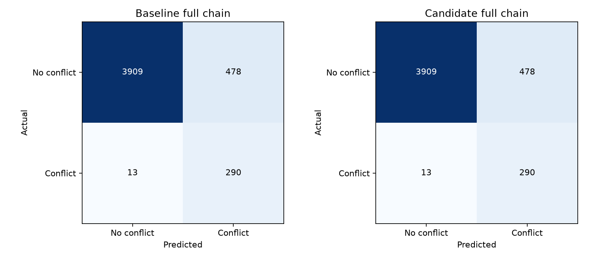

# Multi-path trajectory bundle (Model 1b): evaluation and testing

KMeans route clusters, 40-class route classifier, temperature calibration and along/cross/altitude offset regressors are constituents of this jointly evaluated bundle. Includes table, per-mode, archive, destination and continuation variants.

[Latest comparison](../evaluation.md) · [Every original source and cleanup status](source_inventory.json)

This is the single maintained history for this model/component. Records preserve the original bytes, including every numeric field, trial, seed, protocol, selection and caveat. Shared reports are included in each relevant ledger. No fresh inference is implied by consolidation.

## Development sequence

Initial pattern-table bundle: September 6; per-mode regressors measured September 23 and served September 24; archive-augmented training and four-seed studies September 25, served September 26; destination inputs measured September 26 and served September 27. November 1 compares continue_600, continue_800 and rejected regularized31; only continue_800 is the validation-selected packaged candidate, not deployed. Context, altitude/3-D, runtime and seed ablations below preserve all costs alongside gains.

### Multi-seed route coverage history

Rates are percentages; the whole route bundle varies by seed. Top-k coverage is not single-guess accuracy. Offset-only continuation is a different, deterministic experiment.

| Report | Seed | Variant | k | Group | Within 5 NM % |
| --- | --- | --- | --- | --- | --- |
| multipath_archive_seeds_20260925_030354 | seed_42 | table | 1 | arrivals | 41.32740335271981 |
| multipath_archive_seeds_20260925_030354 | seed_42 | table | 1 | all | 65.26631657914479 |
| multipath_archive_seeds_20260925_030354 | seed_42 | table | 3 | arrivals | 59.52788231269244 |
| multipath_archive_seeds_20260925_030354 | seed_42 | table | 3 | all | 80.3290108241346 |
| multipath_archive_seeds_20260925_030354 | seed_42 | table | 5 | arrivals | 64.24905918576805 |
| multipath_archive_seeds_20260925_030354 | seed_42 | table | 5 | all | 84.09066552352374 |
| multipath_archive_seeds_20260925_030354 | seed_42 | table | 10 | arrivals | 69.03865891207663 |
| multipath_archive_seeds_20260925_030354 | seed_42 | table | 10 | all | 86.85564248204909 |
| multipath_archive_seeds_20260925_030354 | seed_42 | per_mode | 1 | arrivals | 46.835443037974684 |
| multipath_archive_seeds_20260925_030354 | seed_42 | per_mode | 1 | all | 67.79552030864859 |
| multipath_archive_seeds_20260925_030354 | seed_42 | per_mode | 3 | arrivals | 68.90181320561068 |
| multipath_archive_seeds_20260925_030354 | seed_42 | per_mode | 3 | all | 83.75843960990248 |
| multipath_archive_seeds_20260925_030354 | seed_42 | per_mode | 5 | arrivals | 75.43619568936025 |
| multipath_archive_seeds_20260925_030354 | seed_42 | per_mode | 5 | all | 88.0613010395456 |
| multipath_archive_seeds_20260925_030354 | seed_42 | per_mode | 10 | arrivals | 81.45740677386247 |
| multipath_archive_seeds_20260925_030354 | seed_42 | per_mode | 10 | all | 91.49608830779124 |
| multipath_archive_seeds_20260925_030354 | seed_1 | table | 1 | arrivals | 40.23263770099213 |
| multipath_archive_seeds_20260925_030354 | seed_1 | table | 1 | all | 65.35205229878899 |
| multipath_archive_seeds_20260925_030354 | seed_1 | table | 3 | arrivals | 58.05679096818337 |
| multipath_archive_seeds_20260925_030354 | seed_1 | table | 3 | all | 79.55738934733684 |
| multipath_archive_seeds_20260925_030354 | seed_1 | table | 5 | arrivals | 64.0780020526856 |
| multipath_archive_seeds_20260925_030354 | seed_1 | table | 5 | all | 83.61911906548065 |
| multipath_archive_seeds_20260925_030354 | seed_1 | table | 10 | arrivals | 67.63599042080055 |
| multipath_archive_seeds_20260925_030354 | seed_1 | table | 10 | all | 86.11081341764012 |
| multipath_archive_seeds_20260925_030354 | seed_1 | per_mode | 1 | arrivals | 46.32227163872734 |
| multipath_archive_seeds_20260925_030354 | seed_1 | per_mode | 1 | all | 68.18133104704748 |
| multipath_archive_seeds_20260925_030354 | seed_1 | per_mode | 3 | arrivals | 69.1412931919261 |
| multipath_archive_seeds_20260925_030354 | seed_1 | per_mode | 3 | all | 83.80130746972458 |
| multipath_archive_seeds_20260925_030354 | seed_1 | per_mode | 5 | arrivals | 76.12042422169004 |
| multipath_archive_seeds_20260925_030354 | seed_1 | per_mode | 5 | all | 88.29707426856714 |
| multipath_archive_seeds_20260925_030354 | seed_1 | per_mode | 10 | arrivals | 81.354772494013 |
| multipath_archive_seeds_20260925_030354 | seed_1 | per_mode | 10 | all | 91.51752223770228 |
| multipath_archive_seeds_20260925_030354 | seed_2 | table | 1 | arrivals | 40.13000342114266 |
| multipath_archive_seeds_20260925_030354 | seed_2 | table | 1 | all | 65.13235451720072 |
| multipath_archive_seeds_20260925_030354 | seed_2 | table | 3 | arrivals | 57.06465959630517 |
| multipath_archive_seeds_20260925_030354 | seed_2 | table | 3 | all | 79.38055942557068 |
| multipath_archive_seeds_20260925_030354 | seed_2 | table | 5 | arrivals | 62.16216216216216 |
| multipath_archive_seeds_20260925_030354 | seed_2 | table | 5 | all | 83.43693066123674 |
| multipath_archive_seeds_20260925_030354 | seed_2 | table | 10 | arrivals | 66.57543619568936 |
| multipath_archive_seeds_20260925_030354 | seed_2 | table | 10 | all | 85.86432322366306 |
| multipath_archive_seeds_20260925_030354 | seed_2 | per_mode | 1 | arrivals | 47.17755730413958 |
| multipath_archive_seeds_20260925_030354 | seed_2 | per_mode | 1 | all | 68.04201050262566 |
| multipath_archive_seeds_20260925_030354 | seed_2 | per_mode | 3 | arrivals | 68.38864180636332 |
| multipath_archive_seeds_20260925_030354 | seed_2 | per_mode | 3 | all | 83.75843960990248 |
| multipath_archive_seeds_20260925_030354 | seed_2 | per_mode | 5 | arrivals | 74.88881286349641 |
| multipath_archive_seeds_20260925_030354 | seed_2 | per_mode | 5 | all | 88.32386668095596 |
| multipath_archive_seeds_20260925_030354 | seed_2 | per_mode | 10 | arrivals | 81.14950393431405 |
| multipath_archive_seeds_20260925_030354 | seed_2 | per_mode | 10 | all | 91.50144679026899 |
| multipath_archive_seeds_20260925_030354 | seed_3 | table | 1 | arrivals | 41.087923366404375 |
| multipath_archive_seeds_20260925_030354 | seed_3 | table | 1 | all | 65.37884471117779 |
| multipath_archive_seeds_20260925_030354 | seed_3 | table | 3 | arrivals | 58.74101950051317 |
| multipath_archive_seeds_20260925_030354 | seed_3 | table | 3 | all | 80.0450112528132 |
| multipath_archive_seeds_20260925_030354 | seed_3 | table | 5 | arrivals | 64.65959630516592 |
| multipath_archive_seeds_20260925_030354 | seed_3 | table | 5 | all | 84.09066552352374 |
| multipath_archive_seeds_20260925_030354 | seed_3 | table | 10 | arrivals | 68.35443037974683 |
| multipath_archive_seeds_20260925_030354 | seed_3 | table | 10 | all | 86.59843532311649 |
| multipath_archive_seeds_20260925_030354 | seed_3 | per_mode | 1 | arrivals | 46.4591173451933 |
| multipath_archive_seeds_20260925_030354 | seed_3 | per_mode | 1 | all | 67.98842567784803 |
| multipath_archive_seeds_20260925_030354 | seed_3 | per_mode | 3 | arrivals | 68.93602463222717 |
| multipath_archive_seeds_20260925_030354 | seed_3 | per_mode | 3 | all | 83.79059050476904 |
| multipath_archive_seeds_20260925_030354 | seed_3 | per_mode | 5 | arrivals | 75.98357851522408 |
| multipath_archive_seeds_20260925_030354 | seed_3 | per_mode | 5 | all | 88.25420640874503 |
| multipath_archive_seeds_20260925_030354 | seed_3 | per_mode | 10 | arrivals | 81.11529250769756 |
| multipath_archive_seeds_20260925_030354 | seed_3 | per_mode | 10 | all | 91.46393741292465 |
| multipath_seeds_20260925_012526 | seed_42 | table | 1 | arrivals | 38.624700650017104 |
| multipath_seeds_20260925_012526 | seed_42 | table | 1 | all | 63.99635623191512 |
| multipath_seeds_20260925_012526 | seed_42 | table | 3 | arrivals | 57.88573383510093 |
| multipath_seeds_20260925_012526 | seed_42 | table | 3 | all | 78.99474868717179 |
| multipath_seeds_20260925_012526 | seed_42 | table | 5 | arrivals | 63.56483065343825 |
| multipath_seeds_20260925_012526 | seed_42 | table | 5 | all | 82.99753509806023 |
| multipath_seeds_20260925_012526 | seed_42 | table | 10 | arrivals | 68.8333903523777 |
| multipath_seeds_20260925_012526 | seed_42 | table | 10 | all | 86.50734112099452 |
| multipath_seeds_20260925_012526 | seed_42 | per_mode | 1 | arrivals | 44.16695176188847 |
| multipath_seeds_20260925_012526 | seed_42 | per_mode | 1 | all | 66.65416354088522 |
| multipath_seeds_20260925_012526 | seed_42 | per_mode | 3 | arrivals | 65.1043448511803 |
| multipath_seeds_20260925_012526 | seed_42 | per_mode | 3 | all | 82.20447969135141 |
| multipath_seeds_20260925_012526 | seed_42 | per_mode | 5 | arrivals | 71.46767020184743 |
| multipath_seeds_20260925_012526 | seed_42 | per_mode | 5 | all | 86.57700139320545 |
| multipath_seeds_20260925_012526 | seed_42 | per_mode | 10 | arrivals | 77.72836127266507 |
| multipath_seeds_20260925_012526 | seed_42 | per_mode | 10 | all | 90.5905047690494 |
| multipath_seeds_20260925_012526 | seed_1 | table | 1 | arrivals | 37.83783783783784 |
| multipath_seeds_20260925_012526 | seed_1 | table | 1 | all | 63.985639266959595 |
| multipath_seeds_20260925_012526 | seed_1 | table | 3 | arrivals | 56.9620253164557 |
| multipath_seeds_20260925_012526 | seed_1 | table | 3 | all | 78.83935269531669 |
| multipath_seeds_20260925_012526 | seed_1 | table | 5 | arrivals | 63.59904208005474 |
| multipath_seeds_20260925_012526 | seed_1 | table | 5 | all | 83.49051548601436 |
| multipath_seeds_20260925_012526 | seed_1 | table | 10 | arrivals | 69.1070817653096 |
| multipath_seeds_20260925_012526 | seed_1 | table | 10 | all | 87.23073625549245 |
| multipath_seeds_20260925_012526 | seed_1 | per_mode | 1 | arrivals | 42.59322613752993 |
| multipath_seeds_20260925_012526 | seed_1 | per_mode | 1 | all | 66.44518272425249 |
| multipath_seeds_20260925_012526 | seed_1 | per_mode | 3 | arrivals | 64.86486486486487 |
| multipath_seeds_20260925_012526 | seed_1 | per_mode | 3 | all | 82.09731004179616 |
| multipath_seeds_20260925_012526 | seed_1 | per_mode | 5 | arrivals | 72.11768730756073 |
| multipath_seeds_20260925_012526 | seed_1 | per_mode | 5 | all | 86.93601971921552 |
| multipath_seeds_20260925_012526 | seed_1 | per_mode | 10 | arrivals | 78.78891549777626 |
| multipath_seeds_20260925_012526 | seed_1 | per_mode | 10 | all | 91.01918336727039 |
| multipath_seeds_20260925_012526 | seed_2 | table | 1 | arrivals | 37.05097502565857 |
| multipath_seeds_20260925_012526 | seed_2 | table | 1 | all | 64.0285071267817 |
| multipath_seeds_20260925_012526 | seed_2 | table | 3 | arrivals | 55.66199110502909 |
| multipath_seeds_20260925_012526 | seed_2 | table | 3 | all | 78.27671203515165 |
| multipath_seeds_20260925_012526 | seed_2 | table | 5 | arrivals | 61.68320218953131 |
| multipath_seeds_20260925_012526 | seed_2 | table | 5 | all | 82.92251634337156 |
| multipath_seeds_20260925_012526 | seed_2 | table | 10 | arrivals | 67.67020184741703 |
| multipath_seeds_20260925_012526 | seed_2 | table | 10 | all | 86.84492551709356 |
| multipath_seeds_20260925_012526 | seed_2 | per_mode | 1 | arrivals | 43.41430037632569 |
| multipath_seeds_20260925_012526 | seed_2 | per_mode | 1 | all | 66.77205015539599 |
| multipath_seeds_20260925_012526 | seed_2 | per_mode | 3 | arrivals | 64.48853917208348 |
| multipath_seeds_20260925_012526 | seed_2 | per_mode | 3 | all | 81.7650841281749 |
| multipath_seeds_20260925_012526 | seed_2 | per_mode | 5 | arrivals | 72.42559014710913 |
| multipath_seeds_20260925_012526 | seed_2 | per_mode | 5 | all | 86.80741613974922 |
| multipath_seeds_20260925_012526 | seed_2 | per_mode | 10 | arrivals | 79.64420116318851 |
| multipath_seeds_20260925_012526 | seed_2 | per_mode | 10 | all | 91.27639052620297 |
| multipath_seeds_20260925_012526 | seed_3 | table | 1 | arrivals | 39.822100581594256 |
| multipath_seeds_20260925_012526 | seed_3 | table | 1 | all | 63.70163969563819 |
| multipath_seeds_20260925_012526 | seed_3 | table | 3 | arrivals | 59.083133766678074 |
| multipath_seeds_20260925_012526 | seed_3 | table | 3 | all | 79.07512592433822 |
| multipath_seeds_20260925_012526 | seed_3 | table | 5 | arrivals | 64.79644201163188 |
| multipath_seeds_20260925_012526 | seed_3 | table | 5 | all | 84.01028828635731 |
| multipath_seeds_20260925_012526 | seed_3 | table | 10 | arrivals | 70.71501881628464 |
| multipath_seeds_20260925_012526 | seed_3 | table | 10 | all | 87.65405637123567 |
| multipath_seeds_20260925_012526 | seed_3 | per_mode | 1 | arrivals | 44.4064317482039 |
| multipath_seeds_20260925_012526 | seed_3 | per_mode | 1 | all | 66.54163540885222 |
| multipath_seeds_20260925_012526 | seed_3 | per_mode | 3 | arrivals | 65.34382483749572 |
| multipath_seeds_20260925_012526 | seed_3 | per_mode | 3 | all | 82.07051762940735 |
| multipath_seeds_20260925_012526 | seed_3 | per_mode | 5 | arrivals | 71.8439958946288 |
| multipath_seeds_20260925_012526 | seed_3 | per_mode | 5 | all | 87.06462329868181 |
| multipath_seeds_20260925_012526 | seed_3 | per_mode | 10 | arrivals | 79.91789257612042 |
| multipath_seeds_20260925_012526 | seed_3 | per_mode | 10 | all | 91.38891865823598 |

## Study: multipath_tuning_20261101

Historical narrative below retains the recorded results; statements about being uncommitted describe the study date. All studies are now preserved in the checkpoint commit. Links to removed originals now lead to their ledger source register; the evidence appendix retains the exact original prose and links.

# Multi-path tuning — 1 November 2026

The candidate passes the recorded trajectory, alert-chain, later-date and inference-cost checks. It is packaged separately for review; it has not replaced the served model.

All new work is **local and uncommitted** on `fine-tuning`, based on `2bcaba1`. At Archit's instruction, no new commits or pushes have been made. The original checkpoint is preserved in that branch's history at `a502c7e`; the obsolete checkpoint and LSTM experiment branch names were removed.

## Scope and predeclared method

This studies Model 1b, the multi-path predictor used by the alert chain. Only the three ten-minute per-mode offset regressors change. Forty learned route patterns, the route classifier, temperature calibration, top-K=5, destination features, earlier horizons, labels, conflict classifier and alert thresholds stay fixed. Best-of-five is coverage, not single-guess accuracy.

`arrivals` retains the project's existing near-airport bucket: distance less than 40 NM from VABB. It is not an independently labelled arrival/departure classification.

The existing archive-augmented training split has 605,757 windows, including 342,606 ten-minute targets. The five chronological validation collection blocks are divided into 20,091 early windows (10,192 ten-minute targets) for fresh-refit early stopping, and 25,546 later windows (12,499 ten-minute targets) for ranking. Their gap exceeds the 600-second target horizon. Continuation keeps the original identical training data and seed-0 legacy internal random holdout, as required for a valid scikit-learn warm start. It is not claimed to replace that original holdout with chronological early stopping. The fresh refit does use explicit chronological early validation.

The fixed objective averages relative changes in top-1 mean/RMSE/P90 horizontal errors, altitude MAE and energy score, plus rate gaps divided by 100 for within-1-NM, top-1/best-of-five within-5-NM and top-1/best-of-five joint 3-D hits, equally over arrivals and all traffic. Lower is better; the baseline scores zero. These weights and tolerances are our experimental design, not aviation standards.

Trajectory guards: errors may rise at most 2% plus 0.01 NM, 1 ft altitude or 0.001 energy; coverage may fall at most 0.5 percentage points. Regimes with at least 100 examples allow at most 5%+0.01 NM mean-error rise or a one-point top-1 hit-rate drop. Earlier-horizon predictions remain identical. A trajectory candidate also faces a validation alert-chain veto before selection is frozen for test.

## Trials and validation selection

| Trial | Hypothesis | Fitted trees: along / cross / altitude | Objective | Trajectory guards | Validation alert guards |
|---|---|---|---|---|---|
| continue_600 | Continue the original capped models without changing training data | 600 / 600 / 468 | -0.00217 | True | not evaluated after earlier passing selection |
| continue_800 | Continue the original capped models without changing training data | 800 / 800 / 468 | -0.00320 | True | True |
| regularized31 | 31 leaves, minimum 80 samples per leaf, L2=5, chronological early stopping | 265 / 400 / 292 | +0.03038 | False | not evaluated after earlier passing selection |

Validation-frozen choice: **continue_800**, seed **0**. Eligible from validation: **True**.

Continuation is deterministic from a fixed fitted source. Its original training seed is retained; this study does **not** claim independent multi-seed replication. Fresh-model seeds cannot be substituted without changing the warm-start data partition and requiring full baseline retraining.

### Rejected and diagnostic results

- continue_600: no recorded failure in the checks evaluated
- continue_800: no recorded failure in the checks evaluated
- regularized31: all/top1_altitude_mae_ft: error increased >2% + slack; all/energy_score: error increased >2% + slack; all/top1_within_1nm: rate fell >0.5 pp; all/best5_within_5nm: rate fell >0.5 pp; all/top1_both: rate fell >0.5 pp; all/best5_both: rate fell >0.5 pp; arrivals/top1_altitude_mae_ft: error increased >2% + slack; arrivals/energy_score: error increased >2% + slack; arrivals/top1_within_1nm: rate fell >0.5 pp; arrivals/top1_within_5nm: rate fell >0.5 pp; arrivals/best5_within_5nm: rate fell >0.5 pp; arrivals/top1_both: rate fell >0.5 pp; arrivals/best5_both: rate fell >0.5 pp; regime vertical/gentle climb/descent: mean error >5% or hit drop >1 pp; regime vertical/fast climb/descent: mean error >5% or hit drop >1 pp; regime distance to VABB/terminal: mean error >5% or hit drop >1 pp

## Historical held-out trajectory audit

No rejected candidate was selected using test results. The historical split has been examined in earlier project studies, so it is not a new untouched benchmark. Joint 3-D coverage requires the **same candidate** to be within 5 NM horizontally and 1,000 ft vertically.

| Group | Metric at ten minutes | Baseline | Candidate | Difference |
|---|---|---|---|---|
| all (n=18662) | top1_mean_nm | 5.53280 | 5.49463 | -0.03817 |
| all (n=18662) | top1_rmse_nm | 9.99827 | 9.97686 | -0.02141 |
| all (n=18662) | top1_median_nm | 2.05195 | 1.98789 | -0.06407 |
| all (n=18662) | top1_p90_nm | 15.89795 | 15.87455 | -0.02340 |
| all (n=18662) | top1_altitude_mae_ft | 889.18759 | 888.14280 | -1.04479 |
| all (n=18662) | best5_mean_nm | 2.57870 | 2.53530 | -0.04340 |
| all (n=18662) | top1_within_1nm | 37.77194 | 38.34530 | +0.57336 |
| all (n=18662) | top1_within_5nm | 68.06880 | 68.26707 | +0.19826 |
| all (n=18662) | best5_within_5nm | 88.43104 | 88.64538 | +0.21434 |
| all (n=18662) | top1_within_1000ft | 72.87536 | 72.87536 | +0.00000 |
| all (n=18662) | best5_within_1000ft | 77.90698 | 77.92841 | +0.02143 |
| all (n=18662) | top1_both | 55.89969 | 56.02829 | +0.12860 |
| all (n=18662) | best5_both | 68.19205 | 68.31529 | +0.12325 |
| all (n=18662) | energy_score | 1.35628 | 1.35153 | -0.00475 |
| arrivals (n=2923) | top1_mean_nm | 9.93943 | 9.89244 | -0.04699 |
| arrivals (n=2923) | top1_rmse_nm | 15.41122 | 15.39838 | -0.01284 |
| arrivals (n=2923) | top1_median_nm | 5.47821 | 5.36089 | -0.11732 |
| arrivals (n=2923) | top1_p90_nm | 26.01240 | 26.00515 | -0.00725 |
| arrivals (n=2923) | top1_altitude_mae_ft | 1289.81773 | 1288.77336 | -1.04436 |
| arrivals (n=2923) | best5_mean_nm | 4.29989 | 4.22899 | -0.07089 |
| arrivals (n=2923) | top1_within_1nm | 17.03729 | 17.31098 | +0.27369 |
| arrivals (n=2923) | top1_within_5nm | 47.21177 | 47.51967 | +0.30790 |
| arrivals (n=2923) | best5_within_5nm | 76.46254 | 76.90729 | +0.44475 |
| arrivals (n=2923) | top1_within_1000ft | 56.24359 | 56.27780 | +0.03421 |
| arrivals (n=2923) | best5_within_1000ft | 68.14916 | 68.25180 | +0.10263 |
| arrivals (n=2923) | top1_both | 34.45091 | 34.65618 | +0.20527 |
| arrivals (n=2923) | best5_both | 48.78549 | 49.02497 | +0.23948 |
| arrivals (n=2923) | energy_score | 2.03300 | 2.02671 | -0.00629 |

### Per-horizon top-1 metrics

| Horizon | Model | Mean NM | RMSE NM | P90 NM | Altitude MAE ft | Within 5 NM |
|---|---|---|---|---|---|---|
| 1 min | Baseline | 0.4385 | 1.7088 | 0.9432 | 96.7 | 98.47% |
| 1 min | Candidate | 0.4385 | 1.7088 | 0.9432 | 96.7 | 98.47% |
| 3 min | Baseline | 1.3371 | 3.0130 | 4.2739 | 297.6 | 91.73% |
| 3 min | Candidate | 1.3371 | 3.0130 | 4.2739 | 297.6 | 91.73% |
| 5 min | Baseline | 2.5413 | 5.2593 | 7.7133 | 494.3 | 83.75% |
| 5 min | Candidate | 2.5413 | 5.2593 | 7.7133 | 494.3 | 83.75% |
| 10 min | Baseline | 5.5328 | 9.9983 | 15.8979 | 889.2 | 68.07% |
| 10 min | Candidate | 5.4946 | 9.9769 | 15.8745 | 888.1 | 68.27% |

## Full alert-chain audit

The existing constructed encounter set relocates one real track while preserving its recorded future manoeuvres; these are not observed real-world near misses. The audit includes the multi-path step and verifies the actual escalation function pair by pair, assuming unchanged geometry for three updates to satisfy persistence. It is not a full live-tick timing test.

| Split/model | Precision | Recall | F1 | TN | FP | FN | TP | ≥3-minute catches | Tier 1 real / false |
|---|---|---|---|---|---|---|---|---|---|
| Validation baseline | 0.3805 | 0.9622 | 0.5453 | 5409 | 705 | 17 | 433 | 411/428 | 30 / 24 |
| Validation candidate | 0.3805 | 0.9622 | 0.5453 | 5409 | 705 | 17 | 433 | 411/428 | 30 / 24 |
| Test baseline | 0.3776 | 0.9571 | 0.5415 | 3909 | 478 | 13 | 290 | 271/284 | 28 / 20 |
| Test candidate | 0.3776 | 0.9571 | 0.5415 | 3909 | 478 | 13 | 290 | 271/284 | 28 / 20 |

The classification target here is conflict/no conflict after the full chain. The standalone conflict classifier is unchanged; its previously recorded 95.1% warning figure must not be conflated with this full-chain rate. Alert guard failures: none.



Display/prominence and collapse counts are also retained in the JSON. Validation acceptance requires no lost early real catches or real tier-1 alarms and no increase in the specified false-alert/collapse counts; it does not tune controller thresholds.

### Pair-level identity check

Counts alone could hide a lost real case offset by a gained one. This additional post-selection check compares the individual pair decisions and real tier-1 memberships.

| Split | Changed alert decisions | Changed computed tiers | Lost real alerts | Lost real tier 1 |
|---|---|---|---|---|
| val | 0 | 1 | 0 | 0 |
| test | 0 | 0 | 0 | 0 |

## Route classification and probability calibration

The route classifier, cluster identities and temperature are frozen. These values therefore apply equally to the baseline and candidate, not an improvement caused by offset tuning.

| Average | Precision | Recall | F1 |
|---|---|---|---|
| macro avg | 0.5155 | 0.4147 | 0.4413 |
| weighted avg | 0.6170 | 0.6355 | 0.6100 |

Multiclass negative log likelihood: 1.30870; Brier score: 0.50224; top-1 ten-bin calibration error: 0.06370. These score the actual ten-minute residual's KMeans cluster. They do not establish calibration of geometric within-distance hits or the probability of a conflict.

[Full route-cluster confusion counts (archived source)](multipath.md#source-register) and per-class precision/recall/F1 are retained in the raw summary.

## Distribution quality: energy score

The lower-is-better score is E||Z−y|| − 0.5 E||Z−Z′|| for independent draws from the normalized retained five-path distribution. Local residual coordinates are scaled by 5 NM along/cross track and 1,000 ft altitude. This fixed scaling is our design, not an aviation standard. A low best-of-five distance alone can hide poor probabilities or unhelpful other modes; the energy score evaluates the mixture. It is not a score for the discarded probability tail or for the conflict event.

## Shared later-date trajectory audit

10 and 20 September 2026: 213,482 windows. Destination is known in the existing local route cache for 75.3% of windows. No online lookups were made. These dates were used in prior LSTM studies and form a shared exploratory audit, not a fresh independent test for each follow-up. Labels were not used for parameter or candidate selection. This cohort has no labelled encounter outcomes; it supports trajectory, not alert-chain, conclusions.

| Group | Metric at ten minutes | Baseline | Candidate | Difference |
|---|---|---|---|---|
| all (n=120679) | top1_mean_nm | 5.77170 | 5.74494 | -0.02675 |
| all (n=120679) | top1_p90_nm | 16.77225 | 16.77645 | +0.00421 |
| all (n=120679) | top1_altitude_mae_ft | 668.23764 | 667.88143 | -0.35621 |
| all (n=120679) | best5_within_5nm | 87.86119 | 88.03189 | +0.17070 |
| all (n=120679) | best5_both | 73.89355 | 74.01951 | +0.12595 |
| all (n=120679) | energy_score | 1.31141 | 1.30825 | -0.00316 |
| arrivals (n=7480) | top1_mean_nm | 10.63095 | 10.60985 | -0.02110 |
| arrivals (n=7480) | top1_p90_nm | 26.91853 | 27.01920 | +0.10067 |
| arrivals (n=7480) | top1_altitude_mae_ft | 1555.36698 | 1555.00193 | -0.36505 |
| arrivals (n=7480) | best5_within_5nm | 74.58556 | 74.78610 | +0.20053 |
| arrivals (n=7480) | best5_both | 41.55080 | 41.65775 | +0.10695 |
| arrivals (n=7480) | energy_score | 2.23091 | 2.22797 | -0.00294 |

Later-date trajectory guard failures: none.

## Inference and artifact cost

Production loader, CPU limited to four threads, batch 64, two warmups and seven interleaved measurements: median 350.48 ms baseline → 390.30 ms candidate. Recorded practical cost guard passes: True. Raw model size: 116.0 → 121.8 MiB. This measures isolated prediction, not the full ingestion/update loop. Timing varies with laptop load.

## Paired uncertainty diagnostic

1,000 paired resamples of whole aircraft on the later-date cohort, seed 20261101. Differences are candidate minus baseline: negative errors/energy or positive coverage favor the candidate. Intervals crossing zero are inconclusive within this diagnostic. This post-selection check was not used for ranking; it does not measure between-day or airport generalization from only two shared dates.

| Group | Metric | Mean difference | 95% percentile interval |
|---|---|---|---|
| all (925 aircraft) | top1_mean_nm | -0.02675 | -0.03001 to -0.02373 |
| all (925 aircraft) | top1_altitude_mae_ft | -0.35621 | -0.54391 to -0.22142 |
| all (925 aircraft) | best5_within_5nm | +0.17070 | +0.11971 to +0.22857 |
| all (925 aircraft) | best5_both | +0.12595 | +0.07839 to +0.17099 |
| all (925 aircraft) | energy_score | -0.00316 | -0.00365 to -0.00268 |
| arrivals (247 aircraft) | top1_mean_nm | -0.02110 | -0.03290 to -0.01028 |
| arrivals (247 aircraft) | top1_altitude_mae_ft | -0.36505 | -0.69882 to -0.03363 |
| arrivals (247 aircraft) | best5_within_5nm | +0.20053 | -0.09874 to +0.48592 |
| arrivals (247 aircraft) | best5_both | +0.10695 | -0.10833 to +0.30705 |
| arrivals (247 aircraft) | energy_score | -0.00294 | -0.00432 to -0.00166 |

## Acceptance and reproducibility

| Check | Passed |
|---|---|
| validation_eligible | True |
| all_test_trajectory_guards | True |
| all_test_alert_guards | True |
| all_available_finalists_validation_guards | True |
| pair_identity_safety_check | True |
| later_date_guards | True |
| inference_cost_guard | True |
| served_files_unchanged | True |

Passing practical tolerances is not a claim that every individual component or regime improved. No served weights, alert thresholds, original data splits or historical evaluation tables were overwritten.

- [Protocol (archived source)](multipath.md#source-register)
- [Exact training source (archived source)](multipath.md#source-register)
- [Data/source fingerprints (archived source)](multipath.md#source-register)
- [Validation-frozen selection (archived source)](multipath.md#source-register)
- [Full results, including rejected trials (archived source)](multipath.md#source-register)
- [Candidate card (archived source)](multipath.md#source-register)

Local trial models: `ml_pipeline/data/processed/multipath_experiments/20261101/`. If all checks pass, the packaged file is `trajectory_multipath_candidate.pkl` in that directory. Binary models are local, not committed or uploaded.

## Research basis

- [scikit-learn HistGradientBoostingRegressor](https://scikit-learn.org/stable/modules/generated/sklearn.ensemble.HistGradientBoostingRegressor.html): warm-start same-data requirement, regularization and explicit early-stopping validation.
- [Early stopping example](https://scikit-learn.org/stable/auto_examples/ensemble/plot_gradient_boosting_early_stopping.html): motivation for testing iteration limits against validation performance.
- [Gneiting and Raftery (2007), Section 4.3](https://sites.stat.washington.edu/people/raftery/Research/PDF/Gneiting2007jasa.pdf): energy score for multivariate distributions; this report uses negative orientation so lower is better.

The candidate grids, coordinate scaling, objective weights and regression tolerances are our own experimental choices. These sources describe the mechanisms, not evidence that these settings improve Mumbai traffic. All reported benefits and failures come from the local measurements.


## Complete iteration register

| Recorded run | Recorded sections | Details |
| --- | --- | --- |
| ml_pipeline/reports/multipath_tuning_20261101/summary.json | completed_at_utc, protocol, baseline_selection, trials, winner, validation_eligible, finalists_validation, baseline_validation_alerts, baseline_test, baseline_test_alerts, test_audits, route_classification, served_artifacts_unchanged | Exact configuration, validation/test numbers, guards and rejected trials in evidence record below |

## Model artifact cleanup (9 November 2026)

These are storage changes, not new evaluations or model deployment. Original reports below retain every measured value. Retiring a trial's weight file does not erase its configuration or results; rerunning a retired trial requires retraining.

### continue_600

Unselected continuation trial. Continued only the ten-minute offset regressors; validation trajectory guards passed, but continue_800 had a better predeclared objective and was selected. This trial did not receive a test or validation-alert audit.

Status: **removed after provenance verification**. Original artifact: `ml_pipeline/data/processed/multipath_experiments/20261101/continue_600_seed0.pkl`; SHA-256: `e1ce28bb966f5efe485663ef86f0317c6b3417b8748feaa5ac025d64d1175881`.

Configuration: `{"max_iter": 600, "method": "continue", "name": "continue_600"}`; seed 0. Validation objective: -0.0021735643; trajectory guards passed: True.

Fitted trees (along/cross/altitude): 600/600/468. Test outcome: Not run: not selected for the historical test audit.

| Validation group | n | Top-1 mean NM | Top-1 RMSE NM | Top-1 5 NM % | Best-5 5 NM % | Top-1 3-D % | Best-5 3-D % | Altitude MAE ft |
| --- | --- | --- | --- | --- | --- | --- | --- | --- |
| all | 12499 | 4.276530921471593 | 8.395523290665098 | 75.35002800224018 | 93.5674853988319 | 63.78110248819906 | 75.9660772861829 | 682.7521736928564 |
| arrivals | 1514 | 8.563902702492824 | 13.956000784380851 | 52.57595772787318 | 78.73183619550859 | 39.233817701453106 | 51.45310435931307 | 1268.6779353827264 |

Full configuration, training/validation split protocol, every regime metric and guard failure remain in the machine-readable retirement entry and original source records. Source: `ml_pipeline/reports/multipath_tuning_20261101/continue_600_seed0.json`.

### regularized31

Rejected fresh refit with 31 leaves, minimum 80 samples/leaf, L2=5 and chronological early stopping. Validation trajectory guards failed, including altitude/coverage/regime regressions. No test evaluation or validation-alert audit was performed for this rejected trial.

Status: **removed after provenance verification**. Original artifact: `ml_pipeline/data/processed/multipath_experiments/20261101/regularized31_seed0.pkl`; SHA-256: `4a5c1dcb14c3640fd0ced43422f37079451a4c6637825e8a5e9ba0efafcc2e28`.

Configuration: `{"l2_regularization": 5.0, "learning_rate": 0.06, "max_iter": 400, "max_leaf_nodes": 31, "method": "refit", "min_samples_leaf": 80, "name": "regularized31"}`; seed 0. Validation objective: 0.0303833097; trajectory guards passed: False.

Fitted trees (along/cross/altitude): 265/400/292. Test outcome: Not run: not selected for the historical test audit.

| Validation group | n | Top-1 mean NM | Top-1 RMSE NM | Top-1 5 NM % | Best-5 5 NM % | Top-1 3-D % | Best-5 3-D % | Altitude MAE ft |
| --- | --- | --- | --- | --- | --- | --- | --- | --- |
| all | 12499 | 4.351084413996278 | 8.435826088685737 | 74.8139851188095 | 92.89543163453077 | 62.4929994399552 | 73.8299063925114 | 744.9343884326169 |
| arrivals | 1514 | 8.663517974700538 | 13.985733637133707 | 50.46235138705416 | 76.02377807133422 | 35.13870541611625 | 45.640686922060766 | 1455.726292077145 |

Full configuration, training/validation split protocol, every regime metric and guard failure remain in the machine-readable retirement entry and original source records. Source: `ml_pipeline/reports/multipath_tuning_20261101/regularized31_seed0.json`.

### continue_800

Selected model retained in trajectory_multipath_candidate.pkl. Retire only its redundant training export: the packaged file preserves every shared bundle field and adds tuning_model_card. Complete-file hashes differ; this is verified model-content equivalence, not byte identity.

Status: **redundant raw export removed; selected model retained in packaged artifact**. Original artifact: `ml_pipeline/data/processed/multipath_experiments/20261101/continue_800_seed0.pkl`; SHA-256: `ad64df89266b4c5980acb564c7e83d864b522de2f3ec43331147f42232952c2b`.

Configuration: `{"max_iter": 800, "method": "continue", "name": "continue_800"}`; seed 0. Validation objective: -0.0032040498; trajectory guards passed: True.

Fitted trees (along/cross/altitude): 800/800/468. Test outcome: Selected seed-0 candidate: historical test, alert-chain and later-date audits passed; retained in the packaged model.

| Validation group | n | Top-1 mean NM | Top-1 RMSE NM | Top-1 5 NM % | Best-5 5 NM % | Top-1 3-D % | Best-5 3-D % | Altitude MAE ft |
| --- | --- | --- | --- | --- | --- | --- | --- | --- |
| all | 12499 | 4.2626249108171885 | 8.389277920686965 | 75.382030562445 | 93.67149371949756 | 63.81310504840387 | 76.01408112649011 | 682.7521736928564 |
| arrivals | 1514 | 8.545556207444392 | 13.960602884302553 | 52.77410832232496 | 79.19418758256275 | 39.365918097754296 | 51.38705416116248 | 1268.6779353827264 |

Full configuration, training/validation split protocol, every regime metric and guard failure remain in the machine-readable retirement entry and original source records. Source: `ml_pipeline/reports/multipath_tuning_20261101/continue_800_seed0.json`.

Retained canonical artifact: `ml_pipeline/data/processed/multipath_experiments/20261101/trajectory_multipath_candidate.pkl`. All nine shared bundle entries have identical joblib hashes; only the packaged model has an additional tuning_model_card. Canonical references pin the packaged file hash; the old training-export hash is retained as provenance.

## Source register

| Original path | SHA-256 | Bytes |
| --- | --- | --- |
| docs/ablation.json | 3180dce6368064708b55f09668bf3dd50c03f7cc6cb0a86ebcaa3da393d2e063 | 41072 |
| docs/ablation.md | ca9d134f5f35682ba0a06995d9e08436609eba85e2c816f359657f882f27f7be | 6927 |
| docs/evaluation-history/20261030_before_refresh/ablation.json | 3180dce6368064708b55f09668bf3dd50c03f7cc6cb0a86ebcaa3da393d2e063 | 41072 |
| docs/evaluation-history/20261030_before_refresh/ablation.md | ca9d134f5f35682ba0a06995d9e08436609eba85e2c816f359657f882f27f7be | 6927 |
| docs/evaluation-history/20261030_before_refresh/evaluation.md | 642bf426063d325862bcdecbba24fbf28a1388c3cb6b04b974b1d5212ae0b1d4 | 67954 |
| docs/evaluation-history/20261030_before_refresh/figures/multipath_bestofk.png | 8572227fe09fc40cafdab0b23fcac97b1e76774830852ea8dabb0454365970d0 | 74829 |
| docs/evaluation-history/20261030_before_refresh/figures/multipath_calibration.png | 696583c96c062168763ed92450433088e39f5878b29236509e5928cc718c6d0b | 76542 |
| docs/evaluation-history/20261030_before_refresh/metrics.json | d048e5b13c2ecd0db9b02b7e86896f1915d028649c6c018faec2870d12856548 | 10521 |
| docs/evaluation.md | 542c7c21fead0619521428448a7fc57d08ef834a04f1362b8c463d2828975b6b | 13573 |
| docs/experiments/multipath_tuning_20261101.md | 868621cf52555441175432e0770699341856e1234b0fc2d40a286df49a94a482 | 16506 |
| docs/experiments/multipath_tuning_20261101_confusion.png | 5b9755a356c261b72db7d6c41c897efc76b8e2b7391b441237c09fdfc25dd15d | 41909 |
| docs/metrics.json | 49762a0262e64474059e1d4100e014ef99903c44c23b42cbed33c6dff01fcacc | 75451 |
| ml_pipeline/data/processed/seed_runs/destination_alerts.json | d8bd64c26daed2364d6d0771ed7cbfc0f2764bc4f69f272c0b574f99efa30f3a | 979 |
| ml_pipeline/data/processed/seed_runs/multipath_archive_control_seed42.log | e27dc6ac240a1dde801c69b64954b2fd6ddcdf458d098488ae225f581a985347 | 10878 |
| ml_pipeline/data/processed/seed_runs/multipath_archive_control_seed42.summary.json | f21629e1c2ea4f4ac413e6f16d3104f3048c4e79466eaae00d6408a23160bbb6 | 2830 |
| ml_pipeline/data/processed/seed_runs/multipath_archive_destination_seed42.log | cce0c512bf222fdedda13b05277d0123abeff227971e5323b6c6d7a968a432c1 | 11018 |
| ml_pipeline/data/processed/seed_runs/multipath_archive_destination_seed42.summary.json | 635bb1f8850272d6e413a0ac7fc3fe601240d2e1069eff48e7b48372d9301a71 | 2916 |
| ml_pipeline/data/processed/seed_runs/multipath_archive_seed1.summary.json | 266f0477318d4abdbdd8b86c092f705d8bafb22c9234822197b1f48b9231eeda | 1663 |
| ml_pipeline/data/processed/seed_runs/multipath_archive_seed2.summary.json | ce21ba9830b25ae56834197496bfc81f62fbe6678567ec63566f3ed005bdbe75 | 1666 |
| ml_pipeline/data/processed/seed_runs/multipath_archive_seed3.summary.json | 7a62aaeb2c2e5d147f629d16c862216fbdf30cda6116c43b06c84a97ff78ad51 | 1670 |
| ml_pipeline/data/processed/seed_runs/multipath_archive_seed42.summary.json | 0483b77107d7f9fa1efb70f0df1e6f120ae13dfe713b511709708681d96c5361 | 1670 |
| ml_pipeline/data/processed/seed_runs/multipath_ctx_all.log | ebbde0f132ae6048c5365e16b6ae7fb54469e78eeeb3d0faf9d7395df91e06f6 | 11083 |
| ml_pipeline/data/processed/seed_runs/multipath_ctx_all.summary.json | 93432959b99f556c18495f11de6274bfaef3a703b327156839978f2a97f82c67 | 3065 |
| ml_pipeline/data/processed/seed_runs/multipath_ctx_intent.log | e2fdc5b2bd9891caa967c0dff75e84caea962b2883ecb336d128e6d33b813a0e | 10974 |
| ml_pipeline/data/processed/seed_runs/multipath_ctx_intent.summary.json | 337be028c3003955d1eaa3824eba9ae3851c3871b0d830dedb47439b4b8c96ef | 2933 |
| ml_pipeline/data/processed/seed_runs/multipath_ctx_none.log | cbfbd42e7e91bfd8e62730e1421818ee2290ab4d763dad87f1ef23dfb041fdca | 10828 |
| ml_pipeline/data/processed/seed_runs/multipath_ctx_none.summary.json | f7ae9825315752ad9f86605d6bf05a898e670f3b4a3c7bb456fa035fe6985f8e | 2829 |
| ml_pipeline/data/processed/seed_runs/multipath_ctx_route.log | 0b5f58116413b20e976757298c93075cdf6012bb847c35ce27c1c7c8a07b5435 | 10964 |
| ml_pipeline/data/processed/seed_runs/multipath_ctx_route.summary.json | 157fee112e092576f168ca3afe2bb2bd8175f9c888fc53d7b7ac1552c6b2b28c | 2924 |
| ml_pipeline/data/processed/seed_runs/multipath_ctx_route_intent.log | ff58c8a79cbf43cf0cd4837f59c5246edd6b53cbae11ba316eb04b134309c29b | 11064 |
| ml_pipeline/data/processed/seed_runs/multipath_ctx_route_intent.summary.json | 1080f74308f7d0ab3a0e2c0c66835702e017bae3b37d666b61e283badd0a25c4 | 3022 |
| ml_pipeline/data/processed/seed_runs/multipath_ctx_traffic.log | 29422e0735fc1f0213eb956bca67532474aa5eabe2dd893fdf47c5ed199c547d | 10928 |
| ml_pipeline/data/processed/seed_runs/multipath_ctx_traffic.summary.json | c3ddd378b2eebc85bf4f659c69d8d309fecddc0b233c1162d8f645546641a072 | 2873 |
| ml_pipeline/data/processed/seed_runs/multipath_ctx_type.log | 3b458e6234d5597d315142ff25def3522af97b430cabfd2f3a3d807f5d5c09f9 | 10914 |
| ml_pipeline/data/processed/seed_runs/multipath_ctx_type.summary.json | 4e0d05fe2a9f8da9eeff0332fd072724edc7f8162cf95440d8514fe4df694599 | 2872 |
| ml_pipeline/data/processed/seed_runs/multipath_ctx_wind.log | b8c09c63956db0ea1c4008e3fc7b6bdbe9c3bf5c94f13e2f027979bd760756c0 | 10928 |
| ml_pipeline/data/processed/seed_runs/multipath_ctx_wind.summary.json | 49a13938025b5ff4e6d471112efe1a6ce326e0c65969af813faba67fa4299821 | 2887 |
| ml_pipeline/data/processed/seed_runs/multipath_seed1.summary.json | 0c8ebc5a61d37476b36ed17faf1f429f503ec24bb573a144cce7116e0c845d01 | 1666 |
| ml_pipeline/data/processed/seed_runs/multipath_seed2.summary.json | e6c0fd4a96ae9d950f4174d5cde833066715f737acec09b86575269a44f7727e | 1667 |
| ml_pipeline/data/processed/seed_runs/multipath_seed3.summary.json | b0c8d6deddac369ed90386ef5d4383add957de2f48b6595749a0236462a1bc54 | 1669 |
| ml_pipeline/data/processed/seed_runs/multipath_seed42.summary.json | db8e53b908446a9d04f2908becf2e6c35bc2679e4aac8ff90c96efaaa8bc4bda | 1669 |
| ml_pipeline/reports/context_ablation_20260925_050255.json | a6da0f2997b8778c4690b310f5e4d6bcea10e131fa3855153ec3948ff9236369 | 7489 |
| ml_pipeline/reports/context_ablation_20260926_175044.json | 66ecb8b735236d02aa9c3f0f11ee3700f8d5c5dfb1cecb1b44033f2850dbd3e5 | 4551 |
| ml_pipeline/reports/context_features_20260925_043216.json | 09f11314f5ed7bd63d0dfe648b035fdaf3e2e22235ffdfc153d45de50c60ce76 | 1961 |
| ml_pipeline/reports/context_features_route_20260927_000155.json | f2878b4d618c261ff2e1e6b03e9edd6e906b5a27bd06d5ae103528e5f6f88921 | 1198 |
| ml_pipeline/reports/destination_build_20260927_015938.json | 433029c583688c71a6e7e153076bc9d1083ebbbbfc8bf094614a8ae9263b189c | 163 |
| ml_pipeline/reports/destination_row_20260927_023146.json | 42aca7a5f1ad9e7c7d920516aab452f423462c64f6cb43269d0464b12c0c7777 | 2834 |
| ml_pipeline/reports/logs/20260906_140317/multipath.log | 7f622c97459a52f66658279238cd6b5ce308b241b4a38ccaa1987f17772cb668 | 9048 |
| ml_pipeline/reports/logs/20261030/multipath_3d_20261030_run.log | e3b0c44298fc1c149afbf4c8996fb92427ae41e4649b934ca495991b7852b855 | 0 |
| ml_pipeline/reports/logs/20261030/offsets_ab_20261030_run.log | 41dc14adc8515f45eae7dfeb7dda27b5c174e2ba46f46937718ec1b608167d9d | 10154 |
| ml_pipeline/reports/logs/20261030/reevaluation_20261030_run.log | 486f3114da948703f2b016d33cb8e01f8545c1884c6fcbcbc561d58bb013d2a5 | 7062 |
| ml_pipeline/reports/logs/multipath_tuning_20261101/future.log | ac2ce07157ebea1f32eefcf289395c451421e0071712def4c996a200dcfd5785 | 2794 |
| ml_pipeline/reports/logs/multipath_tuning_20261101/train.log | 3dd74ee66a619302305bb6a9d081a282ce0c3658d1c8b184b82bfba95c02cd59 | 6346 |
| ml_pipeline/reports/multipath_3d_20260925_030155.json | f0823235883ae2c1e4a33c6e73296771e9ac3c7cc2b98f924672d88e6c8affea | 8607 |
| ml_pipeline/reports/multipath_3d_20261030_212632.json | 04a90e1a20371859d8d14cfba321a796e2c3d50ecd47049c3c76fee290d07fff | 3499 |
| ml_pipeline/reports/multipath_archive_seeds_20260925_030354.json | 92b52c7a98db21624ef6a8756aa5c535e94b4501164221dfbd193d41a816d55e | 8402 |
| ml_pipeline/reports/multipath_seeds_20260925_012526.json | 9e663b2774cf7aeb93fe5ce5a831314bd5cbcf19ac0d04d578b375ffef99d4a2 | 8270 |
| ml_pipeline/reports/multipath_tuning_20261101/baseline_selection.json | eb230ebb433673c8d741b70dda71cbe212e85131f6ae8fa828341436a6a20e62 | 14156 |
| ml_pipeline/reports/multipath_tuning_20261101/benchmark_policy.json | 3a5b9ef37e39bdcac9b043a782fee3988b6df2d7d572398c94aba801110e1ec6 | 404 |
| ml_pipeline/reports/multipath_tuning_20261101/bootstrap_diagnostics.json | 68074b07c77cc7c13fb723be35d9dd26a76ee3a95cd1a6d07ae0e9b914b23e21 | 2493 |
| ml_pipeline/reports/multipath_tuning_20261101/candidate_model_card.json | 629a03b14e7d9c6e6913477d219243d08ae1e38035bc591eea463bae59a88896 | 70074 |
| ml_pipeline/reports/multipath_tuning_20261101/continue_600_seed0.json | 3dad70208219cbae1c2bde9ddac8141d61ca2f49b56bc64dfcb789991be8defb | 15934 |
| ml_pipeline/reports/multipath_tuning_20261101/continue_600_seed0_fit.json | 650209436e8238b9e664bd28cc04aefc48a2d51dcd44abdf3a0d91cd00f2620b | 598 |
| ml_pipeline/reports/multipath_tuning_20261101/continue_800_seed0.json | a8c643dedde606ce7f0d154a7a6a41ad180d0fdea879b3d59f27270ff1007807 | 15937 |
| ml_pipeline/reports/multipath_tuning_20261101/continue_800_seed0_fit.json | c67e03c0bf3466c2ab909ba4b8aec1837652304d50a97ac2aea1bef7aa116ca5 | 597 |
| ml_pipeline/reports/multipath_tuning_20261101/future_audit.json | 97a5bbd800c67df9449d2c326a7c1412e5224f524a65e12984038da6df4ceb59 | 33148 |
| ml_pipeline/reports/multipath_tuning_20261101/inference_benchmark.json | facf59d53e7353782de89a881ab7fbde30a9fba73fdec55ff243660fb2653500 | 1341 |
| ml_pipeline/reports/multipath_tuning_20261101/pair_identity_audit.json | a83206cdea6bdb907ab1353467f5d63ac15e4379f9c86c2a0ef207e822e65fd0 | 476 |
| ml_pipeline/reports/multipath_tuning_20261101/protocol.json | 8c9cb3e6e58062e056ddc70904ff56e289e6659f2c128f75042d98f58b9d2fd9 | 4519 |
| ml_pipeline/reports/multipath_tuning_20261101/regularized31_seed0.json | 8622764aa4812d70d58bed499e9e5d98774ee13e07a7e07f31d114eaabd5a8aa | 16990 |
| ml_pipeline/reports/multipath_tuning_20261101/regularized31_seed0_fit.json | a2c7a736d6f96ca43b3de4caad2eababf65c74daf57723d77502047aca4cf490 | 714 |
| ml_pipeline/reports/multipath_tuning_20261101/reproducibility_manifest.json | 23850cc0db0c6f4b280177e7d15c46e4e6b273d03a3fe3817f855e83dd6ece87 | 1693 |
| ml_pipeline/reports/multipath_tuning_20261101/route_confusion.csv | 9428d671dee6c129cecf728d039e060dbe810139fb2820c616d61d22f311be5d | 3419 |
| ml_pipeline/reports/multipath_tuning_20261101/selection_frozen_before_test.json | bd6b0e8d0d5f829e5f40941b01d131f6d5692e26ae4a6e45201f8010fb3ea91b | 194 |
| ml_pipeline/reports/multipath_tuning_20261101/source_snapshot.txt | c9d8542582f252f81c361e0b77a8348a32121d667924ea5b1fd17fbedd1b82a8 | 24291 |
| ml_pipeline/reports/multipath_tuning_20261101/summary.json | 2c4484cd42673cbad9ff5c023c60646649b26c70898969f593d70d0d68de7036 | 179285 |
| ml_pipeline/reports/offsets_ab_20260924_174836.json | 12a0efd4354cfebbdb1c61af7262068dfb43846c92e415f5535dc6c982c6514a | 3356 |
| ml_pipeline/reports/offsets_ab_20260924_181140.json | eea85dc8b06427625ad7dfd4d19e866639c08ad9a8d5a6813bcc3a9458efb2f8 | 16355 |
| ml_pipeline/reports/offsets_ab_20260926_114818.json | 5ecc4f9eac158364fad1fa94f98ae3dd42ca69dbdde2a5339ebcac5056aa75f0 | 16330 |
| ml_pipeline/reports/offsets_ab_20260926_115649.json | 09e91aedefe2a94fabc8d0c4ed69e6e0b6c3de41bb2e85c53dd0a01dcad8e98e | 16368 |
| ml_pipeline/reports/offsets_ab_20260926_210400.json | bab4248d766385f071700b30cf88ded18a0c85d82bafc22163880f917cee8ca4 | 16367 |
| ml_pipeline/reports/offsets_ab_20261030_163306.json | 926b8127e67c10ec4833d2b5920ae385ac3dd1fae4ee1c06d61fcaa4b93dfdbe | 18683 |
| ml_pipeline/reports/reevaluation_20260908_093417.json | b8b430512d3e34fce89bc42774de3830bce653f48bd03326720c77f3c2d8e8d8 | 23539 |
| ml_pipeline/reports/reevaluation_20260922_042850.json | 60cfc0f2ce5687af6ff490cbe0653d887cd61c562cae0e82696223ee453f9e2c | 24862 |
| ml_pipeline/reports/reevaluation_20260923_095646.json | c94674e26223a9e38155cae80e2fdcb6733af7637a5c1649ac2f2a36acdd1be1 | 26065 |
| ml_pipeline/reports/reevaluation_20260924_222306.json | eb6b95982d31b4d520284bc24f679a7c8a85a759fab4d022c4f478a9535a1f02 | 26065 |
| ml_pipeline/reports/reevaluation_20260926_122322.json | 5434c89dc8cee6bc931e1277a4d210a449d37b437cab5d0482760392598300b9 | 26071 |
| ml_pipeline/reports/reevaluation_20260926_210926.json | cdf28805036c0abc061f99d9822d86afc26520ba64509027d7df5dd286833c49 | 26072 |
| ml_pipeline/reports/reevaluation_20261030_155729.json | b81b3e34bc969788d65809dc78aa05aa3a7be443642aba07f6e2797a2633bd30 | 58684 |
| ml_pipeline/reports/training_report_20260906_140317.md | 0b10e601cf9cfae4e06402952c1644ee7baaa631a0e670e66b786263e778a680 | 14723 |

## Lossless evidence

Machine-readable JSON envelope. `content` is exact UTF-8 text or base64 bytes; numeric payloads remain unchanged, including historical JSON NaN. Use the maintenance script to verify or restore a source.

<!-- evaluation-evidence-v1 -->
```json
{
  "model": "multipath",
  "records": [
    {
      "path": "docs/ablation.json",
      "sha256": "3180dce6368064708b55f09668bf3dd50c03f7cc6cb0a86ebcaa3da393d2e063",
      "bytes": 41072,
      "encoding": "utf-8",
      "content": "{\r\n  \"generated_utc\": \"2026-09-26T21:15:39.702673+00:00\",\r\n  \"test_windows\": 39614,\r\n  \"rows\": [\r\n    {\r\n      \"name\": \"constant velocity\",\r\n      \"note\": \"baseline\",\r\n      \"ten_minutes\": {\r\n        \"arrivals\": {\r\n          \"n\": 2923,\r\n          \"top1_5nm\": 15.805679096818338,\r\n          \"top1_both\": 14.676702018474169\r\n        },\r\n        \"all\": {\r\n          \"n\": 18662,\r\n          \"top1_5nm\": 50.50369735290966,\r\n          \"top1_both\": 41.86046511627907\r\n        }\r\n      },\r\n      \"per_regime\": {\r\n        \"turn: straight\": {\r\n          \"n\": 14302,\r\n          \"top1_5nm\": 54.22318556845196\r\n        },\r\n        \"turn: gentle turn\": {\r\n          \"n\": 2268,\r\n          \"top1_5nm\": 50.0\r\n        },\r\n        \"turn: moderate turn\": {\r\n          \"n\": 1273,\r\n          \"top1_5nm\": 37.234878240377064\r\n        },\r\n        \"turn: sharp turn\": {\r\n          \"n\": 819,\r\n          \"top1_5nm\": 7.57020757020757\r\n        },\r\n        \"vertical: level\": {\r\n          \"n\": 13320,\r\n          \"top1_5nm\": 63.978978978978986\r\n        },\r\n        \"vertical: gentle climb/descent\": {\r\n          \"n\": 3602,\r\n          \"top1_5nm\": 22.40421987784564\r\n        },\r\n        \"vertical: fast climb/descent\": {\r\n          \"n\": 1740,\r\n          \"top1_5nm\": 5.517241379310345\r\n        },\r\n        \"distance to VABB: terminal\": {\r\n          \"n\": 2923,\r\n          \"top1_5nm\": 15.805679096818338\r\n        },\r\n        \"distance to VABB: intermediate\": {\r\n          \"n\": 2744,\r\n          \"top1_5nm\": 33.85568513119534\r\n        },\r\n        \"distance to VABB: en-route\": {\r\n          \"n\": 12995,\r\n          \"top1_5nm\": 61.82377837629858\r\n        }\r\n      }\r\n    },\r\n    {\r\n      \"name\": \"single-answer LSTM\",\r\n      \"note\": \"not served as a candidate source; the tree beats it\",\r\n      \"ten_minutes\": {\r\n        \"arrivals\": {\r\n          \"n\": 2923,\r\n          \"top1_5nm\": 34.79302086897024,\r\n          \"top1_both\": 25.761204242216902\r\n        },\r\n        \"all\": {\r\n          \"n\": 18662,\r\n          \"top1_5nm\": 61.311756510556215,\r\n          \"top1_both\": 50.46082949308756\r\n        }\r\n      },\r\n      \"per_regime\": {\r\n        \"turn: straight\": {\r\n          \"n\": 14302,\r\n          \"top1_5nm\": 64.33365962802405\r\n        },\r\n        \"turn: gentle turn\": {\r\n          \"n\": 2268,\r\n          \"top1_5nm\": 63.13932980599647\r\n        },\r\n        \"turn: moderate turn\": {\r\n          \"n\": 1273,\r\n          \"top1_5nm\": 49.88216810683425\r\n        },\r\n        \"turn: sharp turn\": {\r\n          \"n\": 819,\r\n          \"top1_5nm\": 21.245421245421245\r\n        },\r\n        \"vertical: level\": {\r\n          \"n\": 13320,\r\n          \"top1_5nm\": 70.04504504504504\r\n        },\r\n        \"vertical: gentle climb/descent\": {\r\n          \"n\": 3602,\r\n          \"top1_5nm\": 42.80955024986119\r\n        },\r\n        \"vertical: fast climb/descent\": {\r\n          \"n\": 1740,\r\n          \"top1_5nm\": 32.758620689655174\r\n        },\r\n        \"distance to VABB: terminal\": {\r\n          \"n\": 2923,\r\n          \"top1_5nm\": 34.79302086897024\r\n        },\r\n        \"distance to VABB: intermediate\": {\r\n          \"n\": 2744,\r\n          \"top1_5nm\": 56.559766763848394\r\n        },\r\n        \"distance to VABB: en-route\": {\r\n          \"n\": 12995,\r\n          \"top1_5nm\": 68.28010773374375\r\n        }\r\n      }\r\n    },\r\n    {\r\n      \"name\": \"tree reference (single answer)\",\r\n      \"note\": \"reference only\",\r\n      \"ten_minutes\": {\r\n        \"arrivals\": {\r\n          \"n\": 2923,\r\n          \"top1_5nm\": 40.47211768730756,\r\n          \"top1_both\": 30.00342114266165\r\n        },\r\n        \"all\": {\r\n          \"n\": 18662,\r\n          \"top1_5nm\": 65.6628442824992,\r\n          \"top1_both\": 52.50241131711499\r\n        }\r\n      },\r\n      \"per_regime\": {\r\n        \"turn: straight\": {\r\n          \"n\": 14302,\r\n          \"top1_5nm\": 69.1162075234233\r\n        },\r\n        \"turn: gentle turn\": {\r\n          \"n\": 2268,\r\n          \"top1_5nm\": 64.37389770723104\r\n        },\r\n        \"turn: moderate turn\": {\r\n          \"n\": 1273,\r\n          \"top1_5nm\": 52.47446975648076\r\n        },\r\n        \"turn: sharp turn\": {\r\n          \"n\": 819,\r\n          \"top1_5nm\": 29.426129426129428\r\n        },\r\n        \"vertical: level\": {\r\n          \"n\": 13320,\r\n          \"top1_5nm\": 73.64114114114115\r\n        },\r\n        \"vertical: gentle climb/descent\": {\r\n          \"n\": 3602,\r\n          \"top1_5nm\": 47.94558578567462\r\n        },\r\n        \"vertical: fast climb/descent\": {\r\n          \"n\": 1740,\r\n          \"top1_5nm\": 41.26436781609195\r\n        },\r\n        \"distance to VABB: terminal\": {\r\n          \"n\": 2923,\r\n          \"top1_5nm\": 40.47211768730756\r\n        },\r\n        \"distance to VABB: intermediate\": {\r\n          \"n\": 2744,\r\n          \"top1_5nm\": 59.876093294460645\r\n        },\r\n        \"distance to VABB: en-route\": {\r\n          \"n\": 12995,\r\n          \"top1_5nm\": 72.55098114659484\r\n        }\r\n      }\r\n    },\r\n    {\r\n      \"name\": \"multi-path, pattern table\",\r\n      \"note\": \"served until 24 Sep 2026\",\r\n      \"ten_minutes\": {\r\n        \"arrivals\": {\r\n          \"n\": 2923,\r\n          \"top1_5nm\": 38.624700650017104,\r\n          \"top1_both\": 16.216216216216218,\r\n          \"best5_5nm\": 63.56483065343825,\r\n          \"best5_both\": 21.176873075607254\r\n        },\r\n        \"all\": {\r\n          \"n\": 18662,\r\n          \"top1_5nm\": 63.99635623191512,\r\n          \"top1_both\": 44.32000857357196,\r\n          \"best5_5nm\": 82.99753509806023,\r\n          \"best5_both\": 52.213053263315835\r\n        }\r\n      },\r\n      \"per_regime\": {\r\n        \"turn: straight\": {\r\n          \"n\": 14302,\r\n          \"top1_5nm\": 67.4451125716683,\r\n          \"best5_5nm\": 86.02992588449167\r\n        },\r\n        \"turn: gentle turn\": {\r\n          \"n\": 2268,\r\n          \"top1_5nm\": 63.00705467372134,\r\n          \"best5_5nm\": 82.98059964726632\r\n        },\r\n        \"turn: moderate turn\": {\r\n          \"n\": 1273,\r\n          \"top1_5nm\": 50.35349567949725,\r\n          \"best5_5nm\": 73.05577376276511\r\n        },\r\n        \"turn: sharp turn\": {\r\n          \"n\": 819,\r\n          \"top1_5nm\": 27.716727716727718,\r\n          \"best5_5nm\": 45.543345543345545\r\n        },\r\n        \"vertical: level\": {\r\n          \"n\": 13320,\r\n          \"top1_5nm\": 73.22822822822823,\r\n          \"best5_5nm\": 89.61711711711712\r\n        },\r\n        \"vertical: gentle climb/descent\": {\r\n          \"n\": 3602,\r\n          \"top1_5nm\": 44.50305385896724,\r\n          \"best5_5nm\": 67.60133259300389\r\n        },\r\n        \"vertical: fast climb/descent\": {\r\n          \"n\": 1740,\r\n          \"top1_5nm\": 33.678160919540225,\r\n          \"best5_5nm\": 64.19540229885058\r\n        },\r\n        \"distance to VABB: terminal\": {\r\n          \"n\": 2923,\r\n          \"top1_5nm\": 38.624700650017104,\r\n          \"best5_5nm\": 63.56483065343825\r\n        },\r\n        \"distance to VABB: intermediate\": {\r\n          \"n\": 2744,\r\n          \"top1_5nm\": 52.22303206997084,\r\n          \"best5_5nm\": 70.59037900874635\r\n        },\r\n        \"distance to VABB: en-route\": {\r\n          \"n\": 12995,\r\n          \"top1_5nm\": 72.18930357829935,\r\n          \"best5_5nm\": 89.98845709888418\r\n        }\r\n      }\r\n    },\r\n    {\r\n      \"name\": \"+ per-mode offsets\",\r\n      \"note\": \"served 24-26 Sep 2026\",\r\n      \"ten_minutes\": {\r\n        \"arrivals\": {\r\n          \"n\": 2923,\r\n          \"top1_5nm\": 44.16695176188847,\r\n          \"top1_both\": 31.885049606568593,\r\n          \"best5_5nm\": 71.46767020184743,\r\n          \"best5_both\": 44.064317482039\r\n        },\r\n        \"all\": {\r\n          \"n\": 18662,\r\n          \"top1_5nm\": 66.65416354088522,\r\n          \"top1_both\": 53.79380559425571,\r\n          \"best5_5nm\": 86.57700139320545,\r\n          \"best5_both\": 66.0165041260315\r\n        }\r\n      },\r\n      \"per_regime\": {\r\n        \"turn: straight\": {\r\n          \"n\": 14302,\r\n          \"top1_5nm\": 70.0181792756258,\r\n          \"best5_5nm\": 89.29520346804642\r\n        },\r\n        \"turn: gentle turn\": {\r\n          \"n\": 2268,\r\n          \"top1_5nm\": 64.19753086419753,\r\n          \"best5_5nm\": 84.70017636684304\r\n        },\r\n        \"turn: moderate turn\": {\r\n          \"n\": 1273,\r\n          \"top1_5nm\": 53.33857030636292,\r\n          \"best5_5nm\": 77.14061272584446\r\n        },\r\n        \"turn: sharp turn\": {\r\n          \"n\": 819,\r\n          \"top1_5nm\": 35.40903540903541,\r\n          \"best5_5nm\": 58.97435897435898\r\n        },\r\n        \"vertical: level\": {\r\n          \"n\": 13320,\r\n          \"top1_5nm\": 74.24174174174173,\r\n          \"best5_5nm\": 91.15615615615616\r\n        },\r\n        \"vertical: gentle climb/descent\": {\r\n          \"n\": 3602,\r\n          \"top1_5nm\": 51.16601887840089,\r\n          \"best5_5nm\": 75.98556357579123\r\n        },\r\n        \"vertical: fast climb/descent\": {\r\n          \"n\": 1740,\r\n          \"top1_5nm\": 40.632183908045974,\r\n          \"best5_5nm\": 73.44827586206897\r\n        },\r\n        \"distance to VABB: terminal\": {\r\n          \"n\": 2923,\r\n          \"top1_5nm\": 44.16695176188847,\r\n          \"best5_5nm\": 71.46767020184743\r\n        },\r\n        \"distance to VABB: intermediate\": {\r\n          \"n\": 2744,\r\n          \"top1_5nm\": 57.68950437317785,\r\n          \"best5_5nm\": 78.06122448979592\r\n        },\r\n        \"distance to VABB: en-route\": {\r\n          \"n\": 12995,\r\n          \"top1_5nm\": 73.60523278183916,\r\n          \"best5_5nm\": 91.77375913813005\r\n        }\r\n      }\r\n    },\r\n    {\r\n      \"name\": \"+ candidate pruning (90% mass)\",\r\n      \"note\": \"measured, not adopted (plan 3.2)\",\r\n      \"ten_minutes\": {\r\n        \"arrivals\": {\r\n          \"n\": 2923,\r\n          \"top1_5nm\": 44.16695176188847,\r\n          \"top1_both\": 31.885049606568593,\r\n          \"best5_5nm\": 65.99384194320903,\r\n          \"best5_both\": 41.498460485802255\r\n        },\r\n        \"all\": {\r\n          \"n\": 18662,\r\n          \"top1_5nm\": 66.65416354088522,\r\n          \"top1_both\": 53.79380559425571,\r\n          \"best5_5nm\": 82.37059264816205,\r\n          \"best5_both\": 63.2033008252063\r\n        }\r\n      },\r\n      \"per_regime\": {\r\n        \"turn: straight\": {\r\n          \"n\": 14302,\r\n          \"top1_5nm\": 70.0181792756258,\r\n          \"best5_5nm\": 85.16990630681023\r\n        },\r\n        \"turn: gentle turn\": {\r\n          \"n\": 2268,\r\n          \"top1_5nm\": 64.19753086419753,\r\n          \"best5_5nm\": 80.51146384479718\r\n        },\r\n        \"turn: moderate turn\": {\r\n          \"n\": 1273,\r\n          \"top1_5nm\": 53.33857030636292,\r\n          \"best5_5nm\": 72.58444619010213\r\n        },\r\n        \"turn: sharp turn\": {\r\n          \"n\": 819,\r\n          \"top1_5nm\": 35.40903540903541,\r\n          \"best5_5nm\": 53.84615384615385\r\n        },\r\n        \"vertical: level\": {\r\n          \"n\": 13320,\r\n          \"top1_5nm\": 74.24174174174173,\r\n          \"best5_5nm\": 87.41741741741743\r\n        },\r\n        \"vertical: gentle climb/descent\": {\r\n          \"n\": 3602,\r\n          \"top1_5nm\": 51.16601887840089,\r\n          \"best5_5nm\": 70.68295391449195\r\n        },\r\n        \"vertical: fast climb/descent\": {\r\n          \"n\": 1740,\r\n          \"top1_5nm\": 40.632183908045974,\r\n          \"best5_5nm\": 67.93103448275862\r\n        },\r\n        \"distance to VABB: terminal\": {\r\n          \"n\": 2923,\r\n          \"top1_5nm\": 44.16695176188847,\r\n          \"best5_5nm\": 65.99384194320903\r\n        },\r\n        \"distance to VABB: intermediate\": {\r\n          \"n\": 2744,\r\n          \"top1_5nm\": 57.68950437317785,\r\n          \"best5_5nm\": 73.83381924198251\r\n        },\r\n        \"distance to VABB: en-route\": {\r\n          \"n\": 12995,\r\n          \"top1_5nm\": 73.60523278183916,\r\n          \"best5_5nm\": 87.85686802616391\r\n        }\r\n      }\r\n    },\r\n    {\r\n      \"name\": \"+ more data (OpenSky archive)\",\r\n      \"note\": \"served 26-27 Sep 2026 (Archit accepted one real tier 1 alarm lost on validation)\",\r\n      \"ten_minutes\": {\r\n        \"arrivals\": {\r\n          \"n\": 2923,\r\n          \"top1_5nm\": 46.835443037974684,\r\n          \"top1_both\": 33.80088949709203,\r\n          \"best5_5nm\": 75.43619568936025,\r\n          \"best5_both\": 46.52754019842627\r\n        },\r\n        \"all\": {\r\n          \"n\": 18662,\r\n          \"top1_5nm\": 67.79552030864859,\r\n          \"top1_both\": 55.015539599185516,\r\n          \"best5_5nm\": 88.0613010395456,\r\n          \"best5_both\": 67.13642696388384\r\n        }\r\n      },\r\n      \"per_regime\": {\r\n        \"turn: straight\": {\r\n          \"n\": 14302,\r\n          \"top1_5nm\": 70.64746189344147,\r\n          \"best5_5nm\": 89.99440637673052\r\n        },\r\n        \"turn: gentle turn\": {\r\n          \"n\": 2268,\r\n          \"top1_5nm\": 66.62257495590829,\r\n          \"best5_5nm\": 88.13932980599647\r\n        },\r\n        \"turn: moderate turn\": {\r\n          \"n\": 1273,\r\n          \"top1_5nm\": 58.2089552238806,\r\n          \"best5_5nm\": 81.06834249803615\r\n        },\r\n        \"turn: sharp turn\": {\r\n          \"n\": 819,\r\n          \"top1_5nm\": 36.14163614163614,\r\n          \"best5_5nm\": 64.95726495726495\r\n        },\r\n        \"vertical: level\": {\r\n          \"n\": 13320,\r\n          \"top1_5nm\": 75.15765765765767,\r\n          \"best5_5nm\": 92.05705705705705\r\n        },\r\n        \"vertical: gentle climb/descent\": {\r\n          \"n\": 3602,\r\n          \"top1_5nm\": 52.88728484175458,\r\n          \"best5_5nm\": 79.20599666851749\r\n        },\r\n        \"vertical: fast climb/descent\": {\r\n          \"n\": 1740,\r\n          \"top1_5nm\": 42.298850574712645,\r\n          \"best5_5nm\": 75.80459770114942\r\n        },\r\n        \"distance to VABB: terminal\": {\r\n          \"n\": 2923,\r\n          \"top1_5nm\": 46.835443037974684,\r\n          \"best5_5nm\": 75.43619568936025\r\n        },\r\n        \"distance to VABB: intermediate\": {\r\n          \"n\": 2744,\r\n          \"top1_5nm\": 60.932944606414,\r\n          \"best5_5nm\": 81.0131195335277\r\n        },\r\n        \"distance to VABB: en-route\": {\r\n          \"n\": 12995,\r\n          \"top1_5nm\": 73.95921508272413,\r\n          \"best5_5nm\": 92.38938053097345\r\n        }\r\n      }\r\n    },\r\n    {\r\n      \"name\": \"+ destination (adsbdb route)\",\r\n      \"note\": \"SERVED since 27 Sep 2026 (all 11 pre-set checks passed)\",\r\n      \"ten_minutes\": {\r\n        \"arrivals\": {\r\n          \"n\": 2923,\r\n          \"top1_5nm\": 47.21176873075607,\r\n          \"top1_both\": 34.45090660280534,\r\n          \"best5_5nm\": 76.46253848785494,\r\n          \"best5_both\": 48.78549435511461\r\n        },\r\n        \"all\": {\r\n          \"n\": 18662,\r\n          \"top1_5nm\": 68.06880291501447,\r\n          \"top1_both\": 55.89968920801629,\r\n          \"best5_5nm\": 88.4310363305112,\r\n          \"best5_both\": 68.192048012003\r\n        }\r\n      },\r\n      \"per_regime\": {\r\n        \"turn: straight\": {\r\n          \"n\": 14302,\r\n          \"top1_5nm\": 70.99706334778352,\r\n          \"best5_5nm\": 90.26709551111732\r\n        },\r\n        \"turn: gentle turn\": {\r\n          \"n\": 2268,\r\n          \"top1_5nm\": 66.93121693121694,\r\n          \"best5_5nm\": 89.19753086419753\r\n        },\r\n        \"turn: moderate turn\": {\r\n          \"n\": 1273,\r\n          \"top1_5nm\": 57.9732914375491,\r\n          \"best5_5nm\": 81.61822466614296\r\n        },\r\n        \"turn: sharp turn\": {\r\n          \"n\": 819,\r\n          \"top1_5nm\": 35.775335775335776,\r\n          \"best5_5nm\": 64.83516483516483\r\n        },\r\n        \"vertical: level\": {\r\n          \"n\": 13320,\r\n          \"top1_5nm\": 75.36036036036036,\r\n          \"best5_5nm\": 92.2897897897898\r\n        },\r\n        \"vertical: gentle climb/descent\": {\r\n          \"n\": 3602,\r\n          \"top1_5nm\": 53.08162132148806,\r\n          \"best5_5nm\": 79.34480843975568\r\n        },\r\n        \"vertical: fast climb/descent\": {\r\n          \"n\": 1740,\r\n          \"top1_5nm\": 43.275862068965516,\r\n          \"best5_5nm\": 77.70114942528735\r\n        },\r\n        \"distance to VABB: terminal\": {\r\n          \"n\": 2923,\r\n          \"top1_5nm\": 47.21176873075607,\r\n          \"best5_5nm\": 76.46253848785494\r\n        },\r\n        \"distance to VABB: intermediate\": {\r\n          \"n\": 2744,\r\n          \"top1_5nm\": 60.932944606414,\r\n          \"best5_5nm\": 80.57580174927114\r\n        },\r\n        \"distance to VABB: en-route\": {\r\n          \"n\": 12995,\r\n          \"top1_5nm\": 74.26702577914583,\r\n          \"best5_5nm\": 92.78183916891112\r\n        }\r\n      }\r\n    }\r\n  ],\r\n  \"oracle\": {\r\n    \"name\": \"+ heard clearance (ORACLE: level cap + heading filter)\",\r\n    \"label\": \"UPPER BOUND, assuming perfect clearance recognition\",\r\n    \"windows\": \"test windows with a 5- and 10-minute truth\",\r\n    \"baseline_same_windows\": {\r\n      \"arrivals\": {\r\n        \"n\": 2597,\r\n        \"top1_5nm\": 45.591066615325374,\r\n        \"top1_both\": 33.269156719291495,\r\n        \"best5_5nm\": 75.31767423950713,\r\n        \"best5_both\": 47.400847131305355\r\n      },\r\n      \"all\": {\r\n        \"n\": 17189,\r\n        \"top1_5nm\": 68.177322706382,\r\n        \"top1_both\": 56.012566176042824,\r\n        \"best5_5nm\": 88.60899412414916,\r\n        \"best5_both\": 68.48565943335855\r\n      }\r\n    },\r\n    \"with_oracle\": {\r\n      \"arrivals\": {\r\n        \"n\": 2597,\r\n        \"top1_5nm\": 48.17096649980747,\r\n        \"top1_both\": 39.66114747785907,\r\n        \"best5_5nm\": 75.08663842895649,\r\n        \"best5_both\": 59.722757027339235\r\n      },\r\n      \"all\": {\r\n        \"n\": 17189,\r\n        \"top1_5nm\": 68.66018965617546,\r\n        \"top1_both\": 60.52126359881319,\r\n        \"best5_5nm\": 88.56245273139798,\r\n        \"best5_both\": 75.27488510093664\r\n      }\r\n    }\r\n  },\r\n  \"variance\": {\r\n    \"served_per_mode_and_table\": {\r\n      \"source\": \"multipath_seeds_20260925_012526.json\",\r\n      \"seeds\": [\r\n        \"seed_42\",\r\n        \"seed_1\",\r\n        \"seed_2\",\r\n        \"seed_3\"\r\n      ],\r\n      \"per_mode_best5_arrivals\": {\r\n        \"mean\": 71.96373588778651,\r\n        \"sd\": 0.40719742436667755,\r\n        \"min\": 71.46767020184743,\r\n        \"max\": 72.42559014710913,\r\n        \"ci95\": [\r\n          71.31588478561913,\r\n          72.61158698995389\r\n        ],\r\n        \"n\": 4\r\n      },\r\n      \"per_mode_top1_arrivals\": {\r\n        \"mean\": 43.645227505986995,\r\n        \"sd\": 0.8188736809411047,\r\n        \"min\": 42.59322613752993,\r\n        \"max\": 44.4064317482039,\r\n        \"ci95\": [\r\n          42.342399479609696,\r\n          44.94805553236429\r\n        ],\r\n        \"n\": 4\r\n      },\r\n      \"table_best5_arrivals\": {\r\n        \"mean\": 63.41087923366404,\r\n        \"sd\": 1.2863071790887177,\r\n        \"min\": 61.68320218953131,\r\n        \"max\": 64.79644201163188,\r\n        \"ci95\": [\r\n          61.36436451173389,\r\n          65.45739395559418\r\n        ],\r\n        \"n\": 4\r\n      },\r\n      \"table_top1_arrivals\": {\r\n        \"mean\": 38.33390352377694,\r\n        \"sd\": 1.1819870483746333,\r\n        \"min\": 37.05097502565857,\r\n        \"max\": 39.822100581594256,\r\n        \"ci95\": [\r\n          36.453362129812895,\r\n          40.214444917740984\r\n        ],\r\n        \"n\": 4\r\n      }\r\n    },\r\n    \"archive\": {\r\n      \"source\": \"multipath_archive_seeds_20260925_030354.json\",\r\n      \"seeds\": [\r\n        \"seed_42\",\r\n        \"seed_1\",\r\n        \"seed_2\",\r\n        \"seed_3\"\r\n      ],\r\n      \"per_mode_best5_arrivals\": {\r\n        \"mean\": 75.60725282244269,\r\n        \"sd\": 0.5628446882998294,\r\n        \"min\": 74.88881286349641,\r\n        \"max\": 76.12042422169004,\r\n        \"ci95\": [\r\n          74.71176692335766,\r\n          76.50273872152772\r\n        ],\r\n        \"n\": 4\r\n      },\r\n      \"per_mode_top1_arrivals\": {\r\n        \"mean\": 46.69859733150873,\r\n        \"sd\": 0.3860488283683592,\r\n        \"min\": 46.32227163872734,\r\n        \"max\": 47.17755730413958,\r\n        \"ci95\": [\r\n          46.08439364557467,\r\n          47.31280101744279\r\n        ],\r\n        \"n\": 4\r\n      },\r\n      \"table_best5_arrivals\": {\r\n        \"mean\": 63.78720492644544,\r\n        \"sd\": 1.110510847748193,\r\n        \"min\": 62.16216216216216,\r\n        \"max\": 64.65959630516592,\r\n        \"ci95\": [\r\n          62.020382167678065,\r\n          65.55402768521282\r\n        ],\r\n        \"n\": 4\r\n      },\r\n      \"table_top1_arrivals\": {\r\n        \"mean\": 40.69449196031474,\r\n        \"sd\": 0.602030389500082,\r\n        \"min\": 40.13000342114266,\r\n        \"max\": 41.32740335271981,\r\n        \"ci95\": [\r\n          39.73666161062011,\r\n          41.652322310009374\r\n        ],\r\n        \"n\": 4\r\n      }\r\n    }\r\n  },\r\n  \"headline_intervals\": {\r\n    \"classifier_alone_94_0\": {\r\n      \"caught\": 270,\r\n      \"total\": 284,\r\n      \"wilson95\": [\r\n        91.9,\r\n        97.04\r\n      ],\r\n      \"source\": \"docs/metrics.json model2.headline_three_minute_warning.xgboost\"\r\n    },\r\n    \"running_system_94_7\": {\r\n      \"caught\": 271,\r\n      \"total\": 284,\r\n      \"wilson95\": [\r\n        92.33,\r\n        97.31\r\n      ],\r\n      \"source\": \"offsets_ab_20260926_210400.json, per_mode rule_only\"\r\n    }\r\n  },\r\n  \"context_rows\": {\r\n    \"source\": \"`ml_pipeline/reports/context_ablation_20260925_050255.json`, `ml_pipeline/reports/context_ablation_20260926_175044.json`\",\r\n    \"none\": {\r\n      \"extra_features\": [],\r\n      \"arrivals_best5_5nm\": 71.46767020184743,\r\n      \"arrivals_top1_5nm\": 44.16695176188847,\r\n      \"all_best5_5nm\": 86.57700139320545,\r\n      \"three_d\": {\r\n        \"arrivals\": {\r\n          \"top1_altitude_mean_ft\": 1413.6672026686208,\r\n          \"top1_within_1000ft\": 54.327745466985974,\r\n          \"best5_within_1000ft\": 72.35716729387616,\r\n          \"top1_both\": 31.885049606568593,\r\n          \"best5_both\": 44.064317482039\r\n        },\r\n        \"all\": {\r\n          \"top1_altitude_mean_ft\": 1116.0079737791114,\r\n          \"top1_within_1000ft\": 71.14993033972779,\r\n          \"best5_within_1000ft\": 78.53927767656201,\r\n          \"top1_both\": 53.79380559425571,\r\n          \"best5_both\": 66.0165041260315\r\n        }\r\n      },\r\n      \"gates\": {\r\n        \"above_60\": true,\r\n        \"per_mode_beats_table\": true,\r\n        \"top1_not_below_table\": true,\r\n        \"beats_constant_velocity_every_horizon\": true\r\n      }\r\n    },\r\n    \"intent\": {\r\n      \"extra_features\": [\r\n        \"sel_alt_delta_ft\",\r\n        \"fms_alt_delta_ft\",\r\n        \"sel_heading_delta_deg\",\r\n        \"intent_age_s\"\r\n      ],\r\n      \"arrivals_best5_5nm\": 71.5360930550804,\r\n      \"arrivals_top1_5nm\": 43.551146082791654,\r\n      \"all_best5_5nm\": 86.69488800771622,\r\n      \"three_d\": {\r\n        \"arrivals\": {\r\n          \"top1_altitude_mean_ft\": 1416.5258918588893,\r\n          \"top1_within_1000ft\": 52.925076975709885,\r\n          \"best5_within_1000ft\": 71.05713308244954,\r\n          \"top1_both\": 30.687649674991448,\r\n          \"best5_both\": 43.619568936024635\r\n        },\r\n        \"all\": {\r\n          \"top1_altitude_mean_ft\": 1125.66456116777,\r\n          \"top1_within_1000ft\": 70.86593076840639,\r\n          \"best5_within_1000ft\": 78.44282499196228,\r\n          \"top1_both\": 53.32225913621262,\r\n          \"best5_both\": 65.84503268674311\r\n        }\r\n      },\r\n      \"gates\": {\r\n        \"above_60\": true,\r\n        \"per_mode_beats_table\": true,\r\n        \"top1_not_below_table\": true,\r\n        \"beats_constant_velocity_every_horizon\": true\r\n      }\r\n    },\r\n    \"wind\": {\r\n      \"extra_features\": [\r\n        \"headwind_kt\",\r\n        \"crosswind_kt\",\r\n        \"oat_c\"\r\n      ],\r\n      \"arrivals_best5_5nm\": 72.01505302771125,\r\n      \"arrivals_top1_5nm\": 43.89326034895655,\r\n      \"all_best5_5nm\": 86.71632193762726,\r\n      \"three_d\": {\r\n        \"arrivals\": {\r\n          \"top1_altitude_mean_ft\": 1482.3887176910575,\r\n          \"top1_within_1000ft\": 52.41190557646254,\r\n          \"best5_within_1000ft\": 69.8255217242559,\r\n          \"top1_both\": 30.242901128977078,\r\n          \"best5_both\": 42.490591857680464\r\n        },\r\n        \"all\": {\r\n          \"top1_altitude_mean_ft\": 1126.6500550835783,\r\n          \"top1_within_1000ft\": 70.7801950487622,\r\n          \"best5_within_1000ft\": 77.76229771728647,\r\n          \"top1_both\": 53.370485478512485,\r\n          \"best5_both\": 65.7485800021434\r\n        }\r\n      },\r\n      \"gates\": {\r\n        \"above_60\": true,\r\n        \"per_mode_beats_table\": true,\r\n        \"top1_not_below_table\": true,\r\n        \"beats_constant_velocity_every_horizon\": true\r\n      }\r\n    },\r\n    \"type\": {\r\n      \"extra_features\": [\r\n        \"mtow_kg\",\r\n        \"cruise_mach\"\r\n      ],\r\n      \"arrivals_best5_5nm\": 71.94663017447827,\r\n      \"arrivals_top1_5nm\": 43.58535750940814,\r\n      \"all_best5_5nm\": 86.63594470046083,\r\n      \"three_d\": {\r\n        \"arrivals\": {\r\n          \"top1_altitude_mean_ft\": 1463.5296950215723,\r\n          \"top1_within_1000ft\": 52.13821416353062,\r\n          \"best5_within_1000ft\": 70.09921313718782,\r\n          \"top1_both\": 30.961341087923365,\r\n          \"best5_both\": 43.209031816626755\r\n        },\r\n        \"all\": {\r\n          \"top1_altitude_mean_ft\": 1131.8595627435298,\r\n          \"top1_within_1000ft\": 70.20683742364162,\r\n          \"best5_within_1000ft\": 78.07308970099668,\r\n          \"top1_both\": 53.23116493409067,\r\n          \"best5_both\": 65.64141035258815\r\n        }\r\n      },\r\n      \"gates\": {\r\n        \"above_60\": true,\r\n        \"per_mode_beats_table\": true,\r\n        \"top1_not_below_table\": true,\r\n        \"beats_constant_velocity_every_horizon\": true\r\n      }\r\n    },\r\n    \"traffic\": {\r\n      \"extra_features\": [\r\n        \"traffic_count\",\r\n        \"nearest_nm\"\r\n      ],\r\n      \"arrivals_best5_5nm\": 71.60451590831339,\r\n      \"arrivals_top1_5nm\": 44.030106055422515,\r\n      \"all_best5_5nm\": 86.57700139320545,\r\n      \"three_d\": {\r\n        \"arrivals\": {\r\n          \"top1_altitude_mean_ft\": 1419.3171118269026,\r\n          \"top1_within_1000ft\": 53.02771125555936,\r\n          \"best5_within_1000ft\": 69.1070817653096,\r\n          \"top1_both\": 30.995552514539852,\r\n          \"best5_both\": 42.69586041737941\r\n        },\r\n        \"all\": {\r\n          \"top1_altitude_mean_ft\": 1143.4195639477114,\r\n          \"top1_within_1000ft\": 70.77483656628442,\r\n          \"best5_within_1000ft\": 77.68192048012003,\r\n          \"top1_both\": 53.40799485585682,\r\n          \"best5_both\": 65.52888222055515\r\n        }\r\n      },\r\n      \"gates\": {\r\n        \"above_60\": true,\r\n        \"per_mode_beats_table\": true,\r\n        \"top1_not_below_table\": true,\r\n        \"beats_constant_velocity_every_horizon\": true\r\n      }\r\n    },\r\n    \"all\": {\r\n      \"extra_features\": [\r\n        \"sel_alt_delta_ft\",\r\n        \"fms_alt_delta_ft\",\r\n        \"sel_heading_delta_deg\",\r\n        \"intent_age_s\",\r\n        \"headwind_kt\",\r\n        \"crosswind_kt\",\r\n        \"oat_c\",\r\n        \"mtow_kg\",\r\n        \"cruise_mach\",\r\n        \"traffic_count\",\r\n        \"nearest_nm\"\r\n      ],\r\n      \"arrivals_best5_5nm\": 71.67293876154636,\r\n      \"arrivals_top1_5nm\": 43.24324324324324,\r\n      \"all_best5_5nm\": 86.5126996034723,\r\n      \"three_d\": {\r\n        \"arrivals\": {\r\n          \"top1_altitude_mean_ft\": 1440.5618311274243,\r\n          \"top1_within_1000ft\": 52.24084844338008,\r\n          \"best5_within_1000ft\": 68.1491618200479,\r\n          \"top1_both\": 30.687649674991448,\r\n          \"best5_both\": 44.201163188504964\r\n        },\r\n        \"all\": {\r\n          \"top1_altitude_mean_ft\": 1115.6607354060022,\r\n          \"top1_within_1000ft\": 71.12849640981675,\r\n          \"best5_within_1000ft\": 77.88018433179722,\r\n          \"top1_both\": 53.62233415496731,\r\n          \"best5_both\": 66.01114564355375\r\n        }\r\n      },\r\n      \"gates\": {\r\n        \"above_60\": true,\r\n        \"per_mode_beats_table\": true,\r\n        \"top1_not_below_table\": true,\r\n        \"beats_constant_velocity_every_horizon\": true\r\n      }\r\n    },\r\n    \"selected_level_cap\": {\r\n      \"windows_with_selected_level\": 20384,\r\n      \"cap_applied\": 9020,\r\n      \"served\": {\r\n        \"arrivals\": {\r\n          \"top1_altitude_mean_ft\": 1336.6062912824764,\r\n          \"top1_both\": 33.80088949709203,\r\n          \"best5_both\": 46.52754019842627,\r\n          \"best5_within_1000ft\": 66.50701334245637\r\n        },\r\n        \"all\": {\r\n          \"top1_altitude_mean_ft\": 1050.6088105506333,\r\n          \"top1_both\": 55.015539599185516,\r\n          \"best5_both\": 67.13642696388384,\r\n          \"best5_within_1000ft\": 78.23384417532955\r\n        },\r\n        \"with a selected level\": {\r\n          \"top1_altitude_mean_ft\": 1388.8008333414793,\r\n          \"top1_both\": 44.379481522338665,\r\n          \"best5_both\": 54.9034749034749,\r\n          \"best5_within_1000ft\": 70.4357418643133\r\n        }\r\n      },\r\n      \"served + selected-level cap\": {\r\n        \"arrivals\": {\r\n          \"top1_altitude_mean_ft\": 3667.3857218214257,\r\n          \"top1_both\": 23.366404379062608,\r\n          \"best5_both\": 29.250769757098873,\r\n          \"best5_within_1000ft\": 38.59048922340062\r\n        },\r\n        \"all\": {\r\n          \"top1_altitude_mean_ft\": 1772.9923618331472,\r\n          \"top1_both\": 52.36309077269318,\r\n          \"best5_both\": 62.69960347229665,\r\n          \"best5_within_1000ft\": 70.29793162576358\r\n        },\r\n        \"with a selected level\": {\r\n          \"top1_altitude_mean_ft\": 2875.9626462520446,\r\n          \"top1_both\": 38.91891891891892,\r\n          \"best5_both\": 45.76944291230006,\r\n          \"best5_within_1000ft\": 54.09817981246553\r\n        }\r\n      }\r\n    },\r\n    \"route\": {\r\n      \"extra_features\": [\r\n        \"dest_dist_nm\",\r\n        \"dest_bearing_sin\",\r\n        \"dest_bearing_cos\",\r\n        \"orig_dist_nm\"\r\n      ],\r\n      \"arrivals_best5_5nm\": 71.12555593568251,\r\n      \"arrivals_top1_5nm\": 43.51693465617516,\r\n      \"all_best5_5nm\": 86.69488800771622,\r\n      \"three_d\": {\r\n        \"arrivals\": {\r\n          \"top1_altitude_mean_ft\": 1432.1852024983814,\r\n          \"top1_within_1000ft\": 52.34348272322956,\r\n          \"best5_within_1000ft\": 67.53335614095107,\r\n          \"top1_both\": 30.92712966130688,\r\n          \"best5_both\": 42.90112897707834\r\n        },\r\n        \"all\": {\r\n          \"top1_altitude_mean_ft\": 938.2548866467783,\r\n          \"top1_within_1000ft\": 71.31068481406065,\r\n          \"best5_within_1000ft\": 76.82992176615583,\r\n          \"top1_both\": 53.71878683956703,\r\n          \"best5_both\": 66.28978673239739\r\n        }\r\n      },\r\n      \"gates\": {\r\n        \"above_60\": true,\r\n        \"per_mode_beats_table\": true,\r\n        \"top1_not_below_table\": true,\r\n        \"beats_constant_velocity_every_horizon\": true\r\n      }\r\n    },\r\n    \"route_intent\": {\r\n      \"extra_features\": [\r\n        \"dest_dist_nm\",\r\n        \"dest_bearing_sin\",\r\n        \"dest_bearing_cos\",\r\n        \"orig_dist_nm\",\r\n        \"sel_alt_delta_ft\",\r\n        \"fms_alt_delta_ft\",\r\n        \"sel_heading_delta_deg\",\r\n        \"intent_age_s\"\r\n      ],\r\n      \"arrivals_best5_5nm\": 72.08347588094423,\r\n      \"arrivals_top1_5nm\": 43.89326034895655,\r\n      \"all_best5_5nm\": 86.91458578930447,\r\n      \"three_d\": {\r\n        \"arrivals\": {\r\n          \"top1_altitude_mean_ft\": 1384.7798538240859,\r\n          \"top1_within_1000ft\": 53.30140266849127,\r\n          \"best5_within_1000ft\": 67.36229900786863,\r\n          \"top1_both\": 31.029763941156347,\r\n          \"best5_both\": 44.85118029421827\r\n        },\r\n        \"all\": {\r\n          \"top1_altitude_mean_ft\": 930.0711815399563,\r\n          \"top1_within_1000ft\": 72.0715893259029,\r\n          \"best5_within_1000ft\": 77.49437359339835,\r\n          \"top1_both\": 54.32965384203193,\r\n          \"best5_both\": 67.20072875361697\r\n        }\r\n      },\r\n      \"gates\": {\r\n        \"above_60\": true,\r\n        \"per_mode_beats_table\": true,\r\n        \"top1_not_below_table\": true,\r\n        \"beats_constant_velocity_every_horizon\": true\r\n      }\r\n    }\r\n  },\r\n  \"classifier_intent\": {\r\n    \"source\": \"classifier_intent_20260925_050817.json\",\r\n    \"coverage\": {\r\n      \"a_sel_alt_delta_ft\": 0.395425,\r\n      \"b_sel_alt_delta_ft\": 0.391525,\r\n      \"sel_level_separation_ft\": 0.159375\r\n    },\r\n    \"seeds\": [\r\n      42,\r\n      1,\r\n      2,\r\n      3\r\n    ],\r\n    \"per_seed\": {\r\n      \"42\": {\r\n        \"baseline_retrained\": {\r\n          \"threshold\": 0.09836401045322418,\r\n          \"recall\": 0.9405940594059405,\r\n          \"precision\": 0.41125541125541126,\r\n          \"f1\": 0.572289156626506,\r\n          \"fbeta_2\": 0.7480314960629921,\r\n          \"false_alarms_per_1000\": 86.99360341151386,\r\n          \"true_positive\": 285,\r\n          \"false_positive\": 408,\r\n          \"false_negative\": 18,\r\n          \"true_negative\": 3979,\r\n          \"alert_rate\": 0.14776119402985075,\r\n          \"validation_floor_met\": true,\r\n          \"headline\": {\r\n            \"rate\": 0.9366197183098591,\r\n            \"caught\": 266,\r\n            \"total\": 284\r\n          }\r\n        },\r\n        \"plus_intent\": {\r\n          \"threshold\": 0.10335702449083328,\r\n          \"recall\": 0.9438943894389439,\r\n          \"precision\": 0.4447900466562986,\r\n          \"f1\": 0.6046511627906976,\r\n          \"fbeta_2\": 0.77088948787062,\r\n          \"false_alarms_per_1000\": 76.11940298507461,\r\n          \"true_positive\": 286,\r\n          \"false_positive\": 357,\r\n          \"false_negative\": 17,\r\n          \"true_negative\": 4030,\r\n          \"alert_rate\": 0.1371002132196162,\r\n          \"validation_floor_met\": true,\r\n          \"headline\": {\r\n            \"rate\": 0.9401408450704225,\r\n            \"caught\": 267,\r\n            \"total\": 284\r\n          }\r\n        },\r\n        \"plus_intent_at_baseline_false_alarm_rate\": {\r\n          \"threshold\": 0.08798199892044067,\r\n          \"recall\": 0.9504950495049505,\r\n          \"precision\": 0.41379310344827586,\r\n          \"f1\": 0.5765765765765766,\r\n          \"fbeta_2\": 0.7547169811320755,\r\n          \"false_alarms_per_1000\": 86.99360341151386,\r\n          \"true_positive\": 288,\r\n          \"false_positive\": 408,\r\n          \"false_negative\": 15,\r\n          \"true_negative\": 3979,\r\n          \"alert_rate\": 0.14840085287846483,\r\n          \"headline\": {\r\n            \"rate\": 0.9471830985915493,\r\n            \"caught\": 269,\r\n            \"total\": 284\r\n          }\r\n        },\r\n        \"false_alarms_in_stacked_mode\": {\r\n          \"baseline\": 273,\r\n          \"plus_intent\": 222\r\n        },\r\n        \"real_conflicts_lost_vs_baseline\": 1,\r\n        \"real_conflicts_gained_vs_baseline\": 2\r\n      },\r\n      \"1\": {\r\n        \"baseline_retrained\": {\r\n          \"threshold\": 0.07180758565664291,\r\n          \"recall\": 0.9471947194719472,\r\n          \"precision\": 0.35964912280701755,\r\n          \"f1\": 0.5213442325158947,\r\n          \"fbeta_2\": 0.7139303482587065,\r\n          \"false_alarms_per_1000\": 108.95522388059702,\r\n          \"true_positive\": 287,\r\n          \"false_positive\": 511,\r\n          \"false_negative\": 16,\r\n          \"true_negative\": 3876,\r\n          \"alert_rate\": 0.1701492537313433,\r\n          \"validation_floor_met\": true,\r\n          \"headline\": {\r\n            \"rate\": 0.9436619718309859,\r\n            \"caught\": 268,\r\n            \"total\": 284\r\n          }\r\n        },\r\n        \"plus_intent\": {\r\n          \"threshold\": 0.1215749979019165,\r\n          \"recall\": 0.9405940594059405,\r\n          \"precision\": 0.47420965058236275,\r\n          \"f1\": 0.6305309734513275,\r\n          \"fbeta_2\": 0.7859900717043574,\r\n          \"false_alarms_per_1000\": 67.3773987206823,\r\n          \"true_positive\": 285,\r\n          \"false_positive\": 316,\r\n          \"false_negative\": 18,\r\n          \"true_negative\": 4071,\r\n          \"alert_rate\": 0.1281449893390192,\r\n          \"validation_floor_met\": true,\r\n          \"headline\": {\r\n            \"rate\": 0.9366197183098591,\r\n            \"caught\": 266,\r\n            \"total\": 284\r\n          }\r\n        },\r\n        \"plus_intent_at_baseline_false_alarm_rate\": {\r\n          \"threshold\": 0.06535500288009644,\r\n          \"recall\": 0.9603960396039604,\r\n          \"precision\": 0.3628428927680798,\r\n          \"f1\": 0.5266968325791855,\r\n          \"fbeta_2\": 0.7224428997020854,\r\n          \"false_alarms_per_1000\": 108.95522388059702,\r\n          \"true_positive\": 291,\r\n          \"false_positive\": 511,\r\n          \"false_negative\": 12,\r\n          \"true_negative\": 3876,\r\n          \"alert_rate\": 0.17100213219616206,\r\n          \"headline\": {\r\n            \"rate\": 0.9577464788732394,\r\n            \"caught\": 272,\r\n            \"total\": 284\r\n          }\r\n        },\r\n        \"false_alarms_in_stacked_mode\": {\r\n          \"baseline\": 369,\r\n          \"plus_intent\": 187\r\n        },\r\n        \"real_conflicts_lost_vs_baseline\": 4,\r\n        \"real_conflicts_gained_vs_baseline\": 2\r\n      },\r\n      \"2\": {\r\n        \"baseline_retrained\": {\r\n          \"threshold\": 0.09050967544317245,\r\n          \"recall\": 0.9504950495049505,\r\n          \"precision\": 0.38247011952191234,\r\n          \"f1\": 0.5454545454545454,\r\n          \"fbeta_2\": 0.732824427480916,\r\n          \"false_alarms_per_1000\": 99.14712153518124,\r\n          \"true_positive\": 288,\r\n          \"false_positive\": 465,\r\n          \"false_negative\": 15,\r\n          \"true_negative\": 3922,\r\n          \"alert_rate\": 0.16055437100213218,\r\n          \"validation_floor_met\": true,\r\n          \"headline\": {\r\n            \"rate\": 0.9471830985915493,\r\n            \"caught\": 269,\r\n            \"total\": 284\r\n          }\r\n        },\r\n        \"plus_intent\": {\r\n          \"threshold\": 0.11272846162319183,\r\n          \"recall\": 0.9405940594059405,\r\n          \"precision\": 0.4596774193548387,\r\n          \"f1\": 0.6175514626218852,\r\n          \"fbeta_2\": 0.7778384279475983,\r\n          \"false_alarms_per_1000\": 71.42857142857143,\r\n          \"true_positive\": 285,\r\n          \"false_positive\": 335,\r\n          \"false_negative\": 18,\r\n          \"true_negative\": 4052,\r\n          \"alert_rate\": 0.13219616204690832,\r\n          \"validation_floor_met\": true,\r\n          \"headline\": {\r\n            \"rate\": 0.9366197183098591,\r\n            \"caught\": 266,\r\n            \"total\": 284\r\n          }\r\n        },\r\n        \"plus_intent_at_baseline_false_alarm_rate\": {\r\n          \"threshold\": 0.07621800154447556,\r\n          \"recall\": 0.9504950495049505,\r\n          \"precision\": 0.3829787234042553,\r\n          \"f1\": 0.5459715639810426,\r\n          \"fbeta_2\": 0.7331975560081466,\r\n          \"false_alarms_per_1000\": 98.93390191897655,\r\n          \"true_positive\": 288,\r\n          \"false_positive\": 464,\r\n          \"false_negative\": 15,\r\n          \"true_negative\": 3923,\r\n          \"alert_rate\": 0.1603411513859275,\r\n          \"headline\": {\r\n            \"rate\": 0.9471830985915493,\r\n            \"caught\": 269,\r\n            \"total\": 284\r\n          }\r\n        },\r\n        \"false_alarms_in_stacked_mode\": {\r\n          \"baseline\": 327,\r\n          \"plus_intent\": 202\r\n        },\r\n        \"real_conflicts_lost_vs_baseline\": 4,\r\n        \"real_conflicts_gained_vs_baseline\": 1\r\n      },\r\n      \"3\": {\r\n        \"baseline_retrained\": {\r\n          \"threshold\": 0.08861207962036133,\r\n          \"recall\": 0.9504950495049505,\r\n          \"precision\": 0.3972413793103448,\r\n          \"f1\": 0.5603112840466926,\r\n          \"fbeta_2\": 0.743417656169334,\r\n          \"false_alarms_per_1000\": 93.17697228144989,\r\n          \"true_positive\": 288,\r\n          \"false_positive\": 437,\r\n          \"false_negative\": 15,\r\n          \"true_negative\": 3950,\r\n          \"alert_rate\": 0.15458422174840086,\r\n          \"validation_floor_met\": true,\r\n          \"headline\": {\r\n            \"rate\": 0.9471830985915493,\r\n            \"caught\": 269,\r\n            \"total\": 284\r\n          }\r\n        },\r\n        \"plus_intent\": {\r\n          \"threshold\": 0.08205705136060715,\r\n          \"recall\": 0.9537953795379538,\r\n          \"precision\": 0.39917127071823205,\r\n          \"f1\": 0.5628042843232717,\r\n          \"fbeta_2\": 0.7463842975206612,\r\n          \"false_alarms_per_1000\": 92.75053304904051,\r\n          \"true_positive\": 289,\r\n          \"false_positive\": 435,\r\n          \"false_negative\": 14,\r\n          \"true_negative\": 3952,\r\n          \"alert_rate\": 0.15437100213219615,\r\n          \"validation_floor_met\": true,\r\n          \"headline\": {\r\n            \"rate\": 0.9507042253521126,\r\n            \"caught\": 270,\r\n            \"total\": 284\r\n          }\r\n        },\r\n        \"plus_intent_at_baseline_false_alarm_rate\": {\r\n          \"threshold\": 0.08155900239944458,\r\n          \"recall\": 0.9537953795379538,\r\n          \"precision\": 0.39807162534435264,\r\n          \"f1\": 0.5617103984450923,\r\n          \"fbeta_2\": 0.7456140350877193,\r\n          \"false_alarms_per_1000\": 93.17697228144989,\r\n          \"true_positive\": 289,\r\n          \"false_positive\": 437,\r\n          \"false_negative\": 14,\r\n          \"true_negative\": 3950,\r\n          \"alert_rate\": 0.15479744136460555,\r\n          \"headline\": {\r\n            \"rate\": 0.9507042253521126,\r\n            \"caught\": 270,\r\n            \"total\": 284\r\n          }\r\n        },\r\n        \"false_alarms_in_stacked_mode\": {\r\n          \"baseline\": 297,\r\n          \"plus_intent\": 299\r\n        },\r\n        \"real_conflicts_lost_vs_baseline\": 0,\r\n        \"real_conflicts_gained_vs_baseline\": 1\r\n      }\r\n    },\r\n    \"summary\": {\r\n      \"baseline_retrained\": {\r\n        \"recall\": {\r\n          \"mean\": 0.9471947194719472,\r\n          \"min\": 0.9405940594059405,\r\n          \"max\": 0.9504950495049505\r\n        },\r\n        \"precision\": {\r\n          \"mean\": 0.3876540082236715,\r\n          \"min\": 0.35964912280701755,\r\n          \"max\": 0.41125541125541126\r\n        },\r\n        \"false_alarms_per_1000\": {\r\n          \"mean\": 97.06823027718549,\r\n          \"min\": 86.99360341151386,\r\n          \"max\": 108.95522388059702\r\n        }\r\n      },\r\n      \"plus_intent\": {\r\n        \"recall\": {\r\n          \"mean\": 0.9447194719471947,\r\n          \"min\": 0.9405940594059405,\r\n          \"max\": 0.9537953795379538\r\n        },\r\n        \"precision\": {\r\n          \"mean\": 0.44446209682793303,\r\n          \"min\": 0.39917127071823205,\r\n          \"max\": 0.47420965058236275\r\n        },\r\n        \"false_alarms_per_1000\": {\r\n          \"mean\": 76.91897654584221,\r\n          \"min\": 67.3773987206823,\r\n          \"max\": 92.75053304904051\r\n        }\r\n      },\r\n      \"lost_real_per_seed\": [\r\n        1,\r\n        4,\r\n        4,\r\n        0\r\n      ],\r\n      \"gained_real_per_seed\": [\r\n        2,\r\n        2,\r\n        1,\r\n        1\r\n      ],\r\n      \"headline_caught\": {\r\n        \"baseline_retrained\": [\r\n          266,\r\n          268,\r\n          269,\r\n          269\r\n        ],\r\n        \"plus_intent\": [\r\n          267,\r\n          266,\r\n          266,\r\n          270\r\n        ]\r\n      }\r\n    }\r\n  }\r\n}"
    },
    {
      "path": "docs/ablation.md",
      "sha256": "ca9d134f5f35682ba0a06995d9e08436609eba85e2c816f359657f882f27f7be",
      "bytes": 6927,
      "encoding": "utf-8",
      "content": "# Ablation table (generated)\r\n\r\nGenerated by `ml_pipeline/utils/ablation.py` from saved artifacts, 2026-09-26. Do not edit by hand; re-run the script.\r\n\r\nTen minutes ahead, held-out test split. **Top-1** = the single likeliest path. **Best-of-5** = one of five candidate paths was close (coverage, not accuracy). **3-D** = within 5 NM *and* 1,000 ft, which is what a conflict needs.\r\n\r\n| Configuration | Arrivals top-1 | Arrivals best-of-5 | Arrivals top-1 3-D | Arrivals best-of-5 3-D | All top-1 | All best-of-5 | Status |\r\n|---|---|---|---|---|---|---|---|\r\n| constant velocity | 15.8% | \u2014 | 14.7% | \u2014 | 50.5% | \u2014 | baseline |\r\n| single-answer LSTM | 34.8% | \u2014 | 25.8% | \u2014 | 61.3% | \u2014 | not served as a candidate source; the tree beats it |\r\n| tree reference (single answer) | 40.5% | \u2014 | 30.0% | \u2014 | 65.7% | \u2014 | reference only |\r\n| multi-path, pattern table | 38.6% | 63.6% | 16.2% | 21.2% | 64.0% | 83.0% | served until 24 Sep 2026 |\r\n| + per-mode offsets | 44.2% | 71.5% | 31.9% | 44.1% | 66.7% | 86.6% | served 24-26 Sep 2026 |\r\n| + candidate pruning (90% mass) | 44.2% | 66.0% | 31.9% | 41.5% | 66.7% | 82.4% | measured, not adopted (plan 3.2) |\r\n| + more data (OpenSky archive) | 46.8% | 75.4% | 33.8% | 46.5% | 67.8% | 88.1% | served 26-27 Sep 2026 (Archit accepted one real tier 1 alarm lost on validation) |\r\n| + destination (adsbdb route) | 47.2% | 76.5% | 34.5% | 48.8% | 68.1% | 88.4% | SERVED since 27 Sep 2026 (all 11 pre-set checks passed) |\r\n| per-mode, same windows | 45.6% | 75.3% | 33.3% | 47.4% | 68.2% | 88.6% | comparison for the oracle row |\r\n| + heard clearance (ORACLE: level cap + heading filter) | 48.2% | 75.1% | 39.7% | 59.7% | 68.7% | 88.6% | **UPPER BOUND, assuming perfect clearance recognition** |\r\n\r\nArrivals n = 2,923, all n = 18,662. The oracle rows use the test windows with a 5- and 10-minute truth (arrivals n = 2,597).\r\n\r\n## Per regime \u2014 ten-minute top-1 within 5 NM (best-of-5 in brackets)\r\n\r\n| Configuration | turn: straight | turn: gentle turn | turn: moderate turn | turn: sharp turn | vertical: level | vertical: gentle climb/descent | vertical: fast climb/descent | distance to VABB: terminal | distance to VABB: intermediate | distance to VABB: en-route |\r\n|---|---|---|---|---|---|---|---|---|---|---|\r\n| constant velocity | 54.2% | 50.0% | 37.2% | 7.6% | 64.0% | 22.4% | 5.5% | 15.8% | 33.9% | 61.8% |\r\n| single-answer LSTM | 64.3% | 63.1% | 49.9% | 21.2% | 70.0% | 42.8% | 32.8% | 34.8% | 56.6% | 68.3% |\r\n| tree reference (single answer) | 69.1% | 64.4% | 52.5% | 29.4% | 73.6% | 47.9% | 41.3% | 40.5% | 59.9% | 72.6% |\r\n| multi-path, pattern table | 67.4% (86.0%) | 63.0% (83.0%) | 50.4% (73.1%) | 27.7% (45.5%) | 73.2% (89.6%) | 44.5% (67.6%) | 33.7% (64.2%) | 38.6% (63.6%) | 52.2% (70.6%) | 72.2% (90.0%) |\r\n| + per-mode offsets | 70.0% (89.3%) | 64.2% (84.7%) | 53.3% (77.1%) | 35.4% (59.0%) | 74.2% (91.2%) | 51.2% (76.0%) | 40.6% (73.4%) | 44.2% (71.5%) | 57.7% (78.1%) | 73.6% (91.8%) |\r\n| + candidate pruning (90% mass) | 70.0% (85.2%) | 64.2% (80.5%) | 53.3% (72.6%) | 35.4% (53.8%) | 74.2% (87.4%) | 51.2% (70.7%) | 40.6% (67.9%) | 44.2% (66.0%) | 57.7% (73.8%) | 73.6% (87.9%) |\r\n| + more data (OpenSky archive) | 70.6% (90.0%) | 66.6% (88.1%) | 58.2% (81.1%) | 36.1% (65.0%) | 75.2% (92.1%) | 52.9% (79.2%) | 42.3% (75.8%) | 46.8% (75.4%) | 60.9% (81.0%) | 74.0% (92.4%) |\r\n| + destination (adsbdb route) | 71.0% (90.3%) | 66.9% (89.2%) | 58.0% (81.6%) | 35.8% (64.8%) | 75.4% (92.3%) | 53.1% (79.3%) | 43.3% (77.7%) | 47.2% (76.5%) | 60.9% (80.6%) | 74.3% (92.8%) |\r\n| n | 14,302 | 2,268 | 1,273 | 819 | 13,320 | 3,602 | 1,740 | 2,923 | 2,744 | 12,995 |\r\n\r\n## Variance across four seeds (arrivals, ten minutes, within 5 NM)\r\n\r\n| | mean | sd | range | 95% CI (t, n = 4) |\r\n|---|---|---|---|---|\r\n| served_per_mode_and_table: per_mode_best5_arrivals | 72.0% | 0.41 | 71.5\u201372.4 | 71.3\u201372.6 |\r\n| served_per_mode_and_table: per_mode_top1_arrivals | 43.6% | 0.82 | 42.6\u201344.4 | 42.3\u201344.9 |\r\n| served_per_mode_and_table: table_best5_arrivals | 63.4% | 1.29 | 61.7\u201364.8 | 61.4\u201365.5 |\r\n| served_per_mode_and_table: table_top1_arrivals | 38.3% | 1.18 | 37.1\u201339.8 | 36.5\u201340.2 |\r\n| archive: per_mode_best5_arrivals | 75.6% | 0.56 | 74.9\u201376.1 | 74.7\u201376.5 |\r\n| archive: per_mode_top1_arrivals | 46.7% | 0.39 | 46.3\u201347.2 | 46.1\u201347.3 |\r\n| archive: table_best5_arrivals | 63.8% | 1.11 | 62.2\u201364.7 | 62.0\u201365.6 |\r\n| archive: table_top1_arrivals | 40.7% | 0.60 | 40.1\u201341.3 | 39.7\u201341.7 |\r\n\r\n## Plan 9: context features for the offset regressors (seed 42, one change at a time)\r\n\r\nSources: `ml_pipeline/reports/context_ablation_20260925_050255.json`, `ml_pipeline/reports/context_ablation_20260926_175044.json`. Standard split (no archive data), so `none` is the 24-26 Sep model. Features reach the offset regressors only, so candidate shapes and probabilities are identical in every row. `route` = destination; the served model carries it on archive data (table above).\r\n\r\n| Row | Arrivals best-of-5 | Arrivals top-1 | Arrivals best-of-5 3-D | Arrivals top-1 3-D | All: top-1 height error |\r\n|---|---|---|---|---|---|\r\n| none | 71.5% | 44.2% | 44.1% | 31.9% | 1116 ft |\r\n| intent | 71.5% | 43.6% | 43.6% | 30.7% | 1126 ft |\r\n| wind | 72.0% | 43.9% | 42.5% | 30.2% | 1127 ft |\r\n| type | 71.9% | 43.6% | 43.2% | 31.0% | 1132 ft |\r\n| traffic | 71.6% | 44.0% | 42.7% | 31.0% | 1143 ft |\r\n| all | 71.7% | 43.2% | 44.2% | 30.7% | 1116 ft |\r\n| route | 71.1% | 43.5% | 42.9% | 30.9% | 938 ft |\r\n| route_intent | 72.1% | 43.9% | 44.9% | 31.0% | 930 ft |\r\n\r\n**Capping at the broadcast selected level (STCA Option E, no training):** top-1 height error 1051 ft -> 1773 ft; all-traffic 3-D best-of-5 67.1% -> 62.7%. Worse at ten minutes: the dialled level is usually a step in a sequence of clearances (see the Section 14 log, 25 Sep).\r\n\r\n## Plan 9.0 on the conflict classifier: the dialled level as an input\r\n\r\nSource: `ml_pipeline/reports/classifier_intent_20260925_050817.json`. Thresholds chosen on validation at the 0.95 recall floor and scored once on test; the baseline is retrained with identical settings and seed.\r\n\r\n| Seed | Baseline recall / FA per 1,000 / caught \u22653 min | + dialled level | Real lost / gained | + dialled level at the baseline's FA rate: recall |\r\n|---|---|---|---|---|\r\n| 42 | 0.9406 / 87.0 / 266 | 0.9439 / 76.1 / 267 | 1 / 2 | 0.9505 |\r\n| 1 | 0.9472 / 109.0 / 268 | 0.9406 / 67.4 / 266 | 4 / 2 | 0.9604 |\r\n| 2 | 0.9505 / 99.1 / 269 | 0.9406 / 71.4 / 266 | 4 / 1 | 0.9505 |\r\n| 3 | 0.9505 / 93.2 / 269 | 0.9538 / 92.8 / 270 | 0 / 1 | 0.9538 |\r\n\r\n## Headline intervals (Wilson 95%)\r\n\r\n* Classifier alone: 270 of 284 caught with \u22653 min warning; 95% interval 91.9\u201397.04%.\r\n* Running system: 271 of 284; 95% interval 92.33\u201397.31%.\r\n\r\nThe two intervals overlap almost entirely: on 284 conflicts, a 1-conflict difference is not statistically distinguishable. Report both figures, never as a significant gain.\r\n"
    },
    {
      "path": "docs/evaluation-history/20261030_before_refresh/ablation.json",
      "sha256": "3180dce6368064708b55f09668bf3dd50c03f7cc6cb0a86ebcaa3da393d2e063",
      "bytes": 41072,
      "encoding": "utf-8",
      "content": "{\r\n  \"generated_utc\": \"2026-09-26T21:15:39.702673+00:00\",\r\n  \"test_windows\": 39614,\r\n  \"rows\": [\r\n    {\r\n      \"name\": \"constant velocity\",\r\n      \"note\": \"baseline\",\r\n      \"ten_minutes\": {\r\n        \"arrivals\": {\r\n          \"n\": 2923,\r\n          \"top1_5nm\": 15.805679096818338,\r\n          \"top1_both\": 14.676702018474169\r\n        },\r\n        \"all\": {\r\n          \"n\": 18662,\r\n          \"top1_5nm\": 50.50369735290966,\r\n          \"top1_both\": 41.86046511627907\r\n        }\r\n      },\r\n      \"per_regime\": {\r\n        \"turn: straight\": {\r\n          \"n\": 14302,\r\n          \"top1_5nm\": 54.22318556845196\r\n        },\r\n        \"turn: gentle turn\": {\r\n          \"n\": 2268,\r\n          \"top1_5nm\": 50.0\r\n        },\r\n        \"turn: moderate turn\": {\r\n          \"n\": 1273,\r\n          \"top1_5nm\": 37.234878240377064\r\n        },\r\n        \"turn: sharp turn\": {\r\n          \"n\": 819,\r\n          \"top1_5nm\": 7.57020757020757\r\n        },\r\n        \"vertical: level\": {\r\n          \"n\": 13320,\r\n          \"top1_5nm\": 63.978978978978986\r\n        },\r\n        \"vertical: gentle climb/descent\": {\r\n          \"n\": 3602,\r\n          \"top1_5nm\": 22.40421987784564\r\n        },\r\n        \"vertical: fast climb/descent\": {\r\n          \"n\": 1740,\r\n          \"top1_5nm\": 5.517241379310345\r\n        },\r\n        \"distance to VABB: terminal\": {\r\n          \"n\": 2923,\r\n          \"top1_5nm\": 15.805679096818338\r\n        },\r\n        \"distance to VABB: intermediate\": {\r\n          \"n\": 2744,\r\n          \"top1_5nm\": 33.85568513119534\r\n        },\r\n        \"distance to VABB: en-route\": {\r\n          \"n\": 12995,\r\n          \"top1_5nm\": 61.82377837629858\r\n        }\r\n      }\r\n    },\r\n    {\r\n      \"name\": \"single-answer LSTM\",\r\n      \"note\": \"not served as a candidate source; the tree beats it\",\r\n      \"ten_minutes\": {\r\n        \"arrivals\": {\r\n          \"n\": 2923,\r\n          \"top1_5nm\": 34.79302086897024,\r\n          \"top1_both\": 25.761204242216902\r\n        },\r\n        \"all\": {\r\n          \"n\": 18662,\r\n          \"top1_5nm\": 61.311756510556215,\r\n          \"top1_both\": 50.46082949308756\r\n        }\r\n      },\r\n      \"per_regime\": {\r\n        \"turn: straight\": {\r\n          \"n\": 14302,\r\n          \"top1_5nm\": 64.33365962802405\r\n        },\r\n        \"turn: gentle turn\": {\r\n          \"n\": 2268,\r\n          \"top1_5nm\": 63.13932980599647\r\n        },\r\n        \"turn: moderate turn\": {\r\n          \"n\": 1273,\r\n          \"top1_5nm\": 49.88216810683425\r\n        },\r\n        \"turn: sharp turn\": {\r\n          \"n\": 819,\r\n          \"top1_5nm\": 21.245421245421245\r\n        },\r\n        \"vertical: level\": {\r\n          \"n\": 13320,\r\n          \"top1_5nm\": 70.04504504504504\r\n        },\r\n        \"vertical: gentle climb/descent\": {\r\n          \"n\": 3602,\r\n          \"top1_5nm\": 42.80955024986119\r\n        },\r\n        \"vertical: fast climb/descent\": {\r\n          \"n\": 1740,\r\n          \"top1_5nm\": 32.758620689655174\r\n        },\r\n        \"distance to VABB: terminal\": {\r\n          \"n\": 2923,\r\n          \"top1_5nm\": 34.79302086897024\r\n        },\r\n        \"distance to VABB: intermediate\": {\r\n          \"n\": 2744,\r\n          \"top1_5nm\": 56.559766763848394\r\n        },\r\n        \"distance to VABB: en-route\": {\r\n          \"n\": 12995,\r\n          \"top1_5nm\": 68.28010773374375\r\n        }\r\n      }\r\n    },\r\n    {\r\n      \"name\": \"tree reference (single answer)\",\r\n      \"note\": \"reference only\",\r\n      \"ten_minutes\": {\r\n        \"arrivals\": {\r\n          \"n\": 2923,\r\n          \"top1_5nm\": 40.47211768730756,\r\n          \"top1_both\": 30.00342114266165\r\n        },\r\n        \"all\": {\r\n          \"n\": 18662,\r\n          \"top1_5nm\": 65.6628442824992,\r\n          \"top1_both\": 52.50241131711499\r\n        }\r\n      },\r\n      \"per_regime\": {\r\n        \"turn: straight\": {\r\n          \"n\": 14302,\r\n          \"top1_5nm\": 69.1162075234233\r\n        },\r\n        \"turn: gentle turn\": {\r\n          \"n\": 2268,\r\n          \"top1_5nm\": 64.37389770723104\r\n        },\r\n        \"turn: moderate turn\": {\r\n          \"n\": 1273,\r\n          \"top1_5nm\": 52.47446975648076\r\n        },\r\n        \"turn: sharp turn\": {\r\n          \"n\": 819,\r\n          \"top1_5nm\": 29.426129426129428\r\n        },\r\n        \"vertical: level\": {\r\n          \"n\": 13320,\r\n          \"top1_5nm\": 73.64114114114115\r\n        },\r\n        \"vertical: gentle climb/descent\": {\r\n          \"n\": 3602,\r\n          \"top1_5nm\": 47.94558578567462\r\n        },\r\n        \"vertical: fast climb/descent\": {\r\n          \"n\": 1740,\r\n          \"top1_5nm\": 41.26436781609195\r\n        },\r\n        \"distance to VABB: terminal\": {\r\n          \"n\": 2923,\r\n          \"top1_5nm\": 40.47211768730756\r\n        },\r\n        \"distance to VABB: intermediate\": {\r\n          \"n\": 2744,\r\n          \"top1_5nm\": 59.876093294460645\r\n        },\r\n        \"distance to VABB: en-route\": {\r\n          \"n\": 12995,\r\n          \"top1_5nm\": 72.55098114659484\r\n        }\r\n      }\r\n    },\r\n    {\r\n      \"name\": \"multi-path, pattern table\",\r\n      \"note\": \"served until 24 Sep 2026\",\r\n      \"ten_minutes\": {\r\n        \"arrivals\": {\r\n          \"n\": 2923,\r\n          \"top1_5nm\": 38.624700650017104,\r\n          \"top1_both\": 16.216216216216218,\r\n          \"best5_5nm\": 63.56483065343825,\r\n          \"best5_both\": 21.176873075607254\r\n        },\r\n        \"all\": {\r\n          \"n\": 18662,\r\n          \"top1_5nm\": 63.99635623191512,\r\n          \"top1_both\": 44.32000857357196,\r\n          \"best5_5nm\": 82.99753509806023,\r\n          \"best5_both\": 52.213053263315835\r\n        }\r\n      },\r\n      \"per_regime\": {\r\n        \"turn: straight\": {\r\n          \"n\": 14302,\r\n          \"top1_5nm\": 67.4451125716683,\r\n          \"best5_5nm\": 86.02992588449167\r\n        },\r\n        \"turn: gentle turn\": {\r\n          \"n\": 2268,\r\n          \"top1_5nm\": 63.00705467372134,\r\n          \"best5_5nm\": 82.98059964726632\r\n        },\r\n        \"turn: moderate turn\": {\r\n          \"n\": 1273,\r\n          \"top1_5nm\": 50.35349567949725,\r\n          \"best5_5nm\": 73.05577376276511\r\n        },\r\n        \"turn: sharp turn\": {\r\n          \"n\": 819,\r\n          \"top1_5nm\": 27.716727716727718,\r\n          \"best5_5nm\": 45.543345543345545\r\n        },\r\n        \"vertical: level\": {\r\n          \"n\": 13320,\r\n          \"top1_5nm\": 73.22822822822823,\r\n          \"best5_5nm\": 89.61711711711712\r\n        },\r\n        \"vertical: gentle climb/descent\": {\r\n          \"n\": 3602,\r\n          \"top1_5nm\": 44.50305385896724,\r\n          \"best5_5nm\": 67.60133259300389\r\n        },\r\n        \"vertical: fast climb/descent\": {\r\n          \"n\": 1740,\r\n          \"top1_5nm\": 33.678160919540225,\r\n          \"best5_5nm\": 64.19540229885058\r\n        },\r\n        \"distance to VABB: terminal\": {\r\n          \"n\": 2923,\r\n          \"top1_5nm\": 38.624700650017104,\r\n          \"best5_5nm\": 63.56483065343825\r\n        },\r\n        \"distance to VABB: intermediate\": {\r\n          \"n\": 2744,\r\n          \"top1_5nm\": 52.22303206997084,\r\n          \"best5_5nm\": 70.59037900874635\r\n        },\r\n        \"distance to VABB: en-route\": {\r\n          \"n\": 12995,\r\n          \"top1_5nm\": 72.18930357829935,\r\n          \"best5_5nm\": 89.98845709888418\r\n        }\r\n      }\r\n    },\r\n    {\r\n      \"name\": \"+ per-mode offsets\",\r\n      \"note\": \"served 24-26 Sep 2026\",\r\n      \"ten_minutes\": {\r\n        \"arrivals\": {\r\n          \"n\": 2923,\r\n          \"top1_5nm\": 44.16695176188847,\r\n          \"top1_both\": 31.885049606568593,\r\n          \"best5_5nm\": 71.46767020184743,\r\n          \"best5_both\": 44.064317482039\r\n        },\r\n        \"all\": {\r\n          \"n\": 18662,\r\n          \"top1_5nm\": 66.65416354088522,\r\n          \"top1_both\": 53.79380559425571,\r\n          \"best5_5nm\": 86.57700139320545,\r\n          \"best5_both\": 66.0165041260315\r\n        }\r\n      },\r\n      \"per_regime\": {\r\n        \"turn: straight\": {\r\n          \"n\": 14302,\r\n          \"top1_5nm\": 70.0181792756258,\r\n          \"best5_5nm\": 89.29520346804642\r\n        },\r\n        \"turn: gentle turn\": {\r\n          \"n\": 2268,\r\n          \"top1_5nm\": 64.19753086419753,\r\n          \"best5_5nm\": 84.70017636684304\r\n        },\r\n        \"turn: moderate turn\": {\r\n          \"n\": 1273,\r\n          \"top1_5nm\": 53.33857030636292,\r\n          \"best5_5nm\": 77.14061272584446\r\n        },\r\n        \"turn: sharp turn\": {\r\n          \"n\": 819,\r\n          \"top1_5nm\": 35.40903540903541,\r\n          \"best5_5nm\": 58.97435897435898\r\n        },\r\n        \"vertical: level\": {\r\n          \"n\": 13320,\r\n          \"top1_5nm\": 74.24174174174173,\r\n          \"best5_5nm\": 91.15615615615616\r\n        },\r\n        \"vertical: gentle climb/descent\": {\r\n          \"n\": 3602,\r\n          \"top1_5nm\": 51.16601887840089,\r\n          \"best5_5nm\": 75.98556357579123\r\n        },\r\n        \"vertical: fast climb/descent\": {\r\n          \"n\": 1740,\r\n          \"top1_5nm\": 40.632183908045974,\r\n          \"best5_5nm\": 73.44827586206897\r\n        },\r\n        \"distance to VABB: terminal\": {\r\n          \"n\": 2923,\r\n          \"top1_5nm\": 44.16695176188847,\r\n          \"best5_5nm\": 71.46767020184743\r\n        },\r\n        \"distance to VABB: intermediate\": {\r\n          \"n\": 2744,\r\n          \"top1_5nm\": 57.68950437317785,\r\n          \"best5_5nm\": 78.06122448979592\r\n        },\r\n        \"distance to VABB: en-route\": {\r\n          \"n\": 12995,\r\n          \"top1_5nm\": 73.60523278183916,\r\n          \"best5_5nm\": 91.77375913813005\r\n        }\r\n      }\r\n    },\r\n    {\r\n      \"name\": \"+ candidate pruning (90% mass)\",\r\n      \"note\": \"measured, not adopted (plan 3.2)\",\r\n      \"ten_minutes\": {\r\n        \"arrivals\": {\r\n          \"n\": 2923,\r\n          \"top1_5nm\": 44.16695176188847,\r\n          \"top1_both\": 31.885049606568593,\r\n          \"best5_5nm\": 65.99384194320903,\r\n          \"best5_both\": 41.498460485802255\r\n        },\r\n        \"all\": {\r\n          \"n\": 18662,\r\n          \"top1_5nm\": 66.65416354088522,\r\n          \"top1_both\": 53.79380559425571,\r\n          \"best5_5nm\": 82.37059264816205,\r\n          \"best5_both\": 63.2033008252063\r\n        }\r\n      },\r\n      \"per_regime\": {\r\n        \"turn: straight\": {\r\n          \"n\": 14302,\r\n          \"top1_5nm\": 70.0181792756258,\r\n          \"best5_5nm\": 85.16990630681023\r\n        },\r\n        \"turn: gentle turn\": {\r\n          \"n\": 2268,\r\n          \"top1_5nm\": 64.19753086419753,\r\n          \"best5_5nm\": 80.51146384479718\r\n        },\r\n        \"turn: moderate turn\": {\r\n          \"n\": 1273,\r\n          \"top1_5nm\": 53.33857030636292,\r\n          \"best5_5nm\": 72.58444619010213\r\n        },\r\n        \"turn: sharp turn\": {\r\n          \"n\": 819,\r\n          \"top1_5nm\": 35.40903540903541,\r\n          \"best5_5nm\": 53.84615384615385\r\n        },\r\n        \"vertical: level\": {\r\n          \"n\": 13320,\r\n          \"top1_5nm\": 74.24174174174173,\r\n          \"best5_5nm\": 87.41741741741743\r\n        },\r\n        \"vertical: gentle climb/descent\": {\r\n          \"n\": 3602,\r\n          \"top1_5nm\": 51.16601887840089,\r\n          \"best5_5nm\": 70.68295391449195\r\n        },\r\n        \"vertical: fast climb/descent\": {\r\n          \"n\": 1740,\r\n          \"top1_5nm\": 40.632183908045974,\r\n          \"best5_5nm\": 67.93103448275862\r\n        },\r\n        \"distance to VABB: terminal\": {\r\n          \"n\": 2923,\r\n          \"top1_5nm\": 44.16695176188847,\r\n          \"best5_5nm\": 65.99384194320903\r\n        },\r\n        \"distance to VABB: intermediate\": {\r\n          \"n\": 2744,\r\n          \"top1_5nm\": 57.68950437317785,\r\n          \"best5_5nm\": 73.83381924198251\r\n        },\r\n        \"distance to VABB: en-route\": {\r\n          \"n\": 12995,\r\n          \"top1_5nm\": 73.60523278183916,\r\n          \"best5_5nm\": 87.85686802616391\r\n        }\r\n      }\r\n    },\r\n    {\r\n      \"name\": \"+ more data (OpenSky archive)\",\r\n      \"note\": \"served 26-27 Sep 2026 (Archit accepted one real tier 1 alarm lost on validation)\",\r\n      \"ten_minutes\": {\r\n        \"arrivals\": {\r\n          \"n\": 2923,\r\n          \"top1_5nm\": 46.835443037974684,\r\n          \"top1_both\": 33.80088949709203,\r\n          \"best5_5nm\": 75.43619568936025,\r\n          \"best5_both\": 46.52754019842627\r\n        },\r\n        \"all\": {\r\n          \"n\": 18662,\r\n          \"top1_5nm\": 67.79552030864859,\r\n          \"top1_both\": 55.015539599185516,\r\n          \"best5_5nm\": 88.0613010395456,\r\n          \"best5_both\": 67.13642696388384\r\n        }\r\n      },\r\n      \"per_regime\": {\r\n        \"turn: straight\": {\r\n          \"n\": 14302,\r\n          \"top1_5nm\": 70.64746189344147,\r\n          \"best5_5nm\": 89.99440637673052\r\n        },\r\n        \"turn: gentle turn\": {\r\n          \"n\": 2268,\r\n          \"top1_5nm\": 66.62257495590829,\r\n          \"best5_5nm\": 88.13932980599647\r\n        },\r\n        \"turn: moderate turn\": {\r\n          \"n\": 1273,\r\n          \"top1_5nm\": 58.2089552238806,\r\n          \"best5_5nm\": 81.06834249803615\r\n        },\r\n        \"turn: sharp turn\": {\r\n          \"n\": 819,\r\n          \"top1_5nm\": 36.14163614163614,\r\n          \"best5_5nm\": 64.95726495726495\r\n        },\r\n        \"vertical: level\": {\r\n          \"n\": 13320,\r\n          \"top1_5nm\": 75.15765765765767,\r\n          \"best5_5nm\": 92.05705705705705\r\n        },\r\n        \"vertical: gentle climb/descent\": {\r\n          \"n\": 3602,\r\n          \"top1_5nm\": 52.88728484175458,\r\n          \"best5_5nm\": 79.20599666851749\r\n        },\r\n        \"vertical: fast climb/descent\": {\r\n          \"n\": 1740,\r\n          \"top1_5nm\": 42.298850574712645,\r\n          \"best5_5nm\": 75.80459770114942\r\n        },\r\n        \"distance to VABB: terminal\": {\r\n          \"n\": 2923,\r\n          \"top1_5nm\": 46.835443037974684,\r\n          \"best5_5nm\": 75.43619568936025\r\n        },\r\n        \"distance to VABB: intermediate\": {\r\n          \"n\": 2744,\r\n          \"top1_5nm\": 60.932944606414,\r\n          \"best5_5nm\": 81.0131195335277\r\n        },\r\n        \"distance to VABB: en-route\": {\r\n          \"n\": 12995,\r\n          \"top1_5nm\": 73.95921508272413,\r\n          \"best5_5nm\": 92.38938053097345\r\n        }\r\n      }\r\n    },\r\n    {\r\n      \"name\": \"+ destination (adsbdb route)\",\r\n      \"note\": \"SERVED since 27 Sep 2026 (all 11 pre-set checks passed)\",\r\n      \"ten_minutes\": {\r\n        \"arrivals\": {\r\n          \"n\": 2923,\r\n          \"top1_5nm\": 47.21176873075607,\r\n          \"top1_both\": 34.45090660280534,\r\n          \"best5_5nm\": 76.46253848785494,\r\n          \"best5_both\": 48.78549435511461\r\n        },\r\n        \"all\": {\r\n          \"n\": 18662,\r\n          \"top1_5nm\": 68.06880291501447,\r\n          \"top1_both\": 55.89968920801629,\r\n          \"best5_5nm\": 88.4310363305112,\r\n          \"best5_both\": 68.192048012003\r\n        }\r\n      },\r\n      \"per_regime\": {\r\n        \"turn: straight\": {\r\n          \"n\": 14302,\r\n          \"top1_5nm\": 70.99706334778352,\r\n          \"best5_5nm\": 90.26709551111732\r\n        },\r\n        \"turn: gentle turn\": {\r\n          \"n\": 2268,\r\n          \"top1_5nm\": 66.93121693121694,\r\n          \"best5_5nm\": 89.19753086419753\r\n        },\r\n        \"turn: moderate turn\": {\r\n          \"n\": 1273,\r\n          \"top1_5nm\": 57.9732914375491,\r\n          \"best5_5nm\": 81.61822466614296\r\n        },\r\n        \"turn: sharp turn\": {\r\n          \"n\": 819,\r\n          \"top1_5nm\": 35.775335775335776,\r\n          \"best5_5nm\": 64.83516483516483\r\n        },\r\n        \"vertical: level\": {\r\n          \"n\": 13320,\r\n          \"top1_5nm\": 75.36036036036036,\r\n          \"best5_5nm\": 92.2897897897898\r\n        },\r\n        \"vertical: gentle climb/descent\": {\r\n          \"n\": 3602,\r\n          \"top1_5nm\": 53.08162132148806,\r\n          \"best5_5nm\": 79.34480843975568\r\n        },\r\n        \"vertical: fast climb/descent\": {\r\n          \"n\": 1740,\r\n          \"top1_5nm\": 43.275862068965516,\r\n          \"best5_5nm\": 77.70114942528735\r\n        },\r\n        \"distance to VABB: terminal\": {\r\n          \"n\": 2923,\r\n          \"top1_5nm\": 47.21176873075607,\r\n          \"best5_5nm\": 76.46253848785494\r\n        },\r\n        \"distance to VABB: intermediate\": {\r\n          \"n\": 2744,\r\n          \"top1_5nm\": 60.932944606414,\r\n          \"best5_5nm\": 80.57580174927114\r\n        },\r\n        \"distance to VABB: en-route\": {\r\n          \"n\": 12995,\r\n          \"top1_5nm\": 74.26702577914583,\r\n          \"best5_5nm\": 92.78183916891112\r\n        }\r\n      }\r\n    }\r\n  ],\r\n  \"oracle\": {\r\n    \"name\": \"+ heard clearance (ORACLE: level cap + heading filter)\",\r\n    \"label\": \"UPPER BOUND, assuming perfect clearance recognition\",\r\n    \"windows\": \"test windows with a 5- and 10-minute truth\",\r\n    \"baseline_same_windows\": {\r\n      \"arrivals\": {\r\n        \"n\": 2597,\r\n        \"top1_5nm\": 45.591066615325374,\r\n        \"top1_both\": 33.269156719291495,\r\n        \"best5_5nm\": 75.31767423950713,\r\n        \"best5_both\": 47.400847131305355\r\n      },\r\n      \"all\": {\r\n        \"n\": 17189,\r\n        \"top1_5nm\": 68.177322706382,\r\n        \"top1_both\": 56.012566176042824,\r\n        \"best5_5nm\": 88.60899412414916,\r\n        \"best5_both\": 68.48565943335855\r\n      }\r\n    },\r\n    \"with_oracle\": {\r\n      \"arrivals\": {\r\n        \"n\": 2597,\r\n        \"top1_5nm\": 48.17096649980747,\r\n        \"top1_both\": 39.66114747785907,\r\n        \"best5_5nm\": 75.08663842895649,\r\n        \"best5_both\": 59.722757027339235\r\n      },\r\n      \"all\": {\r\n        \"n\": 17189,\r\n        \"top1_5nm\": 68.66018965617546,\r\n        \"top1_both\": 60.52126359881319,\r\n        \"best5_5nm\": 88.56245273139798,\r\n        \"best5_both\": 75.27488510093664\r\n      }\r\n    }\r\n  },\r\n  \"variance\": {\r\n    \"served_per_mode_and_table\": {\r\n      \"source\": \"multipath_seeds_20260925_012526.json\",\r\n      \"seeds\": [\r\n        \"seed_42\",\r\n        \"seed_1\",\r\n        \"seed_2\",\r\n        \"seed_3\"\r\n      ],\r\n      \"per_mode_best5_arrivals\": {\r\n        \"mean\": 71.96373588778651,\r\n        \"sd\": 0.40719742436667755,\r\n        \"min\": 71.46767020184743,\r\n        \"max\": 72.42559014710913,\r\n        \"ci95\": [\r\n          71.31588478561913,\r\n          72.61158698995389\r\n        ],\r\n        \"n\": 4\r\n      },\r\n      \"per_mode_top1_arrivals\": {\r\n        \"mean\": 43.645227505986995,\r\n        \"sd\": 0.8188736809411047,\r\n        \"min\": 42.59322613752993,\r\n        \"max\": 44.4064317482039,\r\n        \"ci95\": [\r\n          42.342399479609696,\r\n          44.94805553236429\r\n        ],\r\n        \"n\": 4\r\n      },\r\n      \"table_best5_arrivals\": {\r\n        \"mean\": 63.41087923366404,\r\n        \"sd\": 1.2863071790887177,\r\n        \"min\": 61.68320218953131,\r\n        \"max\": 64.79644201163188,\r\n        \"ci95\": [\r\n          61.36436451173389,\r\n          65.45739395559418\r\n        ],\r\n        \"n\": 4\r\n      },\r\n      \"table_top1_arrivals\": {\r\n        \"mean\": 38.33390352377694,\r\n        \"sd\": 1.1819870483746333,\r\n        \"min\": 37.05097502565857,\r\n        \"max\": 39.822100581594256,\r\n        \"ci95\": [\r\n          36.453362129812895,\r\n          40.214444917740984\r\n        ],\r\n        \"n\": 4\r\n      }\r\n    },\r\n    \"archive\": {\r\n      \"source\": \"multipath_archive_seeds_20260925_030354.json\",\r\n      \"seeds\": [\r\n        \"seed_42\",\r\n        \"seed_1\",\r\n        \"seed_2\",\r\n        \"seed_3\"\r\n      ],\r\n      \"per_mode_best5_arrivals\": {\r\n        \"mean\": 75.60725282244269,\r\n        \"sd\": 0.5628446882998294,\r\n        \"min\": 74.88881286349641,\r\n        \"max\": 76.12042422169004,\r\n        \"ci95\": [\r\n          74.71176692335766,\r\n          76.50273872152772\r\n        ],\r\n        \"n\": 4\r\n      },\r\n      \"per_mode_top1_arrivals\": {\r\n        \"mean\": 46.69859733150873,\r\n        \"sd\": 0.3860488283683592,\r\n        \"min\": 46.32227163872734,\r\n        \"max\": 47.17755730413958,\r\n        \"ci95\": [\r\n          46.08439364557467,\r\n          47.31280101744279\r\n        ],\r\n        \"n\": 4\r\n      },\r\n      \"table_best5_arrivals\": {\r\n        \"mean\": 63.78720492644544,\r\n        \"sd\": 1.110510847748193,\r\n        \"min\": 62.16216216216216,\r\n        \"max\": 64.65959630516592,\r\n        \"ci95\": [\r\n          62.020382167678065,\r\n          65.55402768521282\r\n        ],\r\n        \"n\": 4\r\n      },\r\n      \"table_top1_arrivals\": {\r\n        \"mean\": 40.69449196031474,\r\n        \"sd\": 0.602030389500082,\r\n        \"min\": 40.13000342114266,\r\n        \"max\": 41.32740335271981,\r\n        \"ci95\": [\r\n          39.73666161062011,\r\n          41.652322310009374\r\n        ],\r\n        \"n\": 4\r\n      }\r\n    }\r\n  },\r\n  \"headline_intervals\": {\r\n    \"classifier_alone_94_0\": {\r\n      \"caught\": 270,\r\n      \"total\": 284,\r\n      \"wilson95\": [\r\n        91.9,\r\n        97.04\r\n      ],\r\n      \"source\": \"docs/metrics.json model2.headline_three_minute_warning.xgboost\"\r\n    },\r\n    \"running_system_94_7\": {\r\n      \"caught\": 271,\r\n      \"total\": 284,\r\n      \"wilson95\": [\r\n        92.33,\r\n        97.31\r\n      ],\r\n      \"source\": \"offsets_ab_20260926_210400.json, per_mode rule_only\"\r\n    }\r\n  },\r\n  \"context_rows\": {\r\n    \"source\": \"`ml_pipeline/reports/context_ablation_20260925_050255.json`, `ml_pipeline/reports/context_ablation_20260926_175044.json`\",\r\n    \"none\": {\r\n      \"extra_features\": [],\r\n      \"arrivals_best5_5nm\": 71.46767020184743,\r\n      \"arrivals_top1_5nm\": 44.16695176188847,\r\n      \"all_best5_5nm\": 86.57700139320545,\r\n      \"three_d\": {\r\n        \"arrivals\": {\r\n          \"top1_altitude_mean_ft\": 1413.6672026686208,\r\n          \"top1_within_1000ft\": 54.327745466985974,\r\n          \"best5_within_1000ft\": 72.35716729387616,\r\n          \"top1_both\": 31.885049606568593,\r\n          \"best5_both\": 44.064317482039\r\n        },\r\n        \"all\": {\r\n          \"top1_altitude_mean_ft\": 1116.0079737791114,\r\n          \"top1_within_1000ft\": 71.14993033972779,\r\n          \"best5_within_1000ft\": 78.53927767656201,\r\n          \"top1_both\": 53.79380559425571,\r\n          \"best5_both\": 66.0165041260315\r\n        }\r\n      },\r\n      \"gates\": {\r\n        \"above_60\": true,\r\n        \"per_mode_beats_table\": true,\r\n        \"top1_not_below_table\": true,\r\n        \"beats_constant_velocity_every_horizon\": true\r\n      }\r\n    },\r\n    \"intent\": {\r\n      \"extra_features\": [\r\n        \"sel_alt_delta_ft\",\r\n        \"fms_alt_delta_ft\",\r\n        \"sel_heading_delta_deg\",\r\n        \"intent_age_s\"\r\n      ],\r\n      \"arrivals_best5_5nm\": 71.5360930550804,\r\n      \"arrivals_top1_5nm\": 43.551146082791654,\r\n      \"all_best5_5nm\": 86.69488800771622,\r\n      \"three_d\": {\r\n        \"arrivals\": {\r\n          \"top1_altitude_mean_ft\": 1416.5258918588893,\r\n          \"top1_within_1000ft\": 52.925076975709885,\r\n          \"best5_within_1000ft\": 71.05713308244954,\r\n          \"top1_both\": 30.687649674991448,\r\n          \"best5_both\": 43.619568936024635\r\n        },\r\n        \"all\": {\r\n          \"top1_altitude_mean_ft\": 1125.66456116777,\r\n          \"top1_within_1000ft\": 70.86593076840639,\r\n          \"best5_within_1000ft\": 78.44282499196228,\r\n          \"top1_both\": 53.32225913621262,\r\n          \"best5_both\": 65.84503268674311\r\n        }\r\n      },\r\n      \"gates\": {\r\n        \"above_60\": true,\r\n        \"per_mode_beats_table\": true,\r\n        \"top1_not_below_table\": true,\r\n        \"beats_constant_velocity_every_horizon\": true\r\n      }\r\n    },\r\n    \"wind\": {\r\n      \"extra_features\": [\r\n        \"headwind_kt\",\r\n        \"crosswind_kt\",\r\n        \"oat_c\"\r\n      ],\r\n      \"arrivals_best5_5nm\": 72.01505302771125,\r\n      \"arrivals_top1_5nm\": 43.89326034895655,\r\n      \"all_best5_5nm\": 86.71632193762726,\r\n      \"three_d\": {\r\n        \"arrivals\": {\r\n          \"top1_altitude_mean_ft\": 1482.3887176910575,\r\n          \"top1_within_1000ft\": 52.41190557646254,\r\n          \"best5_within_1000ft\": 69.8255217242559,\r\n          \"top1_both\": 30.242901128977078,\r\n          \"best5_both\": 42.490591857680464\r\n        },\r\n        \"all\": {\r\n          \"top1_altitude_mean_ft\": 1126.6500550835783,\r\n          \"top1_within_1000ft\": 70.7801950487622,\r\n          \"best5_within_1000ft\": 77.76229771728647,\r\n          \"top1_both\": 53.370485478512485,\r\n          \"best5_both\": 65.7485800021434\r\n        }\r\n      },\r\n      \"gates\": {\r\n        \"above_60\": true,\r\n        \"per_mode_beats_table\": true,\r\n        \"top1_not_below_table\": true,\r\n        \"beats_constant_velocity_every_horizon\": true\r\n      }\r\n    },\r\n    \"type\": {\r\n      \"extra_features\": [\r\n        \"mtow_kg\",\r\n        \"cruise_mach\"\r\n      ],\r\n      \"arrivals_best5_5nm\": 71.94663017447827,\r\n      \"arrivals_top1_5nm\": 43.58535750940814,\r\n      \"all_best5_5nm\": 86.63594470046083,\r\n      \"three_d\": {\r\n        \"arrivals\": {\r\n          \"top1_altitude_mean_ft\": 1463.5296950215723,\r\n          \"top1_within_1000ft\": 52.13821416353062,\r\n          \"best5_within_1000ft\": 70.09921313718782,\r\n          \"top1_both\": 30.961341087923365,\r\n          \"best5_both\": 43.209031816626755\r\n        },\r\n        \"all\": {\r\n          \"top1_altitude_mean_ft\": 1131.8595627435298,\r\n          \"top1_within_1000ft\": 70.20683742364162,\r\n          \"best5_within_1000ft\": 78.07308970099668,\r\n          \"top1_both\": 53.23116493409067,\r\n          \"best5_both\": 65.64141035258815\r\n        }\r\n      },\r\n      \"gates\": {\r\n        \"above_60\": true,\r\n        \"per_mode_beats_table\": true,\r\n        \"top1_not_below_table\": true,\r\n        \"beats_constant_velocity_every_horizon\": true\r\n      }\r\n    },\r\n    \"traffic\": {\r\n      \"extra_features\": [\r\n        \"traffic_count\",\r\n        \"nearest_nm\"\r\n      ],\r\n      \"arrivals_best5_5nm\": 71.60451590831339,\r\n      \"arrivals_top1_5nm\": 44.030106055422515,\r\n      \"all_best5_5nm\": 86.57700139320545,\r\n      \"three_d\": {\r\n        \"arrivals\": {\r\n          \"top1_altitude_mean_ft\": 1419.3171118269026,\r\n          \"top1_within_1000ft\": 53.02771125555936,\r\n          \"best5_within_1000ft\": 69.1070817653096,\r\n          \"top1_both\": 30.995552514539852,\r\n          \"best5_both\": 42.69586041737941\r\n        },\r\n        \"all\": {\r\n          \"top1_altitude_mean_ft\": 1143.4195639477114,\r\n          \"top1_within_1000ft\": 70.77483656628442,\r\n          \"best5_within_1000ft\": 77.68192048012003,\r\n          \"top1_both\": 53.40799485585682,\r\n          \"best5_both\": 65.52888222055515\r\n        }\r\n      },\r\n      \"gates\": {\r\n        \"above_60\": true,\r\n        \"per_mode_beats_table\": true,\r\n        \"top1_not_below_table\": true,\r\n        \"beats_constant_velocity_every_horizon\": true\r\n      }\r\n    },\r\n    \"all\": {\r\n      \"extra_features\": [\r\n        \"sel_alt_delta_ft\",\r\n        \"fms_alt_delta_ft\",\r\n        \"sel_heading_delta_deg\",\r\n        \"intent_age_s\",\r\n        \"headwind_kt\",\r\n        \"crosswind_kt\",\r\n        \"oat_c\",\r\n        \"mtow_kg\",\r\n        \"cruise_mach\",\r\n        \"traffic_count\",\r\n        \"nearest_nm\"\r\n      ],\r\n      \"arrivals_best5_5nm\": 71.67293876154636,\r\n      \"arrivals_top1_5nm\": 43.24324324324324,\r\n      \"all_best5_5nm\": 86.5126996034723,\r\n      \"three_d\": {\r\n        \"arrivals\": {\r\n          \"top1_altitude_mean_ft\": 1440.5618311274243,\r\n          \"top1_within_1000ft\": 52.24084844338008,\r\n          \"best5_within_1000ft\": 68.1491618200479,\r\n          \"top1_both\": 30.687649674991448,\r\n          \"best5_both\": 44.201163188504964\r\n        },\r\n        \"all\": {\r\n          \"top1_altitude_mean_ft\": 1115.6607354060022,\r\n          \"top1_within_1000ft\": 71.12849640981675,\r\n          \"best5_within_1000ft\": 77.88018433179722,\r\n          \"top1_both\": 53.62233415496731,\r\n          \"best5_both\": 66.01114564355375\r\n        }\r\n      },\r\n      \"gates\": {\r\n        \"above_60\": true,\r\n        \"per_mode_beats_table\": true,\r\n        \"top1_not_below_table\": true,\r\n        \"beats_constant_velocity_every_horizon\": true\r\n      }\r\n    },\r\n    \"selected_level_cap\": {\r\n      \"windows_with_selected_level\": 20384,\r\n      \"cap_applied\": 9020,\r\n      \"served\": {\r\n        \"arrivals\": {\r\n          \"top1_altitude_mean_ft\": 1336.6062912824764,\r\n          \"top1_both\": 33.80088949709203,\r\n          \"best5_both\": 46.52754019842627,\r\n          \"best5_within_1000ft\": 66.50701334245637\r\n        },\r\n        \"all\": {\r\n          \"top1_altitude_mean_ft\": 1050.6088105506333,\r\n          \"top1_both\": 55.015539599185516,\r\n          \"best5_both\": 67.13642696388384,\r\n          \"best5_within_1000ft\": 78.23384417532955\r\n        },\r\n        \"with a selected level\": {\r\n          \"top1_altitude_mean_ft\": 1388.8008333414793,\r\n          \"top1_both\": 44.379481522338665,\r\n          \"best5_both\": 54.9034749034749,\r\n          \"best5_within_1000ft\": 70.4357418643133\r\n        }\r\n      },\r\n      \"served + selected-level cap\": {\r\n        \"arrivals\": {\r\n          \"top1_altitude_mean_ft\": 3667.3857218214257,\r\n          \"top1_both\": 23.366404379062608,\r\n          \"best5_both\": 29.250769757098873,\r\n          \"best5_within_1000ft\": 38.59048922340062\r\n        },\r\n        \"all\": {\r\n          \"top1_altitude_mean_ft\": 1772.9923618331472,\r\n          \"top1_both\": 52.36309077269318,\r\n          \"best5_both\": 62.69960347229665,\r\n          \"best5_within_1000ft\": 70.29793162576358\r\n        },\r\n        \"with a selected level\": {\r\n          \"top1_altitude_mean_ft\": 2875.9626462520446,\r\n          \"top1_both\": 38.91891891891892,\r\n          \"best5_both\": 45.76944291230006,\r\n          \"best5_within_1000ft\": 54.09817981246553\r\n        }\r\n      }\r\n    },\r\n    \"route\": {\r\n      \"extra_features\": [\r\n        \"dest_dist_nm\",\r\n        \"dest_bearing_sin\",\r\n        \"dest_bearing_cos\",\r\n        \"orig_dist_nm\"\r\n      ],\r\n      \"arrivals_best5_5nm\": 71.12555593568251,\r\n      \"arrivals_top1_5nm\": 43.51693465617516,\r\n      \"all_best5_5nm\": 86.69488800771622,\r\n      \"three_d\": {\r\n        \"arrivals\": {\r\n          \"top1_altitude_mean_ft\": 1432.1852024983814,\r\n          \"top1_within_1000ft\": 52.34348272322956,\r\n          \"best5_within_1000ft\": 67.53335614095107,\r\n          \"top1_both\": 30.92712966130688,\r\n          \"best5_both\": 42.90112897707834\r\n        },\r\n        \"all\": {\r\n          \"top1_altitude_mean_ft\": 938.2548866467783,\r\n          \"top1_within_1000ft\": 71.31068481406065,\r\n          \"best5_within_1000ft\": 76.82992176615583,\r\n          \"top1_both\": 53.71878683956703,\r\n          \"best5_both\": 66.28978673239739\r\n        }\r\n      },\r\n      \"gates\": {\r\n        \"above_60\": true,\r\n        \"per_mode_beats_table\": true,\r\n        \"top1_not_below_table\": true,\r\n        \"beats_constant_velocity_every_horizon\": true\r\n      }\r\n    },\r\n    \"route_intent\": {\r\n      \"extra_features\": [\r\n        \"dest_dist_nm\",\r\n        \"dest_bearing_sin\",\r\n        \"dest_bearing_cos\",\r\n        \"orig_dist_nm\",\r\n        \"sel_alt_delta_ft\",\r\n        \"fms_alt_delta_ft\",\r\n        \"sel_heading_delta_deg\",\r\n        \"intent_age_s\"\r\n      ],\r\n      \"arrivals_best5_5nm\": 72.08347588094423,\r\n      \"arrivals_top1_5nm\": 43.89326034895655,\r\n      \"all_best5_5nm\": 86.91458578930447,\r\n      \"three_d\": {\r\n        \"arrivals\": {\r\n          \"top1_altitude_mean_ft\": 1384.7798538240859,\r\n          \"top1_within_1000ft\": 53.30140266849127,\r\n          \"best5_within_1000ft\": 67.36229900786863,\r\n          \"top1_both\": 31.029763941156347,\r\n          \"best5_both\": 44.85118029421827\r\n        },\r\n        \"all\": {\r\n          \"top1_altitude_mean_ft\": 930.0711815399563,\r\n          \"top1_within_1000ft\": 72.0715893259029,\r\n          \"best5_within_1000ft\": 77.49437359339835,\r\n          \"top1_both\": 54.32965384203193,\r\n          \"best5_both\": 67.20072875361697\r\n        }\r\n      },\r\n      \"gates\": {\r\n        \"above_60\": true,\r\n        \"per_mode_beats_table\": true,\r\n        \"top1_not_below_table\": true,\r\n        \"beats_constant_velocity_every_horizon\": true\r\n      }\r\n    }\r\n  },\r\n  \"classifier_intent\": {\r\n    \"source\": \"classifier_intent_20260925_050817.json\",\r\n    \"coverage\": {\r\n      \"a_sel_alt_delta_ft\": 0.395425,\r\n      \"b_sel_alt_delta_ft\": 0.391525,\r\n      \"sel_level_separation_ft\": 0.159375\r\n    },\r\n    \"seeds\": [\r\n      42,\r\n      1,\r\n      2,\r\n      3\r\n    ],\r\n    \"per_seed\": {\r\n      \"42\": {\r\n        \"baseline_retrained\": {\r\n          \"threshold\": 0.09836401045322418,\r\n          \"recall\": 0.9405940594059405,\r\n          \"precision\": 0.41125541125541126,\r\n          \"f1\": 0.572289156626506,\r\n          \"fbeta_2\": 0.7480314960629921,\r\n          \"false_alarms_per_1000\": 86.99360341151386,\r\n          \"true_positive\": 285,\r\n          \"false_positive\": 408,\r\n          \"false_negative\": 18,\r\n          \"true_negative\": 3979,\r\n          \"alert_rate\": 0.14776119402985075,\r\n          \"validation_floor_met\": true,\r\n          \"headline\": {\r\n            \"rate\": 0.9366197183098591,\r\n            \"caught\": 266,\r\n            \"total\": 284\r\n          }\r\n        },\r\n        \"plus_intent\": {\r\n          \"threshold\": 0.10335702449083328,\r\n          \"recall\": 0.9438943894389439,\r\n          \"precision\": 0.4447900466562986,\r\n          \"f1\": 0.6046511627906976,\r\n          \"fbeta_2\": 0.77088948787062,\r\n          \"false_alarms_per_1000\": 76.11940298507461,\r\n          \"true_positive\": 286,\r\n          \"false_positive\": 357,\r\n          \"false_negative\": 17,\r\n          \"true_negative\": 4030,\r\n          \"alert_rate\": 0.1371002132196162,\r\n          \"validation_floor_met\": true,\r\n          \"headline\": {\r\n            \"rate\": 0.9401408450704225,\r\n            \"caught\": 267,\r\n            \"total\": 284\r\n          }\r\n        },\r\n        \"plus_intent_at_baseline_false_alarm_rate\": {\r\n          \"threshold\": 0.08798199892044067,\r\n          \"recall\": 0.9504950495049505,\r\n          \"precision\": 0.41379310344827586,\r\n          \"f1\": 0.5765765765765766,\r\n          \"fbeta_2\": 0.7547169811320755,\r\n          \"false_alarms_per_1000\": 86.99360341151386,\r\n          \"true_positive\": 288,\r\n          \"false_positive\": 408,\r\n          \"false_negative\": 15,\r\n          \"true_negative\": 3979,\r\n          \"alert_rate\": 0.14840085287846483,\r\n          \"headline\": {\r\n            \"rate\": 0.9471830985915493,\r\n            \"caught\": 269,\r\n            \"total\": 284\r\n          }\r\n        },\r\n        \"false_alarms_in_stacked_mode\": {\r\n          \"baseline\": 273,\r\n          \"plus_intent\": 222\r\n        },\r\n        \"real_conflicts_lost_vs_baseline\": 1,\r\n        \"real_conflicts_gained_vs_baseline\": 2\r\n      },\r\n      \"1\": {\r\n        \"baseline_retrained\": {\r\n          \"threshold\": 0.07180758565664291,\r\n          \"recall\": 0.9471947194719472,\r\n          \"precision\": 0.35964912280701755,\r\n          \"f1\": 0.5213442325158947,\r\n          \"fbeta_2\": 0.7139303482587065,\r\n          \"false_alarms_per_1000\": 108.95522388059702,\r\n          \"true_positive\": 287,\r\n          \"false_positive\": 511,\r\n          \"false_negative\": 16,\r\n          \"true_negative\": 3876,\r\n          \"alert_rate\": 0.1701492537313433,\r\n          \"validation_floor_met\": true,\r\n          \"headline\": {\r\n            \"rate\": 0.9436619718309859,\r\n            \"caught\": 268,\r\n            \"total\": 284\r\n          }\r\n        },\r\n        \"plus_intent\": {\r\n          \"threshold\": 0.1215749979019165,\r\n          \"recall\": 0.9405940594059405,\r\n          \"precision\": 0.47420965058236275,\r\n          \"f1\": 0.6305309734513275,\r\n          \"fbeta_2\": 0.7859900717043574,\r\n          \"false_alarms_per_1000\": 67.3773987206823,\r\n          \"true_positive\": 285,\r\n          \"false_positive\": 316,\r\n          \"false_negative\": 18,\r\n          \"true_negative\": 4071,\r\n          \"alert_rate\": 0.1281449893390192,\r\n          \"validation_floor_met\": true,\r\n          \"headline\": {\r\n            \"rate\": 0.9366197183098591,\r\n            \"caught\": 266,\r\n            \"total\": 284\r\n          }\r\n        },\r\n        \"plus_intent_at_baseline_false_alarm_rate\": {\r\n          \"threshold\": 0.06535500288009644,\r\n          \"recall\": 0.9603960396039604,\r\n          \"precision\": 0.3628428927680798,\r\n          \"f1\": 0.5266968325791855,\r\n          \"fbeta_2\": 0.7224428997020854,\r\n          \"false_alarms_per_1000\": 108.95522388059702,\r\n          \"true_positive\": 291,\r\n          \"false_positive\": 511,\r\n          \"false_negative\": 12,\r\n          \"true_negative\": 3876,\r\n          \"alert_rate\": 0.17100213219616206,\r\n          \"headline\": {\r\n            \"rate\": 0.9577464788732394,\r\n            \"caught\": 272,\r\n            \"total\": 284\r\n          }\r\n        },\r\n        \"false_alarms_in_stacked_mode\": {\r\n          \"baseline\": 369,\r\n          \"plus_intent\": 187\r\n        },\r\n        \"real_conflicts_lost_vs_baseline\": 4,\r\n        \"real_conflicts_gained_vs_baseline\": 2\r\n      },\r\n      \"2\": {\r\n        \"baseline_retrained\": {\r\n          \"threshold\": 0.09050967544317245,\r\n          \"recall\": 0.9504950495049505,\r\n          \"precision\": 0.38247011952191234,\r\n          \"f1\": 0.5454545454545454,\r\n          \"fbeta_2\": 0.732824427480916,\r\n          \"false_alarms_per_1000\": 99.14712153518124,\r\n          \"true_positive\": 288,\r\n          \"false_positive\": 465,\r\n          \"false_negative\": 15,\r\n          \"true_negative\": 3922,\r\n          \"alert_rate\": 0.16055437100213218,\r\n          \"validation_floor_met\": true,\r\n          \"headline\": {\r\n            \"rate\": 0.9471830985915493,\r\n            \"caught\": 269,\r\n            \"total\": 284\r\n          }\r\n        },\r\n        \"plus_intent\": {\r\n          \"threshold\": 0.11272846162319183,\r\n          \"recall\": 0.9405940594059405,\r\n          \"precision\": 0.4596774193548387,\r\n          \"f1\": 0.6175514626218852,\r\n          \"fbeta_2\": 0.7778384279475983,\r\n          \"false_alarms_per_1000\": 71.42857142857143,\r\n          \"true_positive\": 285,\r\n          \"false_positive\": 335,\r\n          \"false_negative\": 18,\r\n          \"true_negative\": 4052,\r\n          \"alert_rate\": 0.13219616204690832,\r\n          \"validation_floor_met\": true,\r\n          \"headline\": {\r\n            \"rate\": 0.9366197183098591,\r\n            \"caught\": 266,\r\n            \"total\": 284\r\n          }\r\n        },\r\n        \"plus_intent_at_baseline_false_alarm_rate\": {\r\n          \"threshold\": 0.07621800154447556,\r\n          \"recall\": 0.9504950495049505,\r\n          \"precision\": 0.3829787234042553,\r\n          \"f1\": 0.5459715639810426,\r\n          \"fbeta_2\": 0.7331975560081466,\r\n          \"false_alarms_per_1000\": 98.93390191897655,\r\n          \"true_positive\": 288,\r\n          \"false_positive\": 464,\r\n          \"false_negative\": 15,\r\n          \"true_negative\": 3923,\r\n          \"alert_rate\": 0.1603411513859275,\r\n          \"headline\": {\r\n            \"rate\": 0.9471830985915493,\r\n            \"caught\": 269,\r\n            \"total\": 284\r\n          }\r\n        },\r\n        \"false_alarms_in_stacked_mode\": {\r\n          \"baseline\": 327,\r\n          \"plus_intent\": 202\r\n        },\r\n        \"real_conflicts_lost_vs_baseline\": 4,\r\n        \"real_conflicts_gained_vs_baseline\": 1\r\n      },\r\n      \"3\": {\r\n        \"baseline_retrained\": {\r\n          \"threshold\": 0.08861207962036133,\r\n          \"recall\": 0.9504950495049505,\r\n          \"precision\": 0.3972413793103448,\r\n          \"f1\": 0.5603112840466926,\r\n          \"fbeta_2\": 0.743417656169334,\r\n          \"false_alarms_per_1000\": 93.17697228144989,\r\n          \"true_positive\": 288,\r\n          \"false_positive\": 437,\r\n          \"false_negative\": 15,\r\n          \"true_negative\": 3950,\r\n          \"alert_rate\": 0.15458422174840086,\r\n          \"validation_floor_met\": true,\r\n          \"headline\": {\r\n            \"rate\": 0.9471830985915493,\r\n            \"caught\": 269,\r\n            \"total\": 284\r\n          }\r\n        },\r\n        \"plus_intent\": {\r\n          \"threshold\": 0.08205705136060715,\r\n          \"recall\": 0.9537953795379538,\r\n          \"precision\": 0.39917127071823205,\r\n          \"f1\": 0.5628042843232717,\r\n          \"fbeta_2\": 0.7463842975206612,\r\n          \"false_alarms_per_1000\": 92.75053304904051,\r\n          \"true_positive\": 289,\r\n          \"false_positive\": 435,\r\n          \"false_negative\": 14,\r\n          \"true_negative\": 3952,\r\n          \"alert_rate\": 0.15437100213219615,\r\n          \"validation_floor_met\": true,\r\n          \"headline\": {\r\n            \"rate\": 0.9507042253521126,\r\n            \"caught\": 270,\r\n            \"total\": 284\r\n          }\r\n        },\r\n        \"plus_intent_at_baseline_false_alarm_rate\": {\r\n          \"threshold\": 0.08155900239944458,\r\n          \"recall\": 0.9537953795379538,\r\n          \"precision\": 0.39807162534435264,\r\n          \"f1\": 0.5617103984450923,\r\n          \"fbeta_2\": 0.7456140350877193,\r\n          \"false_alarms_per_1000\": 93.17697228144989,\r\n          \"true_positive\": 289,\r\n          \"false_positive\": 437,\r\n          \"false_negative\": 14,\r\n          \"true_negative\": 3950,\r\n          \"alert_rate\": 0.15479744136460555,\r\n          \"headline\": {\r\n            \"rate\": 0.9507042253521126,\r\n            \"caught\": 270,\r\n            \"total\": 284\r\n          }\r\n        },\r\n        \"false_alarms_in_stacked_mode\": {\r\n          \"baseline\": 297,\r\n          \"plus_intent\": 299\r\n        },\r\n        \"real_conflicts_lost_vs_baseline\": 0,\r\n        \"real_conflicts_gained_vs_baseline\": 1\r\n      }\r\n    },\r\n    \"summary\": {\r\n      \"baseline_retrained\": {\r\n        \"recall\": {\r\n          \"mean\": 0.9471947194719472,\r\n          \"min\": 0.9405940594059405,\r\n          \"max\": 0.9504950495049505\r\n        },\r\n        \"precision\": {\r\n          \"mean\": 0.3876540082236715,\r\n          \"min\": 0.35964912280701755,\r\n          \"max\": 0.41125541125541126\r\n        },\r\n        \"false_alarms_per_1000\": {\r\n          \"mean\": 97.06823027718549,\r\n          \"min\": 86.99360341151386,\r\n          \"max\": 108.95522388059702\r\n        }\r\n      },\r\n      \"plus_intent\": {\r\n        \"recall\": {\r\n          \"mean\": 0.9447194719471947,\r\n          \"min\": 0.9405940594059405,\r\n          \"max\": 0.9537953795379538\r\n        },\r\n        \"precision\": {\r\n          \"mean\": 0.44446209682793303,\r\n          \"min\": 0.39917127071823205,\r\n          \"max\": 0.47420965058236275\r\n        },\r\n        \"false_alarms_per_1000\": {\r\n          \"mean\": 76.91897654584221,\r\n          \"min\": 67.3773987206823,\r\n          \"max\": 92.75053304904051\r\n        }\r\n      },\r\n      \"lost_real_per_seed\": [\r\n        1,\r\n        4,\r\n        4,\r\n        0\r\n      ],\r\n      \"gained_real_per_seed\": [\r\n        2,\r\n        2,\r\n        1,\r\n        1\r\n      ],\r\n      \"headline_caught\": {\r\n        \"baseline_retrained\": [\r\n          266,\r\n          268,\r\n          269,\r\n          269\r\n        ],\r\n        \"plus_intent\": [\r\n          267,\r\n          266,\r\n          266,\r\n          270\r\n        ]\r\n      }\r\n    }\r\n  }\r\n}"
    },
    {
      "path": "docs/evaluation-history/20261030_before_refresh/ablation.md",
      "sha256": "ca9d134f5f35682ba0a06995d9e08436609eba85e2c816f359657f882f27f7be",
      "bytes": 6927,
      "encoding": "utf-8",
      "content": "# Ablation table (generated)\r\n\r\nGenerated by `ml_pipeline/utils/ablation.py` from saved artifacts, 2026-09-26. Do not edit by hand; re-run the script.\r\n\r\nTen minutes ahead, held-out test split. **Top-1** = the single likeliest path. **Best-of-5** = one of five candidate paths was close (coverage, not accuracy). **3-D** = within 5 NM *and* 1,000 ft, which is what a conflict needs.\r\n\r\n| Configuration | Arrivals top-1 | Arrivals best-of-5 | Arrivals top-1 3-D | Arrivals best-of-5 3-D | All top-1 | All best-of-5 | Status |\r\n|---|---|---|---|---|---|---|---|\r\n| constant velocity | 15.8% | \u2014 | 14.7% | \u2014 | 50.5% | \u2014 | baseline |\r\n| single-answer LSTM | 34.8% | \u2014 | 25.8% | \u2014 | 61.3% | \u2014 | not served as a candidate source; the tree beats it |\r\n| tree reference (single answer) | 40.5% | \u2014 | 30.0% | \u2014 | 65.7% | \u2014 | reference only |\r\n| multi-path, pattern table | 38.6% | 63.6% | 16.2% | 21.2% | 64.0% | 83.0% | served until 24 Sep 2026 |\r\n| + per-mode offsets | 44.2% | 71.5% | 31.9% | 44.1% | 66.7% | 86.6% | served 24-26 Sep 2026 |\r\n| + candidate pruning (90% mass) | 44.2% | 66.0% | 31.9% | 41.5% | 66.7% | 82.4% | measured, not adopted (plan 3.2) |\r\n| + more data (OpenSky archive) | 46.8% | 75.4% | 33.8% | 46.5% | 67.8% | 88.1% | served 26-27 Sep 2026 (Archit accepted one real tier 1 alarm lost on validation) |\r\n| + destination (adsbdb route) | 47.2% | 76.5% | 34.5% | 48.8% | 68.1% | 88.4% | SERVED since 27 Sep 2026 (all 11 pre-set checks passed) |\r\n| per-mode, same windows | 45.6% | 75.3% | 33.3% | 47.4% | 68.2% | 88.6% | comparison for the oracle row |\r\n| + heard clearance (ORACLE: level cap + heading filter) | 48.2% | 75.1% | 39.7% | 59.7% | 68.7% | 88.6% | **UPPER BOUND, assuming perfect clearance recognition** |\r\n\r\nArrivals n = 2,923, all n = 18,662. The oracle rows use the test windows with a 5- and 10-minute truth (arrivals n = 2,597).\r\n\r\n## Per regime \u2014 ten-minute top-1 within 5 NM (best-of-5 in brackets)\r\n\r\n| Configuration | turn: straight | turn: gentle turn | turn: moderate turn | turn: sharp turn | vertical: level | vertical: gentle climb/descent | vertical: fast climb/descent | distance to VABB: terminal | distance to VABB: intermediate | distance to VABB: en-route |\r\n|---|---|---|---|---|---|---|---|---|---|---|\r\n| constant velocity | 54.2% | 50.0% | 37.2% | 7.6% | 64.0% | 22.4% | 5.5% | 15.8% | 33.9% | 61.8% |\r\n| single-answer LSTM | 64.3% | 63.1% | 49.9% | 21.2% | 70.0% | 42.8% | 32.8% | 34.8% | 56.6% | 68.3% |\r\n| tree reference (single answer) | 69.1% | 64.4% | 52.5% | 29.4% | 73.6% | 47.9% | 41.3% | 40.5% | 59.9% | 72.6% |\r\n| multi-path, pattern table | 67.4% (86.0%) | 63.0% (83.0%) | 50.4% (73.1%) | 27.7% (45.5%) | 73.2% (89.6%) | 44.5% (67.6%) | 33.7% (64.2%) | 38.6% (63.6%) | 52.2% (70.6%) | 72.2% (90.0%) |\r\n| + per-mode offsets | 70.0% (89.3%) | 64.2% (84.7%) | 53.3% (77.1%) | 35.4% (59.0%) | 74.2% (91.2%) | 51.2% (76.0%) | 40.6% (73.4%) | 44.2% (71.5%) | 57.7% (78.1%) | 73.6% (91.8%) |\r\n| + candidate pruning (90% mass) | 70.0% (85.2%) | 64.2% (80.5%) | 53.3% (72.6%) | 35.4% (53.8%) | 74.2% (87.4%) | 51.2% (70.7%) | 40.6% (67.9%) | 44.2% (66.0%) | 57.7% (73.8%) | 73.6% (87.9%) |\r\n| + more data (OpenSky archive) | 70.6% (90.0%) | 66.6% (88.1%) | 58.2% (81.1%) | 36.1% (65.0%) | 75.2% (92.1%) | 52.9% (79.2%) | 42.3% (75.8%) | 46.8% (75.4%) | 60.9% (81.0%) | 74.0% (92.4%) |\r\n| + destination (adsbdb route) | 71.0% (90.3%) | 66.9% (89.2%) | 58.0% (81.6%) | 35.8% (64.8%) | 75.4% (92.3%) | 53.1% (79.3%) | 43.3% (77.7%) | 47.2% (76.5%) | 60.9% (80.6%) | 74.3% (92.8%) |\r\n| n | 14,302 | 2,268 | 1,273 | 819 | 13,320 | 3,602 | 1,740 | 2,923 | 2,744 | 12,995 |\r\n\r\n## Variance across four seeds (arrivals, ten minutes, within 5 NM)\r\n\r\n| | mean | sd | range | 95% CI (t, n = 4) |\r\n|---|---|---|---|---|\r\n| served_per_mode_and_table: per_mode_best5_arrivals | 72.0% | 0.41 | 71.5\u201372.4 | 71.3\u201372.6 |\r\n| served_per_mode_and_table: per_mode_top1_arrivals | 43.6% | 0.82 | 42.6\u201344.4 | 42.3\u201344.9 |\r\n| served_per_mode_and_table: table_best5_arrivals | 63.4% | 1.29 | 61.7\u201364.8 | 61.4\u201365.5 |\r\n| served_per_mode_and_table: table_top1_arrivals | 38.3% | 1.18 | 37.1\u201339.8 | 36.5\u201340.2 |\r\n| archive: per_mode_best5_arrivals | 75.6% | 0.56 | 74.9\u201376.1 | 74.7\u201376.5 |\r\n| archive: per_mode_top1_arrivals | 46.7% | 0.39 | 46.3\u201347.2 | 46.1\u201347.3 |\r\n| archive: table_best5_arrivals | 63.8% | 1.11 | 62.2\u201364.7 | 62.0\u201365.6 |\r\n| archive: table_top1_arrivals | 40.7% | 0.60 | 40.1\u201341.3 | 39.7\u201341.7 |\r\n\r\n## Plan 9: context features for the offset regressors (seed 42, one change at a time)\r\n\r\nSources: `ml_pipeline/reports/context_ablation_20260925_050255.json`, `ml_pipeline/reports/context_ablation_20260926_175044.json`. Standard split (no archive data), so `none` is the 24-26 Sep model. Features reach the offset regressors only, so candidate shapes and probabilities are identical in every row. `route` = destination; the served model carries it on archive data (table above).\r\n\r\n| Row | Arrivals best-of-5 | Arrivals top-1 | Arrivals best-of-5 3-D | Arrivals top-1 3-D | All: top-1 height error |\r\n|---|---|---|---|---|---|\r\n| none | 71.5% | 44.2% | 44.1% | 31.9% | 1116 ft |\r\n| intent | 71.5% | 43.6% | 43.6% | 30.7% | 1126 ft |\r\n| wind | 72.0% | 43.9% | 42.5% | 30.2% | 1127 ft |\r\n| type | 71.9% | 43.6% | 43.2% | 31.0% | 1132 ft |\r\n| traffic | 71.6% | 44.0% | 42.7% | 31.0% | 1143 ft |\r\n| all | 71.7% | 43.2% | 44.2% | 30.7% | 1116 ft |\r\n| route | 71.1% | 43.5% | 42.9% | 30.9% | 938 ft |\r\n| route_intent | 72.1% | 43.9% | 44.9% | 31.0% | 930 ft |\r\n\r\n**Capping at the broadcast selected level (STCA Option E, no training):** top-1 height error 1051 ft -> 1773 ft; all-traffic 3-D best-of-5 67.1% -> 62.7%. Worse at ten minutes: the dialled level is usually a step in a sequence of clearances (see the Section 14 log, 25 Sep).\r\n\r\n## Plan 9.0 on the conflict classifier: the dialled level as an input\r\n\r\nSource: `ml_pipeline/reports/classifier_intent_20260925_050817.json`. Thresholds chosen on validation at the 0.95 recall floor and scored once on test; the baseline is retrained with identical settings and seed.\r\n\r\n| Seed | Baseline recall / FA per 1,000 / caught \u22653 min | + dialled level | Real lost / gained | + dialled level at the baseline's FA rate: recall |\r\n|---|---|---|---|---|\r\n| 42 | 0.9406 / 87.0 / 266 | 0.9439 / 76.1 / 267 | 1 / 2 | 0.9505 |\r\n| 1 | 0.9472 / 109.0 / 268 | 0.9406 / 67.4 / 266 | 4 / 2 | 0.9604 |\r\n| 2 | 0.9505 / 99.1 / 269 | 0.9406 / 71.4 / 266 | 4 / 1 | 0.9505 |\r\n| 3 | 0.9505 / 93.2 / 269 | 0.9538 / 92.8 / 270 | 0 / 1 | 0.9538 |\r\n\r\n## Headline intervals (Wilson 95%)\r\n\r\n* Classifier alone: 270 of 284 caught with \u22653 min warning; 95% interval 91.9\u201397.04%.\r\n* Running system: 271 of 284; 95% interval 92.33\u201397.31%.\r\n\r\nThe two intervals overlap almost entirely: on 284 conflicts, a 1-conflict difference is not statistically distinguishable. Report both figures, never as a significant gain.\r\n"
    },
    {
      "path": "docs/evaluation-history/20261030_before_refresh/evaluation.md",
      "sha256": "642bf426063d325862bcdecbba24fbf28a1388c3cb6b04b974b1d5212ae0b1d4",
      "bytes": 67954,
      "encoding": "utf-8",
      "content": "# Flight Right \u2014 Evaluation\r\n\r\nEvery model built so far, measured on held-out data, with the baseline it has to beat\r\nreported beside it in every table. **Every number in this document is explained in plain\r\nwords next to it** \u2014 if a figure appears without a sentence saying what it would mean to\r\nbe right or wrong, that is a bug in the document.\r\n\r\n**Models trained:** 6 September 2026, run\r\n`ml_pipeline/reports/training_report_20260906_140317.md`.\r\n**Re-measured:** 8 September 2026, and again on **21 September 2026**, by\r\n`python ml_pipeline/utils/reevaluate_models.py`, which loads each saved model in a fresh\r\nprocess and scores it again without retraining anything. The two runs are **identical to\r\nevery decimal place** \u2014 the report files differ only in their timestamp. Every figure\r\nbelow was regenerated from those artifacts.\r\n**Reproduce:** `python ml_pipeline/utils/reevaluate_models.py` (re-score, ~6 min) or\r\n`python ml_pipeline/run_pipeline.py` (full retrain, ~20 min on an RTX 4050), then\r\n`python ml_pipeline/utils/verify_pipeline.py` (110 checks, ~1 min).\r\n**Figures:** `python ml_pipeline/utils/build_evaluation_figures.py`; raw values in\r\n[`metrics.json`](metrics.json). The tree-reference columns come from\r\n`ml_pipeline/data/processed/eval_tree_reference.csv`, written by\r\n`reference_benchmark.py`; until 21 September they were typed into the figure script by\r\nhand, which is the one thing this project's rules forbid. Re-checked on 21 September: the\r\nhand-typed values were correct to one decimal in all twelve cases, so nothing published\r\nhere was ever wrong \u2014 but nothing enforced it either, and now something does.\r\n\r\n---\r\n\r\n## 26 September 2026: two served models changed \u2014 read this before any table below\r\n\r\nAt Archit's decision, two of the models the system runs were replaced. Figures further down\r\nthis document that describe the **old** models are kept as the record of what was measured then;\r\n[`metrics.json`](metrics.json), [`ablation.md`](ablation.md) and the charts were regenerated from the\r\nnew models by `reevaluate_models.py` (`ml_pipeline/reports/reevaluation_20260926_122322.json`).\r\nWhere a table below disagrees with those files, the files win.\r\n\r\n| | Before (6 Sep classifier, 23 Sep path model) | Now (26 Sep) | What it means |\r\n|---|---|---|---|\r\n| **Headline: conflicts caught with \u2265 3 min warning, classifier alone** | 94.0% (267 of 284) | **95.1% (270 of 284)** | three more real conflicts caught in time |\r\n| Classifier recall / false alarms per 1,000 pairs | 0.9439 / 96.8 | **0.9538** / 98.1 | GATE 1 (0.95) passes for the first time |\r\n| Running system (classifier + safety net + path model), \u2265 3 min | 94.7% (269) | **95.4% (271)** | what the controller actually gets |\r\n| Running system false audible alarms (tier 1), test | 17 | **21** | the cost: four more loud alarms for conflicts that do not happen |\r\n| Arrivals, one of five paths within 5 NM at 10 min | 71.5% | **75.4%** | the path model trained with 400,000 extra archive examples |\r\n| Arrivals, single best guess within 5 NM at 10 min | 44.2% | **46.8%** | |\r\n\r\n**What changed.** (1) The conflict classifier now also reads the altitude each crew has dialled into\r\nthe autopilot (adsb.lol, where broadcast), with its alarm threshold chosen on validation so the\r\nfalse-alarm rate stays where it was: the gain goes to catching conflicts. Four random seeds all land\r\nat 269\u2013271 of 284, so this is not a lucky run. (2) The path model is the one trained on extra archive\r\ndays; on test it changes no alert, and on validation it demoted one real audible alarm to the watch\r\nlist, a cost Archit accepted. Evidence: `classifier_intent_seeds_20260926_172128.json`,\r\n`offsets_ab_*` (26 Sep), `multipath_archive_seeds_20260925_030354.json`.\r\n\r\n---\r\n\r\n## Which number belongs to which model file\r\n\r\n**This document and [`metrics.json`](metrics.json) are authoritative.** Everything else in\r\nthe repository quotes them.\r\n\r\nThat matters because `docs/CLAUDE.md` contains three different figures for the same\r\nmetric \u2014 the LSTM's ten-minute within-5-NM rate reads **60.9%**, **60.8%** and **61.3%**\r\nin different places. They are not a contradiction and none of them is a typo. **They are\r\nthree different model files**, and only one of them still exists:\r\n\r\n| Figure | Which file produced it | Still on disk? |\r\n|---|---|---|\r\n| 35.8% arrivals / 60.9% overall | the 5 September model (best epoch 19, validation loss 0.235965) | no, overwritten |\r\n| 60.8% overall | a 6 September morning re-run of the training script | no, overwritten |\r\n| **34.8% arrivals / 61.3% overall** | **`trajectory_residual.pt`, written 6 September 14:02:25 \u2014 the file the system actually runs** | **yes** |\r\n\r\nThe evidence that the third row is the shipped one: the model file's own timestamp is\r\n*earlier* than the start of the 6 September 14:03 pipeline run, because that run resumed\r\nfrom a training step that had already succeeded and written its model before crashing on\r\nshutdown. The `multipath.log` from that same run, reading that same file, prints\r\n`single-answer residual LSTM  34.8%  61.3%` \u2014 and re-scoring the file today returns\r\n34.8 / 61.3 again.\r\n\r\n`CLAUDE.md` explains the 60.8-versus-60.9 gap as graphics-card rounding, which is right.\r\nIt never mentions the further step to 61.3, because it never recorded evaluating the model\r\nit shipped. The entries in that file are dated historical records and are **left exactly as\r\nthey were written** \u2014 rewriting them would destroy the evidence trail. When the two\r\ndisagree, this document wins.\r\n\r\nFor the same reason, `CLAUDE.md` says \"all 36 raw parquets\" in its 5 September entry and\r\n\"the current 35 raw parquets\" in its 6 September one. There are **35** on disk today, and\r\nthe later entry is the correction.\r\n\r\n---\r\n\r\n## First, the five words this document cannot avoid\r\n\r\nRead these once and the rest of the document is readable.\r\n\r\n| Word | What it means here |\r\n|---|---|\r\n| **NM** (nautical mile) | The distance unit aviation uses. 1 NM \u2248 1.85 km. Two aircraft are legally \"separated\" if they are at least 5 NM apart *or* 1,000 ft apart in height. |\r\n| **CPA** (closest point of approach) | The single moment in the future when two aircraft will be nearest each other. \"CPA 4 NM in 90 s\" means: in a minute and a half they will be four miles apart, and after that they start moving away again. |\r\n| **Conflict** | A predicted CPA closer than 5 NM **and** less than 1,000 ft \u2014 i.e. they lose legal separation. |\r\n| **Horizon** | How far ahead we are predicting. We predict at 1, 3, 5 and 10 minutes. Longer horizon = harder. |\r\n| **Held-out test data** | Traffic from days the model has never seen. Scoring a model on data it trained on is like marking your own homework from the answer sheet. |\r\n\r\n---\r\n\r\n## The headline number\r\n\r\n> **94.0% of conflicts are caught with at least three minutes of warning.**\r\n> That is 267 out of 284. The best rule-based detector catches 87.3% of the same 284.\r\n\r\n\r\n\r\n### Two numbers, and which one this document means\r\n\r\nThis document quotes **94.0%** throughout. That is the **conflict classifier scored on its\r\nown**: give the model every pair in the held-out test data, apply its own threshold, count\r\nwhat it would catch. It is the model's number and it is what the project's gates are defined\r\nagainst.\r\n\r\nThere is a second number, and until 22 September 2026 it was very different. The classifier\r\ndoes not raise alarms by itself \u2014 it sits inside a system that also has a geometric rule, a\r\ntier assignment and a three-consecutive-updates anti-flicker rule. **What that whole system\r\ncatches is a separate measurement**, and it was not being taken:\r\n\r\n| What is being scored | Conflicts caught | With \u22653 min warning |\r\n|---|---|---|\r\n| The classifier on its own \u2014 **the number this document quotes** | 0.9439 | **94.0%** (267 of 284) |\r\n| The running system, before 22 Sep 2026 | 0.8812 | **87.3%** (248 of 284) |\r\n| The running system, now | 0.9505 | **94.7%** (269 of 284) |\r\n\r\n**Why the middle row was so much worse.** The classifier was computed, displayed on the\r\ndashboard, and then **not consulted** when the system decided whether to raise an alarm \u2014\r\nthat decision ran on geometry alone. So the dashboard was not the system this document\r\ndescribed. That is recorded as issue C3 in `ISSUES.md` and was fixed on 22 September; the\r\nclassifier now gates the decision.\r\n\r\n**Nothing about the model changed.** Its weights, its threshold and its gates are untouched,\r\nwhich is why the top row is identical before and after. Both numbers are now produced by\r\nevery run of `reevaluate_models.py` (under `model2.escalation_runtime`) so the gap cannot\r\nreopen without showing up.\r\n\r\n**Correction, 24 September 2026: the bottom row leaves out one step the running system\r\ntakes.** `reevaluate_models.py` scores the gate on the straight-line geometry only. The\r\nbackend does something more: for any pair not already inside three minutes, it takes the\r\ntime and distance from the **multi-path model** (five candidate paths per aircraft) instead,\r\nand the 5 NM / 1,000 ft safety net then checks the *closest* of the 25 path combinations.\r\n`ml_pipeline/utils/offsets_ab_test.py` measures that step on the same 4,690 labelled test\r\npairs:\r\n\r\n| What is being scored | Alerts | Conflicts caught | With \u22653 min warning | False alarms per 1,000 | Tier 1 real / false |\r\n|---|---|---|---|---|---|\r\n| Running system without the multi-path step (the row above) | 762 | 0.9505 | 94.7% (269 of 284) | 101.1 | 27 / 14 |\r\n| Running system as served **until 24 Sep** (per-pattern average offsets; net checks the model's worst path) | 817 | 0.9472 | 94.4% (268 of 284) | 113.0 | 28 / 18 |\r\n| **Running system as served from 24 Sep** (per-mode offsets; net checks the straight line) | **762** | **0.9505** | **94.7%** (269 of 284) | **101.1** | **28 / 17** |\r\n\r\nUntil 24 September the honest figure for what the controller got was **94.4%**, not 94.7%.\r\nThe multi-path step added 55 alerts and dropped one caught conflict. The safety net was\r\nchecking the model's *closest* path combination, even one the model barely believed in:\r\n403 safety-net alarms without it, 464 with it. On the one dropped conflict, the straight\r\nline breached the legal minimum but the model's path did not, so the net stayed silent.\r\n\r\n**Fixed and switched on 24 September (plan 3.2, with sign-off).** The net now always judges\r\nthe straight-line prediction, as Section 13 of `CLAUDE.md` requires. The multi-path model\r\nstill decides alarm versus watch list and still feeds Model 3's checks. Per-mode offsets\r\n(Phase 3.1) serve by default. Against the old configuration: the same conflicts are caught\r\nplus one, **55 fewer alerts** (all false), and one fewer false audible alarm. Against no\r\nmulti-path step at all, the alerts are identical and the model moves one real conflict up\r\ninto the audible tier 1 alarm.\r\n\r\n**Plan 3.2's candidate pruning was measured and not adopted.** Keeping each aircraft's paths\r\nup to 90% of probability, dropping paths under 0.10, or dropping combinations under 0.05\r\nall cut most of the extra alarms. Letting the model's paths *add* to the net (straight line\r\nOR model) catches up to 2 more real conflicts with per-mode offsets (271 of 284), at 18.3\r\nmore false alarms per 1,000 pairs. Under the adoption rule fixed before the numbers were\r\nseen (no loss in catches, recall or real tier 1 alarms; then fewest false alarms), the\r\nstraight-line net wins. The full 21-configuration table is in\r\n`ml_pipeline/reports/offsets_ab_20260924_181140.json`.\r\n\r\nSources: `ml_pipeline/utils/offsets_ab_test.py`. One training seed for the per-mode offsets\r\n(plan 3.3 owes three). The 94.0% model figure is unaffected.\r\n\r\n**When quoting either, say which one it is.** \"94.0% of conflicts caught with three minutes\r\nof warning\" is the defensible sentence for the model. \"The running system catches 94.7%\" is\r\nthe defensible sentence for the system. Merging them is not defensible.\r\n\r\n**How to read 94.0%.** Take every real conflict in the test data that still had three or\r\nmore minutes to run when we looked at it \u2014 there are 284 of them. We raised an alert on\r\n267. We missed 17. 267 \u00f7 284 = 94.0%.\r\n\r\n**Why \"at least three minutes\" and not just \"caught at all\".** Because a warning that\r\narrives too late to act on is not a warning. Three minutes is not a round number; it is\r\narithmetic:\r\n\r\n| Step | Time |\r\n|---|---|\r\n| Controller sees the alert and decides | 15 s |\r\n| Radio call and pilot reads it back | 15 s |\r\n| Pilot physically starts moving the controls | 8 s |\r\n| **Nothing has moved yet** | **38 s** |\r\n| Then: a 1,000 ft climb or descent takes | ~40 s |\r\n| Or: a 30\u00b0 turn at 450 kt takes | ~96 s |\r\n\r\nSo the shortest useful warning is about 90 seconds, and three minutes is that with a\r\nmargin. Model 3 reached the same boundary independently and by a completely different\r\nmethod \u2014 see the \"90 seconds\" result in its section.\r\n\r\n## Five rules applied to every number in this document\r\n\r\nThey exist because breaking them has already cost this project weeks.\r\n\r\n1. **Splits are by time, on whole collection sessions.** Test data comes from later dates\r\n   than validation, which comes from later dates than training. Aircraft positions ten\r\n   seconds apart are nearly identical, so a random split would put near-copies of the same\r\n   moment on both sides and every score would be inflated.\r\n2. **The constant-velocity baseline is measured on identical data, in the same run.**\r\n   \"Constant velocity\" means the dumbest possible prediction: assume the aircraft keeps\r\n   flying in exactly the same direction at exactly the same speed. A model that cannot beat\r\n   that is worthless \u2014 and one of ours did lose to it, at every horizon, for three weeks,\r\n   because nobody printed the comparison.\r\n3. **Never one averaged figure.** Always per horizon and per flight regime. The 1-minute\r\n   predictions are so easy that averaging them in hides a 10-minute failure completely.\r\n4. **Probabilities are corrected before any threshold is applied.** If a model says \"90%\r\n   likely\" and it is right 67% of the time, then a rule saying \"alert above 85%\" does not\r\n   mean what it says.\r\n5. **Best-of-K is never reported as accuracy.** They are different measurements and mixing\r\n   them up is the single easiest way to overstate this project.\r\n\r\n---\r\n\r\n# Model 1 \u2014 Trajectory prediction\r\n\r\n**The job:** given where an aircraft has just been, say where it will be in 1, 3, 5 and\r\n10 minutes.\r\n\r\n**The design:** a 2-layer LSTM (a neural network that reads a sequence in order and\r\nremembers what it has seen). It does **not** predict the position. It predicts the\r\n*correction* to the constant-velocity guess \u2014 how far off the straight-line answer will\r\nbe. So if it outputs zero, you get exactly the physics answer back. It starts at the\r\nbaseline and can only be pushed off it by evidence. Trained on 291,008 examples drawn\r\nfrom 627,344 real aircraft positions across 33 collection sessions.\r\n\r\n**Test split: 39,614 examples, 6 sessions, 4 Sep 08:01 \u2192 5 Sep 09:28 IST.**\r\n\r\n| Horizon | n | CV mean | **LSTM mean** | Tree ref. | CV <5 NM | **LSTM <5 NM** | Tree ref. |\r\n|---|---|---|---|---|---|---|---|\r\n| 1 min | 38,110 | 0.49 NM | **0.45 NM** | 0.43 NM | 98.4% | **98.5%** | 98.5% |\r\n| 3 min | 32,324 | 1.69 NM | **1.38 NM** | 1.27 NM | 89.5% | **92.0%** | 92.6% |\r\n| 5 min | 27,587 | 3.65 NM | **2.69 NM** | 2.39 NM | 77.3% | **82.9%** | 85.1% |\r\n| 10 min | 18,662 | 10.30 NM | **6.41 NM** | 5.57 NM | 50.5% | **61.3%** | 65.7% |\r\n\r\n**Reading this table, one column at a time.**\r\n\r\n- **n** is how many test examples that row is measured on. It shrinks with the horizon\r\n  because to score a 10-minute prediction the aircraft has to still be in our recorded data\r\n  ten minutes later, and many land or leave the area first. Only 18,662 of the 39,614 pass\r\n  that test \u2014 which is why we never average the four rows together, since the 10-minute row\r\n  is built on less than half the data of the 1-minute row.\r\n- **CV mean** is the constant-velocity baseline's average error, in nautical miles. At ten\r\n  minutes, drawing a straight line puts you **10.30 NM** away from where the aircraft really\r\n  went, on average \u2014 about 19 km.\r\n- **LSTM mean** is our model's average error on the same rows: **6.41 NM**. It cuts the\r\n  baseline's error by 38%.\r\n- **Tree ref.** is a completely different, non-neural model (a gradient-boosted tree) we\r\n  keep as a standing bar. See the honest finding below \u2014 it wins.\r\n- **<5 NM** is the share of predictions landing within 5 NM of the truth. 5 NM is the legal\r\n  separation distance, so this reads as: \"how often is our prediction good enough to reason\r\n  about separation at all?\" At one minute, 98.5% \u2014 near-perfect. At ten minutes, 61.3% \u2014\r\n  right about three times in five.\r\n\r\n**The shape that matters:** at one minute the model and plain arithmetic are the same\r\n(98.5% vs 98.4%), because over sixty seconds an aircraft simply does not do much. The gap\r\nopens as the horizon lengthens, and at ten minutes the model is **10.8 points** ahead of\r\nthe baseline. That is the whole justification for having a model.\r\n\r\n\r\n\r\n\r\n\r\n## Splitting the error into its three parts\r\n\r\nThe same error means different things depending on which direction it points, so we\r\nmeasure the three separately. MAE is \"mean absolute error\" \u2014 the average size of the miss,\r\nignoring whether it was too far or not far enough.\r\n\r\n| Horizon | Along-track MAE | Cross-track MAE | Altitude MAE |\r\n|---|---|---|---|\r\n| 1 min | 0.37 NM | 0.13 NM | 99 ft |\r\n| 3 min | 0.83 NM | 0.81 NM | 304 ft |\r\n| 5 min | 1.45 NM | 1.80 NM | 510 ft |\r\n| 10 min | 2.81 NM | 4.96 NM | 1,109 ft |\r\n\r\n- **Along-track** is error *along the aircraft's own route* \u2014 it got there early or late,\r\n  but it is on the line we predicted. Mostly harmless for separation.\r\n- **Cross-track** is error *sideways*, off the predicted line. This is the dangerous one:\r\n  it means the aircraft is somewhere we did not expect at all.\r\n- **Altitude** is the height error, in feet.\r\n\r\n**The number to notice:** at one minute the sideways error is tiny (0.13 NM, about 240 m)\r\nand almost all the error is along-track \u2014 the aircraft is exactly where we said, just\r\nslightly ahead or behind. By ten minutes cross-track (4.96 NM) has overtaken along-track\r\n(2.81 NM). That flip is the model losing track of *where the aircraft is going*, not just\r\nhow fast. And 1,109 ft of altitude error at ten minutes is larger than the entire 1,000 ft\r\nvertical separation standard, which is exactly why the ten-minute prediction is only ever\r\nused for a watch list, never for an alarm.\r\n\r\n## Where the remaining error lives\r\n\r\nSame measurement (10 minutes, % within 5 NM), sliced by what the aircraft is doing.\r\n\r\n| Regime | LSTM | | Regime | LSTM |\r\n|---|---|---|---|---|\r\n| Straight flight | 64.3% | | Level flight | 70.0% |\r\n| Gentle turn | 63.1% | | Gentle climb/descent | 42.8% |\r\n| Moderate turn | 49.9% | | Fast climb/descent | 32.8% |\r\n| **Sharp turn (>30\u00b0)** | **21.2%** | | En-route (>100 NM from VABB) | 68.3% |\r\n| | | | **Terminal (<40 NM from VABB)** | **34.8%** |\r\n\r\n**Read this as a difficulty ranking, not a failure list.** An aircraft in level cruise is\r\npredictable ten minutes out 70% of the time. An aircraft in a sharp turn is predictable\r\n21% of the time. That is not surprising and it is not fixable with a better model: whether\r\nan aircraft turns now or in two minutes depends on an instruction from a controller that we\r\nnever receive. Terminal traffic (34.8%) is low for the same reason \u2014 aircraft near the\r\nairport are being actively vectored by a human whose intentions we cannot see.\r\n\r\n**Say the overall number alongside the hard cases.** Overall at ten minutes is 61.3%. The\r\n21.2% is one specific hard slice, not the project's score.\r\n\r\n## Two findings that must not be buried\r\n\r\n**1. A non-neural tree beats the LSTM at ten minutes, and has on every split measured.**\r\nA `HistGradientBoostingRegressor` \u2014 an ordinary decision-tree model, no neural network\r\ninvolved \u2014 reaches **65.7%** where the LSTM reaches **61.3%**, a **4.4-point lead**. Across\r\nthree different test splits the gap has been 8.1, 2.2 and 4.4 points; the tree has never\r\nlost. It fits 12 separate small models (4 horizons \u00d7 3 directions) where the LSTM shares one\r\ntrunk across all of them. **The LSTM must not be described as our best trajectory model.**\r\n\r\n**2. At ten minutes the LSTM is worse than plain arithmetic at the very best predictions.**\r\nWithin-1-NM is **24.7% for the LSTM against 29.0% for constant velocity** (tree: 33.1%). So\r\nthe model pulls the *whole* distribution inward \u2014 average error 10.30 \u2192 6.41 NM, and the\r\nworst tenth of cases from 29.2 NM to 17.0 NM \u2014 while giving up some predictions that were\r\nalready nearly perfect. Both facts are true at once and both are reported. This is a known\r\nconsequence of the loss function setting (`SmoothL1Loss`, `beta = 0.05`); raising beta makes\r\nit worse rather than better, which was measured.\r\n\r\nTraining was **overfitting, not under-trained**, on all three runs: the score on unseen data\r\nstopped improving around epoch 12 while the score on training data kept improving. That\r\nmeans the model was starting to memorise, so training longer will not close the tree gap.\r\n\r\n---\r\n\r\n# Model 1b \u2014 Multi-path prediction\r\n\r\n**The job:** instead of one answer, give five plausible futures with a probability on each.\r\n\r\n**Why this exists, measured rather than assumed.** Take two aircraft in an *identical*\r\nsituation \u2014 same position, speed, heading, same recent history. Ten minutes later they end\r\nup **7.9 NM apart on average**, and 64% of such pairs finish more than 5 NM apart. The\r\nfuture genuinely is not determined by what we can see, because whether a controller turns an\r\naircraft now or in two minutes is information we never receive. So a single answer is the\r\nwrong shape of output. For conflict detection we never have to pick one: check all five and\r\nwarn if any of them conflicts.\r\n\r\n**How it works:** 40 typical route shapes are learned from the training data (by KMeans, an\r\nalgorithm that groups similar things together), and a classifier picks the five most likely\r\nshapes for the aircraft in front of it.\r\n\r\n| Method | Arrivals (<40 NM from VABB) | All test traffic |\r\n|---|---|---|\r\n| Constant velocity | 15.8% | 50.5% |\r\n| Single-answer residual LSTM | 34.8% | 61.3% |\r\n| Multi-path, 1 option | 38.6% | 64.0% |\r\n| Multi-path, 3 options | 57.9% | 79.0% |\r\n| **Multi-path, 5 options (served until 24 Sep 2026; see per-mode below)** | **63.6%** | **83.0%** |\r\n| Multi-path, 10 options | 68.8% | 86.5% |\r\n\r\n**Reading it.** Every number is \"% of cases where a prediction landed within 5 NM of the\r\ntruth at ten minutes\". The **arrivals** column is aircraft descending into Mumbai \u2014 the\r\nhardest traffic there is, and the reason the numbers there are so much lower than the\r\nall-traffic column beside them. On arrivals, straight-line arithmetic works 15.8% of the\r\ntime, our single-answer model 34.8%, and offering five options 63.6%.\r\n\r\n\r\n\r\n> ### 63.6% is best-of-5. It is NOT accuracy. This distinction matters more than the number.\r\n>\r\n> It means: *one of the five* candidate paths landed within 5 NM. It does **not** mean the\r\n> model picks the right answer 63.6% of the time \u2014 that figure is **38.6%** (the \"1 option\"\r\n> row). Both are true and they answer different questions. Best-of-5 is the right measure\r\n> here only because the conflict checker genuinely examines all five paths, so a hit on any\r\n> of them is a real hit. If anyone asks \"how accurate is your model\", 63.6% is the wrong\r\n> answer to give.\r\n\r\n**Why we stopped at 5 rather than 10.** Ten options score better (68.8%) but every extra\r\npath multiplies the pairwise conflict check \u2014 checking two aircraft means comparing every\r\npath of one against every path of the other, so 5\u00d75 = 25 comparisons and 10\u00d710 = 100. Five\r\nbuys most of the benefit at a quarter of the cost.\r\n\r\n## Per-mode offsets \u2014 served from 24 September 2026, checked across four seeds\r\n\r\n**What changed (Phase 3.1).** The table above moves every aircraft on a route shape by that\r\nshape's *average* offset. The per-mode version predicts the offset *for this aircraft*,\r\ngiven the shape and its own recent motion. The shapes, their probabilities and the\r\nfive-candidate ranking are unchanged. Only where each candidate lands moves. It serves by\r\ndefault since 24 September.\r\n\r\n**Is the gain real, or one lucky training run? (Phase 3.3).** Trained four times, each with\r\na different random starting point for every part of the model (route shapes, shape\r\nclassifier, offset models), on identical data splits. Seed 42 is the served model, and\r\nretraining it reproduced every printed metric exactly.\r\n\r\n| Arrivals, ten minutes, within 5 NM | seed 42 (served) | seed 1 | seed 2 | seed 3 | mean \u00b1 spread |\r\n|---|---|---|---|---|---|\r\n| Per-mode, 5 options | 71.5% | 72.1% | 72.4% | 71.8% | **72.0% \u00b1 0.4** |\r\n| Pattern table, 5 options | 63.6% | 63.6% | 61.7% | 64.8% | 63.4% \u00b1 1.3 |\r\n| Per-mode, 1 option | 44.2% | 42.6% | 43.4% | 44.4% | **43.7% \u00b1 0.8** |\r\n| Pattern table, 1 option | 38.6% | 37.8% | 37.1% | 39.8% | 38.3% \u00b1 1.2 |\r\n| Per-mode, 5 options, all test traffic | 86.6% | 86.9% | 86.8% | 87.1% | 86.9% \u00b1 0.2 |\r\n\r\nPer-mode beats the table on **every** seed: by 7.0 to 10.7 points with five options and by\r\n4.6 to 6.4 with one. Every gate passes on every seed. The served model is the *lowest* of the\r\nfour with five options, so its 71.5% is not a lucky draw. The best seed was deliberately not\r\nswapped in; that would be picking a result. The single likeliest path also beats straight\r\nlines at every horizon on every seed (mean error at ten minutes 5.65 to 5.73 NM, against\r\n10.30). Source: `ml_pipeline/reports/multipath_seeds_20260925_012526.json`.\r\n\r\nThe best-of-5 warning above applies unchanged: 72% is \"one of five was close\", and 44% is\r\n\"the single likeliest was close\".\r\n\r\n## Height as well as position \u2014 measured for the first time on 25 September 2026\r\n\r\n**Every multi-path figure above is horizontal only.** \"Within 5 NM\" says nothing about height,\r\nbut a conflict needs both: closer than 5 NM **and** closer than 1,000 ft. The multi-path model\r\ndoes predict altitude, but until 25 September nothing scored it.\r\n`ml_pipeline/utils/multipath_3d_eval.py` now does, on the same test split\r\n(`ml_pipeline/reports/multipath_3d_20260925_030155.json`):\r\n\r\n| Ten minutes ahead | Straight line | Pattern table | **Per-mode (served)** |\r\n|---|---|---|---|\r\n| Likeliest path's height error, mean, all traffic | 2,231 ft | 2,224 ft | **1,116 ft** |\r\n| Likeliest path within 1,000 ft of the real height, all traffic | 62.6% | 57.0% | **71.1%** |\r\n| Arrivals: one of 5 within 5 NM | 15.8% | 63.6% | 71.5% |\r\n| Arrivals: one of 5 within 1,000 ft | 26.9% | 43.9% | 72.4% |\r\n| **Arrivals: one of 5 within 5 NM AND 1,000 ft** | 14.7% | 21.2% | **44.1%** |\r\n| All traffic: one of 5 within 5 NM AND 1,000 ft | 41.9% | 52.2% | **66.0%** |\r\n\r\nTwo things follow. First, **the pattern table predicted height no better than a straight\r\nline**, and worse at ten minutes (57.0% vs 62.6% within 1,000 ft). Its route shapes are grouped\r\non horizontal movement only, so each shape's height correction averages climbing and\r\ndescending aircraft into roughly nothing. Per-mode offsets fix this: the height error halves.\r\nThat is a second, previously unmeasured benefit of the 24 September switch. Second, the honest\r\nthree-dimensional figure for arrivals is **44.1%, not 71.5%**. Quote it whenever the question\r\nis about conflicts rather than about where an aircraft will be on a map.\r\n\r\n## More data: the OpenSky archive (Phase 3.3), measured and not served\r\n\r\nThe same model was trained with 400,000 extra windows from 12 archive days (February 2025 to\r\nJuly 2026). All of them come from before the validation period, so nothing from the future\r\nleaks in. Validation and test are unchanged. Four runs with different seeds\r\n(`ml_pipeline/reports/multipath_archive_seeds_20260925_030354.json`):\r\n\r\n| Arrivals, ten minutes | Per-mode, 4 runs | + archive, 4 runs |\r\n|---|---|---|\r\n| One of 5 within 5 NM | 72.0% (71.5\u201372.4) | **75.6%** (74.9\u201376.1) |\r\n| Likeliest within 5 NM | 43.7% (42.6\u201344.4) | **46.7%** (46.3\u201347.2) |\r\n| One of 5 within 5 NM AND 1,000 ft | 44.1% (served run) | **46.4\u201346.9%** |\r\n| One of 5 within 1,000 ft | 72.4% (served run) | 65.5\u201367.2% (lower) |\r\n\r\nBetter on position and on the combined measure. The five paths cover a narrower range of\r\nheights, so \"one of five within 1,000 ft\" falls. The pattern classifier trained on more data\r\nis also much less over-confident before calibration (temperature 1.73 \u2192 1.07).\r\n\r\n**Not served, because it did not help the controller.** Scored through the served alert chain\r\non labelled pairs (`ml_pipeline/reports/alert_prominence_compare_20260924_213320.json`), the\r\nalerts were identical on test. On validation, one real conflict lost its audible tier 1 alarm\r\nand one false one gained it. Every tier change sits at the 180-second boundary, and several are\r\ndecided by a path combination that does not conflict at all. The swap reshuffles borderline\r\npairs rather than improving anything a controller sees. The adoption rule, set before the\r\nresult, required no real conflict to lose its alarm.\r\n\r\n## Calibration \u2014 are the stated probabilities honest?\r\n\r\n**The problem.** The raw model was badly over-confident: when it said \"90% likely\", the\r\nthing happened about 67% of the time. That matters directly, because the alert rules compare\r\nagainst these numbers (tier 1 fires above 0.85, tier 2 above 0.60). A probability that\r\noverstates itself makes those thresholds fire more readily than they claim to.\r\n\r\n**The fix.** Temperature scaling (Guo et al. 2017, <https://arxiv.org/abs/1706.04599>): fit\r\none single number, called the temperature, on validation data, and divide every score by it\r\nbefore converting to probabilities. It flattens over-confidence uniformly. The key property\r\nis that it is **monotone** \u2014 it can never reorder the five options, so every best-of-K figure\r\nabove is provably identical before and after. Only the stated probabilities move.\r\n\r\n| | Before | After |\r\n|---|---|---|\r\n| Fitted temperature | \u2014 | **1.729** |\r\n| Calibration error, arrivals | 0.054 | **0.019** |\r\n| Calibration error, all test | 0.040 | **0.012** |\r\n\r\n**What \"calibration error\" is, in one sentence:** group all the predictions by what\r\nprobability the model claimed, and for each group check how often that thing actually\r\nhappened; the calibration error is the average gap between the two. **0 is perfect\r\nhonesty.** So 0.054 \u2192 0.019 means the model's stated confidence went from being wrong by\r\nabout 5.4 percentage points on average to about 1.9 \u2014 nearly three times more honest.\r\n**Temperature 1.729** is just how much flattening was needed; anything above 1.0 means the\r\nraw model was over-confident, which confirms the diagnosis rather than assuming it.\r\n\r\n\r\n\r\n**How to read that chart.** The dashed diagonal is perfect honesty: everything the model\r\ncalled 40% happens 40% of the time. The orange line (before) sags well below it \u2014 the model\r\nclaimed far more than it delivered. The blue line (after) sits much closer to the diagonal.\r\nIt is still slightly below at the top, so the model remains a little over-confident even\r\nafter correction; that is reported rather than hidden.\r\n\r\n**Still open:** the tier thresholds (0.85 and 0.60) were chosen against the *old*,\r\nover-confident numbers and **have not been revisited** against the corrected ones. Doing so\r\nchanges when a controller is interrupted, so it needs Archit's sign-off.\r\n\r\n---\r\n\r\n# Model 2 \u2014 Conflict classifier\r\n\r\n**The job:** given two aircraft, decide whether they are going to lose separation. This is\r\nthe model the headline number is measured on.\r\n\r\n**The design:** XGBoost \u2014 a gradient-boosted tree, meaning hundreds of small decision trees\r\neach correcting the previous one's mistakes. 300 trees, depth 6, over 24 numbers describing\r\nthe pair.\r\n\r\n**The single most important design point.** The 24 input numbers come from our\r\n**constant-velocity prediction** \u2014 what the straight line says will happen. The answer key\r\ncomes from **where the two real aircraft actually went**, recorded in the data. Those are\r\ndeliberately different things, and the difference is the entire learning problem: the model's\r\njob is to learn *where our own predictions go wrong*.\r\n\r\n**Dataset:** 40,000 encounters, 2,581 real conflicts (6.45%), 31 sessions.\r\n**Test:** 4,690 pairs, 303 real conflicts (6.46%), from sessions strictly later than\r\ntraining and validation.\r\n\r\n**Both aircraft are real; only the introduction is arranged.** Genuine near-misses are\r\nvanishingly rare \u2014 we would wait years for a training set. So aircraft B's entire real\r\nrecorded future is picked up and moved as **one rigid piece**, like sliding a photograph\r\nacross a table and rotating it. Every real turn, climb and speed change inside it survives\r\nexactly. The flying is real; only the pairing is manufactured.\r\n\r\n## The leakage guard \u2014 the trap this model already fell into once\r\n\r\n**What went wrong before.** The earlier version of this dataset was circular. Two of its nine\r\ninputs were the predicted CPA distances, and the answer key was the separation rule applied\r\nto those same two numbers. The model was being handed the answer and asked to find it.\r\nVerified rather than suspected: recomputing the answer key from just those two inputs\r\nreproduced it for **40,000 rows out of 40,000 \u2014 exactly 100.00%**. That fully explained its\r\nreported perfect score.\r\n\r\n**Where it stands now.** After the rebuild, the separation rule applied to the predicted CPA\r\nreproduces the answer for **95.60%** of rows. **The 1,760 rows where it disagrees are the\r\nentire point of the model** \u2014 those are the cases our own prediction gets wrong.\r\n`assert_no_leakage()` refuses to train on any dataset above 99%, so this failure cannot come\r\nback silently.\r\n\r\n## Results\r\n\r\n| Method | Recall | Precision | F-\u03b2(2) | FA/1000 | Missed | Headline (\u22653 min) |\r\n|---|---|---|---|---|---|---|\r\n| Rule at legal minimum 5 NM / 1000 ft | 0.8251 | 0.6203 | 0.7740 | 32.6 | 53 | 81.7% |\r\n| Rule at alert volume 8 NM / 1500 ft | 0.8812 | 0.4356 | 0.7315 | 73.8 | 36 | 87.3% |\r\n| **XGBoost at threshold 0.0851** | **0.9439** | 0.3865 | 0.7326 | 96.8 | **17** | **94.0%** |\r\n\r\n**Every column, in plain words.**\r\n\r\n- **Recall = of all the real conflicts, what fraction did we catch?** 0.9439 means we caught\r\n  94.39% of them. **This is the most important column**, because the cost of missing one is\r\n  not comparable to the cost of a false alarm.\r\n- **Precision = of all the alerts we raised, what fraction were real?** 0.3865 means about\r\n  four in ten. Six in ten were for conflicts that did not happen. That sounds bad; the\r\n  section \"What actually reaches the controller\" shows why it is much less bad in practice\r\n  than it sounds, and it is not an excuse \u2014 it is a measurement.\r\n- **F-\u03b2(2)** combines recall and precision into one score, but **weights recall four times\r\n  more heavily** (that is what \u03b2=2 does). We use it rather than the usual F1, which weights\r\n  them equally, because in this application they are not equally important. 0.7326 is that\r\n  combined score.\r\n- **FA/1000 = false alarms per 1,000 pairs examined.** 96.8 means that for every thousand\r\n  pairs of aircraft we look at, about 97 get an alert they did not deserve.\r\n- **Missed** is the raw count of real conflicts we said nothing about: **17**, against the\r\n  rule's 36. This is the number that would matter in an incident report.\r\n- **Headline** is the project metric: of conflicts with at least three minutes of warning\r\n  available, what share did we catch.\r\n\r\n**Why \"accuracy\" is not in that table.** Only 6.46% of pairs are conflicts, so a model that\r\nanswers \"no conflict\" to everything scores 93.5% accuracy while catching nothing at all.\r\nAccuracy is actively misleading on rare events, which is why the project forbids it.\r\n\r\n**PR-AUC 0.804.** The precision-recall curve shows the trade between the two as you make the\r\nmodel more or less trigger-happy; PR-AUC is the area under it, summarising every possible\r\nsetting in one number between 0 and 1. The bar to beat is the conflict rate itself, **0.065**\r\n\u2014 that is what random guessing scores. 0.804 against 0.065 says the model has learned\r\nsomething substantial. (The previous, circular version scored 1.000, which was the giveaway.)\r\n\r\n**Median warning time on caught conflicts: 330 seconds** \u2014 five and a half minutes. Half of\r\nthe conflicts we catch are caught with more than that in hand.\r\n\r\n\r\n\r\n\r\n\r\n## The confusion matrix\r\n\r\n|  | Really a conflict | Not a conflict |\r\n|---|---|---|\r\n| **Alert raised** | 286 (true positive) | 454 (false positive) |\r\n| **No alert** | 17 (false negative) | 3,933 (true negative) |\r\n\r\n**A confusion matrix is just \"what we said\" against \"what was true\", in four boxes.** All\r\nfour numbers add to 4,690, the whole test set.\r\n\r\n- **286 true positives** \u2014 we warned and we were right.\r\n- **454 false positives** \u2014 we warned and nothing happened. Annoying.\r\n- **17 false negatives** \u2014 a real conflict we said nothing about. **This is the box that\r\n  matters**, and it is the one recall is computed from: 286 \u00f7 (286 + 17) = 0.9439.\r\n- **3,933 true negatives** \u2014 quiet pairs we correctly ignored. This is most of the table, and\r\n  it is why accuracy is a useless measure here.\r\n\r\n## Why the model beats the rule, and why the explanation is checkable\r\n\r\nOf the 36 real conflicts the alert-volume rule misses, **all 36 are vertical misses**: the\r\nrule correctly sees the pair passing close side-to-side (all 36 are predicted within 8 NM\r\nlaterally), but the straight-line extrapolation puts them a median **2,534 ft** apart in\r\nheight when they actually end up **565 ft** apart. Straight-line arithmetic cannot see a\r\ndescent that has not started yet.\r\n\r\n**The model catches 21 of those 36.** In the other direction, of the 17 conflicts the model\r\nmisses, the rule catches only 2 \u2014 so the model is not simply trading one set of misses for\r\nanother.\r\n\r\n**One claim from the previous version of this document did not survive re-measurement, and\r\nis corrected here.** It stated that on those missed rows the faster aircraft's vertical rate\r\nis \"a median 2.60 m/s against 0.33 m/s across all rows \u2014 eight times higher\". On the current\r\ntest split that is **not true**: the median is **0.33 m/s in both groups**, because most\r\naircraft in both groups are flying level. The honest version of the same finding is\r\ndistributional rather than median: **44.4% of the missed pairs have an aircraft climbing or\r\ndescending faster than 2.5 m/s, against 32.6% across all rows.** The direction of the effect\r\nis real and it is smaller than previously reported.\r\n\r\n**SHAP contributions \u2014 which inputs the model actually leans on.** SHAP assigns each input a\r\nshare of the credit for each individual decision; the numbers below are the average size of\r\nthat share across the test set, so bigger means more influential.\r\n\r\n| Feature | Mean abs. SHAP | What it is |\r\n|---|---|---|\r\n| `predicted_cpa_lateral_nm` | 1.954 | How close the straight line says they will pass, sideways |\r\n| `current_vertical_separation_ft` | 1.792 | How far apart in height they are right now |\r\n| `predicted_cpa_vertical_ft` | 1.183 | How far apart in height the straight line says they will be |\r\n| `predicted_time_to_cpa_seconds` | 0.427 | How long until the closest moment |\r\n| `closing_speed_ms` | 0.334 | How fast the gap is shrinking |\r\n| `vertical_convergence_rate_ms` | 0.240 | How fast the height gap is shrinking |\r\n| `min_distance_to_vabb_nm` | 0.194 | How close to Mumbai airport |\r\n| `a_altitude_ft` | 0.183 | The first aircraft's height |\r\n\r\nThe top three are the geometry of the encounter, which is what a controller would look at\r\ntoo. The model is not doing anything mysterious \u2014 it is weighting the same facts, and it has\r\nlearned to distrust the predicted vertical gap in specific circumstances.\r\n\r\n## The comparison that decides whether the model earned its place\r\n\r\nRecall is trivially easy to buy: alert on everything and you catch 100% of conflicts. So the\r\nmodel is also scored at the rule's **exact** false-alarm cost \u2014 same number of false alarms,\r\nso the comparison is fair.\r\n\r\n| At 73.8 false alarms per 1,000 pairs | Rule | **Model** |\r\n|---|---|---|\r\n| Recall | 0.8812 | **0.9406** |\r\n| Headline metric | 87.3% | **93.7%** |\r\n| Missed conflicts | 36 | **18** |\r\n\r\n**The model catches half as many fewer conflicts for exactly the same number of false\r\nalarms.** That is the result that answers \"did the machine learning actually do anything, or\r\ndid you just turn the sensitivity up?\"\r\n\r\n## Calibration\r\n\r\nPlatt scaling on the validation split \u2014 the same idea as the multi-path temperature, fitting\r\na curve that maps the model's raw score onto an honest probability. Sigmoid rather than\r\nisotonic because it is strictly monotone, so the decision threshold maps through the same\r\ncurve and the set of alerts cannot change. The script **refuses to save if the test alert set\r\ndiffers by even one row**.\r\n\r\n| | Brier | Calibration error |\r\n|---|---|---|\r\n| Raw XGBoost | 0.0298 | 0.0322 |\r\n| **Platt-calibrated** | **0.0236** | **0.0074** |\r\n\r\n**Brier score** is the average squared difference between the probability stated and what\r\nactually happened (1 or 0). Lower is better, 0 is perfect. **Calibration error** is the same\r\nhonesty measure used for Model 1b. 0.0322 \u2192 0.0074 is roughly a **fourfold improvement in\r\nhonesty**.\r\n\r\n**The alert set is identical before and after \u2014 the same 740 situations are flagged.**\r\nCalibration changed what the number *means*, not who gets warned. That property is worth\r\nkeeping deliberately: it means recalibrating in future can never silently change who gets\r\nalerted.\r\n\r\n\r\n\r\n## Gates\r\n\r\nA \"gate\" is a pass/fail bar the project set in advance, so a result cannot be graded after\r\nseeing it.\r\n\r\n| Gate | Result |\r\n|---|---|\r\n| **1. Recall \u2265 0.95** | **FAIL \u2014 0.9439** |\r\n| 2. Beats the rule-based detector on F-\u03b2(2) | PASS \u2014 0.7326 vs 0.7315 |\r\n\r\n**One thing must not be misread here.** Since 22 September the *running system's* recall is\r\n**0.9505**, which is above the floor \u2014 reported in \"What actually reaches the controller\"\r\nabove. That does **not** pass Gate 1. Gate 1 is defined on the classifier measured **in\r\nisolation**, and on that measurement it is still 0.9439. The system clears 0.95 partly\r\nbecause the geometric safety net catches pairs the classifier misses, which is the safety\r\nnet doing its job, not the model meeting its bar. Two different measurements; only one of\r\nthem is what this gate asks about.\r\n\r\n**Gate 1 fails by six-tenths of a percentage point, and was not tuned away.** The cause is\r\ndiagnosed and it is not a defect in the model. The threshold is chosen as the *highest*\r\nsensitivity setting that still reaches 0.95 recall on validation data \u2014 which by construction\r\nlands exactly on the edge (validation recall 0.9511, barely over). Tested later on a\r\ndifferent week of traffic it slips just under. Choosing a setting with a little margin above\r\nthe line fixes it, and the model clears 0.95 comfortably at any slightly more sensitive\r\nsetting. It was left alone because **it changes when a real controller is interrupted**, which\r\nis explicitly Archit's decision. The numbers for making it are printed and **not applied**:\r\n\r\n| Margin | Threshold | Test recall | Precision | FA/1000 | Missed | Headline | Gate 1 |\r\n|---|---|---|---|---|---|---|---|\r\n| **0.000 (shipped)** | 0.0851 | 0.9439 | 0.3865 | 96.8 | 17 | 94.0% | FAIL |\r\n| 0.005 | 0.0809 | 0.9439 | 0.3798 | 99.6 | 17 | 94.0% | FAIL |\r\n| 0.010 | 0.0717 | 0.9439 | 0.3562 | 110.2 | 17 | 94.0% | FAIL |\r\n| 0.020 | 0.0479 | **0.9637** | 0.3026 | 143.5 | 11 | **96.1%** | **PASS** |\r\n\r\n**Read the last row as a trade, not a free win.** Taking the 0.020 margin catches 6 more real\r\nconflicts (17 missed \u2192 11) and pushes the headline to 96.1%, and it costs **47 more false\r\nalarms per 1,000 pairs** (96.8 \u2192 143.5), nearly a 50% increase in interruptions. That is a\r\njudgement about a controller's attention, not a technical question. Set\r\n`FLIGHT_RIGHT_RECALL_MARGIN` to apply one; the chosen value is written into the model card so\r\nthe decision is on record with the numbers it was made from.\r\n\r\n**Gate 2 is now marginal and should not be glossed over.** The margin is **0.0011** where the\r\nprevious run had 0.7480 vs 0.7315. Recall rose (0.9406 \u2192 0.9439) but precision fell (0.4113 \u2192\r\n0.3865). The model still beats the rule on every individual comparison, but on the combined\r\nmeasure it is barely ahead. Watch this on the next run rather than treating it as settled.\r\n\r\n---\r\n\r\n# Model 3 \u2014 Resolution engine\r\n\r\n**The job:** for a confirmed alarm, say what the controller could actually *do* about it.\r\n\r\nRule-based, not learned. It proposes up to three ways out \u2014 one altitude change, one heading\r\nchange, one speed change \u2014 each with the separation it achieves, rough delay and fuel cost, a\r\nconfidence figure and a sentence a controller could read aloud. Ranked by the project's fixed\r\nweights: safety 0.60, delay 0.15, fuel 0.10, workload 0.10, confidence 0.05.\r\n\r\n**The design decision that makes it honest: manoeuvres are flown, not teleported.** Every\r\ncandidate is simulated second by second. For the first **38 seconds nothing moves at all** \u2014\r\nthat is the controller deciding, the radio call, the readback and the pilot reacting. Only\r\nthen does the aircraft begin to turn or climb, and at real rates: a standard turn of 3\u00b0 per\r\nsecond, a climb or descent of 1,500 ft per minute, a speed change of 0.35 m/s\u00b2. The naive\r\nversion would move the aircraft instantly and confidently recommend turns no real airliner\r\ncould complete in time \u2014 wrong in the dangerous direction.\r\n\r\n**Measured over all 41 tier 1 alarms in the test split** (re-measured 8 Sep 2026):\r\n\r\n| | Count | What it means |\r\n|---|---|---|\r\n| Tier 1 alarms examined | 41 | 27 real conflicts, 14 false |\r\n| Candidate instructions evaluated | 1,066 | 26 possible manoeuvres per alarm, each fully simulated |\r\n| Blocked as unsafe | 2 | Would have taken an aircraft outside the safe flight envelope \u2014 can never be offered |\r\n| Rejected \u2014 separation still lost | 591 | Simulated, and it did not work |\r\n| Alarms producing at least one option | 31 | |\r\n| **Alarms where nothing works** | **10** | The system says so rather than inventing something |\r\n| **Instructions actually offered** | **76** | Best one of each kind, per alarm |\r\n| \u2014 for real conflicts | 38 | |\r\n| \u2014 for conflicts that never happen | 38 (50%) | Half the advice is for a conflict that would not have occurred |\r\n\r\n**The 50% is a real cost and is stated plainly.** It is inherited from the classifier's\r\nprecision \u2014 Model 3 only ever sees pairs the classifier flagged, so it cannot be better than\r\nwhat it is handed.\r\n\r\n\r\n\r\n**The chart shows the finding that matters most: as time runs out, the options disappear.**\r\nAlarms with 120\u2013180 seconds left get 2.50 workable instructions on average; alarms with under\r\n60 seconds get 0.64.\r\n\r\n**And at 90 seconds to closest approach, all 26 candidate instructions are rejected.** Not the\r\nclimb, not the turn, not the speed change. 38 of those 90 seconds are gone before the aircraft\r\nmoves at all, and nothing an airliner can fly in the remaining 52 seconds opens 5 NM or\r\n1,000 ft in time. **This is independent confirmation of the three-minute tier boundary**,\r\nreached by simulating every option rather than by the pencil arithmetic that originally set\r\nit. Two unrelated methods landing in the same place is the strongest evidence in this\r\ndocument.\r\n\r\n**Checked against the whole picture, not just two aircraft.** Each option is tested against\r\nthe other aircraft's five weighted predicted futures (it must work across futures carrying at\r\nleast 95% of the probability) **and** against every other nearby aircraft. Verified by hand:\r\ndescending 6E455 by 2,000 ft resolves its conflict with AI2841 and puts it head-on into\r\nUK955, losing separation 79 seconds later. The engine rejects it and names UK955. That is the\r\n**domino effect** \u2014 a named failure in the air-traffic literature, with level changes as its\r\nmost common cause.\r\n\r\n**Delay and fuel are coarse proxies and the code says so.** Track-mile arithmetic with a climb\r\ncost of 120 equivalent cruise-seconds per 1,000 ft. No engine data, no aircraft weight, no\r\nwind. Good enough to rank three options against each other; not good enough to quote to an\r\nairline. Every explanation string says \"approximate\".\r\n\r\n**A note on how these were measured.** The encounter dataset stores derived pair features, not\r\nraw aircraft positions, so the geometry has to be rebuilt before the engine can fly it: A\r\nflies east from a fixed point at its recorded speed and altitude, and B is placed and oriented\r\nso the closest approach lands at that row's own predicted distance, height gap and time. **This\r\nis our own construction, not taken from any paper.** It is checked rather than trusted \u2014 the\r\nrebuilt geometry reproduces each row's predicted CPA to a median of **0.004 NM** (about 7\r\nmetres). The counts differ by one or two instructions from the figures recorded on 7 September\r\nbecause that earlier sweep used an ad-hoc reconstruction that was not kept; this one lives in\r\n`ml_pipeline/utils/reevaluate_models.py` and can be re-run.\r\n\r\n---\r\n\r\n# What actually reaches the controller\r\n\r\nThis is the section that matters operationally, and it is **not** what a precision of 0.386\r\nsuggests on its own.\r\n\r\n## First gate: what qualifies as an alert at all\r\n\r\nBefore anything reaches the feed, `escalate_pair` decides whether a pair qualifies. Since\r\n22 September that runs through three routes in strict priority order \u2014 the geometric safety\r\nnet (a predicted breach of 5 NM / 1,000 ft alerts whatever any model says), then the\r\nclassifier, then the older probability route where no classifier verdict exists.\r\n\r\nMeasured on the held-out test split, this is what that gate changed:\r\n\r\n| | Total alerts | Recall | Precision | \u22653 min warning | Tier 1 alarms | Tier 1 false |\r\n|---|---|---|---|---|---|---|\r\n| Geometry only (before) | 613 | 0.8812 | 0.436 | 87.3% | 51 | 24 |\r\n| Classifier-gated (now) | 762 | **0.9505** | 0.378 | **94.7%** | **41** | **14** |\r\n\r\n**Tier 1 \u2014 the audible alarm, and the only tier that carries suggested manoeuvres \u2014\r\nstrictly improves.** The same **27** real conflicts are caught, and the false alarms beside\r\nthem fall from 24 to 14. Ten fewer interruptions for conflicts that were never going to\r\nhappen, with nothing real given up.\r\n\r\n**And something got worse, which matters more than the improvement for how this is\r\nreported.** Total alerts rise and overall precision falls. Every bit of that is in **tier 2,\r\nthe silent watch list**: its real rows rise 240 \u2192 261 and its false rows rise 322 \u2192 460. The\r\nsystem now watches 21 more genuine conflicts at the cost of 138 more watch-list rows that\r\ncome to nothing.\r\n\r\nThat trade is defensible but it is a trade. Tier 2 makes no sound, suggests no manoeuvre,\r\nand is exactly what the alert feed below exists to keep manageable \u2014 which is the reason the\r\nnext subsection is not optional garnish.\r\n\r\n## Then: the alert feed\r\n\r\nBetween detection and the dashboard sits `ml_pipeline/utils/alert_feed.py`. It suppresses\r\nrepeat interruptions and collapses low-confidence watch-list rows. **Both are display\r\ndecisions, not detection decisions.** The guarantee is structural rather than tested-for:\r\nevery pair the escalation rule confirms is on the `active` list on every update, and **the\r\nmodule contains no code path that removes one**. All it can change is whether a pair makes a\r\nnew noise, and whether it gets its own row or sits in a counted group.\r\n\r\n\r\n\r\n## Confusion matrix of what the controller actually sees\r\n\r\n\r\n\r\n| What the controller sees | Really a conflict | Not a conflict | Precision |\r\n|---|---|---|---|\r\n| **Own alert row (prominent)** | **279** | **276** | **0.503** |\r\n| Collapsed group (still on screen, expandable) | 7 | 178 | 0.038 |\r\n| Not shown at all | **17 (missed)** | 3,933 | \u2014 |\r\n| **Removed from the active list** | **0** | 0 | \u2014 |\r\n\r\n**The row that matters: 0 removed.** Nothing the detector confirmed was taken off the screen.\r\nThe feed only changes prominence.\r\n\r\n**The improvement: prominent-list precision goes from 0.386 to 0.503.** Of the warnings that\r\nget their own line on screen, about half are real, against about four in ten before. 178 false\r\nalarms \u2014 39% of the total \u2014 leave the prominent list without a single confirmed pair being\r\ndropped.\r\n\r\nBroken down by tier \u2014 tier 1 is the audible alarm that also carries manoeuvres, tier 2 is a\r\nsilent watch-list row:\r\n\r\n| Tier | Rows | Real | False | Precision |\r\n|---|---|---|---|---|\r\n| **1 \u2014 alarm (0\u20133 min)** | 41 | 27 | **14** | **0.659** |\r\n| 2 \u2014 watch list (3\u201310 min) | 699 | 259 | 440 | 0.371 |\r\n\r\n**96.9% of all false alarms are silent watch-list rows, not interruptions.** The alarms that\r\nactually make a noise are right about **two thirds** of the time, not one third. The\r\noften-quoted \"six in ten alerts are wrong\" is true of the raw alert count and misleading about\r\nthe controller's experience \u2014 **provided the dashboard renders tier 2 as a passive list**,\r\nwhich is its stated obligation.\r\n\r\n## The seven real conflicts in the collapsed group\r\n\r\nSeven real conflicts fall into the low-confidence group rather than getting their own row.\r\nThat sounds alarming, so here is exactly what happens to them: **all seven are tier 2 with 6\r\nto 9 minutes of real warning left** (360\u2013540 s), all seven stay on the active list throughout,\r\nand each is released into a full alarm as it closes inside three minutes. That release is\r\nverified by an automated check, not assumed. So all seven reach the controller with more than\r\nthree minutes in hand \u2014 which is precisely what the headline metric measures.\r\n\r\n**Correction, 24 September 2026: that last sentence overstates it.** With more than three\r\nminutes left, the seven are on the active list only as part of the collapsed group's\r\n*count*. They get a prominent row of their own once they are inside three minutes. The\r\nheadline counts them as caught because detection caught them. What the controller sees\r\nprominently with three minutes or more is a smaller set. Re-measured on the configuration\r\nserved since 24 September: **7 real conflicts in the group on test, 10 on validation.** A\r\nstricter group (collapse only when the multi-path model also puts the conflict under 10%)\r\nwould cut that to 3, at the cost of 50 more false rows shown prominently on test. That is a\r\nsafety-versus-noise decision left to Archit (`ISSUES.md` H5,\r\n`ml_pipeline/reports/alert_prominence_20260924_193159.json`).\r\n\r\n**Four things can never be collapsed**, whatever the model says: a tier 1 alarm, a pair the\r\ndeterministic geometric rule calls a conflict, anything at high or critical severity, and\r\nanything carrying resolution options. The geometric rule outranking the model is deliberate \u2014\r\nit is the safety net, and a probability does not get to overrule it.\r\n\r\n\r\n\r\n## Repeat suppression, measured on real traffic\r\n\r\n**The problem.** Without memory, one converging pair raises an alert once per surveillance\r\nupdate \u2014 every ten seconds \u2014 for as long as the geometry lasts. The controller learns nothing\r\nnew from the twenty-fourth copy.\r\n\r\nTwo recorded one-hour OpenSky sessions were replayed twice, with the feed and without, and the\r\n**sets** of pairs reported were compared (re-measured 8 Sep 2026):\r\n\r\n| Session | Pairs reported before | Pairs on active after | **Lost** | Interruptions before | after | Cut |\r\n|---|---|---|---|---|---|---|\r\n| 05 Sep, 00:30 IST | 49 | 49 | **0** | 680 | 179 | 73.7% |\r\n| 03 Sep, 20:45 IST | 56 | 56 | **0** | 909 | 235 | 74.1% |\r\n\r\n**Two numbers prove the safety property, and they are the point of the table.** First, `lost`\r\nis 0 in both sessions \u2014 every pair reported without the feed is still reported with it.\r\nSecond, the total active rows rendered equals the old message count *exactly* (680 and 909),\r\nwhich is the direct proof that not one confirmed pair-update left the display. Interruptions\r\nfell about 74% while the reported set was untouched.\r\n\r\n\r\n\r\n**The cut is 74%, not the ~95% a raw pair count suggests, and the gap is deliberate.** Every\r\none of the 414 remaining interruptions is a real change of state:\r\n\r\n| Why it fired again | Count |\r\n|---|---|\r\n| Crossed into a shorter time band (2 min / 1 min / 30 s) | 175 |\r\n| Genuinely new conflict \u2014 never announced before | 105 |\r\n| Predicted closest approach closed by more than 1 NM | 62 |\r\n| Escalated to a shorter tier (watch list \u2192 alarm) | 45 |\r\n| Severity rose | 21 |\r\n| Heartbeat (nothing changed, but it has been 2 minutes) | 6 |\r\n\r\nThe difference between 74% and a theoretical 95% is what those safety re-announcements cost,\r\nand they are worth it. The heartbeat firing only 6 times out of 414 confirms it is a genuine\r\nbackstop rather than a source of noise.\r\n\r\n**One honest note on these two rows.** The 7 September version of this table reported 20 and\r\n10 pairs with a 63\u201365% cut. The harness that produced those figures was not kept in the repo,\r\nso the pair pre-filter it used cannot be recovered; this re-run uses the pre-filter the\r\n**backend actually ships** (`server/app/config.py`: within 60 NM and 5,000 ft), which admits\r\nmore pairs and therefore more interruptions on both sides of the comparison. The two\r\nstructural facts \u2014 zero pairs lost, and active rows exactly equalling the old message count \u2014\r\nreproduce identically under both. The replay now lives in\r\n`ml_pipeline/utils/reevaluate_models.py` so it can be re-run.\r\n\r\n---\r\n\r\n# Speech: which model hears the radio (27 Sep 2026)\r\n\r\nFour models, same audio, same extractor, same callsign matcher, beam 5, CTranslate2 int8\r\n(`ml_pipeline/voice/evaluate_voice.py`, report `ml_pipeline/reports/voice_eval_20260927_015420.json`).\r\n\"Word error\" is the share of words wrong after normalising spelling; \"whole clearance right\" means the\r\nright aircraft, the right action (climb, descend, turn, speed, direct) and the right value.\r\n\r\n| test set | what | ours: whisper-small + LoRA | large-v3 ATC (jlvdoorn) | medium ATCOSIM (jlvdoorn) | openai whisper-medium |\r\n|---|---|---|---|---|---|\r\n| ATCO2, 762 clean clips (real radio) | word error % | 28.3 | 25.9 \u00b9 | 39.5 | 62.6 |\r\n| | whole clearance right, of 31 | **64.5%** (20) | 35.5% (11) | 38.7% (12) | 12.9% (4) |\r\n| | callsign right, with aircraft list (n=328) | 70.4% | 72.0% | 68.6% | 14.6% |\r\n| ATCOSIM, 3 unseen speakers (1,712 clips) | word error % | **4.9** | 14.7 \u00b2 | 0.1 \u00b2 | 61.9 |\r\n| UWB-ATCC, unseen recordings (2,814 clips) | word error % | **15.1** | 46.9 | 53.0 | 78.2 |\r\n| all | seconds of compute per second of audio | **0.04** | 0.15 | 0.13 | 0.11 |\r\n\r\n\u00b9 large-v3 trained on other ATCO2 clips from the same airports (the 109 identical recordings are\r\nexcluded above, per Phase 2.5), so its ATCO2 figures are flattering to it.\r\n\u00b2 trained on these ATCOSIM speakers: not a held-out figure.\r\n\r\n**Indian voices, measured 27 Sep** (Svarah, AI4Bharat, 6,656 real clips, everyday English, 19 first\r\nlanguages; `ml_pipeline/reports/voice_eval_20260927_235608.json`):\r\n\r\n| model | word error on Svarah | range across first languages | ATC words in its output (reference: 0.8%) |\r\n|---|---|---|---|\r\n| untouched openai/whisper-small | **9.3%** | 6.4% (Hindi) \u2013 13.6% (Bodo); Marathi 9.1% | 0.9% |\r\n| ours (whisper-small + ATC LoRA) | 33.2% | 26.2% (Maithili) \u2013 47.2% (Assamese); Marathi 33.7% | **5.8%** |\r\n\r\nRead this as **specialisation, not accent**: our model hears everyday speech as radio phraseology (insertions\r\n10.4% vs 2.0%; \"loan EMI due this month\" -> \"due decimal one\"). Whisper's base handling of Indian accents is\r\ngood. Svarah therefore cannot say how our model handles Indian-accented *radio* speech; no real recording of\r\nthat exists publicly. The valid test would be real Indian speakers reading the Mumbai radio scripts\r\n(plan Phase 5).\r\n\r\n**Chosen: ours** (`server/app/config.py`, default whenever its directory exists). The only output the\r\nrest of the system uses is the whole clearance, and ours gets nearly twice as many right; it also\r\ngeneralises to a country none of them trained on and is the fastest. The caveat: 31 clearances is a\r\nsmall sample, and **nothing here measures Indian accents** (Svarah and Indic Parler-TTS are gated).\r\n\r\n---\r\n\r\n# Rejected experiments, with the numbers\r\n\r\nRecorded so they are not retried. All measured on our own data.\r\n\r\n| Idea | Result | Verdict |\r\n|---|---|---|\r\n| **MSE for trajectory loss** | 6.4% within 1 NM at 10 min, vs 27.7% for SmoothL1(\u03b2=0.05) and 30.0% for the physics baseline | Rejected \u2014 optimises the average, destroys near-perfect predictions |\r\n| **SmoothL1 with \u03b2=1.0** | 6.1% \u2014 as bad as MSE, because the quadratic region then covers most of the data | Rejected \u2014 keep \u03b2=0.05 |\r\n| **Bidirectional LSTM** | 56.7% vs 58.0% at 10 min, 2.5\u00d7 the parameters | Rejected \u2014 at prediction time there is no future to read backwards from |\r\n| **Tripling the input window (99 s \u2192 316 s)** | No improvement at any horizon, and it costs 29% of the dataset | Rejected |\r\n| **Per-horizon equal loss weighting** | 63.7% vs 64.5% | Rejected |\r\n| **Warn only when probability is climbing** | Removed 4 false alarms and **5 real conflicts**; recall 93.8% \u2192 62.5% to gain precision 62.5% \u2192 66.7% | Rejected \u2014 the trend is noise (\u00b10.04 per update) |\r\n| **Level-flight filter** | Cuts 46% of false alarms, costs **21 real conflicts**; recall 0.9439 \u2192 0.875, headline 94.0% \u2192 **86.6%** | Rejected \u2014 see below |\r\n\r\n**\"MSE\" is mean squared error** \u2014 a loss function that squares each mistake before averaging.\r\nSquaring means one 10 NM miss counts as much as a hundred 1 NM misses, so the model spends all\r\nits effort on a small tail of hard cases and throws away thousands of near-perfect\r\npredictions. That is why it collapses the within-1-NM rate from 27.7% to 6.4%.\r\n\r\n## Why the level-flight filter failed, and why it is worth reporting\r\n\r\n**The idea, which is genuinely good.** 64.8% of false alarms are pairs that came close\r\nside-to-side but stayed comfortably stacked in height \u2014 median real closest approach\r\n**2.44 NM / 1,930 ft**, against 1.69 NM / 535 ft for true conflicts. So: if both aircraft read\r\nas flying level and the predicted vertical gap already clears 1,000 ft, say nothing.\r\n\r\n**It fails because \"level now\" does not mean \"level in ten minutes\".** Those 21 lost conflicts\r\nreported **0.00\u20130.33 m/s vertical rate at the moment of the decision, and then descended**.\r\nSeveral were predicted 2,200\u20132,450 ft apart and ended 240\u2013530 ft apart. The descent came from\r\na controller instruction we never receive, because ADS-B carries positions, not clearances.\r\n\r\n**Real systems run exactly this filter, using data we do not have.** EUROCONTROL's STCA\r\nguidelines list it as Option E: *\"Cleared and/or Selected Flight Level used for Vertical\r\nPrediction in Linear Prediction Filter \u2014 Reduces nuisance alerts, particularly for level off\r\nsituations. Can give extra warning time, **but reduces warning time in the event of level\r\nbust**.\"* Real STCA gets away with it because the flight data processing system supplies the\r\ncleared level. Our proxy is the observed vertical rate, and a level bust is exactly what a\r\nproxy misses.\r\n\r\n**This is a concrete, measured justification for the standing caveat that production use would\r\nneed certified surveillance and flight plans** \u2014 not a generic disclaimer. The 21 lost\r\nconflicts are the evidence.\r\n\r\n---\r\n\r\n# Known gaps and honest caveats\r\n\r\n1. **Precision would be worse in the field, not better.** The test set is 6.46% real conflicts\r\n   because 55% of pairings were deliberately aimed at each other. Real airspace is far sparser\r\n   in conflicts, so 0.386 is optimistic. It is a relative comparison against the rule on\r\n   identical data, not a field forecast.\r\n2. **En-route only.** Conflict detection is restricted to aircraft above 10,000 ft and faster\r\n   than 50 m/s. Applying the en-route 5 NM rule to *all* traffic flagged something in **91\u201394%\r\n   of all snapshots**, with 65% of flagged pairs involving an aircraft below 2,000 ft \u2014 because\r\n   aircraft on final approach are legitimately much closer together, separated by runway\r\n   sequencing rather than en-route radar rules. Terminal separation is 3 NM (2.5 NM on final)\r\n   with vertical unchanged at 1,000 ft; implementing it needs its own labelled dataset, which\r\n   we do not have.\r\n3. **`classify_conflict`'s severity ladder hardcodes en-route numbers** (3.0 NM / 700 ft for\r\n   critical, 5.0 NM for high) rather than deriving them from its own threshold parameters.\r\n   Passing terminal thresholds would give a correct `is_conflict` and a wrong severity.\r\n4. **Tier thresholds (0.85 / 0.60) have not been revisited** against the now-calibrated\r\n   probabilities. They apply to the multi-path joint probability only. They are emphatically\r\n   **not** applied to the conflict classifier, whose own calibrated conflict line is 0.0285 \u2014\r\n   about thirty times lower. Comparing the classifier against 0.85 was measured and would\r\n   collapse recall from 0.9439 to 0.1881 and the headline from 94.0% to 19.0%.\r\n5. **Model 1's numbers drift about 0.1 points between runs** from GPU floating-point\r\n   non-determinism \u2014 the same arithmetic done in a slightly different order. Stages 1, 3, 5 and\r\n   6 of the pipeline reproduce bit-for-bit.\r\n6. **Model 2's Gate 1 fails** at 0.9439 against a 0.95 floor, diagnosed above and deliberately\r\n   left failing rather than tuned.\r\n7. **This is not a certified system.** OpenSky is not a certified surveillance feed. The\r\n   separation values used here are simplified academic thresholds, not full regulatory\r\n   standards. Production use would need certified surveillance, flight plans, weather, NOTAMs\r\n   and regulatory validation.\r\n\r\n# Verification\r\n\r\n`python ml_pipeline/utils/verify_pipeline.py` \u2014 **110 checks, all passing.** It loads every\r\nsaved artifact in a fresh process with no access to the training scripts and asserts on shape,\r\nmagnitude and the known traps: that masked-out targets really are zero, that\r\n`apply_residual(residual_targets(y))` round-trips to 1e-9 degrees, that the test split starts\r\nafter validation ends, that the saved feature list equals `FEATURE_COLUMNS`, that **the answer\r\nkey is not recomputable from the inputs**, that a confirmed alarm carries ranked explained\r\noptions, that a third aircraft is named when a manoeuvre is rejected for endangering it, and\r\nthat every confirmed pair stays on the active list on every update.\r\n\r\nPlus 8 unit tests (`ml_pipeline/tests/test_units.py`) and an end-to-end smoke test on\r\nsynthetic data whose gate values are meaningless by design and are never quoted.\r\n"
    },
    {
      "path": "docs/evaluation-history/20261030_before_refresh/figures/multipath_bestofk.png",
      "sha256": "8572227fe09fc40cafdab0b23fcac97b1e76774830852ea8dabb0454365970d0",
      "bytes": 74829,
      "encoding": "base64",
      "content": ""
    },
    {
      "path": "docs/evaluation-history/20261030_before_refresh/figures/multipath_calibration.png",
      "sha256": "696583c96c062168763ed92450433088e39f5878b29236509e5928cc718c6d0b",
      "bytes": 76542,
      "encoding": "base64",
      "content": ""
    },
    {
      "path": "docs/evaluation-history/20261030_before_refresh/metrics.json",
      "sha256": "d048e5b13c2ecd0db9b02b7e86896f1915d028649c6c018faec2870d12856548",
      "bytes": 10521,
      "encoding": "utf-8",
      "content": "{\r\n  \"model1\": {\r\n    \"horizons\": [\r\n      {\r\n        \"horizon\": \"1 min\",\r\n        \"n\": 38110,\r\n        \"cv_mean_nm\": 0.4924164946839603,\r\n        \"lstm_mean_nm\": 0.4502506157045149,\r\n        \"gbt_mean_nm\": 0.43230392843529875,\r\n        \"cv_within5\": 98.42561007609552,\r\n        \"lstm_within5\": 98.46496982419312,\r\n        \"gbt_within5\": 98.46496982419312,\r\n        \"cv_within1\": 89.08160587772238,\r\n        \"lstm_within1\": 90.28076620309628,\r\n        \"gbt_within1\": 90.75308318026764,\r\n        \"lstm_cross_mae_nm\": 0.1252669972816686,\r\n        \"lstm_along_mae_nm\": 0.3699789638351911,\r\n        \"lstm_alt_mae_ft\": 98.63343454397824\r\n      },\r\n      {\r\n        \"horizon\": \"3 min\",\r\n        \"n\": 32324,\r\n        \"cv_mean_nm\": 1.6880998484684555,\r\n        \"lstm_mean_nm\": 1.3755302770187414,\r\n        \"gbt_mean_nm\": 1.2709269901424989,\r\n        \"cv_within5\": 89.46293775522831,\r\n        \"lstm_within5\": 91.95953471105062,\r\n        \"gbt_within5\": 92.62776884049003,\r\n        \"cv_within1\": 67.9000123747061,\r\n        \"lstm_within1\": 71.71451553025615,\r\n        \"gbt_within1\": 73.35107041207772,\r\n        \"lstm_cross_mae_nm\": 0.8111920157150229,\r\n        \"lstm_along_mae_nm\": 0.8311022378693348,\r\n        \"lstm_alt_mae_ft\": 304.2594927875106\r\n      },\r\n      {\r\n        \"horizon\": \"5 min\",\r\n        \"n\": 27587,\r\n        \"cv_mean_nm\": 3.65365631441447,\r\n        \"lstm_mean_nm\": 2.6878650009516534,\r\n        \"gbt_mean_nm\": 2.3903268133408915,\r\n        \"cv_within5\": 77.32990176532425,\r\n        \"lstm_within5\": 82.9049914814949,\r\n        \"gbt_within5\": 85.08355384782688,\r\n        \"cv_within1\": 52.01725450393301,\r\n        \"lstm_within1\": 56.11338674013122,\r\n        \"gbt_within1\": 60.06452314495958,\r\n        \"lstm_cross_mae_nm\": 1.7998910685343503,\r\n        \"lstm_along_mae_nm\": 1.448093488955795,\r\n        \"lstm_alt_mae_ft\": 509.5806158741148\r\n      },\r\n      {\r\n        \"horizon\": \"10 min\",\r\n        \"n\": 18662,\r\n        \"cv_mean_nm\": 10.304965389915518,\r\n        \"lstm_mean_nm\": 6.40930729210663,\r\n        \"gbt_mean_nm\": 5.568029268698613,\r\n        \"cv_within5\": 50.50369735290966,\r\n        \"lstm_within5\": 61.311756510556215,\r\n        \"gbt_within5\": 65.6628442824992,\r\n        \"cv_within1\": 28.9947486871718,\r\n        \"lstm_within1\": 24.729396634873005,\r\n        \"gbt_within1\": 33.06719537027114,\r\n        \"lstm_cross_mae_nm\": 4.956989784814763,\r\n        \"lstm_along_mae_nm\": 2.8066012591558898,\r\n        \"lstm_alt_mae_ft\": 1108.5739704360292\r\n      }\r\n    ]\r\n  },\r\n  \"model1b\": {\r\n    \"best_of_k\": [\r\n      {\r\n        \"method\": \"Constant velocity\",\r\n        \"arrivals\": 15.8,\r\n        \"all\": 50.5\r\n      },\r\n      {\r\n        \"method\": \"Single-answer LSTM\",\r\n        \"arrivals\": 34.8,\r\n        \"all\": 61.3\r\n      },\r\n      {\r\n        \"method\": \"Multi-path, 1 option\",\r\n        \"arrivals\": 38.6,\r\n        \"all\": 64.0\r\n      },\r\n      {\r\n        \"method\": \"Multi-path, 3 options\",\r\n        \"arrivals\": 57.9,\r\n        \"all\": 79.0\r\n      },\r\n      {\r\n        \"method\": \"Multi-path, 5 options\",\r\n        \"arrivals\": 63.6,\r\n        \"all\": 83.0\r\n      },\r\n      {\r\n        \"method\": \"Multi-path, 10 options\",\r\n        \"arrivals\": 68.8,\r\n        \"all\": 86.5\r\n      }\r\n    ],\r\n    \"temperature\": 1.729,\r\n    \"ece_arrivals\": [\r\n      0.054,\r\n      0.019\r\n    ],\r\n    \"ece_all\": [\r\n      0.04,\r\n      0.012\r\n    ]\r\n  },\r\n  \"model2\": {\r\n    \"rows\": {\r\n      \"train\": 28746,\r\n      \"val\": 6564,\r\n      \"test\": 4690\r\n    },\r\n    \"conflict_rate\": {\r\n      \"train\": 0.0635914562026021,\r\n      \"val\": 0.06855575868372943,\r\n      \"test\": 0.06460554371002132\r\n    },\r\n    \"decision_threshold\": 0.07465646415948868,\r\n    \"pr_auc\": 0.8064496932495249,\r\n    \"test\": {\r\n      \"threshold\": 0.07465646415948868,\r\n      \"recall\": 0.9537953795379538,\r\n      \"precision\": 0.38584779706275035,\r\n      \"f1\": 0.5494296577946768,\r\n      \"fbeta_2\": 0.7368689444161143,\r\n      \"false_alarms_per_1000\": 98.08102345415779,\r\n      \"true_positive\": 289,\r\n      \"false_positive\": 460,\r\n      \"false_negative\": 14,\r\n      \"true_negative\": 3927,\r\n      \"alert_rate\": 0.15970149253731344\r\n    },\r\n    \"rule_alert_volume\": {\r\n      \"recall\": 0.8811881188118812,\r\n      \"precision\": 0.4355628058727569,\r\n      \"fbeta_2\": 0.7315068493150685,\r\n      \"false_alarms_per_1000\": 73.77398720682304,\r\n      \"false_negative\": 36,\r\n      \"alert_rate\": 0.1307036247334755\r\n    },\r\n    \"rule_legal_minimum\": {\r\n      \"recall\": 0.8250825082508251,\r\n      \"precision\": 0.6203473945409429,\r\n      \"fbeta_2\": 0.7739938080495357,\r\n      \"false_alarms_per_1000\": 32.62260127931769,\r\n      \"false_negative\": 53,\r\n      \"alert_rate\": 0.0859275053304904\r\n    },\r\n    \"headline_three_minute_warning\": {\r\n      \"rule_legal_minimum\": {\r\n        \"rate\": 0.8169014084507042,\r\n        \"caught\": 232,\r\n        \"total\": 284\r\n      },\r\n      \"rule_alert_volume\": {\r\n        \"rate\": 0.8732394366197183,\r\n        \"caught\": 248,\r\n        \"total\": 284\r\n      },\r\n      \"xgboost\": {\r\n        \"rate\": 0.9507042253521126,\r\n        \"caught\": 270,\r\n        \"total\": 284\r\n      }\r\n    },\r\n    \"calibration\": {\r\n      \"raw XGBoost\": {\r\n        \"brier\": 0.030435102060437202,\r\n        \"ece\": 0.03179970091617883\r\n      },\r\n      \"Platt-calibrated\": {\r\n        \"brier\": 0.023399105352275847,\r\n        \"ece\": 0.008625234541661624\r\n      }\r\n    },\r\n    \"gates\": {\r\n      \"gate_1_recall_floor\": true,\r\n      \"gate_2_beats_rule\": true\r\n    },\r\n    \"median_warning_seconds\": 330.0,\r\n    \"recall_margin_what_if\": [\r\n      {\r\n        \"margin\": 0.0,\r\n        \"threshold\": 0.10335702449083328,\r\n        \"validation_target_met\": true,\r\n        \"test_recall\": 0.9438943894389439,\r\n        \"test_precision\": 0.4447900466562986,\r\n        \"false_alarms_per_1000\": 76.11940298507461,\r\n        \"missed\": 17,\r\n        \"headline\": 0.9401408450704225,\r\n        \"gate_1\": false\r\n      },\r\n      {\r\n        \"margin\": 0.005,\r\n        \"threshold\": 0.09782274812459946,\r\n        \"validation_target_met\": true,\r\n        \"test_recall\": 0.9438943894389439,\r\n        \"test_precision\": 0.43007518796992483,\r\n        \"false_alarms_per_1000\": 80.81023454157781,\r\n        \"missed\": 17,\r\n        \"headline\": 0.9401408450704225,\r\n        \"gate_1\": false\r\n      },\r\n      {\r\n        \"margin\": 0.01,\r\n        \"threshold\": 0.09143806248903275,\r\n        \"validation_target_met\": true,\r\n        \"test_recall\": 0.9504950495049505,\r\n        \"test_precision\": 0.41739130434782606,\r\n        \"false_alarms_per_1000\": 85.71428571428571,\r\n        \"missed\": 15,\r\n        \"headline\": 0.9471830985915493,\r\n        \"gate_1\": true\r\n      },\r\n      {\r\n        \"margin\": 0.02,\r\n        \"threshold\": 0.04900556802749634,\r\n        \"validation_target_met\": true,\r\n        \"test_recall\": 0.9603960396039604,\r\n        \"test_precision\": 0.32297447280799113,\r\n        \"false_alarms_per_1000\": 130.0639658848614,\r\n        \"missed\": 12,\r\n        \"headline\": 0.9577464788732394,\r\n        \"gate_1\": true\r\n      }\r\n    ],\r\n    \"shap_top\": [\r\n      [\r\n        \"predicted_cpa_lateral_nm\",\r\n        1.955824851989746\r\n      ],\r\n      [\r\n        \"current_vertical_separation_ft\",\r\n        1.8572250604629517\r\n      ],\r\n      [\r\n        \"predicted_cpa_vertical_ft\",\r\n        1.0519957542419434\r\n      ],\r\n      [\r\n        \"predicted_time_to_cpa_seconds\",\r\n        0.4898146986961365\r\n      ],\r\n      [\r\n        \"closing_speed_ms\",\r\n        0.3986666798591614\r\n      ],\r\n      [\r\n        \"b_altitude_ft\",\r\n        0.2245464324951172\r\n      ],\r\n      [\r\n        \"vertical_convergence_rate_ms\",\r\n        0.21957053244113922\r\n      ],\r\n      [\r\n        \"b_sel_alt_delta_ft\",\r\n        0.1542043834924698\r\n      ]\r\n    ]\r\n  },\r\n  \"frontend\": {\r\n    \"pairs_assessed\": 4690,\r\n    \"real_conflicts\": 303,\r\n    \"prominent\": {\r\n      \"n\": 549,\r\n      \"real\": 277,\r\n      \"false\": 272,\r\n      \"precision\": 0.5045537340619308\r\n    },\r\n    \"collapsed\": {\r\n      \"n\": 200,\r\n      \"real\": 12,\r\n      \"false\": 188\r\n    },\r\n    \"not_shown\": {\r\n      \"n\": 3941,\r\n      \"real\": 14,\r\n      \"false\": 3927\r\n    },\r\n    \"tier1\": {\r\n      \"n\": 45,\r\n      \"real\": 27,\r\n      \"false\": 18\r\n    },\r\n    \"tier2\": {\r\n      \"n\": 704,\r\n      \"real\": 262,\r\n      \"false\": 442\r\n    },\r\n    \"removed_from_active\": 0\r\n  },\r\n  \"bands\": [\r\n    {\r\n      \"band\": \"0.07\\u20130.15\",\r\n      \"alerts\": 198,\r\n      \"real\": 7,\r\n      \"precision\": 0.03535353535353535\r\n    },\r\n    {\r\n      \"band\": \"0.15\\u20130.25\",\r\n      \"alerts\": 92,\r\n      \"real\": 10,\r\n      \"precision\": 0.10869565217391304\r\n    },\r\n    {\r\n      \"band\": \"0.25\\u20130.40\",\r\n      \"alerts\": 40,\r\n      \"real\": 6,\r\n      \"precision\": 0.15\r\n    },\r\n    {\r\n      \"band\": \"0.40\\u20130.60\",\r\n      \"alerts\": 43,\r\n      \"real\": 8,\r\n      \"precision\": 0.18604651162790697\r\n    },\r\n    {\r\n      \"band\": \"0.60\\u20130.80\",\r\n      \"alerts\": 36,\r\n      \"real\": 12,\r\n      \"precision\": 0.3333333333333333\r\n    },\r\n    {\r\n      \"band\": \"0.80\\u20131.00\",\r\n      \"alerts\": 340,\r\n      \"real\": 246,\r\n      \"precision\": 0.7235294117647059\r\n    }\r\n  ],\r\n  \"feed_replay\": [\r\n    {\r\n      \"session\": \"05 Sep, 00:30 IST\",\r\n      \"frames\": 536,\r\n      \"pairs_before\": 49,\r\n      \"pairs_after\": 49,\r\n      \"lost\": 0,\r\n      \"interruptions_before\": 680,\r\n      \"interruptions_after\": 179,\r\n      \"active_rows\": 680\r\n    },\r\n    {\r\n      \"session\": \"03 Sep, 20:45 IST\",\r\n      \"frames\": 540,\r\n      \"pairs_before\": 56,\r\n      \"pairs_after\": 56,\r\n      \"lost\": 0,\r\n      \"interruptions_before\": 909,\r\n      \"interruptions_after\": 235,\r\n      \"active_rows\": 909\r\n    }\r\n  ],\r\n  \"feed_reasons\": [\r\n    [\r\n      \"Crossed into a shorter time band\",\r\n      175\r\n    ],\r\n    [\r\n      \"Genuinely new conflict\",\r\n      105\r\n    ],\r\n    [\r\n      \"Closed by more than 1 NM\",\r\n      62\r\n    ],\r\n    [\r\n      \"Escalated to a shorter tier\",\r\n      45\r\n    ],\r\n    [\r\n      \"Severity rose\",\r\n      21\r\n    ],\r\n    [\r\n      \"Heartbeat\",\r\n      6\r\n    ]\r\n  ],\r\n  \"model3\": {\r\n    \"alarms\": 41,\r\n    \"alarms_real\": 27,\r\n    \"alarms_false\": 14,\r\n    \"candidates_evaluated\": 1066,\r\n    \"alarms_with_options\": 31,\r\n    \"alarms_with_nothing\": 10,\r\n    \"instructions_offered\": 76,\r\n    \"instructions_for_real\": 38,\r\n    \"instructions_for_false\": 38,\r\n    \"rejected_ineffective\": 591,\r\n    \"rejected_domino\": 0,\r\n    \"blocked_unsafe\": 2,\r\n    \"by_kind\": {\r\n      \"altitude\": 31,\r\n      \"heading\": 29,\r\n      \"speed\": 16\r\n    },\r\n    \"by_time\": [\r\n      [\r\n        \"0\\u201360 s\",\r\n        11,\r\n        7,\r\n        0.64\r\n      ],\r\n      [\r\n        \"60\\u2013120 s\",\r\n        10,\r\n        19,\r\n        1.9\r\n      ],\r\n      [\r\n        \"120\\u2013180 s\",\r\n        20,\r\n        50,\r\n        2.5\r\n      ]\r\n    ]\r\n  }\r\n}"
    },
    {
      "path": "docs/evaluation.md",
      "sha256": "542c7c21fead0619521428448a7fc57d08ef834a04f1362b8c463d2828975b6b",
      "bytes": 13573,
      "encoding": "utf-8",
      "content": "# Flight Right \u2014 Evaluation\r\n\r\nRefreshed 2026-10-30T16:35:09.245308+00:00. Saved artifacts were evaluated without retraining or changing thresholds.\r\n\r\n**Headline: 95.07% (270/284) of eligible conflicts caught with at least three minutes of warning.** The full alert chain catches 95.42% (271/284).\r\n\r\nSpeech evaluations are maintained separately and are intentionally excluded from this document and `metrics.json`.\r\n\r\n## Earlier evaluations and reproducibility\r\n\r\n- [Previous evaluation, preserved verbatim](evaluation-history/20261030_before_refresh/evaluation.md), with its original metrics, figures and ablations in the same directory.\r\n- [Initial training report](../ml_pipeline/reports/training_report_20260906_140317.md).\r\n- [Earlier saved-model evaluation](../ml_pipeline/reports/reevaluation_20260908_093417.json). All earlier dated reports remain available.\r\n- [Current machine-readable results](metrics.json), including full confusion matrices, per-class metrics and SHA-256 fingerprints of the model files.\r\n\r\n- reevaluation: [ml_pipeline/reports/reevaluation_20261030_155729.json](../ml_pipeline/reports/reevaluation_20261030_155729.json)\r\n- multipath: [ml_pipeline/reports/multipath_3d_20261030_212632.json](../ml_pipeline/reports/multipath_3d_20261030_212632.json)\r\n- runtime: [ml_pipeline/reports/offsets_ab_20261030_163306.json](../ml_pipeline/reports/offsets_ab_20261030_163306.json)\r\n\r\nReproduce the scoring, then publish the resulting dated report paths:\r\n\r\n```powershell\r\nvenv\\Scripts\\python.exe ml_pipeline/utils/reevaluate_models.py\r\nvenv\\Scripts\\python.exe ml_pipeline/utils/multipath_3d_eval.py\r\nvenv\\Scripts\\python.exe ml_pipeline/utils/offsets_ab_test.py\r\nvenv\\Scripts\\python.exe scripts/update_evaluation.py --reevaluation PATH --multipath PATH --runtime PATH\r\n```\r\n\r\n## What each component is evaluated on\r\n\r\n| Component | Evaluation | Interpretation |\r\n|---|---|---|\r\n| Model 1: residual LSTM | Horizontal mean, RMSE, median, 90th percentile; altitude MAE; within-distance rates, per horizon and regime | Predicts a single future position |\r\n| Tree reference | Same trajectory metrics from saved test predictions | Comparison benchmark; not served |\r\n| Model 1b: multi-path | Top-1 and best-of-5 coverage, horizontal and vertical, calibration; cluster confusion matrix and precision/recall/F1 | Five candidates cover alternatives; best-of-5 is not single-guess accuracy |\r\n| Model 2: conflict classifier | Precision, recall, F1, F2, confusion matrix, PR-AUC, calibration, warning time | Conflict is the positive class |\r\n| Full alert chain | Same binary metrics, warning rate and alarm tiers, including multi-path geometry | Evaluates the served decision logic on encounter pairs |\r\n| Model 3: deterministic resolution engine | Candidates simulated, rejected, offered; real/false-alarm coverage | No learned class labels; classification F1 is not applicable |\r\n| Alert feed | Interruptions before/after and pairs retained | Display suppression, not another predictive model |\r\n\r\nThe trajectory test set contains 39,614 windows, with a mask selecting available future targets. The conflict test set contains 4,690 pairs. Both splits follow collection time. Encounter labels use the recorded futures of real tracks, with one track relocated to create encounters; these are not observed real-world near misses. The warning metric is a subset of conflict recall, restricted to conflicts with at least 180 seconds until their recorded closest approach.\r\n\r\n## Model 1 and the tree reference\r\n\r\nLower errors are better; higher within-distance rates are better. NM means nautical miles. MAE means mean absolute error.\r\n\r\n| Model | Horizon | n | Mean NM | RMSE NM | Median NM | P90 NM | Within 1 NM | Within 5 NM | Altitude MAE ft |\r\n|---|---|---|---|---|---|---|---|---|---|\r\n| Constant velocity | 1 min | 38110 | 0.492 | 1.769 | 0.080 | 1.111 | 89.08% | 98.43% | 119.9 |\r\n| Constant velocity | 3 min | 32324 | 1.688 | 3.684 | 0.270 | 5.239 | 67.90% | 89.46% | 471.3 |\r\n| Constant velocity | 5 min | 27587 | 3.654 | 7.162 | 0.832 | 11.152 | 52.02% | 77.33% | 910.5 |\r\n| Constant velocity | 10 min | 18662 | 10.305 | 16.862 | 4.865 | 29.180 | 28.99% | 50.50% | 2231.1 |\r\n| Residual LSTM | 1 min | 38110 | 0.450 | 1.731 | 0.073 | 0.967 | 90.28% | 98.46% | 98.6 |\r\n| Residual LSTM | 3 min | 32324 | 1.376 | 3.104 | 0.235 | 4.182 | 71.71% | 91.96% | 304.3 |\r\n| Residual LSTM | 5 min | 27587 | 2.688 | 5.372 | 0.672 | 7.779 | 56.11% | 82.90% | 509.6 |\r\n| Residual LSTM | 10 min | 18662 | 6.409 | 10.467 | 3.234 | 17.152 | 24.73% | 61.31% | 1108.6 |\r\n| Tree reference | 1 min | 38110 | 0.432 | 1.705 | 0.065 | 0.908 | 90.75% | 98.46% | 94.8 |\r\n| Tree reference | 3 min | 32324 | 1.271 | 2.963 | 0.197 | 3.912 | 73.35% | 92.63% | 294.7 |\r\n| Tree reference | 5 min | 27587 | 2.390 | 5.017 | 0.504 | 7.069 | 60.06% | 85.08% | 511.7 |\r\n| Tree reference | 10 min | 18662 | 5.568 | 9.510 | 2.332 | 15.276 | 33.07% | 65.66% | 1080.0 |\r\n\r\n\r\n\r\nThe LSTM beats constant velocity at every horizon on the within-5-NM gate: **True**. The tree row re-scores saved predictions rather than refitting a new benchmark. Detailed turn, vertical-motion and airport-distance breakdowns are in `metrics.json`.\r\n\r\n## Model 1b: multi-path trajectories\r\n\r\nA 3-D hit requires the **same candidate** to be within both 5 NM horizontally and 1,000 ft vertically at ten minutes. Arrivals are the existing near-airport evaluation bucket; all-traffic includes those arrivals.\r\n\r\n| Method | Group | n | Top-1 within 5 NM | Best-of-5 within 5 NM | Top-1 3-D hit | Best-of-5 3-D hit |\r\n|---|---|---|---|---|---|---|\r\n| Constant velocity | arrivals | 2923 | 15.81% | 15.81% | 14.68% | 14.68% |\r\n| Constant velocity | all | 18662 | 50.50% | 50.50% | 41.86% | 41.86% |\r\n| Previous table offsets | arrivals | 2923 | 41.33% | 64.25% | 16.66% | 20.25% |\r\n| Previous table offsets | all | 18662 | 65.27% | 84.09% | 35.83% | 42.62% |\r\n| Served per-mode offsets + destination | arrivals | 2923 | 47.21% | 76.46% | 34.45% | 48.79% |\r\n| Served per-mode offsets + destination | all | 18662 | 68.07% | 88.43% | 55.90% | 68.19% |\r\n\r\n### Route-pattern classification\r\n\r\nThis internal classifier selects among 40 learned route clusters, using 18,662 test windows with ten-minute targets. The target cluster is assigned from the actual future horizontal residual by the saved KMeans model. These scores describe cluster selection, not conflict detection or final trajectory accuracy.\r\n\r\n| Average | Precision | Recall | F1 |\r\n|---|---|---|---|\r\n| macro avg | 0.5155 | 0.4147 | 0.4413 |\r\n| weighted avg | 0.6170 | 0.6355 | 0.6100 |\r\n\r\nTop-1 cluster accuracy / micro precision, recall and F1: **0.6355**. Macro averages give every cluster equal weight; weighted averages use the true cluster frequencies. All cluster labels, including those absent from test, are retained and zero-division metrics are zero.\r\n\r\n\r\n\r\n[Full 40 \u00d7 40 counts as CSV](figures/confusion_route_clusters.csv); per-class scores are in `metrics.json`. Rows are actual classes and columns are predicted classes. The heatmap divides each row by its support so frequent clusters do not hide rare-cluster errors; the CSV retains the unnormalized integer counts. Classes absent from the test split have zero rows.\r\n\r\nTemperature: 1.0646. Cluster calibration error (lower is better), before \u2192 after: arrivals 0.022 \u2192 0.017; all traffic 0.015 \u2192 0.011. This measures cluster-probability calibration, not the probability of a conflict.\r\n\r\n## Model 2 and the full alert chain\r\n\r\nPrecision is the share of alerts that are real conflicts. Recall is the share of real conflicts caught. F1 balances both; F2 puts more weight on recall. All scores below use the saved operating threshold, not a threshold selected on this test set.\r\n\r\n| Decision | Precision | Recall | F1 | F2 | TN | FP | FN | TP | Caught \u22653 min |\r\n|---|---|---|---|---|---|---|---|---|---|---|\r\n| Conflict classifier | 0.3858 | 0.9538 | 0.5494 | 0.7369 | 3927 | 460 | 14 | 289 | 270/284 |\r\n| Rule 8 NM / 1,500 ft | 0.4356 | 0.8812 | 0.5830 | 0.7315 | 4041 | 346 | 36 | 267 | 248/284 |\r\n| Rule 5 NM / 1,000 ft | 0.6203 | 0.8251 | 0.7082 | 0.7740 | 4234 | 153 | 53 | 250 | 232/284 |\r\n| Full served alert chain | 0.3776 | 0.9571 | 0.5415 | 0.7323 | 3909 | 478 | 13 | 290 | 271/284 |\r\n\r\nTN = correctly quiet; FP = false alarm; FN = missed conflict; TP = caught conflict.\r\n\r\nSaved raw threshold: **0.07465646**. PR-AUC (average precision): **0.8064**. Brier score, raw \u2192 calibrated: 0.0304 \u2192 0.0234; calibration error: 0.0318 \u2192 0.0086. Calibration preserves the alert set: True.\r\n\r\n\r\n\r\n\r\n\r\nFull-chain tier 1: 28 real / 20 false; tier 2: 262 real / 458 false. False alarms per 1,000 pairs: 101.92.\r\n\r\nThe full-chain test checks the actual escalation decision against its measured implementation on every pair. It assumes unchanged geometry for three updates to satisfy persistence. It is an encounter-level offline evaluation, not a timing or end-to-end live-surveillance test. The geometry-only runtime block retained in the JSON is diagnostic and omits multi-path geometry.\r\n\r\n## Model 3: resolution engine\r\n\r\nEvaluated 45 classifier-triggered tier-1 candidate encounters (27 real, 18 false). Simulated 1170 manoeuvres; blocked 1 unsafe candidates, rejected 923 ineffective and 0 secondary-conflict candidates. Offered 46 instructions across 21 encounters; 24 received none. Instructions on real conflicts: 35; on false alarms: 11.\r\n\r\nThis harness reconstructs the pair's instantaneous geometry; it does not supply all surrounding traffic or the complete multi-path alert stream. A zero secondary-conflict rejection count therefore does not establish runtime domino-check effectiveness. These are simulation outcomes, not proof that a manoeuvre is safe in actual operations. Precision, recall and confusion matrices are not defined for the engine's ranked manoeuvre outputs.\r\n\r\n## Alert-feed display suppression\r\n\r\n| Recorded session | Frames | Notifications before | After | Reduction | Pairs lost |\r\n|---|---|---|---|---|---|\r\n| 05 Sep, 00:30 IST | 536 | 680 | 179 | 73.7% | 0 |\r\n| 03 Sep, 20:45 IST | 540 | 909 | 235 | 74.1% | 0 |\r\n\r\nThis replay uses rule-generated assessments to isolate the display filter. It does not measure the full learned alert chain, controller workload, or reduction in real-world errors. A pair retained in the active list can produce fewer repeated notifications.\r\n\r\n## Limits and interpretation\r\n\r\n- These are repeated measurements on the existing test split, not new independent test data. Improvements developed against this split need a fresh held-out evaluation before a generalization claim.\r\n- No model weights, target definitions, thresholds or alert decisions were changed by this refresh.\r\n- Per-class support, all trajectory regime breakdowns, probability diagnostics and model fingerprints are in `metrics.json`.\r\n- [Historical ablation study](ablation.md) contains its original experiment comparisons; it is a dated study, not a new multi-seed experiment from this refresh.\r\n\r\n\r\n## Trajectory experiments ? 1 November 2026\r\n\r\nSee the [trajectory experiment summary](experiments/README.md) for isolated LSTM fine-tuning studies. A ten-minute-head candidate improves several error and hit-rate metrics while preserving shorter horizons. It has not replaced the served artifacts; all deployed-model tables above remain the baseline.\r\n\r\n\r\n## Multi-path experiments ? 1 November 2026\r\n\r\n[Local multi-path tuning results](experiments/multipath_tuning_20261101.md) compare three offset-regressor configurations, including rejected trials, trajectory distributions, classification/calibration, full alert-chain confusion counts, later-date audit and inference cost. The separately packaged candidate has not replaced the served model; the deployed-model tables above remain the baseline. All new work is uncommitted and has not been pushed.\r\n\r\n## Conflict false-alert experiments - 1 November 2026\r\n\r\n[Local conflict experiment results](experiments/conflict_false_alerts_20261101.md) report\r\nthreshold selection and six learned-filter trials, including multi-path summary inputs.\r\nThe threshold proposal retains the same 290 full-chain true-positive test pairs and\r\n271/284 early catches while reducing false alerts 478 to 463. Precision improves\r\n37.76% to 38.51%; F1 .54155 to .54924; recall remains 95.71%. Standalone classifier\r\nTP remains 289, FP drops 460 to 444. Both validation-selected learned filters fail\r\ntrue-positive preservation on test and are rejected. Full confusion matrices and\r\nper-trial precision/recall/F1 are retained in the linked report and raw JSON.\r\nServed weights and thresholds are unchanged; the initial evaluation archive remains intact.\r\n\r\n[Further conflict refinement](experiments/conflict_refinement_20261101.md) tests 28\r\nadditional configurations. Its validation-selected conservative filter lowers full-chain\r\ntest false alerts to **459**, retaining the same 290 true-positive pairs, 271/284 early\r\ncatches and 28 real tier-1 alarms. False tier-1 alarms fall to 19. Precision is 38.72%,\r\nrecall 95.71%, F1 .55133; confusion matrix [[3928,459],[13,290]]. Classifier/filter TP\r\nremains 289 and FP falls to 440. Actual escalation agrees on all validation/test pairs.\r\nThis is a local exploratory proposal, not a change to the served baseline above.\r\n"
    },
    {
      "path": "docs/experiments/multipath_tuning_20261101.md",
      "sha256": "868621cf52555441175432e0770699341856e1234b0fc2d40a286df49a94a482",
      "bytes": 16506,
      "encoding": "utf-8",
      "content": "# Multi-path tuning \u2014 1 November 2026\r\n\r\nThe candidate passes the recorded trajectory, alert-chain, later-date and inference-cost checks. It is packaged separately for review; it has not replaced the served model.\r\n\r\nAll new work is **local and uncommitted** on `fine-tuning`, based on `2bcaba1`. At Archit's instruction, no new commits or pushes have been made. The original checkpoint is preserved in that branch's history at `a502c7e`; the obsolete checkpoint and LSTM experiment branch names were removed.\r\n\r\n## Scope and predeclared method\r\n\r\nThis studies Model 1b, the multi-path predictor used by the alert chain. Only the three ten-minute per-mode offset regressors change. Forty learned route patterns, the route classifier, temperature calibration, top-K=5, destination features, earlier horizons, labels, conflict classifier and alert thresholds stay fixed. Best-of-five is coverage, not single-guess accuracy.\r\n\r\n`arrivals` retains the project's existing near-airport bucket: distance less than 40 NM from VABB. It is not an independently labelled arrival/departure classification.\r\n\r\nThe existing archive-augmented training split has 605,757 windows, including 342,606 ten-minute targets. The five chronological validation collection blocks are divided into 20,091 early windows (10,192 ten-minute targets) for fresh-refit early stopping, and 25,546 later windows (12,499 ten-minute targets) for ranking. Their gap exceeds the 600-second target horizon. Continuation keeps the original identical training data and seed-0 legacy internal random holdout, as required for a valid scikit-learn warm start. It is not claimed to replace that original holdout with chronological early stopping. The fresh refit does use explicit chronological early validation.\r\n\r\nThe fixed objective averages relative changes in top-1 mean/RMSE/P90 horizontal errors, altitude MAE and energy score, plus rate gaps divided by 100 for within-1-NM, top-1/best-of-five within-5-NM and top-1/best-of-five joint 3-D hits, equally over arrivals and all traffic. Lower is better; the baseline scores zero. These weights and tolerances are our experimental design, not aviation standards.\r\n\r\nTrajectory guards: errors may rise at most 2% plus 0.01 NM, 1 ft altitude or 0.001 energy; coverage may fall at most 0.5 percentage points. Regimes with at least 100 examples allow at most 5%+0.01 NM mean-error rise or a one-point top-1 hit-rate drop. Earlier-horizon predictions remain identical. A trajectory candidate also faces a validation alert-chain veto before selection is frozen for test.\r\n\r\n## Trials and validation selection\r\n\r\n| Trial | Hypothesis | Fitted trees: along / cross / altitude | Objective | Trajectory guards | Validation alert guards |\r\n|---|---|---|---|---|---|\r\n| continue_600 | Continue the original capped models without changing training data | 600 / 600 / 468 | -0.00217 | True | not evaluated after earlier passing selection |\r\n| continue_800 | Continue the original capped models without changing training data | 800 / 800 / 468 | -0.00320 | True | True |\r\n| regularized31 | 31 leaves, minimum 80 samples per leaf, L2=5, chronological early stopping | 265 / 400 / 292 | +0.03038 | False | not evaluated after earlier passing selection |\r\n\r\nValidation-frozen choice: **continue_800**, seed **0**. Eligible from validation: **True**.\r\n\r\nContinuation is deterministic from a fixed fitted source. Its original training seed is retained; this study does **not** claim independent multi-seed replication. Fresh-model seeds cannot be substituted without changing the warm-start data partition and requiring full baseline retraining.\r\n\r\n### Rejected and diagnostic results\r\n\r\n- continue_600: no recorded failure in the checks evaluated\r\n- continue_800: no recorded failure in the checks evaluated\r\n- regularized31: all/top1_altitude_mae_ft: error increased >2% + slack; all/energy_score: error increased >2% + slack; all/top1_within_1nm: rate fell >0.5 pp; all/best5_within_5nm: rate fell >0.5 pp; all/top1_both: rate fell >0.5 pp; all/best5_both: rate fell >0.5 pp; arrivals/top1_altitude_mae_ft: error increased >2% + slack; arrivals/energy_score: error increased >2% + slack; arrivals/top1_within_1nm: rate fell >0.5 pp; arrivals/top1_within_5nm: rate fell >0.5 pp; arrivals/best5_within_5nm: rate fell >0.5 pp; arrivals/top1_both: rate fell >0.5 pp; arrivals/best5_both: rate fell >0.5 pp; regime vertical/gentle climb/descent: mean error >5% or hit drop >1 pp; regime vertical/fast climb/descent: mean error >5% or hit drop >1 pp; regime distance to VABB/terminal: mean error >5% or hit drop >1 pp\r\n\r\n## Historical held-out trajectory audit\r\n\r\nNo rejected candidate was selected using test results. The historical split has been examined in earlier project studies, so it is not a new untouched benchmark. Joint 3-D coverage requires the **same candidate** to be within 5 NM horizontally and 1,000 ft vertically.\r\n\r\n| Group | Metric at ten minutes | Baseline | Candidate | Difference |\r\n|---|---|---|---|---|\r\n| all (n=18662) | top1_mean_nm | 5.53280 | 5.49463 | -0.03817 |\r\n| all (n=18662) | top1_rmse_nm | 9.99827 | 9.97686 | -0.02141 |\r\n| all (n=18662) | top1_median_nm | 2.05195 | 1.98789 | -0.06407 |\r\n| all (n=18662) | top1_p90_nm | 15.89795 | 15.87455 | -0.02340 |\r\n| all (n=18662) | top1_altitude_mae_ft | 889.18759 | 888.14280 | -1.04479 |\r\n| all (n=18662) | best5_mean_nm | 2.57870 | 2.53530 | -0.04340 |\r\n| all (n=18662) | top1_within_1nm | 37.77194 | 38.34530 | +0.57336 |\r\n| all (n=18662) | top1_within_5nm | 68.06880 | 68.26707 | +0.19826 |\r\n| all (n=18662) | best5_within_5nm | 88.43104 | 88.64538 | +0.21434 |\r\n| all (n=18662) | top1_within_1000ft | 72.87536 | 72.87536 | +0.00000 |\r\n| all (n=18662) | best5_within_1000ft | 77.90698 | 77.92841 | +0.02143 |\r\n| all (n=18662) | top1_both | 55.89969 | 56.02829 | +0.12860 |\r\n| all (n=18662) | best5_both | 68.19205 | 68.31529 | +0.12325 |\r\n| all (n=18662) | energy_score | 1.35628 | 1.35153 | -0.00475 |\r\n| arrivals (n=2923) | top1_mean_nm | 9.93943 | 9.89244 | -0.04699 |\r\n| arrivals (n=2923) | top1_rmse_nm | 15.41122 | 15.39838 | -0.01284 |\r\n| arrivals (n=2923) | top1_median_nm | 5.47821 | 5.36089 | -0.11732 |\r\n| arrivals (n=2923) | top1_p90_nm | 26.01240 | 26.00515 | -0.00725 |\r\n| arrivals (n=2923) | top1_altitude_mae_ft | 1289.81773 | 1288.77336 | -1.04436 |\r\n| arrivals (n=2923) | best5_mean_nm | 4.29989 | 4.22899 | -0.07089 |\r\n| arrivals (n=2923) | top1_within_1nm | 17.03729 | 17.31098 | +0.27369 |\r\n| arrivals (n=2923) | top1_within_5nm | 47.21177 | 47.51967 | +0.30790 |\r\n| arrivals (n=2923) | best5_within_5nm | 76.46254 | 76.90729 | +0.44475 |\r\n| arrivals (n=2923) | top1_within_1000ft | 56.24359 | 56.27780 | +0.03421 |\r\n| arrivals (n=2923) | best5_within_1000ft | 68.14916 | 68.25180 | +0.10263 |\r\n| arrivals (n=2923) | top1_both | 34.45091 | 34.65618 | +0.20527 |\r\n| arrivals (n=2923) | best5_both | 48.78549 | 49.02497 | +0.23948 |\r\n| arrivals (n=2923) | energy_score | 2.03300 | 2.02671 | -0.00629 |\r\n\r\n### Per-horizon top-1 metrics\r\n\r\n| Horizon | Model | Mean NM | RMSE NM | P90 NM | Altitude MAE ft | Within 5 NM |\r\n|---|---|---|---|---|---|---|\r\n| 1 min | Baseline | 0.4385 | 1.7088 | 0.9432 | 96.7 | 98.47% |\r\n| 1 min | Candidate | 0.4385 | 1.7088 | 0.9432 | 96.7 | 98.47% |\r\n| 3 min | Baseline | 1.3371 | 3.0130 | 4.2739 | 297.6 | 91.73% |\r\n| 3 min | Candidate | 1.3371 | 3.0130 | 4.2739 | 297.6 | 91.73% |\r\n| 5 min | Baseline | 2.5413 | 5.2593 | 7.7133 | 494.3 | 83.75% |\r\n| 5 min | Candidate | 2.5413 | 5.2593 | 7.7133 | 494.3 | 83.75% |\r\n| 10 min | Baseline | 5.5328 | 9.9983 | 15.8979 | 889.2 | 68.07% |\r\n| 10 min | Candidate | 5.4946 | 9.9769 | 15.8745 | 888.1 | 68.27% |\r\n\r\n## Full alert-chain audit\r\n\r\nThe existing constructed encounter set relocates one real track while preserving its recorded future manoeuvres; these are not observed real-world near misses. The audit includes the multi-path step and verifies the actual escalation function pair by pair, assuming unchanged geometry for three updates to satisfy persistence. It is not a full live-tick timing test.\r\n\r\n| Split/model | Precision | Recall | F1 | TN | FP | FN | TP | \u22653-minute catches | Tier 1 real / false |\r\n|---|---|---|---|---|---|---|---|---|---|\r\n| Validation baseline | 0.3805 | 0.9622 | 0.5453 | 5409 | 705 | 17 | 433 | 411/428 | 30 / 24 |\r\n| Validation candidate | 0.3805 | 0.9622 | 0.5453 | 5409 | 705 | 17 | 433 | 411/428 | 30 / 24 |\r\n| Test baseline | 0.3776 | 0.9571 | 0.5415 | 3909 | 478 | 13 | 290 | 271/284 | 28 / 20 |\r\n| Test candidate | 0.3776 | 0.9571 | 0.5415 | 3909 | 478 | 13 | 290 | 271/284 | 28 / 20 |\r\n\r\nThe classification target here is conflict/no conflict after the full chain. The standalone conflict classifier is unchanged; its previously recorded 95.1% warning figure must not be conflated with this full-chain rate. Alert guard failures: none.\r\n\r\n\r\n\r\nDisplay/prominence and collapse counts are also retained in the JSON. Validation acceptance requires no lost early real catches or real tier-1 alarms and no increase in the specified false-alert/collapse counts; it does not tune controller thresholds.\r\n\r\n### Pair-level identity check\r\n\r\nCounts alone could hide a lost real case offset by a gained one. This additional post-selection check compares the individual pair decisions and real tier-1 memberships.\r\n\r\n| Split | Changed alert decisions | Changed computed tiers | Lost real alerts | Lost real tier 1 |\r\n|---|---|---|---|---|\r\n| val | 0 | 1 | 0 | 0 |\r\n| test | 0 | 0 | 0 | 0 |\r\n\r\n## Route classification and probability calibration\r\n\r\nThe route classifier, cluster identities and temperature are frozen. These values therefore apply equally to the baseline and candidate, not an improvement caused by offset tuning.\r\n\r\n| Average | Precision | Recall | F1 |\r\n|---|---|---|---|\r\n| macro avg | 0.5155 | 0.4147 | 0.4413 |\r\n| weighted avg | 0.6170 | 0.6355 | 0.6100 |\r\n\r\nMulticlass negative log likelihood: 1.30870; Brier score: 0.50224; top-1 ten-bin calibration error: 0.06370. These score the actual ten-minute residual's KMeans cluster. They do not establish calibration of geometric within-distance hits or the probability of a conflict.\r\n\r\n[Full route-cluster confusion counts](../../ml_pipeline/reports/multipath_tuning_20261101/route_confusion.csv) and per-class precision/recall/F1 are retained in the raw summary.\r\n\r\n## Distribution quality: energy score\r\n\r\nThe lower-is-better score is E||Z\u2212y|| \u2212 0.5 E||Z\u2212Z\u2032|| for independent draws from the normalized retained five-path distribution. Local residual coordinates are scaled by 5 NM along/cross track and 1,000 ft altitude. This fixed scaling is our design, not an aviation standard. A low best-of-five distance alone can hide poor probabilities or unhelpful other modes; the energy score evaluates the mixture. It is not a score for the discarded probability tail or for the conflict event.\r\n\r\n## Shared later-date trajectory audit\r\n\r\n10 and 20 September 2026: 213,482 windows. Destination is known in the existing local route cache for 75.3% of windows. No online lookups were made. These dates were used in prior LSTM studies and form a shared exploratory audit, not a fresh independent test for each follow-up. Labels were not used for parameter or candidate selection. This cohort has no labelled encounter outcomes; it supports trajectory, not alert-chain, conclusions.\r\n\r\n| Group | Metric at ten minutes | Baseline | Candidate | Difference |\r\n|---|---|---|---|---|\r\n| all (n=120679) | top1_mean_nm | 5.77170 | 5.74494 | -0.02675 |\r\n| all (n=120679) | top1_p90_nm | 16.77225 | 16.77645 | +0.00421 |\r\n| all (n=120679) | top1_altitude_mae_ft | 668.23764 | 667.88143 | -0.35621 |\r\n| all (n=120679) | best5_within_5nm | 87.86119 | 88.03189 | +0.17070 |\r\n| all (n=120679) | best5_both | 73.89355 | 74.01951 | +0.12595 |\r\n| all (n=120679) | energy_score | 1.31141 | 1.30825 | -0.00316 |\r\n| arrivals (n=7480) | top1_mean_nm | 10.63095 | 10.60985 | -0.02110 |\r\n| arrivals (n=7480) | top1_p90_nm | 26.91853 | 27.01920 | +0.10067 |\r\n| arrivals (n=7480) | top1_altitude_mae_ft | 1555.36698 | 1555.00193 | -0.36505 |\r\n| arrivals (n=7480) | best5_within_5nm | 74.58556 | 74.78610 | +0.20053 |\r\n| arrivals (n=7480) | best5_both | 41.55080 | 41.65775 | +0.10695 |\r\n| arrivals (n=7480) | energy_score | 2.23091 | 2.22797 | -0.00294 |\r\n\r\nLater-date trajectory guard failures: none.\r\n\r\n## Inference and artifact cost\r\n\r\nProduction loader, CPU limited to four threads, batch 64, two warmups and seven interleaved measurements: median 350.48 ms baseline \u2192 390.30 ms candidate. Recorded practical cost guard passes: True. Raw model size: 116.0 \u2192 121.8 MiB. This measures isolated prediction, not the full ingestion/update loop. Timing varies with laptop load.\r\n\r\n## Paired uncertainty diagnostic\r\n\r\n1,000 paired resamples of whole aircraft on the later-date cohort, seed 20261101. Differences are candidate minus baseline: negative errors/energy or positive coverage favor the candidate. Intervals crossing zero are inconclusive within this diagnostic. This post-selection check was not used for ranking; it does not measure between-day or airport generalization from only two shared dates.\r\n\r\n| Group | Metric | Mean difference | 95% percentile interval |\r\n|---|---|---|---|\r\n| all (925 aircraft) | top1_mean_nm | -0.02675 | -0.03001 to -0.02373 |\r\n| all (925 aircraft) | top1_altitude_mae_ft | -0.35621 | -0.54391 to -0.22142 |\r\n| all (925 aircraft) | best5_within_5nm | +0.17070 | +0.11971 to +0.22857 |\r\n| all (925 aircraft) | best5_both | +0.12595 | +0.07839 to +0.17099 |\r\n| all (925 aircraft) | energy_score | -0.00316 | -0.00365 to -0.00268 |\r\n| arrivals (247 aircraft) | top1_mean_nm | -0.02110 | -0.03290 to -0.01028 |\r\n| arrivals (247 aircraft) | top1_altitude_mae_ft | -0.36505 | -0.69882 to -0.03363 |\r\n| arrivals (247 aircraft) | best5_within_5nm | +0.20053 | -0.09874 to +0.48592 |\r\n| arrivals (247 aircraft) | best5_both | +0.10695 | -0.10833 to +0.30705 |\r\n| arrivals (247 aircraft) | energy_score | -0.00294 | -0.00432 to -0.00166 |\r\n\r\n## Acceptance and reproducibility\r\n\r\n| Check | Passed |\r\n|---|---|\r\n| validation_eligible | True |\r\n| all_test_trajectory_guards | True |\r\n| all_test_alert_guards | True |\r\n| all_available_finalists_validation_guards | True |\r\n| pair_identity_safety_check | True |\r\n| later_date_guards | True |\r\n| inference_cost_guard | True |\r\n| served_files_unchanged | True |\r\n\r\nPassing practical tolerances is not a claim that every individual component or regime improved. No served weights, alert thresholds, original data splits or historical evaluation tables were overwritten.\r\n\r\n- [Protocol](../../ml_pipeline/reports/multipath_tuning_20261101/protocol.json)\r\n- [Exact training source](../../ml_pipeline/reports/multipath_tuning_20261101/source_snapshot.txt)\r\n- [Data/source fingerprints](../../ml_pipeline/reports/multipath_tuning_20261101/reproducibility_manifest.json)\r\n- [Validation-frozen selection](../../ml_pipeline/reports/multipath_tuning_20261101/selection_frozen_before_test.json)\r\n- [Full results, including rejected trials](../../ml_pipeline/reports/multipath_tuning_20261101/summary.json)\r\n- [Candidate card](../../ml_pipeline/reports/multipath_tuning_20261101/candidate_model_card.json)\r\n\r\nLocal trial models: `ml_pipeline/data/processed/multipath_experiments/20261101/`. If all checks pass, the packaged file is `trajectory_multipath_candidate.pkl` in that directory. Binary models are local, not committed or uploaded.\r\n\r\n## Research basis\r\n\r\n- [scikit-learn HistGradientBoostingRegressor](https://scikit-learn.org/stable/modules/generated/sklearn.ensemble.HistGradientBoostingRegressor.html): warm-start same-data requirement, regularization and explicit early-stopping validation.\r\n- [Early stopping example](https://scikit-learn.org/stable/auto_examples/ensemble/plot_gradient_boosting_early_stopping.html): motivation for testing iteration limits against validation performance.\r\n- [Gneiting and Raftery (2007), Section 4.3](https://sites.stat.washington.edu/people/raftery/Research/PDF/Gneiting2007jasa.pdf): energy score for multivariate distributions; this report uses negative orientation so lower is better.\r\n\r\nThe candidate grids, coordinate scaling, objective weights and regression tolerances are our own experimental choices. These sources describe the mechanisms, not evidence that these settings improve Mumbai traffic. All reported benefits and failures come from the local measurements.\r\n"
    },
    {
      "path": "docs/experiments/multipath_tuning_20261101_confusion.png",
      "sha256": "5b9755a356c261b72db7d6c41c897efc76b8e2b7391b441237c09fdfc25dd15d",
      "bytes": 41909,
      "encoding": "base64",
      "content": ""
    },
    {
      "path": "docs/metrics.json",
      "sha256": "49762a0262e64474059e1d4100e014ef99903c44c23b42cbed33c6dff01fcacc",
      "bytes": 75451,
      "encoding": "utf-8",
      "content": "{\r\n  \"measured_at_utc\": \"2026-10-30T16:35:09.245308+00:00\",\r\n  \"sources\": {\r\n    \"reevaluation\": \"ml_pipeline/reports/reevaluation_20261030_155729.json\",\r\n    \"multipath\": \"ml_pipeline/reports/multipath_3d_20261030_212632.json\",\r\n    \"runtime\": \"ml_pipeline/reports/offsets_ab_20261030_163306.json\"\r\n  },\r\n  \"artifact_sha256\": {\r\n    \"server/app/ml/saved_models/trajectory_residual.pt\": \"cd5e1c14d789a3010a8806b41265deef6806d0e9166cb1e1cc7f2212ab4c7442\",\r\n    \"server/app/ml/saved_models/trajectory_multipath.pkl\": \"f58a719efb1de245abab1804d7312eb56f2a87d26bf28dde0e0529b0796c3589\",\r\n    \"server/app/ml/saved_models/xgboost_conflict.json\": \"f94a2783d2c9dac3620fc1bc51027b190723a305fbb297e7f217a43ae4c6ab65\",\r\n    \"server/app/ml/saved_models/xgboost_conflict_model_card.json\": \"c86df5f6d3e523248a58d0a4b418eb622d3fc742fc7e162de8fd6af18b32d0d6\"\r\n  },\r\n  \"saved_tree_predictions_sha256\": \"4be20957a0a8770531b7ef134dee67d1a98a89e300f94440e1ec61ddb57d32e5\",\r\n  \"model1\": {\r\n    \"samples\": 39614,\r\n    \"gate_beats_constant_velocity\": true,\r\n    \"training_summary\": {\r\n      \"best_epoch\": 15,\r\n      \"epochs_run\": 25,\r\n      \"best_validation_loss\": 0.23609540829144024,\r\n      \"samples\": {\r\n        \"train\": 205757,\r\n        \"val\": 45637,\r\n        \"test\": 39614\r\n      },\r\n      \"test_per_horizon\": [\r\n        {\r\n          \"horizon\": \"1 min\",\r\n          \"n\": 38110,\r\n          \"mean_nm\": 0.450251504073084,\r\n          \"rmse_nm\": 1.731039228503726,\r\n          \"median_nm\": 0.07327458171577493,\r\n          \"p90_nm\": 0.966524903298623,\r\n          \"within_1_nm\": 90.28076620309629,\r\n          \"within_2_5_nm\": 96.0692731566518,\r\n          \"within_5_nm\": 98.46496982419313,\r\n          \"along_mae_nm\": 0.3699792211100893,\r\n          \"cross_mae_nm\": 0.12526772531343944,\r\n          \"altitude_mae_ft\": 98.63253026327902,\r\n          \"within_500_ft\": 95.11414326948308,\r\n          \"within_1000_ft\": 98.92679086853843\r\n        },\r\n        {\r\n          \"horizon\": \"3 min\",\r\n          \"n\": 32324,\r\n          \"mean_nm\": 1.3755428743144,\r\n          \"rmse_nm\": 3.103894057272233,\r\n          \"median_nm\": 0.23489359748567112,\r\n          \"p90_nm\": 4.180846447820412,\r\n          \"within_1_nm\": 71.71142185373097,\r\n          \"within_2_5_nm\": 83.711793094914,\r\n          \"within_5_nm\": 91.96262838757579,\r\n          \"along_mae_nm\": 0.8311057411750399,\r\n          \"cross_mae_nm\": 0.8112052471933988,\r\n          \"altitude_mae_ft\": 304.28829707706683,\r\n          \"within_500_ft\": 80.71092686548694,\r\n          \"within_1000_ft\": 89.70424452419256\r\n        },\r\n        {\r\n          \"horizon\": \"5 min\",\r\n          \"n\": 27587,\r\n          \"mean_nm\": 2.687808630663087,\r\n          \"rmse_nm\": 5.371912418277013,\r\n          \"median_nm\": 0.6720295706071061,\r\n          \"p90_nm\": 7.779388174700276,\r\n          \"within_1_nm\": 56.10613694856272,\r\n          \"within_2_5_nm\": 71.51919382317759,\r\n          \"within_5_nm\": 82.9049914814949,\r\n          \"along_mae_nm\": 1.4480845060042637,\r\n          \"cross_mae_nm\": 1.7998370188021384,\r\n          \"altitude_mae_ft\": 509.62265003566404,\r\n          \"within_500_ft\": 74.15811795410882,\r\n          \"within_1000_ft\": 82.63312429767645\r\n        },\r\n        {\r\n          \"horizon\": \"10 min\",\r\n          \"n\": 18662,\r\n          \"mean_nm\": 6.409400133581066,\r\n          \"rmse_nm\": 10.467326345718357,\r\n          \"median_nm\": 3.2315944371036487,\r\n          \"p90_nm\": 17.140250424804112,\r\n          \"within_1_nm\": 24.72403815239524,\r\n          \"within_2_5_nm\": 43.96634873003965,\r\n          \"within_5_nm\": 61.32247347551173,\r\n          \"along_mae_nm\": 2.8064409967079635,\r\n          \"cross_mae_nm\": 4.957209028210325,\r\n          \"altitude_mae_ft\": 1108.6249255197574,\r\n          \"within_500_ft\": 64.84299646340158,\r\n          \"within_1000_ft\": 71.92691029900332\r\n        }\r\n      ],\r\n      \"gate_beats_constant_velocity\": true,\r\n      \"device\": \"cuda\"\r\n    },\r\n    \"per_horizon\": [\r\n      {\r\n        \"horizon\": \"1 min\",\r\n        \"n\": 38110,\r\n        \"mean_nm\": 0.4502506157045149,\r\n        \"rmse_nm\": 1.7310378383141964,\r\n        \"median_nm\": 0.07327352622591582,\r\n        \"p90_nm\": 0.9671845455162582,\r\n        \"within_1_nm\": 90.28076620309629,\r\n        \"within_2_5_nm\": 96.0692731566518,\r\n        \"within_5_nm\": 98.46496982419313,\r\n        \"along_mae_nm\": 0.36997896383519113,\r\n        \"cross_mae_nm\": 0.1252669972816686,\r\n        \"altitude_mae_ft\": 98.63343454397825,\r\n        \"within_500_ft\": 95.11414326948308,\r\n        \"within_1000_ft\": 98.92679086853843\r\n      },\r\n      {\r\n        \"horizon\": \"3 min\",\r\n        \"n\": 32324,\r\n        \"mean_nm\": 1.3755302770187414,\r\n        \"rmse_nm\": 3.1038786339189213,\r\n        \"median_nm\": 0.23484882211382813,\r\n        \"p90_nm\": 4.181780634407529,\r\n        \"within_1_nm\": 71.71451553025615,\r\n        \"within_2_5_nm\": 83.711793094914,\r\n        \"within_5_nm\": 91.95953471105062,\r\n        \"along_mae_nm\": 0.8311022378693348,\r\n        \"cross_mae_nm\": 0.8111920157150229,\r\n        \"altitude_mae_ft\": 304.2594927875106,\r\n        \"within_500_ft\": 80.71092686548694,\r\n        \"within_1000_ft\": 89.70733820071773\r\n      },\r\n      {\r\n        \"horizon\": \"5 min\",\r\n        \"n\": 27587,\r\n        \"mean_nm\": 2.6878650009516534,\r\n        \"rmse_nm\": 5.371926462743102,\r\n        \"median_nm\": 0.6721459815336952,\r\n        \"p90_nm\": 7.778785222095993,\r\n        \"within_1_nm\": 56.11338674013122,\r\n        \"within_2_5_nm\": 71.52281871896183,\r\n        \"within_5_nm\": 82.9049914814949,\r\n        \"along_mae_nm\": 1.448093488955795,\r\n        \"cross_mae_nm\": 1.7998910685343505,\r\n        \"altitude_mae_ft\": 509.5806158741148,\r\n        \"within_500_ft\": 74.16174284989306,\r\n        \"within_1000_ft\": 82.62949940189219\r\n      },\r\n      {\r\n        \"horizon\": \"10 min\",\r\n        \"n\": 18662,\r\n        \"mean_nm\": 6.40930729210663,\r\n        \"rmse_nm\": 10.467342144438435,\r\n        \"median_nm\": 3.233871553754756,\r\n        \"p90_nm\": 17.152049135396467,\r\n        \"within_1_nm\": 24.729396634873005,\r\n        \"within_2_5_nm\": 43.971707212517416,\r\n        \"within_5_nm\": 61.311756510556215,\r\n        \"along_mae_nm\": 2.8066012591558898,\r\n        \"cross_mae_nm\": 4.956989784814763,\r\n        \"altitude_mae_ft\": 1108.5739704360292,\r\n        \"within_500_ft\": 64.84835494587932,\r\n        \"within_1000_ft\": 71.92155181652556\r\n      }\r\n    ],\r\n    \"baseline_per_horizon\": [\r\n      {\r\n        \"horizon\": \"1 min\",\r\n        \"n\": 38110,\r\n        \"mean_nm\": 0.4924164946839603,\r\n        \"rmse_nm\": 1.7690065589686828,\r\n        \"median_nm\": 0.07965794688900261,\r\n        \"p90_nm\": 1.1113715741418981,\r\n        \"within_1_nm\": 89.08160587772238,\r\n        \"within_2_5_nm\": 95.20860666491734,\r\n        \"within_5_nm\": 98.42561007609551,\r\n        \"along_mae_nm\": 0.39200092081177723,\r\n        \"cross_mae_nm\": 0.1565578543037152,\r\n        \"altitude_mae_ft\": 119.94002497817728,\r\n        \"within_500_ft\": 93.11466806612437,\r\n        \"within_1000_ft\": 98.08449225924954\r\n      },\r\n      {\r\n        \"horizon\": \"3 min\",\r\n        \"n\": 32324,\r\n        \"mean_nm\": 1.6880998484684555,\r\n        \"rmse_nm\": 3.683649176085278,\r\n        \"median_nm\": 0.26954915448495353,\r\n        \"p90_nm\": 5.239481540135318,\r\n        \"within_1_nm\": 67.9000123747061,\r\n        \"within_2_5_nm\": 80.86251701522089,\r\n        \"within_5_nm\": 89.46293775522831,\r\n        \"along_mae_nm\": 1.0900215830663382,\r\n        \"cross_mae_nm\": 0.9519756370568411,\r\n        \"altitude_mae_ft\": 471.34400312366927,\r\n        \"within_500_ft\": 75.42383368395001,\r\n        \"within_1000_ft\": 83.1270882316545\r\n      },\r\n      {\r\n        \"horizon\": \"5 min\",\r\n        \"n\": 27587,\r\n        \"mean_nm\": 3.65365631441447,\r\n        \"rmse_nm\": 7.162133778085578,\r\n        \"median_nm\": 0.8316167084800161,\r\n        \"p90_nm\": 11.15242576248894,\r\n        \"within_1_nm\": 52.01725450393301,\r\n        \"within_2_5_nm\": 66.6799579512089,\r\n        \"within_5_nm\": 77.32990176532425,\r\n        \"along_mae_nm\": 2.295988425116636,\r\n        \"cross_mae_nm\": 2.1925761369390884,\r\n        \"altitude_mae_ft\": 910.5306924025023,\r\n        \"within_500_ft\": 68.04654366186972,\r\n        \"within_1000_ft\": 73.53101098343423\r\n      },\r\n      {\r\n        \"horizon\": \"10 min\",\r\n        \"n\": 18662,\r\n        \"mean_nm\": 10.304965389915518,\r\n        \"rmse_nm\": 16.861690138404324,\r\n        \"median_nm\": 4.864579611390193,\r\n        \"p90_nm\": 29.1801254672445,\r\n        \"within_1_nm\": 28.994748687171796,\r\n        \"within_2_5_nm\": 39.76529846747401,\r\n        \"within_5_nm\": 50.50369735290966,\r\n        \"along_mae_nm\": 6.1890589810364505,\r\n        \"cross_mae_nm\": 6.536530195755959,\r\n        \"altitude_mae_ft\": 2231.1003412278237,\r\n        \"within_500_ft\": 50.84128174900868,\r\n        \"within_1000_ft\": 62.59779230521916\r\n      }\r\n    ],\r\n    \"per_bucket\": [\r\n      {\r\n        \"family\": \"turn\",\r\n        \"bucket\": \"straight\",\r\n        \"horizon\": \"1 min\",\r\n        \"n\": 28205,\r\n        \"within_5_nm\": 98.35135614252792,\r\n        \"mean_nm\": 0.39176667274374594\r\n      },\r\n      {\r\n        \"family\": \"turn\",\r\n        \"bucket\": \"straight\",\r\n        \"horizon\": \"3 min\",\r\n        \"n\": 24237,\r\n        \"within_5_nm\": 93.9720262408714,\r\n        \"mean_nm\": 1.0692764440291722\r\n      },\r\n      {\r\n        \"family\": \"turn\",\r\n        \"bucket\": \"straight\",\r\n        \"horizon\": \"5 min\",\r\n        \"n\": 20882,\r\n        \"within_5_nm\": 85.59046068384254,\r\n        \"mean_nm\": 2.2454707752621563\r\n      },\r\n      {\r\n        \"family\": \"turn\",\r\n        \"bucket\": \"straight\",\r\n        \"horizon\": \"10 min\",\r\n        \"n\": 14302,\r\n        \"within_5_nm\": 64.33365962802405,\r\n        \"mean_nm\": 5.898781403845635\r\n      },\r\n      {\r\n        \"family\": \"turn\",\r\n        \"bucket\": \"gentle turn\",\r\n        \"horizon\": \"1 min\",\r\n        \"n\": 4311,\r\n        \"within_5_nm\": 98.8169798190675,\r\n        \"mean_nm\": 0.5250245069012222\r\n      },\r\n      {\r\n        \"family\": \"turn\",\r\n        \"bucket\": \"gentle turn\",\r\n        \"horizon\": \"3 min\",\r\n        \"n\": 3518,\r\n        \"within_5_nm\": 89.05628197839681,\r\n        \"mean_nm\": 1.8110392770384853\r\n      },\r\n      {\r\n        \"family\": \"turn\",\r\n        \"bucket\": \"gentle turn\",\r\n        \"horizon\": \"5 min\",\r\n        \"n\": 3179,\r\n        \"within_5_nm\": 82.35294117647058,\r\n        \"mean_nm\": 2.8460758000671946\r\n      },\r\n      {\r\n        \"family\": \"turn\",\r\n        \"bucket\": \"gentle turn\",\r\n        \"horizon\": \"10 min\",\r\n        \"n\": 2268,\r\n        \"within_5_nm\": 63.13932980599647,\r\n        \"mean_nm\": 5.88434517845661\r\n      },\r\n      {\r\n        \"family\": \"turn\",\r\n        \"bucket\": \"moderate turn\",\r\n        \"horizon\": \"1 min\",\r\n        \"n\": 2565,\r\n        \"within_5_nm\": 98.47953216374269,\r\n        \"mean_nm\": 0.6396895490377813\r\n      },\r\n      {\r\n        \"family\": \"turn\",\r\n        \"bucket\": \"moderate turn\",\r\n        \"horizon\": \"3 min\",\r\n        \"n\": 2235,\r\n        \"within_5_nm\": 87.91946308724832,\r\n        \"mean_nm\": 2.123219304085676\r\n      },\r\n      {\r\n        \"family\": \"turn\",\r\n        \"bucket\": \"moderate turn\",\r\n        \"horizon\": \"5 min\",\r\n        \"n\": 1882,\r\n        \"within_5_nm\": 73.80446333687567,\r\n        \"mean_nm\": 3.9890113394588913\r\n      },\r\n      {\r\n        \"family\": \"turn\",\r\n        \"bucket\": \"moderate turn\",\r\n        \"horizon\": \"10 min\",\r\n        \"n\": 1273,\r\n        \"within_5_nm\": 49.88216810683425,\r\n        \"mean_nm\": 7.562153547072709\r\n      },\r\n      {\r\n        \"family\": \"turn\",\r\n        \"bucket\": \"sharp turn\",\r\n        \"horizon\": \"1 min\",\r\n        \"n\": 3029,\r\n        \"within_5_nm\": 99.00957411687025,\r\n        \"mean_nm\": 0.7279919502240457\r\n      },\r\n      {\r\n        \"family\": \"turn\",\r\n        \"bucket\": \"sharp turn\",\r\n        \"horizon\": \"3 min\",\r\n        \"n\": 2334,\r\n        \"within_5_nm\": 79.30591259640103,\r\n        \"mean_nm\": 3.183357403241592\r\n      },\r\n      {\r\n        \"family\": \"turn\",\r\n        \"bucket\": \"sharp turn\",\r\n        \"horizon\": \"5 min\",\r\n        \"n\": 1644,\r\n        \"within_5_nm\": 60.27980535279806,\r\n        \"mean_nm\": 6.511689016395173\r\n      },\r\n      {\r\n        \"family\": \"turn\",\r\n        \"bucket\": \"sharp turn\",\r\n        \"horizon\": \"10 min\",\r\n        \"n\": 819,\r\n        \"within_5_nm\": 21.245421245421245,\r\n        \"mean_nm\": 14.986330546191075\r\n      },\r\n      {\r\n        \"family\": \"vertical\",\r\n        \"bucket\": \"level\",\r\n        \"horizon\": \"1 min\",\r\n        \"n\": 26306,\r\n        \"within_5_nm\": 98.39200182467877,\r\n        \"mean_nm\": 0.40481787632335275\r\n      },\r\n      {\r\n        \"family\": \"vertical\",\r\n        \"bucket\": \"level\",\r\n        \"horizon\": \"3 min\",\r\n        \"n\": 22621,\r\n        \"within_5_nm\": 94.23102426948411,\r\n        \"mean_nm\": 1.0017310910685098\r\n      },\r\n      {\r\n        \"family\": \"vertical\",\r\n        \"bucket\": \"level\",\r\n        \"horizon\": \"5 min\",\r\n        \"n\": 19331,\r\n        \"within_5_nm\": 88.39687548497233,\r\n        \"mean_nm\": 1.9332182771673998\r\n      },\r\n      {\r\n        \"family\": \"vertical\",\r\n        \"bucket\": \"level\",\r\n        \"horizon\": \"10 min\",\r\n        \"n\": 13320,\r\n        \"within_5_nm\": 70.04504504504504,\r\n        \"mean_nm\": 5.060817792002824\r\n      },\r\n      {\r\n        \"family\": \"vertical\",\r\n        \"bucket\": \"gentle climb/descent\",\r\n        \"horizon\": \"1 min\",\r\n        \"n\": 8110,\r\n        \"within_5_nm\": 98.84093711467324,\r\n        \"mean_nm\": 0.4958351774230932\r\n      },\r\n      {\r\n        \"family\": \"vertical\",\r\n        \"bucket\": \"gentle climb/descent\",\r\n        \"horizon\": \"3 min\",\r\n        \"n\": 6538,\r\n        \"within_5_nm\": 87.62618537779137,\r\n        \"mean_nm\": 2.09525096482085\r\n      },\r\n      {\r\n        \"family\": \"vertical\",\r\n        \"bucket\": \"gentle climb/descent\",\r\n        \"horizon\": \"5 min\",\r\n        \"n\": 5520,\r\n        \"within_5_nm\": 70.85144927536233,\r\n        \"mean_nm\": 4.185683156444499\r\n      },\r\n      {\r\n        \"family\": \"vertical\",\r\n        \"bucket\": \"gentle climb/descent\",\r\n        \"horizon\": \"10 min\",\r\n        \"n\": 3602,\r\n        \"within_5_nm\": 42.80955024986119,\r\n        \"mean_nm\": 9.186417715809457\r\n      },\r\n      {\r\n        \"family\": \"vertical\",\r\n        \"bucket\": \"fast climb/descent\",\r\n        \"horizon\": \"1 min\",\r\n        \"n\": 3694,\r\n        \"within_5_nm\": 98.1591770438549,\r\n        \"mean_nm\": 0.673711050632285\r\n      },\r\n      {\r\n        \"family\": \"vertical\",\r\n        \"bucket\": \"fast climb/descent\",\r\n        \"horizon\": \"3 min\",\r\n        \"n\": 3165,\r\n        \"within_5_nm\": 84.67614533965245,\r\n        \"mean_nm\": 2.56042049140421\r\n      },\r\n      {\r\n        \"family\": \"vertical\",\r\n        \"bucket\": \"fast climb/descent\",\r\n        \"horizon\": \"5 min\",\r\n        \"n\": 2736,\r\n        \"within_5_nm\": 68.42105263157895,\r\n        \"mean_nm\": 4.997850234560168\r\n      },\r\n      {\r\n        \"family\": \"vertical\",\r\n        \"bucket\": \"fast climb/descent\",\r\n        \"horizon\": \"10 min\",\r\n        \"n\": 1740,\r\n        \"within_5_nm\": 32.758620689655174,\r\n        \"mean_nm\": 10.9832891284314\r\n      },\r\n      {\r\n        \"family\": \"distance to VABB\",\r\n        \"bucket\": \"terminal\",\r\n        \"horizon\": \"1 min\",\r\n        \"n\": 8229,\r\n        \"within_5_nm\": 98.95491554259327,\r\n        \"mean_nm\": 0.5605641670927712\r\n      },\r\n      {\r\n        \"family\": \"distance to VABB\",\r\n        \"bucket\": \"terminal\",\r\n        \"horizon\": \"3 min\",\r\n        \"n\": 6485,\r\n        \"within_5_nm\": 83.97841171935235,\r\n        \"mean_nm\": 2.5569164267478555\r\n      },\r\n      {\r\n        \"family\": \"distance to VABB\",\r\n        \"bucket\": \"terminal\",\r\n        \"horizon\": \"5 min\",\r\n        \"n\": 5254,\r\n        \"within_5_nm\": 64.8458317472402,\r\n        \"mean_nm\": 5.021126947745036\r\n      },\r\n      {\r\n        \"family\": \"distance to VABB\",\r\n        \"bucket\": \"terminal\",\r\n        \"horizon\": \"10 min\",\r\n        \"n\": 2923,\r\n        \"within_5_nm\": 34.79302086897024,\r\n        \"mean_nm\": 10.811714803797457\r\n      },\r\n      {\r\n        \"family\": \"distance to VABB\",\r\n        \"bucket\": \"intermediate\",\r\n        \"horizon\": \"1 min\",\r\n        \"n\": 4498,\r\n        \"within_5_nm\": 98.11027123165852,\r\n        \"mean_nm\": 0.5169982461906455\r\n      },\r\n      {\r\n        \"family\": \"distance to VABB\",\r\n        \"bucket\": \"intermediate\",\r\n        \"horizon\": \"3 min\",\r\n        \"n\": 3940,\r\n        \"within_5_nm\": 89.18781725888326,\r\n        \"mean_nm\": 1.7975411682726001\r\n      },\r\n      {\r\n        \"family\": \"distance to VABB\",\r\n        \"bucket\": \"intermediate\",\r\n        \"horizon\": \"5 min\",\r\n        \"n\": 3536,\r\n        \"within_5_nm\": 79.4683257918552,\r\n        \"mean_nm\": 3.490337478916661\r\n      },\r\n      {\r\n        \"family\": \"distance to VABB\",\r\n        \"bucket\": \"intermediate\",\r\n        \"horizon\": \"10 min\",\r\n        \"n\": 2744,\r\n        \"within_5_nm\": 56.559766763848394,\r\n        \"mean_nm\": 7.682461179625375\r\n      },\r\n      {\r\n        \"family\": \"distance to VABB\",\r\n        \"bucket\": \"en-route\",\r\n        \"horizon\": \"1 min\",\r\n        \"n\": 25383,\r\n        \"within_5_nm\": 98.36898711736201,\r\n        \"mean_nm\": 0.4026596667898643\r\n      },\r\n      {\r\n        \"family\": \"distance to VABB\",\r\n        \"bucket\": \"en-route\",\r\n        \"horizon\": \"3 min\",\r\n        \"n\": 21899,\r\n        \"within_5_nm\": 94.82168135531303,\r\n        \"mean_nm\": 0.9497568584821185\r\n      },\r\n      {\r\n        \"family\": \"distance to VABB\",\r\n        \"bucket\": \"en-route\",\r\n        \"horizon\": \"5 min\",\r\n        \"n\": 18797,\r\n        \"within_5_nm\": 88.59924456030217,\r\n        \"mean_nm\": 1.8847314716365131\r\n      },\r\n      {\r\n        \"family\": \"distance to VABB\",\r\n        \"bucket\": \"en-route\",\r\n        \"horizon\": \"10 min\",\r\n        \"n\": 12995,\r\n        \"within_5_nm\": 68.28010773374375,\r\n        \"mean_nm\": 5.150225227926273\r\n      }\r\n    ]\r\n  },\r\n  \"model1b\": {\r\n    \"temperature\": 1.0645782538192603,\r\n    \"best_of_k\": [\r\n      {\r\n        \"method\": \"Constant velocity\",\r\n        \"arrivals\": 15.8,\r\n        \"all\": 50.5\r\n      },\r\n      {\r\n        \"method\": \"Single-answer LSTM\",\r\n        \"arrivals\": 34.8,\r\n        \"all\": 61.3\r\n      },\r\n      {\r\n        \"method\": \"Multi-path, 1 option\",\r\n        \"arrivals\": 41.3,\r\n        \"all\": 65.3\r\n      },\r\n      {\r\n        \"method\": \"Multi-path, 3 options\",\r\n        \"arrivals\": 59.5,\r\n        \"all\": 80.3\r\n      },\r\n      {\r\n        \"method\": \"Multi-path, 5 options\",\r\n        \"arrivals\": 64.2,\r\n        \"all\": 84.1\r\n      },\r\n      {\r\n        \"method\": \"Multi-path, 10 options\",\r\n        \"arrivals\": 69.0,\r\n        \"all\": 86.9\r\n      }\r\n    ],\r\n    \"ece_arrivals\": [\r\n      0.022,\r\n      0.017\r\n    ],\r\n    \"ece_all\": [\r\n      0.015,\r\n      0.011\r\n    ],\r\n    \"reliability_before\": [\r\n      [\r\n        0.012,\r\n        0.02,\r\n        20316\r\n      ],\r\n      [\r\n        0.071,\r\n        0.091,\r\n        2774\r\n      ],\r\n      [\r\n        0.142,\r\n        0.166,\r\n        2132\r\n      ],\r\n      [\r\n        0.246,\r\n        0.222,\r\n        1074\r\n      ],\r\n      [\r\n        0.346,\r\n        0.28,\r\n        650\r\n      ],\r\n      [\r\n        0.446,\r\n        0.333,\r\n        462\r\n      ],\r\n      [\r\n        0.547,\r\n        0.406,\r\n        357\r\n      ],\r\n      [\r\n        0.651,\r\n        0.488,\r\n        291\r\n      ],\r\n      [\r\n        0.751,\r\n        0.545,\r\n        290\r\n      ],\r\n      [\r\n        0.854,\r\n        0.686,\r\n        341\r\n      ],\r\n      [\r\n        0.943,\r\n        0.864,\r\n        543\r\n      ]\r\n    ],\r\n    \"reliability_after\": [\r\n      [\r\n        0.014,\r\n        0.019,\r\n        19877\r\n      ],\r\n      [\r\n        0.071,\r\n        0.081,\r\n        3099\r\n      ],\r\n      [\r\n        0.142,\r\n        0.164,\r\n        2271\r\n      ],\r\n      [\r\n        0.245,\r\n        0.225,\r\n        1128\r\n      ],\r\n      [\r\n        0.347,\r\n        0.297,\r\n        680\r\n      ],\r\n      [\r\n        0.449,\r\n        0.337,\r\n        460\r\n      ],\r\n      [\r\n        0.547,\r\n        0.447,\r\n        331\r\n      ],\r\n      [\r\n        0.649,\r\n        0.507,\r\n        298\r\n      ],\r\n      [\r\n        0.75,\r\n        0.577,\r\n        291\r\n      ],\r\n      [\r\n        0.858,\r\n        0.733,\r\n        378\r\n      ],\r\n      [\r\n        0.939,\r\n        0.887,\r\n        417\r\n      ]\r\n    ],\r\n    \"per_mode\": {\r\n      \"seed\": 0,\r\n      \"best_of_k\": [\r\n        {\r\n          \"method\": \"Multi-path per-mode, 1 option\",\r\n          \"arrivals\": 47.2,\r\n          \"all\": 68.1\r\n        },\r\n        {\r\n          \"method\": \"Multi-path per-mode, 3 options\",\r\n          \"arrivals\": 70.0,\r\n          \"all\": 84.1\r\n        },\r\n        {\r\n          \"method\": \"Multi-path per-mode, 5 options\",\r\n          \"arrivals\": 76.5,\r\n          \"all\": 88.4\r\n        },\r\n        {\r\n          \"method\": \"Multi-path per-mode, 10 options\",\r\n          \"arrivals\": 82.3,\r\n          \"all\": 91.8\r\n        }\r\n      ],\r\n      \"top1_per_horizon\": [\r\n        {\r\n          \"horizon_s\": 60,\r\n          \"within_5nm\": 98.47,\r\n          \"within_1nm\": 90.44,\r\n          \"mean_nm\": 0.44\r\n        },\r\n        {\r\n          \"horizon_s\": 180,\r\n          \"within_5nm\": 91.73,\r\n          \"within_1nm\": 72.28,\r\n          \"mean_nm\": 1.34\r\n        },\r\n        {\r\n          \"horizon_s\": 300,\r\n          \"within_5nm\": 83.75,\r\n          \"within_1nm\": 59.57,\r\n          \"mean_nm\": 2.54\r\n        },\r\n        {\r\n          \"horizon_s\": 600,\r\n          \"within_5nm\": 68.07,\r\n          \"within_1nm\": 37.77,\r\n          \"mean_nm\": 5.53\r\n        }\r\n      ]\r\n    },\r\n    \"route_classification\": {\r\n      \"samples\": 18662,\r\n      \"labels\": [\r\n        0,\r\n        1,\r\n        2,\r\n        3,\r\n        4,\r\n        5,\r\n        6,\r\n        7,\r\n        8,\r\n        9,\r\n        10,\r\n        11,\r\n        12,\r\n        13,\r\n        14,\r\n        15,\r\n        16,\r\n        17,\r\n        18,\r\n        19,\r\n        20,\r\n        21,\r\n        22,\r\n        23,\r\n        24,\r\n        25,\r\n        26,\r\n        27,\r\n        28,\r\n        29,\r\n        30,\r\n        31,\r\n        32,\r\n        33,\r\n        34,\r\n        35,\r\n        36,\r\n        37,\r\n        38,\r\n        39\r\n      ],\r\n      \"target\": \"KMeans cluster of actual ten-minute horizontal residual\",\r\n      \"prediction\": \"highest-probability route cluster before offset regression\",\r\n      \"accuracy\": 0.6354624370378309,\r\n      \"confusion_matrix\": [\r\n        [\r\n          51,\r\n          14,\r\n          0,\r\n          0,\r\n          0,\r\n          0,\r\n          0,\r\n          0,\r\n          0,\r\n          0,\r\n          0,\r\n          0,\r\n          1,\r\n          1,\r\n          3,\r\n          0,\r\n          2,\r\n          0,\r\n          0,\r\n          0,\r\n          3,\r\n          0,\r\n          0,\r\n          0,\r\n          9,\r\n          0,\r\n          0,\r\n          0,\r\n          0,\r\n          0,\r\n          0,\r\n          0,\r\n          0,\r\n          0,\r\n          0,\r\n          7,\r\n          0,\r\n          0,\r\n          1,\r\n          0\r\n        ],\r\n        [\r\n          0,\r\n          7580,\r\n          0,\r\n          0,\r\n          0,\r\n          0,\r\n          133,\r\n          0,\r\n          0,\r\n          16,\r\n          0,\r\n          0,\r\n          1,\r\n          1,\r\n          7,\r\n          0,\r\n          0,\r\n          85,\r\n          0,\r\n          0,\r\n          79,\r\n          0,\r\n          27,\r\n          0,\r\n          0,\r\n          0,\r\n          1,\r\n          0,\r\n          0,\r\n          2,\r\n          0,\r\n          103,\r\n          0,\r\n          5,\r\n          2,\r\n          245,\r\n          0,\r\n          0,\r\n          0,\r\n          0\r\n        ],\r\n        [\r\n          0,\r\n          0,\r\n          38,\r\n          0,\r\n          0,\r\n          0,\r\n          0,\r\n          0,\r\n          0,\r\n          0,\r\n          7,\r\n          6,\r\n          1,\r\n          0,\r\n          0,\r\n          9,\r\n          0,\r\n          0,\r\n          0,\r\n          0,\r\n          0,\r\n          0,\r\n          0,\r\n          0,\r\n          0,\r\n          3,\r\n          0,\r\n          0,\r\n          0,\r\n          0,\r\n          22,\r\n          0,\r\n          0,\r\n          0,\r\n          0,\r\n          0,\r\n          0,\r\n          0,\r\n          0,\r\n          3\r\n        ],\r\n        [\r\n          0,\r\n          7,\r\n          0,\r\n          70,\r\n          0,\r\n          0,\r\n          2,\r\n          0,\r\n          0,\r\n          0,\r\n          0,\r\n          0,\r\n          0,\r\n          0,\r\n          9,\r\n          0,\r\n          4,\r\n          1,\r\n          0,\r\n          0,\r\n          0,\r\n          0,\r\n          0,\r\n          0,\r\n          0,\r\n          0,\r\n          0,\r\n          0,\r\n          0,\r\n          0,\r\n          0,\r\n          0,\r\n          6,\r\n          1,\r\n          0,\r\n          0,\r\n          0,\r\n          0,\r\n          0,\r\n          0\r\n        ],\r\n        [\r\n          0,\r\n          73,\r\n          0,\r\n          0,\r\n          59,\r\n          0,\r\n          1,\r\n          0,\r\n          5,\r\n          3,\r\n          0,\r\n          2,\r\n          0,\r\n          0,\r\n          0,\r\n          0,\r\n          0,\r\n          0,\r\n          2,\r\n          0,\r\n          1,\r\n          0,\r\n          7,\r\n          0,\r\n          0,\r\n          0,\r\n          0,\r\n          0,\r\n          0,\r\n          0,\r\n          0,\r\n          25,\r\n          0,\r\n          0,\r\n          0,\r\n          0,\r\n          2,\r\n          0,\r\n          0,\r\n          5\r\n        ],\r\n        [\r\n          0,\r\n          9,\r\n          0,\r\n          0,\r\n          0,\r\n          35,\r\n          0,\r\n          0,\r\n          8,\r\n          0,\r\n          3,\r\n          0,\r\n          5,\r\n          0,\r\n          0,\r\n          0,\r\n          0,\r\n          1,\r\n          0,\r\n          0,\r\n          9,\r\n          0,\r\n          0,\r\n          0,\r\n          0,\r\n          3,\r\n          10,\r\n          9,\r\n          1,\r\n          0,\r\n          6,\r\n          0,\r\n          0,\r\n          0,\r\n          1,\r\n          0,\r\n          0,\r\n          0,\r\n          19,\r\n          1\r\n        ],\r\n        [\r\n          0,\r\n          196,\r\n          0,\r\n          0,\r\n          1,\r\n          0,\r\n          394,\r\n          0,\r\n          0,\r\n          5,\r\n          0,\r\n          0,\r\n          0,\r\n          0,\r\n          0,\r\n          0,\r\n          0,\r\n          10,\r\n          4,\r\n          5,\r\n          0,\r\n          0,\r\n          0,\r\n          0,\r\n          0,\r\n          0,\r\n          0,\r\n          0,\r\n          0,\r\n          3,\r\n          0,\r\n          13,\r\n          5,\r\n          34,\r\n          0,\r\n          14,\r\n          0,\r\n          1,\r\n          0,\r\n          0\r\n        ],\r\n        [\r\n          0,\r\n          1,\r\n          0,\r\n          0,\r\n          0,\r\n          0,\r\n          0,\r\n          28,\r\n          0,\r\n          0,\r\n          0,\r\n          0,\r\n          0,\r\n          0,\r\n          0,\r\n          0,\r\n          0,\r\n          0,\r\n          0,\r\n          0,\r\n          0,\r\n          4,\r\n          0,\r\n          1,\r\n          4,\r\n          0,\r\n          0,\r\n          0,\r\n          0,\r\n          0,\r\n          0,\r\n          0,\r\n          4,\r\n          0,\r\n          0,\r\n          0,\r\n          0,\r\n          0,\r\n          0,\r\n          0\r\n        ],\r\n        [\r\n          0,\r\n          17,\r\n          0,\r\n          0,\r\n          1,\r\n          0,\r\n          0,\r\n          0,\r\n          122,\r\n          3,\r\n          2,\r\n          0,\r\n          6,\r\n          0,\r\n          0,\r\n          5,\r\n          0,\r\n          0,\r\n          0,\r\n          0,\r\n          15,\r\n          0,\r\n          2,\r\n          0,\r\n          0,\r\n          16,\r\n          1,\r\n          0,\r\n          3,\r\n          1,\r\n          25,\r\n          5,\r\n          0,\r\n          0,\r\n          0,\r\n          0,\r\n          0,\r\n          1,\r\n          0,\r\n          16\r\n        ],\r\n        [\r\n          0,\r\n          347,\r\n          0,\r\n          0,\r\n          7,\r\n          0,\r\n          31,\r\n          0,\r\n          0,\r\n          144,\r\n          1,\r\n          0,\r\n          0,\r\n          0,\r\n          0,\r\n          1,\r\n          0,\r\n          0,\r\n          0,\r\n          0,\r\n          1,\r\n          0,\r\n          22,\r\n          0,\r\n          0,\r\n          8,\r\n          0,\r\n          0,\r\n          2,\r\n          0,\r\n          0,\r\n          77,\r\n          1,\r\n          3,\r\n          0,\r\n          1,\r\n          0,\r\n          0,\r\n          0,\r\n          15\r\n        ],\r\n        [\r\n          0,\r\n          1,\r\n          5,\r\n          0,\r\n          1,\r\n          0,\r\n          0,\r\n          0,\r\n          3,\r\n          0,\r\n          61,\r\n          0,\r\n          1,\r\n          0,\r\n          0,\r\n          27,\r\n          0,\r\n          0,\r\n          0,\r\n          0,\r\n          5,\r\n          0,\r\n          2,\r\n          0,\r\n          0,\r\n          40,\r\n          0,\r\n          0,\r\n          1,\r\n          0,\r\n          0,\r\n          0,\r\n          0,\r\n          0,\r\n          0,\r\n          0,\r\n          0,\r\n          0,\r\n          0,\r\n          1\r\n        ],\r\n        [\r\n          0,\r\n          0,\r\n          2,\r\n          0,\r\n          0,\r\n          0,\r\n          0,\r\n          1,\r\n          0,\r\n          0,\r\n          0,\r\n          5,\r\n          0,\r\n          0,\r\n          0,\r\n          0,\r\n          0,\r\n          0,\r\n          0,\r\n          0,\r\n          0,\r\n          1,\r\n          0,\r\n          0,\r\n          0,\r\n          0,\r\n          0,\r\n          0,\r\n          0,\r\n          0,\r\n          6,\r\n          0,\r\n          0,\r\n          0,\r\n          0,\r\n          0,\r\n          0,\r\n          0,\r\n          0,\r\n          0\r\n        ],\r\n        [\r\n          0,\r\n          20,\r\n          0,\r\n          0,\r\n          0,\r\n          9,\r\n          3,\r\n          0,\r\n          11,\r\n          0,\r\n          2,\r\n          0,\r\n          62,\r\n          0,\r\n          0,\r\n          0,\r\n          0,\r\n          0,\r\n          0,\r\n          0,\r\n          49,\r\n          0,\r\n          0,\r\n          0,\r\n          0,\r\n          17,\r\n          10,\r\n          0,\r\n          0,\r\n          0,\r\n          0,\r\n          0,\r\n          0,\r\n          0,\r\n          0,\r\n          1,\r\n          0,\r\n          0,\r\n          4,\r\n          17\r\n        ],\r\n        [\r\n          0,\r\n          0,\r\n          0,\r\n          0,\r\n          0,\r\n          2,\r\n          0,\r\n          0,\r\n          1,\r\n          0,\r\n          0,\r\n          0,\r\n          0,\r\n          13,\r\n          0,\r\n          0,\r\n          0,\r\n          0,\r\n          0,\r\n          0,\r\n          0,\r\n          3,\r\n          0,\r\n          0,\r\n          2,\r\n          0,\r\n          1,\r\n          1,\r\n          0,\r\n          0,\r\n          0,\r\n          0,\r\n          0,\r\n          0,\r\n          0,\r\n          0,\r\n          0,\r\n          0,\r\n          0,\r\n          2\r\n        ],\r\n        [\r\n          0,\r\n          50,\r\n          0,\r\n          17,\r\n          0,\r\n          0,\r\n          1,\r\n          0,\r\n          0,\r\n          0,\r\n          0,\r\n          0,\r\n          0,\r\n          0,\r\n          66,\r\n          0,\r\n          0,\r\n          29,\r\n          0,\r\n          0,\r\n          0,\r\n          0,\r\n          0,\r\n          0,\r\n          0,\r\n          0,\r\n          3,\r\n          9,\r\n          0,\r\n          3,\r\n          0,\r\n          2,\r\n          0,\r\n          4,\r\n          0,\r\n          1,\r\n          0,\r\n          0,\r\n          1,\r\n          0\r\n        ],\r\n        [\r\n          0,\r\n          0,\r\n          3,\r\n          0,\r\n          0,\r\n          0,\r\n          0,\r\n          0,\r\n          0,\r\n          0,\r\n          24,\r\n          0,\r\n          0,\r\n          0,\r\n          0,\r\n          97,\r\n          0,\r\n          0,\r\n          0,\r\n          0,\r\n          14,\r\n          21,\r\n          0,\r\n          0,\r\n          0,\r\n          2,\r\n          0,\r\n          0,\r\n          0,\r\n          0,\r\n          0,\r\n          0,\r\n          0,\r\n          0,\r\n          0,\r\n          0,\r\n          0,\r\n          0,\r\n          0,\r\n          12\r\n        ],\r\n        [\r\n          0,\r\n          1,\r\n          0,\r\n          3,\r\n          0,\r\n          0,\r\n          0,\r\n          0,\r\n          0,\r\n          0,\r\n          0,\r\n          0,\r\n          1,\r\n          0,\r\n          2,\r\n          0,\r\n          15,\r\n          1,\r\n          0,\r\n          0,\r\n          0,\r\n          0,\r\n          0,\r\n          0,\r\n          0,\r\n          0,\r\n          1,\r\n          1,\r\n          0,\r\n          0,\r\n          0,\r\n          0,\r\n          1,\r\n          0,\r\n          0,\r\n          0,\r\n          0,\r\n          0,\r\n          0,\r\n          0\r\n        ],\r\n        [\r\n          0,\r\n          269,\r\n          0,\r\n          2,\r\n          0,\r\n          0,\r\n          40,\r\n          0,\r\n          0,\r\n          2,\r\n          0,\r\n          0,\r\n          0,\r\n          0,\r\n          11,\r\n          0,\r\n          0,\r\n          393,\r\n          2,\r\n          0,\r\n          6,\r\n          0,\r\n          0,\r\n          0,\r\n          0,\r\n          0,\r\n          12,\r\n          3,\r\n          0,\r\n          7,\r\n          0,\r\n          2,\r\n          0,\r\n          24,\r\n          0,\r\n          92,\r\n          0,\r\n          0,\r\n          0,\r\n          0\r\n        ],\r\n        [\r\n          0,\r\n          9,\r\n          0,\r\n          1,\r\n          1,\r\n          0,\r\n          17,\r\n          0,\r\n          0,\r\n          8,\r\n          0,\r\n          0,\r\n          0,\r\n          0,\r\n          0,\r\n          0,\r\n          0,\r\n          0,\r\n          25,\r\n          2,\r\n          0,\r\n          0,\r\n          1,\r\n          0,\r\n          0,\r\n          0,\r\n          0,\r\n          0,\r\n          0,\r\n          2,\r\n          0,\r\n          1,\r\n          8,\r\n          23,\r\n          0,\r\n          0,\r\n          2,\r\n          1,\r\n          0,\r\n          0\r\n        ],\r\n        [\r\n          0,\r\n          7,\r\n          0,\r\n          1,\r\n          0,\r\n          0,\r\n          8,\r\n          0,\r\n          0,\r\n          0,\r\n          0,\r\n          0,\r\n          0,\r\n          0,\r\n          0,\r\n          0,\r\n          0,\r\n          0,\r\n          1,\r\n          63,\r\n          0,\r\n          0,\r\n          0,\r\n          0,\r\n          0,\r\n          0,\r\n          0,\r\n          0,\r\n          0,\r\n          2,\r\n          0,\r\n          0,\r\n          24,\r\n          26,\r\n          0,\r\n          5,\r\n          0,\r\n          6,\r\n          0,\r\n          0\r\n        ],\r\n        [\r\n          0,\r\n          267,\r\n          0,\r\n          0,\r\n          0,\r\n          0,\r\n          5,\r\n          0,\r\n          16,\r\n          0,\r\n          4,\r\n          0,\r\n          20,\r\n          0,\r\n          0,\r\n          2,\r\n          0,\r\n          6,\r\n          0,\r\n          0,\r\n          394,\r\n          0,\r\n          19,\r\n          0,\r\n          0,\r\n          4,\r\n          9,\r\n          1,\r\n          0,\r\n          0,\r\n          1,\r\n          2,\r\n          0,\r\n          0,\r\n          1,\r\n          2,\r\n          0,\r\n          0,\r\n          0,\r\n          38\r\n        ],\r\n        [\r\n          0,\r\n          0,\r\n          3,\r\n          0,\r\n          0,\r\n          0,\r\n          1,\r\n          2,\r\n          0,\r\n          0,\r\n          0,\r\n          0,\r\n          0,\r\n          0,\r\n          0,\r\n          16,\r\n          0,\r\n          0,\r\n          0,\r\n          0,\r\n          0,\r\n          57,\r\n          0,\r\n          0,\r\n          4,\r\n          0,\r\n          0,\r\n          0,\r\n          0,\r\n          0,\r\n          1,\r\n          0,\r\n          3,\r\n          0,\r\n          0,\r\n          0,\r\n          0,\r\n          0,\r\n          0,\r\n          0\r\n        ],\r\n        [\r\n          0,\r\n          207,\r\n          0,\r\n          0,\r\n          10,\r\n          0,\r\n          11,\r\n          0,\r\n          13,\r\n          18,\r\n          2,\r\n          0,\r\n          0,\r\n          0,\r\n          0,\r\n          13,\r\n          0,\r\n          1,\r\n          0,\r\n          0,\r\n          36,\r\n          0,\r\n          95,\r\n          0,\r\n          0,\r\n          7,\r\n          0,\r\n          0,\r\n          0,\r\n          0,\r\n          1,\r\n          53,\r\n          0,\r\n          9,\r\n          0,\r\n          0,\r\n          0,\r\n          0,\r\n          0,\r\n          7\r\n        ],\r\n        [\r\n          1,\r\n          0,\r\n          0,\r\n          0,\r\n          0,\r\n          0,\r\n          0,\r\n          0,\r\n          5,\r\n          0,\r\n          0,\r\n          0,\r\n          0,\r\n          0,\r\n          0,\r\n          0,\r\n          0,\r\n          0,\r\n          0,\r\n          0,\r\n          0,\r\n          0,\r\n          0,\r\n          8,\r\n          0,\r\n          2,\r\n          3,\r\n          0,\r\n          0,\r\n          0,\r\n          0,\r\n          0,\r\n          1,\r\n          0,\r\n          0,\r\n          0,\r\n          0,\r\n          0,\r\n          0,\r\n          3\r\n        ],\r\n        [\r\n          1,\r\n          0,\r\n          0,\r\n          0,\r\n          0,\r\n          0,\r\n          0,\r\n          4,\r\n          0,\r\n          0,\r\n          0,\r\n          0,\r\n          0,\r\n          3,\r\n          0,\r\n          0,\r\n          0,\r\n          0,\r\n          0,\r\n          0,\r\n          0,\r\n          1,\r\n          0,\r\n          0,\r\n          20,\r\n          0,\r\n          0,\r\n          0,\r\n          0,\r\n          0,\r\n          0,\r\n          0,\r\n          0,\r\n          0,\r\n          0,\r\n          0,\r\n          0,\r\n          0,\r\n          0,\r\n          0\r\n        ],\r\n        [\r\n          0,\r\n          5,\r\n          0,\r\n          0,\r\n          0,\r\n          1,\r\n          3,\r\n          0,\r\n          6,\r\n          0,\r\n          14,\r\n          0,\r\n          9,\r\n          0,\r\n          0,\r\n          1,\r\n          0,\r\n          0,\r\n          1,\r\n          0,\r\n          4,\r\n          0,\r\n          0,\r\n          0,\r\n          0,\r\n          62,\r\n          0,\r\n          0,\r\n          7,\r\n          0,\r\n          10,\r\n          0,\r\n          0,\r\n          0,\r\n          0,\r\n          0,\r\n          0,\r\n          0,\r\n          0,\r\n          19\r\n        ],\r\n        [\r\n          1,\r\n          13,\r\n          0,\r\n          0,\r\n          0,\r\n          21,\r\n          0,\r\n          0,\r\n          14,\r\n          0,\r\n          1,\r\n          0,\r\n          27,\r\n          0,\r\n          0,\r\n          0,\r\n          0,\r\n          20,\r\n          0,\r\n          0,\r\n          63,\r\n          0,\r\n          1,\r\n          0,\r\n          0,\r\n          2,\r\n          78,\r\n          21,\r\n          0,\r\n          0,\r\n          1,\r\n          0,\r\n          0,\r\n          0,\r\n          3,\r\n          9,\r\n          0,\r\n          0,\r\n          1,\r\n          13\r\n        ],\r\n        [\r\n          3,\r\n          3,\r\n          0,\r\n          0,\r\n          0,\r\n          8,\r\n          0,\r\n          0,\r\n          1,\r\n          1,\r\n          0,\r\n          0,\r\n          8,\r\n          0,\r\n          6,\r\n          0,\r\n          0,\r\n          2,\r\n          0,\r\n          0,\r\n          10,\r\n          0,\r\n          0,\r\n          0,\r\n          0,\r\n          0,\r\n          14,\r\n          41,\r\n          0,\r\n          0,\r\n          0,\r\n          6,\r\n          0,\r\n          0,\r\n          4,\r\n          4,\r\n          0,\r\n          0,\r\n          1,\r\n          1\r\n        ],\r\n        [\r\n          0,\r\n          24,\r\n          0,\r\n          0,\r\n          0,\r\n          0,\r\n          2,\r\n          0,\r\n          10,\r\n          3,\r\n          10,\r\n          0,\r\n          5,\r\n          0,\r\n          0,\r\n          13,\r\n          0,\r\n          0,\r\n          0,\r\n          0,\r\n          12,\r\n          0,\r\n          0,\r\n          0,\r\n          0,\r\n          0,\r\n          5,\r\n          0,\r\n          3,\r\n          0,\r\n          0,\r\n          2,\r\n          0,\r\n          0,\r\n          0,\r\n          7,\r\n          0,\r\n          0,\r\n          1,\r\n          2\r\n        ],\r\n        [\r\n          0,\r\n          5,\r\n          0,\r\n          4,\r\n          0,\r\n          0,\r\n          43,\r\n          0,\r\n          0,\r\n          0,\r\n          0,\r\n          0,\r\n          0,\r\n          0,\r\n          3,\r\n          0,\r\n          1,\r\n          7,\r\n          3,\r\n          2,\r\n          1,\r\n          0,\r\n          0,\r\n          0,\r\n          0,\r\n          0,\r\n          0,\r\n          0,\r\n          0,\r\n          16,\r\n          0,\r\n          0,\r\n          4,\r\n          29,\r\n          0,\r\n          0,\r\n          0,\r\n          2,\r\n          0,\r\n          0\r\n        ],\r\n        [\r\n          0,\r\n          3,\r\n          0,\r\n          0,\r\n          0,\r\n          0,\r\n          0,\r\n          0,\r\n          47,\r\n          1,\r\n          0,\r\n          5,\r\n          5,\r\n          0,\r\n          0,\r\n          4,\r\n          0,\r\n          0,\r\n          3,\r\n          0,\r\n          5,\r\n          0,\r\n          0,\r\n          0,\r\n          0,\r\n          12,\r\n          0,\r\n          0,\r\n          0,\r\n          0,\r\n          112,\r\n          0,\r\n          0,\r\n          1,\r\n          0,\r\n          0,\r\n          1,\r\n          3,\r\n          0,\r\n          25\r\n        ],\r\n        [\r\n          0,\r\n          627,\r\n          0,\r\n          0,\r\n          7,\r\n          0,\r\n          8,\r\n          0,\r\n          0,\r\n          20,\r\n          1,\r\n          0,\r\n          1,\r\n          0,\r\n          0,\r\n          0,\r\n          0,\r\n          1,\r\n          2,\r\n          0,\r\n          6,\r\n          0,\r\n          10,\r\n          0,\r\n          0,\r\n          1,\r\n          0,\r\n          0,\r\n          0,\r\n          0,\r\n          0,\r\n          228,\r\n          0,\r\n          0,\r\n          0,\r\n          1,\r\n          0,\r\n          1,\r\n          0,\r\n          0\r\n        ],\r\n        [\r\n          0,\r\n          28,\r\n          0,\r\n          1,\r\n          0,\r\n          0,\r\n          24,\r\n          0,\r\n          0,\r\n          0,\r\n          0,\r\n          0,\r\n          0,\r\n          0,\r\n          0,\r\n          0,\r\n          0,\r\n          4,\r\n          1,\r\n          30,\r\n          0,\r\n          0,\r\n          0,\r\n          0,\r\n          0,\r\n          0,\r\n          0,\r\n          0,\r\n          0,\r\n          1,\r\n          0,\r\n          2,\r\n          18,\r\n          1,\r\n          0,\r\n          1,\r\n          0,\r\n          4,\r\n          0,\r\n          0\r\n        ],\r\n        [\r\n          0,\r\n          6,\r\n          0,\r\n          4,\r\n          0,\r\n          0,\r\n          107,\r\n          0,\r\n          0,\r\n          0,\r\n          0,\r\n          0,\r\n          0,\r\n          0,\r\n          2,\r\n          0,\r\n          0,\r\n          12,\r\n          6,\r\n          2,\r\n          0,\r\n          0,\r\n          0,\r\n          0,\r\n          0,\r\n          0,\r\n          0,\r\n          0,\r\n          0,\r\n          5,\r\n          0,\r\n          0,\r\n          9,\r\n          141,\r\n          0,\r\n          4,\r\n          0,\r\n          3,\r\n          0,\r\n          0\r\n        ],\r\n        [\r\n          0,\r\n          0,\r\n          0,\r\n          0,\r\n          0,\r\n          2,\r\n          0,\r\n          0,\r\n          0,\r\n          0,\r\n          0,\r\n          0,\r\n          0,\r\n          1,\r\n          1,\r\n          0,\r\n          0,\r\n          0,\r\n          0,\r\n          0,\r\n          0,\r\n          0,\r\n          0,\r\n          0,\r\n          0,\r\n          1,\r\n          2,\r\n          8,\r\n          0,\r\n          0,\r\n          0,\r\n          0,\r\n          0,\r\n          0,\r\n          25,\r\n          0,\r\n          0,\r\n          0,\r\n          1,\r\n          0\r\n        ],\r\n        [\r\n          0,\r\n          528,\r\n          0,\r\n          0,\r\n          0,\r\n          2,\r\n          30,\r\n          0,\r\n          3,\r\n          0,\r\n          0,\r\n          0,\r\n          4,\r\n          1,\r\n          3,\r\n          0,\r\n          0,\r\n          113,\r\n          0,\r\n          0,\r\n          2,\r\n          0,\r\n          1,\r\n          0,\r\n          0,\r\n          5,\r\n          11,\r\n          0,\r\n          0,\r\n          0,\r\n          1,\r\n          36,\r\n          0,\r\n          18,\r\n          1,\r\n          1051,\r\n          0,\r\n          0,\r\n          4,\r\n          0\r\n        ],\r\n        [\r\n          0,\r\n          16,\r\n          0,\r\n          0,\r\n          0,\r\n          0,\r\n          0,\r\n          0,\r\n          0,\r\n          0,\r\n          0,\r\n          4,\r\n          0,\r\n          0,\r\n          0,\r\n          0,\r\n          0,\r\n          0,\r\n          1,\r\n          0,\r\n          0,\r\n          0,\r\n          0,\r\n          0,\r\n          0,\r\n          0,\r\n          0,\r\n          0,\r\n          0,\r\n          0,\r\n          11,\r\n          2,\r\n          1,\r\n          0,\r\n          0,\r\n          0,\r\n          7,\r\n          6,\r\n          0,\r\n          0\r\n        ],\r\n        [\r\n          0,\r\n          9,\r\n          0,\r\n          1,\r\n          2,\r\n          0,\r\n          22,\r\n          0,\r\n          0,\r\n          1,\r\n          0,\r\n          0,\r\n          0,\r\n          0,\r\n          0,\r\n          0,\r\n          1,\r\n          0,\r\n          4,\r\n          75,\r\n          0,\r\n          0,\r\n          0,\r\n          0,\r\n          0,\r\n          0,\r\n          0,\r\n          0,\r\n          0,\r\n          2,\r\n          0,\r\n          0,\r\n          48,\r\n          14,\r\n          0,\r\n          0,\r\n          0,\r\n          20,\r\n          0,\r\n          0\r\n        ],\r\n        [\r\n          9,\r\n          13,\r\n          0,\r\n          0,\r\n          0,\r\n          6,\r\n          0,\r\n          0,\r\n          0,\r\n          0,\r\n          2,\r\n          0,\r\n          2,\r\n          0,\r\n          0,\r\n          0,\r\n          0,\r\n          0,\r\n          0,\r\n          0,\r\n          13,\r\n          1,\r\n          0,\r\n          0,\r\n          2,\r\n          0,\r\n          0,\r\n          0,\r\n          2,\r\n          0,\r\n          0,\r\n          0,\r\n          0,\r\n          0,\r\n          0,\r\n          3,\r\n          0,\r\n          0,\r\n          41,\r\n          0\r\n        ],\r\n        [\r\n          0,\r\n          30,\r\n          0,\r\n          0,\r\n          1,\r\n          0,\r\n          2,\r\n          0,\r\n          18,\r\n          8,\r\n          6,\r\n          0,\r\n          30,\r\n          0,\r\n          0,\r\n          0,\r\n          0,\r\n          0,\r\n          0,\r\n          0,\r\n          65,\r\n          0,\r\n          8,\r\n          0,\r\n          0,\r\n          30,\r\n          3,\r\n          0,\r\n          0,\r\n          0,\r\n          19,\r\n          3,\r\n          0,\r\n          0,\r\n          0,\r\n          0,\r\n          0,\r\n          0,\r\n          0,\r\n          121\r\n        ]\r\n      ],\r\n      \"classification_report\": {\r\n        \"0\": {\r\n          \"precision\": 0.7727272727272727,\r\n          \"recall\": 0.5543478260869565,\r\n          \"f1-score\": 0.6455696202531646,\r\n          \"support\": 92.0\r\n        },\r\n        \"1\": {\r\n          \"precision\": 0.7298988926336062,\r\n          \"recall\": 0.9146856522263787,\r\n          \"f1-score\": 0.81191088260497,\r\n          \"support\": 8287.0\r\n        },\r\n        \"2\": {\r\n          \"precision\": 0.7450980392156863,\r\n          \"recall\": 0.42696629213483145,\r\n          \"f1-score\": 0.5428571428571428,\r\n          \"support\": 89.0\r\n        },\r\n        \"3\": {\r\n          \"precision\": 0.6730769230769231,\r\n          \"recall\": 0.7,\r\n          \"f1-score\": 0.6862745098039216,\r\n          \"support\": 100.0\r\n        },\r\n        \"4\": {\r\n          \"precision\": 0.6555555555555556,\r\n          \"recall\": 0.31891891891891894,\r\n          \"f1-score\": 0.4290909090909091,\r\n          \"support\": 185.0\r\n        },\r\n        \"5\": {\r\n          \"precision\": 0.4069767441860465,\r\n          \"recall\": 0.2916666666666667,\r\n          \"f1-score\": 0.33980582524271846,\r\n          \"support\": 120.0\r\n        },\r\n        \"6\": {\r\n          \"precision\": 0.4436936936936937,\r\n          \"recall\": 0.5751824817518248,\r\n          \"f1-score\": 0.5009535918626827,\r\n          \"support\": 685.0\r\n        },\r\n        \"7\": {\r\n          \"precision\": 0.8,\r\n          \"recall\": 0.6666666666666666,\r\n          \"f1-score\": 0.7272727272727273,\r\n          \"support\": 42.0\r\n        },\r\n        \"8\": {\r\n          \"precision\": 0.43109540636042404,\r\n          \"recall\": 0.5062240663900415,\r\n          \"f1-score\": 0.46564885496183206,\r\n          \"support\": 241.0\r\n        },\r\n        \"9\": {\r\n          \"precision\": 0.6180257510729614,\r\n          \"recall\": 0.2178517397881997,\r\n          \"f1-score\": 0.3221476510067114,\r\n          \"support\": 661.0\r\n        },\r\n        \"10\": {\r\n          \"precision\": 0.4357142857142857,\r\n          \"recall\": 0.41216216216216217,\r\n          \"f1-score\": 0.4236111111111111,\r\n          \"support\": 148.0\r\n        },\r\n        \"11\": {\r\n          \"precision\": 0.22727272727272727,\r\n          \"recall\": 0.3333333333333333,\r\n          \"f1-score\": 0.2702702702702703,\r\n          \"support\": 15.0\r\n        },\r\n        \"12\": {\r\n          \"precision\": 0.328042328042328,\r\n          \"recall\": 0.3024390243902439,\r\n          \"f1-score\": 0.3147208121827411,\r\n          \"support\": 205.0\r\n        },\r\n        \"13\": {\r\n          \"precision\": 0.65,\r\n          \"recall\": 0.52,\r\n          \"f1-score\": 0.5777777777777777,\r\n          \"support\": 25.0\r\n        },\r\n        \"14\": {\r\n          \"precision\": 0.584070796460177,\r\n          \"recall\": 0.3548387096774194,\r\n          \"f1-score\": 0.4414715719063545,\r\n          \"support\": 186.0\r\n        },\r\n        \"15\": {\r\n          \"precision\": 0.5159574468085106,\r\n          \"recall\": 0.5606936416184971,\r\n          \"f1-score\": 0.5373961218836565,\r\n          \"support\": 173.0\r\n        },\r\n        \"16\": {\r\n          \"precision\": 0.6521739130434783,\r\n          \"recall\": 0.5769230769230769,\r\n          \"f1-score\": 0.6122448979591837,\r\n          \"support\": 26.0\r\n        },\r\n        \"17\": {\r\n          \"precision\": 0.5728862973760933,\r\n          \"recall\": 0.45433526011560693,\r\n          \"f1-score\": 0.5067698259187621,\r\n          \"support\": 865.0\r\n        },\r\n        \"18\": {\r\n          \"precision\": 0.45454545454545453,\r\n          \"recall\": 0.24752475247524752,\r\n          \"f1-score\": 0.32051282051282054,\r\n          \"support\": 101.0\r\n        },\r\n        \"19\": {\r\n          \"precision\": 0.35195530726256985,\r\n          \"recall\": 0.4405594405594406,\r\n          \"f1-score\": 0.391304347826087,\r\n          \"support\": 143.0\r\n        },\r\n        \"20\": {\r\n          \"precision\": 0.4968474148802018,\r\n          \"recall\": 0.49810366624525915,\r\n          \"f1-score\": 0.49747474747474746,\r\n          \"support\": 791.0\r\n        },\r\n        \"21\": {\r\n          \"precision\": 0.6477272727272727,\r\n          \"recall\": 0.6551724137931034,\r\n          \"f1-score\": 0.6514285714285715,\r\n          \"support\": 87.0\r\n        },\r\n        \"22\": {\r\n          \"precision\": 0.48717948717948717,\r\n          \"recall\": 0.19668737060041408,\r\n          \"f1-score\": 0.28023598820059,\r\n          \"support\": 483.0\r\n        },\r\n        \"23\": {\r\n          \"precision\": 0.8888888888888888,\r\n          \"recall\": 0.34782608695652173,\r\n          \"f1-score\": 0.5,\r\n          \"support\": 23.0\r\n        },\r\n        \"24\": {\r\n          \"precision\": 0.4878048780487805,\r\n          \"recall\": 0.6896551724137931,\r\n          \"f1-score\": 0.5714285714285714,\r\n          \"support\": 29.0\r\n        },\r\n        \"25\": {\r\n          \"precision\": 0.28837209302325584,\r\n          \"recall\": 0.43661971830985913,\r\n          \"f1-score\": 0.3473389355742297,\r\n          \"support\": 142.0\r\n        },\r\n        \"26\": {\r\n          \"precision\": 0.47560975609756095,\r\n          \"recall\": 0.2698961937716263,\r\n          \"f1-score\": 0.3443708609271523,\r\n          \"support\": 289.0\r\n        },\r\n        \"27\": {\r\n          \"precision\": 0.43617021276595747,\r\n          \"recall\": 0.36283185840707965,\r\n          \"f1-score\": 0.3961352657004831,\r\n          \"support\": 113.0\r\n        },\r\n        \"28\": {\r\n          \"precision\": 0.15789473684210525,\r\n          \"recall\": 0.030303030303030304,\r\n          \"f1-score\": 0.05084745762711865,\r\n          \"support\": 99.0\r\n        },\r\n        \"29\": {\r\n          \"precision\": 0.36363636363636365,\r\n          \"recall\": 0.13333333333333333,\r\n          \"f1-score\": 0.1951219512195122,\r\n          \"support\": 120.0\r\n        },\r\n        \"30\": {\r\n          \"precision\": 0.5185185185185185,\r\n          \"recall\": 0.4933920704845815,\r\n          \"f1-score\": 0.5056433408577878,\r\n          \"support\": 227.0\r\n        },\r\n        \"31\": {\r\n          \"precision\": 0.40569395017793597,\r\n          \"recall\": 0.24945295404814005,\r\n          \"f1-score\": 0.3089430894308943,\r\n          \"support\": 914.0\r\n        },\r\n        \"32\": {\r\n          \"precision\": 0.13533834586466165,\r\n          \"recall\": 0.1565217391304348,\r\n          \"f1-score\": 0.14516129032258066,\r\n          \"support\": 115.0\r\n        },\r\n        \"33\": {\r\n          \"precision\": 0.42342342342342343,\r\n          \"recall\": 0.4684385382059801,\r\n          \"f1-score\": 0.444794952681388,\r\n          \"support\": 301.0\r\n        },\r\n        \"34\": {\r\n          \"precision\": 0.6756756756756757,\r\n          \"recall\": 0.6097560975609756,\r\n          \"f1-score\": 0.6410256410256411,\r\n          \"support\": 41.0\r\n        },\r\n        \"35\": {\r\n          \"precision\": 0.725828729281768,\r\n          \"recall\": 0.5793825799338479,\r\n          \"f1-score\": 0.6443899448191294,\r\n          \"support\": 1814.0\r\n        },\r\n        \"36\": {\r\n          \"precision\": 0.5833333333333334,\r\n          \"recall\": 0.14583333333333334,\r\n          \"f1-score\": 0.23333333333333334,\r\n          \"support\": 48.0\r\n        },\r\n        \"37\": {\r\n          \"precision\": 0.4166666666666667,\r\n          \"recall\": 0.10050251256281408,\r\n          \"f1-score\": 0.16194331983805668,\r\n          \"support\": 199.0\r\n        },\r\n        \"38\": {\r\n          \"precision\": 0.5540540540540541,\r\n          \"recall\": 0.43617021276595747,\r\n          \"f1-score\": 0.4880952380952381,\r\n          \"support\": 94.0\r\n        },\r\n        \"39\": {\r\n          \"precision\": 0.4019933554817276,\r\n          \"recall\": 0.35174418604651164,\r\n          \"f1-score\": 0.3751937984496124,\r\n          \"support\": 344.0\r\n        },\r\n        \"accuracy\": 0.6354624370378309,\r\n        \"macro avg\": {\r\n          \"precision\": 0.5154855997903859,\r\n          \"recall\": 0.4146735695023027,\r\n          \"f1-score\": 0.44126293926850463,\r\n          \"support\": 18662.0\r\n        },\r\n        \"weighted avg\": {\r\n          \"precision\": 0.6170209995178043,\r\n          \"recall\": 0.6354624370378309,\r\n          \"f1-score\": 0.6100109989732971,\r\n          \"support\": 18662.0\r\n        }\r\n      }\r\n    }\r\n  },\r\n  \"model2\": {\r\n    \"dataset\": \"encounters_real_outcome_20260906_083724.parquet\",\r\n    \"leakage_reproducibility\": 0.956,\r\n    \"threshold\": 0.07465646415948868,\r\n    \"pr_auc\": 0.8064496932495249,\r\n    \"test\": {\r\n      \"threshold\": 0.07465646415948868,\r\n      \"recall\": 0.9537953795379538,\r\n      \"precision\": 0.38584779706275035,\r\n      \"f1\": 0.5494296577946768,\r\n      \"fbeta_2\": 0.7368689444161143,\r\n      \"false_alarms_per_1000\": 98.08102345415779,\r\n      \"true_positive\": 289,\r\n      \"false_positive\": 460,\r\n      \"false_negative\": 14,\r\n      \"true_negative\": 3927,\r\n      \"alert_rate\": 0.15970149253731344,\r\n      \"headline\": {\r\n        \"rate\": 0.9507042253521126,\r\n        \"caught\": 270,\r\n        \"total\": 284\r\n      }\r\n    },\r\n    \"rule_alert_volume\": {\r\n      \"recall\": 0.8811881188118812,\r\n      \"precision\": 0.4355628058727569,\r\n      \"f1\": 0.5829694323144105,\r\n      \"fbeta_2\": 0.7315068493150685,\r\n      \"false_alarms_per_1000\": 73.77398720682304,\r\n      \"true_positive\": 267,\r\n      \"false_positive\": 346,\r\n      \"true_negative\": 4041,\r\n      \"false_negative\": 36,\r\n      \"alert_rate\": 0.1307036247334755,\r\n      \"headline\": {\r\n        \"rate\": 0.8732394366197183,\r\n        \"caught\": 248,\r\n        \"total\": 284\r\n      }\r\n    },\r\n    \"rule_legal_minimum\": {\r\n      \"recall\": 0.8250825082508251,\r\n      \"precision\": 0.6203473945409429,\r\n      \"f1\": 0.7082152974504249,\r\n      \"fbeta_2\": 0.7739938080495357,\r\n      \"false_alarms_per_1000\": 32.62260127931769,\r\n      \"true_positive\": 250,\r\n      \"false_positive\": 153,\r\n      \"true_negative\": 4234,\r\n      \"false_negative\": 53,\r\n      \"alert_rate\": 0.0859275053304904,\r\n      \"headline\": {\r\n        \"rate\": 0.8169014084507042,\r\n        \"caught\": 232,\r\n        \"total\": 284\r\n      }\r\n    },\r\n    \"escalation_runtime\": {\r\n      \"geometry_only\": {\r\n        \"recall\": 0.8811881188118812,\r\n        \"precision\": 0.4355628058727569,\r\n        \"f1\": 0.5829694323144105,\r\n        \"fbeta_2\": 0.7315068493150685,\r\n        \"false_alarms_per_1000\": 73.77398720682304,\r\n        \"true_positive\": 267,\r\n        \"false_positive\": 346,\r\n        \"true_negative\": 4041,\r\n        \"false_negative\": 36,\r\n        \"alert_rate\": 0.1307036247334755,\r\n        \"headline\": {\r\n          \"rate\": 0.8732394366197183,\r\n          \"caught\": 248,\r\n          \"total\": 284\r\n        },\r\n        \"alerts\": 613,\r\n        \"tier_1\": {\r\n          \"alerts\": 51,\r\n          \"real\": 27,\r\n          \"false\": 24\r\n        },\r\n        \"tier_2\": {\r\n          \"alerts\": 562,\r\n          \"real\": 240,\r\n          \"false\": 322\r\n        }\r\n      },\r\n      \"classifier_gated\": {\r\n        \"recall\": 0.9570957095709571,\r\n        \"precision\": 0.3776041666666667,\r\n        \"f1\": 0.5415499533146592,\r\n        \"fbeta_2\": 0.7323232323232324,\r\n        \"false_alarms_per_1000\": 101.91897654584221,\r\n        \"true_positive\": 290,\r\n        \"false_positive\": 478,\r\n        \"true_negative\": 3909,\r\n        \"false_negative\": 13,\r\n        \"alert_rate\": 0.16375266524520257,\r\n        \"headline\": {\r\n          \"rate\": 0.954225352112676,\r\n          \"caught\": 271,\r\n          \"total\": 284\r\n        },\r\n        \"alerts\": 768,\r\n        \"tier_1\": {\r\n          \"alerts\": 45,\r\n          \"real\": 27,\r\n          \"false\": 18\r\n        },\r\n        \"tier_2\": {\r\n          \"alerts\": 723,\r\n          \"real\": 263,\r\n          \"false\": 460\r\n        }\r\n      }\r\n    },\r\n    \"calibration\": {\r\n      \"raw\": {\r\n        \"brier\": 0.030435102060437202,\r\n        \"ece\": 0.03179970091617883\r\n      },\r\n      \"platt\": {\r\n        \"brier\": 0.023399105295538902,\r\n        \"ece\": 0.008625234831680557\r\n      },\r\n      \"alerts\": 749,\r\n      \"alert_set_identical\": true\r\n    },\r\n    \"warning_seconds\": {\r\n      \"n\": 289,\r\n      \"min\": 30.0,\r\n      \"p10\": 180.0,\r\n      \"median\": 330.0,\r\n      \"p90\": 540.0,\r\n      \"max\": 600.0\r\n    },\r\n    \"gates\": {\r\n      \"gate_1_recall_floor\": true,\r\n      \"gate_2_beats_rule\": true\r\n    },\r\n    \"at_rule_false_alarm_cost\": {\r\n      \"threshold\": 0.10829000174999237,\r\n      \"recall\": 0.9438943894389439,\r\n      \"precision\": 0.4525316455696203,\r\n      \"f1\": 0.611764705882353,\r\n      \"fbeta_2\": 0.7754880694143167,\r\n      \"false_alarms_per_1000\": 73.77398720682304,\r\n      \"true_positive\": 286,\r\n      \"false_positive\": 346,\r\n      \"false_negative\": 17,\r\n      \"true_negative\": 4041,\r\n      \"alert_rate\": 0.1347547974413646,\r\n      \"headline\": {\r\n        \"rate\": 0.9401408450704225,\r\n        \"caught\": 267,\r\n        \"total\": 284\r\n      }\r\n    },\r\n    \"rule_misses\": {\r\n      \"n\": 36,\r\n      \"vertical_only\": 36,\r\n      \"median_predicted_vertical_ft\": 2533.6324579360407,\r\n      \"median_actual_vertical_ft\": 565.2394467104414,\r\n      \"climbing_share_missed\": 0.4444444444444444,\r\n      \"climbing_share_all\": 0.3260127931769723,\r\n      \"caught_by_model\": 23,\r\n      \"model_misses_caught_by_rule\": 1\r\n    }\r\n  },\r\n  \"model3\": {\r\n    \"alarms\": 45,\r\n    \"alarms_real\": 27,\r\n    \"alarms_false\": 18,\r\n    \"candidates_evaluated\": 1170,\r\n    \"blocked_unsafe\": 1,\r\n    \"rejected_ineffective\": 923,\r\n    \"rejected_domino\": 0,\r\n    \"alarms_with_options\": 21,\r\n    \"alarms_with_nothing\": 24,\r\n    \"instructions_offered\": 46,\r\n    \"instructions_for_real\": 35,\r\n    \"instructions_for_false\": 11,\r\n    \"by_kind\": {\r\n      \"altitude\": 21,\r\n      \"speed\": 6,\r\n      \"heading\": 19\r\n    },\r\n    \"by_time\": [\r\n      [\r\n        \"0-60 s\",\r\n        12,\r\n        4,\r\n        0.33\r\n      ],\r\n      [\r\n        \"60-120 s\",\r\n        12,\r\n        13,\r\n        1.08\r\n      ],\r\n      [\r\n        \"120-180 s\",\r\n        21,\r\n        29,\r\n        1.38\r\n      ]\r\n    ],\r\n    \"geometry_median_error_nm\": 0.003914603894440205\r\n  },\r\n  \"alert_feed\": [\r\n    {\r\n      \"session\": \"05 Sep, 00:30 IST\",\r\n      \"frames\": 536,\r\n      \"pairs_before\": 49,\r\n      \"pairs_after\": 49,\r\n      \"lost\": 0,\r\n      \"interruptions_before\": 680,\r\n      \"interruptions_after\": 179,\r\n      \"active_rows\": 680,\r\n      \"cut_percent\": 73.7,\r\n      \"reasons\": {\r\n        \"Crossed into a shorter time band\": 72,\r\n        \"Genuinely new conflict\": 49,\r\n        \"Closed by more than 1 NM\": 33,\r\n        \"Escalated to a shorter tier\": 14,\r\n        \"Heartbeat\": 6,\r\n        \"Severity rose\": 5\r\n      }\r\n    },\r\n    {\r\n      \"session\": \"03 Sep, 20:45 IST\",\r\n      \"frames\": 540,\r\n      \"pairs_before\": 56,\r\n      \"pairs_after\": 56,\r\n      \"lost\": 0,\r\n      \"interruptions_before\": 909,\r\n      \"interruptions_after\": 235,\r\n      \"active_rows\": 909,\r\n      \"cut_percent\": 74.1,\r\n      \"reasons\": {\r\n        \"Crossed into a shorter time band\": 103,\r\n        \"Genuinely new conflict\": 56,\r\n        \"Escalated to a shorter tier\": 31,\r\n        \"Closed by more than 1 NM\": 29,\r\n        \"Severity rose\": 16\r\n      }\r\n    }\r\n  ],\r\n  \"multipath_3d\": {\r\n    \"constant_velocity\": {\r\n      \"top1_altitude\": {\r\n        \"1 min\": {\r\n          \"mean_ft\": 119.94002497817728,\r\n          \"within_1000_ft\": 98.08449225924954\r\n        },\r\n        \"3 min\": {\r\n          \"mean_ft\": 471.34400312366927,\r\n          \"within_1000_ft\": 83.1270882316545\r\n        },\r\n        \"5 min\": {\r\n          \"mean_ft\": 910.5306924025023,\r\n          \"within_1000_ft\": 73.53101098343423\r\n        },\r\n        \"10 min\": {\r\n          \"mean_ft\": 2231.1003412278237,\r\n          \"within_1000_ft\": 62.59779230521916\r\n        }\r\n      },\r\n      \"ten_minutes\": {\r\n        \"arrivals\": {\r\n          \"best_of_1\": {\r\n            \"within_5nm\": 15.805679096818338,\r\n            \"within_1000ft\": 26.855969893944575,\r\n            \"within_both\": 14.676702018474169\r\n          }\r\n        },\r\n        \"all\": {\r\n          \"best_of_1\": {\r\n            \"within_5nm\": 50.50369735290966,\r\n            \"within_1000ft\": 62.59779230521916,\r\n            \"within_both\": 41.86046511627907\r\n          }\r\n        }\r\n      }\r\n    },\r\n    \"served_table\": {\r\n      \"top1_altitude\": {\r\n        \"1 min\": {\r\n          \"mean_ft\": 122.39632846362939,\r\n          \"within_1000_ft\": 98.15009183941223\r\n        },\r\n        \"3 min\": {\r\n          \"mean_ft\": 491.72931105762757,\r\n          \"within_1000_ft\": 83.79222868456874\r\n        },\r\n        \"5 min\": {\r\n          \"mean_ft\": 971.1813075222294,\r\n          \"within_1000_ft\": 74.87222242360532\r\n        },\r\n        \"10 min\": {\r\n          \"mean_ft\": 2471.2614832983013,\r\n          \"within_1000_ft\": 45.39170506912442\r\n        }\r\n      },\r\n      \"ten_minutes\": {\r\n        \"arrivals\": {\r\n          \"best_of_1\": {\r\n            \"within_5nm\": 41.32740335271981,\r\n            \"within_1000ft\": 27.745466985973316,\r\n            \"within_both\": 16.660964762230584\r\n          },\r\n          \"best_of_5\": {\r\n            \"within_5nm\": 64.24905918576805,\r\n            \"within_1000ft\": 41.94320903181662,\r\n            \"within_both\": 20.253164556962027\r\n          }\r\n        },\r\n        \"all\": {\r\n          \"best_of_1\": {\r\n            \"within_5nm\": 65.26631657914479,\r\n            \"within_1000ft\": 45.39170506912442,\r\n            \"within_both\": 35.82681384631872\r\n          },\r\n          \"best_of_5\": {\r\n            \"within_5nm\": 84.09066552352374,\r\n            \"within_1000ft\": 65.38956167613333,\r\n            \"within_both\": 42.616011145643554\r\n          }\r\n        }\r\n      }\r\n    },\r\n    \"served_per_mode\": {\r\n      \"top1_altitude\": {\r\n        \"1 min\": {\r\n          \"mean_ft\": 96.69115150100056,\r\n          \"within_1000_ft\": 98.85594332196274\r\n        },\r\n        \"3 min\": {\r\n          \"mean_ft\": 297.5630478158208,\r\n          \"within_1000_ft\": 89.72590025986882\r\n        },\r\n        \"5 min\": {\r\n          \"mean_ft\": 494.3053255433176,\r\n          \"within_1000_ft\": 81.74502483053612\r\n        },\r\n        \"10 min\": {\r\n          \"mean_ft\": 889.1875851243311,\r\n          \"within_1000_ft\": 72.87536169756726\r\n        }\r\n      },\r\n      \"ten_minutes\": {\r\n        \"arrivals\": {\r\n          \"best_of_1\": {\r\n            \"within_5nm\": 47.21176873075607,\r\n            \"within_1000ft\": 56.24358535750941,\r\n            \"within_both\": 34.45090660280534\r\n          },\r\n          \"best_of_5\": {\r\n            \"within_5nm\": 76.46253848785494,\r\n            \"within_1000ft\": 68.1491618200479,\r\n            \"within_both\": 48.78549435511461\r\n          }\r\n        },\r\n        \"all\": {\r\n          \"best_of_1\": {\r\n            \"within_5nm\": 68.06880291501447,\r\n            \"within_1000ft\": 72.87536169756726,\r\n            \"within_both\": 55.89968920801629\r\n          },\r\n          \"best_of_5\": {\r\n            \"within_5nm\": 88.4310363305112,\r\n            \"within_1000ft\": 77.90697674418605,\r\n            \"within_both\": 68.192048012003\r\n          }\r\n        }\r\n      }\r\n    }\r\n  },\r\n  \"full_alert_chain\": {\r\n    \"recall\": 0.9570957095709571,\r\n    \"precision\": 0.3776041666666667,\r\n    \"f1\": 0.5415499533146592,\r\n    \"fbeta_2\": 0.7323232323232324,\r\n    \"false_alarms_per_1000\": 101.91897654584221,\r\n    \"true_positive\": 290,\r\n    \"false_positive\": 478,\r\n    \"true_negative\": 3909,\r\n    \"false_negative\": 13,\r\n    \"alert_rate\": 0.16375266524520257,\r\n    \"headline\": {\r\n      \"rate\": 0.954225352112676,\r\n      \"caught\": 271,\r\n      \"total\": 284\r\n    },\r\n    \"alerts\": 768,\r\n    \"tier_1\": {\r\n      \"alerts\": 48,\r\n      \"real\": 28,\r\n      \"false\": 20\r\n    },\r\n    \"tier_2\": {\r\n      \"alerts\": 720,\r\n      \"real\": 262,\r\n      \"false\": 458\r\n    },\r\n    \"by_route\": {\r\n      \"safety-net\": {\r\n        \"alerts\": 403,\r\n        \"real\": 250\r\n      },\r\n      \"classifier\": {\r\n        \"alerts\": 365,\r\n        \"real\": 40\r\n      }\r\n    },\r\n    \"beneficial_vs_served\": false\r\n  },\r\n  \"tree_reference\": {\r\n    \"label\": \"tree reference\",\r\n    \"per_horizon\": [\r\n      {\r\n        \"horizon\": \"1 min\",\r\n        \"n\": 38110,\r\n        \"mean_nm\": 0.43230392843529875,\r\n        \"rmse_nm\": 1.704905981117695,\r\n        \"median_nm\": 0.06528589462842907,\r\n        \"p90_nm\": 0.9076823209092373,\r\n        \"within_1_nm\": 90.75308318026765,\r\n        \"within_2_5_nm\": 96.23458409866177,\r\n        \"within_5_nm\": 98.46496982419313,\r\n        \"along_mae_nm\": 0.35827185212173274,\r\n        \"cross_mae_nm\": 0.11515566312961964,\r\n        \"altitude_mae_ft\": 94.84006528987376,\r\n        \"within_500_ft\": 94.99081605877723,\r\n        \"within_1000_ft\": 98.85594332196274\r\n      },\r\n      {\r\n        \"horizon\": \"3 min\",\r\n        \"n\": 32324,\r\n        \"mean_nm\": 1.2709269901424989,\r\n        \"rmse_nm\": 2.9630462879685204,\r\n        \"median_nm\": 0.19667119095602503,\r\n        \"p90_nm\": 3.912209054199546,\r\n        \"within_1_nm\": 73.35107041207772,\r\n        \"within_2_5_nm\": 85.02660561811656,\r\n        \"within_5_nm\": 92.62776884049005,\r\n        \"along_mae_nm\": 0.7960743686753091,\r\n        \"cross_mae_nm\": 0.702534459237986,\r\n        \"altitude_mae_ft\": 294.72216333861405,\r\n        \"within_500_ft\": 81.09763643113476,\r\n        \"within_1000_ft\": 89.88677143917832\r\n      },\r\n      {\r\n        \"horizon\": \"5 min\",\r\n        \"n\": 27587,\r\n        \"mean_nm\": 2.3903268133408915,\r\n        \"rmse_nm\": 5.016757649243439,\r\n        \"median_nm\": 0.503767730991659,\r\n        \"p90_nm\": 7.069292536181535,\r\n        \"within_1_nm\": 60.06452314495958,\r\n        \"within_2_5_nm\": 74.73085148801972,\r\n        \"within_5_nm\": 85.08355384782688,\r\n        \"along_mae_nm\": 1.345518983418626,\r\n        \"cross_mae_nm\": 1.5055587653212292,\r\n        \"altitude_mae_ft\": 511.69858717076244,\r\n        \"within_500_ft\": 73.55276035813971,\r\n        \"within_1000_ft\": 82.7164969007141\r\n      },\r\n      {\r\n        \"horizon\": \"10 min\",\r\n        \"n\": 18662,\r\n        \"mean_nm\": 5.568029268698613,\r\n        \"rmse_nm\": 9.51012054968822,\r\n        \"median_nm\": 2.332087474543762,\r\n        \"p90_nm\": 15.275754937158116,\r\n        \"within_1_nm\": 33.06719537027114,\r\n        \"within_2_5_nm\": 51.43071482156253,\r\n        \"within_5_nm\": 65.6628442824992,\r\n        \"along_mae_nm\": 2.603403460440909,\r\n        \"cross_mae_nm\": 4.108591068790915,\r\n        \"altitude_mae_ft\": 1079.973155688104,\r\n        \"within_500_ft\": 62.72103740220769,\r\n        \"within_1000_ft\": 70.38902582788555\r\n      }\r\n    ],\r\n    \"per_bucket\": [\r\n      {\r\n        \"family\": \"turn\",\r\n        \"bucket\": \"straight\",\r\n        \"horizon\": \"1 min\",\r\n        \"n\": 28205,\r\n        \"within_5_nm\": 98.34071973054424,\r\n        \"mean_nm\": 0.3769573918225026\r\n      },\r\n      {\r\n        \"family\": \"turn\",\r\n        \"bucket\": \"straight\",\r\n        \"horizon\": \"3 min\",\r\n        \"n\": 24237,\r\n        \"within_5_nm\": 94.46713702190866,\r\n        \"mean_nm\": 0.9725279451616297\r\n      },\r\n      {\r\n        \"family\": \"turn\",\r\n        \"bucket\": \"straight\",\r\n        \"horizon\": \"5 min\",\r\n        \"n\": 20882,\r\n        \"within_5_nm\": 87.94655684321425,\r\n        \"mean_nm\": 1.9495833691565956\r\n      },\r\n      {\r\n        \"family\": \"turn\",\r\n        \"bucket\": \"straight\",\r\n        \"horizon\": \"10 min\",\r\n        \"n\": 14302,\r\n        \"within_5_nm\": 69.1162075234233,\r\n        \"mean_nm\": 5.017165587624873\r\n      },\r\n      {\r\n        \"family\": \"turn\",\r\n        \"bucket\": \"gentle turn\",\r\n        \"horizon\": \"1 min\",\r\n        \"n\": 4311,\r\n        \"within_5_nm\": 98.79378334493157,\r\n        \"mean_nm\": 0.5014439037348685\r\n      },\r\n      {\r\n        \"family\": \"turn\",\r\n        \"bucket\": \"gentle turn\",\r\n        \"horizon\": \"3 min\",\r\n        \"n\": 3518,\r\n        \"within_5_nm\": 90.02274019329164,\r\n        \"mean_nm\": 1.7040208206304206\r\n      },\r\n      {\r\n        \"family\": \"turn\",\r\n        \"bucket\": \"gentle turn\",\r\n        \"horizon\": \"5 min\",\r\n        \"n\": 3179,\r\n        \"within_5_nm\": 84.24032714690154,\r\n        \"mean_nm\": 2.5740360347710043\r\n      },\r\n      {\r\n        \"family\": \"turn\",\r\n        \"bucket\": \"gentle turn\",\r\n        \"horizon\": \"10 min\",\r\n        \"n\": 2268,\r\n        \"within_5_nm\": 64.37389770723104,\r\n        \"mean_nm\": 5.507165872172403\r\n      },\r\n      {\r\n        \"family\": \"turn\",\r\n        \"bucket\": \"moderate turn\",\r\n        \"horizon\": \"1 min\",\r\n        \"n\": 2565,\r\n        \"within_5_nm\": 98.55750487329435,\r\n        \"mean_nm\": 0.6095201291875136\r\n      },\r\n      {\r\n        \"family\": \"turn\",\r\n        \"bucket\": \"moderate turn\",\r\n        \"horizon\": \"3 min\",\r\n        \"n\": 2235,\r\n        \"within_5_nm\": 89.57494407158836,\r\n        \"mean_nm\": 2.0311664576672843\r\n      },\r\n      {\r\n        \"family\": \"turn\",\r\n        \"bucket\": \"moderate turn\",\r\n        \"horizon\": \"5 min\",\r\n        \"n\": 1882,\r\n        \"within_5_nm\": 74.49521785334751,\r\n        \"mean_nm\": 3.9259739851094135\r\n      },\r\n      {\r\n        \"family\": \"turn\",\r\n        \"bucket\": \"moderate turn\",\r\n        \"horizon\": \"10 min\",\r\n        \"n\": 1273,\r\n        \"within_5_nm\": 52.47446975648076,\r\n        \"mean_nm\": 7.095923990880265\r\n      },\r\n      {\r\n        \"family\": \"turn\",\r\n        \"bucket\": \"sharp turn\",\r\n        \"horizon\": \"1 min\",\r\n        \"n\": 3029,\r\n        \"within_5_nm\": 99.0756025090789,\r\n        \"mean_nm\": 0.6991996289034529\r\n      },\r\n      {\r\n        \"family\": \"turn\",\r\n        \"bucket\": \"sharp turn\",\r\n        \"horizon\": \"3 min\",\r\n        \"n\": 2334,\r\n        \"within_5_nm\": 80.3770351328192,\r\n        \"mean_nm\": 2.988809744052921\r\n      },\r\n      {\r\n        \"family\": \"turn\",\r\n        \"bucket\": \"sharp turn\",\r\n        \"horizon\": \"5 min\",\r\n        \"n\": 1644,\r\n        \"within_5_nm\": 62.469586374695865,\r\n        \"mean_nm\": 5.875427183938072\r\n      },\r\n      {\r\n        \"family\": \"turn\",\r\n        \"bucket\": \"sharp turn\",\r\n        \"horizon\": \"10 min\",\r\n        \"n\": 819,\r\n        \"within_5_nm\": 29.426129426129428,\r\n        \"mean_nm\": 12.98131445636752\r\n      },\r\n      {\r\n        \"family\": \"vertical\",\r\n        \"bucket\": \"level\",\r\n        \"horizon\": \"1 min\",\r\n        \"n\": 26306,\r\n        \"within_5_nm\": 98.39580323880483,\r\n        \"mean_nm\": 0.3864143823001823\r\n      },\r\n      {\r\n        \"family\": \"vertical\",\r\n        \"bucket\": \"level\",\r\n        \"horizon\": \"3 min\",\r\n        \"n\": 22621,\r\n        \"within_5_nm\": 94.58025728305557,\r\n        \"mean_nm\": 0.9308009883131566\r\n      },\r\n      {\r\n        \"family\": \"vertical\",\r\n        \"bucket\": \"level\",\r\n        \"horizon\": \"5 min\",\r\n        \"n\": 19331,\r\n        \"within_5_nm\": 89.66426982566861,\r\n        \"mean_nm\": 1.7238155415020529\r\n      },\r\n      {\r\n        \"family\": \"vertical\",\r\n        \"bucket\": \"level\",\r\n        \"horizon\": \"10 min\",\r\n        \"n\": 13320,\r\n        \"within_5_nm\": 73.64114114114115,\r\n        \"mean_nm\": 4.333474223426685\r\n      },\r\n      {\r\n        \"family\": \"vertical\",\r\n        \"bucket\": \"gentle climb/descent\",\r\n        \"horizon\": \"1 min\",\r\n        \"n\": 8110,\r\n        \"within_5_nm\": 98.85326757090013,\r\n        \"mean_nm\": 0.4765923796090191\r\n      },\r\n      {\r\n        \"family\": \"vertical\",\r\n        \"bucket\": \"gentle climb/descent\",\r\n        \"horizon\": \"3 min\",\r\n        \"n\": 6538,\r\n        \"within_5_nm\": 89.56867543591312,\r\n        \"mean_nm\": 1.8841239960723621\r\n      },\r\n      {\r\n        \"family\": \"vertical\",\r\n        \"bucket\": \"gentle climb/descent\",\r\n        \"horizon\": \"5 min\",\r\n        \"n\": 5520,\r\n        \"within_5_nm\": 75.21739130434783,\r\n        \"mean_nm\": 3.645313863885735\r\n      },\r\n      {\r\n        \"family\": \"vertical\",\r\n        \"bucket\": \"gentle climb/descent\",\r\n        \"horizon\": \"10 min\",\r\n        \"n\": 3602,\r\n        \"within_5_nm\": 47.94558578567462,\r\n        \"mean_nm\": 8.023491170776436\r\n      },\r\n      {\r\n        \"family\": \"vertical\",\r\n        \"bucket\": \"fast climb/descent\",\r\n        \"horizon\": \"1 min\",\r\n        \"n\": 3694,\r\n        \"within_5_nm\": 98.10503519220357,\r\n        \"mean_nm\": 0.6618629597324021\r\n      },\r\n      {\r\n        \"family\": \"vertical\",\r\n        \"bucket\": \"fast climb/descent\",\r\n        \"horizon\": \"3 min\",\r\n        \"n\": 3165,\r\n        \"within_5_nm\": 84.99210110584518,\r\n        \"mean_nm\": 2.435195003606039\r\n      },\r\n      {\r\n        \"family\": \"vertical\",\r\n        \"bucket\": \"fast climb/descent\",\r\n        \"horizon\": \"5 min\",\r\n        \"n\": 2736,\r\n        \"within_5_nm\": 72.62426900584795,\r\n        \"mean_nm\": 4.567520116304725\r\n      },\r\n      {\r\n        \"family\": \"vertical\",\r\n        \"bucket\": \"fast climb/descent\",\r\n        \"horizon\": \"10 min\",\r\n        \"n\": 1740,\r\n        \"within_5_nm\": 41.26436781609195,\r\n        \"mean_nm\": 9.935672620272038\r\n      },\r\n      {\r\n        \"family\": \"distance to VABB\",\r\n        \"bucket\": \"terminal\",\r\n        \"horizon\": \"1 min\",\r\n        \"n\": 8229,\r\n        \"within_5_nm\": 98.96706768744683,\r\n        \"mean_nm\": 0.5404205221196375\r\n      },\r\n      {\r\n        \"family\": \"distance to VABB\",\r\n        \"bucket\": \"terminal\",\r\n        \"horizon\": \"3 min\",\r\n        \"n\": 6485,\r\n        \"within_5_nm\": 85.8905165767155,\r\n        \"mean_nm\": 2.3574508245081036\r\n      },\r\n      {\r\n        \"family\": \"distance to VABB\",\r\n        \"bucket\": \"terminal\",\r\n        \"horizon\": \"5 min\",\r\n        \"n\": 5254,\r\n        \"within_5_nm\": 69.37571374191093,\r\n        \"mean_nm\": 4.530466241443464\r\n      },\r\n      {\r\n        \"family\": \"distance to VABB\",\r\n        \"bucket\": \"terminal\",\r\n        \"horizon\": \"10 min\",\r\n        \"n\": 2923,\r\n        \"within_5_nm\": 40.47211768730756,\r\n        \"mean_nm\": 9.762153044051813\r\n      },\r\n      {\r\n        \"family\": \"distance to VABB\",\r\n        \"bucket\": \"intermediate\",\r\n        \"horizon\": \"1 min\",\r\n        \"n\": 4498,\r\n        \"within_5_nm\": 98.08803912850156,\r\n        \"mean_nm\": 0.5027242709682159\r\n      },\r\n      {\r\n        \"family\": \"distance to VABB\",\r\n        \"bucket\": \"intermediate\",\r\n        \"horizon\": \"3 min\",\r\n        \"n\": 3940,\r\n        \"within_5_nm\": 88.98477157360406,\r\n        \"mean_nm\": 1.740244565841914\r\n      },\r\n      {\r\n        \"family\": \"distance to VABB\",\r\n        \"bucket\": \"intermediate\",\r\n        \"horizon\": \"5 min\",\r\n        \"n\": 3536,\r\n        \"within_5_nm\": 80.7975113122172,\r\n        \"mean_nm\": 3.2994551705494133\r\n      },\r\n      {\r\n        \"family\": \"distance to VABB\",\r\n        \"bucket\": \"intermediate\",\r\n        \"horizon\": \"10 min\",\r\n        \"n\": 2744,\r\n        \"within_5_nm\": 59.876093294460645,\r\n        \"mean_nm\": 7.078976763432039\r\n      },\r\n      {\r\n        \"family\": \"distance to VABB\",\r\n        \"bucket\": \"en-route\",\r\n        \"horizon\": \"1 min\",\r\n        \"n\": 25383,\r\n        \"within_5_nm\": 98.36898711736201,\r\n        \"mean_nm\": 0.3847743948836506\r\n      },\r\n      {\r\n        \"family\": \"distance to VABB\",\r\n        \"bucket\": \"en-route\",\r\n        \"horizon\": \"3 min\",\r\n        \"n\": 21899,\r\n        \"within_5_nm\": 95.27832321110553,\r\n        \"mean_nm\": 0.8647340902787316\r\n      },\r\n      {\r\n        \"family\": \"distance to VABB\",\r\n        \"bucket\": \"en-route\",\r\n        \"horizon\": \"5 min\",\r\n        \"n\": 18797,\r\n        \"within_5_nm\": 90.28036388785445,\r\n        \"mean_nm\": 1.6211098943463575\r\n      },\r\n      {\r\n        \"family\": \"distance to VABB\",\r\n        \"bucket\": \"en-route\",\r\n        \"horizon\": \"10 min\",\r\n        \"n\": 12995,\r\n        \"within_5_nm\": 72.55098114659484,\r\n        \"mean_nm\": 4.305584965435364\r\n      }\r\n    ],\r\n    \"provenance\": \"Re-scored saved test predictions; benchmark estimators are not retained or refitted.\"\r\n  }\r\n}"
    },
    {
      "path": "ml_pipeline/data/processed/seed_runs/destination_alerts.json",
      "sha256": "d8bd64c26daed2364d6d0771ed7cbfc0f2764bc4f69f272c0b574f99efa30f3a",
      "bytes": 979,
      "encoding": "utf-8",
      "content": "{\r\n  \"val/control\": {\r\n    \"alerts\": 1138,\r\n    \"real_alerted\": 433,\r\n    \"tier1_real\": 30,\r\n    \"tier1_false\": 24,\r\n    \"collapsed_real\": 11,\r\n    \"collapsed_false\": 278,\r\n    \"prominent_false\": 427,\r\n    \"prominent_real_with_3min\": 400\r\n  },\r\n  \"val/destination\": {\r\n    \"alerts\": 1138,\r\n    \"real_alerted\": 433,\r\n    \"tier1_real\": 30,\r\n    \"tier1_false\": 24,\r\n    \"collapsed_real\": 11,\r\n    \"collapsed_false\": 278,\r\n    \"prominent_false\": 427,\r\n    \"prominent_real_with_3min\": 400\r\n  },\r\n  \"test/control\": {\r\n    \"alerts\": 768,\r\n    \"real_alerted\": 290,\r\n    \"tier1_real\": 28,\r\n    \"tier1_false\": 21,\r\n    \"collapsed_real\": 12,\r\n    \"collapsed_false\": 187,\r\n    \"prominent_false\": 291,\r\n    \"prominent_real_with_3min\": 259\r\n  },\r\n  \"test/destination\": {\r\n    \"alerts\": 768,\r\n    \"real_alerted\": 290,\r\n    \"tier1_real\": 28,\r\n    \"tier1_false\": 20,\r\n    \"collapsed_real\": 12,\r\n    \"collapsed_false\": 187,\r\n    \"prominent_false\": 291,\r\n    \"prominent_real_with_3min\": 259\r\n  }\r\n}"
    },
    {
      "path": "ml_pipeline/data/processed/seed_runs/multipath_archive_control_seed42.log",
      "sha256": "e27dc6ac240a1dde801c69b64954b2fd6ddcdf458d098488ae225f581a985347",
      "bytes": 10878,
      "encoding": "utf-8",
      "content": "Samples: 605,757 train / 45,637 val / 39,614 test\r\n  cluster centres fitted on 160,490 balanced rows (80,245 arrivals + 80,245 en-route); all 342,606 valid rows then assigned to their nearest centre.\r\n\r\nRoute patterns (40 clusters, fitted on the training split only)\r\n  mean residual from constant velocity at the ten-minute horizon\r\n  pattern    size   share  along NM  cross NM    alt ft\r\n        1 136,915 39.96%     -0.21      0.13      -818\r\n       35  20,952  6.12%     -0.93      6.50     -1170\r\n       31  19,627  5.73%     -0.64     -5.26     -1595\r\n        6  15,566  4.54%      6.79     -0.14     -5139\r\n       20  12,551  3.66%     -8.45     -0.42      -846\r\n        9  11,548  3.37%     -2.23    -12.03     -1923\r\n       17  11,311  3.30%     -2.89     14.65     -1411\r\n       22   7,123  2.08%     -5.59    -21.17     -2640\r\n       26   6,624  1.93%    -13.47      8.38      1424\r\n       39   6,538  1.91%    -13.82    -10.31      1476\r\n       12   6,231  1.82%    -18.23     -1.04      3170\r\n       25   5,266  1.54%    -24.60    -11.38      1639\r\n       33   4,917  1.44%      6.04     11.01     -4984\r\n       14   4,892  1.43%     -7.23     26.30     -1768\r\n       32   4,726  1.38%     14.66      0.03     -5580\r\n       27   4,477  1.31%    -17.58     19.41      1255\r\n       10   4,316  1.26%    -35.00    -11.33       502\r\n        8   4,275  1.25%    -17.43    -23.86       652\r\n        5   4,171  1.22%    -24.88      8.93      1906\r\n       15   3,909  1.14%    -45.54     -9.13       197\r\n        4   3,602  1.05%     -8.43    -34.94     -2189\r\n       37   3,372  0.98%      9.96    -12.07     -5279\r\n        0   3,275  0.96%    -48.51      6.64       154\r\n       28   3,214  0.94%    -30.14     -0.99      1605\r\n       30   3,207  0.94%    -29.80    -30.47      1287\r\n       38   3,151  0.92%    -37.16      8.80       738\r\n       21   3,122  0.91%    -57.48    -10.89      -130\r\n       18   3,025  0.88%      5.36    -23.53     -5009\r\n        3   2,973  0.87%     -8.42     38.79     -3391\r\n       34   2,659  0.78%    -30.60     25.36      1249\r\n       24   2,602  0.76%    -61.03      8.87      -645\r\n       19   2,180  0.64%     14.69     11.15     -5172\r\n       29   2,052  0.60%      4.64     25.16     -5157\r\n        2   1,611  0.47%    -44.86    -22.81       -13\r\n       13   1,532  0.45%    -47.34     22.28      -170\r\n       16   1,436  0.42%    -22.44     50.29     -5119\r\n       36   1,259  0.37%    -25.12    -50.18     -3254\r\n        7   1,068  0.31%    -82.24     -3.99     -1058\r\n       11     753  0.22%    -49.73    -43.22       351\r\n       23     578  0.17%    -54.52     49.84     -2791\r\n  total labelled: 342,606   smallest cluster: 578   largest: 136,915\r\n\r\nTraining the pattern classifier on 342,606 labelled windows, 83 features...\r\n\r\nFitting per-mode offset regressors (seed 0)...\r\n  offset regressors fitted for the 1-minute horizon on 336,022 rows\r\n  offset regressors fitted for the 3-minute horizon on 330,845 rows\r\n  offset regressors fitted for the 5-minute horizon on 327,244 rows\r\n  offset regressors fitted for the 10-minute horizon on 342,606 rows\r\n\r\nCalibration: temperature 1.065 fitted on 22,691 validation rows (T > 1 means the raw classifier was over-confident; 1.0 would mean no correction needed).\r\nTest rows with a ten-minute target: 18,662   of which arrivals (<40 NM from VABB): 2,923\r\n\r\n========================================================================================\r\nTEST ARRIVALS AT TEN MINUTES -- % within 5 NM\r\n========================================================================================\r\n  method                               arrivals   all test\r\n  constant velocity (baseline)            15.8%      50.5%\r\n  single-answer residual LSTM               n/a (saved model not loadable)\r\n  pattern table, 1 option                 41.3%      65.3%\r\n  pattern table, 3 options                59.5%      80.3%\r\n  pattern table, 5 options                64.2%      84.1%\r\n  pattern table, 10 options               69.0%      86.9%\r\n  per-mode, 1 option                      46.8%      67.8%\r\n  per-mode, 3 options                     68.9%      83.8%\r\n  per-mode, 5 options                     75.4%      88.1%   <- gate\r\n  per-mode, 10 options                    81.5%      91.5%\r\n  ceiling, true pattern (NOT a result)      82.8%      92.7%\r\n\r\nTop-1 per horizon, all test rows with that horizon (the constant-velocity check)\r\n  horizon method            <5 NM    <1 NM  mean NM\r\n      1 m constant vel.    98.43%   89.08%     0.49\r\n      1 m pattern table    98.43%   89.33%     0.50\r\n      1 m per-mode         98.45%   90.45%     0.44\r\n      3 m constant vel.    89.46%   67.90%     1.69\r\n      3 m pattern table    91.38%   66.42%     1.51\r\n      3 m per-mode         91.74%   72.43%     1.34\r\n      5 m constant vel.    77.33%   52.02%     3.65\r\n      5 m pattern table    82.56%   52.70%     2.76\r\n      5 m per-mode         83.83%   59.54%     2.53\r\n     10 m constant vel.    50.50%   28.99%    10.30\r\n     10 m pattern table    65.27%   30.92%     5.96\r\n     10 m per-mode         67.80%   37.87%     5.57\r\n\r\nBEFORE calibration -- reliability on test arrivals (all candidate options pooled) -- ECE 0.022\r\n     stated band   options  mean stated   observed      gap\r\n   0.00 - 0.05      20,316        0.012      0.020   +0.007\r\n   0.05 - 0.10       2,774        0.071      0.091   +0.020\r\n   0.10 - 0.20       2,132        0.142      0.166   +0.023\r\n   0.20 - 0.30       1,074        0.246      0.222   -0.025\r\n   0.30 - 0.40         650        0.346      0.280   -0.066\r\n   0.40 - 0.50         462        0.446      0.333   -0.113\r\n   0.50 - 0.60         357        0.547      0.406   -0.141\r\n   0.60 - 0.70         291        0.651      0.488   -0.163\r\n   0.70 - 0.80         290        0.751      0.545   -0.206\r\n   0.80 - 0.90         341        0.854      0.686   -0.168\r\n   0.90 - 1.01         543        0.943      0.864   -0.079\r\n  A positive gap means the model is under-confident, negative means over-confident.\r\n\r\nAFTER temperature scaling -- reliability on test arrivals (all candidate options pooled) -- ECE 0.017\r\n     stated band   options  mean stated   observed      gap\r\n   0.00 - 0.05      19,877        0.014      0.019   +0.006\r\n   0.05 - 0.10       3,099        0.071      0.081   +0.010\r\n   0.10 - 0.20       2,271        0.142      0.164   +0.022\r\n   0.20 - 0.30       1,128        0.245      0.225   -0.020\r\n   0.30 - 0.40         680        0.347      0.297   -0.050\r\n   0.40 - 0.50         460        0.449      0.337   -0.112\r\n   0.50 - 0.60         331        0.547      0.447   -0.100\r\n   0.60 - 0.70         298        0.649      0.507   -0.142\r\n   0.70 - 0.80         291        0.750      0.577   -0.172\r\n   0.80 - 0.90         378        0.858      0.733   -0.125\r\n   0.90 - 1.01         417        0.939      0.887   -0.052\r\n  A positive gap means the model is under-confident, negative means over-confident.\r\n\r\nBEFORE calibration -- reliability on ALL test rows (all candidate options pooled) -- ECE 0.015\r\n     stated band   options  mean stated   observed      gap\r\n   0.00 - 0.05     140,491        0.008      0.013   +0.005\r\n   0.05 - 0.10      11,875        0.071      0.089   +0.018\r\n   0.10 - 0.20       9,449        0.143      0.169   +0.027\r\n   0.20 - 0.30       4,749        0.246      0.233   -0.013\r\n   0.30 - 0.40       3,081        0.347      0.286   -0.060\r\n   0.40 - 0.50       2,386        0.447      0.373   -0.074\r\n   0.50 - 0.60       1,939        0.549      0.458   -0.091\r\n   0.60 - 0.70       1,882        0.651      0.546   -0.105\r\n   0.70 - 0.80       2,104        0.751      0.633   -0.117\r\n   0.80 - 0.90       2,942        0.853      0.758   -0.095\r\n   0.90 - 1.01       5,722        0.955      0.895   -0.060\r\n  A positive gap means the model is under-confident, negative means over-confident.\r\n\r\nAFTER temperature scaling -- reliability on ALL test rows (all candidate options pooled) -- ECE 0.011\r\n     stated band   options  mean stated   observed      gap\r\n   0.00 - 0.05     138,291        0.009      0.012   +0.003\r\n   0.05 - 0.10      13,219        0.071      0.079   +0.008\r\n   0.10 - 0.20      10,217        0.142      0.165   +0.023\r\n   0.20 - 0.30       5,048        0.245      0.233   -0.013\r\n   0.30 - 0.40       3,262        0.347      0.296   -0.051\r\n   0.40 - 0.50       2,427        0.448      0.392   -0.055\r\n   0.50 - 0.60       1,953        0.548      0.478   -0.071\r\n   0.60 - 0.70       2,020        0.650      0.565   -0.085\r\n   0.70 - 0.80       2,198        0.752      0.660   -0.091\r\n   0.80 - 0.90       3,037        0.853      0.793   -0.061\r\n   0.90 - 1.01       4,948        0.951      0.905   -0.046\r\n  A positive gap means the model is under-confident, negative means over-confident.\r\n\r\nExpected calibration error, arrivals: 0.022 -> 0.017   all test: 0.015 -> 0.011   (lower is better, 0 is perfect)\r\n\r\nWorked example: one arriving aircraft, ten minutes ahead\r\n  aircraft now: lat 19.2582, lon 72.7405, altitude 8,575 ft, 12.5 NM from VABB\r\n  truth at ten minutes: lat 20.1362, lon 72.3485, altitude 29,396 ft\r\n  option  pattern  probability  predicted lat  predicted lon  error NM\r\n       1        6        0.375        20.1780        72.7153     20.85\r\n       2       18        0.139        20.1272        72.3234      1.52\r\n       3       33        0.136        20.1621        72.8895     30.57\r\n       4        3        0.092        19.9664        73.4226     61.47\r\n       5       16        0.089        19.6830        73.6345     77.52\r\n  -> truth was closest to option 2 (pattern 18), 1.52 NM away, which the model gave 13.9%.\r\n  -> the single most likely option was 20.85 NM away; spread across the five options is 1.52 to 77.52 NM.\r\n\r\nDense-grid check of the candidate paths (the 1 Sep blind spot, now closed for multi-path)\r\n  300 relocated test pairs checked both ways\r\n  pairs breaching the alert volume on the four named horizons only: 55\r\n  pairs breaching the alert volume on the dense 15 s grid:          111\r\n  pairs whose conflict probability changed once interpolated:      69 (23.0%)\r\n  probability moved UP (conflict found between horizons) in 68 of them, mean change +0.854\r\n\r\nSaved clusters, classifier and config: C:\\Users\\singh\\OneDrive\\Desktop\\Archit\\KJ Somaiya\\LY Project\\Flight_Right\\ml_pipeline\\data\\processed\\seed_runs\\multipath_archive_control_seed42.pkl\r\n\r\nGATE (5 options, test arrivals at ten minutes, within 5 NM, must be comfortably above 60%): 75.4% -> PASS\r\nGATE per-mode best-of-5 beats pattern table: 75.4% vs 64.2% -> PASS\r\nGATE per-mode top-1 not below pattern table: 46.8% vs 41.3% -> PASS\r\nGATE per-mode top-1 beats constant velocity (mean error) at every horizon -> PASS\r\nSummary: C:\\Users\\singh\\OneDrive\\Desktop\\Archit\\KJ Somaiya\\LY Project\\Flight_Right\\ml_pipeline\\data\\processed\\seed_runs\\multipath_archive_control_seed42.summary.json\r\n"
    },
    {
      "path": "ml_pipeline/data/processed/seed_runs/multipath_archive_control_seed42.summary.json",
      "sha256": "f21629e1c2ea4f4ac413e6f16d3104f3048c4e79466eaae00d6408a23160bbb6",
      "bytes": 2830,
      "encoding": "utf-8",
      "content": "{\r\n  \"seed\": 42,\r\n  \"offset_seed\": 0,\r\n  \"temperature\": 1.0645782538192603,\r\n  \"ece_arrivals_after\": 0.01690996378275832,\r\n  \"ece_all_after\": 0.011052562521688677,\r\n  \"constant_velocity_arrivals\": 15.805679096818338,\r\n  \"best_of_k\": {\r\n    \"table\": {\r\n      \"1\": {\r\n        \"arrivals\": 41.32740335271981,\r\n        \"all\": 65.26631657914479\r\n      },\r\n      \"3\": {\r\n        \"arrivals\": 59.52788231269244,\r\n        \"all\": 80.3290108241346\r\n      },\r\n      \"5\": {\r\n        \"arrivals\": 64.24905918576805,\r\n        \"all\": 84.09066552352374\r\n      },\r\n      \"10\": {\r\n        \"arrivals\": 69.03865891207663,\r\n        \"all\": 86.85564248204909\r\n      }\r\n    },\r\n    \"per_mode\": {\r\n      \"1\": {\r\n        \"arrivals\": 46.835443037974684,\r\n        \"all\": 67.79552030864859\r\n      },\r\n      \"3\": {\r\n        \"arrivals\": 68.90181320561068,\r\n        \"all\": 83.75843960990248\r\n      },\r\n      \"5\": {\r\n        \"arrivals\": 75.43619568936025,\r\n        \"all\": 88.0613010395456\r\n      },\r\n      \"10\": {\r\n        \"arrivals\": 81.45740677386247,\r\n        \"all\": 91.49608830779124\r\n      }\r\n    }\r\n  },\r\n  \"top1_mean_nm\": {\r\n    \"constant_velocity\": [\r\n      0.4924164946839603,\r\n      1.6880998484684555,\r\n      3.65365631441447,\r\n      10.304965389915518\r\n    ],\r\n    \"table\": [\r\n      0.49762150016678447,\r\n      1.5128346757919402,\r\n      2.755951611565018,\r\n      5.960121899646334\r\n    ],\r\n    \"per_mode\": [\r\n      0.43853136854791797,\r\n      1.3405835799294559,\r\n      2.5336291716776125,\r\n      5.571339333859077\r\n    ]\r\n  },\r\n  \"gates\": {\r\n    \"above_60\": true,\r\n    \"per_mode_beats_table\": true,\r\n    \"top1_not_below_table\": true,\r\n    \"beats_constant_velocity_every_horizon\": true\r\n  },\r\n  \"three_d\": {\r\n    \"table\": {\r\n      \"arrivals\": {\r\n        \"top1_altitude_mean_ft\": 4046.628246751929,\r\n        \"top1_within_1000ft\": 27.745466985973316,\r\n        \"best5_within_1000ft\": 41.94320903181662,\r\n        \"top1_both\": 16.660964762230584,\r\n        \"best5_both\": 20.253164556962027\r\n      },\r\n      \"all\": {\r\n        \"top1_altitude_mean_ft\": 2471.2614832983013,\r\n        \"top1_within_1000ft\": 45.39170506912442,\r\n        \"best5_within_1000ft\": 65.38956167613333,\r\n        \"top1_both\": 35.82681384631872,\r\n        \"best5_both\": 42.616011145643554\r\n      }\r\n    },\r\n    \"per_mode\": {\r\n      \"arrivals\": {\r\n        \"top1_altitude_mean_ft\": 1336.6062912824764,\r\n        \"top1_within_1000ft\": 55.2514539856312,\r\n        \"best5_within_1000ft\": 66.50701334245637,\r\n        \"top1_both\": 33.80088949709203,\r\n        \"best5_both\": 46.52754019842627\r\n      },\r\n      \"all\": {\r\n        \"top1_altitude_mean_ft\": 1050.6088105506333,\r\n        \"top1_within_1000ft\": 71.69649555245954,\r\n        \"best5_within_1000ft\": 78.23384417532955,\r\n        \"top1_both\": 55.015539599185516,\r\n        \"best5_both\": 67.13642696388384\r\n      }\r\n    }\r\n  },\r\n  \"extra_features\": []\r\n}"
    },
    {
      "path": "ml_pipeline/data/processed/seed_runs/multipath_archive_destination_seed42.log",
      "sha256": "cce0c512bf222fdedda13b05277d0123abeff227971e5323b6c6d7a968a432c1",
      "bytes": 11018,
      "encoding": "utf-8",
      "content": "Samples: 605,757 train / 45,637 val / 39,614 test\r\n  cluster centres fitted on 160,490 balanced rows (80,245 arrivals + 80,245 en-route); all 342,606 valid rows then assigned to their nearest centre.\r\n\r\nRoute patterns (40 clusters, fitted on the training split only)\r\n  mean residual from constant velocity at the ten-minute horizon\r\n  pattern    size   share  along NM  cross NM    alt ft\r\n        1 136,915 39.96%     -0.21      0.13      -818\r\n       35  20,952  6.12%     -0.93      6.50     -1170\r\n       31  19,627  5.73%     -0.64     -5.26     -1595\r\n        6  15,566  4.54%      6.79     -0.14     -5139\r\n       20  12,551  3.66%     -8.45     -0.42      -846\r\n        9  11,548  3.37%     -2.23    -12.03     -1923\r\n       17  11,311  3.30%     -2.89     14.65     -1411\r\n       22   7,123  2.08%     -5.59    -21.17     -2640\r\n       26   6,624  1.93%    -13.47      8.38      1424\r\n       39   6,538  1.91%    -13.82    -10.31      1476\r\n       12   6,231  1.82%    -18.23     -1.04      3170\r\n       25   5,266  1.54%    -24.60    -11.38      1639\r\n       33   4,917  1.44%      6.04     11.01     -4984\r\n       14   4,892  1.43%     -7.23     26.30     -1768\r\n       32   4,726  1.38%     14.66      0.03     -5580\r\n       27   4,477  1.31%    -17.58     19.41      1255\r\n       10   4,316  1.26%    -35.00    -11.33       502\r\n        8   4,275  1.25%    -17.43    -23.86       652\r\n        5   4,171  1.22%    -24.88      8.93      1906\r\n       15   3,909  1.14%    -45.54     -9.13       197\r\n        4   3,602  1.05%     -8.43    -34.94     -2189\r\n       37   3,372  0.98%      9.96    -12.07     -5279\r\n        0   3,275  0.96%    -48.51      6.64       154\r\n       28   3,214  0.94%    -30.14     -0.99      1605\r\n       30   3,207  0.94%    -29.80    -30.47      1287\r\n       38   3,151  0.92%    -37.16      8.80       738\r\n       21   3,122  0.91%    -57.48    -10.89      -130\r\n       18   3,025  0.88%      5.36    -23.53     -5009\r\n        3   2,973  0.87%     -8.42     38.79     -3391\r\n       34   2,659  0.78%    -30.60     25.36      1249\r\n       24   2,602  0.76%    -61.03      8.87      -645\r\n       19   2,180  0.64%     14.69     11.15     -5172\r\n       29   2,052  0.60%      4.64     25.16     -5157\r\n        2   1,611  0.47%    -44.86    -22.81       -13\r\n       13   1,532  0.45%    -47.34     22.28      -170\r\n       16   1,436  0.42%    -22.44     50.29     -5119\r\n       36   1,259  0.37%    -25.12    -50.18     -3254\r\n        7   1,068  0.31%    -82.24     -3.99     -1058\r\n       11     753  0.22%    -49.73    -43.22       351\r\n       23     578  0.17%    -54.52     49.84     -2791\r\n  total labelled: 342,606   smallest cluster: 578   largest: 136,915\r\n\r\nTraining the pattern classifier on 342,606 labelled windows, 83 features...\r\n\r\nExtra context features for the offset regressors (route): ['dest_dist_nm', 'dest_bearing_sin', 'dest_bearing_cos', 'orig_dist_nm']\r\nFitting per-mode offset regressors (seed 0)...\r\n  offset regressors fitted for the 1-minute horizon on 336,022 rows\r\n  offset regressors fitted for the 3-minute horizon on 330,845 rows\r\n  offset regressors fitted for the 5-minute horizon on 327,244 rows\r\n  offset regressors fitted for the 10-minute horizon on 342,606 rows\r\n\r\nCalibration: temperature 1.065 fitted on 22,691 validation rows (T > 1 means the raw classifier was over-confident; 1.0 would mean no correction needed).\r\nTest rows with a ten-minute target: 18,662   of which arrivals (<40 NM from VABB): 2,923\r\n\r\n========================================================================================\r\nTEST ARRIVALS AT TEN MINUTES -- % within 5 NM\r\n========================================================================================\r\n  method                               arrivals   all test\r\n  constant velocity (baseline)            15.8%      50.5%\r\n  single-answer residual LSTM               n/a (saved model not loadable)\r\n  pattern table, 1 option                 41.3%      65.3%\r\n  pattern table, 3 options                59.5%      80.3%\r\n  pattern table, 5 options                64.2%      84.1%\r\n  pattern table, 10 options               69.0%      86.9%\r\n  per-mode, 1 option                      47.2%      68.1%\r\n  per-mode, 3 options                     70.0%      84.1%\r\n  per-mode, 5 options                     76.5%      88.4%   <- gate\r\n  per-mode, 10 options                    82.3%      91.8%\r\n  ceiling, true pattern (NOT a result)      83.9%      92.9%\r\n\r\nTop-1 per horizon, all test rows with that horizon (the constant-velocity check)\r\n  horizon method            <5 NM    <1 NM  mean NM\r\n      1 m constant vel.    98.43%   89.08%     0.49\r\n      1 m pattern table    98.43%   89.33%     0.50\r\n      1 m per-mode         98.47%   90.44%     0.44\r\n      3 m constant vel.    89.46%   67.90%     1.69\r\n      3 m pattern table    91.38%   66.42%     1.51\r\n      3 m per-mode         91.73%   72.28%     1.34\r\n      5 m constant vel.    77.33%   52.02%     3.65\r\n      5 m pattern table    82.56%   52.70%     2.76\r\n      5 m per-mode         83.75%   59.57%     2.54\r\n     10 m constant vel.    50.50%   28.99%    10.30\r\n     10 m pattern table    65.27%   30.92%     5.96\r\n     10 m per-mode         68.07%   37.77%     5.53\r\n\r\nBEFORE calibration -- reliability on test arrivals (all candidate options pooled) -- ECE 0.022\r\n     stated band   options  mean stated   observed      gap\r\n   0.00 - 0.05      20,316        0.012      0.020   +0.007\r\n   0.05 - 0.10       2,774        0.071      0.091   +0.020\r\n   0.10 - 0.20       2,132        0.142      0.166   +0.023\r\n   0.20 - 0.30       1,074        0.246      0.222   -0.025\r\n   0.30 - 0.40         650        0.346      0.280   -0.066\r\n   0.40 - 0.50         462        0.446      0.333   -0.113\r\n   0.50 - 0.60         357        0.547      0.406   -0.141\r\n   0.60 - 0.70         291        0.651      0.488   -0.163\r\n   0.70 - 0.80         290        0.751      0.545   -0.206\r\n   0.80 - 0.90         341        0.854      0.686   -0.168\r\n   0.90 - 1.01         543        0.943      0.864   -0.079\r\n  A positive gap means the model is under-confident, negative means over-confident.\r\n\r\nAFTER temperature scaling -- reliability on test arrivals (all candidate options pooled) -- ECE 0.017\r\n     stated band   options  mean stated   observed      gap\r\n   0.00 - 0.05      19,877        0.014      0.019   +0.006\r\n   0.05 - 0.10       3,099        0.071      0.081   +0.010\r\n   0.10 - 0.20       2,271        0.142      0.164   +0.022\r\n   0.20 - 0.30       1,128        0.245      0.225   -0.020\r\n   0.30 - 0.40         680        0.347      0.297   -0.050\r\n   0.40 - 0.50         460        0.449      0.337   -0.112\r\n   0.50 - 0.60         331        0.547      0.447   -0.100\r\n   0.60 - 0.70         298        0.649      0.507   -0.142\r\n   0.70 - 0.80         291        0.750      0.577   -0.172\r\n   0.80 - 0.90         378        0.858      0.733   -0.125\r\n   0.90 - 1.01         417        0.939      0.887   -0.052\r\n  A positive gap means the model is under-confident, negative means over-confident.\r\n\r\nBEFORE calibration -- reliability on ALL test rows (all candidate options pooled) -- ECE 0.015\r\n     stated band   options  mean stated   observed      gap\r\n   0.00 - 0.05     140,491        0.008      0.013   +0.005\r\n   0.05 - 0.10      11,875        0.071      0.089   +0.018\r\n   0.10 - 0.20       9,449        0.143      0.169   +0.027\r\n   0.20 - 0.30       4,749        0.246      0.233   -0.013\r\n   0.30 - 0.40       3,081        0.347      0.286   -0.060\r\n   0.40 - 0.50       2,386        0.447      0.373   -0.074\r\n   0.50 - 0.60       1,939        0.549      0.458   -0.091\r\n   0.60 - 0.70       1,882        0.651      0.546   -0.105\r\n   0.70 - 0.80       2,104        0.751      0.633   -0.117\r\n   0.80 - 0.90       2,942        0.853      0.758   -0.095\r\n   0.90 - 1.01       5,722        0.955      0.895   -0.060\r\n  A positive gap means the model is under-confident, negative means over-confident.\r\n\r\nAFTER temperature scaling -- reliability on ALL test rows (all candidate options pooled) -- ECE 0.011\r\n     stated band   options  mean stated   observed      gap\r\n   0.00 - 0.05     138,291        0.009      0.012   +0.003\r\n   0.05 - 0.10      13,219        0.071      0.079   +0.008\r\n   0.10 - 0.20      10,217        0.142      0.165   +0.023\r\n   0.20 - 0.30       5,048        0.245      0.233   -0.013\r\n   0.30 - 0.40       3,262        0.347      0.296   -0.051\r\n   0.40 - 0.50       2,427        0.448      0.392   -0.055\r\n   0.50 - 0.60       1,953        0.548      0.478   -0.071\r\n   0.60 - 0.70       2,020        0.650      0.565   -0.085\r\n   0.70 - 0.80       2,198        0.752      0.660   -0.091\r\n   0.80 - 0.90       3,037        0.853      0.793   -0.061\r\n   0.90 - 1.01       4,948        0.951      0.905   -0.046\r\n  A positive gap means the model is under-confident, negative means over-confident.\r\n\r\nExpected calibration error, arrivals: 0.022 -> 0.017   all test: 0.015 -> 0.011   (lower is better, 0 is perfect)\r\n\r\nWorked example: one arriving aircraft, ten minutes ahead\r\n  aircraft now: lat 19.2582, lon 72.7405, altitude 8,575 ft, 12.5 NM from VABB\r\n  truth at ten minutes: lat 20.1362, lon 72.3485, altitude 29,396 ft\r\n  option  pattern  probability  predicted lat  predicted lon  error NM\r\n       1        6        0.375        20.1623        72.7158     20.79\r\n       2       18        0.139        20.1168        72.3529      1.20\r\n       3       33        0.136        20.1557        72.8825     30.16\r\n       4        3        0.092        19.9404        73.3789     59.33\r\n       5       16        0.089        19.6800        73.5946     75.48\r\n  -> truth was closest to option 2 (pattern 18), 1.20 NM away, which the model gave 13.9%.\r\n  -> the single most likely option was 20.79 NM away; spread across the five options is 1.20 to 75.48 NM.\r\n\r\nDense-grid check of the candidate paths (the 1 Sep blind spot, now closed for multi-path)\r\n  300 relocated test pairs checked both ways\r\n  pairs breaching the alert volume on the four named horizons only: 53\r\n  pairs breaching the alert volume on the dense 15 s grid:          111\r\n  pairs whose conflict probability changed once interpolated:      68 (22.7%)\r\n  probability moved UP (conflict found between horizons) in 67 of them, mean change +0.875\r\n\r\nSaved clusters, classifier and config: C:\\Users\\singh\\OneDrive\\Desktop\\Archit\\KJ Somaiya\\LY Project\\Flight_Right\\ml_pipeline\\data\\processed\\seed_runs\\multipath_archive_destination_seed42.pkl\r\n\r\nGATE (5 options, test arrivals at ten minutes, within 5 NM, must be comfortably above 60%): 76.5% -> PASS\r\nGATE per-mode best-of-5 beats pattern table: 76.5% vs 64.2% -> PASS\r\nGATE per-mode top-1 not below pattern table: 47.2% vs 41.3% -> PASS\r\nGATE per-mode top-1 beats constant velocity (mean error) at every horizon -> PASS\r\nSummary: C:\\Users\\singh\\OneDrive\\Desktop\\Archit\\KJ Somaiya\\LY Project\\Flight_Right\\ml_pipeline\\data\\processed\\seed_runs\\multipath_archive_destination_seed42.summary.json\r\n"
    },
    {
      "path": "ml_pipeline/data/processed/seed_runs/multipath_archive_destination_seed42.summary.json",
      "sha256": "635bb1f8850272d6e413a0ac7fc3fe601240d2e1069eff48e7b48372d9301a71",
      "bytes": 2916,
      "encoding": "utf-8",
      "content": "{\r\n  \"seed\": 42,\r\n  \"offset_seed\": 0,\r\n  \"temperature\": 1.0645782538192603,\r\n  \"ece_arrivals_after\": 0.01690996378275832,\r\n  \"ece_all_after\": 0.011052562521688677,\r\n  \"constant_velocity_arrivals\": 15.805679096818338,\r\n  \"best_of_k\": {\r\n    \"table\": {\r\n      \"1\": {\r\n        \"arrivals\": 41.32740335271981,\r\n        \"all\": 65.26631657914479\r\n      },\r\n      \"3\": {\r\n        \"arrivals\": 59.52788231269244,\r\n        \"all\": 80.3290108241346\r\n      },\r\n      \"5\": {\r\n        \"arrivals\": 64.24905918576805,\r\n        \"all\": 84.09066552352374\r\n      },\r\n      \"10\": {\r\n        \"arrivals\": 69.03865891207663,\r\n        \"all\": 86.85564248204909\r\n      }\r\n    },\r\n    \"per_mode\": {\r\n      \"1\": {\r\n        \"arrivals\": 47.21176873075607,\r\n        \"all\": 68.06880291501447\r\n      },\r\n      \"3\": {\r\n        \"arrivals\": 69.96236743072186,\r\n        \"all\": 84.0960240060015\r\n      },\r\n      \"5\": {\r\n        \"arrivals\": 76.46253848785494,\r\n        \"all\": 88.4310363305112\r\n      },\r\n      \"10\": {\r\n        \"arrivals\": 82.3469038658912,\r\n        \"all\": 91.76401243167935\r\n      }\r\n    }\r\n  },\r\n  \"top1_mean_nm\": {\r\n    \"constant_velocity\": [\r\n      0.4924164946839603,\r\n      1.6880998484684555,\r\n      3.65365631441447,\r\n      10.304965389915518\r\n    ],\r\n    \"table\": [\r\n      0.49762150016678447,\r\n      1.5128346757919402,\r\n      2.755951611565018,\r\n      5.960121899646334\r\n    ],\r\n    \"per_mode\": [\r\n      0.4385474529330008,\r\n      1.3370604657710834,\r\n      2.541322858298218,\r\n      5.532795934078992\r\n    ]\r\n  },\r\n  \"gates\": {\r\n    \"above_60\": true,\r\n    \"per_mode_beats_table\": true,\r\n    \"top1_not_below_table\": true,\r\n    \"beats_constant_velocity_every_horizon\": true\r\n  },\r\n  \"three_d\": {\r\n    \"table\": {\r\n      \"arrivals\": {\r\n        \"top1_altitude_mean_ft\": 4046.628246751929,\r\n        \"top1_within_1000ft\": 27.745466985973316,\r\n        \"best5_within_1000ft\": 41.94320903181662,\r\n        \"top1_both\": 16.660964762230584,\r\n        \"best5_both\": 20.253164556962027\r\n      },\r\n      \"all\": {\r\n        \"top1_altitude_mean_ft\": 2471.2614832983013,\r\n        \"top1_within_1000ft\": 45.39170506912442,\r\n        \"best5_within_1000ft\": 65.38956167613333,\r\n        \"top1_both\": 35.82681384631872,\r\n        \"best5_both\": 42.616011145643554\r\n      }\r\n    },\r\n    \"per_mode\": {\r\n      \"arrivals\": {\r\n        \"top1_altitude_mean_ft\": 1289.8177272292307,\r\n        \"top1_within_1000ft\": 56.24358535750941,\r\n        \"best5_within_1000ft\": 68.1491618200479,\r\n        \"top1_both\": 34.45090660280534,\r\n        \"best5_both\": 48.78549435511461\r\n      },\r\n      \"all\": {\r\n        \"top1_altitude_mean_ft\": 889.1875851243311,\r\n        \"top1_within_1000ft\": 72.87536169756726,\r\n        \"best5_within_1000ft\": 77.90697674418605,\r\n        \"top1_both\": 55.89968920801629,\r\n        \"best5_both\": 68.192048012003\r\n      }\r\n    }\r\n  },\r\n  \"extra_features\": [\r\n    \"dest_dist_nm\",\r\n    \"dest_bearing_sin\",\r\n    \"dest_bearing_cos\",\r\n    \"orig_dist_nm\"\r\n  ]\r\n}"
    },
    {
      "path": "ml_pipeline/data/processed/seed_runs/multipath_archive_seed1.summary.json",
      "sha256": "266f0477318d4abdbdd8b86c092f705d8bafb22c9234822197b1f48b9231eeda",
      "bytes": 1663,
      "encoding": "utf-8",
      "content": "{\r\n  \"seed\": 1,\r\n  \"offset_seed\": 1,\r\n  \"temperature\": 1.0580341903732935,\r\n  \"ece_arrivals_after\": 0.01849758525870623,\r\n  \"ece_all_after\": 0.011529417661258446,\r\n  \"constant_velocity_arrivals\": 15.805679096818338,\r\n  \"best_of_k\": {\r\n    \"table\": {\r\n      \"1\": {\r\n        \"arrivals\": 40.23263770099213,\r\n        \"all\": 65.35205229878899\r\n      },\r\n      \"3\": {\r\n        \"arrivals\": 58.05679096818337,\r\n        \"all\": 79.55738934733684\r\n      },\r\n      \"5\": {\r\n        \"arrivals\": 64.0780020526856,\r\n        \"all\": 83.61911906548065\r\n      },\r\n      \"10\": {\r\n        \"arrivals\": 67.63599042080055,\r\n        \"all\": 86.11081341764012\r\n      }\r\n    },\r\n    \"per_mode\": {\r\n      \"1\": {\r\n        \"arrivals\": 46.32227163872734,\r\n        \"all\": 68.18133104704748\r\n      },\r\n      \"3\": {\r\n        \"arrivals\": 69.1412931919261,\r\n        \"all\": 83.80130746972458\r\n      },\r\n      \"5\": {\r\n        \"arrivals\": 76.12042422169004,\r\n        \"all\": 88.29707426856714\r\n      },\r\n      \"10\": {\r\n        \"arrivals\": 81.354772494013,\r\n        \"all\": 91.51752223770228\r\n      }\r\n    }\r\n  },\r\n  \"top1_mean_nm\": {\r\n    \"constant_velocity\": [\r\n      0.4924164946839603,\r\n      1.6880998484684555,\r\n      3.65365631441447,\r\n      10.304965389915518\r\n    ],\r\n    \"table\": [\r\n      0.4989086666768567,\r\n      1.519092867790029,\r\n      2.7545960946586714,\r\n      5.935049973516278\r\n    ],\r\n    \"per_mode\": [\r\n      0.4386167067107258,\r\n      1.3435606263505693,\r\n      2.557706644385937,\r\n      5.538967730720455\r\n    ]\r\n  },\r\n  \"gates\": {\r\n    \"above_60\": true,\r\n    \"per_mode_beats_table\": true,\r\n    \"top1_not_below_table\": true,\r\n    \"beats_constant_velocity_every_horizon\": true\r\n  }\r\n}"
    },
    {
      "path": "ml_pipeline/data/processed/seed_runs/multipath_archive_seed2.summary.json",
      "sha256": "ce21ba9830b25ae56834197496bfc81f62fbe6678567ec63566f3ed005bdbe75",
      "bytes": 1666,
      "encoding": "utf-8",
      "content": "{\r\n  \"seed\": 2,\r\n  \"offset_seed\": 2,\r\n  \"temperature\": 1.0675019599140612,\r\n  \"ece_arrivals_after\": 0.01692564553586573,\r\n  \"ece_all_after\": 0.01059629462884406,\r\n  \"constant_velocity_arrivals\": 15.805679096818338,\r\n  \"best_of_k\": {\r\n    \"table\": {\r\n      \"1\": {\r\n        \"arrivals\": 40.13000342114266,\r\n        \"all\": 65.13235451720072\r\n      },\r\n      \"3\": {\r\n        \"arrivals\": 57.06465959630517,\r\n        \"all\": 79.38055942557068\r\n      },\r\n      \"5\": {\r\n        \"arrivals\": 62.16216216216216,\r\n        \"all\": 83.43693066123674\r\n      },\r\n      \"10\": {\r\n        \"arrivals\": 66.57543619568936,\r\n        \"all\": 85.86432322366306\r\n      }\r\n    },\r\n    \"per_mode\": {\r\n      \"1\": {\r\n        \"arrivals\": 47.17755730413958,\r\n        \"all\": 68.04201050262566\r\n      },\r\n      \"3\": {\r\n        \"arrivals\": 68.38864180636332,\r\n        \"all\": 83.75843960990248\r\n      },\r\n      \"5\": {\r\n        \"arrivals\": 74.88881286349641,\r\n        \"all\": 88.32386668095596\r\n      },\r\n      \"10\": {\r\n        \"arrivals\": 81.14950393431405,\r\n        \"all\": 91.50144679026899\r\n      }\r\n    }\r\n  },\r\n  \"top1_mean_nm\": {\r\n    \"constant_velocity\": [\r\n      0.4924164946839603,\r\n      1.6880998484684555,\r\n      3.65365631441447,\r\n      10.304965389915518\r\n    ],\r\n    \"table\": [\r\n      0.49862984375726543,\r\n      1.5199998115534554,\r\n      2.754667341699613,\r\n      5.924503856979478\r\n    ],\r\n    \"per_mode\": [\r\n      0.4400534444264192,\r\n      1.3495567248447344,\r\n      2.54347805340202,\r\n      5.508233909677131\r\n    ]\r\n  },\r\n  \"gates\": {\r\n    \"above_60\": true,\r\n    \"per_mode_beats_table\": true,\r\n    \"top1_not_below_table\": true,\r\n    \"beats_constant_velocity_every_horizon\": true\r\n  }\r\n}"
    },
    {
      "path": "ml_pipeline/data/processed/seed_runs/multipath_archive_seed3.summary.json",
      "sha256": "7a62aaeb2c2e5d147f629d16c862216fbdf30cda6116c43b06c84a97ff78ad51",
      "bytes": 1670,
      "encoding": "utf-8",
      "content": "{\r\n  \"seed\": 3,\r\n  \"offset_seed\": 3,\r\n  \"temperature\": 1.0691811318622322,\r\n  \"ece_arrivals_after\": 0.018678953066580756,\r\n  \"ece_all_after\": 0.009960481718033747,\r\n  \"constant_velocity_arrivals\": 15.805679096818338,\r\n  \"best_of_k\": {\r\n    \"table\": {\r\n      \"1\": {\r\n        \"arrivals\": 41.087923366404375,\r\n        \"all\": 65.37884471117779\r\n      },\r\n      \"3\": {\r\n        \"arrivals\": 58.74101950051317,\r\n        \"all\": 80.0450112528132\r\n      },\r\n      \"5\": {\r\n        \"arrivals\": 64.65959630516592,\r\n        \"all\": 84.09066552352374\r\n      },\r\n      \"10\": {\r\n        \"arrivals\": 68.35443037974683,\r\n        \"all\": 86.59843532311649\r\n      }\r\n    },\r\n    \"per_mode\": {\r\n      \"1\": {\r\n        \"arrivals\": 46.4591173451933,\r\n        \"all\": 67.98842567784803\r\n      },\r\n      \"3\": {\r\n        \"arrivals\": 68.93602463222717,\r\n        \"all\": 83.79059050476904\r\n      },\r\n      \"5\": {\r\n        \"arrivals\": 75.98357851522408,\r\n        \"all\": 88.25420640874503\r\n      },\r\n      \"10\": {\r\n        \"arrivals\": 81.11529250769756,\r\n        \"all\": 91.46393741292465\r\n      }\r\n    }\r\n  },\r\n  \"top1_mean_nm\": {\r\n    \"constant_velocity\": [\r\n      0.4924164946839603,\r\n      1.6880998484684555,\r\n      3.65365631441447,\r\n      10.304965389915518\r\n    ],\r\n    \"table\": [\r\n      0.49749160037860546,\r\n      1.5147144652482973,\r\n      2.738272547121097,\r\n      5.9523306220066905\r\n    ],\r\n    \"per_mode\": [\r\n      0.4407295465218404,\r\n      1.3404218616878374,\r\n      2.521627372069419,\r\n      5.5540624102218805\r\n    ]\r\n  },\r\n  \"gates\": {\r\n    \"above_60\": true,\r\n    \"per_mode_beats_table\": true,\r\n    \"top1_not_below_table\": true,\r\n    \"beats_constant_velocity_every_horizon\": true\r\n  }\r\n}"
    },
    {
      "path": "ml_pipeline/data/processed/seed_runs/multipath_archive_seed42.summary.json",
      "sha256": "0483b77107d7f9fa1efb70f0df1e6f120ae13dfe713b511709708681d96c5361",
      "bytes": 1670,
      "encoding": "utf-8",
      "content": "{\r\n  \"seed\": 42,\r\n  \"offset_seed\": 0,\r\n  \"temperature\": 1.0645782538192603,\r\n  \"ece_arrivals_after\": 0.01690996378275832,\r\n  \"ece_all_after\": 0.011052562521688677,\r\n  \"constant_velocity_arrivals\": 15.805679096818338,\r\n  \"best_of_k\": {\r\n    \"table\": {\r\n      \"1\": {\r\n        \"arrivals\": 41.32740335271981,\r\n        \"all\": 65.26631657914479\r\n      },\r\n      \"3\": {\r\n        \"arrivals\": 59.52788231269244,\r\n        \"all\": 80.3290108241346\r\n      },\r\n      \"5\": {\r\n        \"arrivals\": 64.24905918576805,\r\n        \"all\": 84.09066552352374\r\n      },\r\n      \"10\": {\r\n        \"arrivals\": 69.03865891207663,\r\n        \"all\": 86.85564248204909\r\n      }\r\n    },\r\n    \"per_mode\": {\r\n      \"1\": {\r\n        \"arrivals\": 46.835443037974684,\r\n        \"all\": 67.79552030864859\r\n      },\r\n      \"3\": {\r\n        \"arrivals\": 68.90181320561068,\r\n        \"all\": 83.75843960990248\r\n      },\r\n      \"5\": {\r\n        \"arrivals\": 75.43619568936025,\r\n        \"all\": 88.0613010395456\r\n      },\r\n      \"10\": {\r\n        \"arrivals\": 81.45740677386247,\r\n        \"all\": 91.49608830779124\r\n      }\r\n    }\r\n  },\r\n  \"top1_mean_nm\": {\r\n    \"constant_velocity\": [\r\n      0.4924164946839603,\r\n      1.6880998484684555,\r\n      3.65365631441447,\r\n      10.304965389915518\r\n    ],\r\n    \"table\": [\r\n      0.49762150016678447,\r\n      1.5128346757919402,\r\n      2.755951611565018,\r\n      5.960121899646334\r\n    ],\r\n    \"per_mode\": [\r\n      0.43853136854791797,\r\n      1.3405835799294559,\r\n      2.5336291716776125,\r\n      5.571339333859077\r\n    ]\r\n  },\r\n  \"gates\": {\r\n    \"above_60\": true,\r\n    \"per_mode_beats_table\": true,\r\n    \"top1_not_below_table\": true,\r\n    \"beats_constant_velocity_every_horizon\": true\r\n  }\r\n}"
    },
    {
      "path": "ml_pipeline/data/processed/seed_runs/multipath_ctx_all.log",
      "sha256": "ebbde0f132ae6048c5365e16b6ae7fb54469e78eeeb3d0faf9d7395df91e06f6",
      "bytes": 11083,
      "encoding": "utf-8",
      "content": "Samples: 205,757 train / 45,637 val / 39,614 test\r\n  cluster centres fitted on 33,276 balanced rows (16,638 arrivals + 16,638 en-route); all 103,881 valid rows then assigned to their nearest centre.\r\n\r\nRoute patterns (40 clusters, fitted on the training split only)\r\n  mean residual from constant velocity at the ten-minute horizon\r\n  pattern    size   share  along NM  cross NM    alt ft\r\n        1  49,530 47.68%     -0.25     -0.08      -374\r\n       19   7,520  7.24%     -1.06     -7.03      -850\r\n       35   7,475  7.20%     -0.52      4.45      -404\r\n       17   5,503  5.30%     -1.21     10.01      -567\r\n       26   3,891  3.75%      6.61      0.28     -4087\r\n       34   3,137  3.02%     -4.55    -17.81     -1843\r\n       37   2,624  2.53%     -2.14     16.22      -981\r\n       23   2,471  2.38%     -9.42      0.45       790\r\n        8   1,443  1.39%      6.69     11.04     -4711\r\n        4   1,372  1.32%     -8.55    -31.58      -712\r\n       39   1,329  1.28%     -7.67     24.84      -442\r\n       11   1,166  1.12%    -10.78     -9.05       563\r\n       14   1,162  1.12%    -18.29     -3.02      3540\r\n        7   1,070  1.03%    -16.86    -24.14      1798\r\n       16     987  0.95%    -12.49     11.89       993\r\n       20     939  0.90%     -9.33     35.50     -1202\r\n       10     925  0.89%     14.71      1.20     -5438\r\n       38     860  0.83%    -19.64    -12.61      3030\r\n        2     854  0.82%    -28.51    -10.05      1513\r\n        5     810  0.78%    -21.69      5.97      1949\r\n       13     791  0.76%    -48.44     -9.70       220\r\n       29     739  0.71%     14.66     10.77     -6011\r\n       36     735  0.71%    -38.28     -9.89      -412\r\n       24     635  0.61%    -26.04    -35.13      1775\r\n        0     600  0.58%    -60.73    -11.35      -245\r\n       33     557  0.54%    -45.84      8.84      -273\r\n       28     546  0.53%    -33.63      6.75       -81\r\n       18     474  0.46%    -59.70      8.04      -826\r\n        9     460  0.44%    -22.23     20.04      2980\r\n       25     425  0.41%    -31.03    -25.32      2123\r\n        3     410  0.39%      3.07     25.52     -5104\r\n       15     399  0.38%    -16.48     46.30     -4116\r\n       12     342  0.33%    -39.47    -39.34      2728\r\n       21     314  0.30%      5.26    -20.79     -2253\r\n       22     288  0.28%     13.82    -13.15     -6338\r\n        6     273  0.26%    -35.14     25.40       380\r\n       32     244  0.23%    -45.83    -22.49       107\r\n       30     233  0.22%    -22.15    -49.85     -2414\r\n       27     213  0.21%    -52.10     21.18      -713\r\n       31     135  0.13%    -34.92     55.58     -6306\r\n  total labelled: 103,881   smallest cluster: 135   largest: 49,530\r\n\r\nTraining the pattern classifier on 103,881 labelled windows, 83 features...\r\n\r\nExtra context features for the offset regressors (intent,wind,type,traffic): ['sel_alt_delta_ft', 'fms_alt_delta_ft', 'sel_heading_delta_deg', 'intent_age_s', 'headwind_kt', 'crosswind_kt', 'oat_c', 'mtow_kg', 'cruise_mach', 'traffic_count', 'nearest_nm']\r\nFitting per-mode offset regressors (seed 0)...\r\n  offset regressors fitted for the 1-minute horizon on 101,651 rows\r\n  offset regressors fitted for the 3-minute horizon on 99,783 rows\r\n  offset regressors fitted for the 5-minute horizon on 98,462 rows\r\n  offset regressors fitted for the 10-minute horizon on 103,881 rows\r\n\r\nCalibration: temperature 1.729 fitted on 22,691 validation rows (T > 1 means the raw classifier was over-confident; 1.0 would mean no correction needed).\r\nTest rows with a ten-minute target: 18,662   of which arrivals (<40 NM from VABB): 2,923\r\n\r\n========================================================================================\r\nTEST ARRIVALS AT TEN MINUTES -- % within 5 NM\r\n========================================================================================\r\n  method                               arrivals   all test\r\n  constant velocity (baseline)            15.8%      50.5%\r\n  single-answer residual LSTM             34.8%      61.3%\r\n  pattern table, 1 option                 38.6%      64.0%\r\n  pattern table, 3 options                57.9%      79.0%\r\n  pattern table, 5 options                63.6%      83.0%\r\n  pattern table, 10 options               68.8%      86.5%\r\n  per-mode, 1 option                      43.2%      66.4%\r\n  per-mode, 3 options                     65.2%      82.1%\r\n  per-mode, 5 options                     71.7%      86.5%   <- gate\r\n  per-mode, 10 options                    78.0%      90.5%\r\n  ceiling, true pattern (NOT a result)      81.4%      91.7%\r\n\r\nTop-1 per horizon, all test rows with that horizon (the constant-velocity check)\r\n  horizon method            <5 NM    <1 NM  mean NM\r\n      1 m constant vel.    98.43%   89.08%     0.49\r\n      1 m pattern table    98.42%   88.63%     0.51\r\n      1 m per-mode         98.47%   90.08%     0.45\r\n      3 m constant vel.    89.46%   67.90%     1.69\r\n      3 m pattern table    90.56%   65.65%     1.60\r\n      3 m per-mode         90.58%   70.98%     1.47\r\n      5 m constant vel.    77.33%   52.02%     3.65\r\n      5 m pattern table    82.44%   52.20%     2.92\r\n      5 m per-mode         82.62%   58.67%     2.72\r\n     10 m constant vel.    50.50%   28.99%    10.30\r\n     10 m pattern table    64.00%   31.50%     6.06\r\n     10 m per-mode         66.44%   37.73%     5.68\r\n\r\nBEFORE calibration -- reliability on test arrivals (all candidate options pooled) -- ECE 0.054\r\n     stated band   options  mean stated   observed      gap\r\n   0.00 - 0.05      22,804        0.007      0.030   +0.023\r\n   0.05 - 0.10       1,438        0.071      0.126   +0.055\r\n   0.10 - 0.20       1,210        0.143      0.173   +0.029\r\n   0.20 - 0.30         601        0.245      0.186   -0.059\r\n   0.30 - 0.40         420        0.348      0.238   -0.110\r\n   0.40 - 0.50         369        0.449      0.247   -0.203\r\n   0.50 - 0.60         291        0.549      0.299   -0.250\r\n   0.60 - 0.70         268        0.649      0.276   -0.373\r\n   0.70 - 0.80         264        0.748      0.394   -0.354\r\n   0.80 - 0.90         293        0.852      0.410   -0.442\r\n   0.90 - 1.01       1,272        0.972      0.674   -0.298\r\n  A positive gap means the model is under-confident, negative means over-confident.\r\n\r\nAFTER temperature scaling -- reliability on test arrivals (all candidate options pooled) -- ECE 0.019\r\n     stated band   options  mean stated   observed      gap\r\n   0.00 - 0.05      20,047        0.016      0.021   +0.005\r\n   0.05 - 0.10       3,407        0.070      0.085   +0.015\r\n   0.10 - 0.20       2,222        0.141      0.167   +0.026\r\n   0.20 - 0.30         898        0.244      0.217   -0.026\r\n   0.30 - 0.40         586        0.346      0.282   -0.064\r\n   0.40 - 0.50         401        0.447      0.339   -0.108\r\n   0.50 - 0.60         284        0.549      0.444   -0.105\r\n   0.60 - 0.70         319        0.650      0.451   -0.199\r\n   0.70 - 0.80         283        0.750      0.541   -0.210\r\n   0.80 - 0.90         439        0.858      0.731   -0.126\r\n   0.90 - 1.01         344        0.932      0.855   -0.078\r\n  A positive gap means the model is under-confident, negative means over-confident.\r\n\r\nBEFORE calibration -- reliability on ALL test rows (all candidate options pooled) -- ECE 0.040\r\n     stated band   options  mean stated   observed      gap\r\n   0.00 - 0.05     152,831        0.004      0.022   +0.018\r\n   0.05 - 0.10       5,604        0.071      0.138   +0.067\r\n   0.10 - 0.20       4,920        0.144      0.186   +0.042\r\n   0.20 - 0.30       2,634        0.247      0.235   -0.012\r\n   0.30 - 0.40       2,009        0.347      0.268   -0.079\r\n   0.40 - 0.50       1,656        0.449      0.287   -0.162\r\n   0.50 - 0.60       1,506        0.549      0.349   -0.200\r\n   0.60 - 0.70       1,459        0.650      0.356   -0.294\r\n   0.70 - 0.80       1,457        0.750      0.432   -0.318\r\n   0.80 - 0.90       2,017        0.854      0.520   -0.334\r\n   0.90 - 1.01      10,527        0.975      0.796   -0.179\r\n  A positive gap means the model is under-confident, negative means over-confident.\r\n\r\nAFTER temperature scaling -- reliability on ALL test rows (all candidate options pooled) -- ECE 0.012\r\n     stated band   options  mean stated   observed      gap\r\n   0.00 - 0.05     138,322        0.010      0.014   +0.004\r\n   0.05 - 0.10      14,310        0.071      0.083   +0.013\r\n   0.10 - 0.20       9,741        0.142      0.156   +0.014\r\n   0.20 - 0.30       4,597        0.246      0.236   -0.010\r\n   0.30 - 0.40       3,109        0.347      0.303   -0.045\r\n   0.40 - 0.50       2,454        0.449      0.360   -0.088\r\n   0.50 - 0.60       1,941        0.548      0.427   -0.121\r\n   0.60 - 0.70       2,050        0.651      0.550   -0.100\r\n   0.70 - 0.80       2,459        0.752      0.658   -0.094\r\n   0.80 - 0.90       3,538        0.854      0.810   -0.044\r\n   0.90 - 1.01       4,099        0.940      0.902   -0.038\r\n  A positive gap means the model is under-confident, negative means over-confident.\r\n\r\nExpected calibration error, arrivals: 0.054 -> 0.019   all test: 0.040 -> 0.012   (lower is better, 0 is perfect)\r\n\r\nWorked example: one arriving aircraft, ten minutes ahead\r\n  aircraft now: lat 19.1961, lon 72.7592, altitude 6,650 ft, 8.9 NM from VABB\r\n  truth at ten minutes: lat 20.1212, lon 72.3573, altitude 24,402 ft\r\n  option  pattern  probability  predicted lat  predicted lon  error NM\r\n       1       10        0.926        20.1915        72.5706     12.76\r\n       2       22        0.026        20.1157        72.3767      1.14\r\n       3       19        0.009        20.0398        72.4268      6.27\r\n       4        3        0.009        20.1220        73.0690     40.17\r\n       5       31        0.008        19.5902        73.6850     81.45\r\n  -> truth was closest to option 2 (pattern 22), 1.14 NM away, which the model gave 2.6%.\r\n  -> the single most likely option was 12.76 NM away; spread across the five options is 1.14 to 81.45 NM.\r\n\r\nDense-grid check of the candidate paths (the 1 Sep blind spot, now closed for multi-path)\r\n  300 relocated test pairs checked both ways\r\n  pairs breaching the alert volume on the four named horizons only: 56\r\n  pairs breaching the alert volume on the dense 15 s grid:          112\r\n  pairs whose conflict probability changed once interpolated:      73 (24.3%)\r\n  probability moved UP (conflict found between horizons) in 70 of them, mean change +0.792\r\n\r\nSaved clusters, classifier and config: C:\\Users\\singh\\OneDrive\\Desktop\\Archit\\KJ Somaiya\\LY Project\\Flight_Right\\ml_pipeline\\data\\processed\\seed_runs\\multipath_ctx_all.pkl\r\n\r\nGATE (5 options, test arrivals at ten minutes, within 5 NM, must be comfortably above 60%): 71.7% -> PASS\r\nGATE per-mode best-of-5 beats pattern table: 71.7% vs 63.6% -> PASS\r\nGATE per-mode top-1 not below pattern table: 43.2% vs 38.6% -> PASS\r\nGATE per-mode top-1 beats constant velocity (mean error) at every horizon -> PASS\r\nSummary: C:\\Users\\singh\\OneDrive\\Desktop\\Archit\\KJ Somaiya\\LY Project\\Flight_Right\\ml_pipeline\\data\\processed\\seed_runs\\multipath_ctx_all.summary.json\r\n"
    },
    {
      "path": "ml_pipeline/data/processed/seed_runs/multipath_ctx_all.summary.json",
      "sha256": "93432959b99f556c18495f11de6274bfaef3a703b327156839978f2a97f82c67",
      "bytes": 3065,
      "encoding": "utf-8",
      "content": "{\r\n  \"seed\": 42,\r\n  \"offset_seed\": 0,\r\n  \"temperature\": 1.7290173725770421,\r\n  \"ece_arrivals_after\": 0.01899391544845689,\r\n  \"ece_all_after\": 0.012068286407650673,\r\n  \"constant_velocity_arrivals\": 15.805679096818338,\r\n  \"best_of_k\": {\r\n    \"table\": {\r\n      \"1\": {\r\n        \"arrivals\": 38.624700650017104,\r\n        \"all\": 63.99635623191512\r\n      },\r\n      \"3\": {\r\n        \"arrivals\": 57.88573383510093,\r\n        \"all\": 78.99474868717179\r\n      },\r\n      \"5\": {\r\n        \"arrivals\": 63.56483065343825,\r\n        \"all\": 82.99753509806023\r\n      },\r\n      \"10\": {\r\n        \"arrivals\": 68.8333903523777,\r\n        \"all\": 86.50734112099452\r\n      }\r\n    },\r\n    \"per_mode\": {\r\n      \"1\": {\r\n        \"arrivals\": 43.24324324324324,\r\n        \"all\": 66.43982424177473\r\n      },\r\n      \"3\": {\r\n        \"arrivals\": 65.20697913102977,\r\n        \"all\": 82.08659307684064\r\n      },\r\n      \"5\": {\r\n        \"arrivals\": 71.67293876154636,\r\n        \"all\": 86.5126996034723\r\n      },\r\n      \"10\": {\r\n        \"arrivals\": 78.002052685597,\r\n        \"all\": 90.52084449683849\r\n      }\r\n    }\r\n  },\r\n  \"top1_mean_nm\": {\r\n    \"constant_velocity\": [\r\n      0.4924164946839603,\r\n      1.6880998484684555,\r\n      3.65365631441447,\r\n      10.304965389915518\r\n    ],\r\n    \"table\": [\r\n      0.5071531731222466,\r\n      1.5971217745892148,\r\n      2.9165151117455417,\r\n      6.056937994118273\r\n    ],\r\n    \"per_mode\": [\r\n      0.4516064312414743,\r\n      1.4661675280808337,\r\n      2.7154327411381396,\r\n      5.681439655500303\r\n    ]\r\n  },\r\n  \"gates\": {\r\n    \"above_60\": true,\r\n    \"per_mode_beats_table\": true,\r\n    \"top1_not_below_table\": true,\r\n    \"beats_constant_velocity_every_horizon\": true\r\n  },\r\n  \"three_d\": {\r\n    \"table\": {\r\n      \"arrivals\": {\r\n        \"top1_altitude_mean_ft\": 3936.143484056818,\r\n        \"top1_within_1000ft\": 28.087581252138214,\r\n        \"best5_within_1000ft\": 43.92747177557304,\r\n        \"top1_both\": 16.216216216216218,\r\n        \"best5_both\": 21.176873075607254\r\n      },\r\n      \"all\": {\r\n        \"top1_altitude_mean_ft\": 2223.6874815499164,\r\n        \"top1_within_1000ft\": 57.019612045868605,\r\n        \"best5_within_1000ft\": 66.31122066230843,\r\n        \"top1_both\": 44.32000857357196,\r\n        \"best5_both\": 52.213053263315835\r\n      }\r\n    },\r\n    \"per_mode\": {\r\n      \"arrivals\": {\r\n        \"top1_altitude_mean_ft\": 1440.5618311274243,\r\n        \"top1_within_1000ft\": 52.24084844338008,\r\n        \"best5_within_1000ft\": 68.1491618200479,\r\n        \"top1_both\": 30.687649674991448,\r\n        \"best5_both\": 44.201163188504964\r\n      },\r\n      \"all\": {\r\n        \"top1_altitude_mean_ft\": 1115.6607354060022,\r\n        \"top1_within_1000ft\": 71.12849640981675,\r\n        \"best5_within_1000ft\": 77.88018433179722,\r\n        \"top1_both\": 53.62233415496731,\r\n        \"best5_both\": 66.01114564355375\r\n      }\r\n    }\r\n  },\r\n  \"extra_features\": [\r\n    \"sel_alt_delta_ft\",\r\n    \"fms_alt_delta_ft\",\r\n    \"sel_heading_delta_deg\",\r\n    \"intent_age_s\",\r\n    \"headwind_kt\",\r\n    \"crosswind_kt\",\r\n    \"oat_c\",\r\n    \"mtow_kg\",\r\n    \"cruise_mach\",\r\n    \"traffic_count\",\r\n    \"nearest_nm\"\r\n  ]\r\n}"
    },
    {
      "path": "ml_pipeline/data/processed/seed_runs/multipath_ctx_intent.log",
      "sha256": "e2fdc5b2bd9891caa967c0dff75e84caea962b2883ecb336d128e6d33b813a0e",
      "bytes": 10974,
      "encoding": "utf-8",
      "content": "Samples: 205,757 train / 45,637 val / 39,614 test\r\n  cluster centres fitted on 33,276 balanced rows (16,638 arrivals + 16,638 en-route); all 103,881 valid rows then assigned to their nearest centre.\r\n\r\nRoute patterns (40 clusters, fitted on the training split only)\r\n  mean residual from constant velocity at the ten-minute horizon\r\n  pattern    size   share  along NM  cross NM    alt ft\r\n        1  49,530 47.68%     -0.25     -0.08      -374\r\n       19   7,520  7.24%     -1.06     -7.03      -850\r\n       35   7,475  7.20%     -0.52      4.45      -404\r\n       17   5,503  5.30%     -1.21     10.01      -567\r\n       26   3,891  3.75%      6.61      0.28     -4087\r\n       34   3,137  3.02%     -4.55    -17.81     -1843\r\n       37   2,624  2.53%     -2.14     16.22      -981\r\n       23   2,471  2.38%     -9.42      0.45       790\r\n        8   1,443  1.39%      6.69     11.04     -4711\r\n        4   1,372  1.32%     -8.55    -31.58      -712\r\n       39   1,329  1.28%     -7.67     24.84      -442\r\n       11   1,166  1.12%    -10.78     -9.05       563\r\n       14   1,162  1.12%    -18.29     -3.02      3540\r\n        7   1,070  1.03%    -16.86    -24.14      1798\r\n       16     987  0.95%    -12.49     11.89       993\r\n       20     939  0.90%     -9.33     35.50     -1202\r\n       10     925  0.89%     14.71      1.20     -5438\r\n       38     860  0.83%    -19.64    -12.61      3030\r\n        2     854  0.82%    -28.51    -10.05      1513\r\n        5     810  0.78%    -21.69      5.97      1949\r\n       13     791  0.76%    -48.44     -9.70       220\r\n       29     739  0.71%     14.66     10.77     -6011\r\n       36     735  0.71%    -38.28     -9.89      -412\r\n       24     635  0.61%    -26.04    -35.13      1775\r\n        0     600  0.58%    -60.73    -11.35      -245\r\n       33     557  0.54%    -45.84      8.84      -273\r\n       28     546  0.53%    -33.63      6.75       -81\r\n       18     474  0.46%    -59.70      8.04      -826\r\n        9     460  0.44%    -22.23     20.04      2980\r\n       25     425  0.41%    -31.03    -25.32      2123\r\n        3     410  0.39%      3.07     25.52     -5104\r\n       15     399  0.38%    -16.48     46.30     -4116\r\n       12     342  0.33%    -39.47    -39.34      2728\r\n       21     314  0.30%      5.26    -20.79     -2253\r\n       22     288  0.28%     13.82    -13.15     -6338\r\n        6     273  0.26%    -35.14     25.40       380\r\n       32     244  0.23%    -45.83    -22.49       107\r\n       30     233  0.22%    -22.15    -49.85     -2414\r\n       27     213  0.21%    -52.10     21.18      -713\r\n       31     135  0.13%    -34.92     55.58     -6306\r\n  total labelled: 103,881   smallest cluster: 135   largest: 49,530\r\n\r\nTraining the pattern classifier on 103,881 labelled windows, 83 features...\r\n\r\nExtra context features for the offset regressors (intent): ['sel_alt_delta_ft', 'fms_alt_delta_ft', 'sel_heading_delta_deg', 'intent_age_s']\r\nFitting per-mode offset regressors (seed 0)...\r\n  offset regressors fitted for the 1-minute horizon on 101,651 rows\r\n  offset regressors fitted for the 3-minute horizon on 99,783 rows\r\n  offset regressors fitted for the 5-minute horizon on 98,462 rows\r\n  offset regressors fitted for the 10-minute horizon on 103,881 rows\r\n\r\nCalibration: temperature 1.729 fitted on 22,691 validation rows (T > 1 means the raw classifier was over-confident; 1.0 would mean no correction needed).\r\nTest rows with a ten-minute target: 18,662   of which arrivals (<40 NM from VABB): 2,923\r\n\r\n========================================================================================\r\nTEST ARRIVALS AT TEN MINUTES -- % within 5 NM\r\n========================================================================================\r\n  method                               arrivals   all test\r\n  constant velocity (baseline)            15.8%      50.5%\r\n  single-answer residual LSTM             34.8%      61.3%\r\n  pattern table, 1 option                 38.6%      64.0%\r\n  pattern table, 3 options                57.9%      79.0%\r\n  pattern table, 5 options                63.6%      83.0%\r\n  pattern table, 10 options               68.8%      86.5%\r\n  per-mode, 1 option                      43.6%      66.6%\r\n  per-mode, 3 options                     65.2%      82.3%\r\n  per-mode, 5 options                     71.5%      86.7%   <- gate\r\n  per-mode, 10 options                    78.4%      90.8%\r\n  ceiling, true pattern (NOT a result)      81.4%      91.9%\r\n\r\nTop-1 per horizon, all test rows with that horizon (the constant-velocity check)\r\n  horizon method            <5 NM    <1 NM  mean NM\r\n      1 m constant vel.    98.43%   89.08%     0.49\r\n      1 m pattern table    98.42%   88.63%     0.51\r\n      1 m per-mode         98.48%   90.06%     0.45\r\n      3 m constant vel.    89.46%   67.90%     1.69\r\n      3 m pattern table    90.56%   65.65%     1.60\r\n      3 m per-mode         90.54%   70.98%     1.46\r\n      5 m constant vel.    77.33%   52.02%     3.65\r\n      5 m pattern table    82.44%   52.20%     2.92\r\n      5 m per-mode         82.56%   58.81%     2.71\r\n     10 m constant vel.    50.50%   28.99%    10.30\r\n     10 m pattern table    64.00%   31.50%     6.06\r\n     10 m per-mode         66.56%   38.29%     5.68\r\n\r\nBEFORE calibration -- reliability on test arrivals (all candidate options pooled) -- ECE 0.054\r\n     stated band   options  mean stated   observed      gap\r\n   0.00 - 0.05      22,804        0.007      0.030   +0.023\r\n   0.05 - 0.10       1,438        0.071      0.126   +0.055\r\n   0.10 - 0.20       1,210        0.143      0.173   +0.029\r\n   0.20 - 0.30         601        0.245      0.186   -0.059\r\n   0.30 - 0.40         420        0.348      0.238   -0.110\r\n   0.40 - 0.50         369        0.449      0.247   -0.203\r\n   0.50 - 0.60         291        0.549      0.299   -0.250\r\n   0.60 - 0.70         268        0.649      0.276   -0.373\r\n   0.70 - 0.80         264        0.748      0.394   -0.354\r\n   0.80 - 0.90         293        0.852      0.410   -0.442\r\n   0.90 - 1.01       1,272        0.972      0.674   -0.298\r\n  A positive gap means the model is under-confident, negative means over-confident.\r\n\r\nAFTER temperature scaling -- reliability on test arrivals (all candidate options pooled) -- ECE 0.019\r\n     stated band   options  mean stated   observed      gap\r\n   0.00 - 0.05      20,047        0.016      0.021   +0.005\r\n   0.05 - 0.10       3,407        0.070      0.085   +0.015\r\n   0.10 - 0.20       2,222        0.141      0.167   +0.026\r\n   0.20 - 0.30         898        0.244      0.217   -0.026\r\n   0.30 - 0.40         586        0.346      0.282   -0.064\r\n   0.40 - 0.50         401        0.447      0.339   -0.108\r\n   0.50 - 0.60         284        0.549      0.444   -0.105\r\n   0.60 - 0.70         319        0.650      0.451   -0.199\r\n   0.70 - 0.80         283        0.750      0.541   -0.210\r\n   0.80 - 0.90         439        0.858      0.731   -0.126\r\n   0.90 - 1.01         344        0.932      0.855   -0.078\r\n  A positive gap means the model is under-confident, negative means over-confident.\r\n\r\nBEFORE calibration -- reliability on ALL test rows (all candidate options pooled) -- ECE 0.040\r\n     stated band   options  mean stated   observed      gap\r\n   0.00 - 0.05     152,831        0.004      0.022   +0.018\r\n   0.05 - 0.10       5,604        0.071      0.138   +0.067\r\n   0.10 - 0.20       4,920        0.144      0.186   +0.042\r\n   0.20 - 0.30       2,634        0.247      0.235   -0.012\r\n   0.30 - 0.40       2,009        0.347      0.268   -0.079\r\n   0.40 - 0.50       1,656        0.449      0.287   -0.162\r\n   0.50 - 0.60       1,506        0.549      0.349   -0.200\r\n   0.60 - 0.70       1,459        0.650      0.356   -0.294\r\n   0.70 - 0.80       1,457        0.750      0.432   -0.318\r\n   0.80 - 0.90       2,017        0.854      0.520   -0.334\r\n   0.90 - 1.01      10,527        0.975      0.796   -0.179\r\n  A positive gap means the model is under-confident, negative means over-confident.\r\n\r\nAFTER temperature scaling -- reliability on ALL test rows (all candidate options pooled) -- ECE 0.012\r\n     stated band   options  mean stated   observed      gap\r\n   0.00 - 0.05     138,322        0.010      0.014   +0.004\r\n   0.05 - 0.10      14,310        0.071      0.083   +0.013\r\n   0.10 - 0.20       9,741        0.142      0.156   +0.014\r\n   0.20 - 0.30       4,597        0.246      0.236   -0.010\r\n   0.30 - 0.40       3,109        0.347      0.303   -0.045\r\n   0.40 - 0.50       2,454        0.449      0.360   -0.088\r\n   0.50 - 0.60       1,941        0.548      0.427   -0.121\r\n   0.60 - 0.70       2,050        0.651      0.550   -0.100\r\n   0.70 - 0.80       2,459        0.752      0.658   -0.094\r\n   0.80 - 0.90       3,538        0.854      0.810   -0.044\r\n   0.90 - 1.01       4,099        0.940      0.902   -0.038\r\n  A positive gap means the model is under-confident, negative means over-confident.\r\n\r\nExpected calibration error, arrivals: 0.054 -> 0.019   all test: 0.040 -> 0.012   (lower is better, 0 is perfect)\r\n\r\nWorked example: one arriving aircraft, ten minutes ahead\r\n  aircraft now: lat 19.1961, lon 72.7592, altitude 6,650 ft, 8.9 NM from VABB\r\n  truth at ten minutes: lat 20.1212, lon 72.3573, altitude 24,402 ft\r\n  option  pattern  probability  predicted lat  predicted lon  error NM\r\n       1       10        0.926        20.1907        72.5700     12.71\r\n       2       22        0.026        20.1493        72.3516      1.72\r\n       3       19        0.009        20.0211        72.4289      7.25\r\n       4        3        0.009        20.1132        73.0584     39.57\r\n       5       31        0.008        19.5866        73.6787     81.21\r\n  -> truth was closest to option 2 (pattern 22), 1.72 NM away, which the model gave 2.6%.\r\n  -> the single most likely option was 12.71 NM away; spread across the five options is 1.72 to 81.21 NM.\r\n\r\nDense-grid check of the candidate paths (the 1 Sep blind spot, now closed for multi-path)\r\n  300 relocated test pairs checked both ways\r\n  pairs breaching the alert volume on the four named horizons only: 56\r\n  pairs breaching the alert volume on the dense 15 s grid:          111\r\n  pairs whose conflict probability changed once interpolated:      71 (23.7%)\r\n  probability moved UP (conflict found between horizons) in 68 of them, mean change +0.813\r\n\r\nSaved clusters, classifier and config: C:\\Users\\singh\\OneDrive\\Desktop\\Archit\\KJ Somaiya\\LY Project\\Flight_Right\\ml_pipeline\\data\\processed\\seed_runs\\multipath_ctx_intent.pkl\r\n\r\nGATE (5 options, test arrivals at ten minutes, within 5 NM, must be comfortably above 60%): 71.5% -> PASS\r\nGATE per-mode best-of-5 beats pattern table: 71.5% vs 63.6% -> PASS\r\nGATE per-mode top-1 not below pattern table: 43.6% vs 38.6% -> PASS\r\nGATE per-mode top-1 beats constant velocity (mean error) at every horizon -> PASS\r\nSummary: C:\\Users\\singh\\OneDrive\\Desktop\\Archit\\KJ Somaiya\\LY Project\\Flight_Right\\ml_pipeline\\data\\processed\\seed_runs\\multipath_ctx_intent.summary.json\r\n"
    },
    {
      "path": "ml_pipeline/data/processed/seed_runs/multipath_ctx_intent.summary.json",
      "sha256": "337be028c3003955d1eaa3824eba9ae3851c3871b0d830dedb47439b4b8c96ef",
      "bytes": 2933,
      "encoding": "utf-8",
      "content": "{\r\n  \"seed\": 42,\r\n  \"offset_seed\": 0,\r\n  \"temperature\": 1.7290173725770421,\r\n  \"ece_arrivals_after\": 0.01899391544845689,\r\n  \"ece_all_after\": 0.012068286407650673,\r\n  \"constant_velocity_arrivals\": 15.805679096818338,\r\n  \"best_of_k\": {\r\n    \"table\": {\r\n      \"1\": {\r\n        \"arrivals\": 38.624700650017104,\r\n        \"all\": 63.99635623191512\r\n      },\r\n      \"3\": {\r\n        \"arrivals\": 57.88573383510093,\r\n        \"all\": 78.99474868717179\r\n      },\r\n      \"5\": {\r\n        \"arrivals\": 63.56483065343825,\r\n        \"all\": 82.99753509806023\r\n      },\r\n      \"10\": {\r\n        \"arrivals\": 68.8333903523777,\r\n        \"all\": 86.50734112099452\r\n      }\r\n    },\r\n    \"per_mode\": {\r\n      \"1\": {\r\n        \"arrivals\": 43.551146082791654,\r\n        \"all\": 66.5577108562855\r\n      },\r\n      \"3\": {\r\n        \"arrivals\": 65.24119055764626,\r\n        \"all\": 82.2902154109956\r\n      },\r\n      \"5\": {\r\n        \"arrivals\": 71.5360930550804,\r\n        \"all\": 86.69488800771622\r\n      },\r\n      \"10\": {\r\n        \"arrivals\": 78.44680123161136,\r\n        \"all\": 90.7619762083378\r\n      }\r\n    }\r\n  },\r\n  \"top1_mean_nm\": {\r\n    \"constant_velocity\": [\r\n      0.4924164946839603,\r\n      1.6880998484684555,\r\n      3.65365631441447,\r\n      10.304965389915518\r\n    ],\r\n    \"table\": [\r\n      0.5071531731222466,\r\n      1.5971217745892148,\r\n      2.9165151117455417,\r\n      6.056937994118273\r\n    ],\r\n    \"per_mode\": [\r\n      0.45024797131306793,\r\n      1.461629343737988,\r\n      2.7143960259569053,\r\n      5.675945260070213\r\n    ]\r\n  },\r\n  \"gates\": {\r\n    \"above_60\": true,\r\n    \"per_mode_beats_table\": true,\r\n    \"top1_not_below_table\": true,\r\n    \"beats_constant_velocity_every_horizon\": true\r\n  },\r\n  \"three_d\": {\r\n    \"table\": {\r\n      \"arrivals\": {\r\n        \"top1_altitude_mean_ft\": 3936.143484056818,\r\n        \"top1_within_1000ft\": 28.087581252138214,\r\n        \"best5_within_1000ft\": 43.92747177557304,\r\n        \"top1_both\": 16.216216216216218,\r\n        \"best5_both\": 21.176873075607254\r\n      },\r\n      \"all\": {\r\n        \"top1_altitude_mean_ft\": 2223.6874815499164,\r\n        \"top1_within_1000ft\": 57.019612045868605,\r\n        \"best5_within_1000ft\": 66.31122066230843,\r\n        \"top1_both\": 44.32000857357196,\r\n        \"best5_both\": 52.213053263315835\r\n      }\r\n    },\r\n    \"per_mode\": {\r\n      \"arrivals\": {\r\n        \"top1_altitude_mean_ft\": 1416.5258918588893,\r\n        \"top1_within_1000ft\": 52.925076975709885,\r\n        \"best5_within_1000ft\": 71.05713308244954,\r\n        \"top1_both\": 30.687649674991448,\r\n        \"best5_both\": 43.619568936024635\r\n      },\r\n      \"all\": {\r\n        \"top1_altitude_mean_ft\": 1125.66456116777,\r\n        \"top1_within_1000ft\": 70.86593076840639,\r\n        \"best5_within_1000ft\": 78.44282499196228,\r\n        \"top1_both\": 53.32225913621262,\r\n        \"best5_both\": 65.84503268674311\r\n      }\r\n    }\r\n  },\r\n  \"extra_features\": [\r\n    \"sel_alt_delta_ft\",\r\n    \"fms_alt_delta_ft\",\r\n    \"sel_heading_delta_deg\",\r\n    \"intent_age_s\"\r\n  ]\r\n}"
    },
    {
      "path": "ml_pipeline/data/processed/seed_runs/multipath_ctx_none.log",
      "sha256": "cbfbd42e7e91bfd8e62730e1421818ee2290ab4d763dad87f1ef23dfb041fdca",
      "bytes": 10828,
      "encoding": "utf-8",
      "content": "Samples: 205,757 train / 45,637 val / 39,614 test\r\n  cluster centres fitted on 33,276 balanced rows (16,638 arrivals + 16,638 en-route); all 103,881 valid rows then assigned to their nearest centre.\r\n\r\nRoute patterns (40 clusters, fitted on the training split only)\r\n  mean residual from constant velocity at the ten-minute horizon\r\n  pattern    size   share  along NM  cross NM    alt ft\r\n        1  49,530 47.68%     -0.25     -0.08      -374\r\n       19   7,520  7.24%     -1.06     -7.03      -850\r\n       35   7,475  7.20%     -0.52      4.45      -404\r\n       17   5,503  5.30%     -1.21     10.01      -567\r\n       26   3,891  3.75%      6.61      0.28     -4087\r\n       34   3,137  3.02%     -4.55    -17.81     -1843\r\n       37   2,624  2.53%     -2.14     16.22      -981\r\n       23   2,471  2.38%     -9.42      0.45       790\r\n        8   1,443  1.39%      6.69     11.04     -4711\r\n        4   1,372  1.32%     -8.55    -31.58      -712\r\n       39   1,329  1.28%     -7.67     24.84      -442\r\n       11   1,166  1.12%    -10.78     -9.05       563\r\n       14   1,162  1.12%    -18.29     -3.02      3540\r\n        7   1,070  1.03%    -16.86    -24.14      1798\r\n       16     987  0.95%    -12.49     11.89       993\r\n       20     939  0.90%     -9.33     35.50     -1202\r\n       10     925  0.89%     14.71      1.20     -5438\r\n       38     860  0.83%    -19.64    -12.61      3030\r\n        2     854  0.82%    -28.51    -10.05      1513\r\n        5     810  0.78%    -21.69      5.97      1949\r\n       13     791  0.76%    -48.44     -9.70       220\r\n       29     739  0.71%     14.66     10.77     -6011\r\n       36     735  0.71%    -38.28     -9.89      -412\r\n       24     635  0.61%    -26.04    -35.13      1775\r\n        0     600  0.58%    -60.73    -11.35      -245\r\n       33     557  0.54%    -45.84      8.84      -273\r\n       28     546  0.53%    -33.63      6.75       -81\r\n       18     474  0.46%    -59.70      8.04      -826\r\n        9     460  0.44%    -22.23     20.04      2980\r\n       25     425  0.41%    -31.03    -25.32      2123\r\n        3     410  0.39%      3.07     25.52     -5104\r\n       15     399  0.38%    -16.48     46.30     -4116\r\n       12     342  0.33%    -39.47    -39.34      2728\r\n       21     314  0.30%      5.26    -20.79     -2253\r\n       22     288  0.28%     13.82    -13.15     -6338\r\n        6     273  0.26%    -35.14     25.40       380\r\n       32     244  0.23%    -45.83    -22.49       107\r\n       30     233  0.22%    -22.15    -49.85     -2414\r\n       27     213  0.21%    -52.10     21.18      -713\r\n       31     135  0.13%    -34.92     55.58     -6306\r\n  total labelled: 103,881   smallest cluster: 135   largest: 49,530\r\n\r\nTraining the pattern classifier on 103,881 labelled windows, 83 features...\r\n\r\nFitting per-mode offset regressors (seed 0)...\r\n  offset regressors fitted for the 1-minute horizon on 101,651 rows\r\n  offset regressors fitted for the 3-minute horizon on 99,783 rows\r\n  offset regressors fitted for the 5-minute horizon on 98,462 rows\r\n  offset regressors fitted for the 10-minute horizon on 103,881 rows\r\n\r\nCalibration: temperature 1.729 fitted on 22,691 validation rows (T > 1 means the raw classifier was over-confident; 1.0 would mean no correction needed).\r\nTest rows with a ten-minute target: 18,662   of which arrivals (<40 NM from VABB): 2,923\r\n\r\n========================================================================================\r\nTEST ARRIVALS AT TEN MINUTES -- % within 5 NM\r\n========================================================================================\r\n  method                               arrivals   all test\r\n  constant velocity (baseline)            15.8%      50.5%\r\n  single-answer residual LSTM             34.8%      61.3%\r\n  pattern table, 1 option                 38.6%      64.0%\r\n  pattern table, 3 options                57.9%      79.0%\r\n  pattern table, 5 options                63.6%      83.0%\r\n  pattern table, 10 options               68.8%      86.5%\r\n  per-mode, 1 option                      44.2%      66.7%\r\n  per-mode, 3 options                     65.1%      82.2%\r\n  per-mode, 5 options                     71.5%      86.6%   <- gate\r\n  per-mode, 10 options                    77.7%      90.6%\r\n  ceiling, true pattern (NOT a result)      81.0%      91.8%\r\n\r\nTop-1 per horizon, all test rows with that horizon (the constant-velocity check)\r\n  horizon method            <5 NM    <1 NM  mean NM\r\n      1 m constant vel.    98.43%   89.08%     0.49\r\n      1 m pattern table    98.42%   88.63%     0.51\r\n      1 m per-mode         98.48%   89.96%     0.45\r\n      3 m constant vel.    89.46%   67.90%     1.69\r\n      3 m pattern table    90.56%   65.65%     1.60\r\n      3 m per-mode         90.56%   71.08%     1.47\r\n      5 m constant vel.    77.33%   52.02%     3.65\r\n      5 m pattern table    82.44%   52.20%     2.92\r\n      5 m per-mode         82.76%   58.79%     2.70\r\n     10 m constant vel.    50.50%   28.99%    10.30\r\n     10 m pattern table    64.00%   31.50%     6.06\r\n     10 m per-mode         66.65%   38.39%     5.67\r\n\r\nBEFORE calibration -- reliability on test arrivals (all candidate options pooled) -- ECE 0.054\r\n     stated band   options  mean stated   observed      gap\r\n   0.00 - 0.05      22,804        0.007      0.030   +0.023\r\n   0.05 - 0.10       1,438        0.071      0.126   +0.055\r\n   0.10 - 0.20       1,210        0.143      0.173   +0.029\r\n   0.20 - 0.30         601        0.245      0.186   -0.059\r\n   0.30 - 0.40         420        0.348      0.238   -0.110\r\n   0.40 - 0.50         369        0.449      0.247   -0.203\r\n   0.50 - 0.60         291        0.549      0.299   -0.250\r\n   0.60 - 0.70         268        0.649      0.276   -0.373\r\n   0.70 - 0.80         264        0.748      0.394   -0.354\r\n   0.80 - 0.90         293        0.852      0.410   -0.442\r\n   0.90 - 1.01       1,272        0.972      0.674   -0.298\r\n  A positive gap means the model is under-confident, negative means over-confident.\r\n\r\nAFTER temperature scaling -- reliability on test arrivals (all candidate options pooled) -- ECE 0.019\r\n     stated band   options  mean stated   observed      gap\r\n   0.00 - 0.05      20,047        0.016      0.021   +0.005\r\n   0.05 - 0.10       3,407        0.070      0.085   +0.015\r\n   0.10 - 0.20       2,222        0.141      0.167   +0.026\r\n   0.20 - 0.30         898        0.244      0.217   -0.026\r\n   0.30 - 0.40         586        0.346      0.282   -0.064\r\n   0.40 - 0.50         401        0.447      0.339   -0.108\r\n   0.50 - 0.60         284        0.549      0.444   -0.105\r\n   0.60 - 0.70         319        0.650      0.451   -0.199\r\n   0.70 - 0.80         283        0.750      0.541   -0.210\r\n   0.80 - 0.90         439        0.858      0.731   -0.126\r\n   0.90 - 1.01         344        0.932      0.855   -0.078\r\n  A positive gap means the model is under-confident, negative means over-confident.\r\n\r\nBEFORE calibration -- reliability on ALL test rows (all candidate options pooled) -- ECE 0.040\r\n     stated band   options  mean stated   observed      gap\r\n   0.00 - 0.05     152,831        0.004      0.022   +0.018\r\n   0.05 - 0.10       5,604        0.071      0.138   +0.067\r\n   0.10 - 0.20       4,920        0.144      0.186   +0.042\r\n   0.20 - 0.30       2,634        0.247      0.235   -0.012\r\n   0.30 - 0.40       2,009        0.347      0.268   -0.079\r\n   0.40 - 0.50       1,656        0.449      0.287   -0.162\r\n   0.50 - 0.60       1,506        0.549      0.349   -0.200\r\n   0.60 - 0.70       1,459        0.650      0.356   -0.294\r\n   0.70 - 0.80       1,457        0.750      0.432   -0.318\r\n   0.80 - 0.90       2,017        0.854      0.520   -0.334\r\n   0.90 - 1.01      10,527        0.975      0.796   -0.179\r\n  A positive gap means the model is under-confident, negative means over-confident.\r\n\r\nAFTER temperature scaling -- reliability on ALL test rows (all candidate options pooled) -- ECE 0.012\r\n     stated band   options  mean stated   observed      gap\r\n   0.00 - 0.05     138,322        0.010      0.014   +0.004\r\n   0.05 - 0.10      14,310        0.071      0.083   +0.013\r\n   0.10 - 0.20       9,741        0.142      0.156   +0.014\r\n   0.20 - 0.30       4,597        0.246      0.236   -0.010\r\n   0.30 - 0.40       3,109        0.347      0.303   -0.045\r\n   0.40 - 0.50       2,454        0.449      0.360   -0.088\r\n   0.50 - 0.60       1,941        0.548      0.427   -0.121\r\n   0.60 - 0.70       2,050        0.651      0.550   -0.100\r\n   0.70 - 0.80       2,459        0.752      0.658   -0.094\r\n   0.80 - 0.90       3,538        0.854      0.810   -0.044\r\n   0.90 - 1.01       4,099        0.940      0.902   -0.038\r\n  A positive gap means the model is under-confident, negative means over-confident.\r\n\r\nExpected calibration error, arrivals: 0.054 -> 0.019   all test: 0.040 -> 0.012   (lower is better, 0 is perfect)\r\n\r\nWorked example: one arriving aircraft, ten minutes ahead\r\n  aircraft now: lat 19.1961, lon 72.7592, altitude 6,650 ft, 8.9 NM from VABB\r\n  truth at ten minutes: lat 20.1212, lon 72.3573, altitude 24,402 ft\r\n  option  pattern  probability  predicted lat  predicted lon  error NM\r\n       1       10        0.926        20.1864        72.5685     12.55\r\n       2       22        0.026        20.1414        72.3528      1.24\r\n       3       19        0.009        20.0083        72.4393      8.21\r\n       4        3        0.009        20.0972        73.0594     39.65\r\n       5       31        0.008        19.5825        73.6706     80.89\r\n  -> truth was closest to option 2 (pattern 22), 1.24 NM away, which the model gave 2.6%.\r\n  -> the single most likely option was 12.55 NM away; spread across the five options is 1.24 to 80.89 NM.\r\n\r\nDense-grid check of the candidate paths (the 1 Sep blind spot, now closed for multi-path)\r\n  300 relocated test pairs checked both ways\r\n  pairs breaching the alert volume on the four named horizons only: 56\r\n  pairs breaching the alert volume on the dense 15 s grid:          112\r\n  pairs whose conflict probability changed once interpolated:      70 (23.3%)\r\n  probability moved UP (conflict found between horizons) in 67 of them, mean change +0.819\r\n\r\nSaved clusters, classifier and config: C:\\Users\\singh\\OneDrive\\Desktop\\Archit\\KJ Somaiya\\LY Project\\Flight_Right\\ml_pipeline\\data\\processed\\seed_runs\\multipath_ctx_none.pkl\r\n\r\nGATE (5 options, test arrivals at ten minutes, within 5 NM, must be comfortably above 60%): 71.5% -> PASS\r\nGATE per-mode best-of-5 beats pattern table: 71.5% vs 63.6% -> PASS\r\nGATE per-mode top-1 not below pattern table: 44.2% vs 38.6% -> PASS\r\nGATE per-mode top-1 beats constant velocity (mean error) at every horizon -> PASS\r\nSummary: C:\\Users\\singh\\OneDrive\\Desktop\\Archit\\KJ Somaiya\\LY Project\\Flight_Right\\ml_pipeline\\data\\processed\\seed_runs\\multipath_ctx_none.summary.json\r\n"
    },
    {
      "path": "ml_pipeline/data/processed/seed_runs/multipath_ctx_none.summary.json",
      "sha256": "f7ae9825315752ad9f86605d6bf05a898e670f3b4a3c7bb456fa035fe6985f8e",
      "bytes": 2829,
      "encoding": "utf-8",
      "content": "{\r\n  \"seed\": 42,\r\n  \"offset_seed\": 0,\r\n  \"temperature\": 1.7290173725770421,\r\n  \"ece_arrivals_after\": 0.01899391544845689,\r\n  \"ece_all_after\": 0.012068286407650673,\r\n  \"constant_velocity_arrivals\": 15.805679096818338,\r\n  \"best_of_k\": {\r\n    \"table\": {\r\n      \"1\": {\r\n        \"arrivals\": 38.624700650017104,\r\n        \"all\": 63.99635623191512\r\n      },\r\n      \"3\": {\r\n        \"arrivals\": 57.88573383510093,\r\n        \"all\": 78.99474868717179\r\n      },\r\n      \"5\": {\r\n        \"arrivals\": 63.56483065343825,\r\n        \"all\": 82.99753509806023\r\n      },\r\n      \"10\": {\r\n        \"arrivals\": 68.8333903523777,\r\n        \"all\": 86.50734112099452\r\n      }\r\n    },\r\n    \"per_mode\": {\r\n      \"1\": {\r\n        \"arrivals\": 44.16695176188847,\r\n        \"all\": 66.65416354088522\r\n      },\r\n      \"3\": {\r\n        \"arrivals\": 65.1043448511803,\r\n        \"all\": 82.20447969135141\r\n      },\r\n      \"5\": {\r\n        \"arrivals\": 71.46767020184743,\r\n        \"all\": 86.57700139320545\r\n      },\r\n      \"10\": {\r\n        \"arrivals\": 77.72836127266507,\r\n        \"all\": 90.5905047690494\r\n      }\r\n    }\r\n  },\r\n  \"top1_mean_nm\": {\r\n    \"constant_velocity\": [\r\n      0.4924164946839603,\r\n      1.6880998484684555,\r\n      3.65365631441447,\r\n      10.304965389915518\r\n    ],\r\n    \"table\": [\r\n      0.5071531731222466,\r\n      1.5971217745892148,\r\n      2.9165151117455417,\r\n      6.056937994118273\r\n    ],\r\n    \"per_mode\": [\r\n      0.45231581817783867,\r\n      1.4683947206542227,\r\n      2.704748949930783,\r\n      5.6677779795940495\r\n    ]\r\n  },\r\n  \"gates\": {\r\n    \"above_60\": true,\r\n    \"per_mode_beats_table\": true,\r\n    \"top1_not_below_table\": true,\r\n    \"beats_constant_velocity_every_horizon\": true\r\n  },\r\n  \"three_d\": {\r\n    \"table\": {\r\n      \"arrivals\": {\r\n        \"top1_altitude_mean_ft\": 3936.143484056818,\r\n        \"top1_within_1000ft\": 28.087581252138214,\r\n        \"best5_within_1000ft\": 43.92747177557304,\r\n        \"top1_both\": 16.216216216216218,\r\n        \"best5_both\": 21.176873075607254\r\n      },\r\n      \"all\": {\r\n        \"top1_altitude_mean_ft\": 2223.6874815499164,\r\n        \"top1_within_1000ft\": 57.019612045868605,\r\n        \"best5_within_1000ft\": 66.31122066230843,\r\n        \"top1_both\": 44.32000857357196,\r\n        \"best5_both\": 52.213053263315835\r\n      }\r\n    },\r\n    \"per_mode\": {\r\n      \"arrivals\": {\r\n        \"top1_altitude_mean_ft\": 1413.6672026686208,\r\n        \"top1_within_1000ft\": 54.327745466985974,\r\n        \"best5_within_1000ft\": 72.35716729387616,\r\n        \"top1_both\": 31.885049606568593,\r\n        \"best5_both\": 44.064317482039\r\n      },\r\n      \"all\": {\r\n        \"top1_altitude_mean_ft\": 1116.0079737791114,\r\n        \"top1_within_1000ft\": 71.14993033972779,\r\n        \"best5_within_1000ft\": 78.53927767656201,\r\n        \"top1_both\": 53.79380559425571,\r\n        \"best5_both\": 66.0165041260315\r\n      }\r\n    }\r\n  },\r\n  \"extra_features\": []\r\n}"
    },
    {
      "path": "ml_pipeline/data/processed/seed_runs/multipath_ctx_route.log",
      "sha256": "0b5f58116413b20e976757298c93075cdf6012bb847c35ce27c1c7c8a07b5435",
      "bytes": 10964,
      "encoding": "utf-8",
      "content": "Samples: 205,757 train / 45,637 val / 39,614 test\r\n  cluster centres fitted on 33,276 balanced rows (16,638 arrivals + 16,638 en-route); all 103,881 valid rows then assigned to their nearest centre.\r\n\r\nRoute patterns (40 clusters, fitted on the training split only)\r\n  mean residual from constant velocity at the ten-minute horizon\r\n  pattern    size   share  along NM  cross NM    alt ft\r\n        1  49,530 47.68%     -0.25     -0.08      -374\r\n       19   7,520  7.24%     -1.06     -7.03      -850\r\n       35   7,475  7.20%     -0.52      4.45      -404\r\n       17   5,503  5.30%     -1.21     10.01      -567\r\n       26   3,891  3.75%      6.61      0.28     -4087\r\n       34   3,137  3.02%     -4.55    -17.81     -1843\r\n       37   2,624  2.53%     -2.14     16.22      -981\r\n       23   2,471  2.38%     -9.42      0.45       790\r\n        8   1,443  1.39%      6.69     11.04     -4711\r\n        4   1,372  1.32%     -8.55    -31.58      -712\r\n       39   1,329  1.28%     -7.67     24.84      -442\r\n       11   1,166  1.12%    -10.78     -9.05       563\r\n       14   1,162  1.12%    -18.29     -3.02      3540\r\n        7   1,070  1.03%    -16.86    -24.14      1798\r\n       16     987  0.95%    -12.49     11.89       993\r\n       20     939  0.90%     -9.33     35.50     -1202\r\n       10     925  0.89%     14.71      1.20     -5438\r\n       38     860  0.83%    -19.64    -12.61      3030\r\n        2     854  0.82%    -28.51    -10.05      1513\r\n        5     810  0.78%    -21.69      5.97      1949\r\n       13     791  0.76%    -48.44     -9.70       220\r\n       29     739  0.71%     14.66     10.77     -6011\r\n       36     735  0.71%    -38.28     -9.89      -412\r\n       24     635  0.61%    -26.04    -35.13      1775\r\n        0     600  0.58%    -60.73    -11.35      -245\r\n       33     557  0.54%    -45.84      8.84      -273\r\n       28     546  0.53%    -33.63      6.75       -81\r\n       18     474  0.46%    -59.70      8.04      -826\r\n        9     460  0.44%    -22.23     20.04      2980\r\n       25     425  0.41%    -31.03    -25.32      2123\r\n        3     410  0.39%      3.07     25.52     -5104\r\n       15     399  0.38%    -16.48     46.30     -4116\r\n       12     342  0.33%    -39.47    -39.34      2728\r\n       21     314  0.30%      5.26    -20.79     -2253\r\n       22     288  0.28%     13.82    -13.15     -6338\r\n        6     273  0.26%    -35.14     25.40       380\r\n       32     244  0.23%    -45.83    -22.49       107\r\n       30     233  0.22%    -22.15    -49.85     -2414\r\n       27     213  0.21%    -52.10     21.18      -713\r\n       31     135  0.13%    -34.92     55.58     -6306\r\n  total labelled: 103,881   smallest cluster: 135   largest: 49,530\r\n\r\nTraining the pattern classifier on 103,881 labelled windows, 83 features...\r\n\r\nExtra context features for the offset regressors (route): ['dest_dist_nm', 'dest_bearing_sin', 'dest_bearing_cos', 'orig_dist_nm']\r\nFitting per-mode offset regressors (seed 0)...\r\n  offset regressors fitted for the 1-minute horizon on 101,651 rows\r\n  offset regressors fitted for the 3-minute horizon on 99,783 rows\r\n  offset regressors fitted for the 5-minute horizon on 98,462 rows\r\n  offset regressors fitted for the 10-minute horizon on 103,881 rows\r\n\r\nCalibration: temperature 1.729 fitted on 22,691 validation rows (T > 1 means the raw classifier was over-confident; 1.0 would mean no correction needed).\r\nTest rows with a ten-minute target: 18,662   of which arrivals (<40 NM from VABB): 2,923\r\n\r\n========================================================================================\r\nTEST ARRIVALS AT TEN MINUTES -- % within 5 NM\r\n========================================================================================\r\n  method                               arrivals   all test\r\n  constant velocity (baseline)            15.8%      50.5%\r\n  single-answer residual LSTM             34.8%      61.3%\r\n  pattern table, 1 option                 38.6%      64.0%\r\n  pattern table, 3 options                57.9%      79.0%\r\n  pattern table, 5 options                63.6%      83.0%\r\n  pattern table, 10 options               68.8%      86.5%\r\n  per-mode, 1 option                      43.5%      66.8%\r\n  per-mode, 3 options                     64.9%      82.3%\r\n  per-mode, 5 options                     71.1%      86.7%   <- gate\r\n  per-mode, 10 options                    77.4%      90.7%\r\n  ceiling, true pattern (NOT a result)      81.5%      92.1%\r\n\r\nTop-1 per horizon, all test rows with that horizon (the constant-velocity check)\r\n  horizon method            <5 NM    <1 NM  mean NM\r\n      1 m constant vel.    98.43%   89.08%     0.49\r\n      1 m pattern table    98.42%   88.63%     0.51\r\n      1 m per-mode         98.48%   89.95%     0.45\r\n      3 m constant vel.    89.46%   67.90%     1.69\r\n      3 m pattern table    90.56%   65.65%     1.60\r\n      3 m per-mode         90.61%   70.97%     1.46\r\n      5 m constant vel.    77.33%   52.02%     3.65\r\n      5 m pattern table    82.44%   52.20%     2.92\r\n      5 m per-mode         82.73%   58.69%     2.70\r\n     10 m constant vel.    50.50%   28.99%    10.30\r\n     10 m pattern table    64.00%   31.50%     6.06\r\n     10 m per-mode         66.78%   38.01%     5.61\r\n\r\nBEFORE calibration -- reliability on test arrivals (all candidate options pooled) -- ECE 0.054\r\n     stated band   options  mean stated   observed      gap\r\n   0.00 - 0.05      22,804        0.007      0.030   +0.023\r\n   0.05 - 0.10       1,438        0.071      0.126   +0.055\r\n   0.10 - 0.20       1,210        0.143      0.173   +0.029\r\n   0.20 - 0.30         601        0.245      0.186   -0.059\r\n   0.30 - 0.40         420        0.348      0.238   -0.110\r\n   0.40 - 0.50         369        0.449      0.247   -0.203\r\n   0.50 - 0.60         291        0.549      0.299   -0.250\r\n   0.60 - 0.70         268        0.649      0.276   -0.373\r\n   0.70 - 0.80         264        0.748      0.394   -0.354\r\n   0.80 - 0.90         293        0.852      0.410   -0.442\r\n   0.90 - 1.01       1,272        0.972      0.674   -0.298\r\n  A positive gap means the model is under-confident, negative means over-confident.\r\n\r\nAFTER temperature scaling -- reliability on test arrivals (all candidate options pooled) -- ECE 0.019\r\n     stated band   options  mean stated   observed      gap\r\n   0.00 - 0.05      20,047        0.016      0.021   +0.005\r\n   0.05 - 0.10       3,407        0.070      0.085   +0.015\r\n   0.10 - 0.20       2,222        0.141      0.167   +0.026\r\n   0.20 - 0.30         898        0.244      0.217   -0.026\r\n   0.30 - 0.40         586        0.346      0.282   -0.064\r\n   0.40 - 0.50         401        0.447      0.339   -0.108\r\n   0.50 - 0.60         284        0.549      0.444   -0.105\r\n   0.60 - 0.70         319        0.650      0.451   -0.199\r\n   0.70 - 0.80         283        0.750      0.541   -0.210\r\n   0.80 - 0.90         439        0.858      0.731   -0.126\r\n   0.90 - 1.01         344        0.932      0.855   -0.078\r\n  A positive gap means the model is under-confident, negative means over-confident.\r\n\r\nBEFORE calibration -- reliability on ALL test rows (all candidate options pooled) -- ECE 0.040\r\n     stated band   options  mean stated   observed      gap\r\n   0.00 - 0.05     152,831        0.004      0.022   +0.018\r\n   0.05 - 0.10       5,604        0.071      0.138   +0.067\r\n   0.10 - 0.20       4,920        0.144      0.186   +0.042\r\n   0.20 - 0.30       2,634        0.247      0.235   -0.012\r\n   0.30 - 0.40       2,009        0.347      0.268   -0.079\r\n   0.40 - 0.50       1,656        0.449      0.287   -0.162\r\n   0.50 - 0.60       1,506        0.549      0.349   -0.200\r\n   0.60 - 0.70       1,459        0.650      0.356   -0.294\r\n   0.70 - 0.80       1,457        0.750      0.432   -0.318\r\n   0.80 - 0.90       2,017        0.854      0.520   -0.334\r\n   0.90 - 1.01      10,527        0.975      0.796   -0.179\r\n  A positive gap means the model is under-confident, negative means over-confident.\r\n\r\nAFTER temperature scaling -- reliability on ALL test rows (all candidate options pooled) -- ECE 0.012\r\n     stated band   options  mean stated   observed      gap\r\n   0.00 - 0.05     138,322        0.010      0.014   +0.004\r\n   0.05 - 0.10      14,310        0.071      0.083   +0.013\r\n   0.10 - 0.20       9,741        0.142      0.156   +0.014\r\n   0.20 - 0.30       4,597        0.246      0.236   -0.010\r\n   0.30 - 0.40       3,109        0.347      0.303   -0.045\r\n   0.40 - 0.50       2,454        0.449      0.360   -0.088\r\n   0.50 - 0.60       1,941        0.548      0.427   -0.121\r\n   0.60 - 0.70       2,050        0.651      0.550   -0.100\r\n   0.70 - 0.80       2,459        0.752      0.658   -0.094\r\n   0.80 - 0.90       3,538        0.854      0.810   -0.044\r\n   0.90 - 1.01       4,099        0.940      0.902   -0.038\r\n  A positive gap means the model is under-confident, negative means over-confident.\r\n\r\nExpected calibration error, arrivals: 0.054 -> 0.019   all test: 0.040 -> 0.012   (lower is better, 0 is perfect)\r\n\r\nWorked example: one arriving aircraft, ten minutes ahead\r\n  aircraft now: lat 19.2237, lon 72.7541, altitude 7,675 ft, 10.4 NM from VABB\r\n  truth at ten minutes: lat 20.1522, lon 72.3278, altitude 24,877 ft\r\n  option  pattern  probability  predicted lat  predicted lon  error NM\r\n       1       10        0.359        20.2120        72.5565     13.40\r\n       2       31        0.277        19.6418        73.6605     81.22\r\n       3       22        0.212        20.1770        72.3433      1.73\r\n       4        8        0.066        20.1580        72.7232     22.31\r\n       5       29        0.020        20.2455        72.7078     22.16\r\n  -> truth was closest to option 3 (pattern 22), 1.73 NM away, which the model gave 21.2%.\r\n  -> the single most likely option was 13.40 NM away; spread across the five options is 1.73 to 81.22 NM.\r\n\r\nDense-grid check of the candidate paths (the 1 Sep blind spot, now closed for multi-path)\r\n  300 relocated test pairs checked both ways\r\n  pairs breaching the alert volume on the four named horizons only: 57\r\n  pairs breaching the alert volume on the dense 15 s grid:          113\r\n  pairs whose conflict probability changed once interpolated:      73 (24.3%)\r\n  probability moved UP (conflict found between horizons) in 69 of them, mean change +0.803\r\n\r\nSaved clusters, classifier and config: C:\\Users\\singh\\OneDrive\\Desktop\\Archit\\KJ Somaiya\\LY Project\\Flight_Right\\ml_pipeline\\data\\processed\\seed_runs\\multipath_ctx_route.pkl\r\n\r\nGATE (5 options, test arrivals at ten minutes, within 5 NM, must be comfortably above 60%): 71.1% -> PASS\r\nGATE per-mode best-of-5 beats pattern table: 71.1% vs 63.6% -> PASS\r\nGATE per-mode top-1 not below pattern table: 43.5% vs 38.6% -> PASS\r\nGATE per-mode top-1 beats constant velocity (mean error) at every horizon -> PASS\r\nSummary: C:\\Users\\singh\\OneDrive\\Desktop\\Archit\\KJ Somaiya\\LY Project\\Flight_Right\\ml_pipeline\\data\\processed\\seed_runs\\multipath_ctx_route.summary.json\r\n"
    },
    {
      "path": "ml_pipeline/data/processed/seed_runs/multipath_ctx_route.summary.json",
      "sha256": "157fee112e092576f168ca3afe2bb2bd8175f9c888fc53d7b7ac1552c6b2b28c",
      "bytes": 2924,
      "encoding": "utf-8",
      "content": "{\r\n  \"seed\": 42,\r\n  \"offset_seed\": 0,\r\n  \"temperature\": 1.7290173725770421,\r\n  \"ece_arrivals_after\": 0.01899391544845689,\r\n  \"ece_all_after\": 0.012068286407650673,\r\n  \"constant_velocity_arrivals\": 15.805679096818338,\r\n  \"best_of_k\": {\r\n    \"table\": {\r\n      \"1\": {\r\n        \"arrivals\": 38.624700650017104,\r\n        \"all\": 63.99635623191512\r\n      },\r\n      \"3\": {\r\n        \"arrivals\": 57.88573383510093,\r\n        \"all\": 78.99474868717179\r\n      },\r\n      \"5\": {\r\n        \"arrivals\": 63.56483065343825,\r\n        \"all\": 82.99753509806023\r\n      },\r\n      \"10\": {\r\n        \"arrivals\": 68.8333903523777,\r\n        \"all\": 86.50734112099452\r\n      }\r\n    },\r\n    \"per_mode\": {\r\n      \"1\": {\r\n        \"arrivals\": 43.51693465617516,\r\n        \"all\": 66.78276712035152\r\n      },\r\n      \"3\": {\r\n        \"arrivals\": 64.86486486486487,\r\n        \"all\": 82.32236630586218\r\n      },\r\n      \"5\": {\r\n        \"arrivals\": 71.12555593568251,\r\n        \"all\": 86.69488800771622\r\n      },\r\n      \"10\": {\r\n        \"arrivals\": 77.42045843311665,\r\n        \"all\": 90.67624048869361\r\n      }\r\n    }\r\n  },\r\n  \"top1_mean_nm\": {\r\n    \"constant_velocity\": [\r\n      0.4924164946839603,\r\n      1.6880998484684555,\r\n      3.65365631441447,\r\n      10.304965389915518\r\n    ],\r\n    \"table\": [\r\n      0.5071531731222466,\r\n      1.5971217745892148,\r\n      2.9165151117455417,\r\n      6.056937994118273\r\n    ],\r\n    \"per_mode\": [\r\n      0.4526942340803057,\r\n      1.4609474424411149,\r\n      2.7030026817504353,\r\n      5.61029173820505\r\n    ]\r\n  },\r\n  \"gates\": {\r\n    \"above_60\": true,\r\n    \"per_mode_beats_table\": true,\r\n    \"top1_not_below_table\": true,\r\n    \"beats_constant_velocity_every_horizon\": true\r\n  },\r\n  \"three_d\": {\r\n    \"table\": {\r\n      \"arrivals\": {\r\n        \"top1_altitude_mean_ft\": 3936.143484056818,\r\n        \"top1_within_1000ft\": 28.087581252138214,\r\n        \"best5_within_1000ft\": 43.92747177557304,\r\n        \"top1_both\": 16.216216216216218,\r\n        \"best5_both\": 21.176873075607254\r\n      },\r\n      \"all\": {\r\n        \"top1_altitude_mean_ft\": 2223.6874815499164,\r\n        \"top1_within_1000ft\": 57.019612045868605,\r\n        \"best5_within_1000ft\": 66.31122066230843,\r\n        \"top1_both\": 44.32000857357196,\r\n        \"best5_both\": 52.213053263315835\r\n      }\r\n    },\r\n    \"per_mode\": {\r\n      \"arrivals\": {\r\n        \"top1_altitude_mean_ft\": 1432.1852024983814,\r\n        \"top1_within_1000ft\": 52.34348272322956,\r\n        \"best5_within_1000ft\": 67.53335614095107,\r\n        \"top1_both\": 30.92712966130688,\r\n        \"best5_both\": 42.90112897707834\r\n      },\r\n      \"all\": {\r\n        \"top1_altitude_mean_ft\": 938.2548866467783,\r\n        \"top1_within_1000ft\": 71.31068481406065,\r\n        \"best5_within_1000ft\": 76.82992176615583,\r\n        \"top1_both\": 53.71878683956703,\r\n        \"best5_both\": 66.28978673239739\r\n      }\r\n    }\r\n  },\r\n  \"extra_features\": [\r\n    \"dest_dist_nm\",\r\n    \"dest_bearing_sin\",\r\n    \"dest_bearing_cos\",\r\n    \"orig_dist_nm\"\r\n  ]\r\n}"
    },
    {
      "path": "ml_pipeline/data/processed/seed_runs/multipath_ctx_route_intent.log",
      "sha256": "ff58c8a79cbf43cf0cd4837f59c5246edd6b53cbae11ba316eb04b134309c29b",
      "bytes": 11064,
      "encoding": "utf-8",
      "content": "Samples: 205,757 train / 45,637 val / 39,614 test\r\n  cluster centres fitted on 33,276 balanced rows (16,638 arrivals + 16,638 en-route); all 103,881 valid rows then assigned to their nearest centre.\r\n\r\nRoute patterns (40 clusters, fitted on the training split only)\r\n  mean residual from constant velocity at the ten-minute horizon\r\n  pattern    size   share  along NM  cross NM    alt ft\r\n        1  49,530 47.68%     -0.25     -0.08      -374\r\n       19   7,520  7.24%     -1.06     -7.03      -850\r\n       35   7,475  7.20%     -0.52      4.45      -404\r\n       17   5,503  5.30%     -1.21     10.01      -567\r\n       26   3,891  3.75%      6.61      0.28     -4087\r\n       34   3,137  3.02%     -4.55    -17.81     -1843\r\n       37   2,624  2.53%     -2.14     16.22      -981\r\n       23   2,471  2.38%     -9.42      0.45       790\r\n        8   1,443  1.39%      6.69     11.04     -4711\r\n        4   1,372  1.32%     -8.55    -31.58      -712\r\n       39   1,329  1.28%     -7.67     24.84      -442\r\n       11   1,166  1.12%    -10.78     -9.05       563\r\n       14   1,162  1.12%    -18.29     -3.02      3540\r\n        7   1,070  1.03%    -16.86    -24.14      1798\r\n       16     987  0.95%    -12.49     11.89       993\r\n       20     939  0.90%     -9.33     35.50     -1202\r\n       10     925  0.89%     14.71      1.20     -5438\r\n       38     860  0.83%    -19.64    -12.61      3030\r\n        2     854  0.82%    -28.51    -10.05      1513\r\n        5     810  0.78%    -21.69      5.97      1949\r\n       13     791  0.76%    -48.44     -9.70       220\r\n       29     739  0.71%     14.66     10.77     -6011\r\n       36     735  0.71%    -38.28     -9.89      -412\r\n       24     635  0.61%    -26.04    -35.13      1775\r\n        0     600  0.58%    -60.73    -11.35      -245\r\n       33     557  0.54%    -45.84      8.84      -273\r\n       28     546  0.53%    -33.63      6.75       -81\r\n       18     474  0.46%    -59.70      8.04      -826\r\n        9     460  0.44%    -22.23     20.04      2980\r\n       25     425  0.41%    -31.03    -25.32      2123\r\n        3     410  0.39%      3.07     25.52     -5104\r\n       15     399  0.38%    -16.48     46.30     -4116\r\n       12     342  0.33%    -39.47    -39.34      2728\r\n       21     314  0.30%      5.26    -20.79     -2253\r\n       22     288  0.28%     13.82    -13.15     -6338\r\n        6     273  0.26%    -35.14     25.40       380\r\n       32     244  0.23%    -45.83    -22.49       107\r\n       30     233  0.22%    -22.15    -49.85     -2414\r\n       27     213  0.21%    -52.10     21.18      -713\r\n       31     135  0.13%    -34.92     55.58     -6306\r\n  total labelled: 103,881   smallest cluster: 135   largest: 49,530\r\n\r\nTraining the pattern classifier on 103,881 labelled windows, 83 features...\r\n\r\nExtra context features for the offset regressors (route,intent): ['dest_dist_nm', 'dest_bearing_sin', 'dest_bearing_cos', 'orig_dist_nm', 'sel_alt_delta_ft', 'fms_alt_delta_ft', 'sel_heading_delta_deg', 'intent_age_s']\r\nFitting per-mode offset regressors (seed 0)...\r\n  offset regressors fitted for the 1-minute horizon on 101,651 rows\r\n  offset regressors fitted for the 3-minute horizon on 99,783 rows\r\n  offset regressors fitted for the 5-minute horizon on 98,462 rows\r\n  offset regressors fitted for the 10-minute horizon on 103,881 rows\r\n\r\nCalibration: temperature 1.729 fitted on 22,691 validation rows (T > 1 means the raw classifier was over-confident; 1.0 would mean no correction needed).\r\nTest rows with a ten-minute target: 18,662   of which arrivals (<40 NM from VABB): 2,923\r\n\r\n========================================================================================\r\nTEST ARRIVALS AT TEN MINUTES -- % within 5 NM\r\n========================================================================================\r\n  method                               arrivals   all test\r\n  constant velocity (baseline)            15.8%      50.5%\r\n  single-answer residual LSTM             34.8%      61.3%\r\n  pattern table, 1 option                 38.6%      64.0%\r\n  pattern table, 3 options                57.9%      79.0%\r\n  pattern table, 5 options                63.6%      83.0%\r\n  pattern table, 10 options               68.8%      86.5%\r\n  per-mode, 1 option                      43.9%      66.8%\r\n  per-mode, 3 options                     65.4%      82.5%\r\n  per-mode, 5 options                     72.1%      86.9%   <- gate\r\n  per-mode, 10 options                    78.4%      90.9%\r\n  ceiling, true pattern (NOT a result)      82.1%      92.3%\r\n\r\nTop-1 per horizon, all test rows with that horizon (the constant-velocity check)\r\n  horizon method            <5 NM    <1 NM  mean NM\r\n      1 m constant vel.    98.43%   89.08%     0.49\r\n      1 m pattern table    98.42%   88.63%     0.51\r\n      1 m per-mode         98.48%   90.13%     0.45\r\n      3 m constant vel.    89.46%   67.90%     1.69\r\n      3 m pattern table    90.56%   65.65%     1.60\r\n      3 m per-mode         90.54%   71.02%     1.47\r\n      5 m constant vel.    77.33%   52.02%     3.65\r\n      5 m pattern table    82.44%   52.20%     2.92\r\n      5 m per-mode         82.79%   58.71%     2.71\r\n     10 m constant vel.    50.50%   28.99%    10.30\r\n     10 m pattern table    64.00%   31.50%     6.06\r\n     10 m per-mode         66.81%   37.94%     5.62\r\n\r\nBEFORE calibration -- reliability on test arrivals (all candidate options pooled) -- ECE 0.054\r\n     stated band   options  mean stated   observed      gap\r\n   0.00 - 0.05      22,804        0.007      0.030   +0.023\r\n   0.05 - 0.10       1,438        0.071      0.126   +0.055\r\n   0.10 - 0.20       1,210        0.143      0.173   +0.029\r\n   0.20 - 0.30         601        0.245      0.186   -0.059\r\n   0.30 - 0.40         420        0.348      0.238   -0.110\r\n   0.40 - 0.50         369        0.449      0.247   -0.203\r\n   0.50 - 0.60         291        0.549      0.299   -0.250\r\n   0.60 - 0.70         268        0.649      0.276   -0.373\r\n   0.70 - 0.80         264        0.748      0.394   -0.354\r\n   0.80 - 0.90         293        0.852      0.410   -0.442\r\n   0.90 - 1.01       1,272        0.972      0.674   -0.298\r\n  A positive gap means the model is under-confident, negative means over-confident.\r\n\r\nAFTER temperature scaling -- reliability on test arrivals (all candidate options pooled) -- ECE 0.019\r\n     stated band   options  mean stated   observed      gap\r\n   0.00 - 0.05      20,047        0.016      0.021   +0.005\r\n   0.05 - 0.10       3,407        0.070      0.085   +0.015\r\n   0.10 - 0.20       2,222        0.141      0.167   +0.026\r\n   0.20 - 0.30         898        0.244      0.217   -0.026\r\n   0.30 - 0.40         586        0.346      0.282   -0.064\r\n   0.40 - 0.50         401        0.447      0.339   -0.108\r\n   0.50 - 0.60         284        0.549      0.444   -0.105\r\n   0.60 - 0.70         319        0.650      0.451   -0.199\r\n   0.70 - 0.80         283        0.750      0.541   -0.210\r\n   0.80 - 0.90         439        0.858      0.731   -0.126\r\n   0.90 - 1.01         344        0.932      0.855   -0.078\r\n  A positive gap means the model is under-confident, negative means over-confident.\r\n\r\nBEFORE calibration -- reliability on ALL test rows (all candidate options pooled) -- ECE 0.040\r\n     stated band   options  mean stated   observed      gap\r\n   0.00 - 0.05     152,831        0.004      0.022   +0.018\r\n   0.05 - 0.10       5,604        0.071      0.138   +0.067\r\n   0.10 - 0.20       4,920        0.144      0.186   +0.042\r\n   0.20 - 0.30       2,634        0.247      0.235   -0.012\r\n   0.30 - 0.40       2,009        0.347      0.268   -0.079\r\n   0.40 - 0.50       1,656        0.449      0.287   -0.162\r\n   0.50 - 0.60       1,506        0.549      0.349   -0.200\r\n   0.60 - 0.70       1,459        0.650      0.356   -0.294\r\n   0.70 - 0.80       1,457        0.750      0.432   -0.318\r\n   0.80 - 0.90       2,017        0.854      0.520   -0.334\r\n   0.90 - 1.01      10,527        0.975      0.796   -0.179\r\n  A positive gap means the model is under-confident, negative means over-confident.\r\n\r\nAFTER temperature scaling -- reliability on ALL test rows (all candidate options pooled) -- ECE 0.012\r\n     stated band   options  mean stated   observed      gap\r\n   0.00 - 0.05     138,322        0.010      0.014   +0.004\r\n   0.05 - 0.10      14,310        0.071      0.083   +0.013\r\n   0.10 - 0.20       9,741        0.142      0.156   +0.014\r\n   0.20 - 0.30       4,597        0.246      0.236   -0.010\r\n   0.30 - 0.40       3,109        0.347      0.303   -0.045\r\n   0.40 - 0.50       2,454        0.449      0.360   -0.088\r\n   0.50 - 0.60       1,941        0.548      0.427   -0.121\r\n   0.60 - 0.70       2,050        0.651      0.550   -0.100\r\n   0.70 - 0.80       2,459        0.752      0.658   -0.094\r\n   0.80 - 0.90       3,538        0.854      0.810   -0.044\r\n   0.90 - 1.01       4,099        0.940      0.902   -0.038\r\n  A positive gap means the model is under-confident, negative means over-confident.\r\n\r\nExpected calibration error, arrivals: 0.054 -> 0.019   all test: 0.040 -> 0.012   (lower is better, 0 is perfect)\r\n\r\nWorked example: one arriving aircraft, ten minutes ahead\r\n  aircraft now: lat 19.1827, lon 72.7617, altitude 6,125 ft, 8.3 NM from VABB\r\n  truth at ten minutes: lat 20.1049, lon 72.3728, altitude 24,155 ft\r\n  option  pattern  probability  predicted lat  predicted lon  error NM\r\n       1       10        0.590        20.1686        72.5725     11.90\r\n       2       31        0.072        19.5591        73.6698     80.23\r\n       3       22        0.055        20.1150        72.3664      0.71\r\n       4       19        0.054        19.9966        72.4455      7.70\r\n       5       26        0.046        20.0762        72.6042     13.18\r\n  -> truth was closest to option 3 (pattern 22), 0.71 NM away, which the model gave 5.5%.\r\n  -> the single most likely option was 11.90 NM away; spread across the five options is 0.71 to 80.23 NM.\r\n\r\nDense-grid check of the candidate paths (the 1 Sep blind spot, now closed for multi-path)\r\n  300 relocated test pairs checked both ways\r\n  pairs breaching the alert volume on the four named horizons only: 57\r\n  pairs breaching the alert volume on the dense 15 s grid:          113\r\n  pairs whose conflict probability changed once interpolated:      73 (24.3%)\r\n  probability moved UP (conflict found between horizons) in 71 of them, mean change +0.796\r\n\r\nSaved clusters, classifier and config: C:\\Users\\singh\\OneDrive\\Desktop\\Archit\\KJ Somaiya\\LY Project\\Flight_Right\\ml_pipeline\\data\\processed\\seed_runs\\multipath_ctx_route_intent.pkl\r\n\r\nGATE (5 options, test arrivals at ten minutes, within 5 NM, must be comfortably above 60%): 72.1% -> PASS\r\nGATE per-mode best-of-5 beats pattern table: 72.1% vs 63.6% -> PASS\r\nGATE per-mode top-1 not below pattern table: 43.9% vs 38.6% -> PASS\r\nGATE per-mode top-1 beats constant velocity (mean error) at every horizon -> PASS\r\nSummary: C:\\Users\\singh\\OneDrive\\Desktop\\Archit\\KJ Somaiya\\LY Project\\Flight_Right\\ml_pipeline\\data\\processed\\seed_runs\\multipath_ctx_route_intent.summary.json\r\n"
    },
    {
      "path": "ml_pipeline/data/processed/seed_runs/multipath_ctx_route_intent.summary.json",
      "sha256": "1080f74308f7d0ab3a0e2c0c66835702e017bae3b37d666b61e283badd0a25c4",
      "bytes": 3022,
      "encoding": "utf-8",
      "content": "{\r\n  \"seed\": 42,\r\n  \"offset_seed\": 0,\r\n  \"temperature\": 1.7290173725770421,\r\n  \"ece_arrivals_after\": 0.01899391544845689,\r\n  \"ece_all_after\": 0.012068286407650673,\r\n  \"constant_velocity_arrivals\": 15.805679096818338,\r\n  \"best_of_k\": {\r\n    \"table\": {\r\n      \"1\": {\r\n        \"arrivals\": 38.624700650017104,\r\n        \"all\": 63.99635623191512\r\n      },\r\n      \"3\": {\r\n        \"arrivals\": 57.88573383510093,\r\n        \"all\": 78.99474868717179\r\n      },\r\n      \"5\": {\r\n        \"arrivals\": 63.56483065343825,\r\n        \"all\": 82.99753509806023\r\n      },\r\n      \"10\": {\r\n        \"arrivals\": 68.8333903523777,\r\n        \"all\": 86.50734112099452\r\n      }\r\n    },\r\n    \"per_mode\": {\r\n      \"1\": {\r\n        \"arrivals\": 43.89326034895655,\r\n        \"all\": 66.80955953274032\r\n      },\r\n      \"3\": {\r\n        \"arrivals\": 65.37803626411221,\r\n        \"all\": 82.52063015753939\r\n      },\r\n      \"5\": {\r\n        \"arrivals\": 72.08347588094423,\r\n        \"all\": 86.91458578930447\r\n      },\r\n      \"10\": {\r\n        \"arrivals\": 78.44680123161136,\r\n        \"all\": 90.9334476476262\r\n      }\r\n    }\r\n  },\r\n  \"top1_mean_nm\": {\r\n    \"constant_velocity\": [\r\n      0.4924164946839603,\r\n      1.6880998484684555,\r\n      3.65365631441447,\r\n      10.304965389915518\r\n    ],\r\n    \"table\": [\r\n      0.5071531731222466,\r\n      1.5971217745892148,\r\n      2.9165151117455417,\r\n      6.056937994118273\r\n    ],\r\n    \"per_mode\": [\r\n      0.450209195406654,\r\n      1.467277047103195,\r\n      2.707587897384655,\r\n      5.618125098911004\r\n    ]\r\n  },\r\n  \"gates\": {\r\n    \"above_60\": true,\r\n    \"per_mode_beats_table\": true,\r\n    \"top1_not_below_table\": true,\r\n    \"beats_constant_velocity_every_horizon\": true\r\n  },\r\n  \"three_d\": {\r\n    \"table\": {\r\n      \"arrivals\": {\r\n        \"top1_altitude_mean_ft\": 3936.143484056818,\r\n        \"top1_within_1000ft\": 28.087581252138214,\r\n        \"best5_within_1000ft\": 43.92747177557304,\r\n        \"top1_both\": 16.216216216216218,\r\n        \"best5_both\": 21.176873075607254\r\n      },\r\n      \"all\": {\r\n        \"top1_altitude_mean_ft\": 2223.6874815499164,\r\n        \"top1_within_1000ft\": 57.019612045868605,\r\n        \"best5_within_1000ft\": 66.31122066230843,\r\n        \"top1_both\": 44.32000857357196,\r\n        \"best5_both\": 52.213053263315835\r\n      }\r\n    },\r\n    \"per_mode\": {\r\n      \"arrivals\": {\r\n        \"top1_altitude_mean_ft\": 1384.7798538240859,\r\n        \"top1_within_1000ft\": 53.30140266849127,\r\n        \"best5_within_1000ft\": 67.36229900786863,\r\n        \"top1_both\": 31.029763941156347,\r\n        \"best5_both\": 44.85118029421827\r\n      },\r\n      \"all\": {\r\n        \"top1_altitude_mean_ft\": 930.0711815399563,\r\n        \"top1_within_1000ft\": 72.0715893259029,\r\n        \"best5_within_1000ft\": 77.49437359339835,\r\n        \"top1_both\": 54.32965384203193,\r\n        \"best5_both\": 67.20072875361697\r\n      }\r\n    }\r\n  },\r\n  \"extra_features\": [\r\n    \"dest_dist_nm\",\r\n    \"dest_bearing_sin\",\r\n    \"dest_bearing_cos\",\r\n    \"orig_dist_nm\",\r\n    \"sel_alt_delta_ft\",\r\n    \"fms_alt_delta_ft\",\r\n    \"sel_heading_delta_deg\",\r\n    \"intent_age_s\"\r\n  ]\r\n}"
    },
    {
      "path": "ml_pipeline/data/processed/seed_runs/multipath_ctx_traffic.log",
      "sha256": "29422e0735fc1f0213eb956bca67532474aa5eabe2dd893fdf47c5ed199c547d",
      "bytes": 10928,
      "encoding": "utf-8",
      "content": "Samples: 205,757 train / 45,637 val / 39,614 test\r\n  cluster centres fitted on 33,276 balanced rows (16,638 arrivals + 16,638 en-route); all 103,881 valid rows then assigned to their nearest centre.\r\n\r\nRoute patterns (40 clusters, fitted on the training split only)\r\n  mean residual from constant velocity at the ten-minute horizon\r\n  pattern    size   share  along NM  cross NM    alt ft\r\n        1  49,530 47.68%     -0.25     -0.08      -374\r\n       19   7,520  7.24%     -1.06     -7.03      -850\r\n       35   7,475  7.20%     -0.52      4.45      -404\r\n       17   5,503  5.30%     -1.21     10.01      -567\r\n       26   3,891  3.75%      6.61      0.28     -4087\r\n       34   3,137  3.02%     -4.55    -17.81     -1843\r\n       37   2,624  2.53%     -2.14     16.22      -981\r\n       23   2,471  2.38%     -9.42      0.45       790\r\n        8   1,443  1.39%      6.69     11.04     -4711\r\n        4   1,372  1.32%     -8.55    -31.58      -712\r\n       39   1,329  1.28%     -7.67     24.84      -442\r\n       11   1,166  1.12%    -10.78     -9.05       563\r\n       14   1,162  1.12%    -18.29     -3.02      3540\r\n        7   1,070  1.03%    -16.86    -24.14      1798\r\n       16     987  0.95%    -12.49     11.89       993\r\n       20     939  0.90%     -9.33     35.50     -1202\r\n       10     925  0.89%     14.71      1.20     -5438\r\n       38     860  0.83%    -19.64    -12.61      3030\r\n        2     854  0.82%    -28.51    -10.05      1513\r\n        5     810  0.78%    -21.69      5.97      1949\r\n       13     791  0.76%    -48.44     -9.70       220\r\n       29     739  0.71%     14.66     10.77     -6011\r\n       36     735  0.71%    -38.28     -9.89      -412\r\n       24     635  0.61%    -26.04    -35.13      1775\r\n        0     600  0.58%    -60.73    -11.35      -245\r\n       33     557  0.54%    -45.84      8.84      -273\r\n       28     546  0.53%    -33.63      6.75       -81\r\n       18     474  0.46%    -59.70      8.04      -826\r\n        9     460  0.44%    -22.23     20.04      2980\r\n       25     425  0.41%    -31.03    -25.32      2123\r\n        3     410  0.39%      3.07     25.52     -5104\r\n       15     399  0.38%    -16.48     46.30     -4116\r\n       12     342  0.33%    -39.47    -39.34      2728\r\n       21     314  0.30%      5.26    -20.79     -2253\r\n       22     288  0.28%     13.82    -13.15     -6338\r\n        6     273  0.26%    -35.14     25.40       380\r\n       32     244  0.23%    -45.83    -22.49       107\r\n       30     233  0.22%    -22.15    -49.85     -2414\r\n       27     213  0.21%    -52.10     21.18      -713\r\n       31     135  0.13%    -34.92     55.58     -6306\r\n  total labelled: 103,881   smallest cluster: 135   largest: 49,530\r\n\r\nTraining the pattern classifier on 103,881 labelled windows, 83 features...\r\n\r\nExtra context features for the offset regressors (traffic): ['traffic_count', 'nearest_nm']\r\nFitting per-mode offset regressors (seed 0)...\r\n  offset regressors fitted for the 1-minute horizon on 101,651 rows\r\n  offset regressors fitted for the 3-minute horizon on 99,783 rows\r\n  offset regressors fitted for the 5-minute horizon on 98,462 rows\r\n  offset regressors fitted for the 10-minute horizon on 103,881 rows\r\n\r\nCalibration: temperature 1.729 fitted on 22,691 validation rows (T > 1 means the raw classifier was over-confident; 1.0 would mean no correction needed).\r\nTest rows with a ten-minute target: 18,662   of which arrivals (<40 NM from VABB): 2,923\r\n\r\n========================================================================================\r\nTEST ARRIVALS AT TEN MINUTES -- % within 5 NM\r\n========================================================================================\r\n  method                               arrivals   all test\r\n  constant velocity (baseline)            15.8%      50.5%\r\n  single-answer residual LSTM             34.8%      61.3%\r\n  pattern table, 1 option                 38.6%      64.0%\r\n  pattern table, 3 options                57.9%      79.0%\r\n  pattern table, 5 options                63.6%      83.0%\r\n  pattern table, 10 options               68.8%      86.5%\r\n  per-mode, 1 option                      44.0%      66.6%\r\n  per-mode, 3 options                     65.1%      82.2%\r\n  per-mode, 5 options                     71.6%      86.6%   <- gate\r\n  per-mode, 10 options                    78.2%      90.6%\r\n  ceiling, true pattern (NOT a result)      81.4%      91.7%\r\n\r\nTop-1 per horizon, all test rows with that horizon (the constant-velocity check)\r\n  horizon method            <5 NM    <1 NM  mean NM\r\n      1 m constant vel.    98.43%   89.08%     0.49\r\n      1 m pattern table    98.42%   88.63%     0.51\r\n      1 m per-mode         98.48%   89.98%     0.45\r\n      3 m constant vel.    89.46%   67.90%     1.69\r\n      3 m pattern table    90.56%   65.65%     1.60\r\n      3 m per-mode         90.53%   70.95%     1.47\r\n      5 m constant vel.    77.33%   52.02%     3.65\r\n      5 m pattern table    82.44%   52.20%     2.92\r\n      5 m per-mode         82.84%   58.64%     2.70\r\n     10 m constant vel.    50.50%   28.99%    10.30\r\n     10 m pattern table    64.00%   31.50%     6.06\r\n     10 m per-mode         66.63%   38.17%     5.68\r\n\r\nBEFORE calibration -- reliability on test arrivals (all candidate options pooled) -- ECE 0.054\r\n     stated band   options  mean stated   observed      gap\r\n   0.00 - 0.05      22,804        0.007      0.030   +0.023\r\n   0.05 - 0.10       1,438        0.071      0.126   +0.055\r\n   0.10 - 0.20       1,210        0.143      0.173   +0.029\r\n   0.20 - 0.30         601        0.245      0.186   -0.059\r\n   0.30 - 0.40         420        0.348      0.238   -0.110\r\n   0.40 - 0.50         369        0.449      0.247   -0.203\r\n   0.50 - 0.60         291        0.549      0.299   -0.250\r\n   0.60 - 0.70         268        0.649      0.276   -0.373\r\n   0.70 - 0.80         264        0.748      0.394   -0.354\r\n   0.80 - 0.90         293        0.852      0.410   -0.442\r\n   0.90 - 1.01       1,272        0.972      0.674   -0.298\r\n  A positive gap means the model is under-confident, negative means over-confident.\r\n\r\nAFTER temperature scaling -- reliability on test arrivals (all candidate options pooled) -- ECE 0.019\r\n     stated band   options  mean stated   observed      gap\r\n   0.00 - 0.05      20,047        0.016      0.021   +0.005\r\n   0.05 - 0.10       3,407        0.070      0.085   +0.015\r\n   0.10 - 0.20       2,222        0.141      0.167   +0.026\r\n   0.20 - 0.30         898        0.244      0.217   -0.026\r\n   0.30 - 0.40         586        0.346      0.282   -0.064\r\n   0.40 - 0.50         401        0.447      0.339   -0.108\r\n   0.50 - 0.60         284        0.549      0.444   -0.105\r\n   0.60 - 0.70         319        0.650      0.451   -0.199\r\n   0.70 - 0.80         283        0.750      0.541   -0.210\r\n   0.80 - 0.90         439        0.858      0.731   -0.126\r\n   0.90 - 1.01         344        0.932      0.855   -0.078\r\n  A positive gap means the model is under-confident, negative means over-confident.\r\n\r\nBEFORE calibration -- reliability on ALL test rows (all candidate options pooled) -- ECE 0.040\r\n     stated band   options  mean stated   observed      gap\r\n   0.00 - 0.05     152,831        0.004      0.022   +0.018\r\n   0.05 - 0.10       5,604        0.071      0.138   +0.067\r\n   0.10 - 0.20       4,920        0.144      0.186   +0.042\r\n   0.20 - 0.30       2,634        0.247      0.235   -0.012\r\n   0.30 - 0.40       2,009        0.347      0.268   -0.079\r\n   0.40 - 0.50       1,656        0.449      0.287   -0.162\r\n   0.50 - 0.60       1,506        0.549      0.349   -0.200\r\n   0.60 - 0.70       1,459        0.650      0.356   -0.294\r\n   0.70 - 0.80       1,457        0.750      0.432   -0.318\r\n   0.80 - 0.90       2,017        0.854      0.520   -0.334\r\n   0.90 - 1.01      10,527        0.975      0.796   -0.179\r\n  A positive gap means the model is under-confident, negative means over-confident.\r\n\r\nAFTER temperature scaling -- reliability on ALL test rows (all candidate options pooled) -- ECE 0.012\r\n     stated band   options  mean stated   observed      gap\r\n   0.00 - 0.05     138,322        0.010      0.014   +0.004\r\n   0.05 - 0.10      14,310        0.071      0.083   +0.013\r\n   0.10 - 0.20       9,741        0.142      0.156   +0.014\r\n   0.20 - 0.30       4,597        0.246      0.236   -0.010\r\n   0.30 - 0.40       3,109        0.347      0.303   -0.045\r\n   0.40 - 0.50       2,454        0.449      0.360   -0.088\r\n   0.50 - 0.60       1,941        0.548      0.427   -0.121\r\n   0.60 - 0.70       2,050        0.651      0.550   -0.100\r\n   0.70 - 0.80       2,459        0.752      0.658   -0.094\r\n   0.80 - 0.90       3,538        0.854      0.810   -0.044\r\n   0.90 - 1.01       4,099        0.940      0.902   -0.038\r\n  A positive gap means the model is under-confident, negative means over-confident.\r\n\r\nExpected calibration error, arrivals: 0.054 -> 0.019   all test: 0.040 -> 0.012   (lower is better, 0 is perfect)\r\n\r\nWorked example: one arriving aircraft, ten minutes ahead\r\n  aircraft now: lat 18.9887, lon 72.7447, altitude 8,350 ft, 9.2 NM from VABB\r\n  truth at ten minutes: lat 18.6831, lon 73.6952, altitude 27,952 ft\r\n  option  pattern  probability  predicted lat  predicted lon  error NM\r\n       1       30        0.752        18.6146        73.6496      4.87\r\n       2       12        0.153        18.8638        73.5146     14.96\r\n       3       10        0.028        18.0058        72.7439     67.76\r\n       4        4        0.018        18.2592        73.4046     30.38\r\n       5       15        0.014        18.5029        71.8843    103.68\r\n  -> truth was closest to option 1 (pattern 30), 4.87 NM away, which the model gave 75.2%.\r\n  -> the single most likely option was 4.87 NM away; spread across the five options is 4.87 to 103.68 NM.\r\n\r\nDense-grid check of the candidate paths (the 1 Sep blind spot, now closed for multi-path)\r\n  300 relocated test pairs checked both ways\r\n  pairs breaching the alert volume on the four named horizons only: 56\r\n  pairs breaching the alert volume on the dense 15 s grid:          113\r\n  pairs whose conflict probability changed once interpolated:      68 (22.7%)\r\n  probability moved UP (conflict found between horizons) in 65 of them, mean change +0.860\r\n\r\nSaved clusters, classifier and config: C:\\Users\\singh\\OneDrive\\Desktop\\Archit\\KJ Somaiya\\LY Project\\Flight_Right\\ml_pipeline\\data\\processed\\seed_runs\\multipath_ctx_traffic.pkl\r\n\r\nGATE (5 options, test arrivals at ten minutes, within 5 NM, must be comfortably above 60%): 71.6% -> PASS\r\nGATE per-mode best-of-5 beats pattern table: 71.6% vs 63.6% -> PASS\r\nGATE per-mode top-1 not below pattern table: 44.0% vs 38.6% -> PASS\r\nGATE per-mode top-1 beats constant velocity (mean error) at every horizon -> PASS\r\nSummary: C:\\Users\\singh\\OneDrive\\Desktop\\Archit\\KJ Somaiya\\LY Project\\Flight_Right\\ml_pipeline\\data\\processed\\seed_runs\\multipath_ctx_traffic.summary.json\r\n"
    },
    {
      "path": "ml_pipeline/data/processed/seed_runs/multipath_ctx_traffic.summary.json",
      "sha256": "c3ddd378b2eebc85bf4f659c69d8d309fecddc0b233c1162d8f645546641a072",
      "bytes": 2873,
      "encoding": "utf-8",
      "content": "{\r\n  \"seed\": 42,\r\n  \"offset_seed\": 0,\r\n  \"temperature\": 1.7290173725770421,\r\n  \"ece_arrivals_after\": 0.01899391544845689,\r\n  \"ece_all_after\": 0.012068286407650673,\r\n  \"constant_velocity_arrivals\": 15.805679096818338,\r\n  \"best_of_k\": {\r\n    \"table\": {\r\n      \"1\": {\r\n        \"arrivals\": 38.624700650017104,\r\n        \"all\": 63.99635623191512\r\n      },\r\n      \"3\": {\r\n        \"arrivals\": 57.88573383510093,\r\n        \"all\": 78.99474868717179\r\n      },\r\n      \"5\": {\r\n        \"arrivals\": 63.56483065343825,\r\n        \"all\": 82.99753509806023\r\n      },\r\n      \"10\": {\r\n        \"arrivals\": 68.8333903523777,\r\n        \"all\": 86.50734112099452\r\n      }\r\n    },\r\n    \"per_mode\": {\r\n      \"1\": {\r\n        \"arrivals\": 44.030106055422515,\r\n        \"all\": 66.63272961097417\r\n      },\r\n      \"3\": {\r\n        \"arrivals\": 65.1385562777968,\r\n        \"all\": 82.18840424391813\r\n      },\r\n      \"5\": {\r\n        \"arrivals\": 71.60451590831339,\r\n        \"all\": 86.57700139320545\r\n      },\r\n      \"10\": {\r\n        \"arrivals\": 78.20732124529593,\r\n        \"all\": 90.5637123566606\r\n      }\r\n    }\r\n  },\r\n  \"top1_mean_nm\": {\r\n    \"constant_velocity\": [\r\n      0.4924164946839603,\r\n      1.6880998484684555,\r\n      3.65365631441447,\r\n      10.304965389915518\r\n    ],\r\n    \"table\": [\r\n      0.5071531731222466,\r\n      1.5971217745892148,\r\n      2.9165151117455417,\r\n      6.056937994118273\r\n    ],\r\n    \"per_mode\": [\r\n      0.452276589467324,\r\n      1.4673725555379906,\r\n      2.704114923003652,\r\n      5.6759067535447585\r\n    ]\r\n  },\r\n  \"gates\": {\r\n    \"above_60\": true,\r\n    \"per_mode_beats_table\": true,\r\n    \"top1_not_below_table\": true,\r\n    \"beats_constant_velocity_every_horizon\": true\r\n  },\r\n  \"three_d\": {\r\n    \"table\": {\r\n      \"arrivals\": {\r\n        \"top1_altitude_mean_ft\": 3936.143484056818,\r\n        \"top1_within_1000ft\": 28.087581252138214,\r\n        \"best5_within_1000ft\": 43.92747177557304,\r\n        \"top1_both\": 16.216216216216218,\r\n        \"best5_both\": 21.176873075607254\r\n      },\r\n      \"all\": {\r\n        \"top1_altitude_mean_ft\": 2223.6874815499164,\r\n        \"top1_within_1000ft\": 57.019612045868605,\r\n        \"best5_within_1000ft\": 66.31122066230843,\r\n        \"top1_both\": 44.32000857357196,\r\n        \"best5_both\": 52.213053263315835\r\n      }\r\n    },\r\n    \"per_mode\": {\r\n      \"arrivals\": {\r\n        \"top1_altitude_mean_ft\": 1419.3171118269026,\r\n        \"top1_within_1000ft\": 53.02771125555936,\r\n        \"best5_within_1000ft\": 69.1070817653096,\r\n        \"top1_both\": 30.995552514539852,\r\n        \"best5_both\": 42.69586041737941\r\n      },\r\n      \"all\": {\r\n        \"top1_altitude_mean_ft\": 1143.4195639477114,\r\n        \"top1_within_1000ft\": 70.77483656628442,\r\n        \"best5_within_1000ft\": 77.68192048012003,\r\n        \"top1_both\": 53.40799485585682,\r\n        \"best5_both\": 65.52888222055515\r\n      }\r\n    }\r\n  },\r\n  \"extra_features\": [\r\n    \"traffic_count\",\r\n    \"nearest_nm\"\r\n  ]\r\n}"
    },
    {
      "path": "ml_pipeline/data/processed/seed_runs/multipath_ctx_type.log",
      "sha256": "3b458e6234d5597d315142ff25def3522af97b430cabfd2f3a3d807f5d5c09f9",
      "bytes": 10914,
      "encoding": "utf-8",
      "content": "Samples: 205,757 train / 45,637 val / 39,614 test\r\n  cluster centres fitted on 33,276 balanced rows (16,638 arrivals + 16,638 en-route); all 103,881 valid rows then assigned to their nearest centre.\r\n\r\nRoute patterns (40 clusters, fitted on the training split only)\r\n  mean residual from constant velocity at the ten-minute horizon\r\n  pattern    size   share  along NM  cross NM    alt ft\r\n        1  49,530 47.68%     -0.25     -0.08      -374\r\n       19   7,520  7.24%     -1.06     -7.03      -850\r\n       35   7,475  7.20%     -0.52      4.45      -404\r\n       17   5,503  5.30%     -1.21     10.01      -567\r\n       26   3,891  3.75%      6.61      0.28     -4087\r\n       34   3,137  3.02%     -4.55    -17.81     -1843\r\n       37   2,624  2.53%     -2.14     16.22      -981\r\n       23   2,471  2.38%     -9.42      0.45       790\r\n        8   1,443  1.39%      6.69     11.04     -4711\r\n        4   1,372  1.32%     -8.55    -31.58      -712\r\n       39   1,329  1.28%     -7.67     24.84      -442\r\n       11   1,166  1.12%    -10.78     -9.05       563\r\n       14   1,162  1.12%    -18.29     -3.02      3540\r\n        7   1,070  1.03%    -16.86    -24.14      1798\r\n       16     987  0.95%    -12.49     11.89       993\r\n       20     939  0.90%     -9.33     35.50     -1202\r\n       10     925  0.89%     14.71      1.20     -5438\r\n       38     860  0.83%    -19.64    -12.61      3030\r\n        2     854  0.82%    -28.51    -10.05      1513\r\n        5     810  0.78%    -21.69      5.97      1949\r\n       13     791  0.76%    -48.44     -9.70       220\r\n       29     739  0.71%     14.66     10.77     -6011\r\n       36     735  0.71%    -38.28     -9.89      -412\r\n       24     635  0.61%    -26.04    -35.13      1775\r\n        0     600  0.58%    -60.73    -11.35      -245\r\n       33     557  0.54%    -45.84      8.84      -273\r\n       28     546  0.53%    -33.63      6.75       -81\r\n       18     474  0.46%    -59.70      8.04      -826\r\n        9     460  0.44%    -22.23     20.04      2980\r\n       25     425  0.41%    -31.03    -25.32      2123\r\n        3     410  0.39%      3.07     25.52     -5104\r\n       15     399  0.38%    -16.48     46.30     -4116\r\n       12     342  0.33%    -39.47    -39.34      2728\r\n       21     314  0.30%      5.26    -20.79     -2253\r\n       22     288  0.28%     13.82    -13.15     -6338\r\n        6     273  0.26%    -35.14     25.40       380\r\n       32     244  0.23%    -45.83    -22.49       107\r\n       30     233  0.22%    -22.15    -49.85     -2414\r\n       27     213  0.21%    -52.10     21.18      -713\r\n       31     135  0.13%    -34.92     55.58     -6306\r\n  total labelled: 103,881   smallest cluster: 135   largest: 49,530\r\n\r\nTraining the pattern classifier on 103,881 labelled windows, 83 features...\r\n\r\nExtra context features for the offset regressors (type): ['mtow_kg', 'cruise_mach']\r\nFitting per-mode offset regressors (seed 0)...\r\n  offset regressors fitted for the 1-minute horizon on 101,651 rows\r\n  offset regressors fitted for the 3-minute horizon on 99,783 rows\r\n  offset regressors fitted for the 5-minute horizon on 98,462 rows\r\n  offset regressors fitted for the 10-minute horizon on 103,881 rows\r\n\r\nCalibration: temperature 1.729 fitted on 22,691 validation rows (T > 1 means the raw classifier was over-confident; 1.0 would mean no correction needed).\r\nTest rows with a ten-minute target: 18,662   of which arrivals (<40 NM from VABB): 2,923\r\n\r\n========================================================================================\r\nTEST ARRIVALS AT TEN MINUTES -- % within 5 NM\r\n========================================================================================\r\n  method                               arrivals   all test\r\n  constant velocity (baseline)            15.8%      50.5%\r\n  single-answer residual LSTM             34.8%      61.3%\r\n  pattern table, 1 option                 38.6%      64.0%\r\n  pattern table, 3 options                57.9%      79.0%\r\n  pattern table, 5 options                63.6%      83.0%\r\n  pattern table, 10 options               68.8%      86.5%\r\n  per-mode, 1 option                      43.6%      66.6%\r\n  per-mode, 3 options                     65.4%      82.3%\r\n  per-mode, 5 options                     71.9%      86.6%   <- gate\r\n  per-mode, 10 options                    78.2%      90.7%\r\n  ceiling, true pattern (NOT a result)      82.2%      92.1%\r\n\r\nTop-1 per horizon, all test rows with that horizon (the constant-velocity check)\r\n  horizon method            <5 NM    <1 NM  mean NM\r\n      1 m constant vel.    98.43%   89.08%     0.49\r\n      1 m pattern table    98.42%   88.63%     0.51\r\n      1 m per-mode         98.48%   89.98%     0.45\r\n      3 m constant vel.    89.46%   67.90%     1.69\r\n      3 m pattern table    90.56%   65.65%     1.60\r\n      3 m per-mode         90.62%   70.94%     1.47\r\n      5 m constant vel.    77.33%   52.02%     3.65\r\n      5 m pattern table    82.44%   52.20%     2.92\r\n      5 m per-mode         82.79%   58.96%     2.71\r\n     10 m constant vel.    50.50%   28.99%    10.30\r\n     10 m pattern table    64.00%   31.50%     6.06\r\n     10 m per-mode         66.64%   37.98%     5.66\r\n\r\nBEFORE calibration -- reliability on test arrivals (all candidate options pooled) -- ECE 0.054\r\n     stated band   options  mean stated   observed      gap\r\n   0.00 - 0.05      22,804        0.007      0.030   +0.023\r\n   0.05 - 0.10       1,438        0.071      0.126   +0.055\r\n   0.10 - 0.20       1,210        0.143      0.173   +0.029\r\n   0.20 - 0.30         601        0.245      0.186   -0.059\r\n   0.30 - 0.40         420        0.348      0.238   -0.110\r\n   0.40 - 0.50         369        0.449      0.247   -0.203\r\n   0.50 - 0.60         291        0.549      0.299   -0.250\r\n   0.60 - 0.70         268        0.649      0.276   -0.373\r\n   0.70 - 0.80         264        0.748      0.394   -0.354\r\n   0.80 - 0.90         293        0.852      0.410   -0.442\r\n   0.90 - 1.01       1,272        0.972      0.674   -0.298\r\n  A positive gap means the model is under-confident, negative means over-confident.\r\n\r\nAFTER temperature scaling -- reliability on test arrivals (all candidate options pooled) -- ECE 0.019\r\n     stated band   options  mean stated   observed      gap\r\n   0.00 - 0.05      20,047        0.016      0.021   +0.005\r\n   0.05 - 0.10       3,407        0.070      0.085   +0.015\r\n   0.10 - 0.20       2,222        0.141      0.167   +0.026\r\n   0.20 - 0.30         898        0.244      0.217   -0.026\r\n   0.30 - 0.40         586        0.346      0.282   -0.064\r\n   0.40 - 0.50         401        0.447      0.339   -0.108\r\n   0.50 - 0.60         284        0.549      0.444   -0.105\r\n   0.60 - 0.70         319        0.650      0.451   -0.199\r\n   0.70 - 0.80         283        0.750      0.541   -0.210\r\n   0.80 - 0.90         439        0.858      0.731   -0.126\r\n   0.90 - 1.01         344        0.932      0.855   -0.078\r\n  A positive gap means the model is under-confident, negative means over-confident.\r\n\r\nBEFORE calibration -- reliability on ALL test rows (all candidate options pooled) -- ECE 0.040\r\n     stated band   options  mean stated   observed      gap\r\n   0.00 - 0.05     152,831        0.004      0.022   +0.018\r\n   0.05 - 0.10       5,604        0.071      0.138   +0.067\r\n   0.10 - 0.20       4,920        0.144      0.186   +0.042\r\n   0.20 - 0.30       2,634        0.247      0.235   -0.012\r\n   0.30 - 0.40       2,009        0.347      0.268   -0.079\r\n   0.40 - 0.50       1,656        0.449      0.287   -0.162\r\n   0.50 - 0.60       1,506        0.549      0.349   -0.200\r\n   0.60 - 0.70       1,459        0.650      0.356   -0.294\r\n   0.70 - 0.80       1,457        0.750      0.432   -0.318\r\n   0.80 - 0.90       2,017        0.854      0.520   -0.334\r\n   0.90 - 1.01      10,527        0.975      0.796   -0.179\r\n  A positive gap means the model is under-confident, negative means over-confident.\r\n\r\nAFTER temperature scaling -- reliability on ALL test rows (all candidate options pooled) -- ECE 0.012\r\n     stated band   options  mean stated   observed      gap\r\n   0.00 - 0.05     138,322        0.010      0.014   +0.004\r\n   0.05 - 0.10      14,310        0.071      0.083   +0.013\r\n   0.10 - 0.20       9,741        0.142      0.156   +0.014\r\n   0.20 - 0.30       4,597        0.246      0.236   -0.010\r\n   0.30 - 0.40       3,109        0.347      0.303   -0.045\r\n   0.40 - 0.50       2,454        0.449      0.360   -0.088\r\n   0.50 - 0.60       1,941        0.548      0.427   -0.121\r\n   0.60 - 0.70       2,050        0.651      0.550   -0.100\r\n   0.70 - 0.80       2,459        0.752      0.658   -0.094\r\n   0.80 - 0.90       3,538        0.854      0.810   -0.044\r\n   0.90 - 1.01       4,099        0.940      0.902   -0.038\r\n  A positive gap means the model is under-confident, negative means over-confident.\r\n\r\nExpected calibration error, arrivals: 0.054 -> 0.019   all test: 0.040 -> 0.012   (lower is better, 0 is perfect)\r\n\r\nWorked example: one arriving aircraft, ten minutes ahead\r\n  aircraft now: lat 18.9887, lon 72.7447, altitude 8,350 ft, 9.2 NM from VABB\r\n  truth at ten minutes: lat 18.6831, lon 73.6952, altitude 27,952 ft\r\n  option  pattern  probability  predicted lat  predicted lon  error NM\r\n       1       30        0.752        18.6123        73.6492      5.00\r\n       2       12        0.153        18.8638        73.5284     14.43\r\n       3       10        0.028        17.9997        72.7359     68.35\r\n       4        4        0.018        18.2698        73.3887     30.36\r\n       5       15        0.014        18.4844        71.9084    102.44\r\n  -> truth was closest to option 1 (pattern 30), 5.00 NM away, which the model gave 75.2%.\r\n  -> the single most likely option was 5.00 NM away; spread across the five options is 5.00 to 102.44 NM.\r\n\r\nDense-grid check of the candidate paths (the 1 Sep blind spot, now closed for multi-path)\r\n  300 relocated test pairs checked both ways\r\n  pairs breaching the alert volume on the four named horizons only: 56\r\n  pairs breaching the alert volume on the dense 15 s grid:          112\r\n  pairs whose conflict probability changed once interpolated:      72 (24.0%)\r\n  probability moved UP (conflict found between horizons) in 69 of them, mean change +0.809\r\n\r\nSaved clusters, classifier and config: C:\\Users\\singh\\OneDrive\\Desktop\\Archit\\KJ Somaiya\\LY Project\\Flight_Right\\ml_pipeline\\data\\processed\\seed_runs\\multipath_ctx_type.pkl\r\n\r\nGATE (5 options, test arrivals at ten minutes, within 5 NM, must be comfortably above 60%): 71.9% -> PASS\r\nGATE per-mode best-of-5 beats pattern table: 71.9% vs 63.6% -> PASS\r\nGATE per-mode top-1 not below pattern table: 43.6% vs 38.6% -> PASS\r\nGATE per-mode top-1 beats constant velocity (mean error) at every horizon -> PASS\r\nSummary: C:\\Users\\singh\\OneDrive\\Desktop\\Archit\\KJ Somaiya\\LY Project\\Flight_Right\\ml_pipeline\\data\\processed\\seed_runs\\multipath_ctx_type.summary.json\r\n"
    },
    {
      "path": "ml_pipeline/data/processed/seed_runs/multipath_ctx_type.summary.json",
      "sha256": "4e0d05fe2a9f8da9eeff0332fd072724edc7f8162cf95440d8514fe4df694599",
      "bytes": 2872,
      "encoding": "utf-8",
      "content": "{\r\n  \"seed\": 42,\r\n  \"offset_seed\": 0,\r\n  \"temperature\": 1.7290173725770421,\r\n  \"ece_arrivals_after\": 0.01899391544845689,\r\n  \"ece_all_after\": 0.012068286407650673,\r\n  \"constant_velocity_arrivals\": 15.805679096818338,\r\n  \"best_of_k\": {\r\n    \"table\": {\r\n      \"1\": {\r\n        \"arrivals\": 38.624700650017104,\r\n        \"all\": 63.99635623191512\r\n      },\r\n      \"3\": {\r\n        \"arrivals\": 57.88573383510093,\r\n        \"all\": 78.99474868717179\r\n      },\r\n      \"5\": {\r\n        \"arrivals\": 63.56483065343825,\r\n        \"all\": 82.99753509806023\r\n      },\r\n      \"10\": {\r\n        \"arrivals\": 68.8333903523777,\r\n        \"all\": 86.50734112099452\r\n      }\r\n    },\r\n    \"per_mode\": {\r\n      \"1\": {\r\n        \"arrivals\": 43.58535750940814,\r\n        \"all\": 66.63808809345193\r\n      },\r\n      \"3\": {\r\n        \"arrivals\": 65.4122476907287,\r\n        \"all\": 82.26878148108455\r\n      },\r\n      \"5\": {\r\n        \"arrivals\": 71.94663017447827,\r\n        \"all\": 86.63594470046083\r\n      },\r\n      \"10\": {\r\n        \"arrivals\": 78.20732124529593,\r\n        \"all\": 90.68159897117137\r\n      }\r\n    }\r\n  },\r\n  \"top1_mean_nm\": {\r\n    \"constant_velocity\": [\r\n      0.4924164946839603,\r\n      1.6880998484684555,\r\n      3.65365631441447,\r\n      10.304965389915518\r\n    ],\r\n    \"table\": [\r\n      0.5071531731222466,\r\n      1.5971217745892148,\r\n      2.9165151117455417,\r\n      6.056937994118273\r\n    ],\r\n    \"per_mode\": [\r\n      0.45196290091075214,\r\n      1.4663309230755845,\r\n      2.7069554033069396,\r\n      5.661720728964684\r\n    ]\r\n  },\r\n  \"gates\": {\r\n    \"above_60\": true,\r\n    \"per_mode_beats_table\": true,\r\n    \"top1_not_below_table\": true,\r\n    \"beats_constant_velocity_every_horizon\": true\r\n  },\r\n  \"three_d\": {\r\n    \"table\": {\r\n      \"arrivals\": {\r\n        \"top1_altitude_mean_ft\": 3936.143484056818,\r\n        \"top1_within_1000ft\": 28.087581252138214,\r\n        \"best5_within_1000ft\": 43.92747177557304,\r\n        \"top1_both\": 16.216216216216218,\r\n        \"best5_both\": 21.176873075607254\r\n      },\r\n      \"all\": {\r\n        \"top1_altitude_mean_ft\": 2223.6874815499164,\r\n        \"top1_within_1000ft\": 57.019612045868605,\r\n        \"best5_within_1000ft\": 66.31122066230843,\r\n        \"top1_both\": 44.32000857357196,\r\n        \"best5_both\": 52.213053263315835\r\n      }\r\n    },\r\n    \"per_mode\": {\r\n      \"arrivals\": {\r\n        \"top1_altitude_mean_ft\": 1463.5296950215723,\r\n        \"top1_within_1000ft\": 52.13821416353062,\r\n        \"best5_within_1000ft\": 70.09921313718782,\r\n        \"top1_both\": 30.961341087923365,\r\n        \"best5_both\": 43.209031816626755\r\n      },\r\n      \"all\": {\r\n        \"top1_altitude_mean_ft\": 1131.8595627435298,\r\n        \"top1_within_1000ft\": 70.20683742364162,\r\n        \"best5_within_1000ft\": 78.07308970099668,\r\n        \"top1_both\": 53.23116493409067,\r\n        \"best5_both\": 65.64141035258815\r\n      }\r\n    }\r\n  },\r\n  \"extra_features\": [\r\n    \"mtow_kg\",\r\n    \"cruise_mach\"\r\n  ]\r\n}"
    },
    {
      "path": "ml_pipeline/data/processed/seed_runs/multipath_ctx_wind.log",
      "sha256": "b8c09c63956db0ea1c4008e3fc7b6bdbe9c3bf5c94f13e2f027979bd760756c0",
      "bytes": 10928,
      "encoding": "utf-8",
      "content": "Samples: 205,757 train / 45,637 val / 39,614 test\r\n  cluster centres fitted on 33,276 balanced rows (16,638 arrivals + 16,638 en-route); all 103,881 valid rows then assigned to their nearest centre.\r\n\r\nRoute patterns (40 clusters, fitted on the training split only)\r\n  mean residual from constant velocity at the ten-minute horizon\r\n  pattern    size   share  along NM  cross NM    alt ft\r\n        1  49,530 47.68%     -0.25     -0.08      -374\r\n       19   7,520  7.24%     -1.06     -7.03      -850\r\n       35   7,475  7.20%     -0.52      4.45      -404\r\n       17   5,503  5.30%     -1.21     10.01      -567\r\n       26   3,891  3.75%      6.61      0.28     -4087\r\n       34   3,137  3.02%     -4.55    -17.81     -1843\r\n       37   2,624  2.53%     -2.14     16.22      -981\r\n       23   2,471  2.38%     -9.42      0.45       790\r\n        8   1,443  1.39%      6.69     11.04     -4711\r\n        4   1,372  1.32%     -8.55    -31.58      -712\r\n       39   1,329  1.28%     -7.67     24.84      -442\r\n       11   1,166  1.12%    -10.78     -9.05       563\r\n       14   1,162  1.12%    -18.29     -3.02      3540\r\n        7   1,070  1.03%    -16.86    -24.14      1798\r\n       16     987  0.95%    -12.49     11.89       993\r\n       20     939  0.90%     -9.33     35.50     -1202\r\n       10     925  0.89%     14.71      1.20     -5438\r\n       38     860  0.83%    -19.64    -12.61      3030\r\n        2     854  0.82%    -28.51    -10.05      1513\r\n        5     810  0.78%    -21.69      5.97      1949\r\n       13     791  0.76%    -48.44     -9.70       220\r\n       29     739  0.71%     14.66     10.77     -6011\r\n       36     735  0.71%    -38.28     -9.89      -412\r\n       24     635  0.61%    -26.04    -35.13      1775\r\n        0     600  0.58%    -60.73    -11.35      -245\r\n       33     557  0.54%    -45.84      8.84      -273\r\n       28     546  0.53%    -33.63      6.75       -81\r\n       18     474  0.46%    -59.70      8.04      -826\r\n        9     460  0.44%    -22.23     20.04      2980\r\n       25     425  0.41%    -31.03    -25.32      2123\r\n        3     410  0.39%      3.07     25.52     -5104\r\n       15     399  0.38%    -16.48     46.30     -4116\r\n       12     342  0.33%    -39.47    -39.34      2728\r\n       21     314  0.30%      5.26    -20.79     -2253\r\n       22     288  0.28%     13.82    -13.15     -6338\r\n        6     273  0.26%    -35.14     25.40       380\r\n       32     244  0.23%    -45.83    -22.49       107\r\n       30     233  0.22%    -22.15    -49.85     -2414\r\n       27     213  0.21%    -52.10     21.18      -713\r\n       31     135  0.13%    -34.92     55.58     -6306\r\n  total labelled: 103,881   smallest cluster: 135   largest: 49,530\r\n\r\nTraining the pattern classifier on 103,881 labelled windows, 83 features...\r\n\r\nExtra context features for the offset regressors (wind): ['headwind_kt', 'crosswind_kt', 'oat_c']\r\nFitting per-mode offset regressors (seed 0)...\r\n  offset regressors fitted for the 1-minute horizon on 101,651 rows\r\n  offset regressors fitted for the 3-minute horizon on 99,783 rows\r\n  offset regressors fitted for the 5-minute horizon on 98,462 rows\r\n  offset regressors fitted for the 10-minute horizon on 103,881 rows\r\n\r\nCalibration: temperature 1.729 fitted on 22,691 validation rows (T > 1 means the raw classifier was over-confident; 1.0 would mean no correction needed).\r\nTest rows with a ten-minute target: 18,662   of which arrivals (<40 NM from VABB): 2,923\r\n\r\n========================================================================================\r\nTEST ARRIVALS AT TEN MINUTES -- % within 5 NM\r\n========================================================================================\r\n  method                               arrivals   all test\r\n  constant velocity (baseline)            15.8%      50.5%\r\n  single-answer residual LSTM             34.8%      61.3%\r\n  pattern table, 1 option                 38.6%      64.0%\r\n  pattern table, 3 options                57.9%      79.0%\r\n  pattern table, 5 options                63.6%      83.0%\r\n  pattern table, 10 options               68.8%      86.5%\r\n  per-mode, 1 option                      43.9%      66.6%\r\n  per-mode, 3 options                     65.8%      82.3%\r\n  per-mode, 5 options                     72.0%      86.7%   <- gate\r\n  per-mode, 10 options                    78.7%      90.7%\r\n  ceiling, true pattern (NOT a result)      81.9%      91.9%\r\n\r\nTop-1 per horizon, all test rows with that horizon (the constant-velocity check)\r\n  horizon method            <5 NM    <1 NM  mean NM\r\n      1 m constant vel.    98.43%   89.08%     0.49\r\n      1 m pattern table    98.42%   88.63%     0.51\r\n      1 m per-mode         98.47%   89.94%     0.45\r\n      3 m constant vel.    89.46%   67.90%     1.69\r\n      3 m pattern table    90.56%   65.65%     1.60\r\n      3 m per-mode         90.53%   70.45%     1.47\r\n      5 m constant vel.    77.33%   52.02%     3.65\r\n      5 m pattern table    82.44%   52.20%     2.92\r\n      5 m per-mode         82.57%   58.66%     2.71\r\n     10 m constant vel.    50.50%   28.99%    10.30\r\n     10 m pattern table    64.00%   31.50%     6.06\r\n     10 m per-mode         66.60%   38.15%     5.67\r\n\r\nBEFORE calibration -- reliability on test arrivals (all candidate options pooled) -- ECE 0.054\r\n     stated band   options  mean stated   observed      gap\r\n   0.00 - 0.05      22,804        0.007      0.030   +0.023\r\n   0.05 - 0.10       1,438        0.071      0.126   +0.055\r\n   0.10 - 0.20       1,210        0.143      0.173   +0.029\r\n   0.20 - 0.30         601        0.245      0.186   -0.059\r\n   0.30 - 0.40         420        0.348      0.238   -0.110\r\n   0.40 - 0.50         369        0.449      0.247   -0.203\r\n   0.50 - 0.60         291        0.549      0.299   -0.250\r\n   0.60 - 0.70         268        0.649      0.276   -0.373\r\n   0.70 - 0.80         264        0.748      0.394   -0.354\r\n   0.80 - 0.90         293        0.852      0.410   -0.442\r\n   0.90 - 1.01       1,272        0.972      0.674   -0.298\r\n  A positive gap means the model is under-confident, negative means over-confident.\r\n\r\nAFTER temperature scaling -- reliability on test arrivals (all candidate options pooled) -- ECE 0.019\r\n     stated band   options  mean stated   observed      gap\r\n   0.00 - 0.05      20,047        0.016      0.021   +0.005\r\n   0.05 - 0.10       3,407        0.070      0.085   +0.015\r\n   0.10 - 0.20       2,222        0.141      0.167   +0.026\r\n   0.20 - 0.30         898        0.244      0.217   -0.026\r\n   0.30 - 0.40         586        0.346      0.282   -0.064\r\n   0.40 - 0.50         401        0.447      0.339   -0.108\r\n   0.50 - 0.60         284        0.549      0.444   -0.105\r\n   0.60 - 0.70         319        0.650      0.451   -0.199\r\n   0.70 - 0.80         283        0.750      0.541   -0.210\r\n   0.80 - 0.90         439        0.858      0.731   -0.126\r\n   0.90 - 1.01         344        0.932      0.855   -0.078\r\n  A positive gap means the model is under-confident, negative means over-confident.\r\n\r\nBEFORE calibration -- reliability on ALL test rows (all candidate options pooled) -- ECE 0.040\r\n     stated band   options  mean stated   observed      gap\r\n   0.00 - 0.05     152,831        0.004      0.022   +0.018\r\n   0.05 - 0.10       5,604        0.071      0.138   +0.067\r\n   0.10 - 0.20       4,920        0.144      0.186   +0.042\r\n   0.20 - 0.30       2,634        0.247      0.235   -0.012\r\n   0.30 - 0.40       2,009        0.347      0.268   -0.079\r\n   0.40 - 0.50       1,656        0.449      0.287   -0.162\r\n   0.50 - 0.60       1,506        0.549      0.349   -0.200\r\n   0.60 - 0.70       1,459        0.650      0.356   -0.294\r\n   0.70 - 0.80       1,457        0.750      0.432   -0.318\r\n   0.80 - 0.90       2,017        0.854      0.520   -0.334\r\n   0.90 - 1.01      10,527        0.975      0.796   -0.179\r\n  A positive gap means the model is under-confident, negative means over-confident.\r\n\r\nAFTER temperature scaling -- reliability on ALL test rows (all candidate options pooled) -- ECE 0.012\r\n     stated band   options  mean stated   observed      gap\r\n   0.00 - 0.05     138,322        0.010      0.014   +0.004\r\n   0.05 - 0.10      14,310        0.071      0.083   +0.013\r\n   0.10 - 0.20       9,741        0.142      0.156   +0.014\r\n   0.20 - 0.30       4,597        0.246      0.236   -0.010\r\n   0.30 - 0.40       3,109        0.347      0.303   -0.045\r\n   0.40 - 0.50       2,454        0.449      0.360   -0.088\r\n   0.50 - 0.60       1,941        0.548      0.427   -0.121\r\n   0.60 - 0.70       2,050        0.651      0.550   -0.100\r\n   0.70 - 0.80       2,459        0.752      0.658   -0.094\r\n   0.80 - 0.90       3,538        0.854      0.810   -0.044\r\n   0.90 - 1.01       4,099        0.940      0.902   -0.038\r\n  A positive gap means the model is under-confident, negative means over-confident.\r\n\r\nExpected calibration error, arrivals: 0.054 -> 0.019   all test: 0.040 -> 0.012   (lower is better, 0 is perfect)\r\n\r\nWorked example: one arriving aircraft, ten minutes ahead\r\n  aircraft now: lat 18.9887, lon 72.7447, altitude 8,350 ft, 9.2 NM from VABB\r\n  truth at ten minutes: lat 18.6831, lon 73.6952, altitude 27,952 ft\r\n  option  pattern  probability  predicted lat  predicted lon  error NM\r\n       1       30        0.752        18.6155        73.6597      4.54\r\n       2       12        0.153        18.8685        73.5388     14.27\r\n       3       10        0.028        18.0120        72.7383     67.79\r\n       4        4        0.018        18.2667        73.4002     30.15\r\n       5       15        0.014        18.5055        71.9090    102.27\r\n  -> truth was closest to option 1 (pattern 30), 4.54 NM away, which the model gave 75.2%.\r\n  -> the single most likely option was 4.54 NM away; spread across the five options is 4.54 to 102.27 NM.\r\n\r\nDense-grid check of the candidate paths (the 1 Sep blind spot, now closed for multi-path)\r\n  300 relocated test pairs checked both ways\r\n  pairs breaching the alert volume on the four named horizons only: 57\r\n  pairs breaching the alert volume on the dense 15 s grid:          113\r\n  pairs whose conflict probability changed once interpolated:      73 (24.3%)\r\n  probability moved UP (conflict found between horizons) in 69 of them, mean change +0.800\r\n\r\nSaved clusters, classifier and config: C:\\Users\\singh\\OneDrive\\Desktop\\Archit\\KJ Somaiya\\LY Project\\Flight_Right\\ml_pipeline\\data\\processed\\seed_runs\\multipath_ctx_wind.pkl\r\n\r\nGATE (5 options, test arrivals at ten minutes, within 5 NM, must be comfortably above 60%): 72.0% -> PASS\r\nGATE per-mode best-of-5 beats pattern table: 72.0% vs 63.6% -> PASS\r\nGATE per-mode top-1 not below pattern table: 43.9% vs 38.6% -> PASS\r\nGATE per-mode top-1 beats constant velocity (mean error) at every horizon -> PASS\r\nSummary: C:\\Users\\singh\\OneDrive\\Desktop\\Archit\\KJ Somaiya\\LY Project\\Flight_Right\\ml_pipeline\\data\\processed\\seed_runs\\multipath_ctx_wind.summary.json\r\n"
    },
    {
      "path": "ml_pipeline/data/processed/seed_runs/multipath_ctx_wind.summary.json",
      "sha256": "49a13938025b5ff4e6d471112efe1a6ce326e0c65969af813faba67fa4299821",
      "bytes": 2887,
      "encoding": "utf-8",
      "content": "{\r\n  \"seed\": 42,\r\n  \"offset_seed\": 0,\r\n  \"temperature\": 1.7290173725770421,\r\n  \"ece_arrivals_after\": 0.01899391544845689,\r\n  \"ece_all_after\": 0.012068286407650673,\r\n  \"constant_velocity_arrivals\": 15.805679096818338,\r\n  \"best_of_k\": {\r\n    \"table\": {\r\n      \"1\": {\r\n        \"arrivals\": 38.624700650017104,\r\n        \"all\": 63.99635623191512\r\n      },\r\n      \"3\": {\r\n        \"arrivals\": 57.88573383510093,\r\n        \"all\": 78.99474868717179\r\n      },\r\n      \"5\": {\r\n        \"arrivals\": 63.56483065343825,\r\n        \"all\": 82.99753509806023\r\n      },\r\n      \"10\": {\r\n        \"arrivals\": 68.8333903523777,\r\n        \"all\": 86.50734112099452\r\n      }\r\n    },\r\n    \"per_mode\": {\r\n      \"1\": {\r\n        \"arrivals\": 43.89326034895655,\r\n        \"all\": 66.59522023362983\r\n      },\r\n      \"3\": {\r\n        \"arrivals\": 65.7885733835101,\r\n        \"all\": 82.25270603365126\r\n      },\r\n      \"5\": {\r\n        \"arrivals\": 72.01505302771125,\r\n        \"all\": 86.71632193762726\r\n      },\r\n      \"10\": {\r\n        \"arrivals\": 78.6520697913103,\r\n        \"all\": 90.71374986603794\r\n      }\r\n    }\r\n  },\r\n  \"top1_mean_nm\": {\r\n    \"constant_velocity\": [\r\n      0.4924164946839603,\r\n      1.6880998484684555,\r\n      3.65365631441447,\r\n      10.304965389915518\r\n    ],\r\n    \"table\": [\r\n      0.5071531731222466,\r\n      1.5971217745892148,\r\n      2.9165151117455417,\r\n      6.056937994118273\r\n    ],\r\n    \"per_mode\": [\r\n      0.4537857817903079,\r\n      1.4736192309838971,\r\n      2.7138267081600183,\r\n      5.672438538691181\r\n    ]\r\n  },\r\n  \"gates\": {\r\n    \"above_60\": true,\r\n    \"per_mode_beats_table\": true,\r\n    \"top1_not_below_table\": true,\r\n    \"beats_constant_velocity_every_horizon\": true\r\n  },\r\n  \"three_d\": {\r\n    \"table\": {\r\n      \"arrivals\": {\r\n        \"top1_altitude_mean_ft\": 3936.143484056818,\r\n        \"top1_within_1000ft\": 28.087581252138214,\r\n        \"best5_within_1000ft\": 43.92747177557304,\r\n        \"top1_both\": 16.216216216216218,\r\n        \"best5_both\": 21.176873075607254\r\n      },\r\n      \"all\": {\r\n        \"top1_altitude_mean_ft\": 2223.6874815499164,\r\n        \"top1_within_1000ft\": 57.019612045868605,\r\n        \"best5_within_1000ft\": 66.31122066230843,\r\n        \"top1_both\": 44.32000857357196,\r\n        \"best5_both\": 52.213053263315835\r\n      }\r\n    },\r\n    \"per_mode\": {\r\n      \"arrivals\": {\r\n        \"top1_altitude_mean_ft\": 1482.3887176910575,\r\n        \"top1_within_1000ft\": 52.41190557646254,\r\n        \"best5_within_1000ft\": 69.8255217242559,\r\n        \"top1_both\": 30.242901128977078,\r\n        \"best5_both\": 42.490591857680464\r\n      },\r\n      \"all\": {\r\n        \"top1_altitude_mean_ft\": 1126.6500550835783,\r\n        \"top1_within_1000ft\": 70.7801950487622,\r\n        \"best5_within_1000ft\": 77.76229771728647,\r\n        \"top1_both\": 53.370485478512485,\r\n        \"best5_both\": 65.7485800021434\r\n      }\r\n    }\r\n  },\r\n  \"extra_features\": [\r\n    \"headwind_kt\",\r\n    \"crosswind_kt\",\r\n    \"oat_c\"\r\n  ]\r\n}"
    },
    {
      "path": "ml_pipeline/data/processed/seed_runs/multipath_seed1.summary.json",
      "sha256": "0c8ebc5a61d37476b36ed17faf1f429f503ec24bb573a144cce7116e0c845d01",
      "bytes": 1666,
      "encoding": "utf-8",
      "content": "{\r\n  \"seed\": 1,\r\n  \"offset_seed\": 1,\r\n  \"temperature\": 1.7237267798679647,\r\n  \"ece_arrivals_after\": 0.02223064641526678,\r\n  \"ece_all_after\": 0.012705879464097845,\r\n  \"constant_velocity_arrivals\": 15.805679096818338,\r\n  \"best_of_k\": {\r\n    \"table\": {\r\n      \"1\": {\r\n        \"arrivals\": 37.83783783783784,\r\n        \"all\": 63.985639266959595\r\n      },\r\n      \"3\": {\r\n        \"arrivals\": 56.9620253164557,\r\n        \"all\": 78.83935269531669\r\n      },\r\n      \"5\": {\r\n        \"arrivals\": 63.59904208005474,\r\n        \"all\": 83.49051548601436\r\n      },\r\n      \"10\": {\r\n        \"arrivals\": 69.1070817653096,\r\n        \"all\": 87.23073625549245\r\n      }\r\n    },\r\n    \"per_mode\": {\r\n      \"1\": {\r\n        \"arrivals\": 42.59322613752993,\r\n        \"all\": 66.44518272425249\r\n      },\r\n      \"3\": {\r\n        \"arrivals\": 64.86486486486487,\r\n        \"all\": 82.09731004179616\r\n      },\r\n      \"5\": {\r\n        \"arrivals\": 72.11768730756073,\r\n        \"all\": 86.93601971921552\r\n      },\r\n      \"10\": {\r\n        \"arrivals\": 78.78891549777626,\r\n        \"all\": 91.01918336727039\r\n      }\r\n    }\r\n  },\r\n  \"top1_mean_nm\": {\r\n    \"constant_velocity\": [\r\n      0.4924164946839603,\r\n      1.6880998484684555,\r\n      3.65365631441447,\r\n      10.304965389915518\r\n    ],\r\n    \"table\": [\r\n      0.5068836592220308,\r\n      1.6022665843315131,\r\n      2.936340824059366,\r\n      6.120092219832995\r\n    ],\r\n    \"per_mode\": [\r\n      0.4532362480049205,\r\n      1.4797658011474393,\r\n      2.724512004444933,\r\n      5.733461588352572\r\n    ]\r\n  },\r\n  \"gates\": {\r\n    \"above_60\": true,\r\n    \"per_mode_beats_table\": true,\r\n    \"top1_not_below_table\": true,\r\n    \"beats_constant_velocity_every_horizon\": true\r\n  }\r\n}"
    },
    {
      "path": "ml_pipeline/data/processed/seed_runs/multipath_seed2.summary.json",
      "sha256": "e6c0fd4a96ae9d950f4174d5cde833066715f737acec09b86575269a44f7727e",
      "bytes": 1667,
      "encoding": "utf-8",
      "content": "{\r\n  \"seed\": 2,\r\n  \"offset_seed\": 2,\r\n  \"temperature\": 1.7327270679014972,\r\n  \"ece_arrivals_after\": 0.020535451888899214,\r\n  \"ece_all_after\": 0.01184438978249956,\r\n  \"constant_velocity_arrivals\": 15.805679096818338,\r\n  \"best_of_k\": {\r\n    \"table\": {\r\n      \"1\": {\r\n        \"arrivals\": 37.05097502565857,\r\n        \"all\": 64.0285071267817\r\n      },\r\n      \"3\": {\r\n        \"arrivals\": 55.66199110502909,\r\n        \"all\": 78.27671203515165\r\n      },\r\n      \"5\": {\r\n        \"arrivals\": 61.68320218953131,\r\n        \"all\": 82.92251634337156\r\n      },\r\n      \"10\": {\r\n        \"arrivals\": 67.67020184741703,\r\n        \"all\": 86.84492551709356\r\n      }\r\n    },\r\n    \"per_mode\": {\r\n      \"1\": {\r\n        \"arrivals\": 43.41430037632569,\r\n        \"all\": 66.77205015539599\r\n      },\r\n      \"3\": {\r\n        \"arrivals\": 64.48853917208348,\r\n        \"all\": 81.7650841281749\r\n      },\r\n      \"5\": {\r\n        \"arrivals\": 72.42559014710913,\r\n        \"all\": 86.80741613974922\r\n      },\r\n      \"10\": {\r\n        \"arrivals\": 79.64420116318851,\r\n        \"all\": 91.27639052620297\r\n      }\r\n    }\r\n  },\r\n  \"top1_mean_nm\": {\r\n    \"constant_velocity\": [\r\n      0.4924164946839603,\r\n      1.6880998484684555,\r\n      3.65365631441447,\r\n      10.304965389915518\r\n    ],\r\n    \"table\": [\r\n      0.5049912579671143,\r\n      1.5839834074647925,\r\n      2.8916023375746382,\r\n      6.043234481812644\r\n    ],\r\n    \"per_mode\": [\r\n      0.4496456576227156,\r\n      1.4473572233863476,\r\n      2.6862520104922414,\r\n      5.649698390622209\r\n    ]\r\n  },\r\n  \"gates\": {\r\n    \"above_60\": true,\r\n    \"per_mode_beats_table\": true,\r\n    \"top1_not_below_table\": true,\r\n    \"beats_constant_velocity_every_horizon\": true\r\n  }\r\n}"
    },
    {
      "path": "ml_pipeline/data/processed/seed_runs/multipath_seed3.summary.json",
      "sha256": "b0c8d6deddac369ed90386ef5d4383add957de2f48b6595749a0236462a1bc54",
      "bytes": 1669,
      "encoding": "utf-8",
      "content": "{\r\n  \"seed\": 3,\r\n  \"offset_seed\": 3,\r\n  \"temperature\": 1.7297619382287661,\r\n  \"ece_arrivals_after\": 0.017406698661039513,\r\n  \"ece_all_after\": 0.012146953008453908,\r\n  \"constant_velocity_arrivals\": 15.805679096818338,\r\n  \"best_of_k\": {\r\n    \"table\": {\r\n      \"1\": {\r\n        \"arrivals\": 39.822100581594256,\r\n        \"all\": 63.70163969563819\r\n      },\r\n      \"3\": {\r\n        \"arrivals\": 59.083133766678074,\r\n        \"all\": 79.07512592433822\r\n      },\r\n      \"5\": {\r\n        \"arrivals\": 64.79644201163188,\r\n        \"all\": 84.01028828635731\r\n      },\r\n      \"10\": {\r\n        \"arrivals\": 70.71501881628464,\r\n        \"all\": 87.65405637123567\r\n      }\r\n    },\r\n    \"per_mode\": {\r\n      \"1\": {\r\n        \"arrivals\": 44.4064317482039,\r\n        \"all\": 66.54163540885222\r\n      },\r\n      \"3\": {\r\n        \"arrivals\": 65.34382483749572,\r\n        \"all\": 82.07051762940735\r\n      },\r\n      \"5\": {\r\n        \"arrivals\": 71.8439958946288,\r\n        \"all\": 87.06462329868181\r\n      },\r\n      \"10\": {\r\n        \"arrivals\": 79.91789257612042,\r\n        \"all\": 91.38891865823598\r\n      }\r\n    }\r\n  },\r\n  \"top1_mean_nm\": {\r\n    \"constant_velocity\": [\r\n      0.4924164946839603,\r\n      1.6880998484684555,\r\n      3.65365631441447,\r\n      10.304965389915518\r\n    ],\r\n    \"table\": [\r\n      0.5047297375004803,\r\n      1.5800732386871597,\r\n      2.893969870143002,\r\n      6.060680735401349\r\n    ],\r\n    \"per_mode\": [\r\n      0.4507083944822351,\r\n      1.4469773949981435,\r\n      2.7018457114735224,\r\n      5.660628174188778\r\n    ]\r\n  },\r\n  \"gates\": {\r\n    \"above_60\": true,\r\n    \"per_mode_beats_table\": true,\r\n    \"top1_not_below_table\": true,\r\n    \"beats_constant_velocity_every_horizon\": true\r\n  }\r\n}"
    },
    {
      "path": "ml_pipeline/data/processed/seed_runs/multipath_seed42.summary.json",
      "sha256": "db8e53b908446a9d04f2908becf2e6c35bc2679e4aac8ff90c96efaaa8bc4bda",
      "bytes": 1669,
      "encoding": "utf-8",
      "content": "{\r\n  \"seed\": 42,\r\n  \"offset_seed\": 0,\r\n  \"temperature\": 1.7290173725770421,\r\n  \"ece_arrivals_after\": 0.01899391544845689,\r\n  \"ece_all_after\": 0.012068286407650673,\r\n  \"constant_velocity_arrivals\": 15.805679096818338,\r\n  \"best_of_k\": {\r\n    \"table\": {\r\n      \"1\": {\r\n        \"arrivals\": 38.624700650017104,\r\n        \"all\": 63.99635623191512\r\n      },\r\n      \"3\": {\r\n        \"arrivals\": 57.88573383510093,\r\n        \"all\": 78.99474868717179\r\n      },\r\n      \"5\": {\r\n        \"arrivals\": 63.56483065343825,\r\n        \"all\": 82.99753509806023\r\n      },\r\n      \"10\": {\r\n        \"arrivals\": 68.8333903523777,\r\n        \"all\": 86.50734112099452\r\n      }\r\n    },\r\n    \"per_mode\": {\r\n      \"1\": {\r\n        \"arrivals\": 44.16695176188847,\r\n        \"all\": 66.65416354088522\r\n      },\r\n      \"3\": {\r\n        \"arrivals\": 65.1043448511803,\r\n        \"all\": 82.20447969135141\r\n      },\r\n      \"5\": {\r\n        \"arrivals\": 71.46767020184743,\r\n        \"all\": 86.57700139320545\r\n      },\r\n      \"10\": {\r\n        \"arrivals\": 77.72836127266507,\r\n        \"all\": 90.5905047690494\r\n      }\r\n    }\r\n  },\r\n  \"top1_mean_nm\": {\r\n    \"constant_velocity\": [\r\n      0.4924164946839603,\r\n      1.6880998484684555,\r\n      3.65365631441447,\r\n      10.304965389915518\r\n    ],\r\n    \"table\": [\r\n      0.5071531731222466,\r\n      1.5971217745892148,\r\n      2.9165151117455417,\r\n      6.056937994118273\r\n    ],\r\n    \"per_mode\": [\r\n      0.45231581817783867,\r\n      1.4683947206542227,\r\n      2.704748949930783,\r\n      5.6677779795940495\r\n    ]\r\n  },\r\n  \"gates\": {\r\n    \"above_60\": true,\r\n    \"per_mode_beats_table\": true,\r\n    \"top1_not_below_table\": true,\r\n    \"beats_constant_velocity_every_horizon\": true\r\n  }\r\n}"
    },
    {
      "path": "ml_pipeline/reports/context_ablation_20260925_050255.json",
      "sha256": "a6da0f2997b8778c4690b310f5e4d6bcea10e131fa3855153ec3948ff9236369",
      "bytes": 7489,
      "encoding": "utf-8",
      "content": "{\r\n  \"none\": {\r\n    \"extra_features\": [],\r\n    \"arrivals_best5_5nm\": 71.46767020184743,\r\n    \"arrivals_top1_5nm\": 44.16695176188847,\r\n    \"all_best5_5nm\": 86.57700139320545,\r\n    \"three_d\": {\r\n      \"arrivals\": {\r\n        \"top1_altitude_mean_ft\": 1413.6672026686208,\r\n        \"top1_within_1000ft\": 54.327745466985974,\r\n        \"best5_within_1000ft\": 72.35716729387616,\r\n        \"top1_both\": 31.885049606568593,\r\n        \"best5_both\": 44.064317482039\r\n      },\r\n      \"all\": {\r\n        \"top1_altitude_mean_ft\": 1116.0079737791114,\r\n        \"top1_within_1000ft\": 71.14993033972779,\r\n        \"best5_within_1000ft\": 78.53927767656201,\r\n        \"top1_both\": 53.79380559425571,\r\n        \"best5_both\": 66.0165041260315\r\n      }\r\n    },\r\n    \"gates\": {\r\n      \"above_60\": true,\r\n      \"per_mode_beats_table\": true,\r\n      \"top1_not_below_table\": true,\r\n      \"beats_constant_velocity_every_horizon\": true\r\n    }\r\n  },\r\n  \"intent\": {\r\n    \"extra_features\": [\r\n      \"sel_alt_delta_ft\",\r\n      \"fms_alt_delta_ft\",\r\n      \"sel_heading_delta_deg\",\r\n      \"intent_age_s\"\r\n    ],\r\n    \"arrivals_best5_5nm\": 71.5360930550804,\r\n    \"arrivals_top1_5nm\": 43.551146082791654,\r\n    \"all_best5_5nm\": 86.69488800771622,\r\n    \"three_d\": {\r\n      \"arrivals\": {\r\n        \"top1_altitude_mean_ft\": 1416.5258918588893,\r\n        \"top1_within_1000ft\": 52.925076975709885,\r\n        \"best5_within_1000ft\": 71.05713308244954,\r\n        \"top1_both\": 30.687649674991448,\r\n        \"best5_both\": 43.619568936024635\r\n      },\r\n      \"all\": {\r\n        \"top1_altitude_mean_ft\": 1125.66456116777,\r\n        \"top1_within_1000ft\": 70.86593076840639,\r\n        \"best5_within_1000ft\": 78.44282499196228,\r\n        \"top1_both\": 53.32225913621262,\r\n        \"best5_both\": 65.84503268674311\r\n      }\r\n    },\r\n    \"gates\": {\r\n      \"above_60\": true,\r\n      \"per_mode_beats_table\": true,\r\n      \"top1_not_below_table\": true,\r\n      \"beats_constant_velocity_every_horizon\": true\r\n    }\r\n  },\r\n  \"wind\": {\r\n    \"extra_features\": [\r\n      \"headwind_kt\",\r\n      \"crosswind_kt\",\r\n      \"oat_c\"\r\n    ],\r\n    \"arrivals_best5_5nm\": 72.01505302771125,\r\n    \"arrivals_top1_5nm\": 43.89326034895655,\r\n    \"all_best5_5nm\": 86.71632193762726,\r\n    \"three_d\": {\r\n      \"arrivals\": {\r\n        \"top1_altitude_mean_ft\": 1482.3887176910575,\r\n        \"top1_within_1000ft\": 52.41190557646254,\r\n        \"best5_within_1000ft\": 69.8255217242559,\r\n        \"top1_both\": 30.242901128977078,\r\n        \"best5_both\": 42.490591857680464\r\n      },\r\n      \"all\": {\r\n        \"top1_altitude_mean_ft\": 1126.6500550835783,\r\n        \"top1_within_1000ft\": 70.7801950487622,\r\n        \"best5_within_1000ft\": 77.76229771728647,\r\n        \"top1_both\": 53.370485478512485,\r\n        \"best5_both\": 65.7485800021434\r\n      }\r\n    },\r\n    \"gates\": {\r\n      \"above_60\": true,\r\n      \"per_mode_beats_table\": true,\r\n      \"top1_not_below_table\": true,\r\n      \"beats_constant_velocity_every_horizon\": true\r\n    }\r\n  },\r\n  \"type\": {\r\n    \"extra_features\": [\r\n      \"mtow_kg\",\r\n      \"cruise_mach\"\r\n    ],\r\n    \"arrivals_best5_5nm\": 71.94663017447827,\r\n    \"arrivals_top1_5nm\": 43.58535750940814,\r\n    \"all_best5_5nm\": 86.63594470046083,\r\n    \"three_d\": {\r\n      \"arrivals\": {\r\n        \"top1_altitude_mean_ft\": 1463.5296950215723,\r\n        \"top1_within_1000ft\": 52.13821416353062,\r\n        \"best5_within_1000ft\": 70.09921313718782,\r\n        \"top1_both\": 30.961341087923365,\r\n        \"best5_both\": 43.209031816626755\r\n      },\r\n      \"all\": {\r\n        \"top1_altitude_mean_ft\": 1131.8595627435298,\r\n        \"top1_within_1000ft\": 70.20683742364162,\r\n        \"best5_within_1000ft\": 78.07308970099668,\r\n        \"top1_both\": 53.23116493409067,\r\n        \"best5_both\": 65.64141035258815\r\n      }\r\n    },\r\n    \"gates\": {\r\n      \"above_60\": true,\r\n      \"per_mode_beats_table\": true,\r\n      \"top1_not_below_table\": true,\r\n      \"beats_constant_velocity_every_horizon\": true\r\n    }\r\n  },\r\n  \"traffic\": {\r\n    \"extra_features\": [\r\n      \"traffic_count\",\r\n      \"nearest_nm\"\r\n    ],\r\n    \"arrivals_best5_5nm\": 71.60451590831339,\r\n    \"arrivals_top1_5nm\": 44.030106055422515,\r\n    \"all_best5_5nm\": 86.57700139320545,\r\n    \"three_d\": {\r\n      \"arrivals\": {\r\n        \"top1_altitude_mean_ft\": 1419.3171118269026,\r\n        \"top1_within_1000ft\": 53.02771125555936,\r\n        \"best5_within_1000ft\": 69.1070817653096,\r\n        \"top1_both\": 30.995552514539852,\r\n        \"best5_both\": 42.69586041737941\r\n      },\r\n      \"all\": {\r\n        \"top1_altitude_mean_ft\": 1143.4195639477114,\r\n        \"top1_within_1000ft\": 70.77483656628442,\r\n        \"best5_within_1000ft\": 77.68192048012003,\r\n        \"top1_both\": 53.40799485585682,\r\n        \"best5_both\": 65.52888222055515\r\n      }\r\n    },\r\n    \"gates\": {\r\n      \"above_60\": true,\r\n      \"per_mode_beats_table\": true,\r\n      \"top1_not_below_table\": true,\r\n      \"beats_constant_velocity_every_horizon\": true\r\n    }\r\n  },\r\n  \"all\": {\r\n    \"extra_features\": [\r\n      \"sel_alt_delta_ft\",\r\n      \"fms_alt_delta_ft\",\r\n      \"sel_heading_delta_deg\",\r\n      \"intent_age_s\",\r\n      \"headwind_kt\",\r\n      \"crosswind_kt\",\r\n      \"oat_c\",\r\n      \"mtow_kg\",\r\n      \"cruise_mach\",\r\n      \"traffic_count\",\r\n      \"nearest_nm\"\r\n    ],\r\n    \"arrivals_best5_5nm\": 71.67293876154636,\r\n    \"arrivals_top1_5nm\": 43.24324324324324,\r\n    \"all_best5_5nm\": 86.5126996034723,\r\n    \"three_d\": {\r\n      \"arrivals\": {\r\n        \"top1_altitude_mean_ft\": 1440.5618311274243,\r\n        \"top1_within_1000ft\": 52.24084844338008,\r\n        \"best5_within_1000ft\": 68.1491618200479,\r\n        \"top1_both\": 30.687649674991448,\r\n        \"best5_both\": 44.201163188504964\r\n      },\r\n      \"all\": {\r\n        \"top1_altitude_mean_ft\": 1115.6607354060022,\r\n        \"top1_within_1000ft\": 71.12849640981675,\r\n        \"best5_within_1000ft\": 77.88018433179722,\r\n        \"top1_both\": 53.62233415496731,\r\n        \"best5_both\": 66.01114564355375\r\n      }\r\n    },\r\n    \"gates\": {\r\n      \"above_60\": true,\r\n      \"per_mode_beats_table\": true,\r\n      \"top1_not_below_table\": true,\r\n      \"beats_constant_velocity_every_horizon\": true\r\n    }\r\n  },\r\n  \"selected_level_cap\": {\r\n    \"windows_with_selected_level\": 20384,\r\n    \"cap_applied\": 9020,\r\n    \"served\": {\r\n      \"arrivals\": {\r\n        \"top1_altitude_mean_ft\": 1413.6672026686208,\r\n        \"top1_both\": 31.885049606568593,\r\n        \"best5_both\": 44.064317482039,\r\n        \"best5_within_1000ft\": 72.35716729387616\r\n      },\r\n      \"all\": {\r\n        \"top1_altitude_mean_ft\": 1116.0079737791114,\r\n        \"top1_both\": 53.79380559425571,\r\n        \"best5_both\": 66.0165041260315,\r\n        \"best5_within_1000ft\": 78.53927767656201\r\n      },\r\n      \"with a selected level\": {\r\n        \"top1_altitude_mean_ft\": 1509.0157307506072,\r\n        \"top1_both\": 42.57032542746828,\r\n        \"best5_both\": 52.619966905681196,\r\n        \"best5_within_1000ft\": 70.7446221731936\r\n      }\r\n    },\r\n    \"served + selected-level cap\": {\r\n      \"arrivals\": {\r\n        \"top1_altitude_mean_ft\": 3778.6865764986783,\r\n        \"top1_both\": 21.21108450222374,\r\n        \"best5_both\": 26.06910708176531,\r\n        \"best5_within_1000ft\": 40.30106055422511\r\n      },\r\n      \"all\": {\r\n        \"top1_altitude_mean_ft\": 1838.58389497693,\r\n        \"top1_both\": 51.012753188297076,\r\n        \"best5_both\": 61.35462437037831,\r\n        \"best5_within_1000ft\": 69.90140392240917\r\n      },\r\n      \"with a selected level\": {\r\n        \"top1_altitude_mean_ft\": 2996.573573154765,\r\n        \"top1_both\": 36.84500827357971,\r\n        \"best5_both\": 43.02261445118588,\r\n        \"best5_within_1000ft\": 52.96194153337011\r\n      }\r\n    }\r\n  }\r\n}"
    },
    {
      "path": "ml_pipeline/reports/context_ablation_20260926_175044.json",
      "sha256": "66ecb8b735236d02aa9c3f0f11ee3700f8d5c5dfb1cecb1b44033f2850dbd3e5",
      "bytes": 4551,
      "encoding": "utf-8",
      "content": "{\r\n  \"none\": {\r\n    \"extra_features\": [],\r\n    \"arrivals_best5_5nm\": 71.46767020184743,\r\n    \"arrivals_top1_5nm\": 44.16695176188847,\r\n    \"all_best5_5nm\": 86.57700139320545,\r\n    \"three_d\": {\r\n      \"arrivals\": {\r\n        \"top1_altitude_mean_ft\": 1413.6672026686208,\r\n        \"top1_within_1000ft\": 54.327745466985974,\r\n        \"best5_within_1000ft\": 72.35716729387616,\r\n        \"top1_both\": 31.885049606568593,\r\n        \"best5_both\": 44.064317482039\r\n      },\r\n      \"all\": {\r\n        \"top1_altitude_mean_ft\": 1116.0079737791114,\r\n        \"top1_within_1000ft\": 71.14993033972779,\r\n        \"best5_within_1000ft\": 78.53927767656201,\r\n        \"top1_both\": 53.79380559425571,\r\n        \"best5_both\": 66.0165041260315\r\n      }\r\n    },\r\n    \"gates\": {\r\n      \"above_60\": true,\r\n      \"per_mode_beats_table\": true,\r\n      \"top1_not_below_table\": true,\r\n      \"beats_constant_velocity_every_horizon\": true\r\n    }\r\n  },\r\n  \"route\": {\r\n    \"extra_features\": [\r\n      \"dest_dist_nm\",\r\n      \"dest_bearing_sin\",\r\n      \"dest_bearing_cos\",\r\n      \"orig_dist_nm\"\r\n    ],\r\n    \"arrivals_best5_5nm\": 71.12555593568251,\r\n    \"arrivals_top1_5nm\": 43.51693465617516,\r\n    \"all_best5_5nm\": 86.69488800771622,\r\n    \"three_d\": {\r\n      \"arrivals\": {\r\n        \"top1_altitude_mean_ft\": 1432.1852024983814,\r\n        \"top1_within_1000ft\": 52.34348272322956,\r\n        \"best5_within_1000ft\": 67.53335614095107,\r\n        \"top1_both\": 30.92712966130688,\r\n        \"best5_both\": 42.90112897707834\r\n      },\r\n      \"all\": {\r\n        \"top1_altitude_mean_ft\": 938.2548866467783,\r\n        \"top1_within_1000ft\": 71.31068481406065,\r\n        \"best5_within_1000ft\": 76.82992176615583,\r\n        \"top1_both\": 53.71878683956703,\r\n        \"best5_both\": 66.28978673239739\r\n      }\r\n    },\r\n    \"gates\": {\r\n      \"above_60\": true,\r\n      \"per_mode_beats_table\": true,\r\n      \"top1_not_below_table\": true,\r\n      \"beats_constant_velocity_every_horizon\": true\r\n    }\r\n  },\r\n  \"route_intent\": {\r\n    \"extra_features\": [\r\n      \"dest_dist_nm\",\r\n      \"dest_bearing_sin\",\r\n      \"dest_bearing_cos\",\r\n      \"orig_dist_nm\",\r\n      \"sel_alt_delta_ft\",\r\n      \"fms_alt_delta_ft\",\r\n      \"sel_heading_delta_deg\",\r\n      \"intent_age_s\"\r\n    ],\r\n    \"arrivals_best5_5nm\": 72.08347588094423,\r\n    \"arrivals_top1_5nm\": 43.89326034895655,\r\n    \"all_best5_5nm\": 86.91458578930447,\r\n    \"three_d\": {\r\n      \"arrivals\": {\r\n        \"top1_altitude_mean_ft\": 1384.7798538240859,\r\n        \"top1_within_1000ft\": 53.30140266849127,\r\n        \"best5_within_1000ft\": 67.36229900786863,\r\n        \"top1_both\": 31.029763941156347,\r\n        \"best5_both\": 44.85118029421827\r\n      },\r\n      \"all\": {\r\n        \"top1_altitude_mean_ft\": 930.0711815399563,\r\n        \"top1_within_1000ft\": 72.0715893259029,\r\n        \"best5_within_1000ft\": 77.49437359339835,\r\n        \"top1_both\": 54.32965384203193,\r\n        \"best5_both\": 67.20072875361697\r\n      }\r\n    },\r\n    \"gates\": {\r\n      \"above_60\": true,\r\n      \"per_mode_beats_table\": true,\r\n      \"top1_not_below_table\": true,\r\n      \"beats_constant_velocity_every_horizon\": true\r\n    }\r\n  },\r\n  \"selected_level_cap\": {\r\n    \"windows_with_selected_level\": 20384,\r\n    \"cap_applied\": 9020,\r\n    \"served\": {\r\n      \"arrivals\": {\r\n        \"top1_altitude_mean_ft\": 1336.6062912824764,\r\n        \"top1_both\": 33.80088949709203,\r\n        \"best5_both\": 46.52754019842627,\r\n        \"best5_within_1000ft\": 66.50701334245637\r\n      },\r\n      \"all\": {\r\n        \"top1_altitude_mean_ft\": 1050.6088105506333,\r\n        \"top1_both\": 55.015539599185516,\r\n        \"best5_both\": 67.13642696388384,\r\n        \"best5_within_1000ft\": 78.23384417532955\r\n      },\r\n      \"with a selected level\": {\r\n        \"top1_altitude_mean_ft\": 1388.8008333414793,\r\n        \"top1_both\": 44.379481522338665,\r\n        \"best5_both\": 54.9034749034749,\r\n        \"best5_within_1000ft\": 70.4357418643133\r\n      }\r\n    },\r\n    \"served + selected-level cap\": {\r\n      \"arrivals\": {\r\n        \"top1_altitude_mean_ft\": 3667.3857218214257,\r\n        \"top1_both\": 23.366404379062608,\r\n        \"best5_both\": 29.250769757098873,\r\n        \"best5_within_1000ft\": 38.59048922340062\r\n      },\r\n      \"all\": {\r\n        \"top1_altitude_mean_ft\": 1772.9923618331472,\r\n        \"top1_both\": 52.36309077269318,\r\n        \"best5_both\": 62.69960347229665,\r\n        \"best5_within_1000ft\": 70.29793162576358\r\n      },\r\n      \"with a selected level\": {\r\n        \"top1_altitude_mean_ft\": 2875.9626462520446,\r\n        \"top1_both\": 38.91891891891892,\r\n        \"best5_both\": 45.76944291230006,\r\n        \"best5_within_1000ft\": 54.09817981246553\r\n      }\r\n    }\r\n  }\r\n}"
    },
    {
      "path": "ml_pipeline/reports/context_features_20260925_043216.json",
      "sha256": "09f11314f5ed7bd63d0dfe648b035fdaf3e2e22235ffdfc153d45de50c60ce76",
      "bytes": 1961,
      "encoding": "utf-8",
      "content": "{\r\n  \"max_age_s\": 300.0,\r\n  \"coverage_share_non_missing\": {\r\n    \"train\": {\r\n      \"windows\": 205757,\r\n      \"sel_alt_delta_ft\": 0.5174842168188689,\r\n      \"fms_alt_delta_ft\": 0.06257867290055745,\r\n      \"sel_heading_delta_deg\": 0.2538091049150211,\r\n      \"intent_age_s\": 0.5174842168188689,\r\n      \"headwind_kt\": 0.4944035925873725,\r\n      \"crosswind_kt\": 0.4944035925873725,\r\n      \"oat_c\": 0.42131251913665146,\r\n      \"mtow_kg\": 0.8242635730497626,\r\n      \"cruise_mach\": 0.8242635730497626,\r\n      \"traffic_count\": 1.0,\r\n      \"nearest_nm\": 0.9991640624620305\r\n    },\r\n    \"val\": {\r\n      \"windows\": 45637,\r\n      \"sel_alt_delta_ft\": 0.5117339001248986,\r\n      \"fms_alt_delta_ft\": 0.05234787562723229,\r\n      \"sel_heading_delta_deg\": 0.2537853057825887,\r\n      \"intent_age_s\": 0.5117339001248986,\r\n      \"headwind_kt\": 0.4873677060280036,\r\n      \"crosswind_kt\": 0.4873677060280036,\r\n      \"oat_c\": 0.4453404036198698,\r\n      \"mtow_kg\": 0.8634660472861933,\r\n      \"cruise_mach\": 0.8634660472861933,\r\n      \"traffic_count\": 1.0,\r\n      \"nearest_nm\": 0.999474110918772\r\n    },\r\n    \"test\": {\r\n      \"windows\": 39614,\r\n      \"sel_alt_delta_ft\": 0.5145655576311405,\r\n      \"fms_alt_delta_ft\": 0.04278790326652194,\r\n      \"sel_heading_delta_deg\": 0.2705104256071086,\r\n      \"intent_age_s\": 0.5145655576311405,\r\n      \"headwind_kt\": 0.48657040440248395,\r\n      \"crosswind_kt\": 0.48657040440248395,\r\n      \"oat_c\": 0.4164941687282274,\r\n      \"mtow_kg\": 0.8332407734639269,\r\n      \"cruise_mach\": 0.8332407734639269,\r\n      \"traffic_count\": 1.0,\r\n      \"nearest_nm\": 0.9994193971828141\r\n    }\r\n  },\r\n  \"groups\": {\r\n    \"intent\": [\r\n      \"sel_alt_delta_ft\",\r\n      \"fms_alt_delta_ft\",\r\n      \"sel_heading_delta_deg\",\r\n      \"intent_age_s\"\r\n    ],\r\n    \"wind\": [\r\n      \"headwind_kt\",\r\n      \"crosswind_kt\",\r\n      \"oat_c\"\r\n    ],\r\n    \"type\": [\r\n      \"mtow_kg\",\r\n      \"cruise_mach\"\r\n    ],\r\n    \"traffic\": [\r\n      \"traffic_count\",\r\n      \"nearest_nm\"\r\n    ]\r\n  }\r\n}"
    },
    {
      "path": "ml_pipeline/reports/context_features_route_20260927_000155.json",
      "sha256": "f2878b4d618c261ff2e1e6b03e9edd6e906b5a27bd06d5ae103528e5f6f88921",
      "bytes": 1198,
      "encoding": "utf-8",
      "content": "{\r\n  \"source\": \"adsbdb callsign route cache + OurAirports\",\r\n  \"coverage_share_non_missing\": {\r\n    \"train\": {\r\n      \"dest_dist_nm\": 0.8582940070082671,\r\n      \"dest_bearing_sin\": 0.8582940070082671,\r\n      \"dest_bearing_cos\": 0.8582940070082671,\r\n      \"orig_dist_nm\": 0.8601700063667336\r\n    },\r\n    \"val\": {\r\n      \"dest_dist_nm\": 0.8975831014308565,\r\n      \"dest_bearing_sin\": 0.8975831014308565,\r\n      \"dest_bearing_cos\": 0.8975831014308565,\r\n      \"orig_dist_nm\": 0.9045949558472293\r\n    },\r\n    \"test\": {\r\n      \"dest_dist_nm\": 0.8737315090624527,\r\n      \"dest_bearing_sin\": 0.8737315090624527,\r\n      \"dest_bearing_cos\": 0.8737315090624527,\r\n      \"orig_dist_nm\": 0.8727470086333114\r\n    }\r\n  },\r\n  \"groups\": {\r\n    \"intent\": [\r\n      \"sel_alt_delta_ft\",\r\n      \"fms_alt_delta_ft\",\r\n      \"sel_heading_delta_deg\",\r\n      \"intent_age_s\"\r\n    ],\r\n    \"wind\": [\r\n      \"headwind_kt\",\r\n      \"crosswind_kt\",\r\n      \"oat_c\"\r\n    ],\r\n    \"type\": [\r\n      \"mtow_kg\",\r\n      \"cruise_mach\"\r\n    ],\r\n    \"traffic\": [\r\n      \"traffic_count\",\r\n      \"nearest_nm\"\r\n    ],\r\n    \"route\": [\r\n      \"dest_dist_nm\",\r\n      \"dest_bearing_sin\",\r\n      \"dest_bearing_cos\",\r\n      \"orig_dist_nm\"\r\n    ]\r\n  }\r\n}"
    },
    {
      "path": "ml_pipeline/reports/destination_build_20260927_015938.json",
      "sha256": "433029c583688c71a6e7e153076bc9d1083ebbbbfc8bf094614a8ae9263b189c",
      "bytes": 163,
      "encoding": "utf-8",
      "content": "{\r\n  \"combined_windows\": 605757,\r\n  \"archive_windows\": 400000,\r\n  \"callsigns\": 6980,\r\n  \"routes_fetched\": 5020,\r\n  \"destination_known_share\": 0.8782762724987082\r\n}"
    },
    {
      "path": "ml_pipeline/reports/destination_row_20260927_023146.json",
      "sha256": "42aca7a5f1ad9e7c7d920516aab452f423462c64f6cb43269d0464b12c0c7777",
      "bytes": 2834,
      "encoding": "utf-8",
      "content": "{\r\n  \"measured_at\": \"2026-09-27T02:31:46.097996\",\r\n  \"rule\": \" before any\\nresult was seen (and printed by `decide` exactly as written here):\\n\\n  1. HEIGHT: top-1 ten-minute height error, all traffic, falls (the reason to add it).\\n  2. POSITION: arrivals best-of-5 within 5 NM does not drop more than 1.2 points and top-1 not more\\n     than 0.8 -- twice the four-seed standard deviation of the archive model (0.6 and 0.4).\\n  3. ALARMS, on validation AND test, through the real chain (alert_prominence.table with today's\\n     classifier): no fewer real tier 1 alarms, no more real conflicts collapsed, no fewer real\\n     conflicts shown prominently with >= 3 min warning, and no more false alarms shown\\n     (tier 1 false + prominent false).\\n\\n\",\r\n  \"control\": {\r\n    \"arrivals_best5\": 75.43619568936025,\r\n    \"arrivals_top1\": 46.835443037974684,\r\n    \"height_all_ft\": 1050.6088105506333,\r\n    \"height_arrivals_ft\": 1336.6062912824764,\r\n    \"three_d_arrivals_best5\": 46.52754019842627\r\n  },\r\n  \"destination\": {\r\n    \"arrivals_best5\": 76.46253848785494,\r\n    \"arrivals_top1\": 47.21176873075607,\r\n    \"height_all_ft\": 889.1875851243311,\r\n    \"height_arrivals_ft\": 1289.8177272292307,\r\n    \"three_d_arrivals_best5\": 48.78549435511461\r\n  },\r\n  \"alerts\": {\r\n    \"val/control\": {\r\n      \"alerts\": 1138,\r\n      \"real_alerted\": 433,\r\n      \"tier1_real\": 30,\r\n      \"tier1_false\": 24,\r\n      \"collapsed_real\": 11,\r\n      \"collapsed_false\": 278,\r\n      \"prominent_false\": 427,\r\n      \"prominent_real_with_3min\": 400\r\n    },\r\n    \"val/destination\": {\r\n      \"alerts\": 1138,\r\n      \"real_alerted\": 433,\r\n      \"tier1_real\": 30,\r\n      \"tier1_false\": 24,\r\n      \"collapsed_real\": 11,\r\n      \"collapsed_false\": 278,\r\n      \"prominent_false\": 427,\r\n      \"prominent_real_with_3min\": 400\r\n    },\r\n    \"test/control\": {\r\n      \"alerts\": 768,\r\n      \"real_alerted\": 290,\r\n      \"tier1_real\": 28,\r\n      \"tier1_false\": 21,\r\n      \"collapsed_real\": 12,\r\n      \"collapsed_false\": 187,\r\n      \"prominent_false\": 291,\r\n      \"prominent_real_with_3min\": 259\r\n    },\r\n    \"test/destination\": {\r\n      \"alerts\": 768,\r\n      \"real_alerted\": 290,\r\n      \"tier1_real\": 28,\r\n      \"tier1_false\": 20,\r\n      \"collapsed_real\": 12,\r\n      \"collapsed_false\": 187,\r\n      \"prominent_false\": 291,\r\n      \"prominent_real_with_3min\": 259\r\n    }\r\n  },\r\n  \"checks\": {\r\n    \"1_height_improves\": true,\r\n    \"2_position_best5_within_slack\": true,\r\n    \"2_position_top1_within_slack\": true,\r\n    \"3_val_tier1_real_not_fewer\": true,\r\n    \"3_val_collapsed_real_not_more\": true,\r\n    \"3_val_prominent_real_3min_not_fewer\": true,\r\n    \"3_val_false_shown_not_more\": true,\r\n    \"3_test_tier1_real_not_fewer\": true,\r\n    \"3_test_collapsed_real_not_more\": true,\r\n    \"3_test_prominent_real_3min_not_fewer\": true,\r\n    \"3_test_false_shown_not_more\": true\r\n  },\r\n  \"adopt\": true\r\n}"
    },
    {
      "path": "ml_pipeline/reports/logs/20260906_140317/multipath.log",
      "sha256": "7f622c97459a52f66658279238cd6b5ce308b241b4a38ccaa1987f17772cb668",
      "bytes": 9048,
      "encoding": "utf-8",
      "content": "Samples: 205,757 train / 45,637 val / 39,614 test\r\n  cluster centres fitted on 33,276 balanced rows (16,638 arrivals + 16,638 en-route); all 103,881 valid rows then assigned to their nearest centre.\r\n\r\nRoute patterns (40 clusters, fitted on the training split only)\r\n  mean residual from constant velocity at the ten-minute horizon\r\n  pattern    size   share  along NM  cross NM    alt ft\r\n        1  49,530 47.68%     -0.25     -0.08      -374\r\n       19   7,520  7.24%     -1.06     -7.03      -850\r\n       35   7,475  7.20%     -0.52      4.45      -404\r\n       17   5,503  5.30%     -1.21     10.01      -567\r\n       26   3,891  3.75%      6.61      0.28     -4087\r\n       34   3,137  3.02%     -4.55    -17.81     -1843\r\n       37   2,624  2.53%     -2.14     16.22      -981\r\n       23   2,471  2.38%     -9.42      0.45       790\r\n        8   1,443  1.39%      6.69     11.04     -4711\r\n        4   1,372  1.32%     -8.55    -31.58      -712\r\n       39   1,329  1.28%     -7.67     24.84      -442\r\n       11   1,166  1.12%    -10.78     -9.05       563\r\n       14   1,162  1.12%    -18.29     -3.02      3540\r\n        7   1,070  1.03%    -16.86    -24.14      1798\r\n       16     987  0.95%    -12.49     11.89       993\r\n       20     939  0.90%     -9.33     35.50     -1202\r\n       10     925  0.89%     14.71      1.20     -5438\r\n       38     860  0.83%    -19.64    -12.61      3030\r\n        2     854  0.82%    -28.51    -10.05      1513\r\n        5     810  0.78%    -21.69      5.97      1949\r\n       13     791  0.76%    -48.44     -9.70       220\r\n       29     739  0.71%     14.66     10.77     -6011\r\n       36     735  0.71%    -38.28     -9.89      -412\r\n       24     635  0.61%    -26.04    -35.13      1775\r\n        0     600  0.58%    -60.73    -11.35      -245\r\n       33     557  0.54%    -45.84      8.84      -273\r\n       28     546  0.53%    -33.63      6.75       -81\r\n       18     474  0.46%    -59.70      8.04      -826\r\n        9     460  0.44%    -22.23     20.04      2980\r\n       25     425  0.41%    -31.03    -25.32      2123\r\n        3     410  0.39%      3.07     25.52     -5104\r\n       15     399  0.38%    -16.48     46.30     -4116\r\n       12     342  0.33%    -39.47    -39.34      2728\r\n       21     314  0.30%      5.26    -20.79     -2253\r\n       22     288  0.28%     13.82    -13.15     -6338\r\n        6     273  0.26%    -35.14     25.40       380\r\n       32     244  0.23%    -45.83    -22.49       107\r\n       30     233  0.22%    -22.15    -49.85     -2414\r\n       27     213  0.21%    -52.10     21.18      -713\r\n       31     135  0.13%    -34.92     55.58     -6306\r\n  total labelled: 103,881   smallest cluster: 135   largest: 49,530\r\n\r\nTraining the pattern classifier on 103,881 labelled windows, 83 features...\r\n\r\nCalibration: temperature 1.729 fitted on 22,691 validation rows (T > 1 means the raw classifier was over-confident; 1.0 would mean no correction needed).\r\nTest rows with a ten-minute target: 18,662   of which arrivals (<40 NM from VABB): 2,923\r\n\r\n========================================================================================\r\nTEST ARRIVALS AT TEN MINUTES -- % within 5 NM\r\n========================================================================================\r\n  method                               arrivals   all test\r\n  constant velocity (baseline)            15.8%      50.5%\r\n  single-answer residual LSTM             34.8%      61.3%\r\n  multi-path, 1 option                    38.6%      64.0%\r\n  multi-path, 3 options                   57.9%      79.0%\r\n  multi-path, 5 options                   63.6%      83.0%   <- gate\r\n  multi-path, 10 options                  68.8%      86.5%\r\n\r\nBEFORE calibration -- reliability on test arrivals (all candidate options pooled) -- ECE 0.054\r\n     stated band   options  mean stated   observed      gap\r\n   0.00 - 0.05      22,804        0.007      0.030   +0.023\r\n   0.05 - 0.10       1,438        0.071      0.126   +0.055\r\n   0.10 - 0.20       1,210        0.143      0.173   +0.029\r\n   0.20 - 0.30         601        0.245      0.186   -0.059\r\n   0.30 - 0.40         420        0.348      0.238   -0.110\r\n   0.40 - 0.50         369        0.449      0.247   -0.203\r\n   0.50 - 0.60         291        0.549      0.299   -0.250\r\n   0.60 - 0.70         268        0.649      0.276   -0.373\r\n   0.70 - 0.80         264        0.748      0.394   -0.354\r\n   0.80 - 0.90         293        0.852      0.410   -0.442\r\n   0.90 - 1.01       1,272        0.972      0.674   -0.298\r\n  A positive gap means the model is under-confident, negative means over-confident.\r\n\r\nAFTER temperature scaling -- reliability on test arrivals (all candidate options pooled) -- ECE 0.019\r\n     stated band   options  mean stated   observed      gap\r\n   0.00 - 0.05      20,047        0.016      0.021   +0.005\r\n   0.05 - 0.10       3,407        0.070      0.085   +0.015\r\n   0.10 - 0.20       2,222        0.141      0.167   +0.026\r\n   0.20 - 0.30         898        0.244      0.217   -0.026\r\n   0.30 - 0.40         586        0.346      0.282   -0.064\r\n   0.40 - 0.50         401        0.447      0.339   -0.108\r\n   0.50 - 0.60         284        0.549      0.444   -0.105\r\n   0.60 - 0.70         319        0.650      0.451   -0.199\r\n   0.70 - 0.80         283        0.750      0.541   -0.210\r\n   0.80 - 0.90         439        0.858      0.731   -0.126\r\n   0.90 - 1.01         344        0.932      0.855   -0.078\r\n  A positive gap means the model is under-confident, negative means over-confident.\r\n\r\nBEFORE calibration -- reliability on ALL test rows (all candidate options pooled) -- ECE 0.040\r\n     stated band   options  mean stated   observed      gap\r\n   0.00 - 0.05     152,831        0.004      0.022   +0.018\r\n   0.05 - 0.10       5,604        0.071      0.138   +0.067\r\n   0.10 - 0.20       4,920        0.144      0.186   +0.042\r\n   0.20 - 0.30       2,634        0.247      0.235   -0.012\r\n   0.30 - 0.40       2,009        0.347      0.268   -0.079\r\n   0.40 - 0.50       1,656        0.449      0.287   -0.162\r\n   0.50 - 0.60       1,506        0.549      0.349   -0.200\r\n   0.60 - 0.70       1,459        0.650      0.356   -0.294\r\n   0.70 - 0.80       1,457        0.750      0.432   -0.318\r\n   0.80 - 0.90       2,017        0.854      0.520   -0.334\r\n   0.90 - 1.01      10,527        0.975      0.796   -0.179\r\n  A positive gap means the model is under-confident, negative means over-confident.\r\n\r\nAFTER temperature scaling -- reliability on ALL test rows (all candidate options pooled) -- ECE 0.012\r\n     stated band   options  mean stated   observed      gap\r\n   0.00 - 0.05     138,322        0.010      0.014   +0.004\r\n   0.05 - 0.10      14,310        0.071      0.083   +0.013\r\n   0.10 - 0.20       9,741        0.142      0.156   +0.014\r\n   0.20 - 0.30       4,597        0.246      0.236   -0.010\r\n   0.30 - 0.40       3,109        0.347      0.303   -0.045\r\n   0.40 - 0.50       2,454        0.449      0.360   -0.088\r\n   0.50 - 0.60       1,941        0.548      0.427   -0.121\r\n   0.60 - 0.70       2,050        0.651      0.550   -0.100\r\n   0.70 - 0.80       2,459        0.752      0.658   -0.094\r\n   0.80 - 0.90       3,538        0.854      0.810   -0.044\r\n   0.90 - 1.01       4,099        0.940      0.902   -0.038\r\n  A positive gap means the model is under-confident, negative means over-confident.\r\n\r\nExpected calibration error, arrivals: 0.054 -> 0.019   all test: 0.040 -> 0.012   (lower is better, 0 is perfect)\r\n\r\nWorked example: one arriving aircraft, ten minutes ahead\r\n  aircraft now: lat 19.2063, lon 72.6800, altitude 11,950 ft, 12.8 NM from VABB\r\n  truth at ten minutes: lat 19.6247, lon 73.6158, altitude 29,456 ft\r\n  option  pattern  probability  predicted lat  predicted lon  error NM\r\n       1       31        0.914        19.6461        73.5524      3.81\r\n       2       10        0.026        20.1112        72.3525     77.27\r\n       3       22        0.013        20.0155        72.1205     87.86\r\n       4       15        0.009        19.8812        73.2874     24.15\r\n       5       19        0.009        19.8178        72.3117     74.74\r\n  -> truth was closest to option 1 (pattern 31), 3.81 NM away, which the model gave 91.4%.\r\n  -> the single most likely option was 3.81 NM away; spread across the five options is 3.81 to 87.86 NM.\r\n\r\nDense-grid check of the candidate paths (the 1 Sep blind spot, now closed for multi-path)\r\n  300 relocated test pairs checked both ways\r\n  pairs breaching the alert volume on the four named horizons only: 56\r\n  pairs breaching the alert volume on the dense 15 s grid:          113\r\n  pairs whose conflict probability changed once interpolated:      72 (24.0%)\r\n  probability moved UP (conflict found between horizons) in 70 of them, mean change +0.794\r\n\r\nSaved clusters, classifier and config: C:\\Users\\singh\\OneDrive\\Desktop\\Archit\\KJ Somaiya\\LY Project\\Flight_Right\\server\\app\\ml\\saved_models\\trajectory_multipath.pkl\r\n\r\nGATE (5 options, test arrivals at ten minutes, within 5 NM, must be comfortably above 60%): 63.6% -> PASS\r\n"
    },
    {
      "path": "ml_pipeline/reports/logs/20261030/multipath_3d_20261030_run.log",
      "sha256": "e3b0c44298fc1c149afbf4c8996fb92427ae41e4649b934ca495991b7852b855",
      "bytes": 0,
      "encoding": "utf-8",
      "content": ""
    },
    {
      "path": "ml_pipeline/reports/logs/20261030/offsets_ab_20261030_run.log",
      "sha256": "41dc14adc8515f45eae7dfeb7dda27b5c174e2ba46f46937718ec1b608167d9d",
      "bytes": 10154,
      "encoding": "base64",
      "content": "//5pAG4AcAB1AHQAcwAgAGYAcgBvAG0AIABjAGEAYwBoAGUAIABvAGYAZgBzAGUAdABzAF8AYQBiAF8AaQBuAHAAdQB0AHMALgBuAHAAegAgACgAcgBlAGIAdQBpAGwAZAAgAHcAYQBzACAAdgBlAHIAaQBmAGkAZQBkACAAdwBoAGUAbgAgAGkAdAAgAHcAYQBzACAAdwByAGkAdAB0AGUAbgApAA0ACgB0AGUAcwB0ADoAIAA0ACwANgA5ADAAIABwAGEAaQByAHMALAAgADMAMAAzACAAcgBlAGEAbAAgAGMAbwBuAGYAbABpAGMAdABzAA0ACgB2AGUAbgB2AFwAUwBjAHIAaQBwAHQAcwBcAHAAeQB0AGgAbwBuAC4AZQB4AGUAIAA6ACAAQwA6AFwAVQBzAGUAcgBzAFwAcwBpAG4AZwBoAFwATwBuAGUARAByAGkAdgBlAFwARABlAHMAawB0AG8AcABcAEEAcgBjAGgAaQB0AFwASwBKACAAUwBvAG0AYQBpAHkAYQBcAEwAWQAgAA0ACgBQAHIAbwBqAGUAYwB0AFwARgBsAGkAZwBoAHQAXwBSAGkAZwBoAHQAXAB2AGUAbgB2AFwATABpAGIAXABzAGkAdABlAC0AcABhAGMAawBhAGcAZQBzAFwAagBvAGIAbABpAGIAXABlAHgAdABlAHIAbgBhAGwAcwBcAGwAbwBrAHkAXABiAGEAYwBrAGUAbgBkAFwAYwBvAG4AdABlAHgAdAAuAHAAeQA6ADEAMwAxADoAIABVAHMAZQByAFcAYQByAG4AaQBuAGcAOgAgAEMAbwB1AGwAZAAgAG4AbwB0ACAAZgBpAG4AZAAgAA0ACgB0AGgAZQAgAG4AdQBtAGIAZQByACAAbwBmACAAcABoAHkAcwBpAGMAYQBsACAAYwBvAHIAZQBzACAAZgBvAHIAIAB0AGgAZQAgAGYAbwBsAGwAbwB3AGkAbgBnACAAcgBlAGEAcwBvAG4AOgANAAoAQQB0ACAAbABpAG4AZQA6ADIAIABjAGgAYQByADoAMQANAAoAKwAgAHYAZQBuAHYAXABTAGMAcgBpAHAAdABzAFwAcAB5AHQAaABvAG4ALgBlAHgAZQAgAC0AdQAgAG0AbABfAHAAaQBwAGUAbABpAG4AZQAvAHUAdABpAGwAcwAvAG8AZgBmAHMAZQB0AHMAXwBhAGIAXwB0AGUAcwB0AC4AcAB5ACAAPgAgAG0AbABfACAALgAuAC4ADQAKACsAIAB+AH4AfgB+AH4AfgB+AH4AfgB+AH4AfgB+AH4AfgB+AH4AfgB+AH4AfgB+AH4AfgB+AH4AfgB+AH4AfgB+AH4AfgB+AH4AfgB+AH4AfgB+AH4AfgB+AH4AfgB+AH4AfgB+AH4AfgB+AH4AfgB+AH4AfgB+AH4AfgB+AH4AfgB+AH4AfgB+AH4AfgANAAoAIAAgACAAIAArACAAQwBhAHQAZQBnAG8AcgB5AEkAbgBmAG8AIAAgACAAIAAgACAAIAAgACAAIAA6ACAATgBvAHQAUwBwAGUAYwBpAGYAaQBlAGQAOgAgACgAQwA6AFwAVQBzAGUAcgBzAFwAcwBpAG4AZwBoAFwALgAuAC4AbABsAG8AdwBpAG4AZwAgAHIAZQBhAHMAbwBuADoAOgBTAHQAcgBpAG4AZwApACAAWwBdACwAIABSAGUAbQBvAHQAZQBFAHgAYwBlAHAAdABpAG8AbgANAAoAIAAgACAAIAArACAARgB1AGwAbAB5AFEAdQBhAGwAaQBmAGkAZQBkAEUAcgByAG8AcgBJAGQAIAA6ACAATgBhAHQAaQB2AGUAQwBvAG0AbQBhAG4AZABFAHIAcgBvAHIADQAKACAADQAKAFsAVwBpAG4ARQByAHIAbwByACAAMgBdACAAVABoAGUAIABzAHkAcwB0AGUAbQAgAGMAYQBuAG4AbwB0ACAAZgBpAG4AZAAgAHQAaABlACAAZgBpAGwAZQAgAHMAcABlAGMAaQBmAGkAZQBkAA0ACgBSAGUAdAB1AHIAbgBpAG4AZwAgAHQAaABlACAAbgB1AG0AYgBlAHIAIABvAGYAIABsAG8AZwBpAGMAYQBsACAAYwBvAHIAZQBzACAAaQBuAHMAdABlAGEAZAAuACAAWQBvAHUAIABjAGEAbgAgAHMAaQBsAGUAbgBjAGUAIAB0AGgAaQBzACAAdwBhAHIAbgBpAG4AZwAgAGIAeQAgAHMAZQB0AHQAaQBuAGcAIABMAE8ASwBZAF8ATQBBAFgAXwBDAFAAVQBfAEMATwBVAE4AVAAgAHQAbwAgAHQAaABlACAADQAKAG4AdQBtAGIAZQByACAAbwBmACAAYwBvAHIAZQBzACAAeQBvAHUAIAB3AGEAbgB0ACAAdABvACAAdQBzAGUALgANAAoAIAAgAHcAYQByAG4AaQBuAGcAcwAuAHcAYQByAG4AKAANAAoAIAAgAEYAaQBsAGUAIAAiAEMAOgBcAFUAcwBlAHIAcwBcAHMAaQBuAGcAaABcAE8AbgBlAEQAcgBpAHYAZQBcAEQAZQBzAGsAdABvAHAAXABBAHIAYwBoAGkAdABcAEsASgAgAFMAbwBtAGEAaQB5AGEAXABMAFkAIAANAAoAUAByAG8AagBlAGMAdABcAEYAbABpAGcAaAB0AF8AUgBpAGcAaAB0AFwAdgBlAG4AdgBcAEwAaQBiAFwAcwBpAHQAZQAtAHAAYQBjAGsAYQBnAGUAcwBcAGoAbwBiAGwAaQBiAFwAZQB4AHQAZQByAG4AYQBsAHMAXABsAG8AawB5AFwAYgBhAGMAawBlAG4AZABcAGMAbwBuAHQAZQB4AHQALgBwAHkAIgAsACAAbABpAG4AZQAgADIANAA3ACwAIABpAG4AIAANAAoAXwBjAG8AdQBuAHQAXwBwAGgAeQBzAGkAYwBhAGwAXwBjAG8AcgBlAHMADQAKACAAIAAgACAAYwBwAHUAXwBjAG8AdQBuAHQAXwBwAGgAeQBzAGkAYwBhAGwAIAA9ACAAXwBjAG8AdQBuAHQAXwBwAGgAeQBzAGkAYwBhAGwAXwBjAG8AcgBlAHMAXwB3AGkAbgAzADIAKAApAA0ACgAgACAARgBpAGwAZQAgACIAQwA6AFwAVQBzAGUAcgBzAFwAcwBpAG4AZwBoAFwATwBuAGUARAByAGkAdgBlAFwARABlAHMAawB0AG8AcABcAEEAcgBjAGgAaQB0AFwASwBKACAAUwBvAG0AYQBpAHkAYQBcAEwAWQAgAA0ACgBQAHIAbwBqAGUAYwB0AFwARgBsAGkAZwBoAHQAXwBSAGkAZwBoAHQAXAB2AGUAbgB2AFwATABpAGIAXABzAGkAdABlAC0AcABhAGMAawBhAGcAZQBzAFwAagBvAGIAbABpAGIAXABlAHgAdABlAHIAbgBhAGwAcwBcAGwAbwBrAHkAXABiAGEAYwBrAGUAbgBkAFwAYwBvAG4AdABlAHgAdAAuAHAAeQAiACwAIABsAGkAbgBlACAAMgA5ADkALAAgAGkAbgAgAA0ACgBfAGMAbwB1AG4AdABfAHAAaAB5AHMAaQBjAGEAbABfAGMAbwByAGUAcwBfAHcAaQBuADMAMgANAAoAIAAgACAAIABjAHAAdQBfAGkAbgBmAG8AIAA9ACAAcwB1AGIAcAByAG8AYwBlAHMAcwAuAHIAdQBuACgADQAKACAAIAAgACAAIAAgACAAIAAiAHcAbQBpAGMAIABDAFAAVQAgAEcAZQB0ACAATgB1AG0AYgBlAHIATwBmAEMAbwByAGUAcwAgAC8ARgBvAHIAbQBhAHQAOgBjAHMAdgAiAC4AcwBwAGwAaQB0ACgAKQAsAA0ACgAgACAAIAAgACAAIAAgACAAYwBhAHAAdAB1AHIAZQBfAG8AdQB0AHAAdQB0AD0AVAByAHUAZQAsAA0ACgAgACAAIAAgACAAIAAgACAAdABlAHgAdAA9AFQAcgB1AGUALAANAAoAIAAgACAAIAApAA0ACgAgACAARgBpAGwAZQAgACIAQwA6AFwAVQBzAGUAcgBzAFwAcwBpAG4AZwBoAFwAQQBwAHAARABhAHQAYQBcAEwAbwBjAGEAbABcAFAAcgBvAGcAcgBhAG0AcwBcAFAAeQB0AGgAbwBuAFwAUAB5AHQAaABvAG4AMwAxADMAXABMAGkAYgBcAHMAdQBiAHAAcgBvAGMAZQBzAHMALgBwAHkAIgAsACAAbABpAG4AZQAgADUANQA2ACwAIABpAG4AIAByAHUAbgANAAoAIAAgACAAIAB3AGkAdABoACAAUABvAHAAZQBuACgAKgBwAG8AcABlAG4AYQByAGcAcwAsACAAKgAqAGsAdwBhAHIAZwBzACkAIABhAHMAIABwAHIAbwBjAGUAcwBzADoADQAKACAAIAAgACAAIAAgACAAIAAgAH4AfgB+AH4AfgBeAF4AXgBeAF4AXgBeAF4AXgBeAF4AXgBeAF4AXgBeAF4AXgBeAF4AXgBeAA0ACgAgACAARgBpAGwAZQAgACIAQwA6AFwAVQBzAGUAcgBzAFwAcwBpAG4AZwBoAFwAQQBwAHAARABhAHQAYQBcAEwAbwBjAGEAbABcAFAAcgBvAGcAcgBhAG0AcwBcAFAAeQB0AGgAbwBuAFwAUAB5AHQAaABvAG4AMwAxADMAXABMAGkAYgBcAHMAdQBiAHAAcgBvAGMAZQBzAHMALgBwAHkAIgAsACAAbABpAG4AZQAgADEAMAAzADgALAAgAGkAbgAgAF8AXwBpAG4AaQB0AF8AXwANAAoAIAAgACAAIABzAGUAbABmAC4AXwBlAHgAZQBjAHUAdABlAF8AYwBoAGkAbABkACgAYQByAGcAcwAsACAAZQB4AGUAYwB1AHQAYQBiAGwAZQAsACAAcAByAGUAZQB4AGUAYwBfAGYAbgAsACAAYwBsAG8AcwBlAF8AZgBkAHMALAANAAoAIAAgACAAIAB+AH4AfgB+AH4AfgB+AH4AfgB+AH4AfgB+AH4AfgB+AH4AfgB+AF4AXgBeAF4AXgBeAF4AXgBeAF4AXgBeAF4AXgBeAF4AXgBeAF4AXgBeAF4AXgBeAF4AXgBeAF4AXgBeAF4AXgBeAF4AXgBeAF4AXgBeAF4AXgANAAoAIAAgACAAIAAgACAAIAAgACAAIAAgACAAIAAgACAAIAAgACAAIAAgACAAIAAgACAAcABhAHMAcwBfAGYAZABzACwAIABjAHcAZAAsACAAZQBuAHYALAANAAoAIAAgACAAIAAgACAAIAAgACAAIAAgACAAIAAgACAAIAAgACAAIAAgACAAIAAgACAAXgBeAF4AXgBeAF4AXgBeAF4AXgBeAF4AXgBeAF4AXgBeAF4AXgANAAoAIAAgACAAIAAuAC4ALgA8ADUAIABsAGkAbgBlAHMAPgAuAC4ALgANAAoAIAAgACAAIAAgACAAIAAgACAAIAAgACAAIAAgACAAIAAgACAAIAAgACAAIAAgACAAZwBpAGQALAAgAGcAaQBkAHMALAAgAHUAaQBkACwAIAB1AG0AYQBzAGsALAANAAoAIAAgACAAIAAgACAAIAAgACAAIAAgACAAIAAgACAAIAAgACAAIAAgACAAIAAgACAAXgBeAF4AXgBeAF4AXgBeAF4AXgBeAF4AXgBeAF4AXgBeAF4AXgBeAF4AXgANAAoAIAAgACAAIAAgACAAIAAgACAAIAAgACAAIAAgACAAIAAgACAAIAAgACAAIAAgACAAcwB0AGEAcgB0AF8AbgBlAHcAXwBzAGUAcwBzAGkAbwBuACwAIABwAHIAbwBjAGUAcwBzAF8AZwByAG8AdQBwACkADQAKACAAIAAgACAAIAAgACAAIAAgACAAIAAgACAAIAAgACAAIAAgACAAIAAgACAAIAAgAF4AXgBeAF4AXgBeAF4AXgBeAF4AXgBeAF4AXgBeAF4AXgBeAF4AXgBeAF4AXgBeAF4AXgBeAF4AXgBeAF4AXgBeAA0ACgAgACAARgBpAGwAZQAgACIAQwA6AFwAVQBzAGUAcgBzAFwAcwBpAG4AZwBoAFwAQQBwAHAARABhAHQAYQBcAEwAbwBjAGEAbABcAFAAcgBvAGcAcgBhAG0AcwBcAFAAeQB0AGgAbwBuAFwAUAB5AHQAaABvAG4AMwAxADMAXABMAGkAYgBcAHMAdQBiAHAAcgBvAGMAZQBzAHMALgBwAHkAIgAsACAAbABpAG4AZQAgADEANQA1ADAALAAgAGkAbgAgAF8AZQB4AGUAYwB1AHQAZQBfAGMAaABpAGwAZAANAAoAIAAgACAAIABoAHAALAAgAGgAdAAsACAAcABpAGQALAAgAHQAaQBkACAAPQAgAF8AdwBpAG4AYQBwAGkALgBDAHIAZQBhAHQAZQBQAHIAbwBjAGUAcwBzACgAZQB4AGUAYwB1AHQAYQBiAGwAZQAsACAAYQByAGcAcwAsAA0ACgAgACAAIAAgACAAIAAgACAAIAAgACAAIAAgACAAIAAgACAAIAAgACAAIAAgACAAfgB+AH4AfgB+AH4AfgB+AH4AfgB+AH4AfgB+AH4AfgB+AH4AfgB+AH4AXgBeAF4AXgBeAF4AXgBeAF4AXgBeAF4AXgBeAF4AXgBeAF4ADQAKACAAIAAgACAAIAAgACAAIAAgACAAIAAgACAAIAAgACAAIAAgACAAIAAgACAAIAAgACAAIAAgACAAIAAjACAAbgBvACAAcwBwAGUAYwBpAGEAbAAgAHMAZQBjAHUAcgBpAHQAeQANAAoAIAAgACAAIAAgACAAIAAgACAAIAAgACAAIAAgACAAIAAgACAAIAAgACAAIAAgACAAIAAgACAAIAAgAF4AXgBeAF4AXgBeAF4AXgBeAF4AXgBeAF4AXgBeAF4AXgBeAF4AXgBeAA0ACgAgACAAIAAgAC4ALgAuADwANAAgAGwAaQBuAGUAcwA+AC4ALgAuAA0ACgAgACAAIAAgACAAIAAgACAAIAAgACAAIAAgACAAIAAgACAAIAAgACAAIAAgACAAIAAgACAAIAAgACAAYwB3AGQALAANAAoAIAAgACAAIAAgACAAIAAgACAAIAAgACAAIAAgACAAIAAgACAAIAAgACAAIAAgACAAIAAgACAAIAAgAF4AXgBeAF4ADQAKACAAIAAgACAAIAAgACAAIAAgACAAIAAgACAAIAAgACAAIAAgACAAIAAgACAAIAAgACAAIAAgACAAIABzAHQAYQByAHQAdQBwAGkAbgBmAG8AKQANAAoAIAAgACAAIAAgACAAIAAgACAAIAAgACAAIAAgACAAIAAgACAAIAAgACAAIAAgACAAIAAgACAAIAAgAF4AXgBeAF4AXgBeAF4AXgBeAF4AXgBeAA0ACgB0AGEAYgBsAGUAOgAgAHMAaABpAHAAcABlAGQAIABkAGUAYwBpAHMAaQBvAG4AIABwAGEAdABoACAAPQA9ACAAbQBlAGEAcwB1AHIAZQBkACAAJwByAHUAbABlAF8AbwBuAGwAeQAnACAAbwBuACAAYQBsAGwAIAA0ACwANgA5ADAAIABwAGEAaQByAHMADQAKAHAAZQByAF8AbQBvAGQAZQA6ACAAcwBoAGkAcABwAGUAZAAgAGQAZQBjAGkAcwBpAG8AbgAgAHAAYQB0AGgAIAA9AD0AIABtAGUAYQBzAHUAcgBlAGQAIAAnAHIAdQBsAGUAXwBvAG4AbAB5ACcAIABvAG4AIABhAGwAbAAgADQALAA2ADkAMAAgAHAAYQBpAHIAcwANAAoADQAKAGMAbwBuAGYAaQBnAHUAcgBhAHQAaQBvAG4AIAAgACAAIAAgACAAIAAgACAAIAAgACAAIAAgACAAIABhAGwAZQByAHQAcwAgACAAcgBlAGMAYQBsAGwAIAAgACAAIAAgADMALQBtAGkAbgAgACAARgBBAC8AMQAwADAAMAAgACAAIAAgAHQAMQAgAHIALwBmACAAIAAgACAAdAAyACAAcgAvAGYAIAAgACAAbgBlAHQAIAAgAGIAZQBuAGUAZgBpAGMAaQBhAGwADQAKAG4AbwBuAGUAIAAgACAAIAAgACAAIAAgACAAIAAgACAAIAAgACAAIAAgACAAIAAgACAAIAAgACAAIAAgACAAIAA3ADYAOAAgACAAMAAuADkANQA3ADEAIAAgACAAMgA3ADEALwAyADgANAAgACAAIAAgADEAMAAxAC4AOQAgACAAIAAgADIANwAvADEAOAAgACAAIAAgADIANgAzAC8ANAA2ADAAIAAgACAANAAwADMAIAAgAG4AbwANAAoAdABhAGIAbABlACAAYwB1AHIAcgBlAG4AdAAgACAAIAAgACAAIAAgACAAIAAgACAAIAAgACAAIAAgACAAIAAgADgAMgA5ACAAIAAwAC4AOQA1ADcAMQAgACAAIAAyADcAMQAvADIAOAA0ACAAIAAgACAAMQAxADQALgA5ACAAIAAgACAAMgA5AC8AMgAxACAAIAAgACAAMgA2ADEALwA1ADEAOAAgACAAIAA0ADcANQAgACAAeQBlAHMADQAKAHQAYQBiAGwAZQAgAHIAdQBsAGUAXwBvAG4AbAB5ACAAIAAgACAAIAAgACAAIAAgACAAIAAgACAAIAAgACAAIAA3ADYAOAAgACAAMAAuADkANQA3ADEAIAAgACAAMgA3ADEALwAyADgANAAgACAAIAAgADEAMAAxAC4AOQAgACAAIAAgADIAOQAvADIAMQAgACAAIAAgADIANgAxAC8ANAA1ADcAIAAgACAANAAwADMAIAAgAHkAZQBzAA0ACgB0AGEAYgBsAGUAIAByAHUAbABlAF8AbwByAF8AbQBwADoAYQBsAGwAIAAgACAAIAAgACAAIAAgACAAIAAgACAAOAA4ADkAIAAgADAALgA5ADUANwAxACAAIAAgADIANwAxAC8AMgA4ADQAIAAgACAAIAAxADIANwAuADcAIAAgACAAIAAyADkALwAyADEAIAAgACAAIAAyADYAMQAvADUANwA4ACAAIAAgADYANgAzACAAIAB5AGUAcwANAAoAdABhAGIAbABlACAAcgB1AGwAZQBfAG8AcgBfAG0AcAA6AG0AYQBzAHMAOQAwACAAIAAgACAAIAAgACAAIAAgADgAMQA1ACAAIAAwAC4AOQA1ADcAMQAgACAAIAAyADcAMQAvADIAOAA0ACAAIAAgACAAMQAxADEALgA5ACAAIAAgACAAMgA4AC8AMgAyACAAIAAgACAAMgA2ADIALwA1ADAAMwAgACAAIAA1ADIANwAgACAAbgBvAA0ACgB0AGEAYgBsAGUAIAByAHUAbABlAF8AbwByAF8AbQBwADoAZgBsAG8AbwByADEAMAAgACAAIAAgACAAIAAgACAANwA5ADQAIAAgADAALgA5ADUANwAxACAAIAAgADIANwAxAC8AMgA4ADQAIAAgACAAIAAxADAANwAuADUAIAAgACAAIAAyADgALwAyADEAIAAgACAAIAAyADYAMgAvADQAOAAzACAAIAAgADQANwA4ACAAIABuAG8ADQAKAHQAYQBiAGwAZQAgAHIAdQBsAGUAXwBvAHIAXwBtAHAAOgBqAG8AaQBuAHQAMAA1ACAAIAAgACAAIAAgACAAIAA3ADkAOQAgACAAMAAuADkANQA3ADEAIAAgACAAMgA3ADEALwAyADgANAAgACAAIAAgADEAMAA4AC4ANQAgACAAIAAgADIAOAAvADIAMgAgACAAIAAgADIANgAyAC8ANAA4ADcAIAAgACAANAA5ADcAIAAgAG4AbwANAAoAdABhAGIAbABlACAAcgBlAHAAbABhAGMAZQA6AG0AYQBzAHMAOQAwACAAIAAgACAAIAAgACAAIAAgACAAIAAgADcAOQA1ACAAIAAwAC4AOQA1ADcAMQAgACAAIAAyADcAMQAvADIAOAA0ACAAIAAgACAAMQAwADcALgA3ACAAIAAgACAAMgA4AC8AMgAyACAAIAAgACAAMgA2ADIALwA0ADgAMwAgACAAIAA0ADMAOAAgACAAbgBvAA0ACgB0AGEAYgBsAGUAIAByAGUAcABsAGEAYwBlADoAZgBsAG8AbwByADEAMAAgACAAIAAgACAAIAAgACAAIAAgACAANwA3ADkAIAAgADAALgA5ADUAMwA4ACAAIAAgADIANwAwAC8AMgA4ADQAIAAgACAAIAAxADAANAAuADUAIAAgACAAIAAyADgALwAyADEAIAAgACAAIAAyADYAMQAvADQANgA5ACAAIAAgADQAMQA0ACAAIABuAG8ADQAKAHQAYQBiAGwAZQAgAHIAZQBwAGwAYQBjAGUAOgBqAG8AaQBuAHQAMAA1ACAAIAAgACAAIAAgACAAIAAgACAAIAA3ADcANwAgACAAMAAuADkANQAzADgAIAAgACAAMgA3ADAALwAyADgANAAgACAAIAAgADEAMAA0AC4AMQAgACAAIAAgADIAOAAvADIAMgAgACAAIAAgADIANgAxAC8ANAA2ADYAIAAgACAANAAxADQAIAAgAG4AbwANAAoAcABlAHIAXwBtAG8AZABlACAAYwB1AHIAcgBlAG4AdAAgACAAIAAgACAAIAAgACAAIAAgACAAIAAgACAAIAAgADcAOAA1ACAAIAAwAC4AOQA2ADMANwAgACAAIAAyADcAMwAvADIAOAA0ACAAIAAgACAAMQAwADUALgAxACAAIAAgACAAMgA4AC8AMgAwACAAIAAgACAAMgA2ADQALwA0ADcAMwAgACAAIAA0ADIAMQAgACAAbgBvAA0ACgBwAGUAcgBfAG0AbwBkAGUAIAByAHUAbABlAF8AbwBuAGwAeQAgACAAIAAgACAAIAAgACAAIAAgACAAIAAgACAANwA2ADgAIAAgADAALgA5ADUANwAxACAAIAAgADIANwAxAC8AMgA4ADQAIAAgACAAIAAxADAAMQAuADkAIAAgACAAIAAyADgALwAyADAAIAAgACAAIAAyADYAMgAvADQANQA4ACAAIAAgADQAMAAzACAAIABuAG8ADQAKAHAAZQByAF8AbQBvAGQAZQAgAHIAdQBsAGUAXwBvAHIAXwBtAHAAOgBhAGwAbAAgACAAIAAgACAAIAAgACAAIAA4ADEAMAAgACAAMAAuADkANgA3ADAAIAAgACAAMgA3ADQALwAyADgANAAgACAAIAAgADEAMQAwAC4AMgAgACAAIAAgADIAOAAvADIAMAAgACAAIAAgADIANgA1AC8ANAA5ADcAIAAgACAANQAxADkAIAAgAG4AbwANAAoAcABlAHIAXwBtAG8AZABlACAAcgB1AGwAZQBfAG8AcgBfAG0AcAA6AG0AYQBzAHMAOQAwACAAIAAgACAAIAAgADcAOAA2ACAAIAAwAC4AOQA1ADcAMQAgACAAIAAyADcAMQAvADIAOAA0ACAAIAAgACAAMQAwADUALgA4ACAAIAAgACAAMgA4AC8AMgAzACAAIAAgACAAMgA2ADIALwA0ADcAMwAgACAAIAA0ADcAOQAgACAAbgBvAA0ACgBwAGUAcgBfAG0AbwBkAGUAIAByAHUAbABlAF8AbwByAF8AbQBwADoAZgBsAG8AbwByADEAMAAgACAAIAAgACAANwA4ADMAIAAgADAALgA5ADUANwAxACAAIAAgADIANwAxAC8AMgA4ADQAIAAgACAAIAAxADAANQAuADEAIAAgACAAIAAyADgALwAyADIAIAAgACAAIAAyADYAMgAvADQANwAxACAAIAAgADQANgA4ACAAIABuAG8ADQAKAHAAZQByAF8AbQBvAGQAZQAgAHIAdQBsAGUAXwBvAHIAXwBtAHAAOgBqAG8AaQBuAHQAMAA1ACAAIAAgACAAIAA3ADgAMwAgACAAMAAuADkANQA3ADEAIAAgACAAMgA3ADEALwAyADgANAAgACAAIAAgADEAMAA1AC4AMQAgACAAIAAgADIAOAAvADIAMwAgACAAIAAgADIANgAyAC8ANAA3ADAAIAAgACAANAA3ADMAIAAgAG4AbwANAAoAcABlAHIAXwBtAG8AZABlACAAcgBlAHAAbABhAGMAZQA6AG0AYQBzAHMAOQAwACAAIAAgACAAIAAgACAAIAAgADcANgA2ACAAIAAwAC4AOQA1ADMAOAAgACAAIAAyADcAMAAvADIAOAA0ACAAIAAgACAAMQAwADEALgA3ACAAIAAgACAAMgA4AC8AMgAzACAAIAAgACAAMgA2ADEALwA0ADUANAAgACAAIAAzADkANAAgACAAbgBvAA0ACgBwAGUAcgBfAG0AbwBkAGUAIAByAGUAcABsAGEAYwBlADoAZgBsAG8AbwByADEAMAAgACAAIAAgACAAIAAgACAANwA2ADYAIAAgADAALgA5ADUAMwA4ACAAIAAgADIANwAwAC8AMgA4ADQAIAAgACAAIAAxADAAMQAuADcAIAAgACAAIAAyADgALwAyADIAIAAgACAAIAAyADYAMQAvADQANQA1ACAAIAAgADMAOQAwACAAIABuAG8ADQAKAHAAZQByAF8AbQBvAGQAZQAgAHIAZQBwAGwAYQBjAGUAOgBqAG8AaQBuAHQAMAA1ACAAIAAgACAAIAAgACAAIAA3ADYANQAgACAAMAAuADkANQAzADgAIAAgACAAMgA3ADAALwAyADgANAAgACAAIAAgADEAMAAxAC4ANQAgACAAIAAgADIAOAAvADIAMwAgACAAIAAgADIANgAxAC8ANAA1ADMAIAAgACAAMwA5ADAAIAAgAG4AbwANAAoADQAKAGEAbABlAHIAdABzACAAdABoAGUAIABtAHUAbAB0AGkALQBwAGEAdABoACAAcwBhAGYAZQB0AHkAIABuAGUAdAAgAGEAZABkAHMAIABvAG4AIAB0AG8AcAAgAG8AZgAgAHQAaABlACAAcgB1AGwAZQAnAHMAOgAgAHsAJwB0AGEAYgBsAGUAJwA6ACAAewAnAHIAZQBhAGwAJwA6ACAAMAAsACAAJwBmAGEAbABzAGUAJwA6ACAAMQAyADEALAAgACcAcgBlAGEAbABfAHcAaQB0AGgAXwAzAG0AaQBuACcAOgAgADAAfQAsACAAJwBwAGUAcgBfAG0AbwBkAGUAJwA6ACAAewAnAHIAZQBhAGwAJwA6ACAAMwAsACAAJwBmAGEAbABzAGUAJwA6ACAAMwA5ACwAIAAnAHIAZQBhAGwAXwB3AGkAdABoAF8AMwBtAGkAbgAnADoAIAAzAH0AfQANAAoADQAKAHcAcgBvAHQAZQAgAG0AbABfAHAAaQBwAGUAbABpAG4AZQBcAHIAZQBwAG8AcgB0AHMAXABvAGYAZgBzAGUAdABzAF8AYQBiAF8AMgAwADIANgAxADAAMwAwAF8AMQA2ADMAMwAwADYALgBqAHMAbwBuAA0ACgA="
    },
    {
      "path": "ml_pipeline/reports/logs/20261030/reevaluation_20261030_run.log",
      "sha256": "486f3114da948703f2b016d33cb8e01f8545c1884c6fcbcbc561d58bb013d2a5",
      "bytes": 7062,
      "encoding": "base64",
      "content": "//4NAAoAPQA9AD0APQA9AD0APQA9AD0APQA9AD0APQA9AD0APQA9AD0APQA9AD0APQA9AD0APQA9AD0APQA9AD0APQA9AD0APQA9AD0APQA9AD0APQA9AD0APQA9AD0APQA9AD0APQA9AD0APQA9AD0APQA9AD0APQA9AD0APQA9AD0APQA9AD0APQA9AD0APQA9AD0APQA9AD0APQA9AD0APQA9AD0APQA9AD0APQA9AD0APQANAAoATQBPAEQARQBMACAAMQAgAC0ALQAgAHQAcgBhAGoAZQBjAHQAbwByAHkAIABwAHIAZQBkAGkAYwB0AGkAbwBuACwAIABzAGEAdgBlAGQAIABMAFMAVABNACAAdgBzACAAdABoAGUAIABjAG8AbgBzAHQAYQBuAHQALQB2AGUAbABvAGMAaQB0AHkAIABiAGEAcwBlAGwAaQBuAGUADQAKAD0APQA9AD0APQA9AD0APQA9AD0APQA9AD0APQA9AD0APQA9AD0APQA9AD0APQA9AD0APQA9AD0APQA9AD0APQA9AD0APQA9AD0APQA9AD0APQA9AD0APQA9AD0APQA9AD0APQA9AD0APQA9AD0APQA9AD0APQA9AD0APQA9AD0APQA9AD0APQA9AD0APQA9AD0APQA9AD0APQA9AD0APQA9AD0APQA9AD0APQA9AD0ADQAKAHQAZQBzAHQAIABzAHAAbABpAHQAOgAgADMAOQAsADYAMQA0ACAAcwBhAG0AcABsAGUAcwAsACAAdgBhAGwAaQBkACAAcABlAHIAIABoAG8AcgBpAHoAbwBuACAAMwA4ADEAMQAwAC8AMwAyADMAMgA0AC8AMgA3ADUAOAA3AC8AMQA4ADYANgAyAA0ACgANAAoAIAAgACAAIAAgACAAIAAgACAAIAAgACAAIAAgACAAIAAgACAAIAAgACAAIAAgAC0ALQAtACAAbQBlAGEAbgAgAGUAcgByAG8AcgAgAE4ATQAgAC0ALQAtACAAIAAgACAAIAAgACAAIAAgACAAIAAgACAAIAAgACAALQAtAC0AIAAlACAAdwBpAHQAaABpAG4AIAA1ACAATgBNACAALQAtAC0AIAAgACAAIAAgACAAIAANAAoAaABvAHIAaQB6AG8AbgAgACAAIAAgACAAIAAgAG4AIAAgAHIAZQBzAGkAZAB1AGEAbAAgAEwAUwBUACAAYwBvAG4AcwB0AGEAbgB0ACAAdgBlAGwAIAAgACAAIABkAGUAbAB0AGEAIAAgACAAcgBlAHMAaQBkAHUAYQBsACAATABTAFQAIABjAG8AbgBzAHQAYQBuAHQAIAB2AGUAbAAgACAAIAAgAGQAZQBsAHQAYQANAAoALQAtAC0ALQAtAC0ALQAtAC0ALQAtAC0ALQAtAC0ALQAtAC0ALQAtAC0ALQAtAC0ALQAtAC0ALQAtAC0ALQAtAC0ALQAtAC0ALQAtAC0ALQAtAC0ALQAtAC0ALQAtAC0ALQAtAC0ALQAtAC0ALQAtAC0ALQAtAC0ALQAtAC0ALQAtAC0ALQAtAC0ALQAtAC0ALQAtAC0ALQAtAC0ALQAtAC0ALQAtAC0ALQAtAC0ALQANAAoAMQAgAG0AaQBuACAAIAAgACAAIAAzADgAMQAxADAAIAAgACAAIAAgACAAIAAgACAAIAAwAC4ANAA1ACAAIAAgACAAIAAgACAAIAAgADAALgA0ADkAIAAgACAAIAAtADAALgAwADQAIAAgACAAIAAgACAAIAAgACAAIAA5ADgALgA1ACUAIAAgACAAIAAgACAAIAAgADkAOAAuADQAJQAgACAAIAAgACsAMAAuADAAJQANAAoAMwAgAG0AaQBuACAAIAAgACAAIAAzADIAMwAyADQAIAAgACAAIAAgACAAIAAgACAAIAAxAC4AMwA4ACAAIAAgACAAIAAgACAAIAAgADEALgA2ADkAIAAgACAAIAAtADAALgAzADEAIAAgACAAIAAgACAAIAAgACAAIAA5ADIALgAwACUAIAAgACAAIAAgACAAIAAgADgAOQAuADUAJQAgACAAIAAgACsAMgAuADUAJQANAAoANQAgAG0AaQBuACAAIAAgACAAIAAyADcANQA4ADcAIAAgACAAIAAgACAAIAAgACAAIAAyAC4ANgA5ACAAIAAgACAAIAAgACAAIAAgADMALgA2ADUAIAAgACAAIAAtADAALgA5ADcAIAAgACAAIAAgACAAIAAgACAAIAA4ADIALgA5ACUAIAAgACAAIAAgACAAIAAgADcANwAuADMAJQAgACAAIAAgACsANQAuADYAJQANAAoAMQAwACAAbQBpAG4AIAAgACAAIAAxADgANgA2ADIAIAAgACAAIAAgACAAIAAgACAAIAA2AC4ANAAxACAAIAAgACAAIAAgACAAIAAxADAALgAzADAAIAAgACAAIAAtADMALgA5ADAAIAAgACAAIAAgACAAIAAgACAAIAA2ADEALgAzACUAIAAgACAAIAAgACAAIAAgADUAMAAuADUAJQAgACAAIAArADEAMAAuADgAJQANAAoADQAKAEcAQQBUAEUAOgAgAHIAZQBzAGkAZAB1AGEAbAAgAEwAUwBUAE0AIABiAGUAYQB0AHMAIABjAG8AbgBzAHQAYQBuAHQAIAB2AGUAbABvAGMAaQB0AHkAIABhAHQAIABlAHYAZQByAHkAIABoAG8AcgBpAHoAbwBuACAAbwBuACAAdwBpAHQAaABpAG4ALQA1AC0ATgBNACAALQA+ACAAUABBAFMAUwANAAoADQAKAD0APQA9ACAAcgBlAHMAaQBkAHUAYQBsACAATABTAFQATQAgAD0APQA9AA0ACgBoAG8AcgBpAHoAbwBuACAAIAAgACAAIAAgACAAbgAgACAAIAAgAG0AZQBhAG4AIAAgACAAIABSAE0AUwBFACAAIABtAGUAZABpAGEAbgAgACAAIAAgACAAcAA5ADAAIAAgACAAIAA8ADEATgBNACAAIAA8ADIALgA1AE4ATQAgACAAIAAgADwANQBOAE0AIAAgACAAYQBsAG8AbgBnACAAIAAgAGMAcgBvAHMAcwAgACAAIABhAGwAdAAgAGYAdAAgACAAPAA1ADAAMABmAHQAIAAgADwAMQAwADAAMABmAHQADQAKAC0ALQAtAC0ALQAtAC0ALQAtAC0ALQAtAC0ALQAtAC0ALQAtAC0ALQAtAC0ALQAtAC0ALQAtAC0ALQAtAC0ALQAtAC0ALQAtAC0ALQAtAC0ALQAtAC0ALQAtAC0ALQAtAC0ALQAtAC0ALQAtAC0ALQAtAC0ALQAtAC0ALQAtAC0ALQAtAC0ALQAtAC0ALQAtAC0ALQAtAC0ALQAtAC0ALQAtAC0ALQAtAC0ALQAtAC0ALQAtAC0ALQAtAC0ALQAtAC0ALQAtAC0ALQAtAC0ALQAtAC0ALQAtAC0ALQAtAC0ALQANAAoAMQAgAG0AaQBuACAAIAAgACAAIAAzADgAMQAxADAAIAAgACAAIAAwAC4ANAA1ACAAIAAgACAAMQAuADcAMwAgACAAIAAgADAALgAwADcAIAAgACAAIAAwAC4AOQA3ACAAIAAgADkAMAAuADMAJQAgACAAIAA5ADYALgAxACUAIAAgACAAOQA4AC4ANQAlACAAIAAgACAAMAAuADMANwAgACAAIAAgADAALgAxADMAIAAgACAAIAAgADkAOAAuADYAIAAgACAAOQA1AC4AMQAlACAAIAAgACAAOQA4AC4AOQAlAA0ACgAzACAAbQBpAG4AIAAgACAAIAAgADMAMgAzADIANAAgACAAIAAgADEALgAzADgAIAAgACAAIAAzAC4AMQAwACAAIAAgACAAMAAuADIAMwAgACAAIAAgADQALgAxADgAIAAgACAANwAxAC4ANwAlACAAIAAgADgAMwAuADcAJQAgACAAIAA5ADIALgAwACUAIAAgACAAIAAwAC4AOAAzACAAIAAgACAAMAAuADgAMQAgACAAIAAgADMAMAA0AC4AMwAgACAAIAA4ADAALgA3ACUAIAAgACAAIAA4ADkALgA3ACUADQAKADUAIABtAGkAbgAgACAAIAAgACAAMgA3ADUAOAA3ACAAIAAgACAAMgAuADYAOQAgACAAIAAgADUALgAzADcAIAAgACAAIAAwAC4ANgA3ACAAIAAgACAANwAuADcAOAAgACAAIAA1ADYALgAxACUAIAAgACAANwAxAC4ANQAlACAAIAAgADgAMgAuADkAJQAgACAAIAAgADEALgA0ADUAIAAgACAAIAAxAC4AOAAwACAAIAAgACAANQAwADkALgA2ACAAIAAgADcANAAuADIAJQAgACAAIAAgADgAMgAuADYAJQANAAoAMQAwACAAbQBpAG4AIAAgACAAIAAxADgANgA2ADIAIAAgACAAIAA2AC4ANAAxACAAIAAgADEAMAAuADQANwAgACAAIAAgADMALgAyADMAIAAgACAAMQA3AC4AMQA1ACAAIAAgADIANAAuADcAJQAgACAAIAA0ADQALgAwACUAIAAgACAANgAxAC4AMwAlACAAIAAgACAAMgAuADgAMQAgACAAIAAgADQALgA5ADYAIAAgACAAMQAxADAAOAAuADYAIAAgACAANgA0AC4AOAAlACAAIAAgACAANwAxAC4AOQAlAA0ACgANAAoAQgB5ACAAZgBsAGkAZwBoAHQAIAByAGUAZwBpAG0AZQAgACgAbgAgAGEAbgBkACAAJQAgAHcAaQB0AGgAaQBuACAANQAgAE4ATQApADoADQAKAA0ACgAgACAAdAB1AHIAbgANAAoAIAAgACAAIABiAHUAYwBrAGUAdAAgACAAIAAgACAAIAAgACAAIAAgACAAIAAgACAAIAAgACAAIAAgACAAIAAgACAAIAAgACAAIAAgACAAMQAgAG0AaQBuACAAIAAgACAAIAAgACAAIAAgACAAIAAgACAAMwAgAG0AaQBuACAAIAAgACAAIAAgACAAIAAgACAAIAAgACAANQAgAG0AaQBuACAAIAAgACAAIAAgACAAIAAgACAAIAAgADEAMAAgAG0AaQBuAA0ACgAgACAAIAAgAHMAdAByAGEAaQBnAGgAdAAgACAAIAAgACAAIAAgACAAIAAgACAAIAAgACAAIAAgACAAIAAyADgAMgAwADUAIAAgACAAOQA4AC4ANAAlACAAIAAgACAAMgA0ADIAMwA3ACAAIAAgADkANAAuADAAJQAgACAAIAAgADIAMAA4ADgAMgAgACAAIAA4ADUALgA2ACUAIAAgACAAIAAxADQAMwAwADIAIAAgACAANgA0AC4AMwAlAA0ACgAgACAAIAAgAGcAZQBuAHQAbABlACAAdAB1AHIAbgAgACAAIAAgACAAIAAgACAAIAAgACAAIAAgACAAIAAgADQAMwAxADEAIAAgACAAOQA4AC4AOAAlACAAIAAgACAAIAAzADUAMQA4ACAAIAAgADgAOQAuADEAJQAgACAAIAAgACAAMwAxADcAOQAgACAAIAA4ADIALgA0ACUAIAAgACAAIAAgADIAMgA2ADgAIAAgACAANgAzAC4AMQAlAA0ACgAgACAAIAAgAG0AbwBkAGUAcgBhAHQAZQAgAHQAdQByAG4AIAAgACAAIAAgACAAIAAgACAAIAAgACAAIAAgADIANQA2ADUAIAAgACAAOQA4AC4ANQAlACAAIAAgACAAIAAyADIAMwA1ACAAIAAgADgANwAuADkAJQAgACAAIAAgACAAMQA4ADgAMgAgACAAIAA3ADMALgA4ACUAIAAgACAAIAAgADEAMgA3ADMAIAAgACAANAA5AC4AOQAlAA0ACgAgACAAIAAgAHMAaABhAHIAcAAgAHQAdQByAG4AIAAgACAAIAAgACAAIAAgACAAIAAgACAAIAAgACAAIAAgADMAMAAyADkAIAAgACAAOQA5AC4AMAAlACAAIAAgACAAIAAyADMAMwA0ACAAIAAgADcAOQAuADMAJQAgACAAIAAgACAAMQA2ADQANAAgACAAIAA2ADAALgAzACUAIAAgACAAIAAgACAAOAAxADkAIAAgACAAMgAxAC4AMgAlAA0ACgANAAoAIAAgAHYAZQByAHQAaQBjAGEAbAANAAoAIAAgACAAIABiAHUAYwBrAGUAdAAgACAAIAAgACAAIAAgACAAIAAgACAAIAAgACAAIAAgACAAIAAgACAAIAAgACAAIAAgACAAIAAgACAAMQAgAG0AaQBuACAAIAAgACAAIAAgACAAIAAgACAAIAAgACAAMwAgAG0AaQBuACAAIAAgACAAIAAgACAAIAAgACAAIAAgACAANQAgAG0AaQBuACAAIAAgACAAIAAgACAAIAAgACAAIAAgADEAMAAgAG0AaQBuAA0ACgAgACAAIAAgAGwAZQB2AGUAbAAgACAAIAAgACAAIAAgACAAIAAgACAAIAAgACAAIAAgACAAIAAgACAAIAAyADYAMwAwADYAIAAgACAAOQA4AC4ANAAlACAAIAAgACAAMgAyADYAMgAxACAAIAAgADkANAAuADIAJQAgACAAIAAgADEAOQAzADMAMQAgACAAIAA4ADgALgA0ACUAIAAgACAAIAAxADMAMwAyADAAIAAgACAANwAwAC4AMAAlAA0ACgAgACAAIAAgAGcAZQBuAHQAbABlACAAYwBsAGkAbQBiAC8AZABlAHMAYwBlAG4AdAAgACAAIAAgACAAIAAgADgAMQAxADAAIAAgACAAOQA4AC4AOAAlACAAIAAgACAAIAA2ADUAMwA4ACAAIAAgADgANwAuADYAJQAgACAAIAAgACAANQA1ADIAMAAgACAAIAA3ADAALgA5ACUAIAAgACAAIAAgADMANgAwADIAIAAgACAANAAyAC4AOAAlAA0ACgAgACAAIAAgAGYAYQBzAHQAIABjAGwAaQBtAGIALwBkAGUAcwBjAGUAbgB0ACAAIAAgACAAIAAgACAAIAAgADMANgA5ADQAIAAgACAAOQA4AC4AMgAlACAAIAAgACAAIAAzADEANgA1ACAAIAAgADgANAAuADcAJQAgACAAIAAgACAAMgA3ADMANgAgACAAIAA2ADgALgA0ACUAIAAgACAAIAAgADEANwA0ADAAIAAgACAAMwAyAC4AOAAlAA0ACgANAAoAIAAgAGQAaQBzAHQAYQBuAGMAZQAgAHQAbwAgAFYAQQBCAEIADQAKACAAIAAgACAAYgB1AGMAawBlAHQAIAAgACAAIAAgACAAIAAgACAAIAAgACAAIAAgACAAIAAgACAAIAAgACAAIAAgACAAIAAgACAAIAAgADEAIABtAGkAbgAgACAAIAAgACAAIAAgACAAIAAgACAAIAAgADMAIABtAGkAbgAgACAAIAAgACAAIAAgACAAIAAgACAAIAAgADUAIABtAGkAbgAgACAAIAAgACAAIAAgACAAIAAgACAAIAAxADAAIABtAGkAbgANAAoAIAAgACAAIAB0AGUAcgBtAGkAbgBhAGwAIAAgACAAIAAgACAAIAAgACAAIAAgACAAIAAgACAAIAAgACAAIAA4ADIAMgA5ACAAIAAgADkAOQAuADAAJQAgACAAIAAgACAANgA0ADgANQAgACAAIAA4ADQALgAwACUAIAAgACAAIAAgADUAMgA1ADQAIAAgACAANgA0AC4AOAAlACAAIAAgACAAIAAyADkAMgAzACAAIAAgADMANAAuADgAJQANAAoAIAAgACAAIABpAG4AdABlAHIAbQBlAGQAaQBhAHQAZQAgACAAIAAgACAAIAAgACAAIAAgACAAIAAgACAAIAA0ADQAOQA4ACAAIAAgADkAOAAuADEAJQAgACAAIAAgACAAMwA5ADQAMAAgACAAIAA4ADkALgAyACUAIAAgACAAIAAgADMANQAzADYAIAAgACAANwA5AC4ANQAlACAAIAAgACAAIAAyADcANAA0ACAAIAAgADUANgAuADYAJQANAAoAIAAgACAAIABlAG4ALQByAG8AdQB0AGUAIAAgACAAIAAgACAAIAAgACAAIAAgACAAIAAgACAAIAAgACAAMgA1ADMAOAAzACAAIAAgADkAOAAuADQAJQAgACAAIAAgADIAMQA4ADkAOQAgACAAIAA5ADQALgA4ACUAIAAgACAAIAAxADgANwA5ADcAIAAgACAAOAA4AC4ANgAlACAAIAAgACAAMQAyADkAOQA1ACAAIAAgADYAOAAuADMAJQANAAoADQAKAEcAQQBUAEUAIAAoAEwAUwBUAE0AIABiAGUAYQB0AHMAIABjAG8AbgBzAHQAYQBuAHQAIAB2AGUAbABvAGMAaQB0AHkAIABhAHQAIABlAHYAZQByAHkAIABoAG8AcgBpAHoAbwBuACAAbwBuACAAPAA1ACAATgBNACkAOgAgAFAAQQBTAFMADQAKAA0ACgA9AD0APQA9AD0APQA9AD0APQA9AD0APQA9AD0APQA9AD0APQA9AD0APQA9AD0APQA9AD0APQA9AD0APQA9AD0APQA9AD0APQA9AD0APQA9AD0APQA9AD0APQA9AD0APQA9AD0APQA9AD0APQA9AD0APQA9AD0APQA9AD0APQA9AD0APQA9AD0APQA9AD0APQA9AD0APQA9AD0APQA9AD0APQA9AD0APQA9AD0APQA9AA0ACgBNAE8ARABFAEwAIAAxAGIAIAAtAC0AIABtAHUAbAB0AGkALQBwAGEAdABoACwAIABiAGUAcwB0AC0AbwBmAC0ASwAgAGEAbgBkACAAYwBhAGwAaQBiAHIAYQB0AGkAbwBuACwAIABmAHIAbwBtACAAdABoAGUAIABzAGEAdgBlAGQAIABwAGkAYwBrAGwAZQANAAoAPQA9AD0APQA9AD0APQA9AD0APQA9AD0APQA9AD0APQA9AD0APQA9AD0APQA9AD0APQA9AD0APQA9AD0APQA9AD0APQA9AD0APQA9AD0APQA9AD0APQA9AD0APQA9AD0APQA9AD0APQA9AD0APQA9AD0APQA9AD0APQA9AD0APQA9AD0APQA9AD0APQA9AD0APQA9AD0APQA9AD0APQA9AD0APQA9AD0APQA9AD0APQANAAoAdABlAG0AcABlAHIAYQB0AHUAcgBlACAAMQAuADAANgA1ADsAIAB0AGUAcwB0ACAAcgBvAHcAcwAgAHcAaQB0AGgAIABhACAAdABlAG4ALQBtAGkAbgB1AHQAZQAgAHQAYQByAGcAZQB0ACAAMQA4ACwANgA2ADIALAAgAG8AZgAgAHcAaABpAGMAaAAgAGEAcgByAGkAdgBhAGwAcwAgADIALAA5ADIAMwANAAoA"
    },
    {
      "path": "ml_pipeline/reports/logs/multipath_tuning_20261101/future.log",
      "sha256": "ac2ce07157ebea1f32eefcf289395c451421e0071712def4c996a200dcfd5785",
      "bytes": 2794,
      "encoding": "base64",
      "content": "//5MAGEAdABlAHIALQBkAGEAdABlACAAYgBhAHMAZQBsAGkAbgBlADoAIAA4ACwAMQA5ADIALwAyADEAMwAsADQAOAAyACAAdwBpAG4AZABvAHcAcwANAAoATABhAHQAZQByAC0AZABhAHQAZQAgAGIAYQBzAGUAbABpAG4AZQA6ACAAMQA2ACwAMwA4ADQALwAyADEAMwAsADQAOAAyACAAdwBpAG4AZABvAHcAcwANAAoATABhAHQAZQByAC0AZABhAHQAZQAgAGIAYQBzAGUAbABpAG4AZQA6ACAAMgA0ACwANQA3ADYALwAyADEAMwAsADQAOAAyACAAdwBpAG4AZABvAHcAcwANAAoATABhAHQAZQByAC0AZABhAHQAZQAgAGIAYQBzAGUAbABpAG4AZQA6ACAAMwAyACwANwA2ADgALwAyADEAMwAsADQAOAAyACAAdwBpAG4AZABvAHcAcwANAAoATABhAHQAZQByAC0AZABhAHQAZQAgAGIAYQBzAGUAbABpAG4AZQA6ACAANAAwACwAOQA2ADAALwAyADEAMwAsADQAOAAyACAAdwBpAG4AZABvAHcAcwANAAoATABhAHQAZQByAC0AZABhAHQAZQAgAGIAYQBzAGUAbABpAG4AZQA6ACAANAA5ACwAMQA1ADIALwAyADEAMwAsADQAOAAyACAAdwBpAG4AZABvAHcAcwANAAoATABhAHQAZQByAC0AZABhAHQAZQAgAGIAYQBzAGUAbABpAG4AZQA6ACAANQA3ACwAMwA0ADQALwAyADEAMwAsADQAOAAyACAAdwBpAG4AZABvAHcAcwANAAoATABhAHQAZQByAC0AZABhAHQAZQAgAGIAYQBzAGUAbABpAG4AZQA6ACAANgA1ACwANQAzADYALwAyADEAMwAsADQAOAAyACAAdwBpAG4AZABvAHcAcwANAAoATABhAHQAZQByAC0AZABhAHQAZQAgAGIAYQBzAGUAbABpAG4AZQA6ACAANwAzACwANwAyADgALwAyADEAMwAsADQAOAAyACAAdwBpAG4AZABvAHcAcwANAAoATABhAHQAZQByAC0AZABhAHQAZQAgAGIAYQBzAGUAbABpAG4AZQA6ACAAOAAxACwAOQAyADAALwAyADEAMwAsADQAOAAyACAAdwBpAG4AZABvAHcAcwANAAoATABhAHQAZQByAC0AZABhAHQAZQAgAGIAYQBzAGUAbABpAG4AZQA6ACAAOQAwACwAMQAxADIALwAyADEAMwAsADQAOAAyACAAdwBpAG4AZABvAHcAcwANAAoATABhAHQAZQByAC0AZABhAHQAZQAgAGIAYQBzAGUAbABpAG4AZQA6ACAAOQA4ACwAMwAwADQALwAyADEAMwAsADQAOAAyACAAdwBpAG4AZABvAHcAcwANAAoATABhAHQAZQByAC0AZABhAHQAZQAgAGIAYQBzAGUAbABpAG4AZQA6ACAAMQAwADYALAA0ADkANgAvADIAMQAzACwANAA4ADIAIAB3AGkAbgBkAG8AdwBzAA0ACgBMAGEAdABlAHIALQBkAGEAdABlACAAYgBhAHMAZQBsAGkAbgBlADoAIAAxADEANAAsADYAOAA4AC8AMgAxADMALAA0ADgAMgAgAHcAaQBuAGQAbwB3AHMADQAKAEwAYQB0AGUAcgAtAGQAYQB0AGUAIABiAGEAcwBlAGwAaQBuAGUAOgAgADEAMgAyACwAOAA4ADAALwAyADEAMwAsADQAOAAyACAAdwBpAG4AZABvAHcAcwANAAoATABhAHQAZQByAC0AZABhAHQAZQAgAGIAYQBzAGUAbABpAG4AZQA6ACAAMQAzADEALAAwADcAMgAvADIAMQAzACwANAA4ADIAIAB3AGkAbgBkAG8AdwBzAA0ACgBMAGEAdABlAHIALQBkAGEAdABlACAAYgBhAHMAZQBsAGkAbgBlADoAIAAxADMAOQAsADIANgA0AC8AMgAxADMALAA0ADgAMgAgAHcAaQBuAGQAbwB3AHMADQAKAEwAYQB0AGUAcgAtAGQAYQB0AGUAIABiAGEAcwBlAGwAaQBuAGUAOgAgADEANAA3ACwANAA1ADYALwAyADEAMwAsADQAOAAyACAAdwBpAG4AZABvAHcAcwANAAoATABhAHQAZQByAC0AZABhAHQAZQAgAGIAYQBzAGUAbABpAG4AZQA6ACAAMQA1ADUALAA2ADQAOAAvADIAMQAzACwANAA4ADIAIAB3AGkAbgBkAG8AdwBzAA0ACgBMAGEAdABlAHIALQBkAGEAdABlACAAYgBhAHMAZQBsAGkAbgBlADoAIAAxADYAMwAsADgANAAwAC8AMgAxADMALAA0ADgAMgAgAHcAaQBuAGQAbwB3AHMADQAKAEwAYQB0AGUAcgAtAGQAYQB0AGUAIABiAGEAcwBlAGwAaQBuAGUAOgAgADEANwAyACwAMAAzADIALwAyADEAMwAsADQAOAAyACAAdwBpAG4AZABvAHcAcwANAAoATABhAHQAZQByAC0AZABhAHQAZQAgAGIAYQBzAGUAbABpAG4AZQA6ACAAMQA4ADAALAAyADIANAAvADIAMQAzACwANAA4ADIAIAB3AGkAbgBkAG8AdwBzAA0ACgBMAGEAdABlAHIALQBkAGEAdABlACAAYgBhAHMAZQBsAGkAbgBlADoAIAAxADgAOAAsADQAMQA2AC8AMgAxADMALAA0ADgAMgAgAHcAaQBuAGQAbwB3AHMADQAKAEwAYQB0AGUAcgAtAGQAYQB0AGUAIABiAGEAcwBlAGwAaQBuAGUAOgAgADEAOQA2ACwANgAwADgALwAyADEAMwAsADQAOAAyACAAdwBpAG4AZABvAHcAcwANAAoATABhAHQAZQByAC0AZABhAHQAZQAgAGIAYQBzAGUAbABpAG4AZQA6ACAAMgAwADQALAA4ADAAMAAvADIAMQAzACwANAA4ADIAIAB3AGkAbgBkAG8AdwBzAA0ACgBMAGEAdABlAHIALQBkAGEAdABlACAAYgBhAHMAZQBsAGkAbgBlADoAIAAyADEAMgAsADkAOQAyAC8AMgAxADMALAA0ADgAMgAgAHcAaQBuAGQAbwB3AHMADQAKAEwAYQB0AGUAcgAtAGQAYQB0AGUAIABiAGEAcwBlAGwAaQBuAGUAOgAgADIAMQAzACwANAA4ADIALwAyADEAMwAsADQAOAAyACAAdwBpAG4AZABvAHcAcwANAAoATABhAHQAZQByAC0AZABhAHQAZQAgAGEAdQBkAGkAdAAgAHMAZQBlAGQAIAAwACAAewAnAG8AYgBqAGUAYwB0AGkAdgBlACcAOgAgAC0AMAAuADAAMAAxADIANwA4ADYAMwA5ADEAOAA0ADcAOAA4ADgANwAyACwAIAAnAHAAYQBzAHMAZQBzAF8AZwB1AGEAcgBkAHIAYQBpAGwAcwAnADoAIABUAHIAdQBlACwAIAAnAGcAdQBhAHIAZAByAGEAaQBsAF8AZgBhAGkAbAB1AHIAZQBzACcAOgAgAFsAXQAsACAAJwBpAG0AcAByAG8AdgBlAHMAXwBvAGIAagBlAGMAdABpAHYAZQAnADoAIABUAHIAdQBlAH0ADQAKAFcAcgBvAHQAZQAgAGwAYQB0AGUAcgAtAGQAYQB0AGUAIABhAHUAZABpAHQADQAKAA=="
    },
    {
      "path": "ml_pipeline/reports/logs/multipath_tuning_20261101/train.log",
      "sha256": "3dd74ee66a619302305bb6a9d081a282ce0c3658d1c8b184b82bfba95c02cd59",
      "bytes": 6346,
      "encoding": "base64",
      "content": "//5UAHIAYQBpAG4AaQBuAGcAIAB0AGUAbgAtAG0AaQBuAHUAdABlACAAcgBvAHcAcwA6ACAAMwA0ADIALAA2ADAANgA7ACAAYwBoAHIAbwBuAG8AbABvAGcAaQBjAGEAbAAgAGUAYQByAGwAeQAgAHMAdABvAHAAOgAgADEAMAAsADEAOQAyADsAIABzAGUAbABlAGMAdABpAG8AbgA6ACAAMgA1ACwANQA0ADYADQAKAGMAbwBuAHQAaQBuAHUAZQBfADYAMAAwACAAcwBlAGUAZAAgADAAOgAgAGEAeABpAHMAIAAwACAAZgBpAHQAdABlAGQALAAgADYAMAAwACAAdAByAGUAZQBzACwAIAAxADAALgA4AHMADQAKAGMAbwBuAHQAaQBuAHUAZQBfADYAMAAwACAAcwBlAGUAZAAgADAAOgAgAGEAeABpAHMAIAAxACAAZgBpAHQAdABlAGQALAAgADYAMAAwACAAdAByAGUAZQBzACwAIAAxADAALgAwAHMADQAKAGMAbwBuAHQAaQBuAHUAZQBfADYAMAAwACAAcwBlAGUAZAAgADAAOgAgAGEAeABpAHMAIAAyACAAZgBpAHQAdABlAGQALAAgADQANgA4ACAAdAByAGUAZQBzACwAIAA4AC4AMgBzAA0ACgBjAG8AbgB0AGkAbgB1AGUAXwA2ADAAMAAgAHsAJwBvAGIAagBlAGMAdABpAHYAZQAnADoAIAAtADAALgAwADAAMgAxADcAMwA1ADYANAAyADkAMQAwADQAOAA2ADMAMwAzACwAIAAnAHAAYQBzAHMAZQBzAF8AZwB1AGEAcgBkAHIAYQBpAGwAcwAnADoAIABUAHIAdQBlACwAIAAnAGcAdQBhAHIAZAByAGEAaQBsAF8AZgBhAGkAbAB1AHIAZQBzACcAOgAgAFsAXQAsACAAJwBpAG0AcAByAG8AdgBlAHMAXwBvAGIAagBlAGMAdABpAHYAZQAnADoAIABUAHIAdQBlAH0ADQAKAGMAbwBuAHQAaQBuAHUAZQBfADgAMAAwACAAcwBlAGUAZAAgADAAOgAgAGEAeABpAHMAIAAwACAAZgBpAHQAdABlAGQALAAgADgAMAAwACAAdAByAGUAZQBzACwAIAAxADYALgA5AHMADQAKAGMAbwBuAHQAaQBuAHUAZQBfADgAMAAwACAAcwBlAGUAZAAgADAAOgAgAGEAeABpAHMAIAAxACAAZgBpAHQAdABlAGQALAAgADgAMAAwACAAdAByAGUAZQBzACwAIAAxADYALgAyAHMADQAKAGMAbwBuAHQAaQBuAHUAZQBfADgAMAAwACAAcwBlAGUAZAAgADAAOgAgAGEAeABpAHMAIAAyACAAZgBpAHQAdABlAGQALAAgADQANgA4ACAAdAByAGUAZQBzACwAIAA3AC4ANgBzAA0ACgBjAG8AbgB0AGkAbgB1AGUAXwA4ADAAMAAgAHsAJwBvAGIAagBlAGMAdABpAHYAZQAnADoAIAAtADAALgAwADAAMwAyADAANAAwADQAOQA4ADAANQA5ADYAOQAyADgAOAAzACwAIAAnAHAAYQBzAHMAZQBzAF8AZwB1AGEAcgBkAHIAYQBpAGwAcwAnADoAIABUAHIAdQBlACwAIAAnAGcAdQBhAHIAZAByAGEAaQBsAF8AZgBhAGkAbAB1AHIAZQBzACcAOgAgAFsAXQAsACAAJwBpAG0AcAByAG8AdgBlAHMAXwBvAGIAagBlAGMAdABpAHYAZQAnADoAIABUAHIAdQBlAH0ADQAKAHIAZQBnAHUAbABhAHIAaQB6AGUAZAAzADEAIABzAGUAZQBkACAAMAA6ACAAYQB4AGkAcwAgADAAIABmAGkAdAB0AGUAZAAsACAAMgA2ADUAIAB0AHIAZQBlAHMALAAgADEAMQAuADEAcwANAAoAcgBlAGcAdQBsAGEAcgBpAHoAZQBkADMAMQAgAHMAZQBlAGQAIAAwADoAIABhAHgAaQBzACAAMQAgAGYAaQB0AHQAZQBkACwAIAA0ADAAMAAgAHQAcgBlAGUAcwAsACAAMQA1AC4ANwBzAA0ACgByAGUAZwB1AGwAYQByAGkAegBlAGQAMwAxACAAcwBlAGUAZAAgADAAOgAgAGEAeABpAHMAIAAyACAAZgBpAHQAdABlAGQALAAgADIAOQAyACAAdAByAGUAZQBzACwAIAAxADQALgAxAHMADQAKAHIAZQBnAHUAbABhAHIAaQB6AGUAZAAzADEAIAB7ACcAbwBiAGoAZQBjAHQAaQB2AGUAJwA6ACAAMAAuADAAMwAwADMAOAAzADMAMAA5ADYANQA0ADMANwA4ADcANQAzACwAIAAnAHAAYQBzAHMAZQBzAF8AZwB1AGEAcgBkAHIAYQBpAGwAcwAnADoAIABGAGEAbABzAGUALAAgACcAZwB1AGEAcgBkAHIAYQBpAGwAXwBmAGEAaQBsAHUAcgBlAHMAJwA6ACAAWwAnAGEAbABsAC8AdABvAHAAMQBfAGEAbAB0AGkAdAB1AGQAZQBfAG0AYQBlAF8AZgB0ADoAIABlAHIAcgBvAHIAIABpAG4AYwByAGUAYQBzAGUAZAAgAD4AMgAlACAAKwAgAHMAbABhAGMAawAnACwAIAAnAGEAbABsAC8AZQBuAGUAcgBnAHkAXwBzAGMAbwByAGUAOgAgAGUAcgByAG8AcgAgAGkAbgBjAHIAZQBhAHMAZQBkACAAPgAyACUAIAArACAAcwBsAGEAYwBrACcALAAgACcAYQBsAGwALwB0AG8AcAAxAF8AdwBpAHQAaABpAG4AXwAxAG4AbQA6ACAAcgBhAHQAZQAgAGYAZQBsAGwAIAA+ADAALgA1ACAAcABwACcALAAgACcAYQBsAGwALwBiAGUAcwB0ADUAXwB3AGkAdABoAGkAbgBfADUAbgBtADoAIAByAGEAdABlACAAZgBlAGwAbAAgAD4AMAAuADUAIABwAHAAJwAsACAAJwBhAGwAbAAvAHQAbwBwADEAXwBiAG8AdABoADoAIAByAGEAdABlACAAZgBlAGwAbAAgAD4AMAAuADUAIABwAHAAJwAsACAAJwBhAGwAbAAvAGIAZQBzAHQANQBfAGIAbwB0AGgAOgAgAHIAYQB0AGUAIABmAGUAbABsACAAPgAwAC4ANQAgAHAAcAAnACwAIAAnAGEAcgByAGkAdgBhAGwAcwAvAHQAbwBwADEAXwBhAGwAdABpAHQAdQBkAGUAXwBtAGEAZQBfAGYAdAA6ACAAZQByAHIAbwByACAAaQBuAGMAcgBlAGEAcwBlAGQAIAA+ADIAJQAgACsAIABzAGwAYQBjAGsAJwAsACAAJwBhAHIAcgBpAHYAYQBsAHMALwBlAG4AZQByAGcAeQBfAHMAYwBvAHIAZQA6ACAAZQByAHIAbwByACAAaQBuAGMAcgBlAGEAcwBlAGQAIAA+ADIAJQAgACsAIABzAGwAYQBjAGsAJwAsACAAJwBhAHIAcgBpAHYAYQBsAHMALwB0AG8AcAAxAF8AdwBpAHQAaABpAG4AXwAxAG4AbQA6ACAAcgBhAHQAZQAgAGYAZQBsAGwAIAA+ADAALgA1ACAAcABwACcALAAgACcAYQByAHIAaQB2AGEAbABzAC8AdABvAHAAMQBfAHcAaQB0AGgAaQBuAF8ANQBuAG0AOgAgAHIAYQB0AGUAIABmAGUAbABsACAAPgAwAC4ANQAgAHAAcAAnACwAIAAnAGEAcgByAGkAdgBhAGwAcwAvAGIAZQBzAHQANQBfAHcAaQB0AGgAaQBuAF8ANQBuAG0AOgAgAHIAYQB0AGUAIABmAGUAbABsACAAPgAwAC4ANQAgAHAAcAAnACwAIAAnAGEAcgByAGkAdgBhAGwAcwAvAHQAbwBwADEAXwBiAG8AdABoADoAIAByAGEAdABlACAAZgBlAGwAbAAgAD4AMAAuADUAIABwAHAAJwAsACAAJwBhAHIAcgBpAHYAYQBsAHMALwBiAGUAcwB0ADUAXwBiAG8AdABoADoAIAByAGEAdABlACAAZgBlAGwAbAAgAD4AMAAuADUAIABwAHAAJwAsACAAJwByAGUAZwBpAG0AZQAgAHYAZQByAHQAaQBjAGEAbAAvAGcAZQBuAHQAbABlACAAYwBsAGkAbQBiAC8AZABlAHMAYwBlAG4AdAA6ACAAbQBlAGEAbgAgAGUAcgByAG8AcgAgAD4ANQAlACAAbwByACAAaABpAHQAIABkAHIAbwBwACAAPgAxACAAcABwACcALAAgACcAcgBlAGcAaQBtAGUAIAB2AGUAcgB0AGkAYwBhAGwALwBmAGEAcwB0ACAAYwBsAGkAbQBiAC8AZABlAHMAYwBlAG4AdAA6ACAAbQBlAGEAbgAgAGUAcgByAG8AcgAgAD4ANQAlACAAbwByACAAaABpAHQAIABkAHIAbwBwACAAPgAxACAAcABwACcALAAgACcAcgBlAGcAaQBtAGUAIABkAGkAcwB0AGEAbgBjAGUAIAB0AG8AIABWAEEAQgBCAC8AdABlAHIAbQBpAG4AYQBsADoAIABtAGUAYQBuACAAZQByAHIAbwByACAAPgA1ACUAIABvAHIAIABoAGkAdAAgAGQAcgBvAHAAIAA+ADEAIABwAHAAJwBdACwAIAAnAGkAbQBwAHIAbwB2AGUAcwBfAG8AYgBqAGUAYwB0AGkAdgBlACcAOgAgAEYAYQBsAHMAZQB9AA0ACgBpAG4AcAB1AHQAcwAgAGYAcgBvAG0AIABjAGEAYwBoAGUAIABvAGYAZgBzAGUAdABzAF8AYQBiAF8AaQBuAHAAdQB0AHMALgBuAHAAegAgACgAcgBlAGIAdQBpAGwAZAAgAHcAYQBzACAAdgBlAHIAaQBmAGkAZQBkACAAdwBoAGUAbgAgAGkAdAAgAHcAYQBzACAAdwByAGkAdAB0AGUAbgApAA0ACgBpAG4AcAB1AHQAcwAgAGYAcgBvAG0AIABjAGEAYwBoAGUAIABvAGYAZgBzAGUAdABzAF8AYQBiAF8AaQBuAHAAdQB0AHMALgBuAHAAegAgACgAcgBlAGIAdQBpAGwAZAAgAHcAYQBzACAAdgBlAHIAaQBmAGkAZQBkACAAdwBoAGUAbgAgAGkAdAAgAHcAYQBzACAAdwByAGkAdAB0AGUAbgApAA0ACgB2AGEAbAA6ACAANgAsADUANgA0ACAAcABhAGkAcgBzACwAIAA0ADUAMAAgAHIAZQBhAGwALAAgADEAMQAzADgAIABhAGwAZQByAHQAZQBkACAALQA+ACAAYQBsAGUAcgB0AF8AdABhAGIAbABlAHMALwBhAGwAZQByAHQAXwBwAHIAbwBtAGkAbgBlAG4AYwBlAF8AdgBhAGwAXwBiAGEAcwBlAGwAaQBuAGUALgBwAGEAcgBxAHUAZQB0AA0ACgBpAG4AcAB1AHQAcwAgAGYAcgBvAG0AIABjAGEAYwBoAGUAIABvAGYAZgBzAGUAdABzAF8AYQBiAF8AaQBuAHAAdQB0AHMALgBuAHAAegAgACgAcgBlAGIAdQBpAGwAZAAgAHcAYQBzACAAdgBlAHIAaQBmAGkAZQBkACAAdwBoAGUAbgAgAGkAdAAgAHcAYQBzACAAdwByAGkAdAB0AGUAbgApAA0ACgBpAG4AcAB1AHQAcwAgAGYAcgBvAG0AIABjAGEAYwBoAGUAIABvAGYAZgBzAGUAdABzAF8AYQBiAF8AaQBuAHAAdQB0AHMALgBuAHAAegAgACgAcgBlAGIAdQBpAGwAZAAgAHcAYQBzACAAdgBlAHIAaQBmAGkAZQBkACAAdwBoAGUAbgAgAGkAdAAgAHcAYQBzACAAdwByAGkAdAB0AGUAbgApAA0ACgB2AGEAbAA6ACAANgAsADUANgA0ACAAcABhAGkAcgBzACwAIAA0ADUAMAAgAHIAZQBhAGwALAAgADEAMQAzADgAIABhAGwAZQByAHQAZQBkACAALQA+ACAAYQBsAGUAcgB0AF8AdABhAGIAbABlAHMALwBhAGwAZQByAHQAXwBwAHIAbwBtAGkAbgBlAG4AYwBlAF8AdgBhAGwAXwBjAG8AbgB0AGkAbgB1AGUAXwA4ADAAMAAuAHAAYQByAHEAdQBlAHQADQAKAGkAbgBwAHUAdABzACAAZgByAG8AbQAgAGMAYQBjAGgAZQAgAG8AZgBmAHMAZQB0AHMAXwBhAGIAXwBpAG4AcAB1AHQAcwAuAG4AcAB6ACAAKAByAGUAYgB1AGkAbABkACAAdwBhAHMAIAB2AGUAcgBpAGYAaQBlAGQAIAB3AGgAZQBuACAAaQB0ACAAdwBhAHMAIAB3AHIAaQB0AHQAZQBuACkADQAKAGkAbgBwAHUAdABzACAAZgByAG8AbQAgAGMAYQBjAGgAZQAgAG8AZgBmAHMAZQB0AHMAXwBhAGIAXwBpAG4AcAB1AHQAcwAuAG4AcAB6ACAAKAByAGUAYgB1AGkAbABkACAAdwBhAHMAIAB2AGUAcgBpAGYAaQBlAGQAIAB3AGgAZQBuACAAaQB0ACAAdwBhAHMAIAB3AHIAaQB0AHQAZQBuACkADQAKAHQAZQBzAHQAOgAgADQALAA2ADkAMAAgAHAAYQBpAHIAcwAsACAAMwAwADMAIAByAGUAYQBsACwAIAA3ADYAOAAgAGEAbABlAHIAdABlAGQAIAAtAD4AIABhAGwAZQByAHQAXwB0AGEAYgBsAGUAcwAvAGEAbABlAHIAdABfAHAAcgBvAG0AaQBuAGUAbgBjAGUAXwB0AGUAcwB0AF8AYgBhAHMAZQBsAGkAbgBlAC4AcABhAHIAcQB1AGUAdAANAAoAaQBuAHAAdQB0AHMAIABmAHIAbwBtACAAYwBhAGMAaABlACAAbwBmAGYAcwBlAHQAcwBfAGEAYgBfAGkAbgBwAHUAdABzAC4AbgBwAHoAIAAoAHIAZQBiAHUAaQBsAGQAIAB3AGEAcwAgAHYAZQByAGkAZgBpAGUAZAAgAHcAaABlAG4AIABpAHQAIAB3AGEAcwAgAHcAcgBpAHQAdABlAG4AKQANAAoAaQBuAHAAdQB0AHMAIABmAHIAbwBtACAAYwBhAGMAaABlACAAbwBmAGYAcwBlAHQAcwBfAGEAYgBfAGkAbgBwAHUAdABzAC4AbgBwAHoAIAAoAHIAZQBiAHUAaQBsAGQAIAB3AGEAcwAgAHYAZQByAGkAZgBpAGUAZAAgAHcAaABlAG4AIABpAHQAIAB3AGEAcwAgAHcAcgBpAHQAdABlAG4AKQANAAoAdABlAHMAdAA6ACAANAAsADYAOQAwACAAcABhAGkAcgBzACwAIAAzADAAMwAgAHIAZQBhAGwALAAgADcANgA4ACAAYQBsAGUAcgB0AGUAZAAgAC0APgAgAGEAbABlAHIAdABfAHQAYQBiAGwAZQBzAC8AYQBsAGUAcgB0AF8AcAByAG8AbQBpAG4AZQBuAGMAZQBfAHQAZQBzAHQAXwBjAGEAbgBkAGkAZABhAHQAZQAwAC4AcABhAHIAcQB1AGUAdAANAAoAQwBvAG0AcABsAGUAdABlAGQAIABtAHUAbAB0AGkALQBwAGEAdABoACAAcwB0AHUAZAB5ADsAIABlAGwAaQBnAGkAYgBsAGUAIABmAHIAbwBtACAAdgBhAGwAaQBkAGEAdABpAG8AbgA6ACAAVAByAHUAZQANAAoAVwBpAG4AbgBlAHIAOgAgAHsAJwBuAGEAbQBlACcAOgAgACcAYwBvAG4AdABpAG4AdQBlAF8AOAAwADAAJwAsACAAJwBtAGUAdABoAG8AZAAnADoAIAAnAGMAbwBuAHQAaQBuAHUAZQAnACwAIAAnAG0AYQB4AF8AaQB0AGUAcgAnADoAIAA4ADAAMAB9AA0ACgBUAGUAcwB0ACAAMAAgAHsAJwBvAGIAagBlAGMAdABpAHYAZQAnADoAIAAtADAALgAwADAAMgA2ADAAMQAyADkAMQAzADMANQAwADMANQA3ADgAOAA1ACwAIAAnAHAAYQBzAHMAZQBzAF8AZwB1AGEAcgBkAHIAYQBpAGwAcwAnADoAIABUAHIAdQBlACwAIAAnAGcAdQBhAHIAZAByAGEAaQBsAF8AZgBhAGkAbAB1AHIAZQBzACcAOgAgAFsAXQAsACAAJwBpAG0AcAByAG8AdgBlAHMAXwBvAGIAagBlAGMAdABpAHYAZQAnADoAIABUAHIAdQBlAH0AIAB7ACcAcABhAHMAcwBlAHMAXwBnAHUAYQByAGQAcgBhAGkAbABzACcAOgAgAFQAcgB1AGUALAAgACcAZwB1AGEAcgBkAHIAYQBpAGwAXwBmAGEAaQBsAHUAcgBlAHMAJwA6ACAAWwBdAH0ADQAKAA=="
    },
    {
      "path": "ml_pipeline/reports/multipath_3d_20260925_030155.json",
      "sha256": "f0823235883ae2c1e4a33c6e73296771e9ac3c7cc2b98f924672d88e6c8affea",
      "bytes": 8607,
      "encoding": "utf-8",
      "content": "{\r\n  \"constant_velocity\": {\r\n    \"top1_altitude\": {\r\n      \"1 min\": {\r\n        \"mean_ft\": 119.94002497817728,\r\n        \"within_1000_ft\": 98.08449225924954\r\n      },\r\n      \"3 min\": {\r\n        \"mean_ft\": 471.34400312366927,\r\n        \"within_1000_ft\": 83.1270882316545\r\n      },\r\n      \"5 min\": {\r\n        \"mean_ft\": 910.5306924025023,\r\n        \"within_1000_ft\": 73.53101098343423\r\n      },\r\n      \"10 min\": {\r\n        \"mean_ft\": 2231.1003412278237,\r\n        \"within_1000_ft\": 62.59779230521916\r\n      }\r\n    },\r\n    \"ten_minutes\": {\r\n      \"arrivals\": {\r\n        \"best_of_1\": {\r\n          \"within_5nm\": 15.805679096818338,\r\n          \"within_1000ft\": 26.855969893944575,\r\n          \"within_both\": 14.676702018474169\r\n        }\r\n      },\r\n      \"all\": {\r\n        \"best_of_1\": {\r\n          \"within_5nm\": 50.50369735290966,\r\n          \"within_1000ft\": 62.59779230521916,\r\n          \"within_both\": 41.86046511627907\r\n        }\r\n      }\r\n    }\r\n  },\r\n  \"served_table\": {\r\n    \"top1_altitude\": {\r\n      \"1 min\": {\r\n        \"mean_ft\": 119.6286873123329,\r\n        \"within_1000_ft\": 98.16058777223826\r\n      },\r\n      \"3 min\": {\r\n        \"mean_ft\": 468.5639308921038,\r\n        \"within_1000_ft\": 83.7984160376191\r\n      },\r\n      \"5 min\": {\r\n        \"mean_ft\": 907.1418736096097,\r\n        \"within_1000_ft\": 74.88309711095806\r\n      },\r\n      \"10 min\": {\r\n        \"mean_ft\": 2223.6874815499164,\r\n        \"within_1000_ft\": 57.019612045868605\r\n      }\r\n    },\r\n    \"ten_minutes\": {\r\n      \"arrivals\": {\r\n        \"best_of_1\": {\r\n          \"within_5nm\": 38.624700650017104,\r\n          \"within_1000ft\": 28.087581252138214,\r\n          \"within_both\": 16.216216216216218\r\n        },\r\n        \"best_of_5\": {\r\n          \"within_5nm\": 63.56483065343825,\r\n          \"within_1000ft\": 43.92747177557304,\r\n          \"within_both\": 21.176873075607254\r\n        }\r\n      },\r\n      \"all\": {\r\n        \"best_of_1\": {\r\n          \"within_5nm\": 63.99635623191512,\r\n          \"within_1000ft\": 57.019612045868605,\r\n          \"within_both\": 44.32000857357196\r\n        },\r\n        \"best_of_5\": {\r\n          \"within_5nm\": 82.99753509806023,\r\n          \"within_1000ft\": 66.31122066230843,\r\n          \"within_both\": 52.213053263315835\r\n        }\r\n      }\r\n    }\r\n  },\r\n  \"served_per_mode\": {\r\n    \"top1_altitude\": {\r\n      \"1 min\": {\r\n        \"mean_ft\": 97.67393588900963,\r\n        \"within_1000_ft\": 98.82707950669116\r\n      },\r\n      \"3 min\": {\r\n        \"mean_ft\": 307.7620180980265,\r\n        \"within_1000_ft\": 89.20306892711298\r\n      },\r\n      \"5 min\": {\r\n        \"mean_ft\": 534.1650561749932,\r\n        \"within_1000_ft\": 81.46228295936491\r\n      },\r\n      \"10 min\": {\r\n        \"mean_ft\": 1116.0079737791114,\r\n        \"within_1000_ft\": 71.14993033972779\r\n      }\r\n    },\r\n    \"ten_minutes\": {\r\n      \"arrivals\": {\r\n        \"best_of_1\": {\r\n          \"within_5nm\": 44.16695176188847,\r\n          \"within_1000ft\": 54.327745466985974,\r\n          \"within_both\": 31.885049606568593\r\n        },\r\n        \"best_of_5\": {\r\n          \"within_5nm\": 71.46767020184743,\r\n          \"within_1000ft\": 72.35716729387616,\r\n          \"within_both\": 44.064317482039\r\n        }\r\n      },\r\n      \"all\": {\r\n        \"best_of_1\": {\r\n          \"within_5nm\": 66.65416354088522,\r\n          \"within_1000ft\": 71.14993033972779,\r\n          \"within_both\": 53.79380559425571\r\n        },\r\n        \"best_of_5\": {\r\n          \"within_5nm\": 86.57700139320545,\r\n          \"within_1000ft\": 78.53927767656201,\r\n          \"within_both\": 66.0165041260315\r\n        }\r\n      }\r\n    }\r\n  },\r\n  \"archive_seed42\": {\r\n    \"top1_altitude\": {\r\n      \"1 min\": {\r\n        \"mean_ft\": 96.94335974436078,\r\n        \"within_1000_ft\": 98.85856730516925\r\n      },\r\n      \"3 min\": {\r\n        \"mean_ft\": 303.9963678579515,\r\n        \"within_1000_ft\": 89.3237223115951\r\n      },\r\n      \"5 min\": {\r\n        \"mean_ft\": 522.0020608720392,\r\n        \"within_1000_ft\": 81.22303983760467\r\n      },\r\n      \"10 min\": {\r\n        \"mean_ft\": 1050.6088105506333,\r\n        \"within_1000_ft\": 71.69649555245954\r\n      }\r\n    },\r\n    \"ten_minutes\": {\r\n      \"arrivals\": {\r\n        \"best_of_1\": {\r\n          \"within_5nm\": 46.835443037974684,\r\n          \"within_1000ft\": 55.2514539856312,\r\n          \"within_both\": 33.80088949709203\r\n        },\r\n        \"best_of_5\": {\r\n          \"within_5nm\": 75.43619568936025,\r\n          \"within_1000ft\": 66.50701334245637,\r\n          \"within_both\": 46.52754019842627\r\n        }\r\n      },\r\n      \"all\": {\r\n        \"best_of_1\": {\r\n          \"within_5nm\": 67.79552030864859,\r\n          \"within_1000ft\": 71.69649555245954,\r\n          \"within_both\": 55.015539599185516\r\n        },\r\n        \"best_of_5\": {\r\n          \"within_5nm\": 88.0613010395456,\r\n          \"within_1000ft\": 78.23384417532955,\r\n          \"within_both\": 67.13642696388384\r\n        }\r\n      }\r\n    }\r\n  },\r\n  \"archive_seed1\": {\r\n    \"top1_altitude\": {\r\n      \"1 min\": {\r\n        \"mean_ft\": 96.99460481902678,\r\n        \"within_1000_ft\": 98.8769351876148\r\n      },\r\n      \"3 min\": {\r\n        \"mean_ft\": 304.5385168683571,\r\n        \"within_1000_ft\": 89.30825392896918\r\n      },\r\n      \"5 min\": {\r\n        \"mean_ft\": 515.9870846585719,\r\n        \"within_1000_ft\": 81.53478087504983\r\n      },\r\n      \"10 min\": {\r\n        \"mean_ft\": 1055.3758042226618,\r\n        \"within_1000_ft\": 71.27317543671631\r\n      }\r\n    },\r\n    \"ten_minutes\": {\r\n      \"arrivals\": {\r\n        \"best_of_1\": {\r\n          \"within_5nm\": 46.32227163872734,\r\n          \"within_1000ft\": 56.619911050290796,\r\n          \"within_both\": 33.45877523092713\r\n        },\r\n        \"best_of_5\": {\r\n          \"within_5nm\": 76.12042422169004,\r\n          \"within_1000ft\": 67.15703044816969,\r\n          \"within_both\": 46.903865891207666\r\n        }\r\n      },\r\n      \"all\": {\r\n        \"best_of_1\": {\r\n          \"within_5nm\": 68.18133104704748,\r\n          \"within_1000ft\": 71.27317543671631,\r\n          \"within_both\": 54.47969135140928\r\n        },\r\n        \"best_of_5\": {\r\n          \"within_5nm\": 88.29707426856714,\r\n          \"within_1000ft\": 77.93376915657487,\r\n          \"within_both\": 66.56306933876326\r\n        }\r\n      }\r\n    }\r\n  },\r\n  \"archive_seed2\": {\r\n    \"top1_altitude\": {\r\n      \"1 min\": {\r\n        \"mean_ft\": 97.14975559989934,\r\n        \"within_1000_ft\": 98.8743112044083\r\n      },\r\n      \"3 min\": {\r\n        \"mean_ft\": 303.4617401106533,\r\n        \"within_1000_ft\": 89.4289073134513\r\n      },\r\n      \"5 min\": {\r\n        \"mean_ft\": 515.3228665590676,\r\n        \"within_1000_ft\": 81.63627795700874\r\n      },\r\n      \"10 min\": {\r\n        \"mean_ft\": 1047.3203554401828,\r\n        \"within_1000_ft\": 71.32676026149394\r\n      }\r\n    },\r\n    \"ten_minutes\": {\r\n      \"arrivals\": {\r\n        \"best_of_1\": {\r\n          \"within_5nm\": 47.17755730413958,\r\n          \"within_1000ft\": 55.5935682517961,\r\n          \"within_both\": 33.39035237769415\r\n        },\r\n        \"best_of_5\": {\r\n          \"within_5nm\": 74.88881286349641,\r\n          \"within_1000ft\": 66.88333903523777,\r\n          \"within_both\": 46.86965446459118\r\n        }\r\n      },\r\n      \"all\": {\r\n        \"best_of_1\": {\r\n          \"within_5nm\": 68.04201050262566,\r\n          \"within_1000ft\": 71.32676026149394,\r\n          \"within_both\": 54.420748044153896\r\n        },\r\n        \"best_of_5\": {\r\n          \"within_5nm\": 88.32386668095596,\r\n          \"within_1000ft\": 77.48365662844282,\r\n          \"within_both\": 66.77205015539599\r\n        }\r\n      }\r\n    }\r\n  },\r\n  \"archive_seed3\": {\r\n    \"top1_altitude\": {\r\n      \"1 min\": {\r\n        \"mean_ft\": 96.89432286374063,\r\n        \"within_1000_ft\": 98.87168722120178\r\n      },\r\n      \"3 min\": {\r\n        \"mean_ft\": 303.5338268447086,\r\n        \"within_1000_ft\": 89.35775275337211\r\n      },\r\n      \"5 min\": {\r\n        \"mean_ft\": 517.7327032804607,\r\n        \"within_1000_ft\": 81.41878420995397\r\n      },\r\n      \"10 min\": {\r\n        \"mean_ft\": 1065.5313729408806,\r\n        \"within_1000_ft\": 71.09634551495017\r\n      }\r\n    },\r\n    \"ten_minutes\": {\r\n      \"arrivals\": {\r\n        \"best_of_1\": {\r\n          \"within_5nm\": 46.4591173451933,\r\n          \"within_1000ft\": 55.114608279165246,\r\n          \"within_both\": 33.25350667122819\r\n        },\r\n        \"best_of_5\": {\r\n          \"within_5nm\": 75.98357851522408,\r\n          \"within_1000ft\": 65.54909339719465,\r\n          \"within_both\": 46.424905918576805\r\n        }\r\n      },\r\n      \"all\": {\r\n        \"best_of_1\": {\r\n          \"within_5nm\": 67.98842567784803,\r\n          \"within_1000ft\": 71.09634551495017,\r\n          \"within_both\": 54.645804308219915\r\n        },\r\n        \"best_of_5\": {\r\n          \"within_5nm\": 88.25420640874503,\r\n          \"within_1000ft\": 77.6015432429536,\r\n          \"within_both\": 66.50412603150788\r\n        }\r\n      }\r\n    }\r\n  }\r\n}"
    },
    {
      "path": "ml_pipeline/reports/multipath_3d_20261030_212632.json",
      "sha256": "04a90e1a20371859d8d14cfba321a796e2c3d50ecd47049c3c76fee290d07fff",
      "bytes": 3499,
      "encoding": "utf-8",
      "content": "{\r\n  \"constant_velocity\": {\r\n    \"top1_altitude\": {\r\n      \"1 min\": {\r\n        \"mean_ft\": 119.94002497817728,\r\n        \"within_1000_ft\": 98.08449225924954\r\n      },\r\n      \"3 min\": {\r\n        \"mean_ft\": 471.34400312366927,\r\n        \"within_1000_ft\": 83.1270882316545\r\n      },\r\n      \"5 min\": {\r\n        \"mean_ft\": 910.5306924025023,\r\n        \"within_1000_ft\": 73.53101098343423\r\n      },\r\n      \"10 min\": {\r\n        \"mean_ft\": 2231.1003412278237,\r\n        \"within_1000_ft\": 62.59779230521916\r\n      }\r\n    },\r\n    \"ten_minutes\": {\r\n      \"arrivals\": {\r\n        \"best_of_1\": {\r\n          \"within_5nm\": 15.805679096818338,\r\n          \"within_1000ft\": 26.855969893944575,\r\n          \"within_both\": 14.676702018474169\r\n        }\r\n      },\r\n      \"all\": {\r\n        \"best_of_1\": {\r\n          \"within_5nm\": 50.50369735290966,\r\n          \"within_1000ft\": 62.59779230521916,\r\n          \"within_both\": 41.86046511627907\r\n        }\r\n      }\r\n    }\r\n  },\r\n  \"served_table\": {\r\n    \"top1_altitude\": {\r\n      \"1 min\": {\r\n        \"mean_ft\": 122.39632846362939,\r\n        \"within_1000_ft\": 98.15009183941223\r\n      },\r\n      \"3 min\": {\r\n        \"mean_ft\": 491.72931105762757,\r\n        \"within_1000_ft\": 83.79222868456874\r\n      },\r\n      \"5 min\": {\r\n        \"mean_ft\": 971.1813075222294,\r\n        \"within_1000_ft\": 74.87222242360532\r\n      },\r\n      \"10 min\": {\r\n        \"mean_ft\": 2471.2614832983013,\r\n        \"within_1000_ft\": 45.39170506912442\r\n      }\r\n    },\r\n    \"ten_minutes\": {\r\n      \"arrivals\": {\r\n        \"best_of_1\": {\r\n          \"within_5nm\": 41.32740335271981,\r\n          \"within_1000ft\": 27.745466985973316,\r\n          \"within_both\": 16.660964762230584\r\n        },\r\n        \"best_of_5\": {\r\n          \"within_5nm\": 64.24905918576805,\r\n          \"within_1000ft\": 41.94320903181662,\r\n          \"within_both\": 20.253164556962027\r\n        }\r\n      },\r\n      \"all\": {\r\n        \"best_of_1\": {\r\n          \"within_5nm\": 65.26631657914479,\r\n          \"within_1000ft\": 45.39170506912442,\r\n          \"within_both\": 35.82681384631872\r\n        },\r\n        \"best_of_5\": {\r\n          \"within_5nm\": 84.09066552352374,\r\n          \"within_1000ft\": 65.38956167613333,\r\n          \"within_both\": 42.616011145643554\r\n        }\r\n      }\r\n    }\r\n  },\r\n  \"served_per_mode\": {\r\n    \"top1_altitude\": {\r\n      \"1 min\": {\r\n        \"mean_ft\": 96.69115150100056,\r\n        \"within_1000_ft\": 98.85594332196274\r\n      },\r\n      \"3 min\": {\r\n        \"mean_ft\": 297.5630478158208,\r\n        \"within_1000_ft\": 89.72590025986882\r\n      },\r\n      \"5 min\": {\r\n        \"mean_ft\": 494.3053255433176,\r\n        \"within_1000_ft\": 81.74502483053612\r\n      },\r\n      \"10 min\": {\r\n        \"mean_ft\": 889.1875851243311,\r\n        \"within_1000_ft\": 72.87536169756726\r\n      }\r\n    },\r\n    \"ten_minutes\": {\r\n      \"arrivals\": {\r\n        \"best_of_1\": {\r\n          \"within_5nm\": 47.21176873075607,\r\n          \"within_1000ft\": 56.24358535750941,\r\n          \"within_both\": 34.45090660280534\r\n        },\r\n        \"best_of_5\": {\r\n          \"within_5nm\": 76.46253848785494,\r\n          \"within_1000ft\": 68.1491618200479,\r\n          \"within_both\": 48.78549435511461\r\n        }\r\n      },\r\n      \"all\": {\r\n        \"best_of_1\": {\r\n          \"within_5nm\": 68.06880291501447,\r\n          \"within_1000ft\": 72.87536169756726,\r\n          \"within_both\": 55.89968920801629\r\n        },\r\n        \"best_of_5\": {\r\n          \"within_5nm\": 88.4310363305112,\r\n          \"within_1000ft\": 77.90697674418605,\r\n          \"within_both\": 68.192048012003\r\n        }\r\n      }\r\n    }\r\n  }\r\n}"
    },
    {
      "path": "ml_pipeline/reports/multipath_archive_seeds_20260925_030354.json",
      "sha256": "92b52c7a98db21624ef6a8756aa5c535e94b4501164221dfbd193d41a816d55e",
      "bytes": 8402,
      "encoding": "utf-8",
      "content": "{\r\n  \"note\": \"Phase 3.3 archive row, four seeds. Training = existing 205,757 windows + 400,000 seeded windows from 12 OpenSky archive days (9 Feb 2025 .. 20 Jul 2026, every 3rd usable day before validation start 2026-09-02 20:46 UTC). Val/test = the existing files. Built by ml_pipeline/utils/archive_row.py. Seed 42 reproduced the first archive run byte-for-byte. NOT served: alert comparison alert_prominence_compare_20260924_213320.json fails the pre-set rule on validation (one real tier 1 alarm lost).\",\r\n  \"runs\": {\r\n    \"seed_42\": {\r\n      \"seed\": 42,\r\n      \"offset_seed\": 0,\r\n      \"temperature\": 1.0645782538192603,\r\n      \"ece_arrivals_after\": 0.01690996378275832,\r\n      \"ece_all_after\": 0.011052562521688677,\r\n      \"constant_velocity_arrivals\": 15.805679096818338,\r\n      \"best_of_k\": {\r\n        \"table\": {\r\n          \"1\": {\r\n            \"arrivals\": 41.32740335271981,\r\n            \"all\": 65.26631657914479\r\n          },\r\n          \"3\": {\r\n            \"arrivals\": 59.52788231269244,\r\n            \"all\": 80.3290108241346\r\n          },\r\n          \"5\": {\r\n            \"arrivals\": 64.24905918576805,\r\n            \"all\": 84.09066552352374\r\n          },\r\n          \"10\": {\r\n            \"arrivals\": 69.03865891207663,\r\n            \"all\": 86.85564248204909\r\n          }\r\n        },\r\n        \"per_mode\": {\r\n          \"1\": {\r\n            \"arrivals\": 46.835443037974684,\r\n            \"all\": 67.79552030864859\r\n          },\r\n          \"3\": {\r\n            \"arrivals\": 68.90181320561068,\r\n            \"all\": 83.75843960990248\r\n          },\r\n          \"5\": {\r\n            \"arrivals\": 75.43619568936025,\r\n            \"all\": 88.0613010395456\r\n          },\r\n          \"10\": {\r\n            \"arrivals\": 81.45740677386247,\r\n            \"all\": 91.49608830779124\r\n          }\r\n        }\r\n      },\r\n      \"top1_mean_nm\": {\r\n        \"constant_velocity\": [\r\n          0.4924164946839603,\r\n          1.6880998484684555,\r\n          3.65365631441447,\r\n          10.304965389915518\r\n        ],\r\n        \"table\": [\r\n          0.49762150016678447,\r\n          1.5128346757919402,\r\n          2.755951611565018,\r\n          5.960121899646334\r\n        ],\r\n        \"per_mode\": [\r\n          0.43853136854791797,\r\n          1.3405835799294559,\r\n          2.5336291716776125,\r\n          5.571339333859077\r\n        ]\r\n      },\r\n      \"gates\": {\r\n        \"above_60\": true,\r\n        \"per_mode_beats_table\": true,\r\n        \"top1_not_below_table\": true,\r\n        \"beats_constant_velocity_every_horizon\": true\r\n      }\r\n    },\r\n    \"seed_1\": {\r\n      \"seed\": 1,\r\n      \"offset_seed\": 1,\r\n      \"temperature\": 1.0580341903732935,\r\n      \"ece_arrivals_after\": 0.01849758525870623,\r\n      \"ece_all_after\": 0.011529417661258446,\r\n      \"constant_velocity_arrivals\": 15.805679096818338,\r\n      \"best_of_k\": {\r\n        \"table\": {\r\n          \"1\": {\r\n            \"arrivals\": 40.23263770099213,\r\n            \"all\": 65.35205229878899\r\n          },\r\n          \"3\": {\r\n            \"arrivals\": 58.05679096818337,\r\n            \"all\": 79.55738934733684\r\n          },\r\n          \"5\": {\r\n            \"arrivals\": 64.0780020526856,\r\n            \"all\": 83.61911906548065\r\n          },\r\n          \"10\": {\r\n            \"arrivals\": 67.63599042080055,\r\n            \"all\": 86.11081341764012\r\n          }\r\n        },\r\n        \"per_mode\": {\r\n          \"1\": {\r\n            \"arrivals\": 46.32227163872734,\r\n            \"all\": 68.18133104704748\r\n          },\r\n          \"3\": {\r\n            \"arrivals\": 69.1412931919261,\r\n            \"all\": 83.80130746972458\r\n          },\r\n          \"5\": {\r\n            \"arrivals\": 76.12042422169004,\r\n            \"all\": 88.29707426856714\r\n          },\r\n          \"10\": {\r\n            \"arrivals\": 81.354772494013,\r\n            \"all\": 91.51752223770228\r\n          }\r\n        }\r\n      },\r\n      \"top1_mean_nm\": {\r\n        \"constant_velocity\": [\r\n          0.4924164946839603,\r\n          1.6880998484684555,\r\n          3.65365631441447,\r\n          10.304965389915518\r\n        ],\r\n        \"table\": [\r\n          0.4989086666768567,\r\n          1.519092867790029,\r\n          2.7545960946586714,\r\n          5.935049973516278\r\n        ],\r\n        \"per_mode\": [\r\n          0.4386167067107258,\r\n          1.3435606263505693,\r\n          2.557706644385937,\r\n          5.538967730720455\r\n        ]\r\n      },\r\n      \"gates\": {\r\n        \"above_60\": true,\r\n        \"per_mode_beats_table\": true,\r\n        \"top1_not_below_table\": true,\r\n        \"beats_constant_velocity_every_horizon\": true\r\n      }\r\n    },\r\n    \"seed_2\": {\r\n      \"seed\": 2,\r\n      \"offset_seed\": 2,\r\n      \"temperature\": 1.0675019599140612,\r\n      \"ece_arrivals_after\": 0.01692564553586573,\r\n      \"ece_all_after\": 0.01059629462884406,\r\n      \"constant_velocity_arrivals\": 15.805679096818338,\r\n      \"best_of_k\": {\r\n        \"table\": {\r\n          \"1\": {\r\n            \"arrivals\": 40.13000342114266,\r\n            \"all\": 65.13235451720072\r\n          },\r\n          \"3\": {\r\n            \"arrivals\": 57.06465959630517,\r\n            \"all\": 79.38055942557068\r\n          },\r\n          \"5\": {\r\n            \"arrivals\": 62.16216216216216,\r\n            \"all\": 83.43693066123674\r\n          },\r\n          \"10\": {\r\n            \"arrivals\": 66.57543619568936,\r\n            \"all\": 85.86432322366306\r\n          }\r\n        },\r\n        \"per_mode\": {\r\n          \"1\": {\r\n            \"arrivals\": 47.17755730413958,\r\n            \"all\": 68.04201050262566\r\n          },\r\n          \"3\": {\r\n            \"arrivals\": 68.38864180636332,\r\n            \"all\": 83.75843960990248\r\n          },\r\n          \"5\": {\r\n            \"arrivals\": 74.88881286349641,\r\n            \"all\": 88.32386668095596\r\n          },\r\n          \"10\": {\r\n            \"arrivals\": 81.14950393431405,\r\n            \"all\": 91.50144679026899\r\n          }\r\n        }\r\n      },\r\n      \"top1_mean_nm\": {\r\n        \"constant_velocity\": [\r\n          0.4924164946839603,\r\n          1.6880998484684555,\r\n          3.65365631441447,\r\n          10.304965389915518\r\n        ],\r\n        \"table\": [\r\n          0.49862984375726543,\r\n          1.5199998115534554,\r\n          2.754667341699613,\r\n          5.924503856979478\r\n        ],\r\n        \"per_mode\": [\r\n          0.4400534444264192,\r\n          1.3495567248447344,\r\n          2.54347805340202,\r\n          5.508233909677131\r\n        ]\r\n      },\r\n      \"gates\": {\r\n        \"above_60\": true,\r\n        \"per_mode_beats_table\": true,\r\n        \"top1_not_below_table\": true,\r\n        \"beats_constant_velocity_every_horizon\": true\r\n      }\r\n    },\r\n    \"seed_3\": {\r\n      \"seed\": 3,\r\n      \"offset_seed\": 3,\r\n      \"temperature\": 1.0691811318622322,\r\n      \"ece_arrivals_after\": 0.018678953066580756,\r\n      \"ece_all_after\": 0.009960481718033747,\r\n      \"constant_velocity_arrivals\": 15.805679096818338,\r\n      \"best_of_k\": {\r\n        \"table\": {\r\n          \"1\": {\r\n            \"arrivals\": 41.087923366404375,\r\n            \"all\": 65.37884471117779\r\n          },\r\n          \"3\": {\r\n            \"arrivals\": 58.74101950051317,\r\n            \"all\": 80.0450112528132\r\n          },\r\n          \"5\": {\r\n            \"arrivals\": 64.65959630516592,\r\n            \"all\": 84.09066552352374\r\n          },\r\n          \"10\": {\r\n            \"arrivals\": 68.35443037974683,\r\n            \"all\": 86.59843532311649\r\n          }\r\n        },\r\n        \"per_mode\": {\r\n          \"1\": {\r\n            \"arrivals\": 46.4591173451933,\r\n            \"all\": 67.98842567784803\r\n          },\r\n          \"3\": {\r\n            \"arrivals\": 68.93602463222717,\r\n            \"all\": 83.79059050476904\r\n          },\r\n          \"5\": {\r\n            \"arrivals\": 75.98357851522408,\r\n            \"all\": 88.25420640874503\r\n          },\r\n          \"10\": {\r\n            \"arrivals\": 81.11529250769756,\r\n            \"all\": 91.46393741292465\r\n          }\r\n        }\r\n      },\r\n      \"top1_mean_nm\": {\r\n        \"constant_velocity\": [\r\n          0.4924164946839603,\r\n          1.6880998484684555,\r\n          3.65365631441447,\r\n          10.304965389915518\r\n        ],\r\n        \"table\": [\r\n          0.49749160037860546,\r\n          1.5147144652482973,\r\n          2.738272547121097,\r\n          5.9523306220066905\r\n        ],\r\n        \"per_mode\": [\r\n          0.4407295465218404,\r\n          1.3404218616878374,\r\n          2.521627372069419,\r\n          5.5540624102218805\r\n        ]\r\n      },\r\n      \"gates\": {\r\n        \"above_60\": true,\r\n        \"per_mode_beats_table\": true,\r\n        \"top1_not_below_table\": true,\r\n        \"beats_constant_velocity_every_horizon\": true\r\n      }\r\n    }\r\n  }\r\n}"
    },
    {
      "path": "ml_pipeline/reports/multipath_seeds_20260925_012526.json",
      "sha256": "9e663b2774cf7aeb93fe5ce5a831314bd5cbcf19ac0d04d578b375ffef99d4a2",
      "bytes": 8270,
      "encoding": "utf-8",
      "content": "{\r\n  \"note\": \"Phase 3.3 seed variance for Model 1b. Each run varies the WHOLE model: balanced sample + KMeans + pattern classifier (FLIGHT_RIGHT_MULTIPATH_SEED) and the per-mode offset regressors (FLIGHT_RIGHT_OFFSET_SEED). seed_42 is the served model, reproduced (KMeans centres within 2.1e-14 NM, every printed metric identical). Same train/val/test splits for all runs.\",\r\n  \"runs\": {\r\n    \"seed_42\": {\r\n      \"seed\": 42,\r\n      \"offset_seed\": 0,\r\n      \"temperature\": 1.7290173725770421,\r\n      \"ece_arrivals_after\": 0.01899391544845689,\r\n      \"ece_all_after\": 0.012068286407650673,\r\n      \"constant_velocity_arrivals\": 15.805679096818338,\r\n      \"best_of_k\": {\r\n        \"table\": {\r\n          \"1\": {\r\n            \"arrivals\": 38.624700650017104,\r\n            \"all\": 63.99635623191512\r\n          },\r\n          \"3\": {\r\n            \"arrivals\": 57.88573383510093,\r\n            \"all\": 78.99474868717179\r\n          },\r\n          \"5\": {\r\n            \"arrivals\": 63.56483065343825,\r\n            \"all\": 82.99753509806023\r\n          },\r\n          \"10\": {\r\n            \"arrivals\": 68.8333903523777,\r\n            \"all\": 86.50734112099452\r\n          }\r\n        },\r\n        \"per_mode\": {\r\n          \"1\": {\r\n            \"arrivals\": 44.16695176188847,\r\n            \"all\": 66.65416354088522\r\n          },\r\n          \"3\": {\r\n            \"arrivals\": 65.1043448511803,\r\n            \"all\": 82.20447969135141\r\n          },\r\n          \"5\": {\r\n            \"arrivals\": 71.46767020184743,\r\n            \"all\": 86.57700139320545\r\n          },\r\n          \"10\": {\r\n            \"arrivals\": 77.72836127266507,\r\n            \"all\": 90.5905047690494\r\n          }\r\n        }\r\n      },\r\n      \"top1_mean_nm\": {\r\n        \"constant_velocity\": [\r\n          0.4924164946839603,\r\n          1.6880998484684555,\r\n          3.65365631441447,\r\n          10.304965389915518\r\n        ],\r\n        \"table\": [\r\n          0.5071531731222466,\r\n          1.5971217745892148,\r\n          2.9165151117455417,\r\n          6.056937994118273\r\n        ],\r\n        \"per_mode\": [\r\n          0.45231581817783867,\r\n          1.4683947206542227,\r\n          2.704748949930783,\r\n          5.6677779795940495\r\n        ]\r\n      },\r\n      \"gates\": {\r\n        \"above_60\": true,\r\n        \"per_mode_beats_table\": true,\r\n        \"top1_not_below_table\": true,\r\n        \"beats_constant_velocity_every_horizon\": true\r\n      }\r\n    },\r\n    \"seed_1\": {\r\n      \"seed\": 1,\r\n      \"offset_seed\": 1,\r\n      \"temperature\": 1.7237267798679647,\r\n      \"ece_arrivals_after\": 0.02223064641526678,\r\n      \"ece_all_after\": 0.012705879464097845,\r\n      \"constant_velocity_arrivals\": 15.805679096818338,\r\n      \"best_of_k\": {\r\n        \"table\": {\r\n          \"1\": {\r\n            \"arrivals\": 37.83783783783784,\r\n            \"all\": 63.985639266959595\r\n          },\r\n          \"3\": {\r\n            \"arrivals\": 56.9620253164557,\r\n            \"all\": 78.83935269531669\r\n          },\r\n          \"5\": {\r\n            \"arrivals\": 63.59904208005474,\r\n            \"all\": 83.49051548601436\r\n          },\r\n          \"10\": {\r\n            \"arrivals\": 69.1070817653096,\r\n            \"all\": 87.23073625549245\r\n          }\r\n        },\r\n        \"per_mode\": {\r\n          \"1\": {\r\n            \"arrivals\": 42.59322613752993,\r\n            \"all\": 66.44518272425249\r\n          },\r\n          \"3\": {\r\n            \"arrivals\": 64.86486486486487,\r\n            \"all\": 82.09731004179616\r\n          },\r\n          \"5\": {\r\n            \"arrivals\": 72.11768730756073,\r\n            \"all\": 86.93601971921552\r\n          },\r\n          \"10\": {\r\n            \"arrivals\": 78.78891549777626,\r\n            \"all\": 91.01918336727039\r\n          }\r\n        }\r\n      },\r\n      \"top1_mean_nm\": {\r\n        \"constant_velocity\": [\r\n          0.4924164946839603,\r\n          1.6880998484684555,\r\n          3.65365631441447,\r\n          10.304965389915518\r\n        ],\r\n        \"table\": [\r\n          0.5068836592220308,\r\n          1.6022665843315131,\r\n          2.936340824059366,\r\n          6.120092219832995\r\n        ],\r\n        \"per_mode\": [\r\n          0.4532362480049205,\r\n          1.4797658011474393,\r\n          2.724512004444933,\r\n          5.733461588352572\r\n        ]\r\n      },\r\n      \"gates\": {\r\n        \"above_60\": true,\r\n        \"per_mode_beats_table\": true,\r\n        \"top1_not_below_table\": true,\r\n        \"beats_constant_velocity_every_horizon\": true\r\n      }\r\n    },\r\n    \"seed_2\": {\r\n      \"seed\": 2,\r\n      \"offset_seed\": 2,\r\n      \"temperature\": 1.7327270679014972,\r\n      \"ece_arrivals_after\": 0.020535451888899214,\r\n      \"ece_all_after\": 0.01184438978249956,\r\n      \"constant_velocity_arrivals\": 15.805679096818338,\r\n      \"best_of_k\": {\r\n        \"table\": {\r\n          \"1\": {\r\n            \"arrivals\": 37.05097502565857,\r\n            \"all\": 64.0285071267817\r\n          },\r\n          \"3\": {\r\n            \"arrivals\": 55.66199110502909,\r\n            \"all\": 78.27671203515165\r\n          },\r\n          \"5\": {\r\n            \"arrivals\": 61.68320218953131,\r\n            \"all\": 82.92251634337156\r\n          },\r\n          \"10\": {\r\n            \"arrivals\": 67.67020184741703,\r\n            \"all\": 86.84492551709356\r\n          }\r\n        },\r\n        \"per_mode\": {\r\n          \"1\": {\r\n            \"arrivals\": 43.41430037632569,\r\n            \"all\": 66.77205015539599\r\n          },\r\n          \"3\": {\r\n            \"arrivals\": 64.48853917208348,\r\n            \"all\": 81.7650841281749\r\n          },\r\n          \"5\": {\r\n            \"arrivals\": 72.42559014710913,\r\n            \"all\": 86.80741613974922\r\n          },\r\n          \"10\": {\r\n            \"arrivals\": 79.64420116318851,\r\n            \"all\": 91.27639052620297\r\n          }\r\n        }\r\n      },\r\n      \"top1_mean_nm\": {\r\n        \"constant_velocity\": [\r\n          0.4924164946839603,\r\n          1.6880998484684555,\r\n          3.65365631441447,\r\n          10.304965389915518\r\n        ],\r\n        \"table\": [\r\n          0.5049912579671143,\r\n          1.5839834074647925,\r\n          2.8916023375746382,\r\n          6.043234481812644\r\n        ],\r\n        \"per_mode\": [\r\n          0.4496456576227156,\r\n          1.4473572233863476,\r\n          2.6862520104922414,\r\n          5.649698390622209\r\n        ]\r\n      },\r\n      \"gates\": {\r\n        \"above_60\": true,\r\n        \"per_mode_beats_table\": true,\r\n        \"top1_not_below_table\": true,\r\n        \"beats_constant_velocity_every_horizon\": true\r\n      }\r\n    },\r\n    \"seed_3\": {\r\n      \"seed\": 3,\r\n      \"offset_seed\": 3,\r\n      \"temperature\": 1.7297619382287661,\r\n      \"ece_arrivals_after\": 0.017406698661039513,\r\n      \"ece_all_after\": 0.012146953008453908,\r\n      \"constant_velocity_arrivals\": 15.805679096818338,\r\n      \"best_of_k\": {\r\n        \"table\": {\r\n          \"1\": {\r\n            \"arrivals\": 39.822100581594256,\r\n            \"all\": 63.70163969563819\r\n          },\r\n          \"3\": {\r\n            \"arrivals\": 59.083133766678074,\r\n            \"all\": 79.07512592433822\r\n          },\r\n          \"5\": {\r\n            \"arrivals\": 64.79644201163188,\r\n            \"all\": 84.01028828635731\r\n          },\r\n          \"10\": {\r\n            \"arrivals\": 70.71501881628464,\r\n            \"all\": 87.65405637123567\r\n          }\r\n        },\r\n        \"per_mode\": {\r\n          \"1\": {\r\n            \"arrivals\": 44.4064317482039,\r\n            \"all\": 66.54163540885222\r\n          },\r\n          \"3\": {\r\n            \"arrivals\": 65.34382483749572,\r\n            \"all\": 82.07051762940735\r\n          },\r\n          \"5\": {\r\n            \"arrivals\": 71.8439958946288,\r\n            \"all\": 87.06462329868181\r\n          },\r\n          \"10\": {\r\n            \"arrivals\": 79.91789257612042,\r\n            \"all\": 91.38891865823598\r\n          }\r\n        }\r\n      },\r\n      \"top1_mean_nm\": {\r\n        \"constant_velocity\": [\r\n          0.4924164946839603,\r\n          1.6880998484684555,\r\n          3.65365631441447,\r\n          10.304965389915518\r\n        ],\r\n        \"table\": [\r\n          0.5047297375004803,\r\n          1.5800732386871597,\r\n          2.893969870143002,\r\n          6.060680735401349\r\n        ],\r\n        \"per_mode\": [\r\n          0.4507083944822351,\r\n          1.4469773949981435,\r\n          2.7018457114735224,\r\n          5.660628174188778\r\n        ]\r\n      },\r\n      \"gates\": {\r\n        \"above_60\": true,\r\n        \"per_mode_beats_table\": true,\r\n        \"top1_not_below_table\": true,\r\n        \"beats_constant_velocity_every_horizon\": true\r\n      }\r\n    }\r\n  }\r\n}"
    },
    {
      "path": "ml_pipeline/reports/multipath_tuning_20261101/baseline_selection.json",
      "sha256": "eb230ebb433673c8d741b70dda71cbe212e85131f6ae8fa828341436a6a20e62",
      "bytes": 14156,
      "encoding": "utf-8",
      "content": "{\r\n  \"groups\": {\r\n    \"all\": {\r\n      \"n\": 12499,\r\n      \"top1_mean_nm\": 4.292654392855614,\r\n      \"top1_rmse_nm\": 8.402464345203706,\r\n      \"top1_median_nm\": 1.3102850440299936,\r\n      \"top1_p90_nm\": 11.9465107030653,\r\n      \"top1_altitude_mae_ft\": 683.0308133363715,\r\n      \"best5_mean_nm\": 1.7660191650293944,\r\n      \"top1_within_1nm\": 45.25162012961037,\r\n      \"top1_within_5nm\": 75.21401712136971,\r\n      \"best5_within_5nm\": 93.39947195775662,\r\n      \"top1_within_1000ft\": 78.05424433954717,\r\n      \"best5_within_1000ft\": 81.92655412432994,\r\n      \"top1_both\": 63.71709736778942,\r\n      \"best5_both\": 75.90207216577326,\r\n      \"energy_score\": 1.0376287664311423\r\n    },\r\n    \"arrivals\": {\r\n      \"n\": 1514,\r\n      \"top1_mean_nm\": 8.585529491542129,\r\n      \"top1_rmse_nm\": 13.954986590022658,\r\n      \"top1_median_nm\": 4.645079694027899,\r\n      \"top1_p90_nm\": 24.147486030224876,\r\n      \"top1_altitude_mae_ft\": 1269.0367864620425,\r\n      \"best5_mean_nm\": 3.5988854799295114,\r\n      \"top1_within_1nm\": 17.305151915455745,\r\n      \"top1_within_5nm\": 52.245706737120216,\r\n      \"best5_within_5nm\": 78.07133421400265,\r\n      \"top1_within_1000ft\": 58.78467635402907,\r\n      \"best5_within_1000ft\": 65.65389696169089,\r\n      \"top1_both\": 39.03566710700132,\r\n      \"best5_both\": 50.85865257595773,\r\n      \"energy_score\": 1.8855489867859814\r\n    }\r\n  },\r\n  \"top1_per_horizon\": {\r\n    \"label\": \"multi-path top-1\",\r\n    \"per_horizon\": [\r\n      {\r\n        \"horizon\": \"1 min\",\r\n        \"n\": 24959,\r\n        \"mean_nm\": 0.20390180709122058,\r\n        \"rmse_nm\": 0.6115052034500449,\r\n        \"median_nm\": 0.06507954519655376,\r\n        \"p90_nm\": 0.4015362569515374,\r\n        \"within_1_nm\": 95.49260787691814,\r\n        \"within_2_5_nm\": 99.13858728314435,\r\n        \"within_5_nm\": 99.67947433791417,\r\n        \"along_mae_nm\": 0.13707123336708024,\r\n        \"cross_mae_nm\": 0.0963204418649403,\r\n        \"altitude_mae_ft\": 72.03941564973803,\r\n        \"within_500_ft\": 96.52229656636885,\r\n        \"within_1000_ft\": 99.47513922833447\r\n      },\r\n      {\r\n        \"horizon\": \"3 min\",\r\n        \"n\": 21497,\r\n        \"mean_nm\": 0.9445073117010214,\r\n        \"rmse_nm\": 2.224235584767284,\r\n        \"median_nm\": 0.16234101731793477,\r\n        \"p90_nm\": 2.8249163389757967,\r\n        \"within_1_nm\": 79.45294692282644,\r\n        \"within_2_5_nm\": 89.04033120900591,\r\n        \"within_5_nm\": 94.58994278271386,\r\n        \"along_mae_nm\": 0.4812404982673652,\r\n        \"cross_mae_nm\": 0.6688002195751624,\r\n        \"altitude_mae_ft\": 219.11764854832552,\r\n        \"within_500_ft\": 85.08629111038749,\r\n        \"within_1000_ft\": 92.9571568125785\r\n      },\r\n      {\r\n        \"horizon\": \"5 min\",\r\n        \"n\": 18397,\r\n        \"mean_nm\": 1.8982124847102984,\r\n        \"rmse_nm\": 4.173061677849111,\r\n        \"median_nm\": 0.35129293574755643,\r\n        \"p90_nm\": 5.767892828270989,\r\n        \"within_1_nm\": 67.00549002554764,\r\n        \"within_2_5_nm\": 79.7140838180138,\r\n        \"within_5_nm\": 88.46551068108931,\r\n        \"along_mae_nm\": 0.900445339817291,\r\n        \"cross_mae_nm\": 1.4218382882371945,\r\n        \"altitude_mae_ft\": 355.8134189639608,\r\n        \"within_500_ft\": 78.71935641680709,\r\n        \"within_1000_ft\": 87.32945588954722\r\n      },\r\n      {\r\n        \"horizon\": \"10 min\",\r\n        \"n\": 12499,\r\n        \"mean_nm\": 4.292654392855614,\r\n        \"rmse_nm\": 8.402464345203706,\r\n        \"median_nm\": 1.3102850440299936,\r\n        \"p90_nm\": 11.9465107030653,\r\n        \"within_1_nm\": 45.25162012961037,\r\n        \"within_2_5_nm\": 62.629010320825664,\r\n        \"within_5_nm\": 75.21401712136971,\r\n        \"along_mae_nm\": 1.7591891020316395,\r\n        \"cross_mae_nm\": 3.442152652674095,\r\n        \"altitude_mae_ft\": 683.0308133363715,\r\n        \"within_500_ft\": 68.27746219697576,\r\n        \"within_1000_ft\": 78.05424433954717\r\n      }\r\n    ],\r\n    \"per_bucket\": [\r\n      {\r\n        \"family\": \"turn\",\r\n        \"bucket\": \"straight\",\r\n        \"horizon\": \"1 min\",\r\n        \"n\": 19345,\r\n        \"within_5_nm\": 99.67433445334711,\r\n        \"mean_nm\": 0.14945844804212485\r\n      },\r\n      {\r\n        \"family\": \"turn\",\r\n        \"bucket\": \"straight\",\r\n        \"horizon\": \"3 min\",\r\n        \"n\": 16835,\r\n        \"within_5_nm\": 97.05969705969706,\r\n        \"mean_nm\": 0.6348146039238666\r\n      },\r\n      {\r\n        \"family\": \"turn\",\r\n        \"bucket\": \"straight\",\r\n        \"horizon\": \"5 min\",\r\n        \"n\": 14441,\r\n        \"within_5_nm\": 91.69725088290285,\r\n        \"mean_nm\": 1.4491534051457375\r\n      },\r\n      {\r\n        \"family\": \"turn\",\r\n        \"bucket\": \"straight\",\r\n        \"horizon\": \"10 min\",\r\n        \"n\": 10201,\r\n        \"within_5_nm\": 77.335555337712,\r\n        \"mean_nm\": 3.9100705134279377\r\n      },\r\n      {\r\n        \"family\": \"turn\",\r\n        \"bucket\": \"gentle turn\",\r\n        \"horizon\": \"1 min\",\r\n        \"n\": 2724,\r\n        \"within_5_nm\": 99.55947136563876,\r\n        \"mean_nm\": 0.27886629247133093\r\n      },\r\n      {\r\n        \"family\": \"turn\",\r\n        \"bucket\": \"gentle turn\",\r\n        \"horizon\": \"3 min\",\r\n        \"n\": 2229,\r\n        \"within_5_nm\": 92.59757738896366,\r\n        \"mean_nm\": 1.2949105640916714\r\n      },\r\n      {\r\n        \"family\": \"turn\",\r\n        \"bucket\": \"gentle turn\",\r\n        \"horizon\": \"5 min\",\r\n        \"n\": 2081,\r\n        \"within_5_nm\": 85.48774627582893,\r\n        \"mean_nm\": 2.385376325886762\r\n      },\r\n      {\r\n        \"family\": \"turn\",\r\n        \"bucket\": \"gentle turn\",\r\n        \"horizon\": \"10 min\",\r\n        \"n\": 1352,\r\n        \"within_5_nm\": 71.15384615384616,\r\n        \"mean_nm\": 4.879023502592221\r\n      },\r\n      {\r\n        \"family\": \"turn\",\r\n        \"bucket\": \"moderate turn\",\r\n        \"horizon\": \"1 min\",\r\n        \"n\": 1387,\r\n        \"within_5_nm\": 99.85580389329488,\r\n        \"mean_nm\": 0.3678137573045975\r\n      },\r\n      {\r\n        \"family\": \"turn\",\r\n        \"bucket\": \"moderate turn\",\r\n        \"horizon\": \"3 min\",\r\n        \"n\": 1191,\r\n        \"within_5_nm\": 89.16876574307305,\r\n        \"mean_nm\": 1.751753424479012\r\n      },\r\n      {\r\n        \"family\": \"turn\",\r\n        \"bucket\": \"moderate turn\",\r\n        \"horizon\": \"5 min\",\r\n        \"n\": 1006,\r\n        \"within_5_nm\": 79.62226640159045,\r\n        \"mean_nm\": 3.0323389404528394\r\n      },\r\n      {\r\n        \"family\": \"turn\",\r\n        \"bucket\": \"moderate turn\",\r\n        \"horizon\": \"10 min\",\r\n        \"n\": 626,\r\n        \"within_5_nm\": 69.00958466453673,\r\n        \"mean_nm\": 4.85207786875933\r\n      },\r\n      {\r\n        \"family\": \"turn\",\r\n        \"bucket\": \"sharp turn\",\r\n        \"horizon\": \"1 min\",\r\n        \"n\": 1503,\r\n        \"within_5_nm\": 99.8003992015968,\r\n        \"mean_nm\": 0.6175130164614018\r\n      },\r\n      {\r\n        \"family\": \"turn\",\r\n        \"bucket\": \"sharp turn\",\r\n        \"horizon\": \"3 min\",\r\n        \"n\": 1242,\r\n        \"within_5_nm\": 69.88727858293076,\r\n        \"mean_nm\": 3.739352533545672\r\n      },\r\n      {\r\n        \"family\": \"turn\",\r\n        \"bucket\": \"sharp turn\",\r\n        \"horizon\": \"5 min\",\r\n        \"n\": 869,\r\n        \"within_5_nm\": 52.12888377445339,\r\n        \"mean_nm\": 6.881115821910071\r\n      },\r\n      {\r\n        \"family\": \"turn\",\r\n        \"bucket\": \"sharp turn\",\r\n        \"horizon\": \"10 min\",\r\n        \"n\": 320,\r\n        \"within_5_nm\": 36.875,\r\n        \"mean_nm\": 12.916929460862187\r\n      },\r\n      {\r\n        \"family\": \"vertical\",\r\n        \"bucket\": \"level\",\r\n        \"horizon\": \"1 min\",\r\n        \"n\": 17756,\r\n        \"within_5_nm\": 99.75219644063978,\r\n        \"mean_nm\": 0.14356654987993805\r\n      },\r\n      {\r\n        \"family\": \"vertical\",\r\n        \"bucket\": \"level\",\r\n        \"horizon\": \"3 min\",\r\n        \"n\": 15398,\r\n        \"within_5_nm\": 97.73347187946486,\r\n        \"mean_nm\": 0.5142804952230348\r\n      },\r\n      {\r\n        \"family\": \"vertical\",\r\n        \"bucket\": \"level\",\r\n        \"horizon\": \"5 min\",\r\n        \"n\": 13274,\r\n        \"within_5_nm\": 94.6888654512581,\r\n        \"mean_nm\": 1.0693895408607297\r\n      },\r\n      {\r\n        \"family\": \"vertical\",\r\n        \"bucket\": \"level\",\r\n        \"horizon\": \"10 min\",\r\n        \"n\": 9316,\r\n        \"within_5_nm\": 83.00772863890082,\r\n        \"mean_nm\": 3.1234050496726717\r\n      },\r\n      {\r\n        \"family\": \"vertical\",\r\n        \"bucket\": \"gentle climb/descent\",\r\n        \"horizon\": \"1 min\",\r\n        \"n\": 4759,\r\n        \"within_5_nm\": 99.4536667367094,\r\n        \"mean_nm\": 0.34578710474546176\r\n      },\r\n      {\r\n        \"family\": \"vertical\",\r\n        \"bucket\": \"gentle climb/descent\",\r\n        \"horizon\": \"3 min\",\r\n        \"n\": 3948,\r\n        \"within_5_nm\": 87.56332320162107,\r\n        \"mean_nm\": 1.9423280686579076\r\n      },\r\n      {\r\n        \"family\": \"vertical\",\r\n        \"bucket\": \"gentle climb/descent\",\r\n        \"horizon\": \"5 min\",\r\n        \"n\": 3330,\r\n        \"within_5_nm\": 71.29129129129129,\r\n        \"mean_nm\": 3.8696254615522383\r\n      },\r\n      {\r\n        \"family\": \"vertical\",\r\n        \"bucket\": \"gentle climb/descent\",\r\n        \"horizon\": \"10 min\",\r\n        \"n\": 2053,\r\n        \"within_5_nm\": 57.52557233317097,\r\n        \"mean_nm\": 6.908250446514362\r\n      },\r\n      {\r\n        \"family\": \"vertical\",\r\n        \"bucket\": \"fast climb/descent\",\r\n        \"horizon\": \"1 min\",\r\n        \"n\": 2444,\r\n        \"within_5_nm\": 99.59083469721767,\r\n        \"mean_nm\": 0.3659642847945753\r\n      },\r\n      {\r\n        \"family\": \"vertical\",\r\n        \"bucket\": \"fast climb/descent\",\r\n        \"horizon\": \"3 min\",\r\n        \"n\": 2151,\r\n        \"within_5_nm\": 84.98372849837284,\r\n        \"mean_nm\": 2.1928737327434424\r\n      },\r\n      {\r\n        \"family\": \"vertical\",\r\n        \"bucket\": \"fast climb/descent\",\r\n        \"horizon\": \"5 min\",\r\n        \"n\": 1793,\r\n        \"within_5_nm\": 74.28890128276632,\r\n        \"mean_nm\": 4.372830746715604\r\n      },\r\n      {\r\n        \"family\": \"vertical\",\r\n        \"bucket\": \"fast climb/descent\",\r\n        \"horizon\": \"10 min\",\r\n        \"n\": 1130,\r\n        \"within_5_nm\": 43.097345132743364,\r\n        \"mean_nm\": 9.180183758281164\r\n      },\r\n      {\r\n        \"family\": \"distance to VABB\",\r\n        \"bucket\": \"terminal\",\r\n        \"horizon\": \"1 min\",\r\n        \"n\": 4612,\r\n        \"within_5_nm\": 99.76149176062445,\r\n        \"mean_nm\": 0.40178076659169676\r\n      },\r\n      {\r\n        \"family\": \"distance to VABB\",\r\n        \"bucket\": \"terminal\",\r\n        \"horizon\": \"3 min\",\r\n        \"n\": 3741,\r\n        \"within_5_nm\": 81.50227211975407,\r\n        \"mean_nm\": 2.5402055520544145\r\n      },\r\n      {\r\n        \"family\": \"distance to VABB\",\r\n        \"bucket\": \"terminal\",\r\n        \"horizon\": \"5 min\",\r\n        \"n\": 2961,\r\n        \"within_5_nm\": 66.56534954407294,\r\n        \"mean_nm\": 4.823332119401603\r\n      },\r\n      {\r\n        \"family\": \"distance to VABB\",\r\n        \"bucket\": \"terminal\",\r\n        \"horizon\": \"10 min\",\r\n        \"n\": 1514,\r\n        \"within_5_nm\": 52.245706737120216,\r\n        \"mean_nm\": 8.585529491542129\r\n      },\r\n      {\r\n        \"family\": \"distance to VABB\",\r\n        \"bucket\": \"intermediate\",\r\n        \"horizon\": \"1 min\",\r\n        \"n\": 3084,\r\n        \"within_5_nm\": 98.92996108949417,\r\n        \"mean_nm\": 0.27056316113745665\r\n      },\r\n      {\r\n        \"family\": \"distance to VABB\",\r\n        \"bucket\": \"intermediate\",\r\n        \"horizon\": \"3 min\",\r\n        \"n\": 2694,\r\n        \"within_5_nm\": 94.35783221974758,\r\n        \"mean_nm\": 1.0787202470751636\r\n      },\r\n      {\r\n        \"family\": \"distance to VABB\",\r\n        \"bucket\": \"intermediate\",\r\n        \"horizon\": \"5 min\",\r\n        \"n\": 2375,\r\n        \"within_5_nm\": 86.94736842105263,\r\n        \"mean_nm\": 2.1797782858333306\r\n      },\r\n      {\r\n        \"family\": \"distance to VABB\",\r\n        \"bucket\": \"intermediate\",\r\n        \"horizon\": \"10 min\",\r\n        \"n\": 1761,\r\n        \"within_5_nm\": 66.6098807495741,\r\n        \"mean_nm\": 4.862770234709133\r\n      },\r\n      {\r\n        \"family\": \"distance to VABB\",\r\n        \"bucket\": \"en-route\",\r\n        \"horizon\": \"1 min\",\r\n        \"n\": 17263,\r\n        \"within_5_nm\": 99.79146150726989,\r\n        \"mean_nm\": 0.13912735438341842\r\n      },\r\n      {\r\n        \"family\": \"distance to VABB\",\r\n        \"bucket\": \"en-route\",\r\n        \"horizon\": \"3 min\",\r\n        \"n\": 15062,\r\n        \"within_5_nm\": 97.88208737219493,\r\n        \"mean_nm\": 0.5241729095592087\r\n      },\r\n      {\r\n        \"family\": \"distance to VABB\",\r\n        \"bucket\": \"en-route\",\r\n        \"horizon\": \"5 min\",\r\n        \"n\": 13061,\r\n        \"within_5_nm\": 93.70645432968378,\r\n        \"mean_nm\": 1.1838722338881442\r\n      },\r\n      {\r\n        \"family\": \"distance to VABB\",\r\n        \"bucket\": \"en-route\",\r\n        \"horizon\": \"10 min\",\r\n        \"n\": 9224,\r\n        \"within_5_nm\": 80.6266261925412,\r\n        \"mean_nm\": 3.479190939157062\r\n      }\r\n    ]\r\n  },\r\n  \"regimes\": [\r\n    {\r\n      \"family\": \"turn\",\r\n      \"name\": \"straight\",\r\n      \"n\": 10201,\r\n      \"mean_nm\": 3.9100705134279377,\r\n      \"within_5nm\": 77.335555337712\r\n    },\r\n    {\r\n      \"family\": \"turn\",\r\n      \"name\": \"gentle turn\",\r\n      \"n\": 1352,\r\n      \"mean_nm\": 4.879023502592221,\r\n      \"within_5nm\": 71.15384615384616\r\n    },\r\n    {\r\n      \"family\": \"turn\",\r\n      \"name\": \"moderate turn\",\r\n      \"n\": 626,\r\n      \"mean_nm\": 4.85207786875933,\r\n      \"within_5nm\": 69.00958466453673\r\n    },\r\n    {\r\n      \"family\": \"turn\",\r\n      \"name\": \"sharp turn\",\r\n      \"n\": 320,\r\n      \"mean_nm\": 12.916929460862187,\r\n      \"within_5nm\": 36.875\r\n    },\r\n    {\r\n      \"family\": \"vertical\",\r\n      \"name\": \"level\",\r\n      \"n\": 9316,\r\n      \"mean_nm\": 3.1234050496726717,\r\n      \"within_5nm\": 83.00772863890082\r\n    },\r\n    {\r\n      \"family\": \"vertical\",\r\n      \"name\": \"gentle climb/descent\",\r\n      \"n\": 2053,\r\n      \"mean_nm\": 6.908250446514362,\r\n      \"within_5nm\": 57.52557233317097\r\n    },\r\n    {\r\n      \"family\": \"vertical\",\r\n      \"name\": \"fast climb/descent\",\r\n      \"n\": 1130,\r\n      \"mean_nm\": 9.180183758281164,\r\n      \"within_5nm\": 43.097345132743364\r\n    },\r\n    {\r\n      \"family\": \"distance to VABB\",\r\n      \"name\": \"terminal\",\r\n      \"n\": 1514,\r\n      \"mean_nm\": 8.585529491542129,\r\n      \"within_5nm\": 52.245706737120216\r\n    },\r\n    {\r\n      \"family\": \"distance to VABB\",\r\n      \"name\": \"intermediate\",\r\n      \"n\": 1761,\r\n      \"mean_nm\": 4.862770234709133,\r\n      \"within_5nm\": 66.6098807495741\r\n    },\r\n    {\r\n      \"family\": \"distance to VABB\",\r\n      \"name\": \"en-route\",\r\n      \"n\": 9224,\r\n      \"mean_nm\": 3.479190939157062,\r\n      \"within_5nm\": 80.6266261925412\r\n    }\r\n  ]\r\n}"
    },
    {
      "path": "ml_pipeline/reports/multipath_tuning_20261101/benchmark_policy.json",
      "sha256": "3a5b9ef37e39bdcac9b043a782fee3988b6df2d7d572398c94aba801110e1ec6",
      "bytes": 404,
      "encoding": "utf-8",
      "content": "{\r\n  \"batch_size\": 64,\r\n  \"warmups\": 2,\r\n  \"interleaved_repetitions\": 7,\r\n  \"cpu_threads\": 4,\r\n  \"comparison\": \"candidate median <= baseline median * 1.25 + 0.010 seconds\",\r\n  \"purpose\": \"Practical inference-cost check, not a full backend latency benchmark or aviation requirement\",\r\n  \"inputs\": \"First 64 validation windows and their saved route features; no timing-based parameter or seed selection\"\r\n}"
    },
    {
      "path": "ml_pipeline/reports/multipath_tuning_20261101/bootstrap_diagnostics.json",
      "sha256": "68074b07c77cc7c13fb723be35d9dd26a76ee3a95cd1a6d07ae0e9b914b23e21",
      "bytes": 2493,
      "encoding": "utf-8",
      "content": "{\r\n  \"method\": \"1000 paired bootstrap resamples of whole aircraft, seed 20261101; candidate minus baseline\",\r\n  \"purpose\": \"Post-selection descriptive diagnostic; not used to rank candidates\",\r\n  \"limitation\": \"Shared two-date cohort; aircraft resampling does not quantify between-day or airport generalization\",\r\n  \"groups\": {\r\n    \"all\": {\r\n      \"aircraft\": 925,\r\n      \"windows\": 120679,\r\n      \"metrics\": {\r\n        \"top1_mean_nm\": {\r\n          \"mean_difference\": -0.026752976535217268,\r\n          \"ci95\": [\r\n            -0.030008456758554458,\r\n            -0.023731834048119405\r\n          ]\r\n        },\r\n        \"top1_altitude_mae_ft\": {\r\n          \"mean_difference\": -0.35621415740884455,\r\n          \"ci95\": [\r\n            -0.5439122247074614,\r\n            -0.22142058867330852\r\n          ]\r\n        },\r\n        \"best5_within_5nm\": {\r\n          \"mean_difference\": 0.170700784726423,\r\n          \"ci95\": [\r\n            0.11971086254188879,\r\n            0.22857012391131026\r\n          ]\r\n        },\r\n        \"best5_both\": {\r\n          \"mean_difference\": 0.12595397707969075,\r\n          \"ci95\": [\r\n            0.07839495885281497,\r\n            0.17098859944724062\r\n          ]\r\n        },\r\n        \"energy_score\": {\r\n          \"mean_difference\": -0.0031611731380376306,\r\n          \"ci95\": [\r\n            -0.0036454485011534073,\r\n            -0.002680733088705947\r\n          ]\r\n        }\r\n      }\r\n    },\r\n    \"arrivals\": {\r\n      \"aircraft\": 247,\r\n      \"windows\": 7480,\r\n      \"metrics\": {\r\n        \"top1_mean_nm\": {\r\n          \"mean_difference\": -0.02110047845036473,\r\n          \"ci95\": [\r\n            -0.03289729217185756,\r\n            -0.01028477449748715\r\n          ]\r\n        },\r\n        \"top1_altitude_mae_ft\": {\r\n          \"mean_difference\": -0.3650500952740175,\r\n          \"ci95\": [\r\n            -0.6988159539643383,\r\n            -0.03363116826073214\r\n          ]\r\n        },\r\n        \"best5_within_5nm\": {\r\n          \"mean_difference\": 0.20053475935828877,\r\n          \"ci95\": [\r\n            -0.09874255604875283,\r\n            0.48591980892407144\r\n          ]\r\n        },\r\n        \"best5_both\": {\r\n          \"mean_difference\": 0.10695187165775401,\r\n          \"ci95\": [\r\n            -0.10832985004636891,\r\n            0.3070486726212107\r\n          ]\r\n        },\r\n        \"energy_score\": {\r\n          \"mean_difference\": -0.002936950514472734,\r\n          \"ci95\": [\r\n            -0.004317838991074714,\r\n            -0.0016574875306179216\r\n          ]\r\n        }\r\n      }\r\n    }\r\n  }\r\n}"
    },
    {
      "path": "ml_pipeline/reports/multipath_tuning_20261101/candidate_model_card.json",
      "sha256": "629a03b14e7d9c6e6913477d219243d08ae1e38035bc591eea463bae59a88896",
      "bytes": 70074,
      "encoding": "utf-8",
      "content": "{\r\n  \"candidate\": {\r\n    \"name\": \"continue_800\",\r\n    \"method\": \"continue\",\r\n    \"max_iter\": 800\r\n  },\r\n  \"seed\": 0,\r\n  \"accepted_as_isolated_candidate\": true,\r\n  \"checks\": {\r\n    \"validation_eligible\": true,\r\n    \"all_test_trajectory_guards\": true,\r\n    \"all_test_alert_guards\": true,\r\n    \"all_available_finalists_validation_guards\": true,\r\n    \"pair_identity_safety_check\": true,\r\n    \"later_date_guards\": true,\r\n    \"inference_cost_guard\": true,\r\n    \"served_files_unchanged\": true\r\n  },\r\n  \"artifact\": \"ml_pipeline\\\\data\\\\processed\\\\multipath_experiments\\\\20261101\\\\continue_800_seed0.pkl\",\r\n  \"source_sha256\": {\r\n    \"trajectory_multipath.pkl\": \"f58a719efb1de245abab1804d7312eb56f2a87d26bf28dde0e0529b0796c3589\",\r\n    \"trajectory_multipath_20260923_per_mode_backup.pkl\": \"5cf289d7bca3fa56124d4f1e6eda00b7dcde4e5ada7a480a7cf326421316f032\",\r\n    \"trajectory_multipath_20260926_archive_backup.pkl\": \"a0610e020a39c655fd521d48f3da200a42bbedcd2955556ab786afb844d0a5fd\",\r\n    \"trajectory_residual.pt\": \"cd5e1c14d789a3010a8806b41265deef6806d0e9166cb1e1cc7f2212ab4c7442\",\r\n    \"xgboost_conflict.json\": \"f94a2783d2c9dac3620fc1bc51027b190723a305fbb297e7f217a43ae4c6ab65\",\r\n    \"xgboost_conflict_20260906_backup.json\": \"8a1d21c1a85ed3ba375f4dd21795fb30c44faeb65b18b6209ae50b8270264e2d\",\r\n    \"xgboost_conflict_20260906_backup_model_card.json\": \"66183941121bb1bfb67abc030ec53945401e0434a0d5c61c3778f1000100c2d6\",\r\n    \"xgboost_conflict_model_card.json\": \"c86df5f6d3e523248a58d0a4b418eb622d3fc742fc7e162de8fd6af18b32d0d6\"\r\n  },\r\n  \"validation\": {\r\n    \"groups\": {\r\n      \"all\": {\r\n        \"n\": 12499,\r\n        \"top1_mean_nm\": 4.2626249108171885,\r\n        \"top1_rmse_nm\": 8.389277920686965,\r\n        \"top1_median_nm\": 1.2656770570764735,\r\n        \"top1_p90_nm\": 11.947918960119525,\r\n        \"top1_altitude_mae_ft\": 682.7521736928564,\r\n        \"best5_mean_nm\": 1.7283592792993874,\r\n        \"top1_within_1nm\": 45.883670693655496,\r\n        \"top1_within_5nm\": 75.382030562445,\r\n        \"best5_within_5nm\": 93.67149371949756,\r\n        \"top1_within_1000ft\": 78.04624369949596,\r\n        \"best5_within_1000ft\": 81.92655412432994,\r\n        \"top1_both\": 63.81310504840387,\r\n        \"best5_both\": 76.01408112649011,\r\n        \"energy_score\": 1.034215596423148\r\n      },\r\n      \"arrivals\": {\r\n        \"n\": 1514,\r\n        \"top1_mean_nm\": 8.545556207444392,\r\n        \"top1_rmse_nm\": 13.960602884302553,\r\n        \"top1_median_nm\": 4.553079357892674,\r\n        \"top1_p90_nm\": 24.23562266792801,\r\n        \"top1_altitude_mae_ft\": 1268.6779353827264,\r\n        \"best5_mean_nm\": 3.5171235780291306,\r\n        \"top1_within_1nm\": 18.361955085865258,\r\n        \"top1_within_5nm\": 52.77410832232496,\r\n        \"best5_within_5nm\": 79.19418758256275,\r\n        \"top1_within_1000ft\": 58.85072655217966,\r\n        \"best5_within_1000ft\": 65.65389696169089,\r\n        \"top1_both\": 39.365918097754296,\r\n        \"best5_both\": 51.38705416116248,\r\n        \"energy_score\": 1.8806800739905518\r\n      }\r\n    },\r\n    \"top1_per_horizon\": {\r\n      \"label\": \"multi-path top-1\",\r\n      \"per_horizon\": [\r\n        {\r\n          \"horizon\": \"1 min\",\r\n          \"n\": 24959,\r\n          \"mean_nm\": 0.20390180709122058,\r\n          \"rmse_nm\": 0.6115052034500449,\r\n          \"median_nm\": 0.06507954519655376,\r\n          \"p90_nm\": 0.4015362569515374,\r\n          \"within_1_nm\": 95.49260787691814,\r\n          \"within_2_5_nm\": 99.13858728314435,\r\n          \"within_5_nm\": 99.67947433791417,\r\n          \"along_mae_nm\": 0.13707123336708024,\r\n          \"cross_mae_nm\": 0.0963204418649403,\r\n          \"altitude_mae_ft\": 72.03941564973803,\r\n          \"within_500_ft\": 96.52229656636885,\r\n          \"within_1000_ft\": 99.47513922833447\r\n        },\r\n        {\r\n          \"horizon\": \"3 min\",\r\n          \"n\": 21497,\r\n          \"mean_nm\": 0.9445073117010214,\r\n          \"rmse_nm\": 2.224235584767284,\r\n          \"median_nm\": 0.16234101731793477,\r\n          \"p90_nm\": 2.8249163389757967,\r\n          \"within_1_nm\": 79.45294692282644,\r\n          \"within_2_5_nm\": 89.04033120900591,\r\n          \"within_5_nm\": 94.58994278271386,\r\n          \"along_mae_nm\": 0.4812404982673652,\r\n          \"cross_mae_nm\": 0.6688002195751624,\r\n          \"altitude_mae_ft\": 219.11764854832552,\r\n          \"within_500_ft\": 85.08629111038749,\r\n          \"within_1000_ft\": 92.9571568125785\r\n        },\r\n        {\r\n          \"horizon\": \"5 min\",\r\n          \"n\": 18397,\r\n          \"mean_nm\": 1.8982124847102984,\r\n          \"rmse_nm\": 4.173061677849111,\r\n          \"median_nm\": 0.35129293574755643,\r\n          \"p90_nm\": 5.767892828270989,\r\n          \"within_1_nm\": 67.00549002554764,\r\n          \"within_2_5_nm\": 79.7140838180138,\r\n          \"within_5_nm\": 88.46551068108931,\r\n          \"along_mae_nm\": 0.900445339817291,\r\n          \"cross_mae_nm\": 1.4218382882371945,\r\n          \"altitude_mae_ft\": 355.8134189639608,\r\n          \"within_500_ft\": 78.71935641680709,\r\n          \"within_1000_ft\": 87.32945588954722\r\n        },\r\n        {\r\n          \"horizon\": \"10 min\",\r\n          \"n\": 12499,\r\n          \"mean_nm\": 4.2626249108171885,\r\n          \"rmse_nm\": 8.389277920686965,\r\n          \"median_nm\": 1.2656770570764735,\r\n          \"p90_nm\": 11.947918960119525,\r\n          \"within_1_nm\": 45.883670693655496,\r\n          \"within_2_5_nm\": 63.10104808384671,\r\n          \"within_5_nm\": 75.382030562445,\r\n          \"along_mae_nm\": 1.747919798116329,\r\n          \"cross_mae_nm\": 3.4144199627464054,\r\n          \"altitude_mae_ft\": 682.7521736928564,\r\n          \"within_500_ft\": 68.29346347707816,\r\n          \"within_1000_ft\": 78.04624369949596\r\n        }\r\n      ],\r\n      \"per_bucket\": [\r\n        {\r\n          \"family\": \"turn\",\r\n          \"bucket\": \"straight\",\r\n          \"horizon\": \"1 min\",\r\n          \"n\": 19345,\r\n          \"within_5_nm\": 99.67433445334711,\r\n          \"mean_nm\": 0.14945844804212485\r\n        },\r\n        {\r\n          \"family\": \"turn\",\r\n          \"bucket\": \"straight\",\r\n          \"horizon\": \"3 min\",\r\n          \"n\": 16835,\r\n          \"within_5_nm\": 97.05969705969706,\r\n          \"mean_nm\": 0.6348146039238666\r\n        },\r\n        {\r\n          \"family\": \"turn\",\r\n          \"bucket\": \"straight\",\r\n          \"horizon\": \"5 min\",\r\n          \"n\": 14441,\r\n          \"within_5_nm\": 91.69725088290285,\r\n          \"mean_nm\": 1.4491534051457375\r\n        },\r\n        {\r\n          \"family\": \"turn\",\r\n          \"bucket\": \"straight\",\r\n          \"horizon\": \"10 min\",\r\n          \"n\": 10201,\r\n          \"within_5_nm\": 77.47279678462895,\r\n          \"mean_nm\": 3.882495803006544\r\n        },\r\n        {\r\n          \"family\": \"turn\",\r\n          \"bucket\": \"gentle turn\",\r\n          \"horizon\": \"1 min\",\r\n          \"n\": 2724,\r\n          \"within_5_nm\": 99.55947136563876,\r\n          \"mean_nm\": 0.27886629247133093\r\n        },\r\n        {\r\n          \"family\": \"turn\",\r\n          \"bucket\": \"gentle turn\",\r\n          \"horizon\": \"3 min\",\r\n          \"n\": 2229,\r\n          \"within_5_nm\": 92.59757738896366,\r\n          \"mean_nm\": 1.2949105640916714\r\n        },\r\n        {\r\n          \"family\": \"turn\",\r\n          \"bucket\": \"gentle turn\",\r\n          \"horizon\": \"5 min\",\r\n          \"n\": 2081,\r\n          \"within_5_nm\": 85.48774627582893,\r\n          \"mean_nm\": 2.385376325886762\r\n        },\r\n        {\r\n          \"family\": \"turn\",\r\n          \"bucket\": \"gentle turn\",\r\n          \"horizon\": \"10 min\",\r\n          \"n\": 1352,\r\n          \"within_5_nm\": 71.30177514792899,\r\n          \"mean_nm\": 4.840250959611376\r\n        },\r\n        {\r\n          \"family\": \"turn\",\r\n          \"bucket\": \"moderate turn\",\r\n          \"horizon\": \"1 min\",\r\n          \"n\": 1387,\r\n          \"within_5_nm\": 99.85580389329488,\r\n          \"mean_nm\": 0.3678137573045975\r\n        },\r\n        {\r\n          \"family\": \"turn\",\r\n          \"bucket\": \"moderate turn\",\r\n          \"horizon\": \"3 min\",\r\n          \"n\": 1191,\r\n          \"within_5_nm\": 89.16876574307305,\r\n          \"mean_nm\": 1.751753424479012\r\n        },\r\n        {\r\n          \"family\": \"turn\",\r\n          \"bucket\": \"moderate turn\",\r\n          \"horizon\": \"5 min\",\r\n          \"n\": 1006,\r\n          \"within_5_nm\": 79.62226640159045,\r\n          \"mean_nm\": 3.0323389404528394\r\n        },\r\n        {\r\n          \"family\": \"turn\",\r\n          \"bucket\": \"moderate turn\",\r\n          \"horizon\": \"10 min\",\r\n          \"n\": 626,\r\n          \"within_5_nm\": 68.69009584664538,\r\n          \"mean_nm\": 4.812210699299961\r\n        },\r\n        {\r\n          \"family\": \"turn\",\r\n          \"bucket\": \"sharp turn\",\r\n          \"horizon\": \"1 min\",\r\n          \"n\": 1503,\r\n          \"within_5_nm\": 99.8003992015968,\r\n          \"mean_nm\": 0.6175130164614018\r\n        },\r\n        {\r\n          \"family\": \"turn\",\r\n          \"bucket\": \"sharp turn\",\r\n          \"horizon\": \"3 min\",\r\n          \"n\": 1242,\r\n          \"within_5_nm\": 69.88727858293076,\r\n          \"mean_nm\": 3.739352533545672\r\n        },\r\n        {\r\n          \"family\": \"turn\",\r\n          \"bucket\": \"sharp turn\",\r\n          \"horizon\": \"5 min\",\r\n          \"n\": 869,\r\n          \"within_5_nm\": 52.12888377445339,\r\n          \"mean_nm\": 6.881115821910071\r\n        },\r\n        {\r\n          \"family\": \"turn\",\r\n          \"bucket\": \"sharp turn\",\r\n          \"horizon\": \"10 min\",\r\n          \"n\": 320,\r\n          \"within_5_nm\": 39.0625,\r\n          \"mean_nm\": 12.864830870868525\r\n        },\r\n        {\r\n          \"family\": \"vertical\",\r\n          \"bucket\": \"level\",\r\n          \"horizon\": \"1 min\",\r\n          \"n\": 17756,\r\n          \"within_5_nm\": 99.75219644063978,\r\n          \"mean_nm\": 0.14356654987993805\r\n        },\r\n        {\r\n          \"family\": \"vertical\",\r\n          \"bucket\": \"level\",\r\n          \"horizon\": \"3 min\",\r\n          \"n\": 15398,\r\n          \"within_5_nm\": 97.73347187946486,\r\n          \"mean_nm\": 0.5142804952230348\r\n        },\r\n        {\r\n          \"family\": \"vertical\",\r\n          \"bucket\": \"level\",\r\n          \"horizon\": \"5 min\",\r\n          \"n\": 13274,\r\n          \"within_5_nm\": 94.6888654512581,\r\n          \"mean_nm\": 1.0693895408607297\r\n        },\r\n        {\r\n          \"family\": \"vertical\",\r\n          \"bucket\": \"level\",\r\n          \"horizon\": \"10 min\",\r\n          \"n\": 9316,\r\n          \"within_5_nm\": 83.13653928724774,\r\n          \"mean_nm\": 3.100311040750463\r\n        },\r\n        {\r\n          \"family\": \"vertical\",\r\n          \"bucket\": \"gentle climb/descent\",\r\n          \"horizon\": \"1 min\",\r\n          \"n\": 4759,\r\n          \"within_5_nm\": 99.4536667367094,\r\n          \"mean_nm\": 0.34578710474546176\r\n        },\r\n        {\r\n          \"family\": \"vertical\",\r\n          \"bucket\": \"gentle climb/descent\",\r\n          \"horizon\": \"3 min\",\r\n          \"n\": 3948,\r\n          \"within_5_nm\": 87.56332320162107,\r\n          \"mean_nm\": 1.9423280686579076\r\n        },\r\n        {\r\n          \"family\": \"vertical\",\r\n          \"bucket\": \"gentle climb/descent\",\r\n          \"horizon\": \"5 min\",\r\n          \"n\": 3330,\r\n          \"within_5_nm\": 71.29129129129129,\r\n          \"mean_nm\": 3.8696254615522383\r\n        },\r\n        {\r\n          \"family\": \"vertical\",\r\n          \"bucket\": \"gentle climb/descent\",\r\n          \"horizon\": \"10 min\",\r\n          \"n\": 2053,\r\n          \"within_5_nm\": 57.81782756941062,\r\n          \"mean_nm\": 6.861852936099463\r\n        },\r\n        {\r\n          \"family\": \"vertical\",\r\n          \"bucket\": \"fast climb/descent\",\r\n          \"horizon\": \"1 min\",\r\n          \"n\": 2444,\r\n          \"within_5_nm\": 99.59083469721767,\r\n          \"mean_nm\": 0.3659642847945753\r\n        },\r\n        {\r\n          \"family\": \"vertical\",\r\n          \"bucket\": \"fast climb/descent\",\r\n          \"horizon\": \"3 min\",\r\n          \"n\": 2151,\r\n          \"within_5_nm\": 84.98372849837284,\r\n          \"mean_nm\": 2.1928737327434424\r\n        },\r\n        {\r\n          \"family\": \"vertical\",\r\n          \"bucket\": \"fast climb/descent\",\r\n          \"horizon\": \"5 min\",\r\n          \"n\": 1793,\r\n          \"within_5_nm\": 74.28890128276632,\r\n          \"mean_nm\": 4.372830746715604\r\n        },\r\n        {\r\n          \"family\": \"vertical\",\r\n          \"bucket\": \"fast climb/descent\",\r\n          \"horizon\": \"10 min\",\r\n          \"n\": 1130,\r\n          \"within_5_nm\": 43.36283185840708,\r\n          \"mean_nm\": 9.122714183062419\r\n        },\r\n        {\r\n          \"family\": \"distance to VABB\",\r\n          \"bucket\": \"terminal\",\r\n          \"horizon\": \"1 min\",\r\n          \"n\": 4612,\r\n          \"within_5_nm\": 99.76149176062445,\r\n          \"mean_nm\": 0.40178076659169676\r\n        },\r\n        {\r\n          \"family\": \"distance to VABB\",\r\n          \"bucket\": \"terminal\",\r\n          \"horizon\": \"3 min\",\r\n          \"n\": 3741,\r\n          \"within_5_nm\": 81.50227211975407,\r\n          \"mean_nm\": 2.5402055520544145\r\n        },\r\n        {\r\n          \"family\": \"distance to VABB\",\r\n          \"bucket\": \"terminal\",\r\n          \"horizon\": \"5 min\",\r\n          \"n\": 2961,\r\n          \"within_5_nm\": 66.56534954407294,\r\n          \"mean_nm\": 4.823332119401603\r\n        },\r\n        {\r\n          \"family\": \"distance to VABB\",\r\n          \"bucket\": \"terminal\",\r\n          \"horizon\": \"10 min\",\r\n          \"n\": 1514,\r\n          \"within_5_nm\": 52.77410832232496,\r\n          \"mean_nm\": 8.545556207444392\r\n        },\r\n        {\r\n          \"family\": \"distance to VABB\",\r\n          \"bucket\": \"intermediate\",\r\n          \"horizon\": \"1 min\",\r\n          \"n\": 3084,\r\n          \"within_5_nm\": 98.92996108949417,\r\n          \"mean_nm\": 0.27056316113745665\r\n        },\r\n        {\r\n          \"family\": \"distance to VABB\",\r\n          \"bucket\": \"intermediate\",\r\n          \"horizon\": \"3 min\",\r\n          \"n\": 2694,\r\n          \"within_5_nm\": 94.35783221974758,\r\n          \"mean_nm\": 1.0787202470751636\r\n        },\r\n        {\r\n          \"family\": \"distance to VABB\",\r\n          \"bucket\": \"intermediate\",\r\n          \"horizon\": \"5 min\",\r\n          \"n\": 2375,\r\n          \"within_5_nm\": 86.94736842105263,\r\n          \"mean_nm\": 2.1797782858333306\r\n        },\r\n        {\r\n          \"family\": \"distance to VABB\",\r\n          \"bucket\": \"intermediate\",\r\n          \"horizon\": \"10 min\",\r\n          \"n\": 1761,\r\n          \"within_5_nm\": 66.83702441794435,\r\n          \"mean_nm\": 4.825794844277746\r\n        },\r\n        {\r\n          \"family\": \"distance to VABB\",\r\n          \"bucket\": \"en-route\",\r\n          \"horizon\": \"1 min\",\r\n          \"n\": 17263,\r\n          \"within_5_nm\": 99.79146150726989,\r\n          \"mean_nm\": 0.13912735438341842\r\n        },\r\n        {\r\n          \"family\": \"distance to VABB\",\r\n          \"bucket\": \"en-route\",\r\n          \"horizon\": \"3 min\",\r\n          \"n\": 15062,\r\n          \"within_5_nm\": 97.88208737219493,\r\n          \"mean_nm\": 0.5241729095592087\r\n        },\r\n        {\r\n          \"family\": \"distance to VABB\",\r\n          \"bucket\": \"en-route\",\r\n          \"horizon\": \"5 min\",\r\n          \"n\": 13061,\r\n          \"within_5_nm\": 93.70645432968378,\r\n          \"mean_nm\": 1.1838722338881442\r\n        },\r\n        {\r\n          \"family\": \"distance to VABB\",\r\n          \"bucket\": \"en-route\",\r\n          \"horizon\": \"10 min\",\r\n          \"n\": 9224,\r\n          \"within_5_nm\": 80.724197745013,\r\n          \"mean_nm\": 3.4521196814245583\r\n        }\r\n      ]\r\n    },\r\n    \"regimes\": [\r\n      {\r\n        \"family\": \"turn\",\r\n        \"name\": \"straight\",\r\n        \"n\": 10201,\r\n        \"mean_nm\": 3.882495803006544,\r\n        \"within_5nm\": 77.47279678462895\r\n      },\r\n      {\r\n        \"family\": \"turn\",\r\n        \"name\": \"gentle turn\",\r\n        \"n\": 1352,\r\n        \"mean_nm\": 4.840250959611376,\r\n        \"within_5nm\": 71.30177514792899\r\n      },\r\n      {\r\n        \"family\": \"turn\",\r\n        \"name\": \"moderate turn\",\r\n        \"n\": 626,\r\n        \"mean_nm\": 4.812210699299961,\r\n        \"within_5nm\": 68.69009584664538\r\n      },\r\n      {\r\n        \"family\": \"turn\",\r\n        \"name\": \"sharp turn\",\r\n        \"n\": 320,\r\n        \"mean_nm\": 12.864830870868525,\r\n        \"within_5nm\": 39.0625\r\n      },\r\n      {\r\n        \"family\": \"vertical\",\r\n        \"name\": \"level\",\r\n        \"n\": 9316,\r\n        \"mean_nm\": 3.100311040750463,\r\n        \"within_5nm\": 83.13653928724774\r\n      },\r\n      {\r\n        \"family\": \"vertical\",\r\n        \"name\": \"gentle climb/descent\",\r\n        \"n\": 2053,\r\n        \"mean_nm\": 6.861852936099463,\r\n        \"within_5nm\": 57.81782756941062\r\n      },\r\n      {\r\n        \"family\": \"vertical\",\r\n        \"name\": \"fast climb/descent\",\r\n        \"n\": 1130,\r\n        \"mean_nm\": 9.122714183062419,\r\n        \"within_5nm\": 43.36283185840708\r\n      },\r\n      {\r\n        \"family\": \"distance to VABB\",\r\n        \"name\": \"terminal\",\r\n        \"n\": 1514,\r\n        \"mean_nm\": 8.545556207444392,\r\n        \"within_5nm\": 52.77410832232496\r\n      },\r\n      {\r\n        \"family\": \"distance to VABB\",\r\n        \"name\": \"intermediate\",\r\n        \"n\": 1761,\r\n        \"mean_nm\": 4.825794844277746,\r\n        \"within_5nm\": 66.83702441794435\r\n      },\r\n      {\r\n        \"family\": \"distance to VABB\",\r\n        \"name\": \"en-route\",\r\n        \"n\": 9224,\r\n        \"mean_nm\": 3.4521196814245583,\r\n        \"within_5nm\": 80.724197745013\r\n      }\r\n    ]\r\n  },\r\n  \"test\": {\r\n    \"seed\": 0,\r\n    \"metrics\": {\r\n      \"groups\": {\r\n        \"all\": {\r\n          \"n\": 18662,\r\n          \"top1_mean_nm\": 5.494630807510731,\r\n          \"top1_rmse_nm\": 9.976862563177225,\r\n          \"top1_median_nm\": 1.987885117512024,\r\n          \"top1_p90_nm\": 15.87454914804297,\r\n          \"top1_altitude_mae_ft\": 888.1427983024817,\r\n          \"best5_mean_nm\": 2.535301903441547,\r\n          \"top1_within_1nm\": 38.345300610867,\r\n          \"top1_within_5nm\": 68.26706676669167,\r\n          \"best5_within_5nm\": 88.6453756296217,\r\n          \"top1_within_1000ft\": 72.87536169756726,\r\n          \"best5_within_1000ft\": 77.9284106740971,\r\n          \"top1_both\": 56.028292787482584,\r\n          \"best5_both\": 68.31529310899154,\r\n          \"energy_score\": 1.3515270593393294\r\n        },\r\n        \"arrivals\": {\r\n          \"n\": 2923,\r\n          \"top1_mean_nm\": 9.892438780347124,\r\n          \"top1_rmse_nm\": 15.398384711789369,\r\n          \"top1_median_nm\": 5.36088788291658,\r\n          \"top1_p90_nm\": 26.005149557817546,\r\n          \"top1_altitude_mae_ft\": 1288.7733644978657,\r\n          \"best5_mean_nm\": 4.228993338765224,\r\n          \"top1_within_1nm\": 17.31098186794389,\r\n          \"top1_within_5nm\": 47.51967157030448,\r\n          \"best5_within_5nm\": 76.90728703386931,\r\n          \"top1_within_1000ft\": 56.2777967841259,\r\n          \"best5_within_1000ft\": 68.25179609989736,\r\n          \"top1_both\": 34.656175162504276,\r\n          \"best5_both\": 49.02497434143004,\r\n          \"energy_score\": 2.026707936070885\r\n        }\r\n      },\r\n      \"top1_per_horizon\": {\r\n        \"label\": \"multi-path top-1\",\r\n        \"per_horizon\": [\r\n          {\r\n            \"horizon\": \"1 min\",\r\n            \"n\": 38110,\r\n            \"mean_nm\": 0.4385474529330008,\r\n            \"rmse_nm\": 1.7087741160175263,\r\n            \"median_nm\": 0.06743243191821327,\r\n            \"p90_nm\": 0.943227245421182,\r\n            \"within_1_nm\": 90.43820519548676,\r\n            \"within_2_5_nm\": 96.27656782996588,\r\n            \"within_5_nm\": 98.46759380739964,\r\n            \"along_mae_nm\": 0.3606034884118615,\r\n            \"cross_mae_nm\": 0.12144123832114766,\r\n            \"altitude_mae_ft\": 96.69115150100056,\r\n            \"within_500_ft\": 94.83337706638677,\r\n            \"within_1000_ft\": 98.85594332196274\r\n          },\r\n          {\r\n            \"horizon\": \"3 min\",\r\n            \"n\": 32324,\r\n            \"mean_nm\": 1.3370604657710834,\r\n            \"rmse_nm\": 3.013048932198914,\r\n            \"median_nm\": 0.20783371741071555,\r\n            \"p90_nm\": 4.273889675789988,\r\n            \"within_1_nm\": 72.28065833436456,\r\n            \"within_2_5_nm\": 83.7303551540651,\r\n            \"within_5_nm\": 91.73369632471228,\r\n            \"along_mae_nm\": 0.8396925436672893,\r\n            \"cross_mae_nm\": 0.75313354079687,\r\n            \"altitude_mae_ft\": 297.5630478158208,\r\n            \"within_500_ft\": 80.26543744586067,\r\n            \"within_1000_ft\": 89.72590025986882\r\n          },\r\n          {\r\n            \"horizon\": \"5 min\",\r\n            \"n\": 27587,\r\n            \"mean_nm\": 2.541322858298218,\r\n            \"rmse_nm\": 5.2592880402737245,\r\n            \"median_nm\": 0.5244237335803662,\r\n            \"p90_nm\": 7.713302321482609,\r\n            \"within_1_nm\": 59.56791242251786,\r\n            \"within_2_5_nm\": 73.44763838039657,\r\n            \"within_5_nm\": 83.74959219922428,\r\n            \"along_mae_nm\": 1.4697759912151582,\r\n            \"cross_mae_nm\": 1.5804840236408784,\r\n            \"altitude_mae_ft\": 494.3053255433176,\r\n            \"within_500_ft\": 73.24101932069453,\r\n            \"within_1000_ft\": 81.74502483053612\r\n          },\r\n          {\r\n            \"horizon\": \"10 min\",\r\n            \"n\": 18662,\r\n            \"mean_nm\": 5.494630807510731,\r\n            \"rmse_nm\": 9.976862563177225,\r\n            \"median_nm\": 1.987885117512024,\r\n            \"p90_nm\": 15.87454914804297,\r\n            \"within_1_nm\": 38.345300610867,\r\n            \"within_2_5_nm\": 54.64044582574215,\r\n            \"within_5_nm\": 68.26706676669167,\r\n            \"along_mae_nm\": 2.587428836741707,\r\n            \"cross_mae_nm\": 3.993613654859101,\r\n            \"altitude_mae_ft\": 888.1427983024817,\r\n            \"within_500_ft\": 62.19590611938699,\r\n            \"within_1000_ft\": 72.87536169756726\r\n          }\r\n        ],\r\n        \"per_bucket\": [\r\n          {\r\n            \"family\": \"turn\",\r\n            \"bucket\": \"straight\",\r\n            \"horizon\": \"1 min\",\r\n            \"n\": 28205,\r\n            \"within_5_nm\": 98.35490161318916,\r\n            \"mean_nm\": 0.3779889334993427\r\n          },\r\n          {\r\n            \"family\": \"turn\",\r\n            \"bucket\": \"straight\",\r\n            \"horizon\": \"3 min\",\r\n            \"n\": 24237,\r\n            \"within_5_nm\": 94.5207740231877,\r\n            \"mean_nm\": 0.9795584490740258\r\n          },\r\n          {\r\n            \"family\": \"turn\",\r\n            \"bucket\": \"straight\",\r\n            \"horizon\": \"5 min\",\r\n            \"n\": 20882,\r\n            \"within_5_nm\": 87.59697346997413,\r\n            \"mean_nm\": 2.008909311094566\r\n          },\r\n          {\r\n            \"family\": \"turn\",\r\n            \"bucket\": \"straight\",\r\n            \"horizon\": \"10 min\",\r\n            \"n\": 14302,\r\n            \"within_5_nm\": 71.18584813312823,\r\n            \"mean_nm\": 5.077084226683666\r\n          },\r\n          {\r\n            \"family\": \"turn\",\r\n            \"bucket\": \"gentle turn\",\r\n            \"horizon\": \"1 min\",\r\n            \"n\": 4311,\r\n            \"within_5_nm\": 98.79378334493157,\r\n            \"mean_nm\": 0.5058788608620554\r\n          },\r\n          {\r\n            \"family\": \"turn\",\r\n            \"bucket\": \"gentle turn\",\r\n            \"horizon\": \"3 min\",\r\n            \"n\": 3518,\r\n            \"within_5_nm\": 88.65832859579307,\r\n            \"mean_nm\": 1.7616012648481896\r\n          },\r\n          {\r\n            \"family\": \"turn\",\r\n            \"bucket\": \"gentle turn\",\r\n            \"horizon\": \"5 min\",\r\n            \"n\": 3179,\r\n            \"within_5_nm\": 81.1890531613715,\r\n            \"mean_nm\": 2.824220234024373\r\n          },\r\n          {\r\n            \"family\": \"turn\",\r\n            \"bucket\": \"gentle turn\",\r\n            \"horizon\": \"10 min\",\r\n            \"n\": 2268,\r\n            \"within_5_nm\": 66.9753086419753,\r\n            \"mean_nm\": 5.40069376016446\r\n          },\r\n          {\r\n            \"family\": \"turn\",\r\n            \"bucket\": \"moderate turn\",\r\n            \"horizon\": \"1 min\",\r\n            \"n\": 2565,\r\n            \"within_5_nm\": 98.55750487329435,\r\n            \"mean_nm\": 0.6167322794972763\r\n          },\r\n          {\r\n            \"family\": \"turn\",\r\n            \"bucket\": \"moderate turn\",\r\n            \"horizon\": \"3 min\",\r\n            \"n\": 2235,\r\n            \"within_5_nm\": 85.77181208053692,\r\n            \"mean_nm\": 2.1637424403657413\r\n          },\r\n          {\r\n            \"family\": \"turn\",\r\n            \"bucket\": \"moderate turn\",\r\n            \"horizon\": \"5 min\",\r\n            \"n\": 1882,\r\n            \"within_5_nm\": 72.21041445270988,\r\n            \"mean_nm\": 4.183788694786958\r\n          },\r\n          {\r\n            \"family\": \"turn\",\r\n            \"bucket\": \"moderate turn\",\r\n            \"horizon\": \"10 min\",\r\n            \"n\": 1273,\r\n            \"within_5_nm\": 58.36606441476826,\r\n            \"mean_nm\": 6.812220785700091\r\n          },\r\n          {\r\n            \"family\": \"turn\",\r\n            \"bucket\": \"sharp turn\",\r\n            \"horizon\": \"1 min\",\r\n            \"n\": 3029,\r\n            \"within_5_nm\": 98.97655992076592,\r\n            \"mean_nm\": 0.7557291171478583\r\n          },\r\n          {\r\n            \"family\": \"turn\",\r\n            \"bucket\": \"sharp turn\",\r\n            \"horizon\": \"3 min\",\r\n            \"n\": 2334,\r\n            \"within_5_nm\": 73.13624678663238,\r\n            \"mean_nm\": 3.6179549106358078\r\n          },\r\n          {\r\n            \"family\": \"turn\",\r\n            \"bucket\": \"sharp turn\",\r\n            \"horizon\": \"5 min\",\r\n            \"n\": 1644,\r\n            \"within_5_nm\": 53.04136253041363,\r\n            \"mean_nm\": 6.876729324844071\r\n          },\r\n          {\r\n            \"family\": \"turn\",\r\n            \"bucket\": \"sharp turn\",\r\n            \"horizon\": \"10 min\",\r\n            \"n\": 819,\r\n            \"within_5_nm\": 36.26373626373626,\r\n            \"mean_nm\": 10.998304043328776\r\n          },\r\n          {\r\n            \"family\": \"vertical\",\r\n            \"bucket\": \"level\",\r\n            \"horizon\": \"1 min\",\r\n            \"n\": 26306,\r\n            \"within_5_nm\": 98.40720748118301,\r\n            \"mean_nm\": 0.3869363659094077\r\n          },\r\n          {\r\n            \"family\": \"vertical\",\r\n            \"bucket\": \"level\",\r\n            \"horizon\": \"3 min\",\r\n            \"n\": 22621,\r\n            \"within_5_nm\": 94.76592546748597,\r\n            \"mean_nm\": 0.9156596953073937\r\n          },\r\n          {\r\n            \"family\": \"vertical\",\r\n            \"bucket\": \"level\",\r\n            \"horizon\": \"5 min\",\r\n            \"n\": 19331,\r\n            \"within_5_nm\": 90.03155553256428,\r\n            \"mean_nm\": 1.6983333123852462\r\n          },\r\n          {\r\n            \"family\": \"vertical\",\r\n            \"bucket\": \"level\",\r\n            \"horizon\": \"10 min\",\r\n            \"n\": 13320,\r\n            \"within_5_nm\": 75.45795795795796,\r\n            \"mean_nm\": 4.221434064944099\r\n          },\r\n          {\r\n            \"family\": \"vertical\",\r\n            \"bucket\": \"gentle climb/descent\",\r\n            \"horizon\": \"1 min\",\r\n            \"n\": 8110,\r\n            \"within_5_nm\": 98.84093711467324,\r\n            \"mean_nm\": 0.499766094353121\r\n          },\r\n          {\r\n            \"family\": \"vertical\",\r\n            \"bucket\": \"gentle climb/descent\",\r\n            \"horizon\": \"3 min\",\r\n            \"n\": 6538,\r\n            \"within_5_nm\": 85.92841847659834,\r\n            \"mean_nm\": 2.1611383181122994\r\n          },\r\n          {\r\n            \"family\": \"vertical\",\r\n            \"bucket\": \"gentle climb/descent\",\r\n            \"horizon\": \"5 min\",\r\n            \"n\": 5520,\r\n            \"within_5_nm\": 69.85507246376812,\r\n            \"mean_nm\": 4.187668926629041\r\n          },\r\n          {\r\n            \"family\": \"vertical\",\r\n            \"bucket\": \"gentle climb/descent\",\r\n            \"horizon\": \"10 min\",\r\n            \"n\": 3602,\r\n            \"within_5_nm\": 53.5258189894503,\r\n            \"mean_nm\": 7.9523608017961624\r\n          },\r\n          {\r\n            \"family\": \"vertical\",\r\n            \"bucket\": \"fast climb/descent\",\r\n            \"horizon\": \"1 min\",\r\n            \"n\": 3694,\r\n            \"within_5_nm\": 98.07796426637792,\r\n            \"mean_nm\": 0.6716817445749774\r\n          },\r\n          {\r\n            \"family\": \"vertical\",\r\n            \"bucket\": \"fast climb/descent\",\r\n            \"horizon\": \"3 min\",\r\n            \"n\": 3165,\r\n            \"within_5_nm\": 82.05371248025276,\r\n            \"mean_nm\": 2.646597852833408\r\n          },\r\n          {\r\n            \"family\": \"vertical\",\r\n            \"bucket\": \"fast climb/descent\",\r\n            \"horizon\": \"5 min\",\r\n            \"n\": 2736,\r\n            \"within_5_nm\": 67.39766081871345,\r\n            \"mean_nm\": 5.175826007003445\r\n          },\r\n          {\r\n            \"family\": \"vertical\",\r\n            \"bucket\": \"fast climb/descent\",\r\n            \"horizon\": \"10 min\",\r\n            \"n\": 1740,\r\n            \"within_5_nm\": 43.735632183908045,\r\n            \"mean_nm\": 10.153387802666716\r\n          },\r\n          {\r\n            \"family\": \"distance to VABB\",\r\n            \"bucket\": \"terminal\",\r\n            \"horizon\": \"1 min\",\r\n            \"n\": 8229,\r\n            \"within_5_nm\": 98.95491554259327,\r\n            \"mean_nm\": 0.5791601833980043\r\n          },\r\n          {\r\n            \"family\": \"distance to VABB\",\r\n            \"bucket\": \"terminal\",\r\n            \"horizon\": \"3 min\",\r\n            \"n\": 6485,\r\n            \"within_5_nm\": 80.40092521202776,\r\n            \"mean_nm\": 2.8077014559365336\r\n          },\r\n          {\r\n            \"family\": \"distance to VABB\",\r\n            \"bucket\": \"terminal\",\r\n            \"horizon\": \"5 min\",\r\n            \"n\": 5254,\r\n            \"within_5_nm\": 62.08602969166349,\r\n            \"mean_nm\": 5.405561734660075\r\n          },\r\n          {\r\n            \"family\": \"distance to VABB\",\r\n            \"bucket\": \"terminal\",\r\n            \"horizon\": \"10 min\",\r\n            \"n\": 2923,\r\n            \"within_5_nm\": 47.51967157030448,\r\n            \"mean_nm\": 9.892438780347124\r\n          },\r\n          {\r\n            \"family\": \"distance to VABB\",\r\n            \"bucket\": \"intermediate\",\r\n            \"horizon\": \"1 min\",\r\n            \"n\": 4498,\r\n            \"within_5_nm\": 98.08803912850156,\r\n            \"mean_nm\": 0.4785066428547701\r\n          },\r\n          {\r\n            \"family\": \"distance to VABB\",\r\n            \"bucket\": \"intermediate\",\r\n            \"horizon\": \"3 min\",\r\n            \"n\": 3940,\r\n            \"within_5_nm\": 90.27918781725889,\r\n            \"mean_nm\": 1.5313534515656928\r\n          },\r\n          {\r\n            \"family\": \"distance to VABB\",\r\n            \"bucket\": \"intermediate\",\r\n            \"horizon\": \"5 min\",\r\n            \"n\": 3536,\r\n            \"within_5_nm\": 81.53280542986425,\r\n            \"mean_nm\": 3.0197731071302254\r\n          },\r\n          {\r\n            \"family\": \"distance to VABB\",\r\n            \"bucket\": \"intermediate\",\r\n            \"horizon\": \"10 min\",\r\n            \"n\": 2744,\r\n            \"within_5_nm\": 61.18804664723032,\r\n            \"mean_nm\": 6.714849278357192\r\n          },\r\n          {\r\n            \"family\": \"distance to VABB\",\r\n            \"bucket\": \"en-route\",\r\n            \"horizon\": \"1 min\",\r\n            \"n\": 25383,\r\n            \"within_5_nm\": 98.37686640665012,\r\n            \"mean_nm\": 0.3858807628150228\r\n          },\r\n          {\r\n            \"family\": \"distance to VABB\",\r\n            \"bucket\": \"en-route\",\r\n            \"horizon\": \"3 min\",\r\n            \"n\": 21899,\r\n            \"within_5_nm\": 95.35138590803233,\r\n            \"mean_nm\": 0.8665996600149437\r\n          },\r\n          {\r\n            \"family\": \"distance to VABB\",\r\n            \"bucket\": \"en-route\",\r\n            \"horizon\": \"5 min\",\r\n            \"n\": 18797,\r\n            \"within_5_nm\": 90.22184391126244,\r\n            \"mean_nm\": 1.6507280220863123\r\n          },\r\n          {\r\n            \"family\": \"distance to VABB\",\r\n            \"bucket\": \"en-route\",\r\n            \"horizon\": \"10 min\",\r\n            \"n\": 12995,\r\n            \"within_5_nm\": 74.42862639476722,\r\n            \"mean_nm\": 4.24776107387445\r\n          }\r\n        ]\r\n      },\r\n      \"regimes\": [\r\n        {\r\n          \"family\": \"turn\",\r\n          \"name\": \"straight\",\r\n          \"n\": 14302,\r\n          \"mean_nm\": 5.077084226683666,\r\n          \"within_5nm\": 71.18584813312823\r\n        },\r\n        {\r\n          \"family\": \"turn\",\r\n          \"name\": \"gentle turn\",\r\n          \"n\": 2268,\r\n          \"mean_nm\": 5.40069376016446,\r\n          \"within_5nm\": 66.9753086419753\r\n        },\r\n        {\r\n          \"family\": \"turn\",\r\n          \"name\": \"moderate turn\",\r\n          \"n\": 1273,\r\n          \"mean_nm\": 6.812220785700091,\r\n          \"within_5nm\": 58.36606441476826\r\n        },\r\n        {\r\n          \"family\": \"turn\",\r\n          \"name\": \"sharp turn\",\r\n          \"n\": 819,\r\n          \"mean_nm\": 10.998304043328776,\r\n          \"within_5nm\": 36.26373626373626\r\n        },\r\n        {\r\n          \"family\": \"vertical\",\r\n          \"name\": \"level\",\r\n          \"n\": 13320,\r\n          \"mean_nm\": 4.221434064944099,\r\n          \"within_5nm\": 75.45795795795796\r\n        },\r\n        {\r\n          \"family\": \"vertical\",\r\n          \"name\": \"gentle climb/descent\",\r\n          \"n\": 3602,\r\n          \"mean_nm\": 7.9523608017961624,\r\n          \"within_5nm\": 53.5258189894503\r\n        },\r\n        {\r\n          \"family\": \"vertical\",\r\n          \"name\": \"fast climb/descent\",\r\n          \"n\": 1740,\r\n          \"mean_nm\": 10.153387802666716,\r\n          \"within_5nm\": 43.735632183908045\r\n        },\r\n        {\r\n          \"family\": \"distance to VABB\",\r\n          \"name\": \"terminal\",\r\n          \"n\": 2923,\r\n          \"mean_nm\": 9.892438780347124,\r\n          \"within_5nm\": 47.51967157030448\r\n        },\r\n        {\r\n          \"family\": \"distance to VABB\",\r\n          \"name\": \"intermediate\",\r\n          \"n\": 2744,\r\n          \"mean_nm\": 6.714849278357192,\r\n          \"within_5nm\": 61.18804664723032\r\n        },\r\n        {\r\n          \"family\": \"distance to VABB\",\r\n          \"name\": \"en-route\",\r\n          \"n\": 12995,\r\n          \"mean_nm\": 4.24776107387445,\r\n          \"within_5nm\": 74.42862639476722\r\n        }\r\n      ]\r\n    },\r\n    \"comparison\": {\r\n      \"objective\": -0.0026012913350357885,\r\n      \"passes_guardrails\": true,\r\n      \"guardrail_failures\": [],\r\n      \"improves_objective\": true\r\n    },\r\n    \"alerts\": {\r\n      \"recall\": 0.9570957095709571,\r\n      \"precision\": 0.3776041666666667,\r\n      \"f1\": 0.5415499533146592,\r\n      \"fbeta_2\": 0.7323232323232324,\r\n      \"false_alarms_per_1000\": 101.91897654584221,\r\n      \"true_positive\": 290,\r\n      \"false_positive\": 478,\r\n      \"true_negative\": 3909,\r\n      \"false_negative\": 13,\r\n      \"alert_rate\": 0.16375266524520257,\r\n      \"headline\": {\r\n        \"rate\": 0.954225352112676,\r\n        \"caught\": 271,\r\n        \"total\": 284\r\n      },\r\n      \"alerts\": 768,\r\n      \"tier_1\": {\r\n        \"alerts\": 48,\r\n        \"real\": 28,\r\n        \"false\": 20\r\n      },\r\n      \"tier_2\": {\r\n        \"alerts\": 720,\r\n        \"real\": 262,\r\n        \"false\": 458\r\n      },\r\n      \"by_route\": {\r\n        \"safety-net\": {\r\n          \"alerts\": 403,\r\n          \"real\": 250\r\n        },\r\n        \"classifier\": {\r\n          \"alerts\": 365,\r\n          \"real\": 40\r\n        }\r\n      },\r\n      \"display\": {\r\n        \"alerts\": 768,\r\n        \"real_alerted\": 290,\r\n        \"tier1_real\": 28,\r\n        \"tier1_false\": 20,\r\n        \"collapsed_real\": 12,\r\n        \"collapsed_false\": 187,\r\n        \"prominent_false\": 291,\r\n        \"prominent_real_with_3min\": 259\r\n      },\r\n      \"real_gate_verified_pairs\": 4690\r\n    },\r\n    \"alert_comparison\": {\r\n      \"passes_guardrails\": true,\r\n      \"guardrail_failures\": []\r\n    }\r\n  },\r\n  \"future\": {\r\n    \"files\": [\r\n      \"archive_20260910.parquet\",\r\n      \"archive_20260920.parquet\"\r\n    ],\r\n    \"samples\": 213482,\r\n    \"data_sha256\": \"bc0d2ff44b654229fd1f57dbde6d04a42e11f7e4b4a875339d5daf1d98486d42\",\r\n    \"route_known_fraction\": 0.7530611480124788,\r\n    \"baseline\": {\r\n      \"groups\": {\r\n        \"all\": {\r\n          \"n\": 120679,\r\n          \"top1_mean_nm\": 5.771695806189128,\r\n          \"top1_rmse_nm\": 10.493965098461791,\r\n          \"top1_median_nm\": 1.9065437826073424,\r\n          \"top1_p90_nm\": 16.772247478979157,\r\n          \"top1_altitude_mae_ft\": 668.2376395188245,\r\n          \"best5_mean_nm\": 2.7025724231037325,\r\n          \"top1_within_1nm\": 37.519369567198936,\r\n          \"top1_within_5nm\": 67.82041614531111,\r\n          \"best5_within_5nm\": 87.8611854589448,\r\n          \"top1_within_1000ft\": 81.42427431450376,\r\n          \"best5_within_1000ft\": 83.9731850611954,\r\n          \"top1_both\": 58.813049494941126,\r\n          \"best5_both\": 73.89355231647595,\r\n          \"energy_score\": 1.3114137747459966\r\n        },\r\n        \"arrivals\": {\r\n          \"n\": 7480,\r\n          \"top1_mean_nm\": 10.63095493007975,\r\n          \"top1_rmse_nm\": 15.639795550604422,\r\n          \"top1_median_nm\": 6.985817730221617,\r\n          \"top1_p90_nm\": 26.91852547861846,\r\n          \"top1_altitude_mae_ft\": 1555.3669808780226,\r\n          \"best5_mean_nm\": 4.388072852929333,\r\n          \"top1_within_1nm\": 13.262032085561499,\r\n          \"top1_within_5nm\": 39.06417112299465,\r\n          \"best5_within_5nm\": 74.5855614973262,\r\n          \"top1_within_1000ft\": 47.99465240641711,\r\n          \"best5_within_1000ft\": 57.49999999999999,\r\n          \"top1_both\": 24.09090909090909,\r\n          \"best5_both\": 41.55080213903744,\r\n          \"energy_score\": 2.230910001793877\r\n        }\r\n      },\r\n      \"top1_per_horizon\": {\r\n        \"label\": \"multi-path top-1\",\r\n        \"per_horizon\": [\r\n          {\r\n            \"horizon\": \"1 min\",\r\n            \"n\": 208964,\r\n            \"mean_nm\": 0.7103154815416004,\r\n            \"rmse_nm\": 2.687317358940929,\r\n            \"median_nm\": 0.04917387495627219,\r\n            \"p90_nm\": 0.8340814508797999,\r\n            \"within_1_nm\": 90.71658276066691,\r\n            \"within_2_5_nm\": 93.43906127371223,\r\n            \"within_5_nm\": 94.30236787197795,\r\n            \"along_mae_nm\": 0.6400291552739054,\r\n            \"cross_mae_nm\": 0.10621494159170644,\r\n            \"altitude_mae_ft\": 66.34939005547537,\r\n            \"within_500_ft\": 96.4185218506537,\r\n            \"within_1000_ft\": 99.41903868608946\r\n          },\r\n          {\r\n            \"horizon\": \"3 min\",\r\n            \"n\": 183120,\r\n            \"mean_nm\": 1.5624912514028706,\r\n            \"rmse_nm\": 4.213593905560439,\r\n            \"median_nm\": 0.16660026460155358,\r\n            \"p90_nm\": 4.171241529367471,\r\n            \"within_1_nm\": 76.270751419834,\r\n            \"within_2_5_nm\": 85.6110747051114,\r\n            \"within_5_nm\": 91.36577107907384,\r\n            \"along_mae_nm\": 1.0680470467424203,\r\n            \"cross_mae_nm\": 0.6958833043559697,\r\n            \"altitude_mae_ft\": 201.5371345876355,\r\n            \"within_500_ft\": 86.89001747487985,\r\n            \"within_1000_ft\": 93.09796854521625\r\n          },\r\n          {\r\n            \"horizon\": \"5 min\",\r\n            \"n\": 162204,\r\n            \"mean_nm\": 2.3550604891825153,\r\n            \"rmse_nm\": 5.061192648398086,\r\n            \"median_nm\": 0.4397792834444184,\r\n            \"p90_nm\": 7.282934206043136,\r\n            \"within_1_nm\": 63.45096298488323,\r\n            \"within_2_5_nm\": 75.93709156370988,\r\n            \"within_5_nm\": 85.38137160612563,\r\n            \"along_mae_nm\": 1.227398983397262,\r\n            \"cross_mae_nm\": 1.5321067898934253,\r\n            \"altitude_mae_ft\": 326.1643183583274,\r\n            \"within_500_ft\": 82.75011713644547,\r\n            \"within_1000_ft\": 88.33690907745802\r\n          },\r\n          {\r\n            \"horizon\": \"10 min\",\r\n            \"n\": 120679,\r\n            \"mean_nm\": 5.771695806189128,\r\n            \"rmse_nm\": 10.493965098461791,\r\n            \"median_nm\": 1.9065437826073424,\r\n            \"p90_nm\": 16.772247478979157,\r\n            \"within_1_nm\": 37.519369567198936,\r\n            \"within_2_5_nm\": 54.81483936724699,\r\n            \"within_5_nm\": 67.82041614531111,\r\n            \"along_mae_nm\": 2.403405951826942,\r\n            \"cross_mae_nm\": 4.503185105608781,\r\n            \"altitude_mae_ft\": 668.2376395188245,\r\n            \"within_500_ft\": 72.94392562086196,\r\n            \"within_1000_ft\": 81.42427431450376\r\n          }\r\n        ],\r\n        \"per_bucket\": [\r\n          {\r\n            \"family\": \"turn\",\r\n            \"bucket\": \"straight\",\r\n            \"horizon\": \"1 min\",\r\n            \"n\": 157891,\r\n            \"within_5_nm\": 94.14659480274366,\r\n            \"mean_nm\": 0.6919672850015944\r\n          },\r\n          {\r\n            \"family\": \"turn\",\r\n            \"bucket\": \"straight\",\r\n            \"horizon\": \"3 min\",\r\n            \"n\": 143141,\r\n            \"within_5_nm\": 93.29542199649296,\r\n            \"mean_nm\": 1.2866750172488564\r\n          },\r\n          {\r\n            \"family\": \"turn\",\r\n            \"bucket\": \"straight\",\r\n            \"horizon\": \"5 min\",\r\n            \"n\": 128565,\r\n            \"within_5_nm\": 87.9181736864621,\r\n            \"mean_nm\": 1.9745928242554618\r\n          },\r\n          {\r\n            \"family\": \"turn\",\r\n            \"bucket\": \"straight\",\r\n            \"horizon\": \"10 min\",\r\n            \"n\": 95144,\r\n            \"within_5_nm\": 70.61716976372657,\r\n            \"mean_nm\": 5.161366787454812\r\n          },\r\n          {\r\n            \"family\": \"turn\",\r\n            \"bucket\": \"gentle turn\",\r\n            \"horizon\": \"1 min\",\r\n            \"n\": 27533,\r\n            \"within_5_nm\": 93.25173428249737,\r\n            \"mean_nm\": 0.8054688195012589\r\n          },\r\n          {\r\n            \"family\": \"turn\",\r\n            \"bucket\": \"gentle turn\",\r\n            \"horizon\": \"3 min\",\r\n            \"n\": 22104,\r\n            \"within_5_nm\": 89.11509229098804,\r\n            \"mean_nm\": 2.0722343369718357\r\n          },\r\n          {\r\n            \"family\": \"turn\",\r\n            \"bucket\": \"gentle turn\",\r\n            \"horizon\": \"5 min\",\r\n            \"n\": 20196,\r\n            \"within_5_nm\": 81.56070509011685,\r\n            \"mean_nm\": 2.958673146672636\r\n          },\r\n          {\r\n            \"family\": \"turn\",\r\n            \"bucket\": \"gentle turn\",\r\n            \"horizon\": \"10 min\",\r\n            \"n\": 16323,\r\n            \"within_5_nm\": 62.562029038779635,\r\n            \"mean_nm\": 6.671983629815448\r\n          },\r\n          {\r\n            \"family\": \"turn\",\r\n            \"bucket\": \"moderate turn\",\r\n            \"horizon\": \"1 min\",\r\n            \"n\": 12685,\r\n            \"within_5_nm\": 94.72605439495467,\r\n            \"mean_nm\": 0.7415361349888551\r\n          },\r\n          {\r\n            \"family\": \"turn\",\r\n            \"bucket\": \"moderate turn\",\r\n            \"horizon\": \"3 min\",\r\n            \"n\": 10938,\r\n            \"within_5_nm\": 84.51270799049186,\r\n            \"mean_nm\": 2.631392588486471\r\n          },\r\n          {\r\n            \"family\": \"turn\",\r\n            \"bucket\": \"moderate turn\",\r\n            \"horizon\": \"5 min\",\r\n            \"n\": 9498,\r\n            \"within_5_nm\": 72.96272899557802,\r\n            \"mean_nm\": 4.103963934829946\r\n          },\r\n          {\r\n            \"family\": \"turn\",\r\n            \"bucket\": \"moderate turn\",\r\n            \"horizon\": \"10 min\",\r\n            \"n\": 6966,\r\n            \"within_5_nm\": 53.617571059431526,\r\n            \"mean_nm\": 8.959614398053947\r\n          },\r\n          {\r\n            \"family\": \"turn\",\r\n            \"bucket\": \"sharp turn\",\r\n            \"horizon\": \"1 min\",\r\n            \"n\": 10855,\r\n            \"within_5_nm\": 98.73790879778905,\r\n            \"mean_nm\": 0.6993642385085653\r\n          },\r\n          {\r\n            \"family\": \"turn\",\r\n            \"bucket\": \"sharp turn\",\r\n            \"horizon\": \"3 min\",\r\n            \"n\": 6937,\r\n            \"within_5_nm\": 69.52573158425832,\r\n            \"mean_nm\": 3.9441558880762\r\n          },\r\n          {\r\n            \"family\": \"turn\",\r\n            \"bucket\": \"sharp turn\",\r\n            \"horizon\": \"5 min\",\r\n            \"n\": 3945,\r\n            \"within_5_nm\": 52.167300380228134,\r\n            \"mean_nm\": 7.453458254433954\r\n          },\r\n          {\r\n            \"family\": \"turn\",\r\n            \"bucket\": \"sharp turn\",\r\n            \"horizon\": \"10 min\",\r\n            \"n\": 2246,\r\n            \"within_5_nm\": 31.611754229741763,\r\n            \"mean_nm\": 15.195874391440684\r\n          },\r\n          {\r\n            \"family\": \"vertical\",\r\n            \"bucket\": \"level\",\r\n            \"horizon\": \"1 min\",\r\n            \"n\": 161294,\r\n            \"within_5_nm\": 92.91418155666051,\r\n            \"mean_nm\": 0.8077754807700758\r\n          },\r\n          {\r\n            \"family\": \"vertical\",\r\n            \"bucket\": \"level\",\r\n            \"horizon\": \"3 min\",\r\n            \"n\": 145957,\r\n            \"within_5_nm\": 92.3909096514727,\r\n            \"mean_nm\": 1.443985151009841\r\n          },\r\n          {\r\n            \"family\": \"vertical\",\r\n            \"bucket\": \"level\",\r\n            \"horizon\": \"5 min\",\r\n            \"n\": 132062,\r\n            \"within_5_nm\": 87.87387742121125,\r\n            \"mean_nm\": 1.9943045321431405\r\n          },\r\n          {\r\n            \"family\": \"vertical\",\r\n            \"bucket\": \"level\",\r\n            \"horizon\": \"10 min\",\r\n            \"n\": 99971,\r\n            \"within_5_nm\": 72.11091216452772,\r\n            \"mean_nm\": 5.0627248534999305\r\n          },\r\n          {\r\n            \"family\": \"vertical\",\r\n            \"bucket\": \"gentle climb/descent\",\r\n            \"horizon\": \"1 min\",\r\n            \"n\": 27049,\r\n            \"within_5_nm\": 98.65799105327369,\r\n            \"mean_nm\": 0.39057483684151323\r\n          },\r\n          {\r\n            \"family\": \"vertical\",\r\n            \"bucket\": \"gentle climb/descent\",\r\n            \"horizon\": \"3 min\",\r\n            \"n\": 22266,\r\n            \"within_5_nm\": 88.11191951854846,\r\n            \"mean_nm\": 1.9368876330881821\r\n          },\r\n          {\r\n            \"family\": \"vertical\",\r\n            \"bucket\": \"gentle climb/descent\",\r\n            \"horizon\": \"5 min\",\r\n            \"n\": 18841,\r\n            \"within_5_nm\": 74.73064062417069,\r\n            \"mean_nm\": 3.7577475910596747\r\n          },\r\n          {\r\n            \"family\": \"vertical\",\r\n            \"bucket\": \"gentle climb/descent\",\r\n            \"horizon\": \"10 min\",\r\n            \"n\": 13290,\r\n            \"within_5_nm\": 51.542513167795335,\r\n            \"mean_nm\": 8.640514183288358\r\n          },\r\n          {\r\n            \"family\": \"vertical\",\r\n            \"bucket\": \"fast climb/descent\",\r\n            \"horizon\": \"1 min\",\r\n            \"n\": 20621,\r\n            \"within_5_nm\": 99.44716551088696,\r\n            \"mean_nm\": 0.36741026758180023\r\n          },\r\n          {\r\n            \"family\": \"vertical\",\r\n            \"bucket\": \"fast climb/descent\",\r\n            \"horizon\": \"3 min\",\r\n            \"n\": 14897,\r\n            \"within_5_nm\": 86.1851379472377,\r\n            \"mean_nm\": 2.1639871942410456\r\n          },\r\n          {\r\n            \"family\": \"vertical\",\r\n            \"bucket\": \"fast climb/descent\",\r\n            \"horizon\": \"5 min\",\r\n            \"n\": 11301,\r\n            \"within_5_nm\": 74.01114945580038,\r\n            \"mean_nm\": 4.23225060616919\r\n          },\r\n          {\r\n            \"family\": \"vertical\",\r\n            \"bucket\": \"fast climb/descent\",\r\n            \"horizon\": \"10 min\",\r\n            \"n\": 7418,\r\n            \"within_5_nm\": 39.16149905634942,\r\n            \"mean_nm\": 10.18662420732729\r\n          },\r\n          {\r\n            \"family\": \"distance to VABB\",\r\n            \"bucket\": \"terminal\",\r\n            \"horizon\": \"1 min\",\r\n            \"n\": 28042,\r\n            \"within_5_nm\": 99.93937664931175,\r\n            \"mean_nm\": 0.37948364062350104\r\n          },\r\n          {\r\n            \"family\": \"distance to VABB\",\r\n            \"bucket\": \"terminal\",\r\n            \"horizon\": \"3 min\",\r\n            \"n\": 18661,\r\n            \"within_5_nm\": 82.47682332136542,\r\n            \"mean_nm\": 2.5448430688504042\r\n          },\r\n          {\r\n            \"family\": \"distance to VABB\",\r\n            \"bucket\": \"terminal\",\r\n            \"horizon\": \"5 min\",\r\n            \"n\": 12814,\r\n            \"within_5_nm\": 67.77743093491495,\r\n            \"mean_nm\": 5.058995659292719\r\n          },\r\n          {\r\n            \"family\": \"distance to VABB\",\r\n            \"bucket\": \"terminal\",\r\n            \"horizon\": \"10 min\",\r\n            \"n\": 7480,\r\n            \"within_5_nm\": 39.06417112299465,\r\n            \"mean_nm\": 10.63095493007975\r\n          },\r\n          {\r\n            \"family\": \"distance to VABB\",\r\n            \"bucket\": \"intermediate\",\r\n            \"horizon\": \"1 min\",\r\n            \"n\": 15031,\r\n            \"within_5_nm\": 99.98004124808728,\r\n            \"mean_nm\": 0.1287060515903726\r\n          },\r\n          {\r\n            \"family\": \"distance to VABB\",\r\n            \"bucket\": \"intermediate\",\r\n            \"horizon\": \"3 min\",\r\n            \"n\": 13460,\r\n            \"within_5_nm\": 96.10698365527489,\r\n            \"mean_nm\": 0.8504696715729655\r\n          },\r\n          {\r\n            \"family\": \"distance to VABB\",\r\n            \"bucket\": \"intermediate\",\r\n            \"horizon\": \"5 min\",\r\n            \"n\": 11816,\r\n            \"within_5_nm\": 87.44075829383885,\r\n            \"mean_nm\": 2.060468656562557\r\n          },\r\n          {\r\n            \"family\": \"distance to VABB\",\r\n            \"bucket\": \"intermediate\",\r\n            \"horizon\": \"10 min\",\r\n            \"n\": 9202,\r\n            \"within_5_nm\": 64.1708324277331,\r\n            \"mean_nm\": 5.781534752998105\r\n          },\r\n          {\r\n            \"family\": \"distance to VABB\",\r\n            \"bucket\": \"en-route\",\r\n            \"horizon\": \"1 min\",\r\n            \"n\": 165891,\r\n            \"within_5_nm\": 92.83505434291192,\r\n            \"mean_nm\": 0.8189371537518001\r\n          },\r\n          {\r\n            \"family\": \"distance to VABB\",\r\n            \"bucket\": \"en-route\",\r\n            \"horizon\": \"3 min\",\r\n            \"n\": 150999,\r\n            \"within_5_nm\": 92.04166915012682,\r\n            \"mean_nm\": 1.5045580412433472\r\n          },\r\n          {\r\n            \"family\": \"distance to VABB\",\r\n            \"bucket\": \"en-route\",\r\n            \"horizon\": \"5 min\",\r\n            \"n\": 137574,\r\n            \"within_5_nm\": 86.8441711369881,\r\n            \"mean_nm\": 2.1285109363923467\r\n          },\r\n          {\r\n            \"family\": \"distance to VABB\",\r\n            \"bucket\": \"en-route\",\r\n            \"horizon\": \"10 min\",\r\n            \"n\": 103997,\r\n            \"within_5_nm\": 70.2116407204054,\r\n            \"mean_nm\": 5.421322273921485\r\n          }\r\n        ]\r\n      },\r\n      \"regimes\": [\r\n        {\r\n          \"family\": \"turn\",\r\n          \"name\": \"straight\",\r\n          \"n\": 95144,\r\n          \"mean_nm\": 5.161366787454812,\r\n          \"within_5nm\": 70.61716976372657\r\n        },\r\n        {\r\n          \"family\": \"turn\",\r\n          \"name\": \"gentle turn\",\r\n          \"n\": 16323,\r\n          \"mean_nm\": 6.671983629815448,\r\n          \"within_5nm\": 62.562029038779635\r\n        },\r\n        {\r\n          \"family\": \"turn\",\r\n          \"name\": \"moderate turn\",\r\n          \"n\": 6966,\r\n          \"mean_nm\": 8.959614398053947,\r\n          \"within_5nm\": 53.617571059431526\r\n        },\r\n        {\r\n          \"family\": \"turn\",\r\n          \"name\": \"sharp turn\",\r\n          \"n\": 2246,\r\n          \"mean_nm\": 15.195874391440684,\r\n          \"within_5nm\": 31.611754229741763\r\n        },\r\n        {\r\n          \"family\": \"vertical\",\r\n          \"name\": \"level\",\r\n          \"n\": 99971,\r\n          \"mean_nm\": 5.0627248534999305,\r\n          \"within_5nm\": 72.11091216452772\r\n        },\r\n        {\r\n          \"family\": \"vertical\",\r\n          \"name\": \"gentle climb/descent\",\r\n          \"n\": 13290,\r\n          \"mean_nm\": 8.640514183288358,\r\n          \"within_5nm\": 51.542513167795335\r\n        },\r\n        {\r\n          \"family\": \"vertical\",\r\n          \"name\": \"fast climb/descent\",\r\n          \"n\": 7418,\r\n          \"mean_nm\": 10.18662420732729,\r\n          \"within_5nm\": 39.16149905634942\r\n        },\r\n        {\r\n          \"family\": \"distance to VABB\",\r\n          \"name\": \"terminal\",\r\n          \"n\": 7480,\r\n          \"mean_nm\": 10.63095493007975,\r\n          \"within_5nm\": 39.06417112299465\r\n        },\r\n        {\r\n          \"family\": \"distance to VABB\",\r\n          \"name\": \"intermediate\",\r\n          \"n\": 9202,\r\n          \"mean_nm\": 5.781534752998105,\r\n          \"within_5nm\": 64.1708324277331\r\n        },\r\n        {\r\n          \"family\": \"distance to VABB\",\r\n          \"name\": \"en-route\",\r\n          \"n\": 103997,\r\n          \"mean_nm\": 5.421322273921485,\r\n          \"within_5nm\": 70.2116407204054\r\n        }\r\n      ]\r\n    },\r\n    \"audits\": [\r\n      {\r\n        \"seed\": 0,\r\n        \"metrics\": {\r\n          \"groups\": {\r\n            \"all\": {\r\n              \"n\": 120679,\r\n              \"top1_mean_nm\": 5.744942829653911,\r\n              \"top1_rmse_nm\": 10.480096896395116,\r\n              \"top1_median_nm\": 1.8513604467328382,\r\n              \"top1_p90_nm\": 16.7764549651969,\r\n              \"top1_altitude_mae_ft\": 667.8814253614156,\r\n              \"best5_mean_nm\": 2.6725598417790684,\r\n              \"top1_within_1nm\": 38.03478649972241,\r\n              \"top1_within_5nm\": 68.0085184663446,\r\n              \"best5_within_5nm\": 88.03188624367124,\r\n              \"top1_within_1000ft\": 81.42841753743402,\r\n              \"best5_within_1000ft\": 83.9764996395396,\r\n              \"top1_both\": 58.94563262870922,\r\n              \"best5_both\": 74.01950629355562,\r\n              \"energy_score\": 1.3082526016079585\r\n            },\r\n            \"arrivals\": {\r\n              \"n\": 7480,\r\n              \"top1_mean_nm\": 10.609854451629383,\r\n              \"top1_rmse_nm\": 15.645272438190997,\r\n              \"top1_median_nm\": 6.924655455033412,\r\n              \"top1_p90_nm\": 27.0191950122037,\r\n              \"top1_altitude_mae_ft\": 1555.0019307827488,\r\n              \"best5_mean_nm\": 4.344642304201592,\r\n              \"top1_within_1nm\": 13.382352941176471,\r\n              \"top1_within_5nm\": 39.211229946524064,\r\n              \"best5_within_5nm\": 74.78609625668449,\r\n              \"top1_within_1000ft\": 47.98128342245989,\r\n              \"best5_within_1000ft\": 57.49999999999999,\r\n              \"top1_both\": 24.131016042780747,\r\n              \"best5_both\": 41.657754010695186,\r\n              \"energy_score\": 2.2279730512794043\r\n            }\r\n          },\r\n          \"top1_per_horizon\": {\r\n            \"label\": \"multi-path top-1\",\r\n            \"per_horizon\": [\r\n              {\r\n                \"horizon\": \"1 min\",\r\n                \"n\": 208964,\r\n                \"mean_nm\": 0.7103154815416004,\r\n                \"rmse_nm\": 2.687317358940929,\r\n                \"median_nm\": 0.04917387495627219,\r\n                \"p90_nm\": 0.8340814508797999,\r\n                \"within_1_nm\": 90.71658276066691,\r\n                \"within_2_5_nm\": 93.43906127371223,\r\n                \"within_5_nm\": 94.30236787197795,\r\n                \"along_mae_nm\": 0.6400291552739054,\r\n                \"cross_mae_nm\": 0.10621494159170644,\r\n                \"altitude_mae_ft\": 66.34939005547537,\r\n                \"within_500_ft\": 96.4185218506537,\r\n                \"within_1000_ft\": 99.41903868608946\r\n              },\r\n              {\r\n                \"horizon\": \"3 min\",\r\n                \"n\": 183120,\r\n                \"mean_nm\": 1.5624912514028706,\r\n                \"rmse_nm\": 4.213593905560439,\r\n                \"median_nm\": 0.16660026460155358,\r\n                \"p90_nm\": 4.171241529367471,\r\n                \"within_1_nm\": 76.270751419834,\r\n                \"within_2_5_nm\": 85.6110747051114,\r\n                \"within_5_nm\": 91.36577107907384,\r\n                \"along_mae_nm\": 1.0680470467424203,\r\n                \"cross_mae_nm\": 0.6958833043559697,\r\n                \"altitude_mae_ft\": 201.5371345876355,\r\n                \"within_500_ft\": 86.89001747487985,\r\n                \"within_1000_ft\": 93.09796854521625\r\n              },\r\n              {\r\n                \"horizon\": \"5 min\",\r\n                \"n\": 162204,\r\n                \"mean_nm\": 2.3550604891825153,\r\n                \"rmse_nm\": 5.061192648398086,\r\n                \"median_nm\": 0.4397792834444184,\r\n                \"p90_nm\": 7.282934206043136,\r\n                \"within_1_nm\": 63.45096298488323,\r\n                \"within_2_5_nm\": 75.93709156370988,\r\n                \"within_5_nm\": 85.38137160612563,\r\n                \"along_mae_nm\": 1.227398983397262,\r\n                \"cross_mae_nm\": 1.5321067898934253,\r\n                \"altitude_mae_ft\": 326.1643183583274,\r\n                \"within_500_ft\": 82.75011713644547,\r\n                \"within_1000_ft\": 88.33690907745802\r\n              },\r\n              {\r\n                \"horizon\": \"10 min\",\r\n                \"n\": 120679,\r\n                \"mean_nm\": 5.744942829653911,\r\n                \"rmse_nm\": 10.480096896395116,\r\n                \"median_nm\": 1.8513604467328382,\r\n                \"p90_nm\": 16.7764549651969,\r\n                \"within_1_nm\": 38.03478649972241,\r\n                \"within_2_5_nm\": 55.30705425136105,\r\n                \"within_5_nm\": 68.0085184663446,\r\n                \"along_mae_nm\": 2.398607946153177,\r\n                \"cross_mae_nm\": 4.477089574794877,\r\n                \"altitude_mae_ft\": 667.8814253614156,\r\n                \"within_500_ft\": 72.95221206672247,\r\n                \"within_1000_ft\": 81.42841753743402\r\n              }\r\n            ],\r\n            \"per_bucket\": [\r\n              {\r\n                \"family\": \"turn\",\r\n                \"bucket\": \"straight\",\r\n                \"horizon\": \"1 min\",\r\n                \"n\": 157891,\r\n                \"within_5_nm\": 94.14659480274366,\r\n                \"mean_nm\": 0.6919672850015944\r\n              },\r\n              {\r\n                \"family\": \"turn\",\r\n                \"bucket\": \"straight\",\r\n                \"horizon\": \"3 min\",\r\n                \"n\": 143141,\r\n                \"within_5_nm\": 93.29542199649296,\r\n                \"mean_nm\": 1.2866750172488564\r\n              },\r\n              {\r\n                \"family\": \"turn\",\r\n                \"bucket\": \"straight\",\r\n                \"horizon\": \"5 min\",\r\n                \"n\": 128565,\r\n                \"within_5_nm\": 87.9181736864621,\r\n                \"mean_nm\": 1.9745928242554618\r\n              },\r\n              {\r\n                \"family\": \"turn\",\r\n                \"bucket\": \"straight\",\r\n                \"horizon\": \"10 min\",\r\n                \"n\": 95144,\r\n                \"within_5_nm\": 70.82107121836374,\r\n                \"mean_nm\": 5.134213683041996\r\n              },\r\n              {\r\n                \"family\": \"turn\",\r\n                \"bucket\": \"gentle turn\",\r\n                \"horizon\": \"1 min\",\r\n                \"n\": 27533,\r\n                \"within_5_nm\": 93.25173428249737,\r\n                \"mean_nm\": 0.8054688195012589\r\n              },\r\n              {\r\n                \"family\": \"turn\",\r\n                \"bucket\": \"gentle turn\",\r\n                \"horizon\": \"3 min\",\r\n                \"n\": 22104,\r\n                \"within_5_nm\": 89.11509229098804,\r\n                \"mean_nm\": 2.0722343369718357\r\n              },\r\n              {\r\n                \"family\": \"turn\",\r\n                \"bucket\": \"gentle turn\",\r\n                \"horizon\": \"5 min\",\r\n                \"n\": 20196,\r\n                \"within_5_nm\": 81.56070509011685,\r\n                \"mean_nm\": 2.958673146672636\r\n              },\r\n              {\r\n                \"family\": \"turn\",\r\n                \"bucket\": \"gentle turn\",\r\n                \"horizon\": \"10 min\",\r\n                \"n\": 16323,\r\n                \"within_5_nm\": 62.684555535134464,\r\n                \"mean_nm\": 6.651108602036597\r\n              },\r\n              {\r\n                \"family\": \"turn\",\r\n                \"bucket\": \"moderate turn\",\r\n                \"horizon\": \"1 min\",\r\n                \"n\": 12685,\r\n                \"within_5_nm\": 94.72605439495467,\r\n                \"mean_nm\": 0.7415361349888551\r\n              },\r\n              {\r\n                \"family\": \"turn\",\r\n                \"bucket\": \"moderate turn\",\r\n                \"horizon\": \"3 min\",\r\n                \"n\": 10938,\r\n                \"within_5_nm\": 84.51270799049186,\r\n                \"mean_nm\": 2.631392588486471\r\n              },\r\n              {\r\n                \"family\": \"turn\",\r\n                \"bucket\": \"moderate turn\",\r\n                \"horizon\": \"5 min\",\r\n                \"n\": 9498,\r\n                \"within_5_nm\": 72.96272899557802,\r\n                \"mean_nm\": 4.103963934829946\r\n              },\r\n              {\r\n                \"family\": \"turn\",\r\n                \"bucket\": \"moderate turn\",\r\n                \"horizon\": \"10 min\",\r\n                \"n\": 6966,\r\n                \"within_5_nm\": 53.66063738156761,\r\n                \"mean_nm\": 8.929133581880123\r\n              },\r\n              {\r\n                \"family\": \"turn\",\r\n                \"bucket\": \"sharp turn\",\r\n                \"horizon\": \"1 min\",\r\n                \"n\": 10855,\r\n                \"within_5_nm\": 98.73790879778905,\r\n                \"mean_nm\": 0.6993642385085653\r\n              },\r\n              {\r\n                \"family\": \"turn\",\r\n                \"bucket\": \"sharp turn\",\r\n                \"horizon\": \"3 min\",\r\n                \"n\": 6937,\r\n                \"within_5_nm\": 69.52573158425832,\r\n                \"mean_nm\": 3.9441558880762\r\n              },\r\n              {\r\n                \"family\": \"turn\",\r\n                \"bucket\": \"sharp turn\",\r\n                \"horizon\": \"5 min\",\r\n                \"n\": 3945,\r\n                \"within_5_nm\": 52.167300380228134,\r\n                \"mean_nm\": 7.453458254433954\r\n              },\r\n              {\r\n                \"family\": \"turn\",\r\n                \"bucket\": \"sharp turn\",\r\n                \"horizon\": \"10 min\",\r\n                \"n\": 2246,\r\n                \"within_5_nm\": 32.05699020480855,\r\n                \"mean_nm\": 15.154914887816648\r\n              },\r\n              {\r\n                \"family\": \"vertical\",\r\n                \"bucket\": \"level\",\r\n                \"horizon\": \"1 min\",\r\n                \"n\": 161294,\r\n                \"within_5_nm\": 92.91418155666051,\r\n                \"mean_nm\": 0.8077754807700758\r\n              },\r\n              {\r\n                \"family\": \"vertical\",\r\n                \"bucket\": \"level\",\r\n                \"horizon\": \"3 min\",\r\n                \"n\": 145957,\r\n                \"within_5_nm\": 92.3909096514727,\r\n                \"mean_nm\": 1.443985151009841\r\n              },\r\n              {\r\n                \"family\": \"vertical\",\r\n                \"bucket\": \"level\",\r\n                \"horizon\": \"5 min\",\r\n                \"n\": 132062,\r\n                \"within_5_nm\": 87.87387742121125,\r\n                \"mean_nm\": 1.9943045321431405\r\n              },\r\n              {\r\n                \"family\": \"vertical\",\r\n                \"bucket\": \"level\",\r\n                \"horizon\": \"10 min\",\r\n                \"n\": 99971,\r\n                \"within_5_nm\": 72.26395654739875,\r\n                \"mean_nm\": 5.038871672035908\r\n              },\r\n              {\r\n                \"family\": \"vertical\",\r\n                \"bucket\": \"gentle climb/descent\",\r\n                \"horizon\": \"1 min\",\r\n                \"n\": 27049,\r\n                \"within_5_nm\": 98.65799105327369,\r\n                \"mean_nm\": 0.39057483684151323\r\n              },\r\n              {\r\n                \"family\": \"vertical\",\r\n                \"bucket\": \"gentle climb/descent\",\r\n                \"horizon\": \"3 min\",\r\n                \"n\": 22266,\r\n                \"within_5_nm\": 88.11191951854846,\r\n                \"mean_nm\": 1.9368876330881821\r\n              },\r\n              {\r\n                \"family\": \"vertical\",\r\n                \"bucket\": \"gentle climb/descent\",\r\n                \"horizon\": \"5 min\",\r\n                \"n\": 18841,\r\n                \"within_5_nm\": 74.73064062417069,\r\n                \"mean_nm\": 3.7577475910596747\r\n              },\r\n              {\r\n                \"family\": \"vertical\",\r\n                \"bucket\": \"gentle climb/descent\",\r\n                \"horizon\": \"10 min\",\r\n                \"n\": 13290,\r\n                \"within_5_nm\": 51.96388261851016,\r\n                \"mean_nm\": 8.596529076464764\r\n              },\r\n              {\r\n                \"family\": \"vertical\",\r\n                \"bucket\": \"fast climb/descent\",\r\n                \"horizon\": \"1 min\",\r\n                \"n\": 20621,\r\n                \"within_5_nm\": 99.44716551088696,\r\n                \"mean_nm\": 0.36741026758180023\r\n              },\r\n              {\r\n                \"family\": \"vertical\",\r\n                \"bucket\": \"fast climb/descent\",\r\n                \"horizon\": \"3 min\",\r\n                \"n\": 14897,\r\n                \"within_5_nm\": 86.1851379472377,\r\n                \"mean_nm\": 2.1639871942410456\r\n              },\r\n              {\r\n                \"family\": \"vertical\",\r\n                \"bucket\": \"fast climb/descent\",\r\n                \"horizon\": \"5 min\",\r\n                \"n\": 11301,\r\n                \"within_5_nm\": 74.01114945580038,\r\n                \"mean_nm\": 4.23225060616919\r\n              },\r\n              {\r\n                \"family\": \"vertical\",\r\n                \"bucket\": \"fast climb/descent\",\r\n                \"horizon\": \"10 min\",\r\n                \"n\": 7418,\r\n                \"within_5_nm\": 39.40415206255055,\r\n                \"mean_nm\": 10.15166411276432\r\n              },\r\n              {\r\n                \"family\": \"distance to VABB\",\r\n                \"bucket\": \"terminal\",\r\n                \"horizon\": \"1 min\",\r\n                \"n\": 28042,\r\n                \"within_5_nm\": 99.93937664931175,\r\n                \"mean_nm\": 0.37948364062350104\r\n              },\r\n              {\r\n                \"family\": \"distance to VABB\",\r\n                \"bucket\": \"terminal\",\r\n                \"horizon\": \"3 min\",\r\n                \"n\": 18661,\r\n                \"within_5_nm\": 82.47682332136542,\r\n                \"mean_nm\": 2.5448430688504042\r\n              },\r\n              {\r\n                \"family\": \"distance to VABB\",\r\n                \"bucket\": \"terminal\",\r\n                \"horizon\": \"5 min\",\r\n                \"n\": 12814,\r\n                \"within_5_nm\": 67.77743093491495,\r\n                \"mean_nm\": 5.058995659292719\r\n              },\r\n              {\r\n                \"family\": \"distance to VABB\",\r\n                \"bucket\": \"terminal\",\r\n                \"horizon\": \"10 min\",\r\n                \"n\": 7480,\r\n                \"within_5_nm\": 39.211229946524064,\r\n                \"mean_nm\": 10.609854451629383\r\n              },\r\n              {\r\n                \"family\": \"distance to VABB\",\r\n                \"bucket\": \"intermediate\",\r\n                \"horizon\": \"1 min\",\r\n                \"n\": 15031,\r\n                \"within_5_nm\": 99.98004124808728,\r\n                \"mean_nm\": 0.1287060515903726\r\n              },\r\n              {\r\n                \"family\": \"distance to VABB\",\r\n                \"bucket\": \"intermediate\",\r\n                \"horizon\": \"3 min\",\r\n                \"n\": 13460,\r\n                \"within_5_nm\": 96.10698365527489,\r\n                \"mean_nm\": 0.8504696715729655\r\n              },\r\n              {\r\n                \"family\": \"distance to VABB\",\r\n                \"bucket\": \"intermediate\",\r\n                \"horizon\": \"5 min\",\r\n                \"n\": 11816,\r\n                \"within_5_nm\": 87.44075829383885,\r\n                \"mean_nm\": 2.060468656562557\r\n              },\r\n              {\r\n                \"family\": \"distance to VABB\",\r\n                \"bucket\": \"intermediate\",\r\n                \"horizon\": \"10 min\",\r\n                \"n\": 9202,\r\n                \"within_5_nm\": 64.48598130841121,\r\n                \"mean_nm\": 5.744126199238822\r\n              },\r\n              {\r\n                \"family\": \"distance to VABB\",\r\n                \"bucket\": \"en-route\",\r\n                \"horizon\": \"1 min\",\r\n                \"n\": 165891,\r\n                \"within_5_nm\": 92.83505434291192,\r\n                \"mean_nm\": 0.8189371537518001\r\n              },\r\n              {\r\n                \"family\": \"distance to VABB\",\r\n                \"bucket\": \"en-route\",\r\n                \"horizon\": \"3 min\",\r\n                \"n\": 150999,\r\n                \"within_5_nm\": 92.04166915012682,\r\n                \"mean_nm\": 1.5045580412433472\r\n              },\r\n              {\r\n                \"family\": \"distance to VABB\",\r\n                \"bucket\": \"en-route\",\r\n                \"horizon\": \"5 min\",\r\n                \"n\": 137574,\r\n                \"within_5_nm\": 86.8441711369881,\r\n                \"mean_nm\": 2.1285109363923467\r\n              },\r\n              {\r\n                \"family\": \"distance to VABB\",\r\n                \"bucket\": \"en-route\",\r\n                \"horizon\": \"10 min\",\r\n                \"n\": 103997,\r\n                \"within_5_nm\": 70.39145359962306,\r\n                \"mean_nm\": 5.395105581470819\r\n              }\r\n            ]\r\n          },\r\n          \"regimes\": [\r\n            {\r\n              \"family\": \"turn\",\r\n              \"name\": \"straight\",\r\n              \"n\": 95144,\r\n              \"mean_nm\": 5.134213683041996,\r\n              \"within_5nm\": 70.82107121836374\r\n            },\r\n            {\r\n              \"family\": \"turn\",\r\n              \"name\": \"gentle turn\",\r\n              \"n\": 16323,\r\n              \"mean_nm\": 6.651108602036597,\r\n              \"within_5nm\": 62.684555535134464\r\n            },\r\n            {\r\n              \"family\": \"turn\",\r\n              \"name\": \"moderate turn\",\r\n              \"n\": 6966,\r\n              \"mean_nm\": 8.929133581880123,\r\n              \"within_5nm\": 53.66063738156761\r\n            },\r\n            {\r\n              \"family\": \"turn\",\r\n              \"name\": \"sharp turn\",\r\n              \"n\": 2246,\r\n              \"mean_nm\": 15.154914887816648,\r\n              \"within_5nm\": 32.05699020480855\r\n            },\r\n            {\r\n              \"family\": \"vertical\",\r\n              \"name\": \"level\",\r\n              \"n\": 99971,\r\n              \"mean_nm\": 5.038871672035908,\r\n              \"within_5nm\": 72.26395654739875\r\n            },\r\n            {\r\n              \"family\": \"vertical\",\r\n              \"name\": \"gentle climb/descent\",\r\n              \"n\": 13290,\r\n              \"mean_nm\": 8.596529076464764,\r\n              \"within_5nm\": 51.96388261851016\r\n            },\r\n            {\r\n              \"family\": \"vertical\",\r\n              \"name\": \"fast climb/descent\",\r\n              \"n\": 7418,\r\n              \"mean_nm\": 10.15166411276432,\r\n              \"within_5nm\": 39.40415206255055\r\n            },\r\n            {\r\n              \"family\": \"distance to VABB\",\r\n              \"name\": \"terminal\",\r\n              \"n\": 7480,\r\n              \"mean_nm\": 10.609854451629383,\r\n              \"within_5nm\": 39.211229946524064\r\n            },\r\n            {\r\n              \"family\": \"distance to VABB\",\r\n              \"name\": \"intermediate\",\r\n              \"n\": 9202,\r\n              \"mean_nm\": 5.744126199238822,\r\n              \"within_5nm\": 64.48598130841121\r\n            },\r\n            {\r\n              \"family\": \"distance to VABB\",\r\n              \"name\": \"en-route\",\r\n              \"n\": 103997,\r\n              \"mean_nm\": 5.395105581470819,\r\n              \"within_5nm\": 70.39145359962306\r\n            }\r\n          ]\r\n        },\r\n        \"comparison\": {\r\n          \"objective\": -0.001278639184788872,\r\n          \"passes_guardrails\": true,\r\n          \"guardrail_failures\": [],\r\n          \"improves_objective\": true\r\n        }\r\n      }\r\n    ],\r\n    \"scope\": \"Shared exploratory later-date trajectory audit. No labels used for selection; no labelled encounter outcomes exist for this cohort, so alert-chain claims use the separate encounter test.\"\r\n  },\r\n  \"calibration_note\": \"Classifier and temperature frozen. Route-cluster calibration is unchanged; geometric hit and conflict-event calibration are different questions.\",\r\n  \"status\": \"local uncommitted candidate, not deployed or pushed\",\r\n  \"packaged_artifact\": \"ml_pipeline\\\\data\\\\processed\\\\multipath_experiments\\\\20261101\\\\trajectory_multipath_candidate.pkl\",\r\n  \"packaged_sha256\": \"7c3ca8d15aa7e3edafeae6813e12e00e8d5e7a4b88140b9b1d6547bc721df255\"\r\n}"
    },
    {
      "path": "ml_pipeline/reports/multipath_tuning_20261101/continue_600_seed0.json",
      "sha256": "3dad70208219cbae1c2bde9ddac8141d61ca2f49b56bc64dfcb789991be8defb",
      "bytes": 15934,
      "encoding": "utf-8",
      "content": "{\r\n  \"config\": {\r\n    \"name\": \"continue_600\",\r\n    \"method\": \"continue\",\r\n    \"max_iter\": 600\r\n  },\r\n  \"seed\": 0,\r\n  \"artifact\": \"ml_pipeline\\\\data\\\\processed\\\\multipath_experiments\\\\20261101\\\\continue_600_seed0.pkl\",\r\n  \"sha256\": \"e1ce28bb966f5efe485663ef86f0317c6b3417b8748feaa5ac025d64d1175881\",\r\n  \"fit\": {\r\n    \"0\": {\r\n      \"iterations\": 600,\r\n      \"seconds\": 10.756323699984932\r\n    },\r\n    \"1\": {\r\n      \"iterations\": 600,\r\n      \"seconds\": 10.002296499995282\r\n    },\r\n    \"2\": {\r\n      \"iterations\": 468,\r\n      \"seconds\": 8.173164200008614\r\n    }\r\n  },\r\n  \"seconds\": 29.61616530001629,\r\n  \"validation\": {\r\n    \"groups\": {\r\n      \"all\": {\r\n        \"n\": 12499,\r\n        \"top1_mean_nm\": 4.276530921471593,\r\n        \"top1_rmse_nm\": 8.395523290665098,\r\n        \"top1_median_nm\": 1.2848078758542716,\r\n        \"top1_p90_nm\": 11.94384836612387,\r\n        \"top1_altitude_mae_ft\": 682.7521736928564,\r\n        \"best5_mean_nm\": 1.7456433558204505,\r\n        \"top1_within_1nm\": 45.61164893191456,\r\n        \"top1_within_5nm\": 75.35002800224018,\r\n        \"best5_within_5nm\": 93.5674853988319,\r\n        \"top1_within_1000ft\": 78.04624369949596,\r\n        \"best5_within_1000ft\": 81.92655412432994,\r\n        \"top1_both\": 63.78110248819906,\r\n        \"best5_both\": 75.9660772861829,\r\n        \"energy_score\": 1.035730751518562\r\n      },\r\n      \"arrivals\": {\r\n        \"n\": 1514,\r\n        \"top1_mean_nm\": 8.563902702492824,\r\n        \"top1_rmse_nm\": 13.956000784380851,\r\n        \"top1_median_nm\": 4.570030734549439,\r\n        \"top1_p90_nm\": 24.197616516968505,\r\n        \"top1_altitude_mae_ft\": 1268.6779353827264,\r\n        \"best5_mean_nm\": 3.559059130287094,\r\n        \"top1_within_1nm\": 18.163804491413472,\r\n        \"top1_within_5nm\": 52.57595772787318,\r\n        \"best5_within_5nm\": 78.73183619550859,\r\n        \"top1_within_1000ft\": 58.85072655217966,\r\n        \"best5_within_1000ft\": 65.65389696169089,\r\n        \"top1_both\": 39.233817701453106,\r\n        \"best5_both\": 51.45310435931307,\r\n        \"energy_score\": 1.8828424967308781\r\n      }\r\n    },\r\n    \"top1_per_horizon\": {\r\n      \"label\": \"multi-path top-1\",\r\n      \"per_horizon\": [\r\n        {\r\n          \"horizon\": \"1 min\",\r\n          \"n\": 24959,\r\n          \"mean_nm\": 0.20390180709122058,\r\n          \"rmse_nm\": 0.6115052034500449,\r\n          \"median_nm\": 0.06507954519655376,\r\n          \"p90_nm\": 0.4015362569515374,\r\n          \"within_1_nm\": 95.49260787691814,\r\n          \"within_2_5_nm\": 99.13858728314435,\r\n          \"within_5_nm\": 99.67947433791417,\r\n          \"along_mae_nm\": 0.13707123336708024,\r\n          \"cross_mae_nm\": 0.0963204418649403,\r\n          \"altitude_mae_ft\": 72.03941564973803,\r\n          \"within_500_ft\": 96.52229656636885,\r\n          \"within_1000_ft\": 99.47513922833447\r\n        },\r\n        {\r\n          \"horizon\": \"3 min\",\r\n          \"n\": 21497,\r\n          \"mean_nm\": 0.9445073117010214,\r\n          \"rmse_nm\": 2.224235584767284,\r\n          \"median_nm\": 0.16234101731793477,\r\n          \"p90_nm\": 2.8249163389757967,\r\n          \"within_1_nm\": 79.45294692282644,\r\n          \"within_2_5_nm\": 89.04033120900591,\r\n          \"within_5_nm\": 94.58994278271386,\r\n          \"along_mae_nm\": 0.4812404982673652,\r\n          \"cross_mae_nm\": 0.6688002195751624,\r\n          \"altitude_mae_ft\": 219.11764854832552,\r\n          \"within_500_ft\": 85.08629111038749,\r\n          \"within_1000_ft\": 92.9571568125785\r\n        },\r\n        {\r\n          \"horizon\": \"5 min\",\r\n          \"n\": 18397,\r\n          \"mean_nm\": 1.8982124847102984,\r\n          \"rmse_nm\": 4.173061677849111,\r\n          \"median_nm\": 0.35129293574755643,\r\n          \"p90_nm\": 5.767892828270989,\r\n          \"within_1_nm\": 67.00549002554764,\r\n          \"within_2_5_nm\": 79.7140838180138,\r\n          \"within_5_nm\": 88.46551068108931,\r\n          \"along_mae_nm\": 0.900445339817291,\r\n          \"cross_mae_nm\": 1.4218382882371945,\r\n          \"altitude_mae_ft\": 355.8134189639608,\r\n          \"within_500_ft\": 78.71935641680709,\r\n          \"within_1000_ft\": 87.32945588954722\r\n        },\r\n        {\r\n          \"horizon\": \"10 min\",\r\n          \"n\": 12499,\r\n          \"mean_nm\": 4.276530921471593,\r\n          \"rmse_nm\": 8.395523290665098,\r\n          \"median_nm\": 1.2848078758542716,\r\n          \"p90_nm\": 11.94384836612387,\r\n          \"within_1_nm\": 45.61164893191456,\r\n          \"within_2_5_nm\": 62.773021841747344,\r\n          \"within_5_nm\": 75.35002800224018,\r\n          \"along_mae_nm\": 1.7537835887025317,\r\n          \"cross_mae_nm\": 3.4276870115429907,\r\n          \"altitude_mae_ft\": 682.7521736928564,\r\n          \"within_500_ft\": 68.29346347707816,\r\n          \"within_1000_ft\": 78.04624369949596\r\n        }\r\n      ],\r\n      \"per_bucket\": [\r\n        {\r\n          \"family\": \"turn\",\r\n          \"bucket\": \"straight\",\r\n          \"horizon\": \"1 min\",\r\n          \"n\": 19345,\r\n          \"within_5_nm\": 99.67433445334711,\r\n          \"mean_nm\": 0.14945844804212485\r\n        },\r\n        {\r\n          \"family\": \"turn\",\r\n          \"bucket\": \"straight\",\r\n          \"horizon\": \"3 min\",\r\n          \"n\": 16835,\r\n          \"within_5_nm\": 97.05969705969706,\r\n          \"mean_nm\": 0.6348146039238666\r\n        },\r\n        {\r\n          \"family\": \"turn\",\r\n          \"bucket\": \"straight\",\r\n          \"horizon\": \"5 min\",\r\n          \"n\": 14441,\r\n          \"within_5_nm\": 91.69725088290285,\r\n          \"mean_nm\": 1.4491534051457375\r\n        },\r\n        {\r\n          \"family\": \"turn\",\r\n          \"bucket\": \"straight\",\r\n          \"horizon\": \"10 min\",\r\n          \"n\": 10201,\r\n          \"within_5_nm\": 77.42378198215862,\r\n          \"mean_nm\": 3.8957008992191815\r\n        },\r\n        {\r\n          \"family\": \"turn\",\r\n          \"bucket\": \"gentle turn\",\r\n          \"horizon\": \"1 min\",\r\n          \"n\": 2724,\r\n          \"within_5_nm\": 99.55947136563876,\r\n          \"mean_nm\": 0.27886629247133093\r\n        },\r\n        {\r\n          \"family\": \"turn\",\r\n          \"bucket\": \"gentle turn\",\r\n          \"horizon\": \"3 min\",\r\n          \"n\": 2229,\r\n          \"within_5_nm\": 92.59757738896366,\r\n          \"mean_nm\": 1.2949105640916714\r\n        },\r\n        {\r\n          \"family\": \"turn\",\r\n          \"bucket\": \"gentle turn\",\r\n          \"horizon\": \"5 min\",\r\n          \"n\": 2081,\r\n          \"within_5_nm\": 85.48774627582893,\r\n          \"mean_nm\": 2.385376325886762\r\n        },\r\n        {\r\n          \"family\": \"turn\",\r\n          \"bucket\": \"gentle turn\",\r\n          \"horizon\": \"10 min\",\r\n          \"n\": 1352,\r\n          \"within_5_nm\": 71.30177514792899,\r\n          \"mean_nm\": 4.855128189889153\r\n        },\r\n        {\r\n          \"family\": \"turn\",\r\n          \"bucket\": \"moderate turn\",\r\n          \"horizon\": \"1 min\",\r\n          \"n\": 1387,\r\n          \"within_5_nm\": 99.85580389329488,\r\n          \"mean_nm\": 0.3678137573045975\r\n        },\r\n        {\r\n          \"family\": \"turn\",\r\n          \"bucket\": \"moderate turn\",\r\n          \"horizon\": \"3 min\",\r\n          \"n\": 1191,\r\n          \"within_5_nm\": 89.16876574307305,\r\n          \"mean_nm\": 1.751753424479012\r\n        },\r\n        {\r\n          \"family\": \"turn\",\r\n          \"bucket\": \"moderate turn\",\r\n          \"horizon\": \"5 min\",\r\n          \"n\": 1006,\r\n          \"within_5_nm\": 79.62226640159045,\r\n          \"mean_nm\": 3.0323389404528394\r\n        },\r\n        {\r\n          \"family\": \"turn\",\r\n          \"bucket\": \"moderate turn\",\r\n          \"horizon\": \"10 min\",\r\n          \"n\": 626,\r\n          \"within_5_nm\": 69.00958466453673,\r\n          \"mean_nm\": 4.82980505304038\r\n        },\r\n        {\r\n          \"family\": \"turn\",\r\n          \"bucket\": \"sharp turn\",\r\n          \"horizon\": \"1 min\",\r\n          \"n\": 1503,\r\n          \"within_5_nm\": 99.8003992015968,\r\n          \"mean_nm\": 0.6175130164614018\r\n        },\r\n        {\r\n          \"family\": \"turn\",\r\n          \"bucket\": \"sharp turn\",\r\n          \"horizon\": \"3 min\",\r\n          \"n\": 1242,\r\n          \"within_5_nm\": 69.88727858293076,\r\n          \"mean_nm\": 3.739352533545672\r\n        },\r\n        {\r\n          \"family\": \"turn\",\r\n          \"bucket\": \"sharp turn\",\r\n          \"horizon\": \"5 min\",\r\n          \"n\": 869,\r\n          \"within_5_nm\": 52.12888377445339,\r\n          \"mean_nm\": 6.881115821910071\r\n        },\r\n        {\r\n          \"family\": \"turn\",\r\n          \"bucket\": \"sharp turn\",\r\n          \"horizon\": \"10 min\",\r\n          \"n\": 320,\r\n          \"within_5_nm\": 38.75,\r\n          \"mean_nm\": 12.88976199564117\r\n        },\r\n        {\r\n          \"family\": \"vertical\",\r\n          \"bucket\": \"level\",\r\n          \"horizon\": \"1 min\",\r\n          \"n\": 17756,\r\n          \"within_5_nm\": 99.75219644063978,\r\n          \"mean_nm\": 0.14356654987993805\r\n        },\r\n        {\r\n          \"family\": \"vertical\",\r\n          \"bucket\": \"level\",\r\n          \"horizon\": \"3 min\",\r\n          \"n\": 15398,\r\n          \"within_5_nm\": 97.73347187946486,\r\n          \"mean_nm\": 0.5142804952230348\r\n        },\r\n        {\r\n          \"family\": \"vertical\",\r\n          \"bucket\": \"level\",\r\n          \"horizon\": \"5 min\",\r\n          \"n\": 13274,\r\n          \"within_5_nm\": 94.6888654512581,\r\n          \"mean_nm\": 1.0693895408607297\r\n        },\r\n        {\r\n          \"family\": \"vertical\",\r\n          \"bucket\": \"level\",\r\n          \"horizon\": \"10 min\",\r\n          \"n\": 9316,\r\n          \"within_5_nm\": 83.1150708458566,\r\n          \"mean_nm\": 3.109879016314637\r\n        },\r\n        {\r\n          \"family\": \"vertical\",\r\n          \"bucket\": \"gentle climb/descent\",\r\n          \"horizon\": \"1 min\",\r\n          \"n\": 4759,\r\n          \"within_5_nm\": 99.4536667367094,\r\n          \"mean_nm\": 0.34578710474546176\r\n        },\r\n        {\r\n          \"family\": \"vertical\",\r\n          \"bucket\": \"gentle climb/descent\",\r\n          \"horizon\": \"3 min\",\r\n          \"n\": 3948,\r\n          \"within_5_nm\": 87.56332320162107,\r\n          \"mean_nm\": 1.9423280686579076\r\n        },\r\n        {\r\n          \"family\": \"vertical\",\r\n          \"bucket\": \"gentle climb/descent\",\r\n          \"horizon\": \"5 min\",\r\n          \"n\": 3330,\r\n          \"within_5_nm\": 71.29129129129129,\r\n          \"mean_nm\": 3.8696254615522383\r\n        },\r\n        {\r\n          \"family\": \"vertical\",\r\n          \"bucket\": \"gentle climb/descent\",\r\n          \"horizon\": \"10 min\",\r\n          \"n\": 2053,\r\n          \"within_5_nm\": 57.720409157330735,\r\n          \"mean_nm\": 6.885901994802468\r\n        },\r\n        {\r\n          \"family\": \"vertical\",\r\n          \"bucket\": \"fast climb/descent\",\r\n          \"horizon\": \"1 min\",\r\n          \"n\": 2444,\r\n          \"within_5_nm\": 99.59083469721767,\r\n          \"mean_nm\": 0.3659642847945753\r\n        },\r\n        {\r\n          \"family\": \"vertical\",\r\n          \"bucket\": \"fast climb/descent\",\r\n          \"horizon\": \"3 min\",\r\n          \"n\": 2151,\r\n          \"within_5_nm\": 84.98372849837284,\r\n          \"mean_nm\": 2.1928737327434424\r\n        },\r\n        {\r\n          \"family\": \"vertical\",\r\n          \"bucket\": \"fast climb/descent\",\r\n          \"horizon\": \"5 min\",\r\n          \"n\": 1793,\r\n          \"within_5_nm\": 74.28890128276632,\r\n          \"mean_nm\": 4.372830746715604\r\n        },\r\n        {\r\n          \"family\": \"vertical\",\r\n          \"bucket\": \"fast climb/descent\",\r\n          \"horizon\": \"10 min\",\r\n          \"n\": 1130,\r\n          \"within_5_nm\": 43.36283185840708,\r\n          \"mean_nm\": 9.153955996598961\r\n        },\r\n        {\r\n          \"family\": \"distance to VABB\",\r\n          \"bucket\": \"terminal\",\r\n          \"horizon\": \"1 min\",\r\n          \"n\": 4612,\r\n          \"within_5_nm\": 99.76149176062445,\r\n          \"mean_nm\": 0.40178076659169676\r\n        },\r\n        {\r\n          \"family\": \"distance to VABB\",\r\n          \"bucket\": \"terminal\",\r\n          \"horizon\": \"3 min\",\r\n          \"n\": 3741,\r\n          \"within_5_nm\": 81.50227211975407,\r\n          \"mean_nm\": 2.5402055520544145\r\n        },\r\n        {\r\n          \"family\": \"distance to VABB\",\r\n          \"bucket\": \"terminal\",\r\n          \"horizon\": \"5 min\",\r\n          \"n\": 2961,\r\n          \"within_5_nm\": 66.56534954407294,\r\n          \"mean_nm\": 4.823332119401603\r\n        },\r\n        {\r\n          \"family\": \"distance to VABB\",\r\n          \"bucket\": \"terminal\",\r\n          \"horizon\": \"10 min\",\r\n          \"n\": 1514,\r\n          \"within_5_nm\": 52.57595772787318,\r\n          \"mean_nm\": 8.563902702492824\r\n        },\r\n        {\r\n          \"family\": \"distance to VABB\",\r\n          \"bucket\": \"intermediate\",\r\n          \"horizon\": \"1 min\",\r\n          \"n\": 3084,\r\n          \"within_5_nm\": 98.92996108949417,\r\n          \"mean_nm\": 0.27056316113745665\r\n        },\r\n        {\r\n          \"family\": \"distance to VABB\",\r\n          \"bucket\": \"intermediate\",\r\n          \"horizon\": \"3 min\",\r\n          \"n\": 2694,\r\n          \"within_5_nm\": 94.35783221974758,\r\n          \"mean_nm\": 1.0787202470751636\r\n        },\r\n        {\r\n          \"family\": \"distance to VABB\",\r\n          \"bucket\": \"intermediate\",\r\n          \"horizon\": \"5 min\",\r\n          \"n\": 2375,\r\n          \"within_5_nm\": 86.94736842105263,\r\n          \"mean_nm\": 2.1797782858333306\r\n        },\r\n        {\r\n          \"family\": \"distance to VABB\",\r\n          \"bucket\": \"intermediate\",\r\n          \"horizon\": \"10 min\",\r\n          \"n\": 1761,\r\n          \"within_5_nm\": 66.83702441794435,\r\n          \"mean_nm\": 4.847899520519106\r\n        },\r\n        {\r\n          \"family\": \"distance to VABB\",\r\n          \"bucket\": \"en-route\",\r\n          \"horizon\": \"1 min\",\r\n          \"n\": 17263,\r\n          \"within_5_nm\": 99.79146150726989,\r\n          \"mean_nm\": 0.13912735438341842\r\n        },\r\n        {\r\n          \"family\": \"distance to VABB\",\r\n          \"bucket\": \"en-route\",\r\n          \"horizon\": \"3 min\",\r\n          \"n\": 15062,\r\n          \"within_5_nm\": 97.88208737219493,\r\n          \"mean_nm\": 0.5241729095592087\r\n        },\r\n        {\r\n          \"family\": \"distance to VABB\",\r\n          \"bucket\": \"en-route\",\r\n          \"horizon\": \"5 min\",\r\n          \"n\": 13061,\r\n          \"within_5_nm\": 93.70645432968378,\r\n          \"mean_nm\": 1.1838722338881442\r\n        },\r\n        {\r\n          \"family\": \"distance to VABB\",\r\n          \"bucket\": \"en-route\",\r\n          \"horizon\": \"10 min\",\r\n          \"n\": 9224,\r\n          \"within_5_nm\": 80.71335646140503,\r\n          \"mean_nm\": 3.4637315958656947\r\n        }\r\n      ]\r\n    },\r\n    \"regimes\": [\r\n      {\r\n        \"family\": \"turn\",\r\n        \"name\": \"straight\",\r\n        \"n\": 10201,\r\n        \"mean_nm\": 3.8957008992191815,\r\n        \"within_5nm\": 77.42378198215862\r\n      },\r\n      {\r\n        \"family\": \"turn\",\r\n        \"name\": \"gentle turn\",\r\n        \"n\": 1352,\r\n        \"mean_nm\": 4.855128189889153,\r\n        \"within_5nm\": 71.30177514792899\r\n      },\r\n      {\r\n        \"family\": \"turn\",\r\n        \"name\": \"moderate turn\",\r\n        \"n\": 626,\r\n        \"mean_nm\": 4.82980505304038,\r\n        \"within_5nm\": 69.00958466453673\r\n      },\r\n      {\r\n        \"family\": \"turn\",\r\n        \"name\": \"sharp turn\",\r\n        \"n\": 320,\r\n        \"mean_nm\": 12.88976199564117,\r\n        \"within_5nm\": 38.75\r\n      },\r\n      {\r\n        \"family\": \"vertical\",\r\n        \"name\": \"level\",\r\n        \"n\": 9316,\r\n        \"mean_nm\": 3.109879016314637,\r\n        \"within_5nm\": 83.1150708458566\r\n      },\r\n      {\r\n        \"family\": \"vertical\",\r\n        \"name\": \"gentle climb/descent\",\r\n        \"n\": 2053,\r\n        \"mean_nm\": 6.885901994802468,\r\n        \"within_5nm\": 57.720409157330735\r\n      },\r\n      {\r\n        \"family\": \"vertical\",\r\n        \"name\": \"fast climb/descent\",\r\n        \"n\": 1130,\r\n        \"mean_nm\": 9.153955996598961,\r\n        \"within_5nm\": 43.36283185840708\r\n      },\r\n      {\r\n        \"family\": \"distance to VABB\",\r\n        \"name\": \"terminal\",\r\n        \"n\": 1514,\r\n        \"mean_nm\": 8.563902702492824,\r\n        \"within_5nm\": 52.57595772787318\r\n      },\r\n      {\r\n        \"family\": \"distance to VABB\",\r\n        \"name\": \"intermediate\",\r\n        \"n\": 1761,\r\n        \"mean_nm\": 4.847899520519106,\r\n        \"within_5nm\": 66.83702441794435\r\n      },\r\n      {\r\n        \"family\": \"distance to VABB\",\r\n        \"name\": \"en-route\",\r\n        \"n\": 9224,\r\n        \"mean_nm\": 3.4637315958656947,\r\n        \"within_5nm\": 80.71335646140503\r\n      }\r\n    ]\r\n  },\r\n  \"comparison\": {\r\n    \"objective\": -0.0021735642910486333,\r\n    \"passes_guardrails\": true,\r\n    \"guardrail_failures\": [],\r\n    \"improves_objective\": true\r\n  }\r\n}"
    },
    {
      "path": "ml_pipeline/reports/multipath_tuning_20261101/continue_600_seed0_fit.json",
      "sha256": "650209436e8238b9e664bd28cc04aefc48a2d51dcd44abdf3a0d91cd00f2620b",
      "bytes": 598,
      "encoding": "utf-8",
      "content": "{\r\n  \"config\": {\r\n    \"name\": \"continue_600\",\r\n    \"method\": \"continue\",\r\n    \"max_iter\": 600\r\n  },\r\n  \"seed\": 0,\r\n  \"artifact\": \"ml_pipeline\\\\data\\\\processed\\\\multipath_experiments\\\\20261101\\\\continue_600_seed0.pkl\",\r\n  \"sha256\": \"e1ce28bb966f5efe485663ef86f0317c6b3417b8748feaa5ac025d64d1175881\",\r\n  \"fit\": {\r\n    \"0\": {\r\n      \"iterations\": 600,\r\n      \"seconds\": 10.756323699984932\r\n    },\r\n    \"1\": {\r\n      \"iterations\": 600,\r\n      \"seconds\": 10.002296499995282\r\n    },\r\n    \"2\": {\r\n      \"iterations\": 468,\r\n      \"seconds\": 8.173164200008614\r\n    }\r\n  },\r\n  \"seconds\": 29.61616530001629\r\n}"
    },
    {
      "path": "ml_pipeline/reports/multipath_tuning_20261101/continue_800_seed0.json",
      "sha256": "a8c643dedde606ce7f0d154a7a6a41ad180d0fdea879b3d59f27270ff1007807",
      "bytes": 15937,
      "encoding": "utf-8",
      "content": "{\r\n  \"config\": {\r\n    \"name\": \"continue_800\",\r\n    \"method\": \"continue\",\r\n    \"max_iter\": 800\r\n  },\r\n  \"seed\": 0,\r\n  \"artifact\": \"ml_pipeline\\\\data\\\\processed\\\\multipath_experiments\\\\20261101\\\\continue_800_seed0.pkl\",\r\n  \"sha256\": \"ad64df89266b4c5980acb564c7e83d864b522de2f3ec43331147f42232952c2b\",\r\n  \"fit\": {\r\n    \"0\": {\r\n      \"iterations\": 800,\r\n      \"seconds\": 16.929315199988196\r\n    },\r\n    \"1\": {\r\n      \"iterations\": 800,\r\n      \"seconds\": 16.19081540001207\r\n    },\r\n    \"2\": {\r\n      \"iterations\": 468,\r\n      \"seconds\": 7.564722399984021\r\n    }\r\n  },\r\n  \"seconds\": 41.50254680000944,\r\n  \"validation\": {\r\n    \"groups\": {\r\n      \"all\": {\r\n        \"n\": 12499,\r\n        \"top1_mean_nm\": 4.2626249108171885,\r\n        \"top1_rmse_nm\": 8.389277920686965,\r\n        \"top1_median_nm\": 1.2656770570764735,\r\n        \"top1_p90_nm\": 11.947918960119525,\r\n        \"top1_altitude_mae_ft\": 682.7521736928564,\r\n        \"best5_mean_nm\": 1.7283592792993874,\r\n        \"top1_within_1nm\": 45.883670693655496,\r\n        \"top1_within_5nm\": 75.382030562445,\r\n        \"best5_within_5nm\": 93.67149371949756,\r\n        \"top1_within_1000ft\": 78.04624369949596,\r\n        \"best5_within_1000ft\": 81.92655412432994,\r\n        \"top1_both\": 63.81310504840387,\r\n        \"best5_both\": 76.01408112649011,\r\n        \"energy_score\": 1.034215596423148\r\n      },\r\n      \"arrivals\": {\r\n        \"n\": 1514,\r\n        \"top1_mean_nm\": 8.545556207444392,\r\n        \"top1_rmse_nm\": 13.960602884302553,\r\n        \"top1_median_nm\": 4.553079357892674,\r\n        \"top1_p90_nm\": 24.23562266792801,\r\n        \"top1_altitude_mae_ft\": 1268.6779353827264,\r\n        \"best5_mean_nm\": 3.5171235780291306,\r\n        \"top1_within_1nm\": 18.361955085865258,\r\n        \"top1_within_5nm\": 52.77410832232496,\r\n        \"best5_within_5nm\": 79.19418758256275,\r\n        \"top1_within_1000ft\": 58.85072655217966,\r\n        \"best5_within_1000ft\": 65.65389696169089,\r\n        \"top1_both\": 39.365918097754296,\r\n        \"best5_both\": 51.38705416116248,\r\n        \"energy_score\": 1.8806800739905518\r\n      }\r\n    },\r\n    \"top1_per_horizon\": {\r\n      \"label\": \"multi-path top-1\",\r\n      \"per_horizon\": [\r\n        {\r\n          \"horizon\": \"1 min\",\r\n          \"n\": 24959,\r\n          \"mean_nm\": 0.20390180709122058,\r\n          \"rmse_nm\": 0.6115052034500449,\r\n          \"median_nm\": 0.06507954519655376,\r\n          \"p90_nm\": 0.4015362569515374,\r\n          \"within_1_nm\": 95.49260787691814,\r\n          \"within_2_5_nm\": 99.13858728314435,\r\n          \"within_5_nm\": 99.67947433791417,\r\n          \"along_mae_nm\": 0.13707123336708024,\r\n          \"cross_mae_nm\": 0.0963204418649403,\r\n          \"altitude_mae_ft\": 72.03941564973803,\r\n          \"within_500_ft\": 96.52229656636885,\r\n          \"within_1000_ft\": 99.47513922833447\r\n        },\r\n        {\r\n          \"horizon\": \"3 min\",\r\n          \"n\": 21497,\r\n          \"mean_nm\": 0.9445073117010214,\r\n          \"rmse_nm\": 2.224235584767284,\r\n          \"median_nm\": 0.16234101731793477,\r\n          \"p90_nm\": 2.8249163389757967,\r\n          \"within_1_nm\": 79.45294692282644,\r\n          \"within_2_5_nm\": 89.04033120900591,\r\n          \"within_5_nm\": 94.58994278271386,\r\n          \"along_mae_nm\": 0.4812404982673652,\r\n          \"cross_mae_nm\": 0.6688002195751624,\r\n          \"altitude_mae_ft\": 219.11764854832552,\r\n          \"within_500_ft\": 85.08629111038749,\r\n          \"within_1000_ft\": 92.9571568125785\r\n        },\r\n        {\r\n          \"horizon\": \"5 min\",\r\n          \"n\": 18397,\r\n          \"mean_nm\": 1.8982124847102984,\r\n          \"rmse_nm\": 4.173061677849111,\r\n          \"median_nm\": 0.35129293574755643,\r\n          \"p90_nm\": 5.767892828270989,\r\n          \"within_1_nm\": 67.00549002554764,\r\n          \"within_2_5_nm\": 79.7140838180138,\r\n          \"within_5_nm\": 88.46551068108931,\r\n          \"along_mae_nm\": 0.900445339817291,\r\n          \"cross_mae_nm\": 1.4218382882371945,\r\n          \"altitude_mae_ft\": 355.8134189639608,\r\n          \"within_500_ft\": 78.71935641680709,\r\n          \"within_1000_ft\": 87.32945588954722\r\n        },\r\n        {\r\n          \"horizon\": \"10 min\",\r\n          \"n\": 12499,\r\n          \"mean_nm\": 4.2626249108171885,\r\n          \"rmse_nm\": 8.389277920686965,\r\n          \"median_nm\": 1.2656770570764735,\r\n          \"p90_nm\": 11.947918960119525,\r\n          \"within_1_nm\": 45.883670693655496,\r\n          \"within_2_5_nm\": 63.10104808384671,\r\n          \"within_5_nm\": 75.382030562445,\r\n          \"along_mae_nm\": 1.747919798116329,\r\n          \"cross_mae_nm\": 3.4144199627464054,\r\n          \"altitude_mae_ft\": 682.7521736928564,\r\n          \"within_500_ft\": 68.29346347707816,\r\n          \"within_1000_ft\": 78.04624369949596\r\n        }\r\n      ],\r\n      \"per_bucket\": [\r\n        {\r\n          \"family\": \"turn\",\r\n          \"bucket\": \"straight\",\r\n          \"horizon\": \"1 min\",\r\n          \"n\": 19345,\r\n          \"within_5_nm\": 99.67433445334711,\r\n          \"mean_nm\": 0.14945844804212485\r\n        },\r\n        {\r\n          \"family\": \"turn\",\r\n          \"bucket\": \"straight\",\r\n          \"horizon\": \"3 min\",\r\n          \"n\": 16835,\r\n          \"within_5_nm\": 97.05969705969706,\r\n          \"mean_nm\": 0.6348146039238666\r\n        },\r\n        {\r\n          \"family\": \"turn\",\r\n          \"bucket\": \"straight\",\r\n          \"horizon\": \"5 min\",\r\n          \"n\": 14441,\r\n          \"within_5_nm\": 91.69725088290285,\r\n          \"mean_nm\": 1.4491534051457375\r\n        },\r\n        {\r\n          \"family\": \"turn\",\r\n          \"bucket\": \"straight\",\r\n          \"horizon\": \"10 min\",\r\n          \"n\": 10201,\r\n          \"within_5_nm\": 77.47279678462895,\r\n          \"mean_nm\": 3.882495803006544\r\n        },\r\n        {\r\n          \"family\": \"turn\",\r\n          \"bucket\": \"gentle turn\",\r\n          \"horizon\": \"1 min\",\r\n          \"n\": 2724,\r\n          \"within_5_nm\": 99.55947136563876,\r\n          \"mean_nm\": 0.27886629247133093\r\n        },\r\n        {\r\n          \"family\": \"turn\",\r\n          \"bucket\": \"gentle turn\",\r\n          \"horizon\": \"3 min\",\r\n          \"n\": 2229,\r\n          \"within_5_nm\": 92.59757738896366,\r\n          \"mean_nm\": 1.2949105640916714\r\n        },\r\n        {\r\n          \"family\": \"turn\",\r\n          \"bucket\": \"gentle turn\",\r\n          \"horizon\": \"5 min\",\r\n          \"n\": 2081,\r\n          \"within_5_nm\": 85.48774627582893,\r\n          \"mean_nm\": 2.385376325886762\r\n        },\r\n        {\r\n          \"family\": \"turn\",\r\n          \"bucket\": \"gentle turn\",\r\n          \"horizon\": \"10 min\",\r\n          \"n\": 1352,\r\n          \"within_5_nm\": 71.30177514792899,\r\n          \"mean_nm\": 4.840250959611376\r\n        },\r\n        {\r\n          \"family\": \"turn\",\r\n          \"bucket\": \"moderate turn\",\r\n          \"horizon\": \"1 min\",\r\n          \"n\": 1387,\r\n          \"within_5_nm\": 99.85580389329488,\r\n          \"mean_nm\": 0.3678137573045975\r\n        },\r\n        {\r\n          \"family\": \"turn\",\r\n          \"bucket\": \"moderate turn\",\r\n          \"horizon\": \"3 min\",\r\n          \"n\": 1191,\r\n          \"within_5_nm\": 89.16876574307305,\r\n          \"mean_nm\": 1.751753424479012\r\n        },\r\n        {\r\n          \"family\": \"turn\",\r\n          \"bucket\": \"moderate turn\",\r\n          \"horizon\": \"5 min\",\r\n          \"n\": 1006,\r\n          \"within_5_nm\": 79.62226640159045,\r\n          \"mean_nm\": 3.0323389404528394\r\n        },\r\n        {\r\n          \"family\": \"turn\",\r\n          \"bucket\": \"moderate turn\",\r\n          \"horizon\": \"10 min\",\r\n          \"n\": 626,\r\n          \"within_5_nm\": 68.69009584664538,\r\n          \"mean_nm\": 4.812210699299961\r\n        },\r\n        {\r\n          \"family\": \"turn\",\r\n          \"bucket\": \"sharp turn\",\r\n          \"horizon\": \"1 min\",\r\n          \"n\": 1503,\r\n          \"within_5_nm\": 99.8003992015968,\r\n          \"mean_nm\": 0.6175130164614018\r\n        },\r\n        {\r\n          \"family\": \"turn\",\r\n          \"bucket\": \"sharp turn\",\r\n          \"horizon\": \"3 min\",\r\n          \"n\": 1242,\r\n          \"within_5_nm\": 69.88727858293076,\r\n          \"mean_nm\": 3.739352533545672\r\n        },\r\n        {\r\n          \"family\": \"turn\",\r\n          \"bucket\": \"sharp turn\",\r\n          \"horizon\": \"5 min\",\r\n          \"n\": 869,\r\n          \"within_5_nm\": 52.12888377445339,\r\n          \"mean_nm\": 6.881115821910071\r\n        },\r\n        {\r\n          \"family\": \"turn\",\r\n          \"bucket\": \"sharp turn\",\r\n          \"horizon\": \"10 min\",\r\n          \"n\": 320,\r\n          \"within_5_nm\": 39.0625,\r\n          \"mean_nm\": 12.864830870868525\r\n        },\r\n        {\r\n          \"family\": \"vertical\",\r\n          \"bucket\": \"level\",\r\n          \"horizon\": \"1 min\",\r\n          \"n\": 17756,\r\n          \"within_5_nm\": 99.75219644063978,\r\n          \"mean_nm\": 0.14356654987993805\r\n        },\r\n        {\r\n          \"family\": \"vertical\",\r\n          \"bucket\": \"level\",\r\n          \"horizon\": \"3 min\",\r\n          \"n\": 15398,\r\n          \"within_5_nm\": 97.73347187946486,\r\n          \"mean_nm\": 0.5142804952230348\r\n        },\r\n        {\r\n          \"family\": \"vertical\",\r\n          \"bucket\": \"level\",\r\n          \"horizon\": \"5 min\",\r\n          \"n\": 13274,\r\n          \"within_5_nm\": 94.6888654512581,\r\n          \"mean_nm\": 1.0693895408607297\r\n        },\r\n        {\r\n          \"family\": \"vertical\",\r\n          \"bucket\": \"level\",\r\n          \"horizon\": \"10 min\",\r\n          \"n\": 9316,\r\n          \"within_5_nm\": 83.13653928724774,\r\n          \"mean_nm\": 3.100311040750463\r\n        },\r\n        {\r\n          \"family\": \"vertical\",\r\n          \"bucket\": \"gentle climb/descent\",\r\n          \"horizon\": \"1 min\",\r\n          \"n\": 4759,\r\n          \"within_5_nm\": 99.4536667367094,\r\n          \"mean_nm\": 0.34578710474546176\r\n        },\r\n        {\r\n          \"family\": \"vertical\",\r\n          \"bucket\": \"gentle climb/descent\",\r\n          \"horizon\": \"3 min\",\r\n          \"n\": 3948,\r\n          \"within_5_nm\": 87.56332320162107,\r\n          \"mean_nm\": 1.9423280686579076\r\n        },\r\n        {\r\n          \"family\": \"vertical\",\r\n          \"bucket\": \"gentle climb/descent\",\r\n          \"horizon\": \"5 min\",\r\n          \"n\": 3330,\r\n          \"within_5_nm\": 71.29129129129129,\r\n          \"mean_nm\": 3.8696254615522383\r\n        },\r\n        {\r\n          \"family\": \"vertical\",\r\n          \"bucket\": \"gentle climb/descent\",\r\n          \"horizon\": \"10 min\",\r\n          \"n\": 2053,\r\n          \"within_5_nm\": 57.81782756941062,\r\n          \"mean_nm\": 6.861852936099463\r\n        },\r\n        {\r\n          \"family\": \"vertical\",\r\n          \"bucket\": \"fast climb/descent\",\r\n          \"horizon\": \"1 min\",\r\n          \"n\": 2444,\r\n          \"within_5_nm\": 99.59083469721767,\r\n          \"mean_nm\": 0.3659642847945753\r\n        },\r\n        {\r\n          \"family\": \"vertical\",\r\n          \"bucket\": \"fast climb/descent\",\r\n          \"horizon\": \"3 min\",\r\n          \"n\": 2151,\r\n          \"within_5_nm\": 84.98372849837284,\r\n          \"mean_nm\": 2.1928737327434424\r\n        },\r\n        {\r\n          \"family\": \"vertical\",\r\n          \"bucket\": \"fast climb/descent\",\r\n          \"horizon\": \"5 min\",\r\n          \"n\": 1793,\r\n          \"within_5_nm\": 74.28890128276632,\r\n          \"mean_nm\": 4.372830746715604\r\n        },\r\n        {\r\n          \"family\": \"vertical\",\r\n          \"bucket\": \"fast climb/descent\",\r\n          \"horizon\": \"10 min\",\r\n          \"n\": 1130,\r\n          \"within_5_nm\": 43.36283185840708,\r\n          \"mean_nm\": 9.122714183062419\r\n        },\r\n        {\r\n          \"family\": \"distance to VABB\",\r\n          \"bucket\": \"terminal\",\r\n          \"horizon\": \"1 min\",\r\n          \"n\": 4612,\r\n          \"within_5_nm\": 99.76149176062445,\r\n          \"mean_nm\": 0.40178076659169676\r\n        },\r\n        {\r\n          \"family\": \"distance to VABB\",\r\n          \"bucket\": \"terminal\",\r\n          \"horizon\": \"3 min\",\r\n          \"n\": 3741,\r\n          \"within_5_nm\": 81.50227211975407,\r\n          \"mean_nm\": 2.5402055520544145\r\n        },\r\n        {\r\n          \"family\": \"distance to VABB\",\r\n          \"bucket\": \"terminal\",\r\n          \"horizon\": \"5 min\",\r\n          \"n\": 2961,\r\n          \"within_5_nm\": 66.56534954407294,\r\n          \"mean_nm\": 4.823332119401603\r\n        },\r\n        {\r\n          \"family\": \"distance to VABB\",\r\n          \"bucket\": \"terminal\",\r\n          \"horizon\": \"10 min\",\r\n          \"n\": 1514,\r\n          \"within_5_nm\": 52.77410832232496,\r\n          \"mean_nm\": 8.545556207444392\r\n        },\r\n        {\r\n          \"family\": \"distance to VABB\",\r\n          \"bucket\": \"intermediate\",\r\n          \"horizon\": \"1 min\",\r\n          \"n\": 3084,\r\n          \"within_5_nm\": 98.92996108949417,\r\n          \"mean_nm\": 0.27056316113745665\r\n        },\r\n        {\r\n          \"family\": \"distance to VABB\",\r\n          \"bucket\": \"intermediate\",\r\n          \"horizon\": \"3 min\",\r\n          \"n\": 2694,\r\n          \"within_5_nm\": 94.35783221974758,\r\n          \"mean_nm\": 1.0787202470751636\r\n        },\r\n        {\r\n          \"family\": \"distance to VABB\",\r\n          \"bucket\": \"intermediate\",\r\n          \"horizon\": \"5 min\",\r\n          \"n\": 2375,\r\n          \"within_5_nm\": 86.94736842105263,\r\n          \"mean_nm\": 2.1797782858333306\r\n        },\r\n        {\r\n          \"family\": \"distance to VABB\",\r\n          \"bucket\": \"intermediate\",\r\n          \"horizon\": \"10 min\",\r\n          \"n\": 1761,\r\n          \"within_5_nm\": 66.83702441794435,\r\n          \"mean_nm\": 4.825794844277746\r\n        },\r\n        {\r\n          \"family\": \"distance to VABB\",\r\n          \"bucket\": \"en-route\",\r\n          \"horizon\": \"1 min\",\r\n          \"n\": 17263,\r\n          \"within_5_nm\": 99.79146150726989,\r\n          \"mean_nm\": 0.13912735438341842\r\n        },\r\n        {\r\n          \"family\": \"distance to VABB\",\r\n          \"bucket\": \"en-route\",\r\n          \"horizon\": \"3 min\",\r\n          \"n\": 15062,\r\n          \"within_5_nm\": 97.88208737219493,\r\n          \"mean_nm\": 0.5241729095592087\r\n        },\r\n        {\r\n          \"family\": \"distance to VABB\",\r\n          \"bucket\": \"en-route\",\r\n          \"horizon\": \"5 min\",\r\n          \"n\": 13061,\r\n          \"within_5_nm\": 93.70645432968378,\r\n          \"mean_nm\": 1.1838722338881442\r\n        },\r\n        {\r\n          \"family\": \"distance to VABB\",\r\n          \"bucket\": \"en-route\",\r\n          \"horizon\": \"10 min\",\r\n          \"n\": 9224,\r\n          \"within_5_nm\": 80.724197745013,\r\n          \"mean_nm\": 3.4521196814245583\r\n        }\r\n      ]\r\n    },\r\n    \"regimes\": [\r\n      {\r\n        \"family\": \"turn\",\r\n        \"name\": \"straight\",\r\n        \"n\": 10201,\r\n        \"mean_nm\": 3.882495803006544,\r\n        \"within_5nm\": 77.47279678462895\r\n      },\r\n      {\r\n        \"family\": \"turn\",\r\n        \"name\": \"gentle turn\",\r\n        \"n\": 1352,\r\n        \"mean_nm\": 4.840250959611376,\r\n        \"within_5nm\": 71.30177514792899\r\n      },\r\n      {\r\n        \"family\": \"turn\",\r\n        \"name\": \"moderate turn\",\r\n        \"n\": 626,\r\n        \"mean_nm\": 4.812210699299961,\r\n        \"within_5nm\": 68.69009584664538\r\n      },\r\n      {\r\n        \"family\": \"turn\",\r\n        \"name\": \"sharp turn\",\r\n        \"n\": 320,\r\n        \"mean_nm\": 12.864830870868525,\r\n        \"within_5nm\": 39.0625\r\n      },\r\n      {\r\n        \"family\": \"vertical\",\r\n        \"name\": \"level\",\r\n        \"n\": 9316,\r\n        \"mean_nm\": 3.100311040750463,\r\n        \"within_5nm\": 83.13653928724774\r\n      },\r\n      {\r\n        \"family\": \"vertical\",\r\n        \"name\": \"gentle climb/descent\",\r\n        \"n\": 2053,\r\n        \"mean_nm\": 6.861852936099463,\r\n        \"within_5nm\": 57.81782756941062\r\n      },\r\n      {\r\n        \"family\": \"vertical\",\r\n        \"name\": \"fast climb/descent\",\r\n        \"n\": 1130,\r\n        \"mean_nm\": 9.122714183062419,\r\n        \"within_5nm\": 43.36283185840708\r\n      },\r\n      {\r\n        \"family\": \"distance to VABB\",\r\n        \"name\": \"terminal\",\r\n        \"n\": 1514,\r\n        \"mean_nm\": 8.545556207444392,\r\n        \"within_5nm\": 52.77410832232496\r\n      },\r\n      {\r\n        \"family\": \"distance to VABB\",\r\n        \"name\": \"intermediate\",\r\n        \"n\": 1761,\r\n        \"mean_nm\": 4.825794844277746,\r\n        \"within_5nm\": 66.83702441794435\r\n      },\r\n      {\r\n        \"family\": \"distance to VABB\",\r\n        \"name\": \"en-route\",\r\n        \"n\": 9224,\r\n        \"mean_nm\": 3.4521196814245583,\r\n        \"within_5nm\": 80.724197745013\r\n      }\r\n    ]\r\n  },\r\n  \"comparison\": {\r\n    \"objective\": -0.0032040498059692883,\r\n    \"passes_guardrails\": true,\r\n    \"guardrail_failures\": [],\r\n    \"improves_objective\": true\r\n  }\r\n}"
    },
    {
      "path": "ml_pipeline/reports/multipath_tuning_20261101/continue_800_seed0_fit.json",
      "sha256": "c67e03c0bf3466c2ab909ba4b8aec1837652304d50a97ac2aea1bef7aa116ca5",
      "bytes": 597,
      "encoding": "utf-8",
      "content": "{\r\n  \"config\": {\r\n    \"name\": \"continue_800\",\r\n    \"method\": \"continue\",\r\n    \"max_iter\": 800\r\n  },\r\n  \"seed\": 0,\r\n  \"artifact\": \"ml_pipeline\\\\data\\\\processed\\\\multipath_experiments\\\\20261101\\\\continue_800_seed0.pkl\",\r\n  \"sha256\": \"ad64df89266b4c5980acb564c7e83d864b522de2f3ec43331147f42232952c2b\",\r\n  \"fit\": {\r\n    \"0\": {\r\n      \"iterations\": 800,\r\n      \"seconds\": 16.929315199988196\r\n    },\r\n    \"1\": {\r\n      \"iterations\": 800,\r\n      \"seconds\": 16.19081540001207\r\n    },\r\n    \"2\": {\r\n      \"iterations\": 468,\r\n      \"seconds\": 7.564722399984021\r\n    }\r\n  },\r\n  \"seconds\": 41.50254680000944\r\n}"
    },
    {
      "path": "ml_pipeline/reports/multipath_tuning_20261101/future_audit.json",
      "sha256": "97a5bbd800c67df9449d2c326a7c1412e5224f524a65e12984038da6df4ceb59",
      "bytes": 33148,
      "encoding": "utf-8",
      "content": "{\r\n  \"files\": [\r\n    \"archive_20260910.parquet\",\r\n    \"archive_20260920.parquet\"\r\n  ],\r\n  \"samples\": 213482,\r\n  \"data_sha256\": \"bc0d2ff44b654229fd1f57dbde6d04a42e11f7e4b4a875339d5daf1d98486d42\",\r\n  \"route_known_fraction\": 0.7530611480124788,\r\n  \"baseline\": {\r\n    \"groups\": {\r\n      \"all\": {\r\n        \"n\": 120679,\r\n        \"top1_mean_nm\": 5.771695806189128,\r\n        \"top1_rmse_nm\": 10.493965098461791,\r\n        \"top1_median_nm\": 1.9065437826073424,\r\n        \"top1_p90_nm\": 16.772247478979157,\r\n        \"top1_altitude_mae_ft\": 668.2376395188245,\r\n        \"best5_mean_nm\": 2.7025724231037325,\r\n        \"top1_within_1nm\": 37.519369567198936,\r\n        \"top1_within_5nm\": 67.82041614531111,\r\n        \"best5_within_5nm\": 87.8611854589448,\r\n        \"top1_within_1000ft\": 81.42427431450376,\r\n        \"best5_within_1000ft\": 83.9731850611954,\r\n        \"top1_both\": 58.813049494941126,\r\n        \"best5_both\": 73.89355231647595,\r\n        \"energy_score\": 1.3114137747459966\r\n      },\r\n      \"arrivals\": {\r\n        \"n\": 7480,\r\n        \"top1_mean_nm\": 10.63095493007975,\r\n        \"top1_rmse_nm\": 15.639795550604422,\r\n        \"top1_median_nm\": 6.985817730221617,\r\n        \"top1_p90_nm\": 26.91852547861846,\r\n        \"top1_altitude_mae_ft\": 1555.3669808780226,\r\n        \"best5_mean_nm\": 4.388072852929333,\r\n        \"top1_within_1nm\": 13.262032085561499,\r\n        \"top1_within_5nm\": 39.06417112299465,\r\n        \"best5_within_5nm\": 74.5855614973262,\r\n        \"top1_within_1000ft\": 47.99465240641711,\r\n        \"best5_within_1000ft\": 57.49999999999999,\r\n        \"top1_both\": 24.09090909090909,\r\n        \"best5_both\": 41.55080213903744,\r\n        \"energy_score\": 2.230910001793877\r\n      }\r\n    },\r\n    \"top1_per_horizon\": {\r\n      \"label\": \"multi-path top-1\",\r\n      \"per_horizon\": [\r\n        {\r\n          \"horizon\": \"1 min\",\r\n          \"n\": 208964,\r\n          \"mean_nm\": 0.7103154815416004,\r\n          \"rmse_nm\": 2.687317358940929,\r\n          \"median_nm\": 0.04917387495627219,\r\n          \"p90_nm\": 0.8340814508797999,\r\n          \"within_1_nm\": 90.71658276066691,\r\n          \"within_2_5_nm\": 93.43906127371223,\r\n          \"within_5_nm\": 94.30236787197795,\r\n          \"along_mae_nm\": 0.6400291552739054,\r\n          \"cross_mae_nm\": 0.10621494159170644,\r\n          \"altitude_mae_ft\": 66.34939005547537,\r\n          \"within_500_ft\": 96.4185218506537,\r\n          \"within_1000_ft\": 99.41903868608946\r\n        },\r\n        {\r\n          \"horizon\": \"3 min\",\r\n          \"n\": 183120,\r\n          \"mean_nm\": 1.5624912514028706,\r\n          \"rmse_nm\": 4.213593905560439,\r\n          \"median_nm\": 0.16660026460155358,\r\n          \"p90_nm\": 4.171241529367471,\r\n          \"within_1_nm\": 76.270751419834,\r\n          \"within_2_5_nm\": 85.6110747051114,\r\n          \"within_5_nm\": 91.36577107907384,\r\n          \"along_mae_nm\": 1.0680470467424203,\r\n          \"cross_mae_nm\": 0.6958833043559697,\r\n          \"altitude_mae_ft\": 201.5371345876355,\r\n          \"within_500_ft\": 86.89001747487985,\r\n          \"within_1000_ft\": 93.09796854521625\r\n        },\r\n        {\r\n          \"horizon\": \"5 min\",\r\n          \"n\": 162204,\r\n          \"mean_nm\": 2.3550604891825153,\r\n          \"rmse_nm\": 5.061192648398086,\r\n          \"median_nm\": 0.4397792834444184,\r\n          \"p90_nm\": 7.282934206043136,\r\n          \"within_1_nm\": 63.45096298488323,\r\n          \"within_2_5_nm\": 75.93709156370988,\r\n          \"within_5_nm\": 85.38137160612563,\r\n          \"along_mae_nm\": 1.227398983397262,\r\n          \"cross_mae_nm\": 1.5321067898934253,\r\n          \"altitude_mae_ft\": 326.1643183583274,\r\n          \"within_500_ft\": 82.75011713644547,\r\n          \"within_1000_ft\": 88.33690907745802\r\n        },\r\n        {\r\n          \"horizon\": \"10 min\",\r\n          \"n\": 120679,\r\n          \"mean_nm\": 5.771695806189128,\r\n          \"rmse_nm\": 10.493965098461791,\r\n          \"median_nm\": 1.9065437826073424,\r\n          \"p90_nm\": 16.772247478979157,\r\n          \"within_1_nm\": 37.519369567198936,\r\n          \"within_2_5_nm\": 54.81483936724699,\r\n          \"within_5_nm\": 67.82041614531111,\r\n          \"along_mae_nm\": 2.403405951826942,\r\n          \"cross_mae_nm\": 4.503185105608781,\r\n          \"altitude_mae_ft\": 668.2376395188245,\r\n          \"within_500_ft\": 72.94392562086196,\r\n          \"within_1000_ft\": 81.42427431450376\r\n        }\r\n      ],\r\n      \"per_bucket\": [\r\n        {\r\n          \"family\": \"turn\",\r\n          \"bucket\": \"straight\",\r\n          \"horizon\": \"1 min\",\r\n          \"n\": 157891,\r\n          \"within_5_nm\": 94.14659480274366,\r\n          \"mean_nm\": 0.6919672850015944\r\n        },\r\n        {\r\n          \"family\": \"turn\",\r\n          \"bucket\": \"straight\",\r\n          \"horizon\": \"3 min\",\r\n          \"n\": 143141,\r\n          \"within_5_nm\": 93.29542199649296,\r\n          \"mean_nm\": 1.2866750172488564\r\n        },\r\n        {\r\n          \"family\": \"turn\",\r\n          \"bucket\": \"straight\",\r\n          \"horizon\": \"5 min\",\r\n          \"n\": 128565,\r\n          \"within_5_nm\": 87.9181736864621,\r\n          \"mean_nm\": 1.9745928242554618\r\n        },\r\n        {\r\n          \"family\": \"turn\",\r\n          \"bucket\": \"straight\",\r\n          \"horizon\": \"10 min\",\r\n          \"n\": 95144,\r\n          \"within_5_nm\": 70.61716976372657,\r\n          \"mean_nm\": 5.161366787454812\r\n        },\r\n        {\r\n          \"family\": \"turn\",\r\n          \"bucket\": \"gentle turn\",\r\n          \"horizon\": \"1 min\",\r\n          \"n\": 27533,\r\n          \"within_5_nm\": 93.25173428249737,\r\n          \"mean_nm\": 0.8054688195012589\r\n        },\r\n        {\r\n          \"family\": \"turn\",\r\n          \"bucket\": \"gentle turn\",\r\n          \"horizon\": \"3 min\",\r\n          \"n\": 22104,\r\n          \"within_5_nm\": 89.11509229098804,\r\n          \"mean_nm\": 2.0722343369718357\r\n        },\r\n        {\r\n          \"family\": \"turn\",\r\n          \"bucket\": \"gentle turn\",\r\n          \"horizon\": \"5 min\",\r\n          \"n\": 20196,\r\n          \"within_5_nm\": 81.56070509011685,\r\n          \"mean_nm\": 2.958673146672636\r\n        },\r\n        {\r\n          \"family\": \"turn\",\r\n          \"bucket\": \"gentle turn\",\r\n          \"horizon\": \"10 min\",\r\n          \"n\": 16323,\r\n          \"within_5_nm\": 62.562029038779635,\r\n          \"mean_nm\": 6.671983629815448\r\n        },\r\n        {\r\n          \"family\": \"turn\",\r\n          \"bucket\": \"moderate turn\",\r\n          \"horizon\": \"1 min\",\r\n          \"n\": 12685,\r\n          \"within_5_nm\": 94.72605439495467,\r\n          \"mean_nm\": 0.7415361349888551\r\n        },\r\n        {\r\n          \"family\": \"turn\",\r\n          \"bucket\": \"moderate turn\",\r\n          \"horizon\": \"3 min\",\r\n          \"n\": 10938,\r\n          \"within_5_nm\": 84.51270799049186,\r\n          \"mean_nm\": 2.631392588486471\r\n        },\r\n        {\r\n          \"family\": \"turn\",\r\n          \"bucket\": \"moderate turn\",\r\n          \"horizon\": \"5 min\",\r\n          \"n\": 9498,\r\n          \"within_5_nm\": 72.96272899557802,\r\n          \"mean_nm\": 4.103963934829946\r\n        },\r\n        {\r\n          \"family\": \"turn\",\r\n          \"bucket\": \"moderate turn\",\r\n          \"horizon\": \"10 min\",\r\n          \"n\": 6966,\r\n          \"within_5_nm\": 53.617571059431526,\r\n          \"mean_nm\": 8.959614398053947\r\n        },\r\n        {\r\n          \"family\": \"turn\",\r\n          \"bucket\": \"sharp turn\",\r\n          \"horizon\": \"1 min\",\r\n          \"n\": 10855,\r\n          \"within_5_nm\": 98.73790879778905,\r\n          \"mean_nm\": 0.6993642385085653\r\n        },\r\n        {\r\n          \"family\": \"turn\",\r\n          \"bucket\": \"sharp turn\",\r\n          \"horizon\": \"3 min\",\r\n          \"n\": 6937,\r\n          \"within_5_nm\": 69.52573158425832,\r\n          \"mean_nm\": 3.9441558880762\r\n        },\r\n        {\r\n          \"family\": \"turn\",\r\n          \"bucket\": \"sharp turn\",\r\n          \"horizon\": \"5 min\",\r\n          \"n\": 3945,\r\n          \"within_5_nm\": 52.167300380228134,\r\n          \"mean_nm\": 7.453458254433954\r\n        },\r\n        {\r\n          \"family\": \"turn\",\r\n          \"bucket\": \"sharp turn\",\r\n          \"horizon\": \"10 min\",\r\n          \"n\": 2246,\r\n          \"within_5_nm\": 31.611754229741763,\r\n          \"mean_nm\": 15.195874391440684\r\n        },\r\n        {\r\n          \"family\": \"vertical\",\r\n          \"bucket\": \"level\",\r\n          \"horizon\": \"1 min\",\r\n          \"n\": 161294,\r\n          \"within_5_nm\": 92.91418155666051,\r\n          \"mean_nm\": 0.8077754807700758\r\n        },\r\n        {\r\n          \"family\": \"vertical\",\r\n          \"bucket\": \"level\",\r\n          \"horizon\": \"3 min\",\r\n          \"n\": 145957,\r\n          \"within_5_nm\": 92.3909096514727,\r\n          \"mean_nm\": 1.443985151009841\r\n        },\r\n        {\r\n          \"family\": \"vertical\",\r\n          \"bucket\": \"level\",\r\n          \"horizon\": \"5 min\",\r\n          \"n\": 132062,\r\n          \"within_5_nm\": 87.87387742121125,\r\n          \"mean_nm\": 1.9943045321431405\r\n        },\r\n        {\r\n          \"family\": \"vertical\",\r\n          \"bucket\": \"level\",\r\n          \"horizon\": \"10 min\",\r\n          \"n\": 99971,\r\n          \"within_5_nm\": 72.11091216452772,\r\n          \"mean_nm\": 5.0627248534999305\r\n        },\r\n        {\r\n          \"family\": \"vertical\",\r\n          \"bucket\": \"gentle climb/descent\",\r\n          \"horizon\": \"1 min\",\r\n          \"n\": 27049,\r\n          \"within_5_nm\": 98.65799105327369,\r\n          \"mean_nm\": 0.39057483684151323\r\n        },\r\n        {\r\n          \"family\": \"vertical\",\r\n          \"bucket\": \"gentle climb/descent\",\r\n          \"horizon\": \"3 min\",\r\n          \"n\": 22266,\r\n          \"within_5_nm\": 88.11191951854846,\r\n          \"mean_nm\": 1.9368876330881821\r\n        },\r\n        {\r\n          \"family\": \"vertical\",\r\n          \"bucket\": \"gentle climb/descent\",\r\n          \"horizon\": \"5 min\",\r\n          \"n\": 18841,\r\n          \"within_5_nm\": 74.73064062417069,\r\n          \"mean_nm\": 3.7577475910596747\r\n        },\r\n        {\r\n          \"family\": \"vertical\",\r\n          \"bucket\": \"gentle climb/descent\",\r\n          \"horizon\": \"10 min\",\r\n          \"n\": 13290,\r\n          \"within_5_nm\": 51.542513167795335,\r\n          \"mean_nm\": 8.640514183288358\r\n        },\r\n        {\r\n          \"family\": \"vertical\",\r\n          \"bucket\": \"fast climb/descent\",\r\n          \"horizon\": \"1 min\",\r\n          \"n\": 20621,\r\n          \"within_5_nm\": 99.44716551088696,\r\n          \"mean_nm\": 0.36741026758180023\r\n        },\r\n        {\r\n          \"family\": \"vertical\",\r\n          \"bucket\": \"fast climb/descent\",\r\n          \"horizon\": \"3 min\",\r\n          \"n\": 14897,\r\n          \"within_5_nm\": 86.1851379472377,\r\n          \"mean_nm\": 2.1639871942410456\r\n        },\r\n        {\r\n          \"family\": \"vertical\",\r\n          \"bucket\": \"fast climb/descent\",\r\n          \"horizon\": \"5 min\",\r\n          \"n\": 11301,\r\n          \"within_5_nm\": 74.01114945580038,\r\n          \"mean_nm\": 4.23225060616919\r\n        },\r\n        {\r\n          \"family\": \"vertical\",\r\n          \"bucket\": \"fast climb/descent\",\r\n          \"horizon\": \"10 min\",\r\n          \"n\": 7418,\r\n          \"within_5_nm\": 39.16149905634942,\r\n          \"mean_nm\": 10.18662420732729\r\n        },\r\n        {\r\n          \"family\": \"distance to VABB\",\r\n          \"bucket\": \"terminal\",\r\n          \"horizon\": \"1 min\",\r\n          \"n\": 28042,\r\n          \"within_5_nm\": 99.93937664931175,\r\n          \"mean_nm\": 0.37948364062350104\r\n        },\r\n        {\r\n          \"family\": \"distance to VABB\",\r\n          \"bucket\": \"terminal\",\r\n          \"horizon\": \"3 min\",\r\n          \"n\": 18661,\r\n          \"within_5_nm\": 82.47682332136542,\r\n          \"mean_nm\": 2.5448430688504042\r\n        },\r\n        {\r\n          \"family\": \"distance to VABB\",\r\n          \"bucket\": \"terminal\",\r\n          \"horizon\": \"5 min\",\r\n          \"n\": 12814,\r\n          \"within_5_nm\": 67.77743093491495,\r\n          \"mean_nm\": 5.058995659292719\r\n        },\r\n        {\r\n          \"family\": \"distance to VABB\",\r\n          \"bucket\": \"terminal\",\r\n          \"horizon\": \"10 min\",\r\n          \"n\": 7480,\r\n          \"within_5_nm\": 39.06417112299465,\r\n          \"mean_nm\": 10.63095493007975\r\n        },\r\n        {\r\n          \"family\": \"distance to VABB\",\r\n          \"bucket\": \"intermediate\",\r\n          \"horizon\": \"1 min\",\r\n          \"n\": 15031,\r\n          \"within_5_nm\": 99.98004124808728,\r\n          \"mean_nm\": 0.1287060515903726\r\n        },\r\n        {\r\n          \"family\": \"distance to VABB\",\r\n          \"bucket\": \"intermediate\",\r\n          \"horizon\": \"3 min\",\r\n          \"n\": 13460,\r\n          \"within_5_nm\": 96.10698365527489,\r\n          \"mean_nm\": 0.8504696715729655\r\n        },\r\n        {\r\n          \"family\": \"distance to VABB\",\r\n          \"bucket\": \"intermediate\",\r\n          \"horizon\": \"5 min\",\r\n          \"n\": 11816,\r\n          \"within_5_nm\": 87.44075829383885,\r\n          \"mean_nm\": 2.060468656562557\r\n        },\r\n        {\r\n          \"family\": \"distance to VABB\",\r\n          \"bucket\": \"intermediate\",\r\n          \"horizon\": \"10 min\",\r\n          \"n\": 9202,\r\n          \"within_5_nm\": 64.1708324277331,\r\n          \"mean_nm\": 5.781534752998105\r\n        },\r\n        {\r\n          \"family\": \"distance to VABB\",\r\n          \"bucket\": \"en-route\",\r\n          \"horizon\": \"1 min\",\r\n          \"n\": 165891,\r\n          \"within_5_nm\": 92.83505434291192,\r\n          \"mean_nm\": 0.8189371537518001\r\n        },\r\n        {\r\n          \"family\": \"distance to VABB\",\r\n          \"bucket\": \"en-route\",\r\n          \"horizon\": \"3 min\",\r\n          \"n\": 150999,\r\n          \"within_5_nm\": 92.04166915012682,\r\n          \"mean_nm\": 1.5045580412433472\r\n        },\r\n        {\r\n          \"family\": \"distance to VABB\",\r\n          \"bucket\": \"en-route\",\r\n          \"horizon\": \"5 min\",\r\n          \"n\": 137574,\r\n          \"within_5_nm\": 86.8441711369881,\r\n          \"mean_nm\": 2.1285109363923467\r\n        },\r\n        {\r\n          \"family\": \"distance to VABB\",\r\n          \"bucket\": \"en-route\",\r\n          \"horizon\": \"10 min\",\r\n          \"n\": 103997,\r\n          \"within_5_nm\": 70.2116407204054,\r\n          \"mean_nm\": 5.421322273921485\r\n        }\r\n      ]\r\n    },\r\n    \"regimes\": [\r\n      {\r\n        \"family\": \"turn\",\r\n        \"name\": \"straight\",\r\n        \"n\": 95144,\r\n        \"mean_nm\": 5.161366787454812,\r\n        \"within_5nm\": 70.61716976372657\r\n      },\r\n      {\r\n        \"family\": \"turn\",\r\n        \"name\": \"gentle turn\",\r\n        \"n\": 16323,\r\n        \"mean_nm\": 6.671983629815448,\r\n        \"within_5nm\": 62.562029038779635\r\n      },\r\n      {\r\n        \"family\": \"turn\",\r\n        \"name\": \"moderate turn\",\r\n        \"n\": 6966,\r\n        \"mean_nm\": 8.959614398053947,\r\n        \"within_5nm\": 53.617571059431526\r\n      },\r\n      {\r\n        \"family\": \"turn\",\r\n        \"name\": \"sharp turn\",\r\n        \"n\": 2246,\r\n        \"mean_nm\": 15.195874391440684,\r\n        \"within_5nm\": 31.611754229741763\r\n      },\r\n      {\r\n        \"family\": \"vertical\",\r\n        \"name\": \"level\",\r\n        \"n\": 99971,\r\n        \"mean_nm\": 5.0627248534999305,\r\n        \"within_5nm\": 72.11091216452772\r\n      },\r\n      {\r\n        \"family\": \"vertical\",\r\n        \"name\": \"gentle climb/descent\",\r\n        \"n\": 13290,\r\n        \"mean_nm\": 8.640514183288358,\r\n        \"within_5nm\": 51.542513167795335\r\n      },\r\n      {\r\n        \"family\": \"vertical\",\r\n        \"name\": \"fast climb/descent\",\r\n        \"n\": 7418,\r\n        \"mean_nm\": 10.18662420732729,\r\n        \"within_5nm\": 39.16149905634942\r\n      },\r\n      {\r\n        \"family\": \"distance to VABB\",\r\n        \"name\": \"terminal\",\r\n        \"n\": 7480,\r\n        \"mean_nm\": 10.63095493007975,\r\n        \"within_5nm\": 39.06417112299465\r\n      },\r\n      {\r\n        \"family\": \"distance to VABB\",\r\n        \"name\": \"intermediate\",\r\n        \"n\": 9202,\r\n        \"mean_nm\": 5.781534752998105,\r\n        \"within_5nm\": 64.1708324277331\r\n      },\r\n      {\r\n        \"family\": \"distance to VABB\",\r\n        \"name\": \"en-route\",\r\n        \"n\": 103997,\r\n        \"mean_nm\": 5.421322273921485,\r\n        \"within_5nm\": 70.2116407204054\r\n      }\r\n    ]\r\n  },\r\n  \"audits\": [\r\n    {\r\n      \"seed\": 0,\r\n      \"metrics\": {\r\n        \"groups\": {\r\n          \"all\": {\r\n            \"n\": 120679,\r\n            \"top1_mean_nm\": 5.744942829653911,\r\n            \"top1_rmse_nm\": 10.480096896395116,\r\n            \"top1_median_nm\": 1.8513604467328382,\r\n            \"top1_p90_nm\": 16.7764549651969,\r\n            \"top1_altitude_mae_ft\": 667.8814253614156,\r\n            \"best5_mean_nm\": 2.6725598417790684,\r\n            \"top1_within_1nm\": 38.03478649972241,\r\n            \"top1_within_5nm\": 68.0085184663446,\r\n            \"best5_within_5nm\": 88.03188624367124,\r\n            \"top1_within_1000ft\": 81.42841753743402,\r\n            \"best5_within_1000ft\": 83.9764996395396,\r\n            \"top1_both\": 58.94563262870922,\r\n            \"best5_both\": 74.01950629355562,\r\n            \"energy_score\": 1.3082526016079585\r\n          },\r\n          \"arrivals\": {\r\n            \"n\": 7480,\r\n            \"top1_mean_nm\": 10.609854451629383,\r\n            \"top1_rmse_nm\": 15.645272438190997,\r\n            \"top1_median_nm\": 6.924655455033412,\r\n            \"top1_p90_nm\": 27.0191950122037,\r\n            \"top1_altitude_mae_ft\": 1555.0019307827488,\r\n            \"best5_mean_nm\": 4.344642304201592,\r\n            \"top1_within_1nm\": 13.382352941176471,\r\n            \"top1_within_5nm\": 39.211229946524064,\r\n            \"best5_within_5nm\": 74.78609625668449,\r\n            \"top1_within_1000ft\": 47.98128342245989,\r\n            \"best5_within_1000ft\": 57.49999999999999,\r\n            \"top1_both\": 24.131016042780747,\r\n            \"best5_both\": 41.657754010695186,\r\n            \"energy_score\": 2.2279730512794043\r\n          }\r\n        },\r\n        \"top1_per_horizon\": {\r\n          \"label\": \"multi-path top-1\",\r\n          \"per_horizon\": [\r\n            {\r\n              \"horizon\": \"1 min\",\r\n              \"n\": 208964,\r\n              \"mean_nm\": 0.7103154815416004,\r\n              \"rmse_nm\": 2.687317358940929,\r\n              \"median_nm\": 0.04917387495627219,\r\n              \"p90_nm\": 0.8340814508797999,\r\n              \"within_1_nm\": 90.71658276066691,\r\n              \"within_2_5_nm\": 93.43906127371223,\r\n              \"within_5_nm\": 94.30236787197795,\r\n              \"along_mae_nm\": 0.6400291552739054,\r\n              \"cross_mae_nm\": 0.10621494159170644,\r\n              \"altitude_mae_ft\": 66.34939005547537,\r\n              \"within_500_ft\": 96.4185218506537,\r\n              \"within_1000_ft\": 99.41903868608946\r\n            },\r\n            {\r\n              \"horizon\": \"3 min\",\r\n              \"n\": 183120,\r\n              \"mean_nm\": 1.5624912514028706,\r\n              \"rmse_nm\": 4.213593905560439,\r\n              \"median_nm\": 0.16660026460155358,\r\n              \"p90_nm\": 4.171241529367471,\r\n              \"within_1_nm\": 76.270751419834,\r\n              \"within_2_5_nm\": 85.6110747051114,\r\n              \"within_5_nm\": 91.36577107907384,\r\n              \"along_mae_nm\": 1.0680470467424203,\r\n              \"cross_mae_nm\": 0.6958833043559697,\r\n              \"altitude_mae_ft\": 201.5371345876355,\r\n              \"within_500_ft\": 86.89001747487985,\r\n              \"within_1000_ft\": 93.09796854521625\r\n            },\r\n            {\r\n              \"horizon\": \"5 min\",\r\n              \"n\": 162204,\r\n              \"mean_nm\": 2.3550604891825153,\r\n              \"rmse_nm\": 5.061192648398086,\r\n              \"median_nm\": 0.4397792834444184,\r\n              \"p90_nm\": 7.282934206043136,\r\n              \"within_1_nm\": 63.45096298488323,\r\n              \"within_2_5_nm\": 75.93709156370988,\r\n              \"within_5_nm\": 85.38137160612563,\r\n              \"along_mae_nm\": 1.227398983397262,\r\n              \"cross_mae_nm\": 1.5321067898934253,\r\n              \"altitude_mae_ft\": 326.1643183583274,\r\n              \"within_500_ft\": 82.75011713644547,\r\n              \"within_1000_ft\": 88.33690907745802\r\n            },\r\n            {\r\n              \"horizon\": \"10 min\",\r\n              \"n\": 120679,\r\n              \"mean_nm\": 5.744942829653911,\r\n              \"rmse_nm\": 10.480096896395116,\r\n              \"median_nm\": 1.8513604467328382,\r\n              \"p90_nm\": 16.7764549651969,\r\n              \"within_1_nm\": 38.03478649972241,\r\n              \"within_2_5_nm\": 55.30705425136105,\r\n              \"within_5_nm\": 68.0085184663446,\r\n              \"along_mae_nm\": 2.398607946153177,\r\n              \"cross_mae_nm\": 4.477089574794877,\r\n              \"altitude_mae_ft\": 667.8814253614156,\r\n              \"within_500_ft\": 72.95221206672247,\r\n              \"within_1000_ft\": 81.42841753743402\r\n            }\r\n          ],\r\n          \"per_bucket\": [\r\n            {\r\n              \"family\": \"turn\",\r\n              \"bucket\": \"straight\",\r\n              \"horizon\": \"1 min\",\r\n              \"n\": 157891,\r\n              \"within_5_nm\": 94.14659480274366,\r\n              \"mean_nm\": 0.6919672850015944\r\n            },\r\n            {\r\n              \"family\": \"turn\",\r\n              \"bucket\": \"straight\",\r\n              \"horizon\": \"3 min\",\r\n              \"n\": 143141,\r\n              \"within_5_nm\": 93.29542199649296,\r\n              \"mean_nm\": 1.2866750172488564\r\n            },\r\n            {\r\n              \"family\": \"turn\",\r\n              \"bucket\": \"straight\",\r\n              \"horizon\": \"5 min\",\r\n              \"n\": 128565,\r\n              \"within_5_nm\": 87.9181736864621,\r\n              \"mean_nm\": 1.9745928242554618\r\n            },\r\n            {\r\n              \"family\": \"turn\",\r\n              \"bucket\": \"straight\",\r\n              \"horizon\": \"10 min\",\r\n              \"n\": 95144,\r\n              \"within_5_nm\": 70.82107121836374,\r\n              \"mean_nm\": 5.134213683041996\r\n            },\r\n            {\r\n              \"family\": \"turn\",\r\n              \"bucket\": \"gentle turn\",\r\n              \"horizon\": \"1 min\",\r\n              \"n\": 27533,\r\n              \"within_5_nm\": 93.25173428249737,\r\n              \"mean_nm\": 0.8054688195012589\r\n            },\r\n            {\r\n              \"family\": \"turn\",\r\n              \"bucket\": \"gentle turn\",\r\n              \"horizon\": \"3 min\",\r\n              \"n\": 22104,\r\n              \"within_5_nm\": 89.11509229098804,\r\n              \"mean_nm\": 2.0722343369718357\r\n            },\r\n            {\r\n              \"family\": \"turn\",\r\n              \"bucket\": \"gentle turn\",\r\n              \"horizon\": \"5 min\",\r\n              \"n\": 20196,\r\n              \"within_5_nm\": 81.56070509011685,\r\n              \"mean_nm\": 2.958673146672636\r\n            },\r\n            {\r\n              \"family\": \"turn\",\r\n              \"bucket\": \"gentle turn\",\r\n              \"horizon\": \"10 min\",\r\n              \"n\": 16323,\r\n              \"within_5_nm\": 62.684555535134464,\r\n              \"mean_nm\": 6.651108602036597\r\n            },\r\n            {\r\n              \"family\": \"turn\",\r\n              \"bucket\": \"moderate turn\",\r\n              \"horizon\": \"1 min\",\r\n              \"n\": 12685,\r\n              \"within_5_nm\": 94.72605439495467,\r\n              \"mean_nm\": 0.7415361349888551\r\n            },\r\n            {\r\n              \"family\": \"turn\",\r\n              \"bucket\": \"moderate turn\",\r\n              \"horizon\": \"3 min\",\r\n              \"n\": 10938,\r\n              \"within_5_nm\": 84.51270799049186,\r\n              \"mean_nm\": 2.631392588486471\r\n            },\r\n            {\r\n              \"family\": \"turn\",\r\n              \"bucket\": \"moderate turn\",\r\n              \"horizon\": \"5 min\",\r\n              \"n\": 9498,\r\n              \"within_5_nm\": 72.96272899557802,\r\n              \"mean_nm\": 4.103963934829946\r\n            },\r\n            {\r\n              \"family\": \"turn\",\r\n              \"bucket\": \"moderate turn\",\r\n              \"horizon\": \"10 min\",\r\n              \"n\": 6966,\r\n              \"within_5_nm\": 53.66063738156761,\r\n              \"mean_nm\": 8.929133581880123\r\n            },\r\n            {\r\n              \"family\": \"turn\",\r\n              \"bucket\": \"sharp turn\",\r\n              \"horizon\": \"1 min\",\r\n              \"n\": 10855,\r\n              \"within_5_nm\": 98.73790879778905,\r\n              \"mean_nm\": 0.6993642385085653\r\n            },\r\n            {\r\n              \"family\": \"turn\",\r\n              \"bucket\": \"sharp turn\",\r\n              \"horizon\": \"3 min\",\r\n              \"n\": 6937,\r\n              \"within_5_nm\": 69.52573158425832,\r\n              \"mean_nm\": 3.9441558880762\r\n            },\r\n            {\r\n              \"family\": \"turn\",\r\n              \"bucket\": \"sharp turn\",\r\n              \"horizon\": \"5 min\",\r\n              \"n\": 3945,\r\n              \"within_5_nm\": 52.167300380228134,\r\n              \"mean_nm\": 7.453458254433954\r\n            },\r\n            {\r\n              \"family\": \"turn\",\r\n              \"bucket\": \"sharp turn\",\r\n              \"horizon\": \"10 min\",\r\n              \"n\": 2246,\r\n              \"within_5_nm\": 32.05699020480855,\r\n              \"mean_nm\": 15.154914887816648\r\n            },\r\n            {\r\n              \"family\": \"vertical\",\r\n              \"bucket\": \"level\",\r\n              \"horizon\": \"1 min\",\r\n              \"n\": 161294,\r\n              \"within_5_nm\": 92.91418155666051,\r\n              \"mean_nm\": 0.8077754807700758\r\n            },\r\n            {\r\n              \"family\": \"vertical\",\r\n              \"bucket\": \"level\",\r\n              \"horizon\": \"3 min\",\r\n              \"n\": 145957,\r\n              \"within_5_nm\": 92.3909096514727,\r\n              \"mean_nm\": 1.443985151009841\r\n            },\r\n            {\r\n              \"family\": \"vertical\",\r\n              \"bucket\": \"level\",\r\n              \"horizon\": \"5 min\",\r\n              \"n\": 132062,\r\n              \"within_5_nm\": 87.87387742121125,\r\n              \"mean_nm\": 1.9943045321431405\r\n            },\r\n            {\r\n              \"family\": \"vertical\",\r\n              \"bucket\": \"level\",\r\n              \"horizon\": \"10 min\",\r\n              \"n\": 99971,\r\n              \"within_5_nm\": 72.26395654739875,\r\n              \"mean_nm\": 5.038871672035908\r\n            },\r\n            {\r\n              \"family\": \"vertical\",\r\n              \"bucket\": \"gentle climb/descent\",\r\n              \"horizon\": \"1 min\",\r\n              \"n\": 27049,\r\n              \"within_5_nm\": 98.65799105327369,\r\n              \"mean_nm\": 0.39057483684151323\r\n            },\r\n            {\r\n              \"family\": \"vertical\",\r\n              \"bucket\": \"gentle climb/descent\",\r\n              \"horizon\": \"3 min\",\r\n              \"n\": 22266,\r\n              \"within_5_nm\": 88.11191951854846,\r\n              \"mean_nm\": 1.9368876330881821\r\n            },\r\n            {\r\n              \"family\": \"vertical\",\r\n              \"bucket\": \"gentle climb/descent\",\r\n              \"horizon\": \"5 min\",\r\n              \"n\": 18841,\r\n              \"within_5_nm\": 74.73064062417069,\r\n              \"mean_nm\": 3.7577475910596747\r\n            },\r\n            {\r\n              \"family\": \"vertical\",\r\n              \"bucket\": \"gentle climb/descent\",\r\n              \"horizon\": \"10 min\",\r\n              \"n\": 13290,\r\n              \"within_5_nm\": 51.96388261851016,\r\n              \"mean_nm\": 8.596529076464764\r\n            },\r\n            {\r\n              \"family\": \"vertical\",\r\n              \"bucket\": \"fast climb/descent\",\r\n              \"horizon\": \"1 min\",\r\n              \"n\": 20621,\r\n              \"within_5_nm\": 99.44716551088696,\r\n              \"mean_nm\": 0.36741026758180023\r\n            },\r\n            {\r\n              \"family\": \"vertical\",\r\n              \"bucket\": \"fast climb/descent\",\r\n              \"horizon\": \"3 min\",\r\n              \"n\": 14897,\r\n              \"within_5_nm\": 86.1851379472377,\r\n              \"mean_nm\": 2.1639871942410456\r\n            },\r\n            {\r\n              \"family\": \"vertical\",\r\n              \"bucket\": \"fast climb/descent\",\r\n              \"horizon\": \"5 min\",\r\n              \"n\": 11301,\r\n              \"within_5_nm\": 74.01114945580038,\r\n              \"mean_nm\": 4.23225060616919\r\n            },\r\n            {\r\n              \"family\": \"vertical\",\r\n              \"bucket\": \"fast climb/descent\",\r\n              \"horizon\": \"10 min\",\r\n              \"n\": 7418,\r\n              \"within_5_nm\": 39.40415206255055,\r\n              \"mean_nm\": 10.15166411276432\r\n            },\r\n            {\r\n              \"family\": \"distance to VABB\",\r\n              \"bucket\": \"terminal\",\r\n              \"horizon\": \"1 min\",\r\n              \"n\": 28042,\r\n              \"within_5_nm\": 99.93937664931175,\r\n              \"mean_nm\": 0.37948364062350104\r\n            },\r\n            {\r\n              \"family\": \"distance to VABB\",\r\n              \"bucket\": \"terminal\",\r\n              \"horizon\": \"3 min\",\r\n              \"n\": 18661,\r\n              \"within_5_nm\": 82.47682332136542,\r\n              \"mean_nm\": 2.5448430688504042\r\n            },\r\n            {\r\n              \"family\": \"distance to VABB\",\r\n              \"bucket\": \"terminal\",\r\n              \"horizon\": \"5 min\",\r\n              \"n\": 12814,\r\n              \"within_5_nm\": 67.77743093491495,\r\n              \"mean_nm\": 5.058995659292719\r\n            },\r\n            {\r\n              \"family\": \"distance to VABB\",\r\n              \"bucket\": \"terminal\",\r\n              \"horizon\": \"10 min\",\r\n              \"n\": 7480,\r\n              \"within_5_nm\": 39.211229946524064,\r\n              \"mean_nm\": 10.609854451629383\r\n            },\r\n            {\r\n              \"family\": \"distance to VABB\",\r\n              \"bucket\": \"intermediate\",\r\n              \"horizon\": \"1 min\",\r\n              \"n\": 15031,\r\n              \"within_5_nm\": 99.98004124808728,\r\n              \"mean_nm\": 0.1287060515903726\r\n            },\r\n            {\r\n              \"family\": \"distance to VABB\",\r\n              \"bucket\": \"intermediate\",\r\n              \"horizon\": \"3 min\",\r\n              \"n\": 13460,\r\n              \"within_5_nm\": 96.10698365527489,\r\n              \"mean_nm\": 0.8504696715729655\r\n            },\r\n            {\r\n              \"family\": \"distance to VABB\",\r\n              \"bucket\": \"intermediate\",\r\n              \"horizon\": \"5 min\",\r\n              \"n\": 11816,\r\n              \"within_5_nm\": 87.44075829383885,\r\n              \"mean_nm\": 2.060468656562557\r\n            },\r\n            {\r\n              \"family\": \"distance to VABB\",\r\n              \"bucket\": \"intermediate\",\r\n              \"horizon\": \"10 min\",\r\n              \"n\": 9202,\r\n              \"within_5_nm\": 64.48598130841121,\r\n              \"mean_nm\": 5.744126199238822\r\n            },\r\n            {\r\n              \"family\": \"distance to VABB\",\r\n              \"bucket\": \"en-route\",\r\n              \"horizon\": \"1 min\",\r\n              \"n\": 165891,\r\n              \"within_5_nm\": 92.83505434291192,\r\n              \"mean_nm\": 0.8189371537518001\r\n            },\r\n            {\r\n              \"family\": \"distance to VABB\",\r\n              \"bucket\": \"en-route\",\r\n              \"horizon\": \"3 min\",\r\n              \"n\": 150999,\r\n              \"within_5_nm\": 92.04166915012682,\r\n              \"mean_nm\": 1.5045580412433472\r\n            },\r\n            {\r\n              \"family\": \"distance to VABB\",\r\n              \"bucket\": \"en-route\",\r\n              \"horizon\": \"5 min\",\r\n              \"n\": 137574,\r\n              \"within_5_nm\": 86.8441711369881,\r\n              \"mean_nm\": 2.1285109363923467\r\n            },\r\n            {\r\n              \"family\": \"distance to VABB\",\r\n              \"bucket\": \"en-route\",\r\n              \"horizon\": \"10 min\",\r\n              \"n\": 103997,\r\n              \"within_5_nm\": 70.39145359962306,\r\n              \"mean_nm\": 5.395105581470819\r\n            }\r\n          ]\r\n        },\r\n        \"regimes\": [\r\n          {\r\n            \"family\": \"turn\",\r\n            \"name\": \"straight\",\r\n            \"n\": 95144,\r\n            \"mean_nm\": 5.134213683041996,\r\n            \"within_5nm\": 70.82107121836374\r\n          },\r\n          {\r\n            \"family\": \"turn\",\r\n            \"name\": \"gentle turn\",\r\n            \"n\": 16323,\r\n            \"mean_nm\": 6.651108602036597,\r\n            \"within_5nm\": 62.684555535134464\r\n          },\r\n          {\r\n            \"family\": \"turn\",\r\n            \"name\": \"moderate turn\",\r\n            \"n\": 6966,\r\n            \"mean_nm\": 8.929133581880123,\r\n            \"within_5nm\": 53.66063738156761\r\n          },\r\n          {\r\n            \"family\": \"turn\",\r\n            \"name\": \"sharp turn\",\r\n            \"n\": 2246,\r\n            \"mean_nm\": 15.154914887816648,\r\n            \"within_5nm\": 32.05699020480855\r\n          },\r\n          {\r\n            \"family\": \"vertical\",\r\n            \"name\": \"level\",\r\n            \"n\": 99971,\r\n            \"mean_nm\": 5.038871672035908,\r\n            \"within_5nm\": 72.26395654739875\r\n          },\r\n          {\r\n            \"family\": \"vertical\",\r\n            \"name\": \"gentle climb/descent\",\r\n            \"n\": 13290,\r\n            \"mean_nm\": 8.596529076464764,\r\n            \"within_5nm\": 51.96388261851016\r\n          },\r\n          {\r\n            \"family\": \"vertical\",\r\n            \"name\": \"fast climb/descent\",\r\n            \"n\": 7418,\r\n            \"mean_nm\": 10.15166411276432,\r\n            \"within_5nm\": 39.40415206255055\r\n          },\r\n          {\r\n            \"family\": \"distance to VABB\",\r\n            \"name\": \"terminal\",\r\n            \"n\": 7480,\r\n            \"mean_nm\": 10.609854451629383,\r\n            \"within_5nm\": 39.211229946524064\r\n          },\r\n          {\r\n            \"family\": \"distance to VABB\",\r\n            \"name\": \"intermediate\",\r\n            \"n\": 9202,\r\n            \"mean_nm\": 5.744126199238822,\r\n            \"within_5nm\": 64.48598130841121\r\n          },\r\n          {\r\n            \"family\": \"distance to VABB\",\r\n            \"name\": \"en-route\",\r\n            \"n\": 103997,\r\n            \"mean_nm\": 5.395105581470819,\r\n            \"within_5nm\": 70.39145359962306\r\n          }\r\n        ]\r\n      },\r\n      \"comparison\": {\r\n        \"objective\": -0.001278639184788872,\r\n        \"passes_guardrails\": true,\r\n        \"guardrail_failures\": [],\r\n        \"improves_objective\": true\r\n      }\r\n    }\r\n  ],\r\n  \"scope\": \"Shared exploratory later-date trajectory audit. No labels used for selection; no labelled encounter outcomes exist for this cohort, so alert-chain claims use the separate encounter test.\"\r\n}"
    },
    {
      "path": "ml_pipeline/reports/multipath_tuning_20261101/inference_benchmark.json",
      "sha256": "facf59d53e7353782de89a881ab7fbde30a9fba73fdec55ff243660fb2653500",
      "bytes": 1341,
      "encoding": "utf-8",
      "content": "{\r\n  \"policy\": {\r\n    \"batch_size\": 64,\r\n    \"warmups\": 2,\r\n    \"interleaved_repetitions\": 7,\r\n    \"cpu_threads\": 4,\r\n    \"comparison\": \"candidate median <= baseline median * 1.25 + 0.010 seconds\",\r\n    \"purpose\": \"Practical inference-cost check, not a full backend latency benchmark or aviation requirement\",\r\n    \"inputs\": \"First 64 validation windows and their saved route features; no timing-based parameter or seed selection\"\r\n  },\r\n  \"times_seconds\": {\r\n    \"baseline\": [\r\n      0.32822259998647496,\r\n      0.33878740001819097,\r\n      0.3386510999989696,\r\n      0.4143929999845568,\r\n      0.44547470001270995,\r\n      0.3504767999984324,\r\n      0.371260899992194\r\n    ],\r\n    \"candidate\": [\r\n      0.3409424000128638,\r\n      0.34366259997477755,\r\n      0.3903005999745801,\r\n      0.4567326999967918,\r\n      0.35735350000322796,\r\n      0.4210612000024412,\r\n      0.4173966000089422\r\n    ]\r\n  },\r\n  \"median_seconds\": {\r\n    \"baseline\": 0.3504767999984324,\r\n    \"candidate\": 0.3903005999745801\r\n  },\r\n  \"passes_cost_guard\": true,\r\n  \"probabilities_identical\": true,\r\n  \"patterns_identical\": true,\r\n  \"earlier_horizons_identical\": true,\r\n  \"finite_output\": true,\r\n  \"artifact_bytes\": {\r\n    \"baseline\": 121584812,\r\n    \"candidate\": 127721278\r\n  },\r\n  \"candidate_sha256\": \"ad64df89266b4c5980acb564c7e83d864b522de2f3ec43331147f42232952c2b\"\r\n}"
    },
    {
      "path": "ml_pipeline/reports/multipath_tuning_20261101/pair_identity_audit.json",
      "sha256": "a83206cdea6bdb907ab1353467f5d63ac15e4379f9c86c2a0ef207e822e65fd0",
      "bytes": 476,
      "encoding": "utf-8",
      "content": "{\r\n  \"val\": {\r\n    \"changed_alert_pairs\": 0,\r\n    \"changed_tier_pairs\": 1,\r\n    \"lost_real_alerts\": 0,\r\n    \"lost_real_tier1\": 0,\r\n    \"gained_real_tier1\": 0,\r\n    \"lost_real_test_row_indices\": [],\r\n    \"lost_tier1_row_indices\": []\r\n  },\r\n  \"test\": {\r\n    \"changed_alert_pairs\": 0,\r\n    \"changed_tier_pairs\": 0,\r\n    \"lost_real_alerts\": 0,\r\n    \"lost_real_tier1\": 0,\r\n    \"gained_real_tier1\": 0,\r\n    \"lost_real_test_row_indices\": [],\r\n    \"lost_tier1_row_indices\": []\r\n  }\r\n}"
    },
    {
      "path": "ml_pipeline/reports/multipath_tuning_20261101/protocol.json",
      "sha256": "8c9cb3e6e58062e056ddc70904ff56e289e6659f2c128f75042d98f58b9d2fd9",
      "bytes": 4519,
      "encoding": "utf-8",
      "content": "{\r\n  \"created_at_utc\": \"2026-11-01T08:58:52.788152+00:00\",\r\n  \"trials\": [\r\n    {\r\n      \"name\": \"continue_600\",\r\n      \"method\": \"continue\",\r\n      \"max_iter\": 600\r\n    },\r\n    {\r\n      \"name\": \"continue_800\",\r\n      \"method\": \"continue\",\r\n      \"max_iter\": 800\r\n    },\r\n    {\r\n      \"name\": \"regularized31\",\r\n      \"method\": \"refit\",\r\n      \"max_iter\": 400,\r\n      \"learning_rate\": 0.06,\r\n      \"max_leaf_nodes\": 31,\r\n      \"min_samples_leaf\": 80,\r\n      \"l2_regularization\": 5.0\r\n    }\r\n  ],\r\n  \"scope\": \"Model 1b ten-minute per-mode offsets only; all 40 route patterns, classifier, calibration temperature, top-K=5, destination features, horizons and alert rules frozen\",\r\n  \"training_windows\": 605757,\r\n  \"early_validation_windows\": 20091,\r\n  \"selection_validation_windows\": 25546,\r\n  \"selection_seed\": 0,\r\n  \"validation_partition\": \"Whole time blocks separated by >1800 s; first two blocks for fresh-model early stopping, last three for ranking. Gap exceeds 600-second horizon.\",\r\n  \"warm_start_caveat\": \"Continuation preserves the source's original seed-0 internal random holdout and identical training data, as required by sklearn warm_start. Fresh refits use explicit earlier chronological validation. This legacy internal split is reported, not presented as a new chronological training control.\",\r\n  \"selection\": \"Rank by trajectory guards then fixed combined error/coverage objective on later validation only; validation alert-chain veto determines eligible candidate. If none pass, audit the best trajectory candidate as rejected diagnostic, never adopt.\",\r\n  \"objective\": {\r\n    \"relative_error_ratios\": [\r\n      \"top1_mean_nm\",\r\n      \"top1_rmse_nm\",\r\n      \"top1_p90_nm\",\r\n      \"top1_altitude_mae_ft\",\r\n      \"energy_score\"\r\n    ],\r\n    \"coverage_gap_divided_by_100\": [\r\n      \"top1_within_1nm\",\r\n      \"top1_within_5nm\",\r\n      \"best5_within_5nm\",\r\n      \"top1_both\",\r\n      \"best5_both\"\r\n    ],\r\n    \"equal_groups\": [\r\n      \"all\",\r\n      \"arrivals\"\r\n    ]\r\n  },\r\n  \"trajectory_guards\": \"Errors <= baseline*1.02 + .01 NM or 1 ft or .001 energy; coverage drop <= .5 pp; regimes n>=100: mean error <=+5%+.01 NM and top1 within5 drop <=1 pp. Earlier horizons must be identical.\",\r\n  \"alert_guards\": \"No loss in real detections, three-minute catches, real tier1, prominent early real conflicts; no increase in total false alerts, false tier1, collapsed real, or prominent false plus false tier1.\",\r\n  \"confirmation\": \"Fresh-refit winner: repeat training seeds 1 and 2. Warm continuation is deterministic from a fixed seed-0 source and cannot claim independent multi-seed replication.\",\r\n  \"test_policy\": \"Freeze candidate from validation before opening historical test targets. Later Sep10/Sep20 cohort is shared with prior LSTM studies and is an exploratory audit, never used for ranking.\",\r\n  \"energy_score\": \"Lower-is-better beta=1 energy score of normalized top-five mixture in local residual coordinates scaled by 5 NM along/cross and 1000 ft altitude. Scaling is our design. Not the full forty-class distribution or conflict risk.\",\r\n  \"source_sha256\": {\r\n    \"trajectory_multipath.pkl\": \"f58a719efb1de245abab1804d7312eb56f2a87d26bf28dde0e0529b0796c3589\",\r\n    \"trajectory_multipath_20260923_per_mode_backup.pkl\": \"5cf289d7bca3fa56124d4f1e6eda00b7dcde4e5ada7a480a7cf326421316f032\",\r\n    \"trajectory_multipath_20260926_archive_backup.pkl\": \"a0610e020a39c655fd521d48f3da200a42bbedcd2955556ab786afb844d0a5fd\",\r\n    \"trajectory_residual.pt\": \"cd5e1c14d789a3010a8806b41265deef6806d0e9166cb1e1cc7f2212ab4c7442\",\r\n    \"xgboost_conflict.json\": \"f94a2783d2c9dac3620fc1bc51027b190723a305fbb297e7f217a43ae4c6ab65\",\r\n    \"xgboost_conflict_20260906_backup.json\": \"8a1d21c1a85ed3ba375f4dd21795fb30c44faeb65b18b6209ae50b8270264e2d\",\r\n    \"xgboost_conflict_20260906_backup_model_card.json\": \"66183941121bb1bfb67abc030ec53945401e0434a0d5c61c3778f1000100c2d6\",\r\n    \"xgboost_conflict_model_card.json\": \"c86df5f6d3e523248a58d0a4b418eb622d3fc742fc7e162de8fd6af18b32d0d6\"\r\n  },\r\n  \"source_code_sha256\": \"c9d8542582f252f81c361e0b77a8348a32121d667924ea5b1fd17fbedd1b82a8\",\r\n  \"sources\": [\r\n    \"https://scikit-learn.org/stable/modules/generated/sklearn.ensemble.HistGradientBoostingRegressor.html\",\r\n    \"https://scikit-learn.org/stable/auto_examples/ensemble/plot_gradient_boosting_early_stopping.html\",\r\n    \"https://sites.stat.washington.edu/people/raftery/Research/PDF/Gneiting2007jasa.pdf\"\r\n  ],\r\n  \"git_policy\": \"No commits or pushes without Archit's explicit instruction. Current study is local and uncommitted.\"\r\n}"
    },
    {
      "path": "ml_pipeline/reports/multipath_tuning_20261101/regularized31_seed0.json",
      "sha256": "8622764aa4812d70d58bed499e9e5d98774ee13e07a7e07f31d114eaabd5a8aa",
      "bytes": 16990,
      "encoding": "utf-8",
      "content": "{\r\n  \"config\": {\r\n    \"name\": \"regularized31\",\r\n    \"method\": \"refit\",\r\n    \"max_iter\": 400,\r\n    \"learning_rate\": 0.06,\r\n    \"max_leaf_nodes\": 31,\r\n    \"min_samples_leaf\": 80,\r\n    \"l2_regularization\": 5.0\r\n  },\r\n  \"seed\": 0,\r\n  \"artifact\": \"ml_pipeline\\\\data\\\\processed\\\\multipath_experiments\\\\20261101\\\\regularized31_seed0.pkl\",\r\n  \"sha256\": \"4a5c1dcb14c3640fd0ced43422f37079451a4c6637825e8a5e9ba0efafcc2e28\",\r\n  \"fit\": {\r\n    \"0\": {\r\n      \"iterations\": 265,\r\n      \"seconds\": 11.103997600002913\r\n    },\r\n    \"1\": {\r\n      \"iterations\": 400,\r\n      \"seconds\": 15.725065799982985\r\n    },\r\n    \"2\": {\r\n      \"iterations\": 292,\r\n      \"seconds\": 14.074352299998282\r\n    }\r\n  },\r\n  \"seconds\": 41.565606199990725,\r\n  \"validation\": {\r\n    \"groups\": {\r\n      \"all\": {\r\n        \"n\": 12499,\r\n        \"top1_mean_nm\": 4.351084413996278,\r\n        \"top1_rmse_nm\": 8.435826088685737,\r\n        \"top1_median_nm\": 1.3745100385174622,\r\n        \"top1_p90_nm\": 12.045204596636918,\r\n        \"top1_altitude_mae_ft\": 744.9343884326169,\r\n        \"best5_mean_nm\": 1.834841607363097,\r\n        \"top1_within_1nm\": 44.04352348187855,\r\n        \"top1_within_5nm\": 74.8139851188095,\r\n        \"best5_within_5nm\": 92.89543163453077,\r\n        \"top1_within_1000ft\": 76.41411312905032,\r\n        \"best5_within_1000ft\": 79.55036402912233,\r\n        \"top1_both\": 62.4929994399552,\r\n        \"best5_both\": 73.8299063925114,\r\n        \"energy_score\": 1.0983427759698627\r\n      },\r\n      \"arrivals\": {\r\n        \"n\": 1514,\r\n        \"top1_mean_nm\": 8.663517974700538,\r\n        \"top1_rmse_nm\": 13.985733637133707,\r\n        \"top1_median_nm\": 4.8988626771380055,\r\n        \"top1_p90_nm\": 24.17926217956921,\r\n        \"top1_altitude_mae_ft\": 1455.726292077145,\r\n        \"best5_mean_nm\": 3.7059964758778063,\r\n        \"top1_within_1nm\": 16.77675033025099,\r\n        \"top1_within_5nm\": 50.46235138705416,\r\n        \"best5_within_5nm\": 76.02377807133422,\r\n        \"top1_within_1000ft\": 54.02906208718626,\r\n        \"best5_within_1000ft\": 58.91677675033024,\r\n        \"top1_both\": 35.13870541611625,\r\n        \"best5_both\": 45.640686922060766,\r\n        \"energy_score\": 2.044197080769672\r\n      }\r\n    },\r\n    \"top1_per_horizon\": {\r\n      \"label\": \"multi-path top-1\",\r\n      \"per_horizon\": [\r\n        {\r\n          \"horizon\": \"1 min\",\r\n          \"n\": 24959,\r\n          \"mean_nm\": 0.20390180709122058,\r\n          \"rmse_nm\": 0.6115052034500449,\r\n          \"median_nm\": 0.06507954519655376,\r\n          \"p90_nm\": 0.4015362569515374,\r\n          \"within_1_nm\": 95.49260787691814,\r\n          \"within_2_5_nm\": 99.13858728314435,\r\n          \"within_5_nm\": 99.67947433791417,\r\n          \"along_mae_nm\": 0.13707123336708024,\r\n          \"cross_mae_nm\": 0.0963204418649403,\r\n          \"altitude_mae_ft\": 72.03941564973803,\r\n          \"within_500_ft\": 96.52229656636885,\r\n          \"within_1000_ft\": 99.47513922833447\r\n        },\r\n        {\r\n          \"horizon\": \"3 min\",\r\n          \"n\": 21497,\r\n          \"mean_nm\": 0.9445073117010214,\r\n          \"rmse_nm\": 2.224235584767284,\r\n          \"median_nm\": 0.16234101731793477,\r\n          \"p90_nm\": 2.8249163389757967,\r\n          \"within_1_nm\": 79.45294692282644,\r\n          \"within_2_5_nm\": 89.04033120900591,\r\n          \"within_5_nm\": 94.58994278271386,\r\n          \"along_mae_nm\": 0.4812404982673652,\r\n          \"cross_mae_nm\": 0.6688002195751624,\r\n          \"altitude_mae_ft\": 219.11764854832552,\r\n          \"within_500_ft\": 85.08629111038749,\r\n          \"within_1000_ft\": 92.9571568125785\r\n        },\r\n        {\r\n          \"horizon\": \"5 min\",\r\n          \"n\": 18397,\r\n          \"mean_nm\": 1.8982124847102984,\r\n          \"rmse_nm\": 4.173061677849111,\r\n          \"median_nm\": 0.35129293574755643,\r\n          \"p90_nm\": 5.767892828270989,\r\n          \"within_1_nm\": 67.00549002554764,\r\n          \"within_2_5_nm\": 79.7140838180138,\r\n          \"within_5_nm\": 88.46551068108931,\r\n          \"along_mae_nm\": 0.900445339817291,\r\n          \"cross_mae_nm\": 1.4218382882371945,\r\n          \"altitude_mae_ft\": 355.8134189639608,\r\n          \"within_500_ft\": 78.71935641680709,\r\n          \"within_1000_ft\": 87.32945588954722\r\n        },\r\n        {\r\n          \"horizon\": \"10 min\",\r\n          \"n\": 12499,\r\n          \"mean_nm\": 4.351084413996278,\r\n          \"rmse_nm\": 8.435826088685737,\r\n          \"median_nm\": 1.3745100385174622,\r\n          \"p90_nm\": 12.045204596636918,\r\n          \"within_1_nm\": 44.04352348187855,\r\n          \"within_2_5_nm\": 61.18089447155772,\r\n          \"within_5_nm\": 74.8139851188095,\r\n          \"along_mae_nm\": 1.7828801283399272,\r\n          \"cross_mae_nm\": 3.490778214223231,\r\n          \"altitude_mae_ft\": 744.9343884326169,\r\n          \"within_500_ft\": 66.86934954796384,\r\n          \"within_1000_ft\": 76.41411312905032\r\n        }\r\n      ],\r\n      \"per_bucket\": [\r\n        {\r\n          \"family\": \"turn\",\r\n          \"bucket\": \"straight\",\r\n          \"horizon\": \"1 min\",\r\n          \"n\": 19345,\r\n          \"within_5_nm\": 99.67433445334711,\r\n          \"mean_nm\": 0.14945844804212485\r\n        },\r\n        {\r\n          \"family\": \"turn\",\r\n          \"bucket\": \"straight\",\r\n          \"horizon\": \"3 min\",\r\n          \"n\": 16835,\r\n          \"within_5_nm\": 97.05969705969706,\r\n          \"mean_nm\": 0.6348146039238666\r\n        },\r\n        {\r\n          \"family\": \"turn\",\r\n          \"bucket\": \"straight\",\r\n          \"horizon\": \"5 min\",\r\n          \"n\": 14441,\r\n          \"within_5_nm\": 91.69725088290285,\r\n          \"mean_nm\": 1.4491534051457375\r\n        },\r\n        {\r\n          \"family\": \"turn\",\r\n          \"bucket\": \"straight\",\r\n          \"horizon\": \"10 min\",\r\n          \"n\": 10201,\r\n          \"within_5_nm\": 77.01205764140771,\r\n          \"mean_nm\": 3.9643876018258686\r\n        },\r\n        {\r\n          \"family\": \"turn\",\r\n          \"bucket\": \"gentle turn\",\r\n          \"horizon\": \"1 min\",\r\n          \"n\": 2724,\r\n          \"within_5_nm\": 99.55947136563876,\r\n          \"mean_nm\": 0.27886629247133093\r\n        },\r\n        {\r\n          \"family\": \"turn\",\r\n          \"bucket\": \"gentle turn\",\r\n          \"horizon\": \"3 min\",\r\n          \"n\": 2229,\r\n          \"within_5_nm\": 92.59757738896366,\r\n          \"mean_nm\": 1.2949105640916714\r\n        },\r\n        {\r\n          \"family\": \"turn\",\r\n          \"bucket\": \"gentle turn\",\r\n          \"horizon\": \"5 min\",\r\n          \"n\": 2081,\r\n          \"within_5_nm\": 85.48774627582893,\r\n          \"mean_nm\": 2.385376325886762\r\n        },\r\n        {\r\n          \"family\": \"turn\",\r\n          \"bucket\": \"gentle turn\",\r\n          \"horizon\": \"10 min\",\r\n          \"n\": 1352,\r\n          \"within_5_nm\": 70.26627218934911,\r\n          \"mean_nm\": 4.9429903500117325\r\n        },\r\n        {\r\n          \"family\": \"turn\",\r\n          \"bucket\": \"moderate turn\",\r\n          \"horizon\": \"1 min\",\r\n          \"n\": 1387,\r\n          \"within_5_nm\": 99.85580389329488,\r\n          \"mean_nm\": 0.3678137573045975\r\n        },\r\n        {\r\n          \"family\": \"turn\",\r\n          \"bucket\": \"moderate turn\",\r\n          \"horizon\": \"3 min\",\r\n          \"n\": 1191,\r\n          \"within_5_nm\": 89.16876574307305,\r\n          \"mean_nm\": 1.751753424479012\r\n        },\r\n        {\r\n          \"family\": \"turn\",\r\n          \"bucket\": \"moderate turn\",\r\n          \"horizon\": \"5 min\",\r\n          \"n\": 1006,\r\n          \"within_5_nm\": 79.62226640159045,\r\n          \"mean_nm\": 3.0323389404528394\r\n        },\r\n        {\r\n          \"family\": \"turn\",\r\n          \"bucket\": \"moderate turn\",\r\n          \"horizon\": \"10 min\",\r\n          \"n\": 626,\r\n          \"within_5_nm\": 68.53035143769968,\r\n          \"mean_nm\": 4.934528217670058\r\n        },\r\n        {\r\n          \"family\": \"turn\",\r\n          \"bucket\": \"sharp turn\",\r\n          \"horizon\": \"1 min\",\r\n          \"n\": 1503,\r\n          \"within_5_nm\": 99.8003992015968,\r\n          \"mean_nm\": 0.6175130164614018\r\n        },\r\n        {\r\n          \"family\": \"turn\",\r\n          \"bucket\": \"sharp turn\",\r\n          \"horizon\": \"3 min\",\r\n          \"n\": 1242,\r\n          \"within_5_nm\": 69.88727858293076,\r\n          \"mean_nm\": 3.739352533545672\r\n        },\r\n        {\r\n          \"family\": \"turn\",\r\n          \"bucket\": \"sharp turn\",\r\n          \"horizon\": \"5 min\",\r\n          \"n\": 869,\r\n          \"within_5_nm\": 52.12888377445339,\r\n          \"mean_nm\": 6.881115821910071\r\n        },\r\n        {\r\n          \"family\": \"turn\",\r\n          \"bucket\": \"sharp turn\",\r\n          \"horizon\": \"10 min\",\r\n          \"n\": 320,\r\n          \"within_5_nm\": 36.25,\r\n          \"mean_nm\": 13.03608920886399\r\n        },\r\n        {\r\n          \"family\": \"vertical\",\r\n          \"bucket\": \"level\",\r\n          \"horizon\": \"1 min\",\r\n          \"n\": 17756,\r\n          \"within_5_nm\": 99.75219644063978,\r\n          \"mean_nm\": 0.14356654987993805\r\n        },\r\n        {\r\n          \"family\": \"vertical\",\r\n          \"bucket\": \"level\",\r\n          \"horizon\": \"3 min\",\r\n          \"n\": 15398,\r\n          \"within_5_nm\": 97.73347187946486,\r\n          \"mean_nm\": 0.5142804952230348\r\n        },\r\n        {\r\n          \"family\": \"vertical\",\r\n          \"bucket\": \"level\",\r\n          \"horizon\": \"5 min\",\r\n          \"n\": 13274,\r\n          \"within_5_nm\": 94.6888654512581,\r\n          \"mean_nm\": 1.0693895408607297\r\n        },\r\n        {\r\n          \"family\": \"vertical\",\r\n          \"bucket\": \"level\",\r\n          \"horizon\": \"10 min\",\r\n          \"n\": 9316,\r\n          \"within_5_nm\": 83.05066552168313,\r\n          \"mean_nm\": 3.172173976023553\r\n        },\r\n        {\r\n          \"family\": \"vertical\",\r\n          \"bucket\": \"gentle climb/descent\",\r\n          \"horizon\": \"1 min\",\r\n          \"n\": 4759,\r\n          \"within_5_nm\": 99.4536667367094,\r\n          \"mean_nm\": 0.34578710474546176\r\n        },\r\n        {\r\n          \"family\": \"vertical\",\r\n          \"bucket\": \"gentle climb/descent\",\r\n          \"horizon\": \"3 min\",\r\n          \"n\": 3948,\r\n          \"within_5_nm\": 87.56332320162107,\r\n          \"mean_nm\": 1.9423280686579076\r\n        },\r\n        {\r\n          \"family\": \"vertical\",\r\n          \"bucket\": \"gentle climb/descent\",\r\n          \"horizon\": \"5 min\",\r\n          \"n\": 3330,\r\n          \"within_5_nm\": 71.29129129129129,\r\n          \"mean_nm\": 3.8696254615522383\r\n        },\r\n        {\r\n          \"family\": \"vertical\",\r\n          \"bucket\": \"gentle climb/descent\",\r\n          \"horizon\": \"10 min\",\r\n          \"n\": 2053,\r\n          \"within_5_nm\": 55.82075012177301,\r\n          \"mean_nm\": 7.001558468814549\r\n        },\r\n        {\r\n          \"family\": \"vertical\",\r\n          \"bucket\": \"fast climb/descent\",\r\n          \"horizon\": \"1 min\",\r\n          \"n\": 2444,\r\n          \"within_5_nm\": 99.59083469721767,\r\n          \"mean_nm\": 0.3659642847945753\r\n        },\r\n        {\r\n          \"family\": \"vertical\",\r\n          \"bucket\": \"fast climb/descent\",\r\n          \"horizon\": \"3 min\",\r\n          \"n\": 2151,\r\n          \"within_5_nm\": 84.98372849837284,\r\n          \"mean_nm\": 2.1928737327434424\r\n        },\r\n        {\r\n          \"family\": \"vertical\",\r\n          \"bucket\": \"fast climb/descent\",\r\n          \"horizon\": \"5 min\",\r\n          \"n\": 1793,\r\n          \"within_5_nm\": 74.28890128276632,\r\n          \"mean_nm\": 4.372830746715604\r\n        },\r\n        {\r\n          \"family\": \"vertical\",\r\n          \"bucket\": \"fast climb/descent\",\r\n          \"horizon\": \"10 min\",\r\n          \"n\": 1130,\r\n          \"within_5_nm\": 41.415929203539825,\r\n          \"mean_nm\": 9.254895392413975\r\n        },\r\n        {\r\n          \"family\": \"distance to VABB\",\r\n          \"bucket\": \"terminal\",\r\n          \"horizon\": \"1 min\",\r\n          \"n\": 4612,\r\n          \"within_5_nm\": 99.76149176062445,\r\n          \"mean_nm\": 0.40178076659169676\r\n        },\r\n        {\r\n          \"family\": \"distance to VABB\",\r\n          \"bucket\": \"terminal\",\r\n          \"horizon\": \"3 min\",\r\n          \"n\": 3741,\r\n          \"within_5_nm\": 81.50227211975407,\r\n          \"mean_nm\": 2.5402055520544145\r\n        },\r\n        {\r\n          \"family\": \"distance to VABB\",\r\n          \"bucket\": \"terminal\",\r\n          \"horizon\": \"5 min\",\r\n          \"n\": 2961,\r\n          \"within_5_nm\": 66.56534954407294,\r\n          \"mean_nm\": 4.823332119401603\r\n        },\r\n        {\r\n          \"family\": \"distance to VABB\",\r\n          \"bucket\": \"terminal\",\r\n          \"horizon\": \"10 min\",\r\n          \"n\": 1514,\r\n          \"within_5_nm\": 50.46235138705416,\r\n          \"mean_nm\": 8.663517974700538\r\n        },\r\n        {\r\n          \"family\": \"distance to VABB\",\r\n          \"bucket\": \"intermediate\",\r\n          \"horizon\": \"1 min\",\r\n          \"n\": 3084,\r\n          \"within_5_nm\": 98.92996108949417,\r\n          \"mean_nm\": 0.27056316113745665\r\n        },\r\n        {\r\n          \"family\": \"distance to VABB\",\r\n          \"bucket\": \"intermediate\",\r\n          \"horizon\": \"3 min\",\r\n          \"n\": 2694,\r\n          \"within_5_nm\": 94.35783221974758,\r\n          \"mean_nm\": 1.0787202470751636\r\n        },\r\n        {\r\n          \"family\": \"distance to VABB\",\r\n          \"bucket\": \"intermediate\",\r\n          \"horizon\": \"5 min\",\r\n          \"n\": 2375,\r\n          \"within_5_nm\": 86.94736842105263,\r\n          \"mean_nm\": 2.1797782858333306\r\n        },\r\n        {\r\n          \"family\": \"distance to VABB\",\r\n          \"bucket\": \"intermediate\",\r\n          \"horizon\": \"10 min\",\r\n          \"n\": 1761,\r\n          \"within_5_nm\": 66.15559341283361,\r\n          \"mean_nm\": 4.9116503033150725\r\n        },\r\n        {\r\n          \"family\": \"distance to VABB\",\r\n          \"bucket\": \"en-route\",\r\n          \"horizon\": \"1 min\",\r\n          \"n\": 17263,\r\n          \"within_5_nm\": 99.79146150726989,\r\n          \"mean_nm\": 0.13912735438341842\r\n        },\r\n        {\r\n          \"family\": \"distance to VABB\",\r\n          \"bucket\": \"en-route\",\r\n          \"horizon\": \"3 min\",\r\n          \"n\": 15062,\r\n          \"within_5_nm\": 97.88208737219493,\r\n          \"mean_nm\": 0.5241729095592087\r\n        },\r\n        {\r\n          \"family\": \"distance to VABB\",\r\n          \"bucket\": \"en-route\",\r\n          \"horizon\": \"5 min\",\r\n          \"n\": 13061,\r\n          \"within_5_nm\": 93.70645432968378,\r\n          \"mean_nm\": 1.1838722338881442\r\n        },\r\n        {\r\n          \"family\": \"distance to VABB\",\r\n          \"bucket\": \"en-route\",\r\n          \"horizon\": \"10 min\",\r\n          \"n\": 9224,\r\n          \"within_5_nm\": 80.4640069384215,\r\n          \"mean_nm\": 3.5362339215855405\r\n        }\r\n      ]\r\n    },\r\n    \"regimes\": [\r\n      {\r\n        \"family\": \"turn\",\r\n        \"name\": \"straight\",\r\n        \"n\": 10201,\r\n        \"mean_nm\": 3.9643876018258686,\r\n        \"within_5nm\": 77.01205764140771\r\n      },\r\n      {\r\n        \"family\": \"turn\",\r\n        \"name\": \"gentle turn\",\r\n        \"n\": 1352,\r\n        \"mean_nm\": 4.9429903500117325,\r\n        \"within_5nm\": 70.26627218934911\r\n      },\r\n      {\r\n        \"family\": \"turn\",\r\n        \"name\": \"moderate turn\",\r\n        \"n\": 626,\r\n        \"mean_nm\": 4.934528217670058,\r\n        \"within_5nm\": 68.53035143769968\r\n      },\r\n      {\r\n        \"family\": \"turn\",\r\n        \"name\": \"sharp turn\",\r\n        \"n\": 320,\r\n        \"mean_nm\": 13.03608920886399,\r\n        \"within_5nm\": 36.25\r\n      },\r\n      {\r\n        \"family\": \"vertical\",\r\n        \"name\": \"level\",\r\n        \"n\": 9316,\r\n        \"mean_nm\": 3.172173976023553,\r\n        \"within_5nm\": 83.05066552168313\r\n      },\r\n      {\r\n        \"family\": \"vertical\",\r\n        \"name\": \"gentle climb/descent\",\r\n        \"n\": 2053,\r\n        \"mean_nm\": 7.001558468814549,\r\n        \"within_5nm\": 55.82075012177301\r\n      },\r\n      {\r\n        \"family\": \"vertical\",\r\n        \"name\": \"fast climb/descent\",\r\n        \"n\": 1130,\r\n        \"mean_nm\": 9.254895392413975,\r\n        \"within_5nm\": 41.415929203539825\r\n      },\r\n      {\r\n        \"family\": \"distance to VABB\",\r\n        \"name\": \"terminal\",\r\n        \"n\": 1514,\r\n        \"mean_nm\": 8.663517974700538,\r\n        \"within_5nm\": 50.46235138705416\r\n      },\r\n      {\r\n        \"family\": \"distance to VABB\",\r\n        \"name\": \"intermediate\",\r\n        \"n\": 1761,\r\n        \"mean_nm\": 4.9116503033150725,\r\n        \"within_5nm\": 66.15559341283361\r\n      },\r\n      {\r\n        \"family\": \"distance to VABB\",\r\n        \"name\": \"en-route\",\r\n        \"n\": 9224,\r\n        \"mean_nm\": 3.5362339215855405,\r\n        \"within_5nm\": 80.4640069384215\r\n      }\r\n    ]\r\n  },\r\n  \"comparison\": {\r\n    \"objective\": 0.030383309654378753,\r\n    \"passes_guardrails\": false,\r\n    \"guardrail_failures\": [\r\n      \"all/top1_altitude_mae_ft: error increased >2% + slack\",\r\n      \"all/energy_score: error increased >2% + slack\",\r\n      \"all/top1_within_1nm: rate fell >0.5 pp\",\r\n      \"all/best5_within_5nm: rate fell >0.5 pp\",\r\n      \"all/top1_both: rate fell >0.5 pp\",\r\n      \"all/best5_both: rate fell >0.5 pp\",\r\n      \"arrivals/top1_altitude_mae_ft: error increased >2% + slack\",\r\n      \"arrivals/energy_score: error increased >2% + slack\",\r\n      \"arrivals/top1_within_1nm: rate fell >0.5 pp\",\r\n      \"arrivals/top1_within_5nm: rate fell >0.5 pp\",\r\n      \"arrivals/best5_within_5nm: rate fell >0.5 pp\",\r\n      \"arrivals/top1_both: rate fell >0.5 pp\",\r\n      \"arrivals/best5_both: rate fell >0.5 pp\",\r\n      \"regime vertical/gentle climb/descent: mean error >5% or hit drop >1 pp\",\r\n      \"regime vertical/fast climb/descent: mean error >5% or hit drop >1 pp\",\r\n      \"regime distance to VABB/terminal: mean error >5% or hit drop >1 pp\"\r\n    ],\r\n    \"improves_objective\": false\r\n  }\r\n}"
    },
    {
      "path": "ml_pipeline/reports/multipath_tuning_20261101/regularized31_seed0_fit.json",
      "sha256": "a2c7a736d6f96ca43b3de4caad2eababf65c74daf57723d77502047aca4cf490",
      "bytes": 714,
      "encoding": "utf-8",
      "content": "{\r\n  \"config\": {\r\n    \"name\": \"regularized31\",\r\n    \"method\": \"refit\",\r\n    \"max_iter\": 400,\r\n    \"learning_rate\": 0.06,\r\n    \"max_leaf_nodes\": 31,\r\n    \"min_samples_leaf\": 80,\r\n    \"l2_regularization\": 5.0\r\n  },\r\n  \"seed\": 0,\r\n  \"artifact\": \"ml_pipeline\\\\data\\\\processed\\\\multipath_experiments\\\\20261101\\\\regularized31_seed0.pkl\",\r\n  \"sha256\": \"4a5c1dcb14c3640fd0ced43422f37079451a4c6637825e8a5e9ba0efafcc2e28\",\r\n  \"fit\": {\r\n    \"0\": {\r\n      \"iterations\": 265,\r\n      \"seconds\": 11.103997600002913\r\n    },\r\n    \"1\": {\r\n      \"iterations\": 400,\r\n      \"seconds\": 15.725065799982985\r\n    },\r\n    \"2\": {\r\n      \"iterations\": 292,\r\n      \"seconds\": 14.074352299998282\r\n    }\r\n  },\r\n  \"seconds\": 41.565606199990725\r\n}"
    },
    {
      "path": "ml_pipeline/reports/multipath_tuning_20261101/reproducibility_manifest.json",
      "sha256": "23850cc0db0c6f4b280177e7d15c46e4e6b273d03a3fe3817f855e83dd6ece87",
      "bytes": 1693,
      "encoding": "utf-8",
      "content": "{\r\n  \"python\": \"3.13.2\",\r\n  \"sklearn\": \"1.9.0\",\r\n  \"numpy\": \"2.5.2\",\r\n  \"thread_limit\": 4,\r\n  \"source_snapshot_sha256\": \"c9d8542582f252f81c361e0b77a8348a32121d667924ea5b1fd17fbedd1b82a8\",\r\n  \"data_sha256\": {\r\n    \"trajectory_train.npz\": \"4d49344eb10444b2bc815c3f49487b8343e09fed02d40f1b5bbc3f6fac4ac1df\",\r\n    \"trajectory_val.npz\": \"7f52c8d1321a8dcdce981056c76908b9295eb08ba6706609ed2eae2d2e69a9b1\",\r\n    \"trajectory_test.npz\": \"39ca67af19781190686d59c5b43a0d7d7ff1c79a26163bc318bff6f1627a467e\",\r\n    \"context_train.npz\": \"f31ef3e5f0c5b6f05595aed5de0cbfc73cee64cd3ba42ca7a66995f5552c0ec6\",\r\n    \"context_val.npz\": \"2b289038290484a6a77c0e7da88783795aa57011d09956a9312ffe7b829456e6\",\r\n    \"context_test.npz\": \"701fdb78b02754b87d42742397b4b4aaf447d02d149ef97b4cd1a1c65b1cfee3\"\r\n  },\r\n  \"git_policy\": \"Local uncommitted work; no further commits/pushes without explicit instruction.\",\r\n  \"evaluation_script_sha256\": {\r\n    \"scripts/audit_multipath_future.py\": \"25c213349fd72f50367ee20ec5fa9d202aaa2171e78f8fc96eb02ef4940b5c9b\",\r\n    \"scripts/benchmark_multipath_candidate.py\": \"d9b9afd63c495e54d1af4ab6d29e3795d4081bc6910066305282a929b0d784b0\",\r\n    \"scripts/bootstrap_multipath_audit.py\": \"e4d14126f60b2a27633ab607aad09e9d5628653c913d251d157237a6098a164b\",\r\n    \"scripts/report_multipath_tuning.py\": \"a3278b522655d140b028246e04716fd2a1c72da54c7ad2ef0cb89b761ea500f3\"\r\n  },\r\n  \"checks_completed\": [\r\n    \"34 unit tests passed\",\r\n    \"Actual escalation gate verified on every validation/test pair\",\r\n    \"Packaged production-loader predictions exactly match audited predictions\",\r\n    \"Served model SHA-256 values unchanged\",\r\n    \"Candidate model file and data/source fingerprints verified\"\r\n  ]\r\n}"
    },
    {
      "path": "ml_pipeline/reports/multipath_tuning_20261101/route_confusion.csv",
      "sha256": "9428d671dee6c129cecf728d039e060dbe810139fb2820c616d61d22f311be5d",
      "bytes": 3419,
      "encoding": "utf-8",
      "content": "51,14,0,0,0,0,0,0,0,0,0,0,1,1,3,0,2,0,0,0,3,0,0,0,9,0,0,0,0,0,0,0,0,0,0,7,0,0,1,0\r\n0,7580,0,0,0,0,133,0,0,16,0,0,1,1,7,0,0,85,0,0,79,0,27,0,0,0,1,0,0,2,0,103,0,5,2,245,0,0,0,0\r\n0,0,38,0,0,0,0,0,0,0,7,6,1,0,0,9,0,0,0,0,0,0,0,0,0,3,0,0,0,0,22,0,0,0,0,0,0,0,0,3\r\n0,7,0,70,0,0,2,0,0,0,0,0,0,0,9,0,4,1,0,0,0,0,0,0,0,0,0,0,0,0,0,0,6,1,0,0,0,0,0,0\r\n0,73,0,0,59,0,1,0,5,3,0,2,0,0,0,0,0,0,2,0,1,0,7,0,0,0,0,0,0,0,0,25,0,0,0,0,2,0,0,5\r\n0,9,0,0,0,35,0,0,8,0,3,0,5,0,0,0,0,1,0,0,9,0,0,0,0,3,10,9,1,0,6,0,0,0,1,0,0,0,19,1\r\n0,196,0,0,1,0,394,0,0,5,0,0,0,0,0,0,0,10,4,5,0,0,0,0,0,0,0,0,0,3,0,13,5,34,0,14,0,1,0,0\r\n0,1,0,0,0,0,0,28,0,0,0,0,0,0,0,0,0,0,0,0,0,4,0,1,4,0,0,0,0,0,0,0,4,0,0,0,0,0,0,0\r\n0,17,0,0,1,0,0,0,122,3,2,0,6,0,0,5,0,0,0,0,15,0,2,0,0,16,1,0,3,1,25,5,0,0,0,0,0,1,0,16\r\n0,347,0,0,7,0,31,0,0,144,1,0,0,0,0,1,0,0,0,0,1,0,22,0,0,8,0,0,2,0,0,77,1,3,0,1,0,0,0,15\r\n0,1,5,0,1,0,0,0,3,0,61,0,1,0,0,27,0,0,0,0,5,0,2,0,0,40,0,0,1,0,0,0,0,0,0,0,0,0,0,1\r\n0,0,2,0,0,0,0,1,0,0,0,5,0,0,0,0,0,0,0,0,0,1,0,0,0,0,0,0,0,0,6,0,0,0,0,0,0,0,0,0\r\n0,20,0,0,0,9,3,0,11,0,2,0,62,0,0,0,0,0,0,0,49,0,0,0,0,17,10,0,0,0,0,0,0,0,0,1,0,0,4,17\r\n0,0,0,0,0,2,0,0,1,0,0,0,0,13,0,0,0,0,0,0,0,3,0,0,2,0,1,1,0,0,0,0,0,0,0,0,0,0,0,2\r\n0,50,0,17,0,0,1,0,0,0,0,0,0,0,66,0,0,29,0,0,0,0,0,0,0,0,3,9,0,3,0,2,0,4,0,1,0,0,1,0\r\n0,0,3,0,0,0,0,0,0,0,24,0,0,0,0,97,0,0,0,0,14,21,0,0,0,2,0,0,0,0,0,0,0,0,0,0,0,0,0,12\r\n0,1,0,3,0,0,0,0,0,0,0,0,1,0,2,0,15,1,0,0,0,0,0,0,0,0,1,1,0,0,0,0,1,0,0,0,0,0,0,0\r\n0,269,0,2,0,0,40,0,0,2,0,0,0,0,11,0,0,393,2,0,6,0,0,0,0,0,12,3,0,7,0,2,0,24,0,92,0,0,0,0\r\n0,9,0,1,1,0,17,0,0,8,0,0,0,0,0,0,0,0,25,2,0,0,1,0,0,0,0,0,0,2,0,1,8,23,0,0,2,1,0,0\r\n0,7,0,1,0,0,8,0,0,0,0,0,0,0,0,0,0,0,1,63,0,0,0,0,0,0,0,0,0,2,0,0,24,26,0,5,0,6,0,0\r\n0,267,0,0,0,0,5,0,16,0,4,0,20,0,0,2,0,6,0,0,394,0,19,0,0,4,9,1,0,0,1,2,0,0,1,2,0,0,0,38\r\n0,0,3,0,0,0,1,2,0,0,0,0,0,0,0,16,0,0,0,0,0,57,0,0,4,0,0,0,0,0,1,0,3,0,0,0,0,0,0,0\r\n0,207,0,0,10,0,11,0,13,18,2,0,0,0,0,13,0,1,0,0,36,0,95,0,0,7,0,0,0,0,1,53,0,9,0,0,0,0,0,7\r\n1,0,0,0,0,0,0,0,5,0,0,0,0,0,0,0,0,0,0,0,0,0,0,8,0,2,3,0,0,0,0,0,1,0,0,0,0,0,0,3\r\n1,0,0,0,0,0,0,4,0,0,0,0,0,3,0,0,0,0,0,0,0,1,0,0,20,0,0,0,0,0,0,0,0,0,0,0,0,0,0,0\r\n0,5,0,0,0,1,3,0,6,0,14,0,9,0,0,1,0,0,1,0,4,0,0,0,0,62,0,0,7,0,10,0,0,0,0,0,0,0,0,19\r\n1,13,0,0,0,21,0,0,14,0,1,0,27,0,0,0,0,20,0,0,63,0,1,0,0,2,78,21,0,0,1,0,0,0,3,9,0,0,1,13\r\n3,3,0,0,0,8,0,0,1,1,0,0,8,0,6,0,0,2,0,0,10,0,0,0,0,0,14,41,0,0,0,6,0,0,4,4,0,0,1,1\r\n0,24,0,0,0,0,2,0,10,3,10,0,5,0,0,13,0,0,0,0,12,0,0,0,0,0,5,0,3,0,0,2,0,0,0,7,0,0,1,2\r\n0,5,0,4,0,0,43,0,0,0,0,0,0,0,3,0,1,7,3,2,1,0,0,0,0,0,0,0,0,16,0,0,4,29,0,0,0,2,0,0\r\n0,3,0,0,0,0,0,0,47,1,0,5,5,0,0,4,0,0,3,0,5,0,0,0,0,12,0,0,0,0,112,0,0,1,0,0,1,3,0,25\r\n0,627,0,0,7,0,8,0,0,20,1,0,1,0,0,0,0,1,2,0,6,0,10,0,0,1,0,0,0,0,0,228,0,0,0,1,0,1,0,0\r\n0,28,0,1,0,0,24,0,0,0,0,0,0,0,0,0,0,4,1,30,0,0,0,0,0,0,0,0,0,1,0,2,18,1,0,1,0,4,0,0\r\n0,6,0,4,0,0,107,0,0,0,0,0,0,0,2,0,0,12,6,2,0,0,0,0,0,0,0,0,0,5,0,0,9,141,0,4,0,3,0,0\r\n0,0,0,0,0,2,0,0,0,0,0,0,0,1,1,0,0,0,0,0,0,0,0,0,0,1,2,8,0,0,0,0,0,0,25,0,0,0,1,0\r\n0,528,0,0,0,2,30,0,3,0,0,0,4,1,3,0,0,113,0,0,2,0,1,0,0,5,11,0,0,0,1,36,0,18,1,1051,0,0,4,0\r\n0,16,0,0,0,0,0,0,0,0,0,4,0,0,0,0,0,0,1,0,0,0,0,0,0,0,0,0,0,0,11,2,1,0,0,0,7,6,0,0\r\n0,9,0,1,2,0,22,0,0,1,0,0,0,0,0,0,1,0,4,75,0,0,0,0,0,0,0,0,0,2,0,0,48,14,0,0,0,20,0,0\r\n9,13,0,0,0,6,0,0,0,0,2,0,2,0,0,0,0,0,0,0,13,1,0,0,2,0,0,0,2,0,0,0,0,0,0,3,0,0,41,0\r\n0,30,0,0,1,0,2,0,18,8,6,0,30,0,0,0,0,0,0,0,65,0,8,0,0,30,3,0,0,0,19,3,0,0,0,0,0,0,0,121\r\n"
    },
    {
      "path": "ml_pipeline/reports/multipath_tuning_20261101/selection_frozen_before_test.json",
      "sha256": "bd6b0e8d0d5f829e5f40941b01d131f6d5692e26ae4a6e45201f8010fb3ea91b",
      "bytes": 194,
      "encoding": "utf-8",
      "content": "{\r\n  \"config\": {\r\n    \"name\": \"continue_800\",\r\n    \"method\": \"continue\",\r\n    \"max_iter\": 800\r\n  },\r\n  \"seed\": 0,\r\n  \"eligible\": true,\r\n  \"selected_at_utc\": \"2026-11-01T09:03:18.932013+00:00\"\r\n}"
    },
    {
      "path": "ml_pipeline/reports/multipath_tuning_20261101/source_snapshot.txt",
      "sha256": "c9d8542582f252f81c361e0b77a8348a32121d667924ea5b1fd17fbedd1b82a8",
      "bytes": 24291,
      "encoding": "utf-8",
      "content": "\"\"\"Isolated Model 1b tuning: ten-minute offset regressors; frozen routes/probabilities.\n\nRun with the project venv. Reports are local uncommitted files. No Git commands,\nserved-model writes, alert-threshold changes or model downloads are performed.\n\"\"\"\nfrom __future__ import annotations\n\nimport copy\nimport hashlib\nimport json\nimport os\nimport pickle\nimport shutil\nimport sys\nimport time\nfrom datetime import datetime, timezone\nfrom pathlib import Path\n\nos.environ.setdefault(\"OMP_NUM_THREADS\", \"4\")\nos.environ.setdefault(\"LOKY_MAX_CPU_COUNT\", \"4\")\nimport numpy as np\nfrom sklearn.ensemble import HistGradientBoostingRegressor\nfrom sklearn.metrics import classification_report, confusion_matrix, log_loss\nfrom threadpoolctl import threadpool_limits\n\nimport evaluate\nimport framing\nimport multipath as mp\n\nROOT = Path(__file__).resolve().parents[3]\nsys.path.insert(0, str(ROOT))\nsys.path.insert(0, str(ROOT / \"ml_pipeline/utils\"))\nsys.path.insert(0, str(ROOT / \"ml_pipeline/training/conflict_classifier\"))\nREPORTS = ROOT / \"ml_pipeline/reports/multipath_tuning_20261101\"\nWORK = ROOT / \"ml_pipeline/data/processed/multipath_experiments/20261101\"\nDATA = ROOT / \"ml_pipeline/data/processed/archive_row/combined_root/ml_pipeline/data/processed\"\nSAVED = ROOT / \"server/app/ml/saved_models\"\nTRIALS = [\n    {\"name\": \"continue_600\", \"method\": \"continue\", \"max_iter\": 600},\n    {\"name\": \"continue_800\", \"method\": \"continue\", \"max_iter\": 800},\n    {\"name\": \"regularized31\", \"method\": \"refit\", \"max_iter\": 400, \"learning_rate\": .06,\n     \"max_leaf_nodes\": 31, \"min_samples_leaf\": 80, \"l2_regularization\": 5.0},\n]\nERRORS = (\"top1_mean_nm\", \"top1_rmse_nm\", \"top1_p90_nm\", \"top1_altitude_mae_ft\", \"energy_score\")\nRATES = (\"top1_within_1nm\", \"top1_within_5nm\", \"best5_within_5nm\", \"top1_both\", \"best5_both\")\n\n\ndef sha(path):\n    return hashlib.sha256(path.read_bytes()).hexdigest()\n\n\ndef write(path, value):\n    path.write_text(json.dumps(value, indent=2, default=str), encoding=\"utf-8\")\n\n\ndef load(split):\n    with np.load(DATA / f\"trajectory_{split}.npz\", allow_pickle=True) as data:\n        return {k: data[k] for k in data.files}\n\n\ndef extras(split, names):\n    with np.load(DATA / f\"context_{split}.npz\", allow_pickle=True) as data:\n        return np.column_stack([data[k] for k in names]).astype(np.float64)\n\n\ndef model_features(X, extra):\n    return mp._offset_inputs(mp.build_feature_matrix(X), extra)\n\n\ndef energy_score(points, truth, probabilities):\n    \"\"\"Negative orientation of Gneiting/Raftery Eq.22, beta=1; lower is better.\"\"\"\n    first = (probabilities * np.linalg.norm(points - truth[:, None], axis=2)).sum(axis=1)\n    second = np.zeros(len(points))\n    for a in range(points.shape[1]):\n        for b in range(a + 1, points.shape[1]):\n            second += probabilities[:, a] * probabilities[:, b] * np.linalg.norm(points[:, a] - points[:, b], axis=1)\n    return first - second\n\n\ndef score(positions, X, y, mask, probabilities):\n    lateral = np.stack([framing.error_nm(positions[:, k], y) for k in range(5)], axis=1)\n    vertical = np.abs(positions[..., 2] - y[:, None, :, 2]) * 3.28084\n    cv = framing.constant_velocity_predict(X)\n    scale = np.array([5 * 1852., 5 * 1852., 1000 / 3.28084])\n    points = np.stack([framing.residual_targets(X, positions[:, k], cv)[:, 3] / scale for k in range(5)], axis=1)\n    truth = framing.residual_targets(X, y, cv)[:, 3] / scale\n    energy = energy_score(points, truth, probabilities)\n    out = {\"groups\": {}, \"top1_per_horizon\": evaluate.evaluate(positions[:, 0], y, mask, X, \"multi-path top-1\"),\n           \"regimes\": []}\n    for name, sel in ((\"all\", mask[:, 3]), (\"arrivals\", mask[:, 3] & mp.arrival_rows(X))):\n        lat, ver = lateral[sel, :, 3], vertical[sel, :, 3]\n        both = (lat < 5) & (ver < 1000)\n        out[\"groups\"][name] = {\n            \"n\": int(sel.sum()), \"top1_mean_nm\": float(lat[:, 0].mean()),\n            \"top1_rmse_nm\": float(np.sqrt((lat[:, 0] ** 2).mean())),\n            \"top1_median_nm\": float(np.median(lat[:, 0])), \"top1_p90_nm\": float(np.percentile(lat[:, 0], 90)),\n            \"top1_altitude_mae_ft\": float(ver[:, 0].mean()), \"best5_mean_nm\": float(lat.min(axis=1).mean()),\n            \"top1_within_1nm\": float((lat[:, 0] < 1).mean() * 100),\n            \"top1_within_5nm\": float((lat[:, 0] < 5).mean() * 100),\n            \"best5_within_5nm\": float((lat < 5).any(axis=1).mean() * 100),\n            \"top1_within_1000ft\": float((ver[:, 0] < 1000).mean() * 100),\n            \"best5_within_1000ft\": float((ver < 1000).any(axis=1).mean() * 100),\n            \"top1_both\": float(both[:, 0].mean() * 100), \"best5_both\": float(both.any(axis=1).mean() * 100),\n            \"energy_score\": float(energy[sel].mean()),\n        }\n    for family, (values, buckets) in evaluate.bucket_assignments(X).items():\n        for label, low, high in buckets:\n            sel = mask[:, 3] & (values >= low) & (values < high)\n            if not sel.any():\n                continue\n            err = lateral[sel, 0, 3]\n            out[\"regimes\"].append({\"family\": family, \"name\": label, \"n\": int(sel.sum()),\n                                   \"mean_nm\": float(err.mean()), \"within_5nm\": float((err < 5).mean() * 100)})\n    return out\n\n\ndef compare(candidate, baseline):\n    deltas, failures = [], []\n    for group in (\"all\", \"arrivals\"):\n        c, b = candidate[\"groups\"][group], baseline[\"groups\"][group]\n        for key in ERRORS:\n            deltas.append(c[key] / max(b[key], 1e-8) - 1)\n            slack = 1. if key.endswith(\"_ft\") else .01 if key.endswith(\"_nm\") else .001\n            if c[key] > b[key] * 1.02 + slack:\n                failures.append(f\"{group}/{key}: error increased >2% + slack\")\n        for key in RATES:\n            deltas.append((b[key] - c[key]) / 100)\n            if c[key] < b[key] - .5:\n                failures.append(f\"{group}/{key}: rate fell >0.5 pp\")\n    for c, b in zip(candidate[\"regimes\"], baseline[\"regimes\"]):\n        assert (c[\"family\"], c[\"name\"], c[\"n\"]) == (b[\"family\"], b[\"name\"], b[\"n\"])\n        if c[\"n\"] >= 100 and (c[\"mean_nm\"] > b[\"mean_nm\"] * 1.05 + .01 or c[\"within_5nm\"] < b[\"within_5nm\"] - 1):\n            failures.append(f\"regime {c['family']}/{c['name']}: mean error >5% or hit drop >1 pp\")\n    objective = float(np.mean(deltas))\n    return {\"objective\": objective, \"passes_guardrails\": not failures,\n            \"guardrail_failures\": failures, \"improves_objective\": objective < -1e-4}\n\n\ndef prediction(bundle, X, extra, base=None):\n    if base is None:\n        p, pos, ids, raw = mp.candidate_paths(bundle[\"classifier\"], bundle[\"kmeans\"], bundle[\"pattern_residuals\"], X, 5,\n                                              bundle[\"temperature\"], bundle[\"offset_models\"], extra)\n        return p, pos, ids, raw\n    p, original, ids, raw = base\n    positions = original.copy()\n    inputs = mp._with_pattern(np.repeat(model_features(X, extra), 5, axis=0), ids.ravel())\n    residual = np.zeros((len(inputs), 4, 3))\n    for axis in range(3):\n        residual[:, 3, axis] = bundle[\"offset_models\"][\"models\"][(3, axis)].predict(inputs)\n    cv = framing.constant_velocity_predict(X)\n    for k in range(5):\n        positions[:, k, 3] = framing.apply_residual(X, cv, residual.reshape(len(X), 5, 4, 3)[:, k])[:, 3]\n    assert np.array_equal(positions[:, :, :3], original[:, :, :3])\n    return p, positions, ids, raw\n\n\ndef split_validation(timestamps):\n    times = np.unique(timestamps)\n    blocks = np.split(times, np.where(np.diff(times) > 1800)[0] + 1)\n    mid = len(blocks) // 2\n    if mid:\n        early, late = timestamps <= blocks[mid - 1][-1], timestamps >= blocks[mid][0]\n    else:\n        cut = np.median(times)\n        early, late = timestamps <= cut - 600, timestamps >= cut + 600\n    assert timestamps[early].max() + 600 < timestamps[late].min()\n    return early, late\n\n\ndef train(config, seed, source, train_input, train_target, early_input, early_target):\n    artifact = WORK / f\"{config['name']}_seed{seed}.pkl\"\n    log_path = REPORTS / f\"{config['name']}_seed{seed}_fit.json\"\n    candidate = copy.deepcopy(source)\n    start, diagnostics = time.perf_counter(), {}\n    categorical = np.zeros(train_input.shape[1], dtype=bool)\n    categorical[-1] = True\n    for axis in range(3):\n        axis_start = time.perf_counter()\n        if config[\"method\"] == \"continue\":\n            assert seed == 0, \"Warm start must keep the original random state and same data\"\n            regressor = copy.deepcopy(source[\"offset_models\"][\"models\"][(3, axis)])\n            regressor.set_params(warm_start=True, max_iter=config[\"max_iter\"])\n            regressor.fit(train_input, train_target[:, axis])\n        else:\n            params = {k: v for k, v in config.items() if k not in (\"name\", \"method\")}\n            regressor = HistGradientBoostingRegressor(loss=\"absolute_error\", categorical_features=categorical,\n                                                       early_stopping=True, random_state=seed, **params)\n            regressor.fit(train_input, train_target[:, axis], X_val=early_input, y_val=early_target[:, axis])\n        candidate[\"offset_models\"][\"models\"][(3, axis)] = regressor\n        diagnostics[str(axis)] = {\"iterations\": int(regressor.n_iter_), \"seconds\": time.perf_counter() - axis_start}\n        print(f\"{config['name']} seed {seed}: axis {axis} fitted, {regressor.n_iter_} trees, {diagnostics[str(axis)]['seconds']:.1f}s\", flush=True)\n    candidate[\"experiment\"] = {\"config\": config, \"seed\": seed, \"source_sha256\": sha(SAVED / \"trajectory_multipath.pkl\"),\n                               \"changed\": \"Only ten-minute per-mode offset regressors; classifier/temperature/K/earlier horizons unchanged\"}\n    artifact.write_bytes(pickle.dumps(candidate, protocol=pickle.HIGHEST_PROTOCOL))\n    info = {\"config\": config, \"seed\": seed, \"artifact\": str(artifact.relative_to(ROOT)),\n            \"sha256\": sha(artifact), \"fit\": diagnostics, \"seconds\": time.perf_counter() - start}\n    write(log_path, info)\n    return candidate, info\n\n\ndef alert_audit(path, split, tag):\n    import alert_prominence as ap\n    from destination_row import a_callsigns\n    from offsets_ab_test import score as binary_score\n    from ml_pipeline.utils.cpa_conflict_detection import (CLASSIFIER_ALERT_KEY, RULE_GEOMETRY_KEY,\n                                                         compute_cpa_from_paths, escalate_pair, assign_tier)\n    from server.app.ml.inference import MultiPathPredictor\n    frame, X, current = ap.inputs(split)\n    ap.OUT = WORK / \"alert_tables\"\n    ap.OUT.mkdir(exist_ok=True)\n    calls = a_callsigns(frame, current[:len(frame)]) + [None] * len(frame)\n    table = ap.table(split, path, tag, callsigns=calls)\n    metrics = binary_score(frame, table.y.to_numpy(), table.fired.to_numpy(), table.tier.to_numpy(), table.route.to_numpy())\n    metrics[\"display\"] = ap.summary(table)\n    # Check the optimized offline gate against the actual escalation function, pair by pair.\n    predictor = MultiPathPredictor(path, offsets=\"per_mode\")\n    probabilities, positions, _ = predictor.predict(X, extra=predictor.route_inputs(X, calls))\n    for i in range(len(frame)):\n        rule = {\"cpa_lateral_distance_nm\": float(frame.predicted_cpa_lateral_nm.iloc[i]),\n                \"cpa_vertical_separation_ft\": float(frame.predicted_cpa_vertical_ft.iloc[i]),\n                \"time_to_cpa_seconds\": float(frame.predicted_time_to_cpa_seconds.iloc[i]), \"is_converging\": True}\n        if assign_tier(rule)[\"tier\"] == 1:\n            chosen = rule\n        else:\n            chosen = {**compute_cpa_from_paths(predictor.paths_for_cpa(X, i, probabilities, positions),\n                                                predictor.paths_for_cpa(X, len(frame) + i, probabilities, positions),\n                                                tuple(current[i]), tuple(current[len(frame) + i])), RULE_GEOMETRY_KEY: rule}\n        chosen[CLASSIFIER_ALERT_KEY] = bool(table.classifier_alert.iloc[i])\n        actual = escalate_pair(chosen, [chosen, chosen])\n        expected = bool(table.fired.iloc[i])\n        assert bool(actual[\"notify\"]) == expected, f\"Gate differs on pair {i}\"\n        if expected:\n            assert int(actual[\"tier\"]) == int(table.tier.iloc[i]), f\"Tier differs on pair {i}\"\n    metrics[\"real_gate_verified_pairs\"] = len(frame)\n    return metrics\n\n\ndef alert_compare(candidate, baseline):\n    failures = []\n    if candidate[\"headline\"][\"caught\"] < baseline[\"headline\"][\"caught\"]:\n        failures.append(\"three-minute warning count decreased\")\n    if candidate[\"true_positive\"] < baseline[\"true_positive\"]:\n        failures.append(\"real conflicts detected decreased\")\n    if candidate[\"tier_1\"][\"real\"] < baseline[\"tier_1\"][\"real\"]:\n        failures.append(\"real tier-1 count decreased\")\n    if candidate[\"false_positive\"] > baseline[\"false_positive\"]:\n        failures.append(\"total false alerts increased\")\n    if candidate[\"tier_1\"][\"false\"] > baseline[\"tier_1\"][\"false\"]:\n        failures.append(\"false tier-1 count increased\")\n    c, b = candidate[\"display\"], baseline[\"display\"]\n    if c[\"prominent_real_with_3min\"] < b[\"prominent_real_with_3min\"]:\n        failures.append(\"prominent real conflicts with three-minute warning decreased\")\n    if c[\"collapsed_real\"] > b[\"collapsed_real\"]:\n        failures.append(\"more real conflicts collapsed\")\n    if c[\"tier1_false\"] + c[\"prominent_false\"] > b[\"tier1_false\"] + b[\"prominent_false\"]:\n        failures.append(\"false alarms shown prominently increased\")\n    return {\"passes_guardrails\": not failures, \"guardrail_failures\": failures}\n\n\ndef class_metrics(bundle, X, y, mask):\n    residual = framing.residual_targets(X, y, framing.constant_velocity_predict(X))\n    valid = mask[:, 3]\n    labels = bundle[\"kmeans\"].predict(residual[valid, 3, :2] / 1852.)\n    probabilities = mp.pattern_probabilities(bundle[\"classifier\"], mp.build_feature_matrix(X[valid]), bundle[\"temperature\"])\n    classes = bundle[\"classifier\"].classes_\n    predicted = classes[probabilities.argmax(axis=1)]\n    truth_onehot = (labels[:, None] == classes).astype(float)\n    return {\"samples\": int(valid.sum()), \"labels\": classes.tolist(),\n            \"classification_report\": classification_report(labels, predicted, labels=classes, output_dict=True, zero_division=0),\n            \"confusion_matrix\": confusion_matrix(labels, predicted, labels=classes).tolist(),\n            \"negative_log_likelihood\": float(log_loss(labels, probabilities, labels=classes)),\n            \"multiclass_brier\": float(((probabilities - truth_onehot) ** 2).sum(axis=1).mean()),\n            \"top1_ece\": mp.expected_calibration_error(probabilities.max(axis=1), (predicted == labels).astype(float)),\n            \"note\": \"Route-cluster calibration; not calibration of within-distance hits or conflict probabilities. Frozen for every candidate.\"}\n\n\ndef main():\n    REPORTS.mkdir(parents=True, exist_ok=True)\n    WORK.mkdir(parents=True, exist_ok=True)\n    if (REPORTS / \"summary.json\").exists():\n        raise RuntimeError(\"Completed study exists; do not overwrite it\")\n    hashes = {p.name: sha(p) for p in SAVED.iterdir() if p.suffix in (\".pkl\", \".pt\", \".json\")}\n    source = pickle.loads((SAVED / \"trajectory_multipath.pkl\").read_bytes())\n    source_path = WORK / \"baseline_multipath.pkl\"\n    shutil.copy2(SAVED / \"trajectory_multipath.pkl\", source_path)\n    shutil.copy2(Path(__file__), REPORTS / \"source_snapshot.txt\")\n    train_data, val = load(\"train\"), load(\"val\")\n    early, later = split_validation(val[\"timestamps\"])\n    assert train_data[\"timestamps\"].max() + 600 < val[\"timestamps\"].min()\n    protocol = {\"created_at_utc\": datetime.now(timezone.utc).isoformat(), \"trials\": TRIALS,\n                \"scope\": \"Model 1b ten-minute per-mode offsets only; all 40 route patterns, classifier, calibration temperature, top-K=5, destination features, horizons and alert rules frozen\",\n                \"training_windows\": len(train_data[\"X\"]), \"early_validation_windows\": int(early.sum()),\n                \"selection_validation_windows\": int(later.sum()), \"selection_seed\": 0,\n                \"validation_partition\": \"Whole time blocks separated by >1800 s; first two blocks for fresh-model early stopping, last three for ranking. Gap exceeds 600-second horizon.\",\n                \"warm_start_caveat\": \"Continuation preserves the source's original seed-0 internal random holdout and identical training data, as required by sklearn warm_start. Fresh refits use explicit earlier chronological validation. This legacy internal split is reported, not presented as a new chronological training control.\",\n                \"selection\": \"Rank by trajectory guards then fixed combined error/coverage objective on later validation only; validation alert-chain veto determines eligible candidate. If none pass, audit the best trajectory candidate as rejected diagnostic, never adopt.\",\n                \"objective\": {\"relative_error_ratios\": ERRORS, \"coverage_gap_divided_by_100\": RATES, \"equal_groups\": [\"all\", \"arrivals\"]},\n                \"trajectory_guards\": \"Errors <= baseline*1.02 + .01 NM or 1 ft or .001 energy; coverage drop <= .5 pp; regimes n>=100: mean error <=+5%+.01 NM and top1 within5 drop <=1 pp. Earlier horizons must be identical.\",\n                \"alert_guards\": \"No loss in real detections, three-minute catches, real tier1, prominent early real conflicts; no increase in total false alerts, false tier1, collapsed real, or prominent false plus false tier1.\",\n                \"confirmation\": \"Fresh-refit winner: repeat training seeds 1 and 2. Warm continuation is deterministic from a fixed seed-0 source and cannot claim independent multi-seed replication.\",\n                \"test_policy\": \"Freeze candidate from validation before opening historical test targets. Later Sep10/Sep20 cohort is shared with prior LSTM studies and is an exploratory audit, never used for ranking.\",\n                \"energy_score\": \"Lower-is-better beta=1 energy score of normalized top-five mixture in local residual coordinates scaled by 5 NM along/cross and 1000 ft altitude. Scaling is our design. Not the full forty-class distribution or conflict risk.\",\n                \"source_sha256\": hashes, \"source_code_sha256\": sha(Path(__file__)),\n                \"sources\": [\"https://scikit-learn.org/stable/modules/generated/sklearn.ensemble.HistGradientBoostingRegressor.html\",\n                            \"https://scikit-learn.org/stable/auto_examples/ensemble/plot_gradient_boosting_early_stopping.html\",\n                            \"https://sites.stat.washington.edu/people/raftery/Research/PDF/Gneiting2007jasa.pdf\"],\n                \"git_policy\": \"No commits or pushes without Archit's explicit instruction. Current study is local and uncommitted.\"}\n    write(REPORTS / \"protocol.json\", protocol)\n    names = source[\"offset_models\"][\"extra_features\"]\n    train_extra, val_extra = extras(\"train\", names), extras(\"val\", names)\n    train_cv = framing.constant_velocity_predict(train_data[\"X\"])\n    train_residual = framing.residual_targets(train_data[\"X\"], train_data[\"y\"], train_cv)\n    valid_train = train_data[\"mask\"][:, 3]\n    labels = source[\"kmeans\"].predict(train_residual[valid_train, 3, :2] / 1852.)\n    train_inputs = mp._with_pattern(model_features(train_data[\"X\"][valid_train], train_extra[valid_train]), labels)\n    train_target = train_residual[valid_train, 3]\n    early_rows = early & val[\"mask\"][:, 3]\n    early_residual = framing.residual_targets(val[\"X\"][early_rows], val[\"y\"][early_rows], framing.constant_velocity_predict(val[\"X\"][early_rows]))\n    early_labels = source[\"kmeans\"].predict(early_residual[:, 3, :2] / 1852.)\n    early_inputs = mp._with_pattern(model_features(val[\"X\"][early_rows], val_extra[early_rows]), early_labels)\n    X, y, mask, extra = val[\"X\"][later], val[\"y\"][later], val[\"mask\"][later], val_extra[later]\n    print(f\"Training ten-minute rows: {len(train_inputs):,}; chronological early stop: {len(early_inputs):,}; selection: {len(X):,}\", flush=True)\n    base_prediction = prediction(source, X, extra)\n    base_metrics = score(base_prediction[1], X, y, mask, base_prediction[0])\n    write(REPORTS / \"baseline_selection.json\", base_metrics)\n    trials = []\n    for config in TRIALS:\n        candidate, info = train(config, 0, source, train_inputs, train_target, early_inputs, early_residual[:, 3])\n        predicted = prediction(candidate, X, extra, base_prediction)\n        metrics = score(predicted[1], X, y, mask, predicted[0])\n        info.update(validation=metrics, comparison=compare(metrics, base_metrics))\n        write(REPORTS / f\"{config['name']}_seed0.json\", info)\n        trials.append(info)\n        print(config[\"name\"], info[\"comparison\"], flush=True)\n        del candidate\n    baseline_val_alert = alert_audit(source_path, \"val\", \"baseline\")\n    ranked = sorted(trials, key=lambda t: (not t[\"comparison\"][\"passes_guardrails\"], t[\"comparison\"][\"objective\"]))\n    winner, eligible = ranked[0], False\n    for trial in ranked:\n        trial[\"validation_alerts\"] = alert_audit(ROOT / trial[\"artifact\"], \"val\", trial[\"config\"][\"name\"])\n        trial[\"alert_comparison\"] = alert_compare(trial[\"validation_alerts\"], baseline_val_alert)\n        if trial[\"comparison\"][\"passes_guardrails\"] and trial[\"comparison\"][\"improves_objective\"] and trial[\"alert_comparison\"][\"passes_guardrails\"]:\n            winner, eligible = trial, True\n            break\n    write(REPORTS / \"selection_frozen_before_test.json\", {\"config\": winner[\"config\"], \"seed\": 0, \"eligible\": eligible,\n                                                          \"selected_at_utc\": datetime.now(timezone.utc).isoformat()})\n    finalists = [winner]\n    if winner[\"config\"][\"method\"] == \"refit\":\n        for seed in (1, 2):\n            candidate, info = train(winner[\"config\"], seed, source, train_inputs, train_target, early_inputs, early_residual[:, 3])\n            pred = prediction(candidate, X, extra, base_prediction)\n            info.update(validation=score(pred[1], X, y, mask, pred[0]))\n            info[\"comparison\"] = compare(info[\"validation\"], base_metrics)\n            info[\"validation_alerts\"] = alert_audit(ROOT / info[\"artifact\"], \"val\", f\"confirm{seed}\")\n            info[\"alert_comparison\"] = alert_compare(info[\"validation_alerts\"], baseline_val_alert)\n            finalists.append(info)\n    test = load(\"test\")\n    test_extra = extras(\"test\", names)\n    base_test_pred = prediction(source, test[\"X\"], test_extra)\n    base_test = score(base_test_pred[1], test[\"X\"], test[\"y\"], test[\"mask\"], base_test_pred[0])\n    base_test_alert = alert_audit(source_path, \"test\", \"baseline\")\n    audits = []\n    for info in finalists:\n        bundle = pickle.loads((ROOT / info[\"artifact\"]).read_bytes())\n        pred = prediction(bundle, test[\"X\"], test_extra, base_test_pred)\n        metrics = score(pred[1], test[\"X\"], test[\"y\"], test[\"mask\"], pred[0])\n        alerts = alert_audit(ROOT / info[\"artifact\"], \"test\", f\"candidate{info['seed']}\")\n        audits.append({\"seed\": info[\"seed\"], \"metrics\": metrics, \"comparison\": compare(metrics, base_test),\n                       \"alerts\": alerts, \"alert_comparison\": alert_compare(alerts, base_test_alert)})\n        np.savez_compressed(WORK / f\"candidate_seed{info['seed']}_test_predictions.npz\", positions=pred[1], probabilities=pred[0])\n    classes = class_metrics(source, test[\"X\"], test[\"y\"], test[\"mask\"])\n    after = {p.name: sha(p) for p in SAVED.iterdir() if p.suffix in (\".pkl\", \".pt\", \".json\")}\n    assert hashes == after, \"Served files changed\"\n    result = {\"completed_at_utc\": datetime.now(timezone.utc).isoformat(), \"protocol\": protocol,\n              \"baseline_selection\": base_metrics, \"trials\": trials, \"winner\": winner, \"validation_eligible\": eligible,\n              \"finalists_validation\": finalists, \"baseline_validation_alerts\": baseline_val_alert,\n              \"baseline_test\": base_test, \"baseline_test_alerts\": base_test_alert, \"test_audits\": audits,\n              \"route_classification\": classes, \"served_artifacts_unchanged\": hashes == after}\n    write(REPORTS / \"summary.json\", result)\n    print(\"Completed multi-path study; eligible from validation:\", eligible, flush=True)\n    print(\"Winner:\", winner[\"config\"], flush=True)\n    for audit in audits:\n        print(\"Test\", audit[\"seed\"], audit[\"comparison\"], audit[\"alert_comparison\"], flush=True)\n\n\nif __name__ == \"__main__\":\n    with threadpool_limits(limits=4):\n        main()\n"
    },
    {
      "path": "ml_pipeline/reports/multipath_tuning_20261101/summary.json",
      "sha256": "2c4484cd42673cbad9ff5c023c60646649b26c70898969f593d70d0d68de7036",
      "bytes": 179285,
      "encoding": "utf-8",
      "content": "{\r\n  \"completed_at_utc\": \"2026-11-01T09:05:35.682922+00:00\",\r\n  \"protocol\": {\r\n    \"created_at_utc\": \"2026-11-01T08:58:52.788152+00:00\",\r\n    \"trials\": [\r\n      {\r\n        \"name\": \"continue_600\",\r\n        \"method\": \"continue\",\r\n        \"max_iter\": 600\r\n      },\r\n      {\r\n        \"name\": \"continue_800\",\r\n        \"method\": \"continue\",\r\n        \"max_iter\": 800\r\n      },\r\n      {\r\n        \"name\": \"regularized31\",\r\n        \"method\": \"refit\",\r\n        \"max_iter\": 400,\r\n        \"learning_rate\": 0.06,\r\n        \"max_leaf_nodes\": 31,\r\n        \"min_samples_leaf\": 80,\r\n        \"l2_regularization\": 5.0\r\n      }\r\n    ],\r\n    \"scope\": \"Model 1b ten-minute per-mode offsets only; all 40 route patterns, classifier, calibration temperature, top-K=5, destination features, horizons and alert rules frozen\",\r\n    \"training_windows\": 605757,\r\n    \"early_validation_windows\": 20091,\r\n    \"selection_validation_windows\": 25546,\r\n    \"selection_seed\": 0,\r\n    \"validation_partition\": \"Whole time blocks separated by >1800 s; first two blocks for fresh-model early stopping, last three for ranking. Gap exceeds 600-second horizon.\",\r\n    \"warm_start_caveat\": \"Continuation preserves the source's original seed-0 internal random holdout and identical training data, as required by sklearn warm_start. Fresh refits use explicit earlier chronological validation. This legacy internal split is reported, not presented as a new chronological training control.\",\r\n    \"selection\": \"Rank by trajectory guards then fixed combined error/coverage objective on later validation only; validation alert-chain veto determines eligible candidate. If none pass, audit the best trajectory candidate as rejected diagnostic, never adopt.\",\r\n    \"objective\": {\r\n      \"relative_error_ratios\": [\r\n        \"top1_mean_nm\",\r\n        \"top1_rmse_nm\",\r\n        \"top1_p90_nm\",\r\n        \"top1_altitude_mae_ft\",\r\n        \"energy_score\"\r\n      ],\r\n      \"coverage_gap_divided_by_100\": [\r\n        \"top1_within_1nm\",\r\n        \"top1_within_5nm\",\r\n        \"best5_within_5nm\",\r\n        \"top1_both\",\r\n        \"best5_both\"\r\n      ],\r\n      \"equal_groups\": [\r\n        \"all\",\r\n        \"arrivals\"\r\n      ]\r\n    },\r\n    \"trajectory_guards\": \"Errors <= baseline*1.02 + .01 NM or 1 ft or .001 energy; coverage drop <= .5 pp; regimes n>=100: mean error <=+5%+.01 NM and top1 within5 drop <=1 pp. Earlier horizons must be identical.\",\r\n    \"alert_guards\": \"No loss in real detections, three-minute catches, real tier1, prominent early real conflicts; no increase in total false alerts, false tier1, collapsed real, or prominent false plus false tier1.\",\r\n    \"confirmation\": \"Fresh-refit winner: repeat training seeds 1 and 2. Warm continuation is deterministic from a fixed seed-0 source and cannot claim independent multi-seed replication.\",\r\n    \"test_policy\": \"Freeze candidate from validation before opening historical test targets. Later Sep10/Sep20 cohort is shared with prior LSTM studies and is an exploratory audit, never used for ranking.\",\r\n    \"energy_score\": \"Lower-is-better beta=1 energy score of normalized top-five mixture in local residual coordinates scaled by 5 NM along/cross and 1000 ft altitude. Scaling is our design. Not the full forty-class distribution or conflict risk.\",\r\n    \"source_sha256\": {\r\n      \"trajectory_multipath.pkl\": \"f58a719efb1de245abab1804d7312eb56f2a87d26bf28dde0e0529b0796c3589\",\r\n      \"trajectory_multipath_20260923_per_mode_backup.pkl\": \"5cf289d7bca3fa56124d4f1e6eda00b7dcde4e5ada7a480a7cf326421316f032\",\r\n      \"trajectory_multipath_20260926_archive_backup.pkl\": \"a0610e020a39c655fd521d48f3da200a42bbedcd2955556ab786afb844d0a5fd\",\r\n      \"trajectory_residual.pt\": \"cd5e1c14d789a3010a8806b41265deef6806d0e9166cb1e1cc7f2212ab4c7442\",\r\n      \"xgboost_conflict.json\": \"f94a2783d2c9dac3620fc1bc51027b190723a305fbb297e7f217a43ae4c6ab65\",\r\n      \"xgboost_conflict_20260906_backup.json\": \"8a1d21c1a85ed3ba375f4dd21795fb30c44faeb65b18b6209ae50b8270264e2d\",\r\n      \"xgboost_conflict_20260906_backup_model_card.json\": \"66183941121bb1bfb67abc030ec53945401e0434a0d5c61c3778f1000100c2d6\",\r\n      \"xgboost_conflict_model_card.json\": \"c86df5f6d3e523248a58d0a4b418eb622d3fc742fc7e162de8fd6af18b32d0d6\"\r\n    },\r\n    \"source_code_sha256\": \"c9d8542582f252f81c361e0b77a8348a32121d667924ea5b1fd17fbedd1b82a8\",\r\n    \"sources\": [\r\n      \"https://scikit-learn.org/stable/modules/generated/sklearn.ensemble.HistGradientBoostingRegressor.html\",\r\n      \"https://scikit-learn.org/stable/auto_examples/ensemble/plot_gradient_boosting_early_stopping.html\",\r\n      \"https://sites.stat.washington.edu/people/raftery/Research/PDF/Gneiting2007jasa.pdf\"\r\n    ],\r\n    \"git_policy\": \"No commits or pushes without Archit's explicit instruction. Current study is local and uncommitted.\"\r\n  },\r\n  \"baseline_selection\": {\r\n    \"groups\": {\r\n      \"all\": {\r\n        \"n\": 12499,\r\n        \"top1_mean_nm\": 4.292654392855614,\r\n        \"top1_rmse_nm\": 8.402464345203706,\r\n        \"top1_median_nm\": 1.3102850440299936,\r\n        \"top1_p90_nm\": 11.9465107030653,\r\n        \"top1_altitude_mae_ft\": 683.0308133363715,\r\n        \"best5_mean_nm\": 1.7660191650293944,\r\n        \"top1_within_1nm\": 45.25162012961037,\r\n        \"top1_within_5nm\": 75.21401712136971,\r\n        \"best5_within_5nm\": 93.39947195775662,\r\n        \"top1_within_1000ft\": 78.05424433954717,\r\n        \"best5_within_1000ft\": 81.92655412432994,\r\n        \"top1_both\": 63.71709736778942,\r\n        \"best5_both\": 75.90207216577326,\r\n        \"energy_score\": 1.0376287664311423\r\n      },\r\n      \"arrivals\": {\r\n        \"n\": 1514,\r\n        \"top1_mean_nm\": 8.585529491542129,\r\n        \"top1_rmse_nm\": 13.954986590022658,\r\n        \"top1_median_nm\": 4.645079694027899,\r\n        \"top1_p90_nm\": 24.147486030224876,\r\n        \"top1_altitude_mae_ft\": 1269.0367864620425,\r\n        \"best5_mean_nm\": 3.5988854799295114,\r\n        \"top1_within_1nm\": 17.305151915455745,\r\n        \"top1_within_5nm\": 52.245706737120216,\r\n        \"best5_within_5nm\": 78.07133421400265,\r\n        \"top1_within_1000ft\": 58.78467635402907,\r\n        \"best5_within_1000ft\": 65.65389696169089,\r\n        \"top1_both\": 39.03566710700132,\r\n        \"best5_both\": 50.85865257595773,\r\n        \"energy_score\": 1.8855489867859814\r\n      }\r\n    },\r\n    \"top1_per_horizon\": {\r\n      \"label\": \"multi-path top-1\",\r\n      \"per_horizon\": [\r\n        {\r\n          \"horizon\": \"1 min\",\r\n          \"n\": 24959,\r\n          \"mean_nm\": 0.20390180709122058,\r\n          \"rmse_nm\": 0.6115052034500449,\r\n          \"median_nm\": 0.06507954519655376,\r\n          \"p90_nm\": 0.4015362569515374,\r\n          \"within_1_nm\": 95.49260787691814,\r\n          \"within_2_5_nm\": 99.13858728314435,\r\n          \"within_5_nm\": 99.67947433791417,\r\n          \"along_mae_nm\": 0.13707123336708024,\r\n          \"cross_mae_nm\": 0.0963204418649403,\r\n          \"altitude_mae_ft\": 72.03941564973803,\r\n          \"within_500_ft\": 96.52229656636885,\r\n          \"within_1000_ft\": 99.47513922833447\r\n        },\r\n        {\r\n          \"horizon\": \"3 min\",\r\n          \"n\": 21497,\r\n          \"mean_nm\": 0.9445073117010214,\r\n          \"rmse_nm\": 2.224235584767284,\r\n          \"median_nm\": 0.16234101731793477,\r\n          \"p90_nm\": 2.8249163389757967,\r\n          \"within_1_nm\": 79.45294692282644,\r\n          \"within_2_5_nm\": 89.04033120900591,\r\n          \"within_5_nm\": 94.58994278271386,\r\n          \"along_mae_nm\": 0.4812404982673652,\r\n          \"cross_mae_nm\": 0.6688002195751624,\r\n          \"altitude_mae_ft\": 219.11764854832552,\r\n          \"within_500_ft\": 85.08629111038749,\r\n          \"within_1000_ft\": 92.9571568125785\r\n        },\r\n        {\r\n          \"horizon\": \"5 min\",\r\n          \"n\": 18397,\r\n          \"mean_nm\": 1.8982124847102984,\r\n          \"rmse_nm\": 4.173061677849111,\r\n          \"median_nm\": 0.35129293574755643,\r\n          \"p90_nm\": 5.767892828270989,\r\n          \"within_1_nm\": 67.00549002554764,\r\n          \"within_2_5_nm\": 79.7140838180138,\r\n          \"within_5_nm\": 88.46551068108931,\r\n          \"along_mae_nm\": 0.900445339817291,\r\n          \"cross_mae_nm\": 1.4218382882371945,\r\n          \"altitude_mae_ft\": 355.8134189639608,\r\n          \"within_500_ft\": 78.71935641680709,\r\n          \"within_1000_ft\": 87.32945588954722\r\n        },\r\n        {\r\n          \"horizon\": \"10 min\",\r\n          \"n\": 12499,\r\n          \"mean_nm\": 4.292654392855614,\r\n          \"rmse_nm\": 8.402464345203706,\r\n          \"median_nm\": 1.3102850440299936,\r\n          \"p90_nm\": 11.9465107030653,\r\n          \"within_1_nm\": 45.25162012961037,\r\n          \"within_2_5_nm\": 62.629010320825664,\r\n          \"within_5_nm\": 75.21401712136971,\r\n          \"along_mae_nm\": 1.7591891020316395,\r\n          \"cross_mae_nm\": 3.442152652674095,\r\n          \"altitude_mae_ft\": 683.0308133363715,\r\n          \"within_500_ft\": 68.27746219697576,\r\n          \"within_1000_ft\": 78.05424433954717\r\n        }\r\n      ],\r\n      \"per_bucket\": [\r\n        {\r\n          \"family\": \"turn\",\r\n          \"bucket\": \"straight\",\r\n          \"horizon\": \"1 min\",\r\n          \"n\": 19345,\r\n          \"within_5_nm\": 99.67433445334711,\r\n          \"mean_nm\": 0.14945844804212485\r\n        },\r\n        {\r\n          \"family\": \"turn\",\r\n          \"bucket\": \"straight\",\r\n          \"horizon\": \"3 min\",\r\n          \"n\": 16835,\r\n          \"within_5_nm\": 97.05969705969706,\r\n          \"mean_nm\": 0.6348146039238666\r\n        },\r\n        {\r\n          \"family\": \"turn\",\r\n          \"bucket\": \"straight\",\r\n          \"horizon\": \"5 min\",\r\n          \"n\": 14441,\r\n          \"within_5_nm\": 91.69725088290285,\r\n          \"mean_nm\": 1.4491534051457375\r\n        },\r\n        {\r\n          \"family\": \"turn\",\r\n          \"bucket\": \"straight\",\r\n          \"horizon\": \"10 min\",\r\n          \"n\": 10201,\r\n          \"within_5_nm\": 77.335555337712,\r\n          \"mean_nm\": 3.9100705134279377\r\n        },\r\n        {\r\n          \"family\": \"turn\",\r\n          \"bucket\": \"gentle turn\",\r\n          \"horizon\": \"1 min\",\r\n          \"n\": 2724,\r\n          \"within_5_nm\": 99.55947136563876,\r\n          \"mean_nm\": 0.27886629247133093\r\n        },\r\n        {\r\n          \"family\": \"turn\",\r\n          \"bucket\": \"gentle turn\",\r\n          \"horizon\": \"3 min\",\r\n          \"n\": 2229,\r\n          \"within_5_nm\": 92.59757738896366,\r\n          \"mean_nm\": 1.2949105640916714\r\n        },\r\n        {\r\n          \"family\": \"turn\",\r\n          \"bucket\": \"gentle turn\",\r\n          \"horizon\": \"5 min\",\r\n          \"n\": 2081,\r\n          \"within_5_nm\": 85.48774627582893,\r\n          \"mean_nm\": 2.385376325886762\r\n        },\r\n        {\r\n          \"family\": \"turn\",\r\n          \"bucket\": \"gentle turn\",\r\n          \"horizon\": \"10 min\",\r\n          \"n\": 1352,\r\n          \"within_5_nm\": 71.15384615384616,\r\n          \"mean_nm\": 4.879023502592221\r\n        },\r\n        {\r\n          \"family\": \"turn\",\r\n          \"bucket\": \"moderate turn\",\r\n          \"horizon\": \"1 min\",\r\n          \"n\": 1387,\r\n          \"within_5_nm\": 99.85580389329488,\r\n          \"mean_nm\": 0.3678137573045975\r\n        },\r\n        {\r\n          \"family\": \"turn\",\r\n          \"bucket\": \"moderate turn\",\r\n          \"horizon\": \"3 min\",\r\n          \"n\": 1191,\r\n          \"within_5_nm\": 89.16876574307305,\r\n          \"mean_nm\": 1.751753424479012\r\n        },\r\n        {\r\n          \"family\": \"turn\",\r\n          \"bucket\": \"moderate turn\",\r\n          \"horizon\": \"5 min\",\r\n          \"n\": 1006,\r\n          \"within_5_nm\": 79.62226640159045,\r\n          \"mean_nm\": 3.0323389404528394\r\n        },\r\n        {\r\n          \"family\": \"turn\",\r\n          \"bucket\": \"moderate turn\",\r\n          \"horizon\": \"10 min\",\r\n          \"n\": 626,\r\n          \"within_5_nm\": 69.00958466453673,\r\n          \"mean_nm\": 4.85207786875933\r\n        },\r\n        {\r\n          \"family\": \"turn\",\r\n          \"bucket\": \"sharp turn\",\r\n          \"horizon\": \"1 min\",\r\n          \"n\": 1503,\r\n          \"within_5_nm\": 99.8003992015968,\r\n          \"mean_nm\": 0.6175130164614018\r\n        },\r\n        {\r\n          \"family\": \"turn\",\r\n          \"bucket\": \"sharp turn\",\r\n          \"horizon\": \"3 min\",\r\n          \"n\": 1242,\r\n          \"within_5_nm\": 69.88727858293076,\r\n          \"mean_nm\": 3.739352533545672\r\n        },\r\n        {\r\n          \"family\": \"turn\",\r\n          \"bucket\": \"sharp turn\",\r\n          \"horizon\": \"5 min\",\r\n          \"n\": 869,\r\n          \"within_5_nm\": 52.12888377445339,\r\n          \"mean_nm\": 6.881115821910071\r\n        },\r\n        {\r\n          \"family\": \"turn\",\r\n          \"bucket\": \"sharp turn\",\r\n          \"horizon\": \"10 min\",\r\n          \"n\": 320,\r\n          \"within_5_nm\": 36.875,\r\n          \"mean_nm\": 12.916929460862187\r\n        },\r\n        {\r\n          \"family\": \"vertical\",\r\n          \"bucket\": \"level\",\r\n          \"horizon\": \"1 min\",\r\n          \"n\": 17756,\r\n          \"within_5_nm\": 99.75219644063978,\r\n          \"mean_nm\": 0.14356654987993805\r\n        },\r\n        {\r\n          \"family\": \"vertical\",\r\n          \"bucket\": \"level\",\r\n          \"horizon\": \"3 min\",\r\n          \"n\": 15398,\r\n          \"within_5_nm\": 97.73347187946486,\r\n          \"mean_nm\": 0.5142804952230348\r\n        },\r\n        {\r\n          \"family\": \"vertical\",\r\n          \"bucket\": \"level\",\r\n          \"horizon\": \"5 min\",\r\n          \"n\": 13274,\r\n          \"within_5_nm\": 94.6888654512581,\r\n          \"mean_nm\": 1.0693895408607297\r\n        },\r\n        {\r\n          \"family\": \"vertical\",\r\n          \"bucket\": \"level\",\r\n          \"horizon\": \"10 min\",\r\n          \"n\": 9316,\r\n          \"within_5_nm\": 83.00772863890082,\r\n          \"mean_nm\": 3.1234050496726717\r\n        },\r\n        {\r\n          \"family\": \"vertical\",\r\n          \"bucket\": \"gentle climb/descent\",\r\n          \"horizon\": \"1 min\",\r\n          \"n\": 4759,\r\n          \"within_5_nm\": 99.4536667367094,\r\n          \"mean_nm\": 0.34578710474546176\r\n        },\r\n        {\r\n          \"family\": \"vertical\",\r\n          \"bucket\": \"gentle climb/descent\",\r\n          \"horizon\": \"3 min\",\r\n          \"n\": 3948,\r\n          \"within_5_nm\": 87.56332320162107,\r\n          \"mean_nm\": 1.9423280686579076\r\n        },\r\n        {\r\n          \"family\": \"vertical\",\r\n          \"bucket\": \"gentle climb/descent\",\r\n          \"horizon\": \"5 min\",\r\n          \"n\": 3330,\r\n          \"within_5_nm\": 71.29129129129129,\r\n          \"mean_nm\": 3.8696254615522383\r\n        },\r\n        {\r\n          \"family\": \"vertical\",\r\n          \"bucket\": \"gentle climb/descent\",\r\n          \"horizon\": \"10 min\",\r\n          \"n\": 2053,\r\n          \"within_5_nm\": 57.52557233317097,\r\n          \"mean_nm\": 6.908250446514362\r\n        },\r\n        {\r\n          \"family\": \"vertical\",\r\n          \"bucket\": \"fast climb/descent\",\r\n          \"horizon\": \"1 min\",\r\n          \"n\": 2444,\r\n          \"within_5_nm\": 99.59083469721767,\r\n          \"mean_nm\": 0.3659642847945753\r\n        },\r\n        {\r\n          \"family\": \"vertical\",\r\n          \"bucket\": \"fast climb/descent\",\r\n          \"horizon\": \"3 min\",\r\n          \"n\": 2151,\r\n          \"within_5_nm\": 84.98372849837284,\r\n          \"mean_nm\": 2.1928737327434424\r\n        },\r\n        {\r\n          \"family\": \"vertical\",\r\n          \"bucket\": \"fast climb/descent\",\r\n          \"horizon\": \"5 min\",\r\n          \"n\": 1793,\r\n          \"within_5_nm\": 74.28890128276632,\r\n          \"mean_nm\": 4.372830746715604\r\n        },\r\n        {\r\n          \"family\": \"vertical\",\r\n          \"bucket\": \"fast climb/descent\",\r\n          \"horizon\": \"10 min\",\r\n          \"n\": 1130,\r\n          \"within_5_nm\": 43.097345132743364,\r\n          \"mean_nm\": 9.180183758281164\r\n        },\r\n        {\r\n          \"family\": \"distance to VABB\",\r\n          \"bucket\": \"terminal\",\r\n          \"horizon\": \"1 min\",\r\n          \"n\": 4612,\r\n          \"within_5_nm\": 99.76149176062445,\r\n          \"mean_nm\": 0.40178076659169676\r\n        },\r\n        {\r\n          \"family\": \"distance to VABB\",\r\n          \"bucket\": \"terminal\",\r\n          \"horizon\": \"3 min\",\r\n          \"n\": 3741,\r\n          \"within_5_nm\": 81.50227211975407,\r\n          \"mean_nm\": 2.5402055520544145\r\n        },\r\n        {\r\n          \"family\": \"distance to VABB\",\r\n          \"bucket\": \"terminal\",\r\n          \"horizon\": \"5 min\",\r\n          \"n\": 2961,\r\n          \"within_5_nm\": 66.56534954407294,\r\n          \"mean_nm\": 4.823332119401603\r\n        },\r\n        {\r\n          \"family\": \"distance to VABB\",\r\n          \"bucket\": \"terminal\",\r\n          \"horizon\": \"10 min\",\r\n          \"n\": 1514,\r\n          \"within_5_nm\": 52.245706737120216,\r\n          \"mean_nm\": 8.585529491542129\r\n        },\r\n        {\r\n          \"family\": \"distance to VABB\",\r\n          \"bucket\": \"intermediate\",\r\n          \"horizon\": \"1 min\",\r\n          \"n\": 3084,\r\n          \"within_5_nm\": 98.92996108949417,\r\n          \"mean_nm\": 0.27056316113745665\r\n        },\r\n        {\r\n          \"family\": \"distance to VABB\",\r\n          \"bucket\": \"intermediate\",\r\n          \"horizon\": \"3 min\",\r\n          \"n\": 2694,\r\n          \"within_5_nm\": 94.35783221974758,\r\n          \"mean_nm\": 1.0787202470751636\r\n        },\r\n        {\r\n          \"family\": \"distance to VABB\",\r\n          \"bucket\": \"intermediate\",\r\n          \"horizon\": \"5 min\",\r\n          \"n\": 2375,\r\n          \"within_5_nm\": 86.94736842105263,\r\n          \"mean_nm\": 2.1797782858333306\r\n        },\r\n        {\r\n          \"family\": \"distance to VABB\",\r\n          \"bucket\": \"intermediate\",\r\n          \"horizon\": \"10 min\",\r\n          \"n\": 1761,\r\n          \"within_5_nm\": 66.6098807495741,\r\n          \"mean_nm\": 4.862770234709133\r\n        },\r\n        {\r\n          \"family\": \"distance to VABB\",\r\n          \"bucket\": \"en-route\",\r\n          \"horizon\": \"1 min\",\r\n          \"n\": 17263,\r\n          \"within_5_nm\": 99.79146150726989,\r\n          \"mean_nm\": 0.13912735438341842\r\n        },\r\n        {\r\n          \"family\": \"distance to VABB\",\r\n          \"bucket\": \"en-route\",\r\n          \"horizon\": \"3 min\",\r\n          \"n\": 15062,\r\n          \"within_5_nm\": 97.88208737219493,\r\n          \"mean_nm\": 0.5241729095592087\r\n        },\r\n        {\r\n          \"family\": \"distance to VABB\",\r\n          \"bucket\": \"en-route\",\r\n          \"horizon\": \"5 min\",\r\n          \"n\": 13061,\r\n          \"within_5_nm\": 93.70645432968378,\r\n          \"mean_nm\": 1.1838722338881442\r\n        },\r\n        {\r\n          \"family\": \"distance to VABB\",\r\n          \"bucket\": \"en-route\",\r\n          \"horizon\": \"10 min\",\r\n          \"n\": 9224,\r\n          \"within_5_nm\": 80.6266261925412,\r\n          \"mean_nm\": 3.479190939157062\r\n        }\r\n      ]\r\n    },\r\n    \"regimes\": [\r\n      {\r\n        \"family\": \"turn\",\r\n        \"name\": \"straight\",\r\n        \"n\": 10201,\r\n        \"mean_nm\": 3.9100705134279377,\r\n        \"within_5nm\": 77.335555337712\r\n      },\r\n      {\r\n        \"family\": \"turn\",\r\n        \"name\": \"gentle turn\",\r\n        \"n\": 1352,\r\n        \"mean_nm\": 4.879023502592221,\r\n        \"within_5nm\": 71.15384615384616\r\n      },\r\n      {\r\n        \"family\": \"turn\",\r\n        \"name\": \"moderate turn\",\r\n        \"n\": 626,\r\n        \"mean_nm\": 4.85207786875933,\r\n        \"within_5nm\": 69.00958466453673\r\n      },\r\n      {\r\n        \"family\": \"turn\",\r\n        \"name\": \"sharp turn\",\r\n        \"n\": 320,\r\n        \"mean_nm\": 12.916929460862187,\r\n        \"within_5nm\": 36.875\r\n      },\r\n      {\r\n        \"family\": \"vertical\",\r\n        \"name\": \"level\",\r\n        \"n\": 9316,\r\n        \"mean_nm\": 3.1234050496726717,\r\n        \"within_5nm\": 83.00772863890082\r\n      },\r\n      {\r\n        \"family\": \"vertical\",\r\n        \"name\": \"gentle climb/descent\",\r\n        \"n\": 2053,\r\n        \"mean_nm\": 6.908250446514362,\r\n        \"within_5nm\": 57.52557233317097\r\n      },\r\n      {\r\n        \"family\": \"vertical\",\r\n        \"name\": \"fast climb/descent\",\r\n        \"n\": 1130,\r\n        \"mean_nm\": 9.180183758281164,\r\n        \"within_5nm\": 43.097345132743364\r\n      },\r\n      {\r\n        \"family\": \"distance to VABB\",\r\n        \"name\": \"terminal\",\r\n        \"n\": 1514,\r\n        \"mean_nm\": 8.585529491542129,\r\n        \"within_5nm\": 52.245706737120216\r\n      },\r\n      {\r\n        \"family\": \"distance to VABB\",\r\n        \"name\": \"intermediate\",\r\n        \"n\": 1761,\r\n        \"mean_nm\": 4.862770234709133,\r\n        \"within_5nm\": 66.6098807495741\r\n      },\r\n      {\r\n        \"family\": \"distance to VABB\",\r\n        \"name\": \"en-route\",\r\n        \"n\": 9224,\r\n        \"mean_nm\": 3.479190939157062,\r\n        \"within_5nm\": 80.6266261925412\r\n      }\r\n    ]\r\n  },\r\n  \"trials\": [\r\n    {\r\n      \"config\": {\r\n        \"name\": \"continue_600\",\r\n        \"method\": \"continue\",\r\n        \"max_iter\": 600\r\n      },\r\n      \"seed\": 0,\r\n      \"artifact\": \"ml_pipeline\\\\data\\\\processed\\\\multipath_experiments\\\\20261101\\\\continue_600_seed0.pkl\",\r\n      \"sha256\": \"e1ce28bb966f5efe485663ef86f0317c6b3417b8748feaa5ac025d64d1175881\",\r\n      \"fit\": {\r\n        \"0\": {\r\n          \"iterations\": 600,\r\n          \"seconds\": 10.756323699984932\r\n        },\r\n        \"1\": {\r\n          \"iterations\": 600,\r\n          \"seconds\": 10.002296499995282\r\n        },\r\n        \"2\": {\r\n          \"iterations\": 468,\r\n          \"seconds\": 8.173164200008614\r\n        }\r\n      },\r\n      \"seconds\": 29.61616530001629,\r\n      \"validation\": {\r\n        \"groups\": {\r\n          \"all\": {\r\n            \"n\": 12499,\r\n            \"top1_mean_nm\": 4.276530921471593,\r\n            \"top1_rmse_nm\": 8.395523290665098,\r\n            \"top1_median_nm\": 1.2848078758542716,\r\n            \"top1_p90_nm\": 11.94384836612387,\r\n            \"top1_altitude_mae_ft\": 682.7521736928564,\r\n            \"best5_mean_nm\": 1.7456433558204505,\r\n            \"top1_within_1nm\": 45.61164893191456,\r\n            \"top1_within_5nm\": 75.35002800224018,\r\n            \"best5_within_5nm\": 93.5674853988319,\r\n            \"top1_within_1000ft\": 78.04624369949596,\r\n            \"best5_within_1000ft\": 81.92655412432994,\r\n            \"top1_both\": 63.78110248819906,\r\n            \"best5_both\": 75.9660772861829,\r\n            \"energy_score\": 1.035730751518562\r\n          },\r\n          \"arrivals\": {\r\n            \"n\": 1514,\r\n            \"top1_mean_nm\": 8.563902702492824,\r\n            \"top1_rmse_nm\": 13.956000784380851,\r\n            \"top1_median_nm\": 4.570030734549439,\r\n            \"top1_p90_nm\": 24.197616516968505,\r\n            \"top1_altitude_mae_ft\": 1268.6779353827264,\r\n            \"best5_mean_nm\": 3.559059130287094,\r\n            \"top1_within_1nm\": 18.163804491413472,\r\n            \"top1_within_5nm\": 52.57595772787318,\r\n            \"best5_within_5nm\": 78.73183619550859,\r\n            \"top1_within_1000ft\": 58.85072655217966,\r\n            \"best5_within_1000ft\": 65.65389696169089,\r\n            \"top1_both\": 39.233817701453106,\r\n            \"best5_both\": 51.45310435931307,\r\n            \"energy_score\": 1.8828424967308781\r\n          }\r\n        },\r\n        \"top1_per_horizon\": {\r\n          \"label\": \"multi-path top-1\",\r\n          \"per_horizon\": [\r\n            {\r\n              \"horizon\": \"1 min\",\r\n              \"n\": 24959,\r\n              \"mean_nm\": 0.20390180709122058,\r\n              \"rmse_nm\": 0.6115052034500449,\r\n              \"median_nm\": 0.06507954519655376,\r\n              \"p90_nm\": 0.4015362569515374,\r\n              \"within_1_nm\": 95.49260787691814,\r\n              \"within_2_5_nm\": 99.13858728314435,\r\n              \"within_5_nm\": 99.67947433791417,\r\n              \"along_mae_nm\": 0.13707123336708024,\r\n              \"cross_mae_nm\": 0.0963204418649403,\r\n              \"altitude_mae_ft\": 72.03941564973803,\r\n              \"within_500_ft\": 96.52229656636885,\r\n              \"within_1000_ft\": 99.47513922833447\r\n            },\r\n            {\r\n              \"horizon\": \"3 min\",\r\n              \"n\": 21497,\r\n              \"mean_nm\": 0.9445073117010214,\r\n              \"rmse_nm\": 2.224235584767284,\r\n              \"median_nm\": 0.16234101731793477,\r\n              \"p90_nm\": 2.8249163389757967,\r\n              \"within_1_nm\": 79.45294692282644,\r\n              \"within_2_5_nm\": 89.04033120900591,\r\n              \"within_5_nm\": 94.58994278271386,\r\n              \"along_mae_nm\": 0.4812404982673652,\r\n              \"cross_mae_nm\": 0.6688002195751624,\r\n              \"altitude_mae_ft\": 219.11764854832552,\r\n              \"within_500_ft\": 85.08629111038749,\r\n              \"within_1000_ft\": 92.9571568125785\r\n            },\r\n            {\r\n              \"horizon\": \"5 min\",\r\n              \"n\": 18397,\r\n              \"mean_nm\": 1.8982124847102984,\r\n              \"rmse_nm\": 4.173061677849111,\r\n              \"median_nm\": 0.35129293574755643,\r\n              \"p90_nm\": 5.767892828270989,\r\n              \"within_1_nm\": 67.00549002554764,\r\n              \"within_2_5_nm\": 79.7140838180138,\r\n              \"within_5_nm\": 88.46551068108931,\r\n              \"along_mae_nm\": 0.900445339817291,\r\n              \"cross_mae_nm\": 1.4218382882371945,\r\n              \"altitude_mae_ft\": 355.8134189639608,\r\n              \"within_500_ft\": 78.71935641680709,\r\n              \"within_1000_ft\": 87.32945588954722\r\n            },\r\n            {\r\n              \"horizon\": \"10 min\",\r\n              \"n\": 12499,\r\n              \"mean_nm\": 4.276530921471593,\r\n              \"rmse_nm\": 8.395523290665098,\r\n              \"median_nm\": 1.2848078758542716,\r\n              \"p90_nm\": 11.94384836612387,\r\n              \"within_1_nm\": 45.61164893191456,\r\n              \"within_2_5_nm\": 62.773021841747344,\r\n              \"within_5_nm\": 75.35002800224018,\r\n              \"along_mae_nm\": 1.7537835887025317,\r\n              \"cross_mae_nm\": 3.4276870115429907,\r\n              \"altitude_mae_ft\": 682.7521736928564,\r\n              \"within_500_ft\": 68.29346347707816,\r\n              \"within_1000_ft\": 78.04624369949596\r\n            }\r\n          ],\r\n          \"per_bucket\": [\r\n            {\r\n              \"family\": \"turn\",\r\n              \"bucket\": \"straight\",\r\n              \"horizon\": \"1 min\",\r\n              \"n\": 19345,\r\n              \"within_5_nm\": 99.67433445334711,\r\n              \"mean_nm\": 0.14945844804212485\r\n            },\r\n            {\r\n              \"family\": \"turn\",\r\n              \"bucket\": \"straight\",\r\n              \"horizon\": \"3 min\",\r\n              \"n\": 16835,\r\n              \"within_5_nm\": 97.05969705969706,\r\n              \"mean_nm\": 0.6348146039238666\r\n            },\r\n            {\r\n              \"family\": \"turn\",\r\n              \"bucket\": \"straight\",\r\n              \"horizon\": \"5 min\",\r\n              \"n\": 14441,\r\n              \"within_5_nm\": 91.69725088290285,\r\n              \"mean_nm\": 1.4491534051457375\r\n            },\r\n            {\r\n              \"family\": \"turn\",\r\n              \"bucket\": \"straight\",\r\n              \"horizon\": \"10 min\",\r\n              \"n\": 10201,\r\n              \"within_5_nm\": 77.42378198215862,\r\n              \"mean_nm\": 3.8957008992191815\r\n            },\r\n            {\r\n              \"family\": \"turn\",\r\n              \"bucket\": \"gentle turn\",\r\n              \"horizon\": \"1 min\",\r\n              \"n\": 2724,\r\n              \"within_5_nm\": 99.55947136563876,\r\n              \"mean_nm\": 0.27886629247133093\r\n            },\r\n            {\r\n              \"family\": \"turn\",\r\n              \"bucket\": \"gentle turn\",\r\n              \"horizon\": \"3 min\",\r\n              \"n\": 2229,\r\n              \"within_5_nm\": 92.59757738896366,\r\n              \"mean_nm\": 1.2949105640916714\r\n            },\r\n            {\r\n              \"family\": \"turn\",\r\n              \"bucket\": \"gentle turn\",\r\n              \"horizon\": \"5 min\",\r\n              \"n\": 2081,\r\n              \"within_5_nm\": 85.48774627582893,\r\n              \"mean_nm\": 2.385376325886762\r\n            },\r\n            {\r\n              \"family\": \"turn\",\r\n              \"bucket\": \"gentle turn\",\r\n              \"horizon\": \"10 min\",\r\n              \"n\": 1352,\r\n              \"within_5_nm\": 71.30177514792899,\r\n              \"mean_nm\": 4.855128189889153\r\n            },\r\n            {\r\n              \"family\": \"turn\",\r\n              \"bucket\": \"moderate turn\",\r\n              \"horizon\": \"1 min\",\r\n              \"n\": 1387,\r\n              \"within_5_nm\": 99.85580389329488,\r\n              \"mean_nm\": 0.3678137573045975\r\n            },\r\n            {\r\n              \"family\": \"turn\",\r\n              \"bucket\": \"moderate turn\",\r\n              \"horizon\": \"3 min\",\r\n              \"n\": 1191,\r\n              \"within_5_nm\": 89.16876574307305,\r\n              \"mean_nm\": 1.751753424479012\r\n            },\r\n            {\r\n              \"family\": \"turn\",\r\n              \"bucket\": \"moderate turn\",\r\n              \"horizon\": \"5 min\",\r\n              \"n\": 1006,\r\n              \"within_5_nm\": 79.62226640159045,\r\n              \"mean_nm\": 3.0323389404528394\r\n            },\r\n            {\r\n              \"family\": \"turn\",\r\n              \"bucket\": \"moderate turn\",\r\n              \"horizon\": \"10 min\",\r\n              \"n\": 626,\r\n              \"within_5_nm\": 69.00958466453673,\r\n              \"mean_nm\": 4.82980505304038\r\n            },\r\n            {\r\n              \"family\": \"turn\",\r\n              \"bucket\": \"sharp turn\",\r\n              \"horizon\": \"1 min\",\r\n              \"n\": 1503,\r\n              \"within_5_nm\": 99.8003992015968,\r\n              \"mean_nm\": 0.6175130164614018\r\n            },\r\n            {\r\n              \"family\": \"turn\",\r\n              \"bucket\": \"sharp turn\",\r\n              \"horizon\": \"3 min\",\r\n              \"n\": 1242,\r\n              \"within_5_nm\": 69.88727858293076,\r\n              \"mean_nm\": 3.739352533545672\r\n            },\r\n            {\r\n              \"family\": \"turn\",\r\n              \"bucket\": \"sharp turn\",\r\n              \"horizon\": \"5 min\",\r\n              \"n\": 869,\r\n              \"within_5_nm\": 52.12888377445339,\r\n              \"mean_nm\": 6.881115821910071\r\n            },\r\n            {\r\n              \"family\": \"turn\",\r\n              \"bucket\": \"sharp turn\",\r\n              \"horizon\": \"10 min\",\r\n              \"n\": 320,\r\n              \"within_5_nm\": 38.75,\r\n              \"mean_nm\": 12.88976199564117\r\n            },\r\n            {\r\n              \"family\": \"vertical\",\r\n              \"bucket\": \"level\",\r\n              \"horizon\": \"1 min\",\r\n              \"n\": 17756,\r\n              \"within_5_nm\": 99.75219644063978,\r\n              \"mean_nm\": 0.14356654987993805\r\n            },\r\n            {\r\n              \"family\": \"vertical\",\r\n              \"bucket\": \"level\",\r\n              \"horizon\": \"3 min\",\r\n              \"n\": 15398,\r\n              \"within_5_nm\": 97.73347187946486,\r\n              \"mean_nm\": 0.5142804952230348\r\n            },\r\n            {\r\n              \"family\": \"vertical\",\r\n              \"bucket\": \"level\",\r\n              \"horizon\": \"5 min\",\r\n              \"n\": 13274,\r\n              \"within_5_nm\": 94.6888654512581,\r\n              \"mean_nm\": 1.0693895408607297\r\n            },\r\n            {\r\n              \"family\": \"vertical\",\r\n              \"bucket\": \"level\",\r\n              \"horizon\": \"10 min\",\r\n              \"n\": 9316,\r\n              \"within_5_nm\": 83.1150708458566,\r\n              \"mean_nm\": 3.109879016314637\r\n            },\r\n            {\r\n              \"family\": \"vertical\",\r\n              \"bucket\": \"gentle climb/descent\",\r\n              \"horizon\": \"1 min\",\r\n              \"n\": 4759,\r\n              \"within_5_nm\": 99.4536667367094,\r\n              \"mean_nm\": 0.34578710474546176\r\n            },\r\n            {\r\n              \"family\": \"vertical\",\r\n              \"bucket\": \"gentle climb/descent\",\r\n              \"horizon\": \"3 min\",\r\n              \"n\": 3948,\r\n              \"within_5_nm\": 87.56332320162107,\r\n              \"mean_nm\": 1.9423280686579076\r\n            },\r\n            {\r\n              \"family\": \"vertical\",\r\n              \"bucket\": \"gentle climb/descent\",\r\n              \"horizon\": \"5 min\",\r\n              \"n\": 3330,\r\n              \"within_5_nm\": 71.29129129129129,\r\n              \"mean_nm\": 3.8696254615522383\r\n            },\r\n            {\r\n              \"family\": \"vertical\",\r\n              \"bucket\": \"gentle climb/descent\",\r\n              \"horizon\": \"10 min\",\r\n              \"n\": 2053,\r\n              \"within_5_nm\": 57.720409157330735,\r\n              \"mean_nm\": 6.885901994802468\r\n            },\r\n            {\r\n              \"family\": \"vertical\",\r\n              \"bucket\": \"fast climb/descent\",\r\n              \"horizon\": \"1 min\",\r\n              \"n\": 2444,\r\n              \"within_5_nm\": 99.59083469721767,\r\n              \"mean_nm\": 0.3659642847945753\r\n            },\r\n            {\r\n              \"family\": \"vertical\",\r\n              \"bucket\": \"fast climb/descent\",\r\n              \"horizon\": \"3 min\",\r\n              \"n\": 2151,\r\n              \"within_5_nm\": 84.98372849837284,\r\n              \"mean_nm\": 2.1928737327434424\r\n            },\r\n            {\r\n              \"family\": \"vertical\",\r\n              \"bucket\": \"fast climb/descent\",\r\n              \"horizon\": \"5 min\",\r\n              \"n\": 1793,\r\n              \"within_5_nm\": 74.28890128276632,\r\n              \"mean_nm\": 4.372830746715604\r\n            },\r\n            {\r\n              \"family\": \"vertical\",\r\n              \"bucket\": \"fast climb/descent\",\r\n              \"horizon\": \"10 min\",\r\n              \"n\": 1130,\r\n              \"within_5_nm\": 43.36283185840708,\r\n              \"mean_nm\": 9.153955996598961\r\n            },\r\n            {\r\n              \"family\": \"distance to VABB\",\r\n              \"bucket\": \"terminal\",\r\n              \"horizon\": \"1 min\",\r\n              \"n\": 4612,\r\n              \"within_5_nm\": 99.76149176062445,\r\n              \"mean_nm\": 0.40178076659169676\r\n            },\r\n            {\r\n              \"family\": \"distance to VABB\",\r\n              \"bucket\": \"terminal\",\r\n              \"horizon\": \"3 min\",\r\n              \"n\": 3741,\r\n              \"within_5_nm\": 81.50227211975407,\r\n              \"mean_nm\": 2.5402055520544145\r\n            },\r\n            {\r\n              \"family\": \"distance to VABB\",\r\n              \"bucket\": \"terminal\",\r\n              \"horizon\": \"5 min\",\r\n              \"n\": 2961,\r\n              \"within_5_nm\": 66.56534954407294,\r\n              \"mean_nm\": 4.823332119401603\r\n            },\r\n            {\r\n              \"family\": \"distance to VABB\",\r\n              \"bucket\": \"terminal\",\r\n              \"horizon\": \"10 min\",\r\n              \"n\": 1514,\r\n              \"within_5_nm\": 52.57595772787318,\r\n              \"mean_nm\": 8.563902702492824\r\n            },\r\n            {\r\n              \"family\": \"distance to VABB\",\r\n              \"bucket\": \"intermediate\",\r\n              \"horizon\": \"1 min\",\r\n              \"n\": 3084,\r\n              \"within_5_nm\": 98.92996108949417,\r\n              \"mean_nm\": 0.27056316113745665\r\n            },\r\n            {\r\n              \"family\": \"distance to VABB\",\r\n              \"bucket\": \"intermediate\",\r\n              \"horizon\": \"3 min\",\r\n              \"n\": 2694,\r\n              \"within_5_nm\": 94.35783221974758,\r\n              \"mean_nm\": 1.0787202470751636\r\n            },\r\n            {\r\n              \"family\": \"distance to VABB\",\r\n              \"bucket\": \"intermediate\",\r\n              \"horizon\": \"5 min\",\r\n              \"n\": 2375,\r\n              \"within_5_nm\": 86.94736842105263,\r\n              \"mean_nm\": 2.1797782858333306\r\n            },\r\n            {\r\n              \"family\": \"distance to VABB\",\r\n              \"bucket\": \"intermediate\",\r\n              \"horizon\": \"10 min\",\r\n              \"n\": 1761,\r\n              \"within_5_nm\": 66.83702441794435,\r\n              \"mean_nm\": 4.847899520519106\r\n            },\r\n            {\r\n              \"family\": \"distance to VABB\",\r\n              \"bucket\": \"en-route\",\r\n              \"horizon\": \"1 min\",\r\n              \"n\": 17263,\r\n              \"within_5_nm\": 99.79146150726989,\r\n              \"mean_nm\": 0.13912735438341842\r\n            },\r\n            {\r\n              \"family\": \"distance to VABB\",\r\n              \"bucket\": \"en-route\",\r\n              \"horizon\": \"3 min\",\r\n              \"n\": 15062,\r\n              \"within_5_nm\": 97.88208737219493,\r\n              \"mean_nm\": 0.5241729095592087\r\n            },\r\n            {\r\n              \"family\": \"distance to VABB\",\r\n              \"bucket\": \"en-route\",\r\n              \"horizon\": \"5 min\",\r\n              \"n\": 13061,\r\n              \"within_5_nm\": 93.70645432968378,\r\n              \"mean_nm\": 1.1838722338881442\r\n            },\r\n            {\r\n              \"family\": \"distance to VABB\",\r\n              \"bucket\": \"en-route\",\r\n              \"horizon\": \"10 min\",\r\n              \"n\": 9224,\r\n              \"within_5_nm\": 80.71335646140503,\r\n              \"mean_nm\": 3.4637315958656947\r\n            }\r\n          ]\r\n        },\r\n        \"regimes\": [\r\n          {\r\n            \"family\": \"turn\",\r\n            \"name\": \"straight\",\r\n            \"n\": 10201,\r\n            \"mean_nm\": 3.8957008992191815,\r\n            \"within_5nm\": 77.42378198215862\r\n          },\r\n          {\r\n            \"family\": \"turn\",\r\n            \"name\": \"gentle turn\",\r\n            \"n\": 1352,\r\n            \"mean_nm\": 4.855128189889153,\r\n            \"within_5nm\": 71.30177514792899\r\n          },\r\n          {\r\n            \"family\": \"turn\",\r\n            \"name\": \"moderate turn\",\r\n            \"n\": 626,\r\n            \"mean_nm\": 4.82980505304038,\r\n            \"within_5nm\": 69.00958466453673\r\n          },\r\n          {\r\n            \"family\": \"turn\",\r\n            \"name\": \"sharp turn\",\r\n            \"n\": 320,\r\n            \"mean_nm\": 12.88976199564117,\r\n            \"within_5nm\": 38.75\r\n          },\r\n          {\r\n            \"family\": \"vertical\",\r\n            \"name\": \"level\",\r\n            \"n\": 9316,\r\n            \"mean_nm\": 3.109879016314637,\r\n            \"within_5nm\": 83.1150708458566\r\n          },\r\n          {\r\n            \"family\": \"vertical\",\r\n            \"name\": \"gentle climb/descent\",\r\n            \"n\": 2053,\r\n            \"mean_nm\": 6.885901994802468,\r\n            \"within_5nm\": 57.720409157330735\r\n          },\r\n          {\r\n            \"family\": \"vertical\",\r\n            \"name\": \"fast climb/descent\",\r\n            \"n\": 1130,\r\n            \"mean_nm\": 9.153955996598961,\r\n            \"within_5nm\": 43.36283185840708\r\n          },\r\n          {\r\n            \"family\": \"distance to VABB\",\r\n            \"name\": \"terminal\",\r\n            \"n\": 1514,\r\n            \"mean_nm\": 8.563902702492824,\r\n            \"within_5nm\": 52.57595772787318\r\n          },\r\n          {\r\n            \"family\": \"distance to VABB\",\r\n            \"name\": \"intermediate\",\r\n            \"n\": 1761,\r\n            \"mean_nm\": 4.847899520519106,\r\n            \"within_5nm\": 66.83702441794435\r\n          },\r\n          {\r\n            \"family\": \"distance to VABB\",\r\n            \"name\": \"en-route\",\r\n            \"n\": 9224,\r\n            \"mean_nm\": 3.4637315958656947,\r\n            \"within_5nm\": 80.71335646140503\r\n          }\r\n        ]\r\n      },\r\n      \"comparison\": {\r\n        \"objective\": -0.0021735642910486333,\r\n        \"passes_guardrails\": true,\r\n        \"guardrail_failures\": [],\r\n        \"improves_objective\": true\r\n      }\r\n    },\r\n    {\r\n      \"config\": {\r\n        \"name\": \"continue_800\",\r\n        \"method\": \"continue\",\r\n        \"max_iter\": 800\r\n      },\r\n      \"seed\": 0,\r\n      \"artifact\": \"ml_pipeline\\\\data\\\\processed\\\\multipath_experiments\\\\20261101\\\\continue_800_seed0.pkl\",\r\n      \"sha256\": \"ad64df89266b4c5980acb564c7e83d864b522de2f3ec43331147f42232952c2b\",\r\n      \"fit\": {\r\n        \"0\": {\r\n          \"iterations\": 800,\r\n          \"seconds\": 16.929315199988196\r\n        },\r\n        \"1\": {\r\n          \"iterations\": 800,\r\n          \"seconds\": 16.19081540001207\r\n        },\r\n        \"2\": {\r\n          \"iterations\": 468,\r\n          \"seconds\": 7.564722399984021\r\n        }\r\n      },\r\n      \"seconds\": 41.50254680000944,\r\n      \"validation\": {\r\n        \"groups\": {\r\n          \"all\": {\r\n            \"n\": 12499,\r\n            \"top1_mean_nm\": 4.2626249108171885,\r\n            \"top1_rmse_nm\": 8.389277920686965,\r\n            \"top1_median_nm\": 1.2656770570764735,\r\n            \"top1_p90_nm\": 11.947918960119525,\r\n            \"top1_altitude_mae_ft\": 682.7521736928564,\r\n            \"best5_mean_nm\": 1.7283592792993874,\r\n            \"top1_within_1nm\": 45.883670693655496,\r\n            \"top1_within_5nm\": 75.382030562445,\r\n            \"best5_within_5nm\": 93.67149371949756,\r\n            \"top1_within_1000ft\": 78.04624369949596,\r\n            \"best5_within_1000ft\": 81.92655412432994,\r\n            \"top1_both\": 63.81310504840387,\r\n            \"best5_both\": 76.01408112649011,\r\n            \"energy_score\": 1.034215596423148\r\n          },\r\n          \"arrivals\": {\r\n            \"n\": 1514,\r\n            \"top1_mean_nm\": 8.545556207444392,\r\n            \"top1_rmse_nm\": 13.960602884302553,\r\n            \"top1_median_nm\": 4.553079357892674,\r\n            \"top1_p90_nm\": 24.23562266792801,\r\n            \"top1_altitude_mae_ft\": 1268.6779353827264,\r\n            \"best5_mean_nm\": 3.5171235780291306,\r\n            \"top1_within_1nm\": 18.361955085865258,\r\n            \"top1_within_5nm\": 52.77410832232496,\r\n            \"best5_within_5nm\": 79.19418758256275,\r\n            \"top1_within_1000ft\": 58.85072655217966,\r\n            \"best5_within_1000ft\": 65.65389696169089,\r\n            \"top1_both\": 39.365918097754296,\r\n            \"best5_both\": 51.38705416116248,\r\n            \"energy_score\": 1.8806800739905518\r\n          }\r\n        },\r\n        \"top1_per_horizon\": {\r\n          \"label\": \"multi-path top-1\",\r\n          \"per_horizon\": [\r\n            {\r\n              \"horizon\": \"1 min\",\r\n              \"n\": 24959,\r\n              \"mean_nm\": 0.20390180709122058,\r\n              \"rmse_nm\": 0.6115052034500449,\r\n              \"median_nm\": 0.06507954519655376,\r\n              \"p90_nm\": 0.4015362569515374,\r\n              \"within_1_nm\": 95.49260787691814,\r\n              \"within_2_5_nm\": 99.13858728314435,\r\n              \"within_5_nm\": 99.67947433791417,\r\n              \"along_mae_nm\": 0.13707123336708024,\r\n              \"cross_mae_nm\": 0.0963204418649403,\r\n              \"altitude_mae_ft\": 72.03941564973803,\r\n              \"within_500_ft\": 96.52229656636885,\r\n              \"within_1000_ft\": 99.47513922833447\r\n            },\r\n            {\r\n              \"horizon\": \"3 min\",\r\n              \"n\": 21497,\r\n              \"mean_nm\": 0.9445073117010214,\r\n              \"rmse_nm\": 2.224235584767284,\r\n              \"median_nm\": 0.16234101731793477,\r\n              \"p90_nm\": 2.8249163389757967,\r\n              \"within_1_nm\": 79.45294692282644,\r\n              \"within_2_5_nm\": 89.04033120900591,\r\n              \"within_5_nm\": 94.58994278271386,\r\n              \"along_mae_nm\": 0.4812404982673652,\r\n              \"cross_mae_nm\": 0.6688002195751624,\r\n              \"altitude_mae_ft\": 219.11764854832552,\r\n              \"within_500_ft\": 85.08629111038749,\r\n              \"within_1000_ft\": 92.9571568125785\r\n            },\r\n            {\r\n              \"horizon\": \"5 min\",\r\n              \"n\": 18397,\r\n              \"mean_nm\": 1.8982124847102984,\r\n              \"rmse_nm\": 4.173061677849111,\r\n              \"median_nm\": 0.35129293574755643,\r\n              \"p90_nm\": 5.767892828270989,\r\n              \"within_1_nm\": 67.00549002554764,\r\n              \"within_2_5_nm\": 79.7140838180138,\r\n              \"within_5_nm\": 88.46551068108931,\r\n              \"along_mae_nm\": 0.900445339817291,\r\n              \"cross_mae_nm\": 1.4218382882371945,\r\n              \"altitude_mae_ft\": 355.8134189639608,\r\n              \"within_500_ft\": 78.71935641680709,\r\n              \"within_1000_ft\": 87.32945588954722\r\n            },\r\n            {\r\n              \"horizon\": \"10 min\",\r\n              \"n\": 12499,\r\n              \"mean_nm\": 4.2626249108171885,\r\n              \"rmse_nm\": 8.389277920686965,\r\n              \"median_nm\": 1.2656770570764735,\r\n              \"p90_nm\": 11.947918960119525,\r\n              \"within_1_nm\": 45.883670693655496,\r\n              \"within_2_5_nm\": 63.10104808384671,\r\n              \"within_5_nm\": 75.382030562445,\r\n              \"along_mae_nm\": 1.747919798116329,\r\n              \"cross_mae_nm\": 3.4144199627464054,\r\n              \"altitude_mae_ft\": 682.7521736928564,\r\n              \"within_500_ft\": 68.29346347707816,\r\n              \"within_1000_ft\": 78.04624369949596\r\n            }\r\n          ],\r\n          \"per_bucket\": [\r\n            {\r\n              \"family\": \"turn\",\r\n              \"bucket\": \"straight\",\r\n              \"horizon\": \"1 min\",\r\n              \"n\": 19345,\r\n              \"within_5_nm\": 99.67433445334711,\r\n              \"mean_nm\": 0.14945844804212485\r\n            },\r\n            {\r\n              \"family\": \"turn\",\r\n              \"bucket\": \"straight\",\r\n              \"horizon\": \"3 min\",\r\n              \"n\": 16835,\r\n              \"within_5_nm\": 97.05969705969706,\r\n              \"mean_nm\": 0.6348146039238666\r\n            },\r\n            {\r\n              \"family\": \"turn\",\r\n              \"bucket\": \"straight\",\r\n              \"horizon\": \"5 min\",\r\n              \"n\": 14441,\r\n              \"within_5_nm\": 91.69725088290285,\r\n              \"mean_nm\": 1.4491534051457375\r\n            },\r\n            {\r\n              \"family\": \"turn\",\r\n              \"bucket\": \"straight\",\r\n              \"horizon\": \"10 min\",\r\n              \"n\": 10201,\r\n              \"within_5_nm\": 77.47279678462895,\r\n              \"mean_nm\": 3.882495803006544\r\n            },\r\n            {\r\n              \"family\": \"turn\",\r\n              \"bucket\": \"gentle turn\",\r\n              \"horizon\": \"1 min\",\r\n              \"n\": 2724,\r\n              \"within_5_nm\": 99.55947136563876,\r\n              \"mean_nm\": 0.27886629247133093\r\n            },\r\n            {\r\n              \"family\": \"turn\",\r\n              \"bucket\": \"gentle turn\",\r\n              \"horizon\": \"3 min\",\r\n              \"n\": 2229,\r\n              \"within_5_nm\": 92.59757738896366,\r\n              \"mean_nm\": 1.2949105640916714\r\n            },\r\n            {\r\n              \"family\": \"turn\",\r\n              \"bucket\": \"gentle turn\",\r\n              \"horizon\": \"5 min\",\r\n              \"n\": 2081,\r\n              \"within_5_nm\": 85.48774627582893,\r\n              \"mean_nm\": 2.385376325886762\r\n            },\r\n            {\r\n              \"family\": \"turn\",\r\n              \"bucket\": \"gentle turn\",\r\n              \"horizon\": \"10 min\",\r\n              \"n\": 1352,\r\n              \"within_5_nm\": 71.30177514792899,\r\n              \"mean_nm\": 4.840250959611376\r\n            },\r\n            {\r\n              \"family\": \"turn\",\r\n              \"bucket\": \"moderate turn\",\r\n              \"horizon\": \"1 min\",\r\n              \"n\": 1387,\r\n              \"within_5_nm\": 99.85580389329488,\r\n              \"mean_nm\": 0.3678137573045975\r\n            },\r\n            {\r\n              \"family\": \"turn\",\r\n              \"bucket\": \"moderate turn\",\r\n              \"horizon\": \"3 min\",\r\n              \"n\": 1191,\r\n              \"within_5_nm\": 89.16876574307305,\r\n              \"mean_nm\": 1.751753424479012\r\n            },\r\n            {\r\n              \"family\": \"turn\",\r\n              \"bucket\": \"moderate turn\",\r\n              \"horizon\": \"5 min\",\r\n              \"n\": 1006,\r\n              \"within_5_nm\": 79.62226640159045,\r\n              \"mean_nm\": 3.0323389404528394\r\n            },\r\n            {\r\n              \"family\": \"turn\",\r\n              \"bucket\": \"moderate turn\",\r\n              \"horizon\": \"10 min\",\r\n              \"n\": 626,\r\n              \"within_5_nm\": 68.69009584664538,\r\n              \"mean_nm\": 4.812210699299961\r\n            },\r\n            {\r\n              \"family\": \"turn\",\r\n              \"bucket\": \"sharp turn\",\r\n              \"horizon\": \"1 min\",\r\n              \"n\": 1503,\r\n              \"within_5_nm\": 99.8003992015968,\r\n              \"mean_nm\": 0.6175130164614018\r\n            },\r\n            {\r\n              \"family\": \"turn\",\r\n              \"bucket\": \"sharp turn\",\r\n              \"horizon\": \"3 min\",\r\n              \"n\": 1242,\r\n              \"within_5_nm\": 69.88727858293076,\r\n              \"mean_nm\": 3.739352533545672\r\n            },\r\n            {\r\n              \"family\": \"turn\",\r\n              \"bucket\": \"sharp turn\",\r\n              \"horizon\": \"5 min\",\r\n              \"n\": 869,\r\n              \"within_5_nm\": 52.12888377445339,\r\n              \"mean_nm\": 6.881115821910071\r\n            },\r\n            {\r\n              \"family\": \"turn\",\r\n              \"bucket\": \"sharp turn\",\r\n              \"horizon\": \"10 min\",\r\n              \"n\": 320,\r\n              \"within_5_nm\": 39.0625,\r\n              \"mean_nm\": 12.864830870868525\r\n            },\r\n            {\r\n              \"family\": \"vertical\",\r\n              \"bucket\": \"level\",\r\n              \"horizon\": \"1 min\",\r\n              \"n\": 17756,\r\n              \"within_5_nm\": 99.75219644063978,\r\n              \"mean_nm\": 0.14356654987993805\r\n            },\r\n            {\r\n              \"family\": \"vertical\",\r\n              \"bucket\": \"level\",\r\n              \"horizon\": \"3 min\",\r\n              \"n\": 15398,\r\n              \"within_5_nm\": 97.73347187946486,\r\n              \"mean_nm\": 0.5142804952230348\r\n            },\r\n            {\r\n              \"family\": \"vertical\",\r\n              \"bucket\": \"level\",\r\n              \"horizon\": \"5 min\",\r\n              \"n\": 13274,\r\n              \"within_5_nm\": 94.6888654512581,\r\n              \"mean_nm\": 1.0693895408607297\r\n            },\r\n            {\r\n              \"family\": \"vertical\",\r\n              \"bucket\": \"level\",\r\n              \"horizon\": \"10 min\",\r\n              \"n\": 9316,\r\n              \"within_5_nm\": 83.13653928724774,\r\n              \"mean_nm\": 3.100311040750463\r\n            },\r\n            {\r\n              \"family\": \"vertical\",\r\n              \"bucket\": \"gentle climb/descent\",\r\n              \"horizon\": \"1 min\",\r\n              \"n\": 4759,\r\n              \"within_5_nm\": 99.4536667367094,\r\n              \"mean_nm\": 0.34578710474546176\r\n            },\r\n            {\r\n              \"family\": \"vertical\",\r\n              \"bucket\": \"gentle climb/descent\",\r\n              \"horizon\": \"3 min\",\r\n              \"n\": 3948,\r\n              \"within_5_nm\": 87.56332320162107,\r\n              \"mean_nm\": 1.9423280686579076\r\n            },\r\n            {\r\n              \"family\": \"vertical\",\r\n              \"bucket\": \"gentle climb/descent\",\r\n              \"horizon\": \"5 min\",\r\n              \"n\": 3330,\r\n              \"within_5_nm\": 71.29129129129129,\r\n              \"mean_nm\": 3.8696254615522383\r\n            },\r\n            {\r\n              \"family\": \"vertical\",\r\n              \"bucket\": \"gentle climb/descent\",\r\n              \"horizon\": \"10 min\",\r\n              \"n\": 2053,\r\n              \"within_5_nm\": 57.81782756941062,\r\n              \"mean_nm\": 6.861852936099463\r\n            },\r\n            {\r\n              \"family\": \"vertical\",\r\n              \"bucket\": \"fast climb/descent\",\r\n              \"horizon\": \"1 min\",\r\n              \"n\": 2444,\r\n              \"within_5_nm\": 99.59083469721767,\r\n              \"mean_nm\": 0.3659642847945753\r\n            },\r\n            {\r\n              \"family\": \"vertical\",\r\n              \"bucket\": \"fast climb/descent\",\r\n              \"horizon\": \"3 min\",\r\n              \"n\": 2151,\r\n              \"within_5_nm\": 84.98372849837284,\r\n              \"mean_nm\": 2.1928737327434424\r\n            },\r\n            {\r\n              \"family\": \"vertical\",\r\n              \"bucket\": \"fast climb/descent\",\r\n              \"horizon\": \"5 min\",\r\n              \"n\": 1793,\r\n              \"within_5_nm\": 74.28890128276632,\r\n              \"mean_nm\": 4.372830746715604\r\n            },\r\n            {\r\n              \"family\": \"vertical\",\r\n              \"bucket\": \"fast climb/descent\",\r\n              \"horizon\": \"10 min\",\r\n              \"n\": 1130,\r\n              \"within_5_nm\": 43.36283185840708,\r\n              \"mean_nm\": 9.122714183062419\r\n            },\r\n            {\r\n              \"family\": \"distance to VABB\",\r\n              \"bucket\": \"terminal\",\r\n              \"horizon\": \"1 min\",\r\n              \"n\": 4612,\r\n              \"within_5_nm\": 99.76149176062445,\r\n              \"mean_nm\": 0.40178076659169676\r\n            },\r\n            {\r\n              \"family\": \"distance to VABB\",\r\n              \"bucket\": \"terminal\",\r\n              \"horizon\": \"3 min\",\r\n              \"n\": 3741,\r\n              \"within_5_nm\": 81.50227211975407,\r\n              \"mean_nm\": 2.5402055520544145\r\n            },\r\n            {\r\n              \"family\": \"distance to VABB\",\r\n              \"bucket\": \"terminal\",\r\n              \"horizon\": \"5 min\",\r\n              \"n\": 2961,\r\n              \"within_5_nm\": 66.56534954407294,\r\n              \"mean_nm\": 4.823332119401603\r\n            },\r\n            {\r\n              \"family\": \"distance to VABB\",\r\n              \"bucket\": \"terminal\",\r\n              \"horizon\": \"10 min\",\r\n              \"n\": 1514,\r\n              \"within_5_nm\": 52.77410832232496,\r\n              \"mean_nm\": 8.545556207444392\r\n            },\r\n            {\r\n              \"family\": \"distance to VABB\",\r\n              \"bucket\": \"intermediate\",\r\n              \"horizon\": \"1 min\",\r\n              \"n\": 3084,\r\n              \"within_5_nm\": 98.92996108949417,\r\n              \"mean_nm\": 0.27056316113745665\r\n            },\r\n            {\r\n              \"family\": \"distance to VABB\",\r\n              \"bucket\": \"intermediate\",\r\n              \"horizon\": \"3 min\",\r\n              \"n\": 2694,\r\n              \"within_5_nm\": 94.35783221974758,\r\n              \"mean_nm\": 1.0787202470751636\r\n            },\r\n            {\r\n              \"family\": \"distance to VABB\",\r\n              \"bucket\": \"intermediate\",\r\n              \"horizon\": \"5 min\",\r\n              \"n\": 2375,\r\n              \"within_5_nm\": 86.94736842105263,\r\n              \"mean_nm\": 2.1797782858333306\r\n            },\r\n            {\r\n              \"family\": \"distance to VABB\",\r\n              \"bucket\": \"intermediate\",\r\n              \"horizon\": \"10 min\",\r\n              \"n\": 1761,\r\n              \"within_5_nm\": 66.83702441794435,\r\n              \"mean_nm\": 4.825794844277746\r\n            },\r\n            {\r\n              \"family\": \"distance to VABB\",\r\n              \"bucket\": \"en-route\",\r\n              \"horizon\": \"1 min\",\r\n              \"n\": 17263,\r\n              \"within_5_nm\": 99.79146150726989,\r\n              \"mean_nm\": 0.13912735438341842\r\n            },\r\n            {\r\n              \"family\": \"distance to VABB\",\r\n              \"bucket\": \"en-route\",\r\n              \"horizon\": \"3 min\",\r\n              \"n\": 15062,\r\n              \"within_5_nm\": 97.88208737219493,\r\n              \"mean_nm\": 0.5241729095592087\r\n            },\r\n            {\r\n              \"family\": \"distance to VABB\",\r\n              \"bucket\": \"en-route\",\r\n              \"horizon\": \"5 min\",\r\n              \"n\": 13061,\r\n              \"within_5_nm\": 93.70645432968378,\r\n              \"mean_nm\": 1.1838722338881442\r\n            },\r\n            {\r\n              \"family\": \"distance to VABB\",\r\n              \"bucket\": \"en-route\",\r\n              \"horizon\": \"10 min\",\r\n              \"n\": 9224,\r\n              \"within_5_nm\": 80.724197745013,\r\n              \"mean_nm\": 3.4521196814245583\r\n            }\r\n          ]\r\n        },\r\n        \"regimes\": [\r\n          {\r\n            \"family\": \"turn\",\r\n            \"name\": \"straight\",\r\n            \"n\": 10201,\r\n            \"mean_nm\": 3.882495803006544,\r\n            \"within_5nm\": 77.47279678462895\r\n          },\r\n          {\r\n            \"family\": \"turn\",\r\n            \"name\": \"gentle turn\",\r\n            \"n\": 1352,\r\n            \"mean_nm\": 4.840250959611376,\r\n            \"within_5nm\": 71.30177514792899\r\n          },\r\n          {\r\n            \"family\": \"turn\",\r\n            \"name\": \"moderate turn\",\r\n            \"n\": 626,\r\n            \"mean_nm\": 4.812210699299961,\r\n            \"within_5nm\": 68.69009584664538\r\n          },\r\n          {\r\n            \"family\": \"turn\",\r\n            \"name\": \"sharp turn\",\r\n            \"n\": 320,\r\n            \"mean_nm\": 12.864830870868525,\r\n            \"within_5nm\": 39.0625\r\n          },\r\n          {\r\n            \"family\": \"vertical\",\r\n            \"name\": \"level\",\r\n            \"n\": 9316,\r\n            \"mean_nm\": 3.100311040750463,\r\n            \"within_5nm\": 83.13653928724774\r\n          },\r\n          {\r\n            \"family\": \"vertical\",\r\n            \"name\": \"gentle climb/descent\",\r\n            \"n\": 2053,\r\n            \"mean_nm\": 6.861852936099463,\r\n            \"within_5nm\": 57.81782756941062\r\n          },\r\n          {\r\n            \"family\": \"vertical\",\r\n            \"name\": \"fast climb/descent\",\r\n            \"n\": 1130,\r\n            \"mean_nm\": 9.122714183062419,\r\n            \"within_5nm\": 43.36283185840708\r\n          },\r\n          {\r\n            \"family\": \"distance to VABB\",\r\n            \"name\": \"terminal\",\r\n            \"n\": 1514,\r\n            \"mean_nm\": 8.545556207444392,\r\n            \"within_5nm\": 52.77410832232496\r\n          },\r\n          {\r\n            \"family\": \"distance to VABB\",\r\n            \"name\": \"intermediate\",\r\n            \"n\": 1761,\r\n            \"mean_nm\": 4.825794844277746,\r\n            \"within_5nm\": 66.83702441794435\r\n          },\r\n          {\r\n            \"family\": \"distance to VABB\",\r\n            \"name\": \"en-route\",\r\n            \"n\": 9224,\r\n            \"mean_nm\": 3.4521196814245583,\r\n            \"within_5nm\": 80.724197745013\r\n          }\r\n        ]\r\n      },\r\n      \"comparison\": {\r\n        \"objective\": -0.0032040498059692883,\r\n        \"passes_guardrails\": true,\r\n        \"guardrail_failures\": [],\r\n        \"improves_objective\": true\r\n      },\r\n      \"validation_alerts\": {\r\n        \"recall\": 0.9622222222222222,\r\n        \"precision\": 0.3804920913884007,\r\n        \"f1\": 0.5453400503778337,\r\n        \"fbeta_2\": 0.7368958475153166,\r\n        \"false_alarms_per_1000\": 107.40402193784278,\r\n        \"true_positive\": 433,\r\n        \"false_positive\": 705,\r\n        \"true_negative\": 5409,\r\n        \"false_negative\": 17,\r\n        \"alert_rate\": 0.17336989640463132,\r\n        \"headline\": {\r\n          \"rate\": 0.9602803738317757,\r\n          \"caught\": 411,\r\n          \"total\": 428\r\n        },\r\n        \"alerts\": 1138,\r\n        \"tier_1\": {\r\n          \"alerts\": 54,\r\n          \"real\": 30,\r\n          \"false\": 24\r\n        },\r\n        \"tier_2\": {\r\n          \"alerts\": 1084,\r\n          \"real\": 403,\r\n          \"false\": 681\r\n        },\r\n        \"by_route\": {\r\n          \"safety-net\": {\r\n            \"alerts\": 613,\r\n            \"real\": 387\r\n          },\r\n          \"classifier\": {\r\n            \"alerts\": 525,\r\n            \"real\": 46\r\n          }\r\n        },\r\n        \"display\": {\r\n          \"alerts\": 1138,\r\n          \"real_alerted\": 433,\r\n          \"tier1_real\": 30,\r\n          \"tier1_false\": 24,\r\n          \"collapsed_real\": 11,\r\n          \"collapsed_false\": 278,\r\n          \"prominent_false\": 427,\r\n          \"prominent_real_with_3min\": 400\r\n        },\r\n        \"real_gate_verified_pairs\": 6564\r\n      },\r\n      \"alert_comparison\": {\r\n        \"passes_guardrails\": true,\r\n        \"guardrail_failures\": []\r\n      }\r\n    },\r\n    {\r\n      \"config\": {\r\n        \"name\": \"regularized31\",\r\n        \"method\": \"refit\",\r\n        \"max_iter\": 400,\r\n        \"learning_rate\": 0.06,\r\n        \"max_leaf_nodes\": 31,\r\n        \"min_samples_leaf\": 80,\r\n        \"l2_regularization\": 5.0\r\n      },\r\n      \"seed\": 0,\r\n      \"artifact\": \"ml_pipeline\\\\data\\\\processed\\\\multipath_experiments\\\\20261101\\\\regularized31_seed0.pkl\",\r\n      \"sha256\": \"4a5c1dcb14c3640fd0ced43422f37079451a4c6637825e8a5e9ba0efafcc2e28\",\r\n      \"fit\": {\r\n        \"0\": {\r\n          \"iterations\": 265,\r\n          \"seconds\": 11.103997600002913\r\n        },\r\n        \"1\": {\r\n          \"iterations\": 400,\r\n          \"seconds\": 15.725065799982985\r\n        },\r\n        \"2\": {\r\n          \"iterations\": 292,\r\n          \"seconds\": 14.074352299998282\r\n        }\r\n      },\r\n      \"seconds\": 41.565606199990725,\r\n      \"validation\": {\r\n        \"groups\": {\r\n          \"all\": {\r\n            \"n\": 12499,\r\n            \"top1_mean_nm\": 4.351084413996278,\r\n            \"top1_rmse_nm\": 8.435826088685737,\r\n            \"top1_median_nm\": 1.3745100385174622,\r\n            \"top1_p90_nm\": 12.045204596636918,\r\n            \"top1_altitude_mae_ft\": 744.9343884326169,\r\n            \"best5_mean_nm\": 1.834841607363097,\r\n            \"top1_within_1nm\": 44.04352348187855,\r\n            \"top1_within_5nm\": 74.8139851188095,\r\n            \"best5_within_5nm\": 92.89543163453077,\r\n            \"top1_within_1000ft\": 76.41411312905032,\r\n            \"best5_within_1000ft\": 79.55036402912233,\r\n            \"top1_both\": 62.4929994399552,\r\n            \"best5_both\": 73.8299063925114,\r\n            \"energy_score\": 1.0983427759698627\r\n          },\r\n          \"arrivals\": {\r\n            \"n\": 1514,\r\n            \"top1_mean_nm\": 8.663517974700538,\r\n            \"top1_rmse_nm\": 13.985733637133707,\r\n            \"top1_median_nm\": 4.8988626771380055,\r\n            \"top1_p90_nm\": 24.17926217956921,\r\n            \"top1_altitude_mae_ft\": 1455.726292077145,\r\n            \"best5_mean_nm\": 3.7059964758778063,\r\n            \"top1_within_1nm\": 16.77675033025099,\r\n            \"top1_within_5nm\": 50.46235138705416,\r\n            \"best5_within_5nm\": 76.02377807133422,\r\n            \"top1_within_1000ft\": 54.02906208718626,\r\n            \"best5_within_1000ft\": 58.91677675033024,\r\n            \"top1_both\": 35.13870541611625,\r\n            \"best5_both\": 45.640686922060766,\r\n            \"energy_score\": 2.044197080769672\r\n          }\r\n        },\r\n        \"top1_per_horizon\": {\r\n          \"label\": \"multi-path top-1\",\r\n          \"per_horizon\": [\r\n            {\r\n              \"horizon\": \"1 min\",\r\n              \"n\": 24959,\r\n              \"mean_nm\": 0.20390180709122058,\r\n              \"rmse_nm\": 0.6115052034500449,\r\n              \"median_nm\": 0.06507954519655376,\r\n              \"p90_nm\": 0.4015362569515374,\r\n              \"within_1_nm\": 95.49260787691814,\r\n              \"within_2_5_nm\": 99.13858728314435,\r\n              \"within_5_nm\": 99.67947433791417,\r\n              \"along_mae_nm\": 0.13707123336708024,\r\n              \"cross_mae_nm\": 0.0963204418649403,\r\n              \"altitude_mae_ft\": 72.03941564973803,\r\n              \"within_500_ft\": 96.52229656636885,\r\n              \"within_1000_ft\": 99.47513922833447\r\n            },\r\n            {\r\n              \"horizon\": \"3 min\",\r\n              \"n\": 21497,\r\n              \"mean_nm\": 0.9445073117010214,\r\n              \"rmse_nm\": 2.224235584767284,\r\n              \"median_nm\": 0.16234101731793477,\r\n              \"p90_nm\": 2.8249163389757967,\r\n              \"within_1_nm\": 79.45294692282644,\r\n              \"within_2_5_nm\": 89.04033120900591,\r\n              \"within_5_nm\": 94.58994278271386,\r\n              \"along_mae_nm\": 0.4812404982673652,\r\n              \"cross_mae_nm\": 0.6688002195751624,\r\n              \"altitude_mae_ft\": 219.11764854832552,\r\n              \"within_500_ft\": 85.08629111038749,\r\n              \"within_1000_ft\": 92.9571568125785\r\n            },\r\n            {\r\n              \"horizon\": \"5 min\",\r\n              \"n\": 18397,\r\n              \"mean_nm\": 1.8982124847102984,\r\n              \"rmse_nm\": 4.173061677849111,\r\n              \"median_nm\": 0.35129293574755643,\r\n              \"p90_nm\": 5.767892828270989,\r\n              \"within_1_nm\": 67.00549002554764,\r\n              \"within_2_5_nm\": 79.7140838180138,\r\n              \"within_5_nm\": 88.46551068108931,\r\n              \"along_mae_nm\": 0.900445339817291,\r\n              \"cross_mae_nm\": 1.4218382882371945,\r\n              \"altitude_mae_ft\": 355.8134189639608,\r\n              \"within_500_ft\": 78.71935641680709,\r\n              \"within_1000_ft\": 87.32945588954722\r\n            },\r\n            {\r\n              \"horizon\": \"10 min\",\r\n              \"n\": 12499,\r\n              \"mean_nm\": 4.351084413996278,\r\n              \"rmse_nm\": 8.435826088685737,\r\n              \"median_nm\": 1.3745100385174622,\r\n              \"p90_nm\": 12.045204596636918,\r\n              \"within_1_nm\": 44.04352348187855,\r\n              \"within_2_5_nm\": 61.18089447155772,\r\n              \"within_5_nm\": 74.8139851188095,\r\n              \"along_mae_nm\": 1.7828801283399272,\r\n              \"cross_mae_nm\": 3.490778214223231,\r\n              \"altitude_mae_ft\": 744.9343884326169,\r\n              \"within_500_ft\": 66.86934954796384,\r\n              \"within_1000_ft\": 76.41411312905032\r\n            }\r\n          ],\r\n          \"per_bucket\": [\r\n            {\r\n              \"family\": \"turn\",\r\n              \"bucket\": \"straight\",\r\n              \"horizon\": \"1 min\",\r\n              \"n\": 19345,\r\n              \"within_5_nm\": 99.67433445334711,\r\n              \"mean_nm\": 0.14945844804212485\r\n            },\r\n            {\r\n              \"family\": \"turn\",\r\n              \"bucket\": \"straight\",\r\n              \"horizon\": \"3 min\",\r\n              \"n\": 16835,\r\n              \"within_5_nm\": 97.05969705969706,\r\n              \"mean_nm\": 0.6348146039238666\r\n            },\r\n            {\r\n              \"family\": \"turn\",\r\n              \"bucket\": \"straight\",\r\n              \"horizon\": \"5 min\",\r\n              \"n\": 14441,\r\n              \"within_5_nm\": 91.69725088290285,\r\n              \"mean_nm\": 1.4491534051457375\r\n            },\r\n            {\r\n              \"family\": \"turn\",\r\n              \"bucket\": \"straight\",\r\n              \"horizon\": \"10 min\",\r\n              \"n\": 10201,\r\n              \"within_5_nm\": 77.01205764140771,\r\n              \"mean_nm\": 3.9643876018258686\r\n            },\r\n            {\r\n              \"family\": \"turn\",\r\n              \"bucket\": \"gentle turn\",\r\n              \"horizon\": \"1 min\",\r\n              \"n\": 2724,\r\n              \"within_5_nm\": 99.55947136563876,\r\n              \"mean_nm\": 0.27886629247133093\r\n            },\r\n            {\r\n              \"family\": \"turn\",\r\n              \"bucket\": \"gentle turn\",\r\n              \"horizon\": \"3 min\",\r\n              \"n\": 2229,\r\n              \"within_5_nm\": 92.59757738896366,\r\n              \"mean_nm\": 1.2949105640916714\r\n            },\r\n            {\r\n              \"family\": \"turn\",\r\n              \"bucket\": \"gentle turn\",\r\n              \"horizon\": \"5 min\",\r\n              \"n\": 2081,\r\n              \"within_5_nm\": 85.48774627582893,\r\n              \"mean_nm\": 2.385376325886762\r\n            },\r\n            {\r\n              \"family\": \"turn\",\r\n              \"bucket\": \"gentle turn\",\r\n              \"horizon\": \"10 min\",\r\n              \"n\": 1352,\r\n              \"within_5_nm\": 70.26627218934911,\r\n              \"mean_nm\": 4.9429903500117325\r\n            },\r\n            {\r\n              \"family\": \"turn\",\r\n              \"bucket\": \"moderate turn\",\r\n              \"horizon\": \"1 min\",\r\n              \"n\": 1387,\r\n              \"within_5_nm\": 99.85580389329488,\r\n              \"mean_nm\": 0.3678137573045975\r\n            },\r\n            {\r\n              \"family\": \"turn\",\r\n              \"bucket\": \"moderate turn\",\r\n              \"horizon\": \"3 min\",\r\n              \"n\": 1191,\r\n              \"within_5_nm\": 89.16876574307305,\r\n              \"mean_nm\": 1.751753424479012\r\n            },\r\n            {\r\n              \"family\": \"turn\",\r\n              \"bucket\": \"moderate turn\",\r\n              \"horizon\": \"5 min\",\r\n              \"n\": 1006,\r\n              \"within_5_nm\": 79.62226640159045,\r\n              \"mean_nm\": 3.0323389404528394\r\n            },\r\n            {\r\n              \"family\": \"turn\",\r\n              \"bucket\": \"moderate turn\",\r\n              \"horizon\": \"10 min\",\r\n              \"n\": 626,\r\n              \"within_5_nm\": 68.53035143769968,\r\n              \"mean_nm\": 4.934528217670058\r\n            },\r\n            {\r\n              \"family\": \"turn\",\r\n              \"bucket\": \"sharp turn\",\r\n              \"horizon\": \"1 min\",\r\n              \"n\": 1503,\r\n              \"within_5_nm\": 99.8003992015968,\r\n              \"mean_nm\": 0.6175130164614018\r\n            },\r\n            {\r\n              \"family\": \"turn\",\r\n              \"bucket\": \"sharp turn\",\r\n              \"horizon\": \"3 min\",\r\n              \"n\": 1242,\r\n              \"within_5_nm\": 69.88727858293076,\r\n              \"mean_nm\": 3.739352533545672\r\n            },\r\n            {\r\n              \"family\": \"turn\",\r\n              \"bucket\": \"sharp turn\",\r\n              \"horizon\": \"5 min\",\r\n              \"n\": 869,\r\n              \"within_5_nm\": 52.12888377445339,\r\n              \"mean_nm\": 6.881115821910071\r\n            },\r\n            {\r\n              \"family\": \"turn\",\r\n              \"bucket\": \"sharp turn\",\r\n              \"horizon\": \"10 min\",\r\n              \"n\": 320,\r\n              \"within_5_nm\": 36.25,\r\n              \"mean_nm\": 13.03608920886399\r\n            },\r\n            {\r\n              \"family\": \"vertical\",\r\n              \"bucket\": \"level\",\r\n              \"horizon\": \"1 min\",\r\n              \"n\": 17756,\r\n              \"within_5_nm\": 99.75219644063978,\r\n              \"mean_nm\": 0.14356654987993805\r\n            },\r\n            {\r\n              \"family\": \"vertical\",\r\n              \"bucket\": \"level\",\r\n              \"horizon\": \"3 min\",\r\n              \"n\": 15398,\r\n              \"within_5_nm\": 97.73347187946486,\r\n              \"mean_nm\": 0.5142804952230348\r\n            },\r\n            {\r\n              \"family\": \"vertical\",\r\n              \"bucket\": \"level\",\r\n              \"horizon\": \"5 min\",\r\n              \"n\": 13274,\r\n              \"within_5_nm\": 94.6888654512581,\r\n              \"mean_nm\": 1.0693895408607297\r\n            },\r\n            {\r\n              \"family\": \"vertical\",\r\n              \"bucket\": \"level\",\r\n              \"horizon\": \"10 min\",\r\n              \"n\": 9316,\r\n              \"within_5_nm\": 83.05066552168313,\r\n              \"mean_nm\": 3.172173976023553\r\n            },\r\n            {\r\n              \"family\": \"vertical\",\r\n              \"bucket\": \"gentle climb/descent\",\r\n              \"horizon\": \"1 min\",\r\n              \"n\": 4759,\r\n              \"within_5_nm\": 99.4536667367094,\r\n              \"mean_nm\": 0.34578710474546176\r\n            },\r\n            {\r\n              \"family\": \"vertical\",\r\n              \"bucket\": \"gentle climb/descent\",\r\n              \"horizon\": \"3 min\",\r\n              \"n\": 3948,\r\n              \"within_5_nm\": 87.56332320162107,\r\n              \"mean_nm\": 1.9423280686579076\r\n            },\r\n            {\r\n              \"family\": \"vertical\",\r\n              \"bucket\": \"gentle climb/descent\",\r\n              \"horizon\": \"5 min\",\r\n              \"n\": 3330,\r\n              \"within_5_nm\": 71.29129129129129,\r\n              \"mean_nm\": 3.8696254615522383\r\n            },\r\n            {\r\n              \"family\": \"vertical\",\r\n              \"bucket\": \"gentle climb/descent\",\r\n              \"horizon\": \"10 min\",\r\n              \"n\": 2053,\r\n              \"within_5_nm\": 55.82075012177301,\r\n              \"mean_nm\": 7.001558468814549\r\n            },\r\n            {\r\n              \"family\": \"vertical\",\r\n              \"bucket\": \"fast climb/descent\",\r\n              \"horizon\": \"1 min\",\r\n              \"n\": 2444,\r\n              \"within_5_nm\": 99.59083469721767,\r\n              \"mean_nm\": 0.3659642847945753\r\n            },\r\n            {\r\n              \"family\": \"vertical\",\r\n              \"bucket\": \"fast climb/descent\",\r\n              \"horizon\": \"3 min\",\r\n              \"n\": 2151,\r\n              \"within_5_nm\": 84.98372849837284,\r\n              \"mean_nm\": 2.1928737327434424\r\n            },\r\n            {\r\n              \"family\": \"vertical\",\r\n              \"bucket\": \"fast climb/descent\",\r\n              \"horizon\": \"5 min\",\r\n              \"n\": 1793,\r\n              \"within_5_nm\": 74.28890128276632,\r\n              \"mean_nm\": 4.372830746715604\r\n            },\r\n            {\r\n              \"family\": \"vertical\",\r\n              \"bucket\": \"fast climb/descent\",\r\n              \"horizon\": \"10 min\",\r\n              \"n\": 1130,\r\n              \"within_5_nm\": 41.415929203539825,\r\n              \"mean_nm\": 9.254895392413975\r\n            },\r\n            {\r\n              \"family\": \"distance to VABB\",\r\n              \"bucket\": \"terminal\",\r\n              \"horizon\": \"1 min\",\r\n              \"n\": 4612,\r\n              \"within_5_nm\": 99.76149176062445,\r\n              \"mean_nm\": 0.40178076659169676\r\n            },\r\n            {\r\n              \"family\": \"distance to VABB\",\r\n              \"bucket\": \"terminal\",\r\n              \"horizon\": \"3 min\",\r\n              \"n\": 3741,\r\n              \"within_5_nm\": 81.50227211975407,\r\n              \"mean_nm\": 2.5402055520544145\r\n            },\r\n            {\r\n              \"family\": \"distance to VABB\",\r\n              \"bucket\": \"terminal\",\r\n              \"horizon\": \"5 min\",\r\n              \"n\": 2961,\r\n              \"within_5_nm\": 66.56534954407294,\r\n              \"mean_nm\": 4.823332119401603\r\n            },\r\n            {\r\n              \"family\": \"distance to VABB\",\r\n              \"bucket\": \"terminal\",\r\n              \"horizon\": \"10 min\",\r\n              \"n\": 1514,\r\n              \"within_5_nm\": 50.46235138705416,\r\n              \"mean_nm\": 8.663517974700538\r\n            },\r\n            {\r\n              \"family\": \"distance to VABB\",\r\n              \"bucket\": \"intermediate\",\r\n              \"horizon\": \"1 min\",\r\n              \"n\": 3084,\r\n              \"within_5_nm\": 98.92996108949417,\r\n              \"mean_nm\": 0.27056316113745665\r\n            },\r\n            {\r\n              \"family\": \"distance to VABB\",\r\n              \"bucket\": \"intermediate\",\r\n              \"horizon\": \"3 min\",\r\n              \"n\": 2694,\r\n              \"within_5_nm\": 94.35783221974758,\r\n              \"mean_nm\": 1.0787202470751636\r\n            },\r\n            {\r\n              \"family\": \"distance to VABB\",\r\n              \"bucket\": \"intermediate\",\r\n              \"horizon\": \"5 min\",\r\n              \"n\": 2375,\r\n              \"within_5_nm\": 86.94736842105263,\r\n              \"mean_nm\": 2.1797782858333306\r\n            },\r\n            {\r\n              \"family\": \"distance to VABB\",\r\n              \"bucket\": \"intermediate\",\r\n              \"horizon\": \"10 min\",\r\n              \"n\": 1761,\r\n              \"within_5_nm\": 66.15559341283361,\r\n              \"mean_nm\": 4.9116503033150725\r\n            },\r\n            {\r\n              \"family\": \"distance to VABB\",\r\n              \"bucket\": \"en-route\",\r\n              \"horizon\": \"1 min\",\r\n              \"n\": 17263,\r\n              \"within_5_nm\": 99.79146150726989,\r\n              \"mean_nm\": 0.13912735438341842\r\n            },\r\n            {\r\n              \"family\": \"distance to VABB\",\r\n              \"bucket\": \"en-route\",\r\n              \"horizon\": \"3 min\",\r\n              \"n\": 15062,\r\n              \"within_5_nm\": 97.88208737219493,\r\n              \"mean_nm\": 0.5241729095592087\r\n            },\r\n            {\r\n              \"family\": \"distance to VABB\",\r\n              \"bucket\": \"en-route\",\r\n              \"horizon\": \"5 min\",\r\n              \"n\": 13061,\r\n              \"within_5_nm\": 93.70645432968378,\r\n              \"mean_nm\": 1.1838722338881442\r\n            },\r\n            {\r\n              \"family\": \"distance to VABB\",\r\n              \"bucket\": \"en-route\",\r\n              \"horizon\": \"10 min\",\r\n              \"n\": 9224,\r\n              \"within_5_nm\": 80.4640069384215,\r\n              \"mean_nm\": 3.5362339215855405\r\n            }\r\n          ]\r\n        },\r\n        \"regimes\": [\r\n          {\r\n            \"family\": \"turn\",\r\n            \"name\": \"straight\",\r\n            \"n\": 10201,\r\n            \"mean_nm\": 3.9643876018258686,\r\n            \"within_5nm\": 77.01205764140771\r\n          },\r\n          {\r\n            \"family\": \"turn\",\r\n            \"name\": \"gentle turn\",\r\n            \"n\": 1352,\r\n            \"mean_nm\": 4.9429903500117325,\r\n            \"within_5nm\": 70.26627218934911\r\n          },\r\n          {\r\n            \"family\": \"turn\",\r\n            \"name\": \"moderate turn\",\r\n            \"n\": 626,\r\n            \"mean_nm\": 4.934528217670058,\r\n            \"within_5nm\": 68.53035143769968\r\n          },\r\n          {\r\n            \"family\": \"turn\",\r\n            \"name\": \"sharp turn\",\r\n            \"n\": 320,\r\n            \"mean_nm\": 13.03608920886399,\r\n            \"within_5nm\": 36.25\r\n          },\r\n          {\r\n            \"family\": \"vertical\",\r\n            \"name\": \"level\",\r\n            \"n\": 9316,\r\n            \"mean_nm\": 3.172173976023553,\r\n            \"within_5nm\": 83.05066552168313\r\n          },\r\n          {\r\n            \"family\": \"vertical\",\r\n            \"name\": \"gentle climb/descent\",\r\n            \"n\": 2053,\r\n            \"mean_nm\": 7.001558468814549,\r\n            \"within_5nm\": 55.82075012177301\r\n          },\r\n          {\r\n            \"family\": \"vertical\",\r\n            \"name\": \"fast climb/descent\",\r\n            \"n\": 1130,\r\n            \"mean_nm\": 9.254895392413975,\r\n            \"within_5nm\": 41.415929203539825\r\n          },\r\n          {\r\n            \"family\": \"distance to VABB\",\r\n            \"name\": \"terminal\",\r\n            \"n\": 1514,\r\n            \"mean_nm\": 8.663517974700538,\r\n            \"within_5nm\": 50.46235138705416\r\n          },\r\n          {\r\n            \"family\": \"distance to VABB\",\r\n            \"name\": \"intermediate\",\r\n            \"n\": 1761,\r\n            \"mean_nm\": 4.9116503033150725,\r\n            \"within_5nm\": 66.15559341283361\r\n          },\r\n          {\r\n            \"family\": \"distance to VABB\",\r\n            \"name\": \"en-route\",\r\n            \"n\": 9224,\r\n            \"mean_nm\": 3.5362339215855405,\r\n            \"within_5nm\": 80.4640069384215\r\n          }\r\n        ]\r\n      },\r\n      \"comparison\": {\r\n        \"objective\": 0.030383309654378753,\r\n        \"passes_guardrails\": false,\r\n        \"guardrail_failures\": [\r\n          \"all/top1_altitude_mae_ft: error increased >2% + slack\",\r\n          \"all/energy_score: error increased >2% + slack\",\r\n          \"all/top1_within_1nm: rate fell >0.5 pp\",\r\n          \"all/best5_within_5nm: rate fell >0.5 pp\",\r\n          \"all/top1_both: rate fell >0.5 pp\",\r\n          \"all/best5_both: rate fell >0.5 pp\",\r\n          \"arrivals/top1_altitude_mae_ft: error increased >2% + slack\",\r\n          \"arrivals/energy_score: error increased >2% + slack\",\r\n          \"arrivals/top1_within_1nm: rate fell >0.5 pp\",\r\n          \"arrivals/top1_within_5nm: rate fell >0.5 pp\",\r\n          \"arrivals/best5_within_5nm: rate fell >0.5 pp\",\r\n          \"arrivals/top1_both: rate fell >0.5 pp\",\r\n          \"arrivals/best5_both: rate fell >0.5 pp\",\r\n          \"regime vertical/gentle climb/descent: mean error >5% or hit drop >1 pp\",\r\n          \"regime vertical/fast climb/descent: mean error >5% or hit drop >1 pp\",\r\n          \"regime distance to VABB/terminal: mean error >5% or hit drop >1 pp\"\r\n        ],\r\n        \"improves_objective\": false\r\n      }\r\n    }\r\n  ],\r\n  \"winner\": {\r\n    \"config\": {\r\n      \"name\": \"continue_800\",\r\n      \"method\": \"continue\",\r\n      \"max_iter\": 800\r\n    },\r\n    \"seed\": 0,\r\n    \"artifact\": \"ml_pipeline\\\\data\\\\processed\\\\multipath_experiments\\\\20261101\\\\continue_800_seed0.pkl\",\r\n    \"sha256\": \"ad64df89266b4c5980acb564c7e83d864b522de2f3ec43331147f42232952c2b\",\r\n    \"fit\": {\r\n      \"0\": {\r\n        \"iterations\": 800,\r\n        \"seconds\": 16.929315199988196\r\n      },\r\n      \"1\": {\r\n        \"iterations\": 800,\r\n        \"seconds\": 16.19081540001207\r\n      },\r\n      \"2\": {\r\n        \"iterations\": 468,\r\n        \"seconds\": 7.564722399984021\r\n      }\r\n    },\r\n    \"seconds\": 41.50254680000944,\r\n    \"validation\": {\r\n      \"groups\": {\r\n        \"all\": {\r\n          \"n\": 12499,\r\n          \"top1_mean_nm\": 4.2626249108171885,\r\n          \"top1_rmse_nm\": 8.389277920686965,\r\n          \"top1_median_nm\": 1.2656770570764735,\r\n          \"top1_p90_nm\": 11.947918960119525,\r\n          \"top1_altitude_mae_ft\": 682.7521736928564,\r\n          \"best5_mean_nm\": 1.7283592792993874,\r\n          \"top1_within_1nm\": 45.883670693655496,\r\n          \"top1_within_5nm\": 75.382030562445,\r\n          \"best5_within_5nm\": 93.67149371949756,\r\n          \"top1_within_1000ft\": 78.04624369949596,\r\n          \"best5_within_1000ft\": 81.92655412432994,\r\n          \"top1_both\": 63.81310504840387,\r\n          \"best5_both\": 76.01408112649011,\r\n          \"energy_score\": 1.034215596423148\r\n        },\r\n        \"arrivals\": {\r\n          \"n\": 1514,\r\n          \"top1_mean_nm\": 8.545556207444392,\r\n          \"top1_rmse_nm\": 13.960602884302553,\r\n          \"top1_median_nm\": 4.553079357892674,\r\n          \"top1_p90_nm\": 24.23562266792801,\r\n          \"top1_altitude_mae_ft\": 1268.6779353827264,\r\n          \"best5_mean_nm\": 3.5171235780291306,\r\n          \"top1_within_1nm\": 18.361955085865258,\r\n          \"top1_within_5nm\": 52.77410832232496,\r\n          \"best5_within_5nm\": 79.19418758256275,\r\n          \"top1_within_1000ft\": 58.85072655217966,\r\n          \"best5_within_1000ft\": 65.65389696169089,\r\n          \"top1_both\": 39.365918097754296,\r\n          \"best5_both\": 51.38705416116248,\r\n          \"energy_score\": 1.8806800739905518\r\n        }\r\n      },\r\n      \"top1_per_horizon\": {\r\n        \"label\": \"multi-path top-1\",\r\n        \"per_horizon\": [\r\n          {\r\n            \"horizon\": \"1 min\",\r\n            \"n\": 24959,\r\n            \"mean_nm\": 0.20390180709122058,\r\n            \"rmse_nm\": 0.6115052034500449,\r\n            \"median_nm\": 0.06507954519655376,\r\n            \"p90_nm\": 0.4015362569515374,\r\n            \"within_1_nm\": 95.49260787691814,\r\n            \"within_2_5_nm\": 99.13858728314435,\r\n            \"within_5_nm\": 99.67947433791417,\r\n            \"along_mae_nm\": 0.13707123336708024,\r\n            \"cross_mae_nm\": 0.0963204418649403,\r\n            \"altitude_mae_ft\": 72.03941564973803,\r\n            \"within_500_ft\": 96.52229656636885,\r\n            \"within_1000_ft\": 99.47513922833447\r\n          },\r\n          {\r\n            \"horizon\": \"3 min\",\r\n            \"n\": 21497,\r\n            \"mean_nm\": 0.9445073117010214,\r\n            \"rmse_nm\": 2.224235584767284,\r\n            \"median_nm\": 0.16234101731793477,\r\n            \"p90_nm\": 2.8249163389757967,\r\n            \"within_1_nm\": 79.45294692282644,\r\n            \"within_2_5_nm\": 89.04033120900591,\r\n            \"within_5_nm\": 94.58994278271386,\r\n            \"along_mae_nm\": 0.4812404982673652,\r\n            \"cross_mae_nm\": 0.6688002195751624,\r\n            \"altitude_mae_ft\": 219.11764854832552,\r\n            \"within_500_ft\": 85.08629111038749,\r\n            \"within_1000_ft\": 92.9571568125785\r\n          },\r\n          {\r\n            \"horizon\": \"5 min\",\r\n            \"n\": 18397,\r\n            \"mean_nm\": 1.8982124847102984,\r\n            \"rmse_nm\": 4.173061677849111,\r\n            \"median_nm\": 0.35129293574755643,\r\n            \"p90_nm\": 5.767892828270989,\r\n            \"within_1_nm\": 67.00549002554764,\r\n            \"within_2_5_nm\": 79.7140838180138,\r\n            \"within_5_nm\": 88.46551068108931,\r\n            \"along_mae_nm\": 0.900445339817291,\r\n            \"cross_mae_nm\": 1.4218382882371945,\r\n            \"altitude_mae_ft\": 355.8134189639608,\r\n            \"within_500_ft\": 78.71935641680709,\r\n            \"within_1000_ft\": 87.32945588954722\r\n          },\r\n          {\r\n            \"horizon\": \"10 min\",\r\n            \"n\": 12499,\r\n            \"mean_nm\": 4.2626249108171885,\r\n            \"rmse_nm\": 8.389277920686965,\r\n            \"median_nm\": 1.2656770570764735,\r\n            \"p90_nm\": 11.947918960119525,\r\n            \"within_1_nm\": 45.883670693655496,\r\n            \"within_2_5_nm\": 63.10104808384671,\r\n            \"within_5_nm\": 75.382030562445,\r\n            \"along_mae_nm\": 1.747919798116329,\r\n            \"cross_mae_nm\": 3.4144199627464054,\r\n            \"altitude_mae_ft\": 682.7521736928564,\r\n            \"within_500_ft\": 68.29346347707816,\r\n            \"within_1000_ft\": 78.04624369949596\r\n          }\r\n        ],\r\n        \"per_bucket\": [\r\n          {\r\n            \"family\": \"turn\",\r\n            \"bucket\": \"straight\",\r\n            \"horizon\": \"1 min\",\r\n            \"n\": 19345,\r\n            \"within_5_nm\": 99.67433445334711,\r\n            \"mean_nm\": 0.14945844804212485\r\n          },\r\n          {\r\n            \"family\": \"turn\",\r\n            \"bucket\": \"straight\",\r\n            \"horizon\": \"3 min\",\r\n            \"n\": 16835,\r\n            \"within_5_nm\": 97.05969705969706,\r\n            \"mean_nm\": 0.6348146039238666\r\n          },\r\n          {\r\n            \"family\": \"turn\",\r\n            \"bucket\": \"straight\",\r\n            \"horizon\": \"5 min\",\r\n            \"n\": 14441,\r\n            \"within_5_nm\": 91.69725088290285,\r\n            \"mean_nm\": 1.4491534051457375\r\n          },\r\n          {\r\n            \"family\": \"turn\",\r\n            \"bucket\": \"straight\",\r\n            \"horizon\": \"10 min\",\r\n            \"n\": 10201,\r\n            \"within_5_nm\": 77.47279678462895,\r\n            \"mean_nm\": 3.882495803006544\r\n          },\r\n          {\r\n            \"family\": \"turn\",\r\n            \"bucket\": \"gentle turn\",\r\n            \"horizon\": \"1 min\",\r\n            \"n\": 2724,\r\n            \"within_5_nm\": 99.55947136563876,\r\n            \"mean_nm\": 0.27886629247133093\r\n          },\r\n          {\r\n            \"family\": \"turn\",\r\n            \"bucket\": \"gentle turn\",\r\n            \"horizon\": \"3 min\",\r\n            \"n\": 2229,\r\n            \"within_5_nm\": 92.59757738896366,\r\n            \"mean_nm\": 1.2949105640916714\r\n          },\r\n          {\r\n            \"family\": \"turn\",\r\n            \"bucket\": \"gentle turn\",\r\n            \"horizon\": \"5 min\",\r\n            \"n\": 2081,\r\n            \"within_5_nm\": 85.48774627582893,\r\n            \"mean_nm\": 2.385376325886762\r\n          },\r\n          {\r\n            \"family\": \"turn\",\r\n            \"bucket\": \"gentle turn\",\r\n            \"horizon\": \"10 min\",\r\n            \"n\": 1352,\r\n            \"within_5_nm\": 71.30177514792899,\r\n            \"mean_nm\": 4.840250959611376\r\n          },\r\n          {\r\n            \"family\": \"turn\",\r\n            \"bucket\": \"moderate turn\",\r\n            \"horizon\": \"1 min\",\r\n            \"n\": 1387,\r\n            \"within_5_nm\": 99.85580389329488,\r\n            \"mean_nm\": 0.3678137573045975\r\n          },\r\n          {\r\n            \"family\": \"turn\",\r\n            \"bucket\": \"moderate turn\",\r\n            \"horizon\": \"3 min\",\r\n            \"n\": 1191,\r\n            \"within_5_nm\": 89.16876574307305,\r\n            \"mean_nm\": 1.751753424479012\r\n          },\r\n          {\r\n            \"family\": \"turn\",\r\n            \"bucket\": \"moderate turn\",\r\n            \"horizon\": \"5 min\",\r\n            \"n\": 1006,\r\n            \"within_5_nm\": 79.62226640159045,\r\n            \"mean_nm\": 3.0323389404528394\r\n          },\r\n          {\r\n            \"family\": \"turn\",\r\n            \"bucket\": \"moderate turn\",\r\n            \"horizon\": \"10 min\",\r\n            \"n\": 626,\r\n            \"within_5_nm\": 68.69009584664538,\r\n            \"mean_nm\": 4.812210699299961\r\n          },\r\n          {\r\n            \"family\": \"turn\",\r\n            \"bucket\": \"sharp turn\",\r\n            \"horizon\": \"1 min\",\r\n            \"n\": 1503,\r\n            \"within_5_nm\": 99.8003992015968,\r\n            \"mean_nm\": 0.6175130164614018\r\n          },\r\n          {\r\n            \"family\": \"turn\",\r\n            \"bucket\": \"sharp turn\",\r\n            \"horizon\": \"3 min\",\r\n            \"n\": 1242,\r\n            \"within_5_nm\": 69.88727858293076,\r\n            \"mean_nm\": 3.739352533545672\r\n          },\r\n          {\r\n            \"family\": \"turn\",\r\n            \"bucket\": \"sharp turn\",\r\n            \"horizon\": \"5 min\",\r\n            \"n\": 869,\r\n            \"within_5_nm\": 52.12888377445339,\r\n            \"mean_nm\": 6.881115821910071\r\n          },\r\n          {\r\n            \"family\": \"turn\",\r\n            \"bucket\": \"sharp turn\",\r\n            \"horizon\": \"10 min\",\r\n            \"n\": 320,\r\n            \"within_5_nm\": 39.0625,\r\n            \"mean_nm\": 12.864830870868525\r\n          },\r\n          {\r\n            \"family\": \"vertical\",\r\n            \"bucket\": \"level\",\r\n            \"horizon\": \"1 min\",\r\n            \"n\": 17756,\r\n            \"within_5_nm\": 99.75219644063978,\r\n            \"mean_nm\": 0.14356654987993805\r\n          },\r\n          {\r\n            \"family\": \"vertical\",\r\n            \"bucket\": \"level\",\r\n            \"horizon\": \"3 min\",\r\n            \"n\": 15398,\r\n            \"within_5_nm\": 97.73347187946486,\r\n            \"mean_nm\": 0.5142804952230348\r\n          },\r\n          {\r\n            \"family\": \"vertical\",\r\n            \"bucket\": \"level\",\r\n            \"horizon\": \"5 min\",\r\n            \"n\": 13274,\r\n            \"within_5_nm\": 94.6888654512581,\r\n            \"mean_nm\": 1.0693895408607297\r\n          },\r\n          {\r\n            \"family\": \"vertical\",\r\n            \"bucket\": \"level\",\r\n            \"horizon\": \"10 min\",\r\n            \"n\": 9316,\r\n            \"within_5_nm\": 83.13653928724774,\r\n            \"mean_nm\": 3.100311040750463\r\n          },\r\n          {\r\n            \"family\": \"vertical\",\r\n            \"bucket\": \"gentle climb/descent\",\r\n            \"horizon\": \"1 min\",\r\n            \"n\": 4759,\r\n            \"within_5_nm\": 99.4536667367094,\r\n            \"mean_nm\": 0.34578710474546176\r\n          },\r\n          {\r\n            \"family\": \"vertical\",\r\n            \"bucket\": \"gentle climb/descent\",\r\n            \"horizon\": \"3 min\",\r\n            \"n\": 3948,\r\n            \"within_5_nm\": 87.56332320162107,\r\n            \"mean_nm\": 1.9423280686579076\r\n          },\r\n          {\r\n            \"family\": \"vertical\",\r\n            \"bucket\": \"gentle climb/descent\",\r\n            \"horizon\": \"5 min\",\r\n            \"n\": 3330,\r\n            \"within_5_nm\": 71.29129129129129,\r\n            \"mean_nm\": 3.8696254615522383\r\n          },\r\n          {\r\n            \"family\": \"vertical\",\r\n            \"bucket\": \"gentle climb/descent\",\r\n            \"horizon\": \"10 min\",\r\n            \"n\": 2053,\r\n            \"within_5_nm\": 57.81782756941062,\r\n            \"mean_nm\": 6.861852936099463\r\n          },\r\n          {\r\n            \"family\": \"vertical\",\r\n            \"bucket\": \"fast climb/descent\",\r\n            \"horizon\": \"1 min\",\r\n            \"n\": 2444,\r\n            \"within_5_nm\": 99.59083469721767,\r\n            \"mean_nm\": 0.3659642847945753\r\n          },\r\n          {\r\n            \"family\": \"vertical\",\r\n            \"bucket\": \"fast climb/descent\",\r\n            \"horizon\": \"3 min\",\r\n            \"n\": 2151,\r\n            \"within_5_nm\": 84.98372849837284,\r\n            \"mean_nm\": 2.1928737327434424\r\n          },\r\n          {\r\n            \"family\": \"vertical\",\r\n            \"bucket\": \"fast climb/descent\",\r\n            \"horizon\": \"5 min\",\r\n            \"n\": 1793,\r\n            \"within_5_nm\": 74.28890128276632,\r\n            \"mean_nm\": 4.372830746715604\r\n          },\r\n          {\r\n            \"family\": \"vertical\",\r\n            \"bucket\": \"fast climb/descent\",\r\n            \"horizon\": \"10 min\",\r\n            \"n\": 1130,\r\n            \"within_5_nm\": 43.36283185840708,\r\n            \"mean_nm\": 9.122714183062419\r\n          },\r\n          {\r\n            \"family\": \"distance to VABB\",\r\n            \"bucket\": \"terminal\",\r\n            \"horizon\": \"1 min\",\r\n            \"n\": 4612,\r\n            \"within_5_nm\": 99.76149176062445,\r\n            \"mean_nm\": 0.40178076659169676\r\n          },\r\n          {\r\n            \"family\": \"distance to VABB\",\r\n            \"bucket\": \"terminal\",\r\n            \"horizon\": \"3 min\",\r\n            \"n\": 3741,\r\n            \"within_5_nm\": 81.50227211975407,\r\n            \"mean_nm\": 2.5402055520544145\r\n          },\r\n          {\r\n            \"family\": \"distance to VABB\",\r\n            \"bucket\": \"terminal\",\r\n            \"horizon\": \"5 min\",\r\n            \"n\": 2961,\r\n            \"within_5_nm\": 66.56534954407294,\r\n            \"mean_nm\": 4.823332119401603\r\n          },\r\n          {\r\n            \"family\": \"distance to VABB\",\r\n            \"bucket\": \"terminal\",\r\n            \"horizon\": \"10 min\",\r\n            \"n\": 1514,\r\n            \"within_5_nm\": 52.77410832232496,\r\n            \"mean_nm\": 8.545556207444392\r\n          },\r\n          {\r\n            \"family\": \"distance to VABB\",\r\n            \"bucket\": \"intermediate\",\r\n            \"horizon\": \"1 min\",\r\n            \"n\": 3084,\r\n            \"within_5_nm\": 98.92996108949417,\r\n            \"mean_nm\": 0.27056316113745665\r\n          },\r\n          {\r\n            \"family\": \"distance to VABB\",\r\n            \"bucket\": \"intermediate\",\r\n            \"horizon\": \"3 min\",\r\n            \"n\": 2694,\r\n            \"within_5_nm\": 94.35783221974758,\r\n            \"mean_nm\": 1.0787202470751636\r\n          },\r\n          {\r\n            \"family\": \"distance to VABB\",\r\n            \"bucket\": \"intermediate\",\r\n            \"horizon\": \"5 min\",\r\n            \"n\": 2375,\r\n            \"within_5_nm\": 86.94736842105263,\r\n            \"mean_nm\": 2.1797782858333306\r\n          },\r\n          {\r\n            \"family\": \"distance to VABB\",\r\n            \"bucket\": \"intermediate\",\r\n            \"horizon\": \"10 min\",\r\n            \"n\": 1761,\r\n            \"within_5_nm\": 66.83702441794435,\r\n            \"mean_nm\": 4.825794844277746\r\n          },\r\n          {\r\n            \"family\": \"distance to VABB\",\r\n            \"bucket\": \"en-route\",\r\n            \"horizon\": \"1 min\",\r\n            \"n\": 17263,\r\n            \"within_5_nm\": 99.79146150726989,\r\n            \"mean_nm\": 0.13912735438341842\r\n          },\r\n          {\r\n            \"family\": \"distance to VABB\",\r\n            \"bucket\": \"en-route\",\r\n            \"horizon\": \"3 min\",\r\n            \"n\": 15062,\r\n            \"within_5_nm\": 97.88208737219493,\r\n            \"mean_nm\": 0.5241729095592087\r\n          },\r\n          {\r\n            \"family\": \"distance to VABB\",\r\n            \"bucket\": \"en-route\",\r\n            \"horizon\": \"5 min\",\r\n            \"n\": 13061,\r\n            \"within_5_nm\": 93.70645432968378,\r\n            \"mean_nm\": 1.1838722338881442\r\n          },\r\n          {\r\n            \"family\": \"distance to VABB\",\r\n            \"bucket\": \"en-route\",\r\n            \"horizon\": \"10 min\",\r\n            \"n\": 9224,\r\n            \"within_5_nm\": 80.724197745013,\r\n            \"mean_nm\": 3.4521196814245583\r\n          }\r\n        ]\r\n      },\r\n      \"regimes\": [\r\n        {\r\n          \"family\": \"turn\",\r\n          \"name\": \"straight\",\r\n          \"n\": 10201,\r\n          \"mean_nm\": 3.882495803006544,\r\n          \"within_5nm\": 77.47279678462895\r\n        },\r\n        {\r\n          \"family\": \"turn\",\r\n          \"name\": \"gentle turn\",\r\n          \"n\": 1352,\r\n          \"mean_nm\": 4.840250959611376,\r\n          \"within_5nm\": 71.30177514792899\r\n        },\r\n        {\r\n          \"family\": \"turn\",\r\n          \"name\": \"moderate turn\",\r\n          \"n\": 626,\r\n          \"mean_nm\": 4.812210699299961,\r\n          \"within_5nm\": 68.69009584664538\r\n        },\r\n        {\r\n          \"family\": \"turn\",\r\n          \"name\": \"sharp turn\",\r\n          \"n\": 320,\r\n          \"mean_nm\": 12.864830870868525,\r\n          \"within_5nm\": 39.0625\r\n        },\r\n        {\r\n          \"family\": \"vertical\",\r\n          \"name\": \"level\",\r\n          \"n\": 9316,\r\n          \"mean_nm\": 3.100311040750463,\r\n          \"within_5nm\": 83.13653928724774\r\n        },\r\n        {\r\n          \"family\": \"vertical\",\r\n          \"name\": \"gentle climb/descent\",\r\n          \"n\": 2053,\r\n          \"mean_nm\": 6.861852936099463,\r\n          \"within_5nm\": 57.81782756941062\r\n        },\r\n        {\r\n          \"family\": \"vertical\",\r\n          \"name\": \"fast climb/descent\",\r\n          \"n\": 1130,\r\n          \"mean_nm\": 9.122714183062419,\r\n          \"within_5nm\": 43.36283185840708\r\n        },\r\n        {\r\n          \"family\": \"distance to VABB\",\r\n          \"name\": \"terminal\",\r\n          \"n\": 1514,\r\n          \"mean_nm\": 8.545556207444392,\r\n          \"within_5nm\": 52.77410832232496\r\n        },\r\n        {\r\n          \"family\": \"distance to VABB\",\r\n          \"name\": \"intermediate\",\r\n          \"n\": 1761,\r\n          \"mean_nm\": 4.825794844277746,\r\n          \"within_5nm\": 66.83702441794435\r\n        },\r\n        {\r\n          \"family\": \"distance to VABB\",\r\n          \"name\": \"en-route\",\r\n          \"n\": 9224,\r\n          \"mean_nm\": 3.4521196814245583,\r\n          \"within_5nm\": 80.724197745013\r\n        }\r\n      ]\r\n    },\r\n    \"comparison\": {\r\n      \"objective\": -0.0032040498059692883,\r\n      \"passes_guardrails\": true,\r\n      \"guardrail_failures\": [],\r\n      \"improves_objective\": true\r\n    },\r\n    \"validation_alerts\": {\r\n      \"recall\": 0.9622222222222222,\r\n      \"precision\": 0.3804920913884007,\r\n      \"f1\": 0.5453400503778337,\r\n      \"fbeta_2\": 0.7368958475153166,\r\n      \"false_alarms_per_1000\": 107.40402193784278,\r\n      \"true_positive\": 433,\r\n      \"false_positive\": 705,\r\n      \"true_negative\": 5409,\r\n      \"false_negative\": 17,\r\n      \"alert_rate\": 0.17336989640463132,\r\n      \"headline\": {\r\n        \"rate\": 0.9602803738317757,\r\n        \"caught\": 411,\r\n        \"total\": 428\r\n      },\r\n      \"alerts\": 1138,\r\n      \"tier_1\": {\r\n        \"alerts\": 54,\r\n        \"real\": 30,\r\n        \"false\": 24\r\n      },\r\n      \"tier_2\": {\r\n        \"alerts\": 1084,\r\n        \"real\": 403,\r\n        \"false\": 681\r\n      },\r\n      \"by_route\": {\r\n        \"safety-net\": {\r\n          \"alerts\": 613,\r\n          \"real\": 387\r\n        },\r\n        \"classifier\": {\r\n          \"alerts\": 525,\r\n          \"real\": 46\r\n        }\r\n      },\r\n      \"display\": {\r\n        \"alerts\": 1138,\r\n        \"real_alerted\": 433,\r\n        \"tier1_real\": 30,\r\n        \"tier1_false\": 24,\r\n        \"collapsed_real\": 11,\r\n        \"collapsed_false\": 278,\r\n        \"prominent_false\": 427,\r\n        \"prominent_real_with_3min\": 400\r\n      },\r\n      \"real_gate_verified_pairs\": 6564\r\n    },\r\n    \"alert_comparison\": {\r\n      \"passes_guardrails\": true,\r\n      \"guardrail_failures\": []\r\n    }\r\n  },\r\n  \"validation_eligible\": true,\r\n  \"finalists_validation\": [\r\n    {\r\n      \"config\": {\r\n        \"name\": \"continue_800\",\r\n        \"method\": \"continue\",\r\n        \"max_iter\": 800\r\n      },\r\n      \"seed\": 0,\r\n      \"artifact\": \"ml_pipeline\\\\data\\\\processed\\\\multipath_experiments\\\\20261101\\\\continue_800_seed0.pkl\",\r\n      \"sha256\": \"ad64df89266b4c5980acb564c7e83d864b522de2f3ec43331147f42232952c2b\",\r\n      \"fit\": {\r\n        \"0\": {\r\n          \"iterations\": 800,\r\n          \"seconds\": 16.929315199988196\r\n        },\r\n        \"1\": {\r\n          \"iterations\": 800,\r\n          \"seconds\": 16.19081540001207\r\n        },\r\n        \"2\": {\r\n          \"iterations\": 468,\r\n          \"seconds\": 7.564722399984021\r\n        }\r\n      },\r\n      \"seconds\": 41.50254680000944,\r\n      \"validation\": {\r\n        \"groups\": {\r\n          \"all\": {\r\n            \"n\": 12499,\r\n            \"top1_mean_nm\": 4.2626249108171885,\r\n            \"top1_rmse_nm\": 8.389277920686965,\r\n            \"top1_median_nm\": 1.2656770570764735,\r\n            \"top1_p90_nm\": 11.947918960119525,\r\n            \"top1_altitude_mae_ft\": 682.7521736928564,\r\n            \"best5_mean_nm\": 1.7283592792993874,\r\n            \"top1_within_1nm\": 45.883670693655496,\r\n            \"top1_within_5nm\": 75.382030562445,\r\n            \"best5_within_5nm\": 93.67149371949756,\r\n            \"top1_within_1000ft\": 78.04624369949596,\r\n            \"best5_within_1000ft\": 81.92655412432994,\r\n            \"top1_both\": 63.81310504840387,\r\n            \"best5_both\": 76.01408112649011,\r\n            \"energy_score\": 1.034215596423148\r\n          },\r\n          \"arrivals\": {\r\n            \"n\": 1514,\r\n            \"top1_mean_nm\": 8.545556207444392,\r\n            \"top1_rmse_nm\": 13.960602884302553,\r\n            \"top1_median_nm\": 4.553079357892674,\r\n            \"top1_p90_nm\": 24.23562266792801,\r\n            \"top1_altitude_mae_ft\": 1268.6779353827264,\r\n            \"best5_mean_nm\": 3.5171235780291306,\r\n            \"top1_within_1nm\": 18.361955085865258,\r\n            \"top1_within_5nm\": 52.77410832232496,\r\n            \"best5_within_5nm\": 79.19418758256275,\r\n            \"top1_within_1000ft\": 58.85072655217966,\r\n            \"best5_within_1000ft\": 65.65389696169089,\r\n            \"top1_both\": 39.365918097754296,\r\n            \"best5_both\": 51.38705416116248,\r\n            \"energy_score\": 1.8806800739905518\r\n          }\r\n        },\r\n        \"top1_per_horizon\": {\r\n          \"label\": \"multi-path top-1\",\r\n          \"per_horizon\": [\r\n            {\r\n              \"horizon\": \"1 min\",\r\n              \"n\": 24959,\r\n              \"mean_nm\": 0.20390180709122058,\r\n              \"rmse_nm\": 0.6115052034500449,\r\n              \"median_nm\": 0.06507954519655376,\r\n              \"p90_nm\": 0.4015362569515374,\r\n              \"within_1_nm\": 95.49260787691814,\r\n              \"within_2_5_nm\": 99.13858728314435,\r\n              \"within_5_nm\": 99.67947433791417,\r\n              \"along_mae_nm\": 0.13707123336708024,\r\n              \"cross_mae_nm\": 0.0963204418649403,\r\n              \"altitude_mae_ft\": 72.03941564973803,\r\n              \"within_500_ft\": 96.52229656636885,\r\n              \"within_1000_ft\": 99.47513922833447\r\n            },\r\n            {\r\n              \"horizon\": \"3 min\",\r\n              \"n\": 21497,\r\n              \"mean_nm\": 0.9445073117010214,\r\n              \"rmse_nm\": 2.224235584767284,\r\n              \"median_nm\": 0.16234101731793477,\r\n              \"p90_nm\": 2.8249163389757967,\r\n              \"within_1_nm\": 79.45294692282644,\r\n              \"within_2_5_nm\": 89.04033120900591,\r\n              \"within_5_nm\": 94.58994278271386,\r\n              \"along_mae_nm\": 0.4812404982673652,\r\n              \"cross_mae_nm\": 0.6688002195751624,\r\n              \"altitude_mae_ft\": 219.11764854832552,\r\n              \"within_500_ft\": 85.08629111038749,\r\n              \"within_1000_ft\": 92.9571568125785\r\n            },\r\n            {\r\n              \"horizon\": \"5 min\",\r\n              \"n\": 18397,\r\n              \"mean_nm\": 1.8982124847102984,\r\n              \"rmse_nm\": 4.173061677849111,\r\n              \"median_nm\": 0.35129293574755643,\r\n              \"p90_nm\": 5.767892828270989,\r\n              \"within_1_nm\": 67.00549002554764,\r\n              \"within_2_5_nm\": 79.7140838180138,\r\n              \"within_5_nm\": 88.46551068108931,\r\n              \"along_mae_nm\": 0.900445339817291,\r\n              \"cross_mae_nm\": 1.4218382882371945,\r\n              \"altitude_mae_ft\": 355.8134189639608,\r\n              \"within_500_ft\": 78.71935641680709,\r\n              \"within_1000_ft\": 87.32945588954722\r\n            },\r\n            {\r\n              \"horizon\": \"10 min\",\r\n              \"n\": 12499,\r\n              \"mean_nm\": 4.2626249108171885,\r\n              \"rmse_nm\": 8.389277920686965,\r\n              \"median_nm\": 1.2656770570764735,\r\n              \"p90_nm\": 11.947918960119525,\r\n              \"within_1_nm\": 45.883670693655496,\r\n              \"within_2_5_nm\": 63.10104808384671,\r\n              \"within_5_nm\": 75.382030562445,\r\n              \"along_mae_nm\": 1.747919798116329,\r\n              \"cross_mae_nm\": 3.4144199627464054,\r\n              \"altitude_mae_ft\": 682.7521736928564,\r\n              \"within_500_ft\": 68.29346347707816,\r\n              \"within_1000_ft\": 78.04624369949596\r\n            }\r\n          ],\r\n          \"per_bucket\": [\r\n            {\r\n              \"family\": \"turn\",\r\n              \"bucket\": \"straight\",\r\n              \"horizon\": \"1 min\",\r\n              \"n\": 19345,\r\n              \"within_5_nm\": 99.67433445334711,\r\n              \"mean_nm\": 0.14945844804212485\r\n            },\r\n            {\r\n              \"family\": \"turn\",\r\n              \"bucket\": \"straight\",\r\n              \"horizon\": \"3 min\",\r\n              \"n\": 16835,\r\n              \"within_5_nm\": 97.05969705969706,\r\n              \"mean_nm\": 0.6348146039238666\r\n            },\r\n            {\r\n              \"family\": \"turn\",\r\n              \"bucket\": \"straight\",\r\n              \"horizon\": \"5 min\",\r\n              \"n\": 14441,\r\n              \"within_5_nm\": 91.69725088290285,\r\n              \"mean_nm\": 1.4491534051457375\r\n            },\r\n            {\r\n              \"family\": \"turn\",\r\n              \"bucket\": \"straight\",\r\n              \"horizon\": \"10 min\",\r\n              \"n\": 10201,\r\n              \"within_5_nm\": 77.47279678462895,\r\n              \"mean_nm\": 3.882495803006544\r\n            },\r\n            {\r\n              \"family\": \"turn\",\r\n              \"bucket\": \"gentle turn\",\r\n              \"horizon\": \"1 min\",\r\n              \"n\": 2724,\r\n              \"within_5_nm\": 99.55947136563876,\r\n              \"mean_nm\": 0.27886629247133093\r\n            },\r\n            {\r\n              \"family\": \"turn\",\r\n              \"bucket\": \"gentle turn\",\r\n              \"horizon\": \"3 min\",\r\n              \"n\": 2229,\r\n              \"within_5_nm\": 92.59757738896366,\r\n              \"mean_nm\": 1.2949105640916714\r\n            },\r\n            {\r\n              \"family\": \"turn\",\r\n              \"bucket\": \"gentle turn\",\r\n              \"horizon\": \"5 min\",\r\n              \"n\": 2081,\r\n              \"within_5_nm\": 85.48774627582893,\r\n              \"mean_nm\": 2.385376325886762\r\n            },\r\n            {\r\n              \"family\": \"turn\",\r\n              \"bucket\": \"gentle turn\",\r\n              \"horizon\": \"10 min\",\r\n              \"n\": 1352,\r\n              \"within_5_nm\": 71.30177514792899,\r\n              \"mean_nm\": 4.840250959611376\r\n            },\r\n            {\r\n              \"family\": \"turn\",\r\n              \"bucket\": \"moderate turn\",\r\n              \"horizon\": \"1 min\",\r\n              \"n\": 1387,\r\n              \"within_5_nm\": 99.85580389329488,\r\n              \"mean_nm\": 0.3678137573045975\r\n            },\r\n            {\r\n              \"family\": \"turn\",\r\n              \"bucket\": \"moderate turn\",\r\n              \"horizon\": \"3 min\",\r\n              \"n\": 1191,\r\n              \"within_5_nm\": 89.16876574307305,\r\n              \"mean_nm\": 1.751753424479012\r\n            },\r\n            {\r\n              \"family\": \"turn\",\r\n              \"bucket\": \"moderate turn\",\r\n              \"horizon\": \"5 min\",\r\n              \"n\": 1006,\r\n              \"within_5_nm\": 79.62226640159045,\r\n              \"mean_nm\": 3.0323389404528394\r\n            },\r\n            {\r\n              \"family\": \"turn\",\r\n              \"bucket\": \"moderate turn\",\r\n              \"horizon\": \"10 min\",\r\n              \"n\": 626,\r\n              \"within_5_nm\": 68.69009584664538,\r\n              \"mean_nm\": 4.812210699299961\r\n            },\r\n            {\r\n              \"family\": \"turn\",\r\n              \"bucket\": \"sharp turn\",\r\n              \"horizon\": \"1 min\",\r\n              \"n\": 1503,\r\n              \"within_5_nm\": 99.8003992015968,\r\n              \"mean_nm\": 0.6175130164614018\r\n            },\r\n            {\r\n              \"family\": \"turn\",\r\n              \"bucket\": \"sharp turn\",\r\n              \"horizon\": \"3 min\",\r\n              \"n\": 1242,\r\n              \"within_5_nm\": 69.88727858293076,\r\n              \"mean_nm\": 3.739352533545672\r\n            },\r\n            {\r\n              \"family\": \"turn\",\r\n              \"bucket\": \"sharp turn\",\r\n              \"horizon\": \"5 min\",\r\n              \"n\": 869,\r\n              \"within_5_nm\": 52.12888377445339,\r\n              \"mean_nm\": 6.881115821910071\r\n            },\r\n            {\r\n              \"family\": \"turn\",\r\n              \"bucket\": \"sharp turn\",\r\n              \"horizon\": \"10 min\",\r\n              \"n\": 320,\r\n              \"within_5_nm\": 39.0625,\r\n              \"mean_nm\": 12.864830870868525\r\n            },\r\n            {\r\n              \"family\": \"vertical\",\r\n              \"bucket\": \"level\",\r\n              \"horizon\": \"1 min\",\r\n              \"n\": 17756,\r\n              \"within_5_nm\": 99.75219644063978,\r\n              \"mean_nm\": 0.14356654987993805\r\n            },\r\n            {\r\n              \"family\": \"vertical\",\r\n              \"bucket\": \"level\",\r\n              \"horizon\": \"3 min\",\r\n              \"n\": 15398,\r\n              \"within_5_nm\": 97.73347187946486,\r\n              \"mean_nm\": 0.5142804952230348\r\n            },\r\n            {\r\n              \"family\": \"vertical\",\r\n              \"bucket\": \"level\",\r\n              \"horizon\": \"5 min\",\r\n              \"n\": 13274,\r\n              \"within_5_nm\": 94.6888654512581,\r\n              \"mean_nm\": 1.0693895408607297\r\n            },\r\n            {\r\n              \"family\": \"vertical\",\r\n              \"bucket\": \"level\",\r\n              \"horizon\": \"10 min\",\r\n              \"n\": 9316,\r\n              \"within_5_nm\": 83.13653928724774,\r\n              \"mean_nm\": 3.100311040750463\r\n            },\r\n            {\r\n              \"family\": \"vertical\",\r\n              \"bucket\": \"gentle climb/descent\",\r\n              \"horizon\": \"1 min\",\r\n              \"n\": 4759,\r\n              \"within_5_nm\": 99.4536667367094,\r\n              \"mean_nm\": 0.34578710474546176\r\n            },\r\n            {\r\n              \"family\": \"vertical\",\r\n              \"bucket\": \"gentle climb/descent\",\r\n              \"horizon\": \"3 min\",\r\n              \"n\": 3948,\r\n              \"within_5_nm\": 87.56332320162107,\r\n              \"mean_nm\": 1.9423280686579076\r\n            },\r\n            {\r\n              \"family\": \"vertical\",\r\n              \"bucket\": \"gentle climb/descent\",\r\n              \"horizon\": \"5 min\",\r\n              \"n\": 3330,\r\n              \"within_5_nm\": 71.29129129129129,\r\n              \"mean_nm\": 3.8696254615522383\r\n            },\r\n            {\r\n              \"family\": \"vertical\",\r\n              \"bucket\": \"gentle climb/descent\",\r\n              \"horizon\": \"10 min\",\r\n              \"n\": 2053,\r\n              \"within_5_nm\": 57.81782756941062,\r\n              \"mean_nm\": 6.861852936099463\r\n            },\r\n            {\r\n              \"family\": \"vertical\",\r\n              \"bucket\": \"fast climb/descent\",\r\n              \"horizon\": \"1 min\",\r\n              \"n\": 2444,\r\n              \"within_5_nm\": 99.59083469721767,\r\n              \"mean_nm\": 0.3659642847945753\r\n            },\r\n            {\r\n              \"family\": \"vertical\",\r\n              \"bucket\": \"fast climb/descent\",\r\n              \"horizon\": \"3 min\",\r\n              \"n\": 2151,\r\n              \"within_5_nm\": 84.98372849837284,\r\n              \"mean_nm\": 2.1928737327434424\r\n            },\r\n            {\r\n              \"family\": \"vertical\",\r\n              \"bucket\": \"fast climb/descent\",\r\n              \"horizon\": \"5 min\",\r\n              \"n\": 1793,\r\n              \"within_5_nm\": 74.28890128276632,\r\n              \"mean_nm\": 4.372830746715604\r\n            },\r\n            {\r\n              \"family\": \"vertical\",\r\n              \"bucket\": \"fast climb/descent\",\r\n              \"horizon\": \"10 min\",\r\n              \"n\": 1130,\r\n              \"within_5_nm\": 43.36283185840708,\r\n              \"mean_nm\": 9.122714183062419\r\n            },\r\n            {\r\n              \"family\": \"distance to VABB\",\r\n              \"bucket\": \"terminal\",\r\n              \"horizon\": \"1 min\",\r\n              \"n\": 4612,\r\n              \"within_5_nm\": 99.76149176062445,\r\n              \"mean_nm\": 0.40178076659169676\r\n            },\r\n            {\r\n              \"family\": \"distance to VABB\",\r\n              \"bucket\": \"terminal\",\r\n              \"horizon\": \"3 min\",\r\n              \"n\": 3741,\r\n              \"within_5_nm\": 81.50227211975407,\r\n              \"mean_nm\": 2.5402055520544145\r\n            },\r\n            {\r\n              \"family\": \"distance to VABB\",\r\n              \"bucket\": \"terminal\",\r\n              \"horizon\": \"5 min\",\r\n              \"n\": 2961,\r\n              \"within_5_nm\": 66.56534954407294,\r\n              \"mean_nm\": 4.823332119401603\r\n            },\r\n            {\r\n              \"family\": \"distance to VABB\",\r\n              \"bucket\": \"terminal\",\r\n              \"horizon\": \"10 min\",\r\n              \"n\": 1514,\r\n              \"within_5_nm\": 52.77410832232496,\r\n              \"mean_nm\": 8.545556207444392\r\n            },\r\n            {\r\n              \"family\": \"distance to VABB\",\r\n              \"bucket\": \"intermediate\",\r\n              \"horizon\": \"1 min\",\r\n              \"n\": 3084,\r\n              \"within_5_nm\": 98.92996108949417,\r\n              \"mean_nm\": 0.27056316113745665\r\n            },\r\n            {\r\n              \"family\": \"distance to VABB\",\r\n              \"bucket\": \"intermediate\",\r\n              \"horizon\": \"3 min\",\r\n              \"n\": 2694,\r\n              \"within_5_nm\": 94.35783221974758,\r\n              \"mean_nm\": 1.0787202470751636\r\n            },\r\n            {\r\n              \"family\": \"distance to VABB\",\r\n              \"bucket\": \"intermediate\",\r\n              \"horizon\": \"5 min\",\r\n              \"n\": 2375,\r\n              \"within_5_nm\": 86.94736842105263,\r\n              \"mean_nm\": 2.1797782858333306\r\n            },\r\n            {\r\n              \"family\": \"distance to VABB\",\r\n              \"bucket\": \"intermediate\",\r\n              \"horizon\": \"10 min\",\r\n              \"n\": 1761,\r\n              \"within_5_nm\": 66.83702441794435,\r\n              \"mean_nm\": 4.825794844277746\r\n            },\r\n            {\r\n              \"family\": \"distance to VABB\",\r\n              \"bucket\": \"en-route\",\r\n              \"horizon\": \"1 min\",\r\n              \"n\": 17263,\r\n              \"within_5_nm\": 99.79146150726989,\r\n              \"mean_nm\": 0.13912735438341842\r\n            },\r\n            {\r\n              \"family\": \"distance to VABB\",\r\n              \"bucket\": \"en-route\",\r\n              \"horizon\": \"3 min\",\r\n              \"n\": 15062,\r\n              \"within_5_nm\": 97.88208737219493,\r\n              \"mean_nm\": 0.5241729095592087\r\n            },\r\n            {\r\n              \"family\": \"distance to VABB\",\r\n              \"bucket\": \"en-route\",\r\n              \"horizon\": \"5 min\",\r\n              \"n\": 13061,\r\n              \"within_5_nm\": 93.70645432968378,\r\n              \"mean_nm\": 1.1838722338881442\r\n            },\r\n            {\r\n              \"family\": \"distance to VABB\",\r\n              \"bucket\": \"en-route\",\r\n              \"horizon\": \"10 min\",\r\n              \"n\": 9224,\r\n              \"within_5_nm\": 80.724197745013,\r\n              \"mean_nm\": 3.4521196814245583\r\n            }\r\n          ]\r\n        },\r\n        \"regimes\": [\r\n          {\r\n            \"family\": \"turn\",\r\n            \"name\": \"straight\",\r\n            \"n\": 10201,\r\n            \"mean_nm\": 3.882495803006544,\r\n            \"within_5nm\": 77.47279678462895\r\n          },\r\n          {\r\n            \"family\": \"turn\",\r\n            \"name\": \"gentle turn\",\r\n            \"n\": 1352,\r\n            \"mean_nm\": 4.840250959611376,\r\n            \"within_5nm\": 71.30177514792899\r\n          },\r\n          {\r\n            \"family\": \"turn\",\r\n            \"name\": \"moderate turn\",\r\n            \"n\": 626,\r\n            \"mean_nm\": 4.812210699299961,\r\n            \"within_5nm\": 68.69009584664538\r\n          },\r\n          {\r\n            \"family\": \"turn\",\r\n            \"name\": \"sharp turn\",\r\n            \"n\": 320,\r\n            \"mean_nm\": 12.864830870868525,\r\n            \"within_5nm\": 39.0625\r\n          },\r\n          {\r\n            \"family\": \"vertical\",\r\n            \"name\": \"level\",\r\n            \"n\": 9316,\r\n            \"mean_nm\": 3.100311040750463,\r\n            \"within_5nm\": 83.13653928724774\r\n          },\r\n          {\r\n            \"family\": \"vertical\",\r\n            \"name\": \"gentle climb/descent\",\r\n            \"n\": 2053,\r\n            \"mean_nm\": 6.861852936099463,\r\n            \"within_5nm\": 57.81782756941062\r\n          },\r\n          {\r\n            \"family\": \"vertical\",\r\n            \"name\": \"fast climb/descent\",\r\n            \"n\": 1130,\r\n            \"mean_nm\": 9.122714183062419,\r\n            \"within_5nm\": 43.36283185840708\r\n          },\r\n          {\r\n            \"family\": \"distance to VABB\",\r\n            \"name\": \"terminal\",\r\n            \"n\": 1514,\r\n            \"mean_nm\": 8.545556207444392,\r\n            \"within_5nm\": 52.77410832232496\r\n          },\r\n          {\r\n            \"family\": \"distance to VABB\",\r\n            \"name\": \"intermediate\",\r\n            \"n\": 1761,\r\n            \"mean_nm\": 4.825794844277746,\r\n            \"within_5nm\": 66.83702441794435\r\n          },\r\n          {\r\n            \"family\": \"distance to VABB\",\r\n            \"name\": \"en-route\",\r\n            \"n\": 9224,\r\n            \"mean_nm\": 3.4521196814245583,\r\n            \"within_5nm\": 80.724197745013\r\n          }\r\n        ]\r\n      },\r\n      \"comparison\": {\r\n        \"objective\": -0.0032040498059692883,\r\n        \"passes_guardrails\": true,\r\n        \"guardrail_failures\": [],\r\n        \"improves_objective\": true\r\n      },\r\n      \"validation_alerts\": {\r\n        \"recall\": 0.9622222222222222,\r\n        \"precision\": 0.3804920913884007,\r\n        \"f1\": 0.5453400503778337,\r\n        \"fbeta_2\": 0.7368958475153166,\r\n        \"false_alarms_per_1000\": 107.40402193784278,\r\n        \"true_positive\": 433,\r\n        \"false_positive\": 705,\r\n        \"true_negative\": 5409,\r\n        \"false_negative\": 17,\r\n        \"alert_rate\": 0.17336989640463132,\r\n        \"headline\": {\r\n          \"rate\": 0.9602803738317757,\r\n          \"caught\": 411,\r\n          \"total\": 428\r\n        },\r\n        \"alerts\": 1138,\r\n        \"tier_1\": {\r\n          \"alerts\": 54,\r\n          \"real\": 30,\r\n          \"false\": 24\r\n        },\r\n        \"tier_2\": {\r\n          \"alerts\": 1084,\r\n          \"real\": 403,\r\n          \"false\": 681\r\n        },\r\n        \"by_route\": {\r\n          \"safety-net\": {\r\n            \"alerts\": 613,\r\n            \"real\": 387\r\n          },\r\n          \"classifier\": {\r\n            \"alerts\": 525,\r\n            \"real\": 46\r\n          }\r\n        },\r\n        \"display\": {\r\n          \"alerts\": 1138,\r\n          \"real_alerted\": 433,\r\n          \"tier1_real\": 30,\r\n          \"tier1_false\": 24,\r\n          \"collapsed_real\": 11,\r\n          \"collapsed_false\": 278,\r\n          \"prominent_false\": 427,\r\n          \"prominent_real_with_3min\": 400\r\n        },\r\n        \"real_gate_verified_pairs\": 6564\r\n      },\r\n      \"alert_comparison\": {\r\n        \"passes_guardrails\": true,\r\n        \"guardrail_failures\": []\r\n      }\r\n    }\r\n  ],\r\n  \"baseline_validation_alerts\": {\r\n    \"recall\": 0.9622222222222222,\r\n    \"precision\": 0.3804920913884007,\r\n    \"f1\": 0.5453400503778337,\r\n    \"fbeta_2\": 0.7368958475153166,\r\n    \"false_alarms_per_1000\": 107.40402193784278,\r\n    \"true_positive\": 433,\r\n    \"false_positive\": 705,\r\n    \"true_negative\": 5409,\r\n    \"false_negative\": 17,\r\n    \"alert_rate\": 0.17336989640463132,\r\n    \"headline\": {\r\n      \"rate\": 0.9602803738317757,\r\n      \"caught\": 411,\r\n      \"total\": 428\r\n    },\r\n    \"alerts\": 1138,\r\n    \"tier_1\": {\r\n      \"alerts\": 54,\r\n      \"real\": 30,\r\n      \"false\": 24\r\n    },\r\n    \"tier_2\": {\r\n      \"alerts\": 1084,\r\n      \"real\": 403,\r\n      \"false\": 681\r\n    },\r\n    \"by_route\": {\r\n      \"safety-net\": {\r\n        \"alerts\": 613,\r\n        \"real\": 387\r\n      },\r\n      \"classifier\": {\r\n        \"alerts\": 525,\r\n        \"real\": 46\r\n      }\r\n    },\r\n    \"display\": {\r\n      \"alerts\": 1138,\r\n      \"real_alerted\": 433,\r\n      \"tier1_real\": 30,\r\n      \"tier1_false\": 24,\r\n      \"collapsed_real\": 11,\r\n      \"collapsed_false\": 278,\r\n      \"prominent_false\": 427,\r\n      \"prominent_real_with_3min\": 400\r\n    },\r\n    \"real_gate_verified_pairs\": 6564\r\n  },\r\n  \"baseline_test\": {\r\n    \"groups\": {\r\n      \"all\": {\r\n        \"n\": 18662,\r\n        \"top1_mean_nm\": 5.532795934078992,\r\n        \"top1_rmse_nm\": 9.99827096624201,\r\n        \"top1_median_nm\": 2.051951239164092,\r\n        \"top1_p90_nm\": 15.897948368303535,\r\n        \"top1_altitude_mae_ft\": 889.1875851243311,\r\n        \"best5_mean_nm\": 2.5786998793455296,\r\n        \"top1_within_1nm\": 37.771942985746435,\r\n        \"top1_within_5nm\": 68.06880291501447,\r\n        \"best5_within_5nm\": 88.4310363305112,\r\n        \"top1_within_1000ft\": 72.87536169756726,\r\n        \"best5_within_1000ft\": 77.90697674418605,\r\n        \"top1_both\": 55.89968920801629,\r\n        \"best5_both\": 68.192048012003,\r\n        \"energy_score\": 1.356281136901635\r\n      },\r\n      \"arrivals\": {\r\n        \"n\": 2923,\r\n        \"top1_mean_nm\": 9.939430665859284,\r\n        \"top1_rmse_nm\": 15.411222093547277,\r\n        \"top1_median_nm\": 5.47820878800724,\r\n        \"top1_p90_nm\": 26.012399058076024,\r\n        \"top1_altitude_mae_ft\": 1289.8177272292307,\r\n        \"best5_mean_nm\": 4.299888087997519,\r\n        \"top1_within_1nm\": 17.037290455011973,\r\n        \"top1_within_5nm\": 47.21176873075607,\r\n        \"best5_within_5nm\": 76.46253848785494,\r\n        \"top1_within_1000ft\": 56.24358535750941,\r\n        \"best5_within_1000ft\": 68.1491618200479,\r\n        \"top1_both\": 34.45090660280534,\r\n        \"best5_both\": 48.78549435511461,\r\n        \"energy_score\": 2.0330028466097465\r\n      }\r\n    },\r\n    \"top1_per_horizon\": {\r\n      \"label\": \"multi-path top-1\",\r\n      \"per_horizon\": [\r\n        {\r\n          \"horizon\": \"1 min\",\r\n          \"n\": 38110,\r\n          \"mean_nm\": 0.4385474529330008,\r\n          \"rmse_nm\": 1.7087741160175263,\r\n          \"median_nm\": 0.06743243191821327,\r\n          \"p90_nm\": 0.943227245421182,\r\n          \"within_1_nm\": 90.43820519548676,\r\n          \"within_2_5_nm\": 96.27656782996588,\r\n          \"within_5_nm\": 98.46759380739964,\r\n          \"along_mae_nm\": 0.3606034884118615,\r\n          \"cross_mae_nm\": 0.12144123832114766,\r\n          \"altitude_mae_ft\": 96.69115150100056,\r\n          \"within_500_ft\": 94.83337706638677,\r\n          \"within_1000_ft\": 98.85594332196274\r\n        },\r\n        {\r\n          \"horizon\": \"3 min\",\r\n          \"n\": 32324,\r\n          \"mean_nm\": 1.3370604657710834,\r\n          \"rmse_nm\": 3.013048932198914,\r\n          \"median_nm\": 0.20783371741071555,\r\n          \"p90_nm\": 4.273889675789988,\r\n          \"within_1_nm\": 72.28065833436456,\r\n          \"within_2_5_nm\": 83.7303551540651,\r\n          \"within_5_nm\": 91.73369632471228,\r\n          \"along_mae_nm\": 0.8396925436672893,\r\n          \"cross_mae_nm\": 0.75313354079687,\r\n          \"altitude_mae_ft\": 297.5630478158208,\r\n          \"within_500_ft\": 80.26543744586067,\r\n          \"within_1000_ft\": 89.72590025986882\r\n        },\r\n        {\r\n          \"horizon\": \"5 min\",\r\n          \"n\": 27587,\r\n          \"mean_nm\": 2.541322858298218,\r\n          \"rmse_nm\": 5.2592880402737245,\r\n          \"median_nm\": 0.5244237335803662,\r\n          \"p90_nm\": 7.713302321482609,\r\n          \"within_1_nm\": 59.56791242251786,\r\n          \"within_2_5_nm\": 73.44763838039657,\r\n          \"within_5_nm\": 83.74959219922428,\r\n          \"along_mae_nm\": 1.4697759912151582,\r\n          \"cross_mae_nm\": 1.5804840236408784,\r\n          \"altitude_mae_ft\": 494.3053255433176,\r\n          \"within_500_ft\": 73.24101932069453,\r\n          \"within_1000_ft\": 81.74502483053612\r\n        },\r\n        {\r\n          \"horizon\": \"10 min\",\r\n          \"n\": 18662,\r\n          \"mean_nm\": 5.532795934078992,\r\n          \"rmse_nm\": 9.99827096624201,\r\n          \"median_nm\": 2.051951239164092,\r\n          \"p90_nm\": 15.897948368303535,\r\n          \"within_1_nm\": 37.771942985746435,\r\n          \"within_2_5_nm\": 53.99206944593291,\r\n          \"within_5_nm\": 68.06880291501447,\r\n          \"along_mae_nm\": 2.601744023505887,\r\n          \"cross_mae_nm\": 4.025265510128885,\r\n          \"altitude_mae_ft\": 889.1875851243311,\r\n          \"within_500_ft\": 62.233415496731325,\r\n          \"within_1000_ft\": 72.87536169756726\r\n        }\r\n      ],\r\n      \"per_bucket\": [\r\n        {\r\n          \"family\": \"turn\",\r\n          \"bucket\": \"straight\",\r\n          \"horizon\": \"1 min\",\r\n          \"n\": 28205,\r\n          \"within_5_nm\": 98.35490161318916,\r\n          \"mean_nm\": 0.3779889334993427\r\n        },\r\n        {\r\n          \"family\": \"turn\",\r\n          \"bucket\": \"straight\",\r\n          \"horizon\": \"3 min\",\r\n          \"n\": 24237,\r\n          \"within_5_nm\": 94.5207740231877,\r\n          \"mean_nm\": 0.9795584490740258\r\n        },\r\n        {\r\n          \"family\": \"turn\",\r\n          \"bucket\": \"straight\",\r\n          \"horizon\": \"5 min\",\r\n          \"n\": 20882,\r\n          \"within_5_nm\": 87.59697346997413,\r\n          \"mean_nm\": 2.008909311094566\r\n        },\r\n        {\r\n          \"family\": \"turn\",\r\n          \"bucket\": \"straight\",\r\n          \"horizon\": \"10 min\",\r\n          \"n\": 14302,\r\n          \"within_5_nm\": 70.99706334778352,\r\n          \"mean_nm\": 5.111646829805034\r\n        },\r\n        {\r\n          \"family\": \"turn\",\r\n          \"bucket\": \"gentle turn\",\r\n          \"horizon\": \"1 min\",\r\n          \"n\": 4311,\r\n          \"within_5_nm\": 98.79378334493157,\r\n          \"mean_nm\": 0.5058788608620554\r\n        },\r\n        {\r\n          \"family\": \"turn\",\r\n          \"bucket\": \"gentle turn\",\r\n          \"horizon\": \"3 min\",\r\n          \"n\": 3518,\r\n          \"within_5_nm\": 88.65832859579307,\r\n          \"mean_nm\": 1.7616012648481896\r\n        },\r\n        {\r\n          \"family\": \"turn\",\r\n          \"bucket\": \"gentle turn\",\r\n          \"horizon\": \"5 min\",\r\n          \"n\": 3179,\r\n          \"within_5_nm\": 81.1890531613715,\r\n          \"mean_nm\": 2.824220234024373\r\n        },\r\n        {\r\n          \"family\": \"turn\",\r\n          \"bucket\": \"gentle turn\",\r\n          \"horizon\": \"10 min\",\r\n          \"n\": 2268,\r\n          \"within_5_nm\": 66.93121693121694,\r\n          \"mean_nm\": 5.441966701877856\r\n        },\r\n        {\r\n          \"family\": \"turn\",\r\n          \"bucket\": \"moderate turn\",\r\n          \"horizon\": \"1 min\",\r\n          \"n\": 2565,\r\n          \"within_5_nm\": 98.55750487329435,\r\n          \"mean_nm\": 0.6167322794972763\r\n        },\r\n        {\r\n          \"family\": \"turn\",\r\n          \"bucket\": \"moderate turn\",\r\n          \"horizon\": \"3 min\",\r\n          \"n\": 2235,\r\n          \"within_5_nm\": 85.77181208053692,\r\n          \"mean_nm\": 2.1637424403657413\r\n        },\r\n        {\r\n          \"family\": \"turn\",\r\n          \"bucket\": \"moderate turn\",\r\n          \"horizon\": \"5 min\",\r\n          \"n\": 1882,\r\n          \"within_5_nm\": 72.21041445270988,\r\n          \"mean_nm\": 4.183788694786958\r\n        },\r\n        {\r\n          \"family\": \"turn\",\r\n          \"bucket\": \"moderate turn\",\r\n          \"horizon\": \"10 min\",\r\n          \"n\": 1273,\r\n          \"within_5_nm\": 57.9732914375491,\r\n          \"mean_nm\": 6.839153593202629\r\n        },\r\n        {\r\n          \"family\": \"turn\",\r\n          \"bucket\": \"sharp turn\",\r\n          \"horizon\": \"1 min\",\r\n          \"n\": 3029,\r\n          \"within_5_nm\": 98.97655992076592,\r\n          \"mean_nm\": 0.7557291171478583\r\n        },\r\n        {\r\n          \"family\": \"turn\",\r\n          \"bucket\": \"sharp turn\",\r\n          \"horizon\": \"3 min\",\r\n          \"n\": 2334,\r\n          \"within_5_nm\": 73.13624678663238,\r\n          \"mean_nm\": 3.6179549106358078\r\n        },\r\n        {\r\n          \"family\": \"turn\",\r\n          \"bucket\": \"sharp turn\",\r\n          \"horizon\": \"5 min\",\r\n          \"n\": 1644,\r\n          \"within_5_nm\": 53.04136253041363,\r\n          \"mean_nm\": 6.876729324844071\r\n        },\r\n        {\r\n          \"family\": \"turn\",\r\n          \"bucket\": \"sharp turn\",\r\n          \"horizon\": \"10 min\",\r\n          \"n\": 819,\r\n          \"within_5_nm\": 35.775335775335776,\r\n          \"mean_nm\": 11.10823169463325\r\n        },\r\n        {\r\n          \"family\": \"vertical\",\r\n          \"bucket\": \"level\",\r\n          \"horizon\": \"1 min\",\r\n          \"n\": 26306,\r\n          \"within_5_nm\": 98.40720748118301,\r\n          \"mean_nm\": 0.3869363659094077\r\n        },\r\n        {\r\n          \"family\": \"vertical\",\r\n          \"bucket\": \"level\",\r\n          \"horizon\": \"3 min\",\r\n          \"n\": 22621,\r\n          \"within_5_nm\": 94.76592546748597,\r\n          \"mean_nm\": 0.9156596953073937\r\n        },\r\n        {\r\n          \"family\": \"vertical\",\r\n          \"bucket\": \"level\",\r\n          \"horizon\": \"5 min\",\r\n          \"n\": 19331,\r\n          \"within_5_nm\": 90.03155553256428,\r\n          \"mean_nm\": 1.6983333123852462\r\n        },\r\n        {\r\n          \"family\": \"vertical\",\r\n          \"bucket\": \"level\",\r\n          \"horizon\": \"10 min\",\r\n          \"n\": 13320,\r\n          \"within_5_nm\": 75.36036036036036,\r\n          \"mean_nm\": 4.2481904445158225\r\n        },\r\n        {\r\n          \"family\": \"vertical\",\r\n          \"bucket\": \"gentle climb/descent\",\r\n          \"horizon\": \"1 min\",\r\n          \"n\": 8110,\r\n          \"within_5_nm\": 98.84093711467324,\r\n          \"mean_nm\": 0.499766094353121\r\n        },\r\n        {\r\n          \"family\": \"vertical\",\r\n          \"bucket\": \"gentle climb/descent\",\r\n          \"horizon\": \"3 min\",\r\n          \"n\": 6538,\r\n          \"within_5_nm\": 85.92841847659834,\r\n          \"mean_nm\": 2.1611383181122994\r\n        },\r\n        {\r\n          \"family\": \"vertical\",\r\n          \"bucket\": \"gentle climb/descent\",\r\n          \"horizon\": \"5 min\",\r\n          \"n\": 5520,\r\n          \"within_5_nm\": 69.85507246376812,\r\n          \"mean_nm\": 4.187668926629041\r\n        },\r\n        {\r\n          \"family\": \"vertical\",\r\n          \"bucket\": \"gentle climb/descent\",\r\n          \"horizon\": \"10 min\",\r\n          \"n\": 3602,\r\n          \"within_5_nm\": 53.08162132148806,\r\n          \"mean_nm\": 8.014734402044796\r\n        },\r\n        {\r\n          \"family\": \"vertical\",\r\n          \"bucket\": \"fast climb/descent\",\r\n          \"horizon\": \"1 min\",\r\n          \"n\": 3694,\r\n          \"within_5_nm\": 98.07796426637792,\r\n          \"mean_nm\": 0.6716817445749774\r\n        },\r\n        {\r\n          \"family\": \"vertical\",\r\n          \"bucket\": \"fast climb/descent\",\r\n          \"horizon\": \"3 min\",\r\n          \"n\": 3165,\r\n          \"within_5_nm\": 82.05371248025276,\r\n          \"mean_nm\": 2.646597852833408\r\n        },\r\n        {\r\n          \"family\": \"vertical\",\r\n          \"bucket\": \"fast climb/descent\",\r\n          \"horizon\": \"5 min\",\r\n          \"n\": 2736,\r\n          \"within_5_nm\": 67.39766081871345,\r\n          \"mean_nm\": 5.175826007003445\r\n        },\r\n        {\r\n          \"family\": \"vertical\",\r\n          \"bucket\": \"fast climb/descent\",\r\n          \"horizon\": \"10 min\",\r\n          \"n\": 1740,\r\n          \"within_5_nm\": 43.275862068965516,\r\n          \"mean_nm\": 10.228774531417265\r\n        },\r\n        {\r\n          \"family\": \"distance to VABB\",\r\n          \"bucket\": \"terminal\",\r\n          \"horizon\": \"1 min\",\r\n          \"n\": 8229,\r\n          \"within_5_nm\": 98.95491554259327,\r\n          \"mean_nm\": 0.5791601833980043\r\n        },\r\n        {\r\n          \"family\": \"distance to VABB\",\r\n          \"bucket\": \"terminal\",\r\n          \"horizon\": \"3 min\",\r\n          \"n\": 6485,\r\n          \"within_5_nm\": 80.40092521202776,\r\n          \"mean_nm\": 2.8077014559365336\r\n        },\r\n        {\r\n          \"family\": \"distance to VABB\",\r\n          \"bucket\": \"terminal\",\r\n          \"horizon\": \"5 min\",\r\n          \"n\": 5254,\r\n          \"within_5_nm\": 62.08602969166349,\r\n          \"mean_nm\": 5.405561734660075\r\n        },\r\n        {\r\n          \"family\": \"distance to VABB\",\r\n          \"bucket\": \"terminal\",\r\n          \"horizon\": \"10 min\",\r\n          \"n\": 2923,\r\n          \"within_5_nm\": 47.21176873075607,\r\n          \"mean_nm\": 9.939430665859284\r\n        },\r\n        {\r\n          \"family\": \"distance to VABB\",\r\n          \"bucket\": \"intermediate\",\r\n          \"horizon\": \"1 min\",\r\n          \"n\": 4498,\r\n          \"within_5_nm\": 98.08803912850156,\r\n          \"mean_nm\": 0.4785066428547701\r\n        },\r\n        {\r\n          \"family\": \"distance to VABB\",\r\n          \"bucket\": \"intermediate\",\r\n          \"horizon\": \"3 min\",\r\n          \"n\": 3940,\r\n          \"within_5_nm\": 90.27918781725889,\r\n          \"mean_nm\": 1.5313534515656928\r\n        },\r\n        {\r\n          \"family\": \"distance to VABB\",\r\n          \"bucket\": \"intermediate\",\r\n          \"horizon\": \"5 min\",\r\n          \"n\": 3536,\r\n          \"within_5_nm\": 81.53280542986425,\r\n          \"mean_nm\": 3.0197731071302254\r\n        },\r\n        {\r\n          \"family\": \"distance to VABB\",\r\n          \"bucket\": \"intermediate\",\r\n          \"horizon\": \"10 min\",\r\n          \"n\": 2744,\r\n          \"within_5_nm\": 60.932944606414,\r\n          \"mean_nm\": 6.777677534426246\r\n        },\r\n        {\r\n          \"family\": \"distance to VABB\",\r\n          \"bucket\": \"en-route\",\r\n          \"horizon\": \"1 min\",\r\n          \"n\": 25383,\r\n          \"within_5_nm\": 98.37686640665012,\r\n          \"mean_nm\": 0.3858807628150228\r\n        },\r\n        {\r\n          \"family\": \"distance to VABB\",\r\n          \"bucket\": \"en-route\",\r\n          \"horizon\": \"3 min\",\r\n          \"n\": 21899,\r\n          \"within_5_nm\": 95.35138590803233,\r\n          \"mean_nm\": 0.8665996600149437\r\n        },\r\n        {\r\n          \"family\": \"distance to VABB\",\r\n          \"bucket\": \"en-route\",\r\n          \"horizon\": \"5 min\",\r\n          \"n\": 18797,\r\n          \"within_5_nm\": 90.22184391126244,\r\n          \"mean_nm\": 1.6507280220863123\r\n        },\r\n        {\r\n          \"family\": \"distance to VABB\",\r\n          \"bucket\": \"en-route\",\r\n          \"horizon\": \"10 min\",\r\n          \"n\": 12995,\r\n          \"within_5_nm\": 74.26702577914583,\r\n          \"mean_nm\": 4.2787329535213425\r\n        }\r\n      ]\r\n    },\r\n    \"regimes\": [\r\n      {\r\n        \"family\": \"turn\",\r\n        \"name\": \"straight\",\r\n        \"n\": 14302,\r\n        \"mean_nm\": 5.111646829805034,\r\n        \"within_5nm\": 70.99706334778352\r\n      },\r\n      {\r\n        \"family\": \"turn\",\r\n        \"name\": \"gentle turn\",\r\n        \"n\": 2268,\r\n        \"mean_nm\": 5.441966701877856,\r\n        \"within_5nm\": 66.93121693121694\r\n      },\r\n      {\r\n        \"family\": \"turn\",\r\n        \"name\": \"moderate turn\",\r\n        \"n\": 1273,\r\n        \"mean_nm\": 6.839153593202629,\r\n        \"within_5nm\": 57.9732914375491\r\n      },\r\n      {\r\n        \"family\": \"turn\",\r\n        \"name\": \"sharp turn\",\r\n        \"n\": 819,\r\n        \"mean_nm\": 11.10823169463325,\r\n        \"within_5nm\": 35.775335775335776\r\n      },\r\n      {\r\n        \"family\": \"vertical\",\r\n        \"name\": \"level\",\r\n        \"n\": 13320,\r\n        \"mean_nm\": 4.2481904445158225,\r\n        \"within_5nm\": 75.36036036036036\r\n      },\r\n      {\r\n        \"family\": \"vertical\",\r\n        \"name\": \"gentle climb/descent\",\r\n        \"n\": 3602,\r\n        \"mean_nm\": 8.014734402044796,\r\n        \"within_5nm\": 53.08162132148806\r\n      },\r\n      {\r\n        \"family\": \"vertical\",\r\n        \"name\": \"fast climb/descent\",\r\n        \"n\": 1740,\r\n        \"mean_nm\": 10.228774531417265,\r\n        \"within_5nm\": 43.275862068965516\r\n      },\r\n      {\r\n        \"family\": \"distance to VABB\",\r\n        \"name\": \"terminal\",\r\n        \"n\": 2923,\r\n        \"mean_nm\": 9.939430665859284,\r\n        \"within_5nm\": 47.21176873075607\r\n      },\r\n      {\r\n        \"family\": \"distance to VABB\",\r\n        \"name\": \"intermediate\",\r\n        \"n\": 2744,\r\n        \"mean_nm\": 6.777677534426246,\r\n        \"within_5nm\": 60.932944606414\r\n      },\r\n      {\r\n        \"family\": \"distance to VABB\",\r\n        \"name\": \"en-route\",\r\n        \"n\": 12995,\r\n        \"mean_nm\": 4.2787329535213425,\r\n        \"within_5nm\": 74.26702577914583\r\n      }\r\n    ]\r\n  },\r\n  \"baseline_test_alerts\": {\r\n    \"recall\": 0.9570957095709571,\r\n    \"precision\": 0.3776041666666667,\r\n    \"f1\": 0.5415499533146592,\r\n    \"fbeta_2\": 0.7323232323232324,\r\n    \"false_alarms_per_1000\": 101.91897654584221,\r\n    \"true_positive\": 290,\r\n    \"false_positive\": 478,\r\n    \"true_negative\": 3909,\r\n    \"false_negative\": 13,\r\n    \"alert_rate\": 0.16375266524520257,\r\n    \"headline\": {\r\n      \"rate\": 0.954225352112676,\r\n      \"caught\": 271,\r\n      \"total\": 284\r\n    },\r\n    \"alerts\": 768,\r\n    \"tier_1\": {\r\n      \"alerts\": 48,\r\n      \"real\": 28,\r\n      \"false\": 20\r\n    },\r\n    \"tier_2\": {\r\n      \"alerts\": 720,\r\n      \"real\": 262,\r\n      \"false\": 458\r\n    },\r\n    \"by_route\": {\r\n      \"safety-net\": {\r\n        \"alerts\": 403,\r\n        \"real\": 250\r\n      },\r\n      \"classifier\": {\r\n        \"alerts\": 365,\r\n        \"real\": 40\r\n      }\r\n    },\r\n    \"display\": {\r\n      \"alerts\": 768,\r\n      \"real_alerted\": 290,\r\n      \"tier1_real\": 28,\r\n      \"tier1_false\": 20,\r\n      \"collapsed_real\": 12,\r\n      \"collapsed_false\": 187,\r\n      \"prominent_false\": 291,\r\n      \"prominent_real_with_3min\": 259\r\n    },\r\n    \"real_gate_verified_pairs\": 4690\r\n  },\r\n  \"test_audits\": [\r\n    {\r\n      \"seed\": 0,\r\n      \"metrics\": {\r\n        \"groups\": {\r\n          \"all\": {\r\n            \"n\": 18662,\r\n            \"top1_mean_nm\": 5.494630807510731,\r\n            \"top1_rmse_nm\": 9.976862563177225,\r\n            \"top1_median_nm\": 1.987885117512024,\r\n            \"top1_p90_nm\": 15.87454914804297,\r\n            \"top1_altitude_mae_ft\": 888.1427983024817,\r\n            \"best5_mean_nm\": 2.535301903441547,\r\n            \"top1_within_1nm\": 38.345300610867,\r\n            \"top1_within_5nm\": 68.26706676669167,\r\n            \"best5_within_5nm\": 88.6453756296217,\r\n            \"top1_within_1000ft\": 72.87536169756726,\r\n            \"best5_within_1000ft\": 77.9284106740971,\r\n            \"top1_both\": 56.028292787482584,\r\n            \"best5_both\": 68.31529310899154,\r\n            \"energy_score\": 1.3515270593393294\r\n          },\r\n          \"arrivals\": {\r\n            \"n\": 2923,\r\n            \"top1_mean_nm\": 9.892438780347124,\r\n            \"top1_rmse_nm\": 15.398384711789369,\r\n            \"top1_median_nm\": 5.36088788291658,\r\n            \"top1_p90_nm\": 26.005149557817546,\r\n            \"top1_altitude_mae_ft\": 1288.7733644978657,\r\n            \"best5_mean_nm\": 4.228993338765224,\r\n            \"top1_within_1nm\": 17.31098186794389,\r\n            \"top1_within_5nm\": 47.51967157030448,\r\n            \"best5_within_5nm\": 76.90728703386931,\r\n            \"top1_within_1000ft\": 56.2777967841259,\r\n            \"best5_within_1000ft\": 68.25179609989736,\r\n            \"top1_both\": 34.656175162504276,\r\n            \"best5_both\": 49.02497434143004,\r\n            \"energy_score\": 2.026707936070885\r\n          }\r\n        },\r\n        \"top1_per_horizon\": {\r\n          \"label\": \"multi-path top-1\",\r\n          \"per_horizon\": [\r\n            {\r\n              \"horizon\": \"1 min\",\r\n              \"n\": 38110,\r\n              \"mean_nm\": 0.4385474529330008,\r\n              \"rmse_nm\": 1.7087741160175263,\r\n              \"median_nm\": 0.06743243191821327,\r\n              \"p90_nm\": 0.943227245421182,\r\n              \"within_1_nm\": 90.43820519548676,\r\n              \"within_2_5_nm\": 96.27656782996588,\r\n              \"within_5_nm\": 98.46759380739964,\r\n              \"along_mae_nm\": 0.3606034884118615,\r\n              \"cross_mae_nm\": 0.12144123832114766,\r\n              \"altitude_mae_ft\": 96.69115150100056,\r\n              \"within_500_ft\": 94.83337706638677,\r\n              \"within_1000_ft\": 98.85594332196274\r\n            },\r\n            {\r\n              \"horizon\": \"3 min\",\r\n              \"n\": 32324,\r\n              \"mean_nm\": 1.3370604657710834,\r\n              \"rmse_nm\": 3.013048932198914,\r\n              \"median_nm\": 0.20783371741071555,\r\n              \"p90_nm\": 4.273889675789988,\r\n              \"within_1_nm\": 72.28065833436456,\r\n              \"within_2_5_nm\": 83.7303551540651,\r\n              \"within_5_nm\": 91.73369632471228,\r\n              \"along_mae_nm\": 0.8396925436672893,\r\n              \"cross_mae_nm\": 0.75313354079687,\r\n              \"altitude_mae_ft\": 297.5630478158208,\r\n              \"within_500_ft\": 80.26543744586067,\r\n              \"within_1000_ft\": 89.72590025986882\r\n            },\r\n            {\r\n              \"horizon\": \"5 min\",\r\n              \"n\": 27587,\r\n              \"mean_nm\": 2.541322858298218,\r\n              \"rmse_nm\": 5.2592880402737245,\r\n              \"median_nm\": 0.5244237335803662,\r\n              \"p90_nm\": 7.713302321482609,\r\n              \"within_1_nm\": 59.56791242251786,\r\n              \"within_2_5_nm\": 73.44763838039657,\r\n              \"within_5_nm\": 83.74959219922428,\r\n              \"along_mae_nm\": 1.4697759912151582,\r\n              \"cross_mae_nm\": 1.5804840236408784,\r\n              \"altitude_mae_ft\": 494.3053255433176,\r\n              \"within_500_ft\": 73.24101932069453,\r\n              \"within_1000_ft\": 81.74502483053612\r\n            },\r\n            {\r\n              \"horizon\": \"10 min\",\r\n              \"n\": 18662,\r\n              \"mean_nm\": 5.494630807510731,\r\n              \"rmse_nm\": 9.976862563177225,\r\n              \"median_nm\": 1.987885117512024,\r\n              \"p90_nm\": 15.87454914804297,\r\n              \"within_1_nm\": 38.345300610867,\r\n              \"within_2_5_nm\": 54.64044582574215,\r\n              \"within_5_nm\": 68.26706676669167,\r\n              \"along_mae_nm\": 2.587428836741707,\r\n              \"cross_mae_nm\": 3.993613654859101,\r\n              \"altitude_mae_ft\": 888.1427983024817,\r\n              \"within_500_ft\": 62.19590611938699,\r\n              \"within_1000_ft\": 72.87536169756726\r\n            }\r\n          ],\r\n          \"per_bucket\": [\r\n            {\r\n              \"family\": \"turn\",\r\n              \"bucket\": \"straight\",\r\n              \"horizon\": \"1 min\",\r\n              \"n\": 28205,\r\n              \"within_5_nm\": 98.35490161318916,\r\n              \"mean_nm\": 0.3779889334993427\r\n            },\r\n            {\r\n              \"family\": \"turn\",\r\n              \"bucket\": \"straight\",\r\n              \"horizon\": \"3 min\",\r\n              \"n\": 24237,\r\n              \"within_5_nm\": 94.5207740231877,\r\n              \"mean_nm\": 0.9795584490740258\r\n            },\r\n            {\r\n              \"family\": \"turn\",\r\n              \"bucket\": \"straight\",\r\n              \"horizon\": \"5 min\",\r\n              \"n\": 20882,\r\n              \"within_5_nm\": 87.59697346997413,\r\n              \"mean_nm\": 2.008909311094566\r\n            },\r\n            {\r\n              \"family\": \"turn\",\r\n              \"bucket\": \"straight\",\r\n              \"horizon\": \"10 min\",\r\n              \"n\": 14302,\r\n              \"within_5_nm\": 71.18584813312823,\r\n              \"mean_nm\": 5.077084226683666\r\n            },\r\n            {\r\n              \"family\": \"turn\",\r\n              \"bucket\": \"gentle turn\",\r\n              \"horizon\": \"1 min\",\r\n              \"n\": 4311,\r\n              \"within_5_nm\": 98.79378334493157,\r\n              \"mean_nm\": 0.5058788608620554\r\n            },\r\n            {\r\n              \"family\": \"turn\",\r\n              \"bucket\": \"gentle turn\",\r\n              \"horizon\": \"3 min\",\r\n              \"n\": 3518,\r\n              \"within_5_nm\": 88.65832859579307,\r\n              \"mean_nm\": 1.7616012648481896\r\n            },\r\n            {\r\n              \"family\": \"turn\",\r\n              \"bucket\": \"gentle turn\",\r\n              \"horizon\": \"5 min\",\r\n              \"n\": 3179,\r\n              \"within_5_nm\": 81.1890531613715,\r\n              \"mean_nm\": 2.824220234024373\r\n            },\r\n            {\r\n              \"family\": \"turn\",\r\n              \"bucket\": \"gentle turn\",\r\n              \"horizon\": \"10 min\",\r\n              \"n\": 2268,\r\n              \"within_5_nm\": 66.9753086419753,\r\n              \"mean_nm\": 5.40069376016446\r\n            },\r\n            {\r\n              \"family\": \"turn\",\r\n              \"bucket\": \"moderate turn\",\r\n              \"horizon\": \"1 min\",\r\n              \"n\": 2565,\r\n              \"within_5_nm\": 98.55750487329435,\r\n              \"mean_nm\": 0.6167322794972763\r\n            },\r\n            {\r\n              \"family\": \"turn\",\r\n              \"bucket\": \"moderate turn\",\r\n              \"horizon\": \"3 min\",\r\n              \"n\": 2235,\r\n              \"within_5_nm\": 85.77181208053692,\r\n              \"mean_nm\": 2.1637424403657413\r\n            },\r\n            {\r\n              \"family\": \"turn\",\r\n              \"bucket\": \"moderate turn\",\r\n              \"horizon\": \"5 min\",\r\n              \"n\": 1882,\r\n              \"within_5_nm\": 72.21041445270988,\r\n              \"mean_nm\": 4.183788694786958\r\n            },\r\n            {\r\n              \"family\": \"turn\",\r\n              \"bucket\": \"moderate turn\",\r\n              \"horizon\": \"10 min\",\r\n              \"n\": 1273,\r\n              \"within_5_nm\": 58.36606441476826,\r\n              \"mean_nm\": 6.812220785700091\r\n            },\r\n            {\r\n              \"family\": \"turn\",\r\n              \"bucket\": \"sharp turn\",\r\n              \"horizon\": \"1 min\",\r\n              \"n\": 3029,\r\n              \"within_5_nm\": 98.97655992076592,\r\n              \"mean_nm\": 0.7557291171478583\r\n            },\r\n            {\r\n              \"family\": \"turn\",\r\n              \"bucket\": \"sharp turn\",\r\n              \"horizon\": \"3 min\",\r\n              \"n\": 2334,\r\n              \"within_5_nm\": 73.13624678663238,\r\n              \"mean_nm\": 3.6179549106358078\r\n            },\r\n            {\r\n              \"family\": \"turn\",\r\n              \"bucket\": \"sharp turn\",\r\n              \"horizon\": \"5 min\",\r\n              \"n\": 1644,\r\n              \"within_5_nm\": 53.04136253041363,\r\n              \"mean_nm\": 6.876729324844071\r\n            },\r\n            {\r\n              \"family\": \"turn\",\r\n              \"bucket\": \"sharp turn\",\r\n              \"horizon\": \"10 min\",\r\n              \"n\": 819,\r\n              \"within_5_nm\": 36.26373626373626,\r\n              \"mean_nm\": 10.998304043328776\r\n            },\r\n            {\r\n              \"family\": \"vertical\",\r\n              \"bucket\": \"level\",\r\n              \"horizon\": \"1 min\",\r\n              \"n\": 26306,\r\n              \"within_5_nm\": 98.40720748118301,\r\n              \"mean_nm\": 0.3869363659094077\r\n            },\r\n            {\r\n              \"family\": \"vertical\",\r\n              \"bucket\": \"level\",\r\n              \"horizon\": \"3 min\",\r\n              \"n\": 22621,\r\n              \"within_5_nm\": 94.76592546748597,\r\n              \"mean_nm\": 0.9156596953073937\r\n            },\r\n            {\r\n              \"family\": \"vertical\",\r\n              \"bucket\": \"level\",\r\n              \"horizon\": \"5 min\",\r\n              \"n\": 19331,\r\n              \"within_5_nm\": 90.03155553256428,\r\n              \"mean_nm\": 1.6983333123852462\r\n            },\r\n            {\r\n              \"family\": \"vertical\",\r\n              \"bucket\": \"level\",\r\n              \"horizon\": \"10 min\",\r\n              \"n\": 13320,\r\n              \"within_5_nm\": 75.45795795795796,\r\n              \"mean_nm\": 4.221434064944099\r\n            },\r\n            {\r\n              \"family\": \"vertical\",\r\n              \"bucket\": \"gentle climb/descent\",\r\n              \"horizon\": \"1 min\",\r\n              \"n\": 8110,\r\n              \"within_5_nm\": 98.84093711467324,\r\n              \"mean_nm\": 0.499766094353121\r\n            },\r\n            {\r\n              \"family\": \"vertical\",\r\n              \"bucket\": \"gentle climb/descent\",\r\n              \"horizon\": \"3 min\",\r\n              \"n\": 6538,\r\n              \"within_5_nm\": 85.92841847659834,\r\n              \"mean_nm\": 2.1611383181122994\r\n            },\r\n            {\r\n              \"family\": \"vertical\",\r\n              \"bucket\": \"gentle climb/descent\",\r\n              \"horizon\": \"5 min\",\r\n              \"n\": 5520,\r\n              \"within_5_nm\": 69.85507246376812,\r\n              \"mean_nm\": 4.187668926629041\r\n            },\r\n            {\r\n              \"family\": \"vertical\",\r\n              \"bucket\": \"gentle climb/descent\",\r\n              \"horizon\": \"10 min\",\r\n              \"n\": 3602,\r\n              \"within_5_nm\": 53.5258189894503,\r\n              \"mean_nm\": 7.9523608017961624\r\n            },\r\n            {\r\n              \"family\": \"vertical\",\r\n              \"bucket\": \"fast climb/descent\",\r\n              \"horizon\": \"1 min\",\r\n              \"n\": 3694,\r\n              \"within_5_nm\": 98.07796426637792,\r\n              \"mean_nm\": 0.6716817445749774\r\n            },\r\n            {\r\n              \"family\": \"vertical\",\r\n              \"bucket\": \"fast climb/descent\",\r\n              \"horizon\": \"3 min\",\r\n              \"n\": 3165,\r\n              \"within_5_nm\": 82.05371248025276,\r\n              \"mean_nm\": 2.646597852833408\r\n            },\r\n            {\r\n              \"family\": \"vertical\",\r\n              \"bucket\": \"fast climb/descent\",\r\n              \"horizon\": \"5 min\",\r\n              \"n\": 2736,\r\n              \"within_5_nm\": 67.39766081871345,\r\n              \"mean_nm\": 5.175826007003445\r\n            },\r\n            {\r\n              \"family\": \"vertical\",\r\n              \"bucket\": \"fast climb/descent\",\r\n              \"horizon\": \"10 min\",\r\n              \"n\": 1740,\r\n              \"within_5_nm\": 43.735632183908045,\r\n              \"mean_nm\": 10.153387802666716\r\n            },\r\n            {\r\n              \"family\": \"distance to VABB\",\r\n              \"bucket\": \"terminal\",\r\n              \"horizon\": \"1 min\",\r\n              \"n\": 8229,\r\n              \"within_5_nm\": 98.95491554259327,\r\n              \"mean_nm\": 0.5791601833980043\r\n            },\r\n            {\r\n              \"family\": \"distance to VABB\",\r\n              \"bucket\": \"terminal\",\r\n              \"horizon\": \"3 min\",\r\n              \"n\": 6485,\r\n              \"within_5_nm\": 80.40092521202776,\r\n              \"mean_nm\": 2.8077014559365336\r\n            },\r\n            {\r\n              \"family\": \"distance to VABB\",\r\n              \"bucket\": \"terminal\",\r\n              \"horizon\": \"5 min\",\r\n              \"n\": 5254,\r\n              \"within_5_nm\": 62.08602969166349,\r\n              \"mean_nm\": 5.405561734660075\r\n            },\r\n            {\r\n              \"family\": \"distance to VABB\",\r\n              \"bucket\": \"terminal\",\r\n              \"horizon\": \"10 min\",\r\n              \"n\": 2923,\r\n              \"within_5_nm\": 47.51967157030448,\r\n              \"mean_nm\": 9.892438780347124\r\n            },\r\n            {\r\n              \"family\": \"distance to VABB\",\r\n              \"bucket\": \"intermediate\",\r\n              \"horizon\": \"1 min\",\r\n              \"n\": 4498,\r\n              \"within_5_nm\": 98.08803912850156,\r\n              \"mean_nm\": 0.4785066428547701\r\n            },\r\n            {\r\n              \"family\": \"distance to VABB\",\r\n              \"bucket\": \"intermediate\",\r\n              \"horizon\": \"3 min\",\r\n              \"n\": 3940,\r\n              \"within_5_nm\": 90.27918781725889,\r\n              \"mean_nm\": 1.5313534515656928\r\n            },\r\n            {\r\n              \"family\": \"distance to VABB\",\r\n              \"bucket\": \"intermediate\",\r\n              \"horizon\": \"5 min\",\r\n              \"n\": 3536,\r\n              \"within_5_nm\": 81.53280542986425,\r\n              \"mean_nm\": 3.0197731071302254\r\n            },\r\n            {\r\n              \"family\": \"distance to VABB\",\r\n              \"bucket\": \"intermediate\",\r\n              \"horizon\": \"10 min\",\r\n              \"n\": 2744,\r\n              \"within_5_nm\": 61.18804664723032,\r\n              \"mean_nm\": 6.714849278357192\r\n            },\r\n            {\r\n              \"family\": \"distance to VABB\",\r\n              \"bucket\": \"en-route\",\r\n              \"horizon\": \"1 min\",\r\n              \"n\": 25383,\r\n              \"within_5_nm\": 98.37686640665012,\r\n              \"mean_nm\": 0.3858807628150228\r\n            },\r\n            {\r\n              \"family\": \"distance to VABB\",\r\n              \"bucket\": \"en-route\",\r\n              \"horizon\": \"3 min\",\r\n              \"n\": 21899,\r\n              \"within_5_nm\": 95.35138590803233,\r\n              \"mean_nm\": 0.8665996600149437\r\n            },\r\n            {\r\n              \"family\": \"distance to VABB\",\r\n              \"bucket\": \"en-route\",\r\n              \"horizon\": \"5 min\",\r\n              \"n\": 18797,\r\n              \"within_5_nm\": 90.22184391126244,\r\n              \"mean_nm\": 1.6507280220863123\r\n            },\r\n            {\r\n              \"family\": \"distance to VABB\",\r\n              \"bucket\": \"en-route\",\r\n              \"horizon\": \"10 min\",\r\n              \"n\": 12995,\r\n              \"within_5_nm\": 74.42862639476722,\r\n              \"mean_nm\": 4.24776107387445\r\n            }\r\n          ]\r\n        },\r\n        \"regimes\": [\r\n          {\r\n            \"family\": \"turn\",\r\n            \"name\": \"straight\",\r\n            \"n\": 14302,\r\n            \"mean_nm\": 5.077084226683666,\r\n            \"within_5nm\": 71.18584813312823\r\n          },\r\n          {\r\n            \"family\": \"turn\",\r\n            \"name\": \"gentle turn\",\r\n            \"n\": 2268,\r\n            \"mean_nm\": 5.40069376016446,\r\n            \"within_5nm\": 66.9753086419753\r\n          },\r\n          {\r\n            \"family\": \"turn\",\r\n            \"name\": \"moderate turn\",\r\n            \"n\": 1273,\r\n            \"mean_nm\": 6.812220785700091,\r\n            \"within_5nm\": 58.36606441476826\r\n          },\r\n          {\r\n            \"family\": \"turn\",\r\n            \"name\": \"sharp turn\",\r\n            \"n\": 819,\r\n            \"mean_nm\": 10.998304043328776,\r\n            \"within_5nm\": 36.26373626373626\r\n          },\r\n          {\r\n            \"family\": \"vertical\",\r\n            \"name\": \"level\",\r\n            \"n\": 13320,\r\n            \"mean_nm\": 4.221434064944099,\r\n            \"within_5nm\": 75.45795795795796\r\n          },\r\n          {\r\n            \"family\": \"vertical\",\r\n            \"name\": \"gentle climb/descent\",\r\n            \"n\": 3602,\r\n            \"mean_nm\": 7.9523608017961624,\r\n            \"within_5nm\": 53.5258189894503\r\n          },\r\n          {\r\n            \"family\": \"vertical\",\r\n            \"name\": \"fast climb/descent\",\r\n            \"n\": 1740,\r\n            \"mean_nm\": 10.153387802666716,\r\n            \"within_5nm\": 43.735632183908045\r\n          },\r\n          {\r\n            \"family\": \"distance to VABB\",\r\n            \"name\": \"terminal\",\r\n            \"n\": 2923,\r\n            \"mean_nm\": 9.892438780347124,\r\n            \"within_5nm\": 47.51967157030448\r\n          },\r\n          {\r\n            \"family\": \"distance to VABB\",\r\n            \"name\": \"intermediate\",\r\n            \"n\": 2744,\r\n            \"mean_nm\": 6.714849278357192,\r\n            \"within_5nm\": 61.18804664723032\r\n          },\r\n          {\r\n            \"family\": \"distance to VABB\",\r\n            \"name\": \"en-route\",\r\n            \"n\": 12995,\r\n            \"mean_nm\": 4.24776107387445,\r\n            \"within_5nm\": 74.42862639476722\r\n          }\r\n        ]\r\n      },\r\n      \"comparison\": {\r\n        \"objective\": -0.0026012913350357885,\r\n        \"passes_guardrails\": true,\r\n        \"guardrail_failures\": [],\r\n        \"improves_objective\": true\r\n      },\r\n      \"alerts\": {\r\n        \"recall\": 0.9570957095709571,\r\n        \"precision\": 0.3776041666666667,\r\n        \"f1\": 0.5415499533146592,\r\n        \"fbeta_2\": 0.7323232323232324,\r\n        \"false_alarms_per_1000\": 101.91897654584221,\r\n        \"true_positive\": 290,\r\n        \"false_positive\": 478,\r\n        \"true_negative\": 3909,\r\n        \"false_negative\": 13,\r\n        \"alert_rate\": 0.16375266524520257,\r\n        \"headline\": {\r\n          \"rate\": 0.954225352112676,\r\n          \"caught\": 271,\r\n          \"total\": 284\r\n        },\r\n        \"alerts\": 768,\r\n        \"tier_1\": {\r\n          \"alerts\": 48,\r\n          \"real\": 28,\r\n          \"false\": 20\r\n        },\r\n        \"tier_2\": {\r\n          \"alerts\": 720,\r\n          \"real\": 262,\r\n          \"false\": 458\r\n        },\r\n        \"by_route\": {\r\n          \"safety-net\": {\r\n            \"alerts\": 403,\r\n            \"real\": 250\r\n          },\r\n          \"classifier\": {\r\n            \"alerts\": 365,\r\n            \"real\": 40\r\n          }\r\n        },\r\n        \"display\": {\r\n          \"alerts\": 768,\r\n          \"real_alerted\": 290,\r\n          \"tier1_real\": 28,\r\n          \"tier1_false\": 20,\r\n          \"collapsed_real\": 12,\r\n          \"collapsed_false\": 187,\r\n          \"prominent_false\": 291,\r\n          \"prominent_real_with_3min\": 259\r\n        },\r\n        \"real_gate_verified_pairs\": 4690\r\n      },\r\n      \"alert_comparison\": {\r\n        \"passes_guardrails\": true,\r\n        \"guardrail_failures\": []\r\n      }\r\n    }\r\n  ],\r\n  \"route_classification\": {\r\n    \"samples\": 18662,\r\n    \"labels\": [\r\n      0,\r\n      1,\r\n      2,\r\n      3,\r\n      4,\r\n      5,\r\n      6,\r\n      7,\r\n      8,\r\n      9,\r\n      10,\r\n      11,\r\n      12,\r\n      13,\r\n      14,\r\n      15,\r\n      16,\r\n      17,\r\n      18,\r\n      19,\r\n      20,\r\n      21,\r\n      22,\r\n      23,\r\n      24,\r\n      25,\r\n      26,\r\n      27,\r\n      28,\r\n      29,\r\n      30,\r\n      31,\r\n      32,\r\n      33,\r\n      34,\r\n      35,\r\n      36,\r\n      37,\r\n      38,\r\n      39\r\n    ],\r\n    \"classification_report\": {\r\n      \"0\": {\r\n        \"precision\": 0.7727272727272727,\r\n        \"recall\": 0.5543478260869565,\r\n        \"f1-score\": 0.6455696202531646,\r\n        \"support\": 92.0\r\n      },\r\n      \"1\": {\r\n        \"precision\": 0.7298988926336062,\r\n        \"recall\": 0.9146856522263787,\r\n        \"f1-score\": 0.81191088260497,\r\n        \"support\": 8287.0\r\n      },\r\n      \"2\": {\r\n        \"precision\": 0.7450980392156863,\r\n        \"recall\": 0.42696629213483145,\r\n        \"f1-score\": 0.5428571428571428,\r\n        \"support\": 89.0\r\n      },\r\n      \"3\": {\r\n        \"precision\": 0.6730769230769231,\r\n        \"recall\": 0.7,\r\n        \"f1-score\": 0.6862745098039216,\r\n        \"support\": 100.0\r\n      },\r\n      \"4\": {\r\n        \"precision\": 0.6555555555555556,\r\n        \"recall\": 0.31891891891891894,\r\n        \"f1-score\": 0.4290909090909091,\r\n        \"support\": 185.0\r\n      },\r\n      \"5\": {\r\n        \"precision\": 0.4069767441860465,\r\n        \"recall\": 0.2916666666666667,\r\n        \"f1-score\": 0.33980582524271846,\r\n        \"support\": 120.0\r\n      },\r\n      \"6\": {\r\n        \"precision\": 0.4436936936936937,\r\n        \"recall\": 0.5751824817518248,\r\n        \"f1-score\": 0.5009535918626827,\r\n        \"support\": 685.0\r\n      },\r\n      \"7\": {\r\n        \"precision\": 0.8,\r\n        \"recall\": 0.6666666666666666,\r\n        \"f1-score\": 0.7272727272727273,\r\n        \"support\": 42.0\r\n      },\r\n      \"8\": {\r\n        \"precision\": 0.43109540636042404,\r\n        \"recall\": 0.5062240663900415,\r\n        \"f1-score\": 0.46564885496183206,\r\n        \"support\": 241.0\r\n      },\r\n      \"9\": {\r\n        \"precision\": 0.6180257510729614,\r\n        \"recall\": 0.2178517397881997,\r\n        \"f1-score\": 0.3221476510067114,\r\n        \"support\": 661.0\r\n      },\r\n      \"10\": {\r\n        \"precision\": 0.4357142857142857,\r\n        \"recall\": 0.41216216216216217,\r\n        \"f1-score\": 0.4236111111111111,\r\n        \"support\": 148.0\r\n      },\r\n      \"11\": {\r\n        \"precision\": 0.22727272727272727,\r\n        \"recall\": 0.3333333333333333,\r\n        \"f1-score\": 0.2702702702702703,\r\n        \"support\": 15.0\r\n      },\r\n      \"12\": {\r\n        \"precision\": 0.328042328042328,\r\n        \"recall\": 0.3024390243902439,\r\n        \"f1-score\": 0.3147208121827411,\r\n        \"support\": 205.0\r\n      },\r\n      \"13\": {\r\n        \"precision\": 0.65,\r\n        \"recall\": 0.52,\r\n        \"f1-score\": 0.5777777777777777,\r\n        \"support\": 25.0\r\n      },\r\n      \"14\": {\r\n        \"precision\": 0.584070796460177,\r\n        \"recall\": 0.3548387096774194,\r\n        \"f1-score\": 0.4414715719063545,\r\n        \"support\": 186.0\r\n      },\r\n      \"15\": {\r\n        \"precision\": 0.5159574468085106,\r\n        \"recall\": 0.5606936416184971,\r\n        \"f1-score\": 0.5373961218836565,\r\n        \"support\": 173.0\r\n      },\r\n      \"16\": {\r\n        \"precision\": 0.6521739130434783,\r\n        \"recall\": 0.5769230769230769,\r\n        \"f1-score\": 0.6122448979591837,\r\n        \"support\": 26.0\r\n      },\r\n      \"17\": {\r\n        \"precision\": 0.5728862973760933,\r\n        \"recall\": 0.45433526011560693,\r\n        \"f1-score\": 0.5067698259187621,\r\n        \"support\": 865.0\r\n      },\r\n      \"18\": {\r\n        \"precision\": 0.45454545454545453,\r\n        \"recall\": 0.24752475247524752,\r\n        \"f1-score\": 0.32051282051282054,\r\n        \"support\": 101.0\r\n      },\r\n      \"19\": {\r\n        \"precision\": 0.35195530726256985,\r\n        \"recall\": 0.4405594405594406,\r\n        \"f1-score\": 0.391304347826087,\r\n        \"support\": 143.0\r\n      },\r\n      \"20\": {\r\n        \"precision\": 0.4968474148802018,\r\n        \"recall\": 0.49810366624525915,\r\n        \"f1-score\": 0.49747474747474746,\r\n        \"support\": 791.0\r\n      },\r\n      \"21\": {\r\n        \"precision\": 0.6477272727272727,\r\n        \"recall\": 0.6551724137931034,\r\n        \"f1-score\": 0.6514285714285715,\r\n        \"support\": 87.0\r\n      },\r\n      \"22\": {\r\n        \"precision\": 0.48717948717948717,\r\n        \"recall\": 0.19668737060041408,\r\n        \"f1-score\": 0.28023598820059,\r\n        \"support\": 483.0\r\n      },\r\n      \"23\": {\r\n        \"precision\": 0.8888888888888888,\r\n        \"recall\": 0.34782608695652173,\r\n        \"f1-score\": 0.5,\r\n        \"support\": 23.0\r\n      },\r\n      \"24\": {\r\n        \"precision\": 0.4878048780487805,\r\n        \"recall\": 0.6896551724137931,\r\n        \"f1-score\": 0.5714285714285714,\r\n        \"support\": 29.0\r\n      },\r\n      \"25\": {\r\n        \"precision\": 0.28837209302325584,\r\n        \"recall\": 0.43661971830985913,\r\n        \"f1-score\": 0.3473389355742297,\r\n        \"support\": 142.0\r\n      },\r\n      \"26\": {\r\n        \"precision\": 0.47560975609756095,\r\n        \"recall\": 0.2698961937716263,\r\n        \"f1-score\": 0.3443708609271523,\r\n        \"support\": 289.0\r\n      },\r\n      \"27\": {\r\n        \"precision\": 0.43617021276595747,\r\n        \"recall\": 0.36283185840707965,\r\n        \"f1-score\": 0.3961352657004831,\r\n        \"support\": 113.0\r\n      },\r\n      \"28\": {\r\n        \"precision\": 0.15789473684210525,\r\n        \"recall\": 0.030303030303030304,\r\n        \"f1-score\": 0.05084745762711865,\r\n        \"support\": 99.0\r\n      },\r\n      \"29\": {\r\n        \"precision\": 0.36363636363636365,\r\n        \"recall\": 0.13333333333333333,\r\n        \"f1-score\": 0.1951219512195122,\r\n        \"support\": 120.0\r\n      },\r\n      \"30\": {\r\n        \"precision\": 0.5185185185185185,\r\n        \"recall\": 0.4933920704845815,\r\n        \"f1-score\": 0.5056433408577878,\r\n        \"support\": 227.0\r\n      },\r\n      \"31\": {\r\n        \"precision\": 0.40569395017793597,\r\n        \"recall\": 0.24945295404814005,\r\n        \"f1-score\": 0.3089430894308943,\r\n        \"support\": 914.0\r\n      },\r\n      \"32\": {\r\n        \"precision\": 0.13533834586466165,\r\n        \"recall\": 0.1565217391304348,\r\n        \"f1-score\": 0.14516129032258066,\r\n        \"support\": 115.0\r\n      },\r\n      \"33\": {\r\n        \"precision\": 0.42342342342342343,\r\n        \"recall\": 0.4684385382059801,\r\n        \"f1-score\": 0.444794952681388,\r\n        \"support\": 301.0\r\n      },\r\n      \"34\": {\r\n        \"precision\": 0.6756756756756757,\r\n        \"recall\": 0.6097560975609756,\r\n        \"f1-score\": 0.6410256410256411,\r\n        \"support\": 41.0\r\n      },\r\n      \"35\": {\r\n        \"precision\": 0.725828729281768,\r\n        \"recall\": 0.5793825799338479,\r\n        \"f1-score\": 0.6443899448191294,\r\n        \"support\": 1814.0\r\n      },\r\n      \"36\": {\r\n        \"precision\": 0.5833333333333334,\r\n        \"recall\": 0.14583333333333334,\r\n        \"f1-score\": 0.23333333333333334,\r\n        \"support\": 48.0\r\n      },\r\n      \"37\": {\r\n        \"precision\": 0.4166666666666667,\r\n        \"recall\": 0.10050251256281408,\r\n        \"f1-score\": 0.16194331983805668,\r\n        \"support\": 199.0\r\n      },\r\n      \"38\": {\r\n        \"precision\": 0.5540540540540541,\r\n        \"recall\": 0.43617021276595747,\r\n        \"f1-score\": 0.4880952380952381,\r\n        \"support\": 94.0\r\n      },\r\n      \"39\": {\r\n        \"precision\": 0.4019933554817276,\r\n        \"recall\": 0.35174418604651164,\r\n        \"f1-score\": 0.3751937984496124,\r\n        \"support\": 344.0\r\n      },\r\n      \"accuracy\": 0.6354624370378309,\r\n      \"macro avg\": {\r\n        \"precision\": 0.5154855997903859,\r\n        \"recall\": 0.4146735695023027,\r\n        \"f1-score\": 0.44126293926850463,\r\n        \"support\": 18662.0\r\n      },\r\n      \"weighted avg\": {\r\n        \"precision\": 0.6170209995178043,\r\n        \"recall\": 0.6354624370378309,\r\n        \"f1-score\": 0.6100109989732971,\r\n        \"support\": 18662.0\r\n      }\r\n    },\r\n    \"confusion_matrix\": [\r\n      [\r\n        51,\r\n        14,\r\n        0,\r\n        0,\r\n        0,\r\n        0,\r\n        0,\r\n        0,\r\n        0,\r\n        0,\r\n        0,\r\n        0,\r\n        1,\r\n        1,\r\n        3,\r\n        0,\r\n        2,\r\n        0,\r\n        0,\r\n        0,\r\n        3,\r\n        0,\r\n        0,\r\n        0,\r\n        9,\r\n        0,\r\n        0,\r\n        0,\r\n        0,\r\n        0,\r\n        0,\r\n        0,\r\n        0,\r\n        0,\r\n        0,\r\n        7,\r\n        0,\r\n        0,\r\n        1,\r\n        0\r\n      ],\r\n      [\r\n        0,\r\n        7580,\r\n        0,\r\n        0,\r\n        0,\r\n        0,\r\n        133,\r\n        0,\r\n        0,\r\n        16,\r\n        0,\r\n        0,\r\n        1,\r\n        1,\r\n        7,\r\n        0,\r\n        0,\r\n        85,\r\n        0,\r\n        0,\r\n        79,\r\n        0,\r\n        27,\r\n        0,\r\n        0,\r\n        0,\r\n        1,\r\n        0,\r\n        0,\r\n        2,\r\n        0,\r\n        103,\r\n        0,\r\n        5,\r\n        2,\r\n        245,\r\n        0,\r\n        0,\r\n        0,\r\n        0\r\n      ],\r\n      [\r\n        0,\r\n        0,\r\n        38,\r\n        0,\r\n        0,\r\n        0,\r\n        0,\r\n        0,\r\n        0,\r\n        0,\r\n        7,\r\n        6,\r\n        1,\r\n        0,\r\n        0,\r\n        9,\r\n        0,\r\n        0,\r\n        0,\r\n        0,\r\n        0,\r\n        0,\r\n        0,\r\n        0,\r\n        0,\r\n        3,\r\n        0,\r\n        0,\r\n        0,\r\n        0,\r\n        22,\r\n        0,\r\n        0,\r\n        0,\r\n        0,\r\n        0,\r\n        0,\r\n        0,\r\n        0,\r\n        3\r\n      ],\r\n      [\r\n        0,\r\n        7,\r\n        0,\r\n        70,\r\n        0,\r\n        0,\r\n        2,\r\n        0,\r\n        0,\r\n        0,\r\n        0,\r\n        0,\r\n        0,\r\n        0,\r\n        9,\r\n        0,\r\n        4,\r\n        1,\r\n        0,\r\n        0,\r\n        0,\r\n        0,\r\n        0,\r\n        0,\r\n        0,\r\n        0,\r\n        0,\r\n        0,\r\n        0,\r\n        0,\r\n        0,\r\n        0,\r\n        6,\r\n        1,\r\n        0,\r\n        0,\r\n        0,\r\n        0,\r\n        0,\r\n        0\r\n      ],\r\n      [\r\n        0,\r\n        73,\r\n        0,\r\n        0,\r\n        59,\r\n        0,\r\n        1,\r\n        0,\r\n        5,\r\n        3,\r\n        0,\r\n        2,\r\n        0,\r\n        0,\r\n        0,\r\n        0,\r\n        0,\r\n        0,\r\n        2,\r\n        0,\r\n        1,\r\n        0,\r\n        7,\r\n        0,\r\n        0,\r\n        0,\r\n        0,\r\n        0,\r\n        0,\r\n        0,\r\n        0,\r\n        25,\r\n        0,\r\n        0,\r\n        0,\r\n        0,\r\n        2,\r\n        0,\r\n        0,\r\n        5\r\n      ],\r\n      [\r\n        0,\r\n        9,\r\n        0,\r\n        0,\r\n        0,\r\n        35,\r\n        0,\r\n        0,\r\n        8,\r\n        0,\r\n        3,\r\n        0,\r\n        5,\r\n        0,\r\n        0,\r\n        0,\r\n        0,\r\n        1,\r\n        0,\r\n        0,\r\n        9,\r\n        0,\r\n        0,\r\n        0,\r\n        0,\r\n        3,\r\n        10,\r\n        9,\r\n        1,\r\n        0,\r\n        6,\r\n        0,\r\n        0,\r\n        0,\r\n        1,\r\n        0,\r\n        0,\r\n        0,\r\n        19,\r\n        1\r\n      ],\r\n      [\r\n        0,\r\n        196,\r\n        0,\r\n        0,\r\n        1,\r\n        0,\r\n        394,\r\n        0,\r\n        0,\r\n        5,\r\n        0,\r\n        0,\r\n        0,\r\n        0,\r\n        0,\r\n        0,\r\n        0,\r\n        10,\r\n        4,\r\n        5,\r\n        0,\r\n        0,\r\n        0,\r\n        0,\r\n        0,\r\n        0,\r\n        0,\r\n        0,\r\n        0,\r\n        3,\r\n        0,\r\n        13,\r\n        5,\r\n        34,\r\n        0,\r\n        14,\r\n        0,\r\n        1,\r\n        0,\r\n        0\r\n      ],\r\n      [\r\n        0,\r\n        1,\r\n        0,\r\n        0,\r\n        0,\r\n        0,\r\n        0,\r\n        28,\r\n        0,\r\n        0,\r\n        0,\r\n        0,\r\n        0,\r\n        0,\r\n        0,\r\n        0,\r\n        0,\r\n        0,\r\n        0,\r\n        0,\r\n        0,\r\n        4,\r\n        0,\r\n        1,\r\n        4,\r\n        0,\r\n        0,\r\n        0,\r\n        0,\r\n        0,\r\n        0,\r\n        0,\r\n        4,\r\n        0,\r\n        0,\r\n        0,\r\n        0,\r\n        0,\r\n        0,\r\n        0\r\n      ],\r\n      [\r\n        0,\r\n        17,\r\n        0,\r\n        0,\r\n        1,\r\n        0,\r\n        0,\r\n        0,\r\n        122,\r\n        3,\r\n        2,\r\n        0,\r\n        6,\r\n        0,\r\n        0,\r\n        5,\r\n        0,\r\n        0,\r\n        0,\r\n        0,\r\n        15,\r\n        0,\r\n        2,\r\n        0,\r\n        0,\r\n        16,\r\n        1,\r\n        0,\r\n        3,\r\n        1,\r\n        25,\r\n        5,\r\n        0,\r\n        0,\r\n        0,\r\n        0,\r\n        0,\r\n        1,\r\n        0,\r\n        16\r\n      ],\r\n      [\r\n        0,\r\n        347,\r\n        0,\r\n        0,\r\n        7,\r\n        0,\r\n        31,\r\n        0,\r\n        0,\r\n        144,\r\n        1,\r\n        0,\r\n        0,\r\n        0,\r\n        0,\r\n        1,\r\n        0,\r\n        0,\r\n        0,\r\n        0,\r\n        1,\r\n        0,\r\n        22,\r\n        0,\r\n        0,\r\n        8,\r\n        0,\r\n        0,\r\n        2,\r\n        0,\r\n        0,\r\n        77,\r\n        1,\r\n        3,\r\n        0,\r\n        1,\r\n        0,\r\n        0,\r\n        0,\r\n        15\r\n      ],\r\n      [\r\n        0,\r\n        1,\r\n        5,\r\n        0,\r\n        1,\r\n        0,\r\n        0,\r\n        0,\r\n        3,\r\n        0,\r\n        61,\r\n        0,\r\n        1,\r\n        0,\r\n        0,\r\n        27,\r\n        0,\r\n        0,\r\n        0,\r\n        0,\r\n        5,\r\n        0,\r\n        2,\r\n        0,\r\n        0,\r\n        40,\r\n        0,\r\n        0,\r\n        1,\r\n        0,\r\n        0,\r\n        0,\r\n        0,\r\n        0,\r\n        0,\r\n        0,\r\n        0,\r\n        0,\r\n        0,\r\n        1\r\n      ],\r\n      [\r\n        0,\r\n        0,\r\n        2,\r\n        0,\r\n        0,\r\n        0,\r\n        0,\r\n        1,\r\n        0,\r\n        0,\r\n        0,\r\n        5,\r\n        0,\r\n        0,\r\n        0,\r\n        0,\r\n        0,\r\n        0,\r\n        0,\r\n        0,\r\n        0,\r\n        1,\r\n        0,\r\n        0,\r\n        0,\r\n        0,\r\n        0,\r\n        0,\r\n        0,\r\n        0,\r\n        6,\r\n        0,\r\n        0,\r\n        0,\r\n        0,\r\n        0,\r\n        0,\r\n        0,\r\n        0,\r\n        0\r\n      ],\r\n      [\r\n        0,\r\n        20,\r\n        0,\r\n        0,\r\n        0,\r\n        9,\r\n        3,\r\n        0,\r\n        11,\r\n        0,\r\n        2,\r\n        0,\r\n        62,\r\n        0,\r\n        0,\r\n        0,\r\n        0,\r\n        0,\r\n        0,\r\n        0,\r\n        49,\r\n        0,\r\n        0,\r\n        0,\r\n        0,\r\n        17,\r\n        10,\r\n        0,\r\n        0,\r\n        0,\r\n        0,\r\n        0,\r\n        0,\r\n        0,\r\n        0,\r\n        1,\r\n        0,\r\n        0,\r\n        4,\r\n        17\r\n      ],\r\n      [\r\n        0,\r\n        0,\r\n        0,\r\n        0,\r\n        0,\r\n        2,\r\n        0,\r\n        0,\r\n        1,\r\n        0,\r\n        0,\r\n        0,\r\n        0,\r\n        13,\r\n        0,\r\n        0,\r\n        0,\r\n        0,\r\n        0,\r\n        0,\r\n        0,\r\n        3,\r\n        0,\r\n        0,\r\n        2,\r\n        0,\r\n        1,\r\n        1,\r\n        0,\r\n        0,\r\n        0,\r\n        0,\r\n        0,\r\n        0,\r\n        0,\r\n        0,\r\n        0,\r\n        0,\r\n        0,\r\n        2\r\n      ],\r\n      [\r\n        0,\r\n        50,\r\n        0,\r\n        17,\r\n        0,\r\n        0,\r\n        1,\r\n        0,\r\n        0,\r\n        0,\r\n        0,\r\n        0,\r\n        0,\r\n        0,\r\n        66,\r\n        0,\r\n        0,\r\n        29,\r\n        0,\r\n        0,\r\n        0,\r\n        0,\r\n        0,\r\n        0,\r\n        0,\r\n        0,\r\n        3,\r\n        9,\r\n        0,\r\n        3,\r\n        0,\r\n        2,\r\n        0,\r\n        4,\r\n        0,\r\n        1,\r\n        0,\r\n        0,\r\n        1,\r\n        0\r\n      ],\r\n      [\r\n        0,\r\n        0,\r\n        3,\r\n        0,\r\n        0,\r\n        0,\r\n        0,\r\n        0,\r\n        0,\r\n        0,\r\n        24,\r\n        0,\r\n        0,\r\n        0,\r\n        0,\r\n        97,\r\n        0,\r\n        0,\r\n        0,\r\n        0,\r\n        14,\r\n        21,\r\n        0,\r\n        0,\r\n        0,\r\n        2,\r\n        0,\r\n        0,\r\n        0,\r\n        0,\r\n        0,\r\n        0,\r\n        0,\r\n        0,\r\n        0,\r\n        0,\r\n        0,\r\n        0,\r\n        0,\r\n        12\r\n      ],\r\n      [\r\n        0,\r\n        1,\r\n        0,\r\n        3,\r\n        0,\r\n        0,\r\n        0,\r\n        0,\r\n        0,\r\n        0,\r\n        0,\r\n        0,\r\n        1,\r\n        0,\r\n        2,\r\n        0,\r\n        15,\r\n        1,\r\n        0,\r\n        0,\r\n        0,\r\n        0,\r\n        0,\r\n        0,\r\n        0,\r\n        0,\r\n        1,\r\n        1,\r\n        0,\r\n        0,\r\n        0,\r\n        0,\r\n        1,\r\n        0,\r\n        0,\r\n        0,\r\n        0,\r\n        0,\r\n        0,\r\n        0\r\n      ],\r\n      [\r\n        0,\r\n        269,\r\n        0,\r\n        2,\r\n        0,\r\n        0,\r\n        40,\r\n        0,\r\n        0,\r\n        2,\r\n        0,\r\n        0,\r\n        0,\r\n        0,\r\n        11,\r\n        0,\r\n        0,\r\n        393,\r\n        2,\r\n        0,\r\n        6,\r\n        0,\r\n        0,\r\n        0,\r\n        0,\r\n        0,\r\n        12,\r\n        3,\r\n        0,\r\n        7,\r\n        0,\r\n        2,\r\n        0,\r\n        24,\r\n        0,\r\n        92,\r\n        0,\r\n        0,\r\n        0,\r\n        0\r\n      ],\r\n      [\r\n        0,\r\n        9,\r\n        0,\r\n        1,\r\n        1,\r\n        0,\r\n        17,\r\n        0,\r\n        0,\r\n        8,\r\n        0,\r\n        0,\r\n        0,\r\n        0,\r\n        0,\r\n        0,\r\n        0,\r\n        0,\r\n        25,\r\n        2,\r\n        0,\r\n        0,\r\n        1,\r\n        0,\r\n        0,\r\n        0,\r\n        0,\r\n        0,\r\n        0,\r\n        2,\r\n        0,\r\n        1,\r\n        8,\r\n        23,\r\n        0,\r\n        0,\r\n        2,\r\n        1,\r\n        0,\r\n        0\r\n      ],\r\n      [\r\n        0,\r\n        7,\r\n        0,\r\n        1,\r\n        0,\r\n        0,\r\n        8,\r\n        0,\r\n        0,\r\n        0,\r\n        0,\r\n        0,\r\n        0,\r\n        0,\r\n        0,\r\n        0,\r\n        0,\r\n        0,\r\n        1,\r\n        63,\r\n        0,\r\n        0,\r\n        0,\r\n        0,\r\n        0,\r\n        0,\r\n        0,\r\n        0,\r\n        0,\r\n        2,\r\n        0,\r\n        0,\r\n        24,\r\n        26,\r\n        0,\r\n        5,\r\n        0,\r\n        6,\r\n        0,\r\n        0\r\n      ],\r\n      [\r\n        0,\r\n        267,\r\n        0,\r\n        0,\r\n        0,\r\n        0,\r\n        5,\r\n        0,\r\n        16,\r\n        0,\r\n        4,\r\n        0,\r\n        20,\r\n        0,\r\n        0,\r\n        2,\r\n        0,\r\n        6,\r\n        0,\r\n        0,\r\n        394,\r\n        0,\r\n        19,\r\n        0,\r\n        0,\r\n        4,\r\n        9,\r\n        1,\r\n        0,\r\n        0,\r\n        1,\r\n        2,\r\n        0,\r\n        0,\r\n        1,\r\n        2,\r\n        0,\r\n        0,\r\n        0,\r\n        38\r\n      ],\r\n      [\r\n        0,\r\n        0,\r\n        3,\r\n        0,\r\n        0,\r\n        0,\r\n        1,\r\n        2,\r\n        0,\r\n        0,\r\n        0,\r\n        0,\r\n        0,\r\n        0,\r\n        0,\r\n        16,\r\n        0,\r\n        0,\r\n        0,\r\n        0,\r\n        0,\r\n        57,\r\n        0,\r\n        0,\r\n        4,\r\n        0,\r\n        0,\r\n        0,\r\n        0,\r\n        0,\r\n        1,\r\n        0,\r\n        3,\r\n        0,\r\n        0,\r\n        0,\r\n        0,\r\n        0,\r\n        0,\r\n        0\r\n      ],\r\n      [\r\n        0,\r\n        207,\r\n        0,\r\n        0,\r\n        10,\r\n        0,\r\n        11,\r\n        0,\r\n        13,\r\n        18,\r\n        2,\r\n        0,\r\n        0,\r\n        0,\r\n        0,\r\n        13,\r\n        0,\r\n        1,\r\n        0,\r\n        0,\r\n        36,\r\n        0,\r\n        95,\r\n        0,\r\n        0,\r\n        7,\r\n        0,\r\n        0,\r\n        0,\r\n        0,\r\n        1,\r\n        53,\r\n        0,\r\n        9,\r\n        0,\r\n        0,\r\n        0,\r\n        0,\r\n        0,\r\n        7\r\n      ],\r\n      [\r\n        1,\r\n        0,\r\n        0,\r\n        0,\r\n        0,\r\n        0,\r\n        0,\r\n        0,\r\n        5,\r\n        0,\r\n        0,\r\n        0,\r\n        0,\r\n        0,\r\n        0,\r\n        0,\r\n        0,\r\n        0,\r\n        0,\r\n        0,\r\n        0,\r\n        0,\r\n        0,\r\n        8,\r\n        0,\r\n        2,\r\n        3,\r\n        0,\r\n        0,\r\n        0,\r\n        0,\r\n        0,\r\n        1,\r\n        0,\r\n        0,\r\n        0,\r\n        0,\r\n        0,\r\n        0,\r\n        3\r\n      ],\r\n      [\r\n        1,\r\n        0,\r\n        0,\r\n        0,\r\n        0,\r\n        0,\r\n        0,\r\n        4,\r\n        0,\r\n        0,\r\n        0,\r\n        0,\r\n        0,\r\n        3,\r\n        0,\r\n        0,\r\n        0,\r\n        0,\r\n        0,\r\n        0,\r\n        0,\r\n        1,\r\n        0,\r\n        0,\r\n        20,\r\n        0,\r\n        0,\r\n        0,\r\n        0,\r\n        0,\r\n        0,\r\n        0,\r\n        0,\r\n        0,\r\n        0,\r\n        0,\r\n        0,\r\n        0,\r\n        0,\r\n        0\r\n      ],\r\n      [\r\n        0,\r\n        5,\r\n        0,\r\n        0,\r\n        0,\r\n        1,\r\n        3,\r\n        0,\r\n        6,\r\n        0,\r\n        14,\r\n        0,\r\n        9,\r\n        0,\r\n        0,\r\n        1,\r\n        0,\r\n        0,\r\n        1,\r\n        0,\r\n        4,\r\n        0,\r\n        0,\r\n        0,\r\n        0,\r\n        62,\r\n        0,\r\n        0,\r\n        7,\r\n        0,\r\n        10,\r\n        0,\r\n        0,\r\n        0,\r\n        0,\r\n        0,\r\n        0,\r\n        0,\r\n        0,\r\n        19\r\n      ],\r\n      [\r\n        1,\r\n        13,\r\n        0,\r\n        0,\r\n        0,\r\n        21,\r\n        0,\r\n        0,\r\n        14,\r\n        0,\r\n        1,\r\n        0,\r\n        27,\r\n        0,\r\n        0,\r\n        0,\r\n        0,\r\n        20,\r\n        0,\r\n        0,\r\n        63,\r\n        0,\r\n        1,\r\n        0,\r\n        0,\r\n        2,\r\n        78,\r\n        21,\r\n        0,\r\n        0,\r\n        1,\r\n        0,\r\n        0,\r\n        0,\r\n        3,\r\n        9,\r\n        0,\r\n        0,\r\n        1,\r\n        13\r\n      ],\r\n      [\r\n        3,\r\n        3,\r\n        0,\r\n        0,\r\n        0,\r\n        8,\r\n        0,\r\n        0,\r\n        1,\r\n        1,\r\n        0,\r\n        0,\r\n        8,\r\n        0,\r\n        6,\r\n        0,\r\n        0,\r\n        2,\r\n        0,\r\n        0,\r\n        10,\r\n        0,\r\n        0,\r\n        0,\r\n        0,\r\n        0,\r\n        14,\r\n        41,\r\n        0,\r\n        0,\r\n        0,\r\n        6,\r\n        0,\r\n        0,\r\n        4,\r\n        4,\r\n        0,\r\n        0,\r\n        1,\r\n        1\r\n      ],\r\n      [\r\n        0,\r\n        24,\r\n        0,\r\n        0,\r\n        0,\r\n        0,\r\n        2,\r\n        0,\r\n        10,\r\n        3,\r\n        10,\r\n        0,\r\n        5,\r\n        0,\r\n        0,\r\n        13,\r\n        0,\r\n        0,\r\n        0,\r\n        0,\r\n        12,\r\n        0,\r\n        0,\r\n        0,\r\n        0,\r\n        0,\r\n        5,\r\n        0,\r\n        3,\r\n        0,\r\n        0,\r\n        2,\r\n        0,\r\n        0,\r\n        0,\r\n        7,\r\n        0,\r\n        0,\r\n        1,\r\n        2\r\n      ],\r\n      [\r\n        0,\r\n        5,\r\n        0,\r\n        4,\r\n        0,\r\n        0,\r\n        43,\r\n        0,\r\n        0,\r\n        0,\r\n        0,\r\n        0,\r\n        0,\r\n        0,\r\n        3,\r\n        0,\r\n        1,\r\n        7,\r\n        3,\r\n        2,\r\n        1,\r\n        0,\r\n        0,\r\n        0,\r\n        0,\r\n        0,\r\n        0,\r\n        0,\r\n        0,\r\n        16,\r\n        0,\r\n        0,\r\n        4,\r\n        29,\r\n        0,\r\n        0,\r\n        0,\r\n        2,\r\n        0,\r\n        0\r\n      ],\r\n      [\r\n        0,\r\n        3,\r\n        0,\r\n        0,\r\n        0,\r\n        0,\r\n        0,\r\n        0,\r\n        47,\r\n        1,\r\n        0,\r\n        5,\r\n        5,\r\n        0,\r\n        0,\r\n        4,\r\n        0,\r\n        0,\r\n        3,\r\n        0,\r\n        5,\r\n        0,\r\n        0,\r\n        0,\r\n        0,\r\n        12,\r\n        0,\r\n        0,\r\n        0,\r\n        0,\r\n        112,\r\n        0,\r\n        0,\r\n        1,\r\n        0,\r\n        0,\r\n        1,\r\n        3,\r\n        0,\r\n        25\r\n      ],\r\n      [\r\n        0,\r\n        627,\r\n        0,\r\n        0,\r\n        7,\r\n        0,\r\n        8,\r\n        0,\r\n        0,\r\n        20,\r\n        1,\r\n        0,\r\n        1,\r\n        0,\r\n        0,\r\n        0,\r\n        0,\r\n        1,\r\n        2,\r\n        0,\r\n        6,\r\n        0,\r\n        10,\r\n        0,\r\n        0,\r\n        1,\r\n        0,\r\n        0,\r\n        0,\r\n        0,\r\n        0,\r\n        228,\r\n        0,\r\n        0,\r\n        0,\r\n        1,\r\n        0,\r\n        1,\r\n        0,\r\n        0\r\n      ],\r\n      [\r\n        0,\r\n        28,\r\n        0,\r\n        1,\r\n        0,\r\n        0,\r\n        24,\r\n        0,\r\n        0,\r\n        0,\r\n        0,\r\n        0,\r\n        0,\r\n        0,\r\n        0,\r\n        0,\r\n        0,\r\n        4,\r\n        1,\r\n        30,\r\n        0,\r\n        0,\r\n        0,\r\n        0,\r\n        0,\r\n        0,\r\n        0,\r\n        0,\r\n        0,\r\n        1,\r\n        0,\r\n        2,\r\n        18,\r\n        1,\r\n        0,\r\n        1,\r\n        0,\r\n        4,\r\n        0,\r\n        0\r\n      ],\r\n      [\r\n        0,\r\n        6,\r\n        0,\r\n        4,\r\n        0,\r\n        0,\r\n        107,\r\n        0,\r\n        0,\r\n        0,\r\n        0,\r\n        0,\r\n        0,\r\n        0,\r\n        2,\r\n        0,\r\n        0,\r\n        12,\r\n        6,\r\n        2,\r\n        0,\r\n        0,\r\n        0,\r\n        0,\r\n        0,\r\n        0,\r\n        0,\r\n        0,\r\n        0,\r\n        5,\r\n        0,\r\n        0,\r\n        9,\r\n        141,\r\n        0,\r\n        4,\r\n        0,\r\n        3,\r\n        0,\r\n        0\r\n      ],\r\n      [\r\n        0,\r\n        0,\r\n        0,\r\n        0,\r\n        0,\r\n        2,\r\n        0,\r\n        0,\r\n        0,\r\n        0,\r\n        0,\r\n        0,\r\n        0,\r\n        1,\r\n        1,\r\n        0,\r\n        0,\r\n        0,\r\n        0,\r\n        0,\r\n        0,\r\n        0,\r\n        0,\r\n        0,\r\n        0,\r\n        1,\r\n        2,\r\n        8,\r\n        0,\r\n        0,\r\n        0,\r\n        0,\r\n        0,\r\n        0,\r\n        25,\r\n        0,\r\n        0,\r\n        0,\r\n        1,\r\n        0\r\n      ],\r\n      [\r\n        0,\r\n        528,\r\n        0,\r\n        0,\r\n        0,\r\n        2,\r\n        30,\r\n        0,\r\n        3,\r\n        0,\r\n        0,\r\n        0,\r\n        4,\r\n        1,\r\n        3,\r\n        0,\r\n        0,\r\n        113,\r\n        0,\r\n        0,\r\n        2,\r\n        0,\r\n        1,\r\n        0,\r\n        0,\r\n        5,\r\n        11,\r\n        0,\r\n        0,\r\n        0,\r\n        1,\r\n        36,\r\n        0,\r\n        18,\r\n        1,\r\n        1051,\r\n        0,\r\n        0,\r\n        4,\r\n        0\r\n      ],\r\n      [\r\n        0,\r\n        16,\r\n        0,\r\n        0,\r\n        0,\r\n        0,\r\n        0,\r\n        0,\r\n        0,\r\n        0,\r\n        0,\r\n        4,\r\n        0,\r\n        0,\r\n        0,\r\n        0,\r\n        0,\r\n        0,\r\n        1,\r\n        0,\r\n        0,\r\n        0,\r\n        0,\r\n        0,\r\n        0,\r\n        0,\r\n        0,\r\n        0,\r\n        0,\r\n        0,\r\n        11,\r\n        2,\r\n        1,\r\n        0,\r\n        0,\r\n        0,\r\n        7,\r\n        6,\r\n        0,\r\n        0\r\n      ],\r\n      [\r\n        0,\r\n        9,\r\n        0,\r\n        1,\r\n        2,\r\n        0,\r\n        22,\r\n        0,\r\n        0,\r\n        1,\r\n        0,\r\n        0,\r\n        0,\r\n        0,\r\n        0,\r\n        0,\r\n        1,\r\n        0,\r\n        4,\r\n        75,\r\n        0,\r\n        0,\r\n        0,\r\n        0,\r\n        0,\r\n        0,\r\n        0,\r\n        0,\r\n        0,\r\n        2,\r\n        0,\r\n        0,\r\n        48,\r\n        14,\r\n        0,\r\n        0,\r\n        0,\r\n        20,\r\n        0,\r\n        0\r\n      ],\r\n      [\r\n        9,\r\n        13,\r\n        0,\r\n        0,\r\n        0,\r\n        6,\r\n        0,\r\n        0,\r\n        0,\r\n        0,\r\n        2,\r\n        0,\r\n        2,\r\n        0,\r\n        0,\r\n        0,\r\n        0,\r\n        0,\r\n        0,\r\n        0,\r\n        13,\r\n        1,\r\n        0,\r\n        0,\r\n        2,\r\n        0,\r\n        0,\r\n        0,\r\n        2,\r\n        0,\r\n        0,\r\n        0,\r\n        0,\r\n        0,\r\n        0,\r\n        3,\r\n        0,\r\n        0,\r\n        41,\r\n        0\r\n      ],\r\n      [\r\n        0,\r\n        30,\r\n        0,\r\n        0,\r\n        1,\r\n        0,\r\n        2,\r\n        0,\r\n        18,\r\n        8,\r\n        6,\r\n        0,\r\n        30,\r\n        0,\r\n        0,\r\n        0,\r\n        0,\r\n        0,\r\n        0,\r\n        0,\r\n        65,\r\n        0,\r\n        8,\r\n        0,\r\n        0,\r\n        30,\r\n        3,\r\n        0,\r\n        0,\r\n        0,\r\n        19,\r\n        3,\r\n        0,\r\n        0,\r\n        0,\r\n        0,\r\n        0,\r\n        0,\r\n        0,\r\n        121\r\n      ]\r\n    ],\r\n    \"negative_log_likelihood\": 1.3086980317183836,\r\n    \"multiclass_brier\": 0.5022409332964728,\r\n    \"top1_ece\": 0.06370414599033647,\r\n    \"note\": \"Route-cluster calibration; not calibration of within-distance hits or conflict probabilities. Frozen for every candidate.\"\r\n  },\r\n  \"served_artifacts_unchanged\": true\r\n}"
    },
    {
      "path": "ml_pipeline/reports/offsets_ab_20260924_174836.json",
      "sha256": "12a0efd4354cfebbdb1c61af7262068dfb43846c92e415f5535dc6c982c6514a",
      "bytes": 3356,
      "encoding": "utf-8",
      "content": "{\r\n  \"dataset\": \"encounters_real_outcome_20260906_083724.parquet\",\r\n  \"test_pairs\": 4690,\r\n  \"results\": {\r\n    \"none\": {\r\n      \"recall\": 0.9504950495049505,\r\n      \"precision\": 0.3779527559055118,\r\n      \"fbeta_2\": 0.729483282674772,\r\n      \"false_alarms_per_1000\": 101.06609808102345,\r\n      \"false_negative\": 15,\r\n      \"alert_rate\": 0.1624733475479744,\r\n      \"headline\": {\r\n        \"rate\": 0.9471830985915493,\r\n        \"caught\": 269,\r\n        \"total\": 284\r\n      },\r\n      \"alerts\": 762,\r\n      \"tier_1\": {\r\n        \"alerts\": 41,\r\n        \"real\": 27,\r\n        \"false\": 14\r\n      },\r\n      \"tier_2\": {\r\n        \"alerts\": 721,\r\n        \"real\": 261,\r\n        \"false\": 460\r\n      },\r\n      \"by_route\": {\r\n        \"separation-minimum\": {\r\n          \"alerts\": 403,\r\n          \"real\": 250\r\n        },\r\n        \"classifier\": {\r\n          \"alerts\": 359,\r\n          \"real\": 38\r\n        },\r\n        \"probability\": {\r\n          \"alerts\": 0,\r\n          \"real\": 0\r\n        }\r\n      }\r\n    },\r\n    \"table\": {\r\n      \"recall\": 0.9471947194719472,\r\n      \"precision\": 0.35128518971848227,\r\n      \"fbeta_2\": 0.7072449482503697,\r\n      \"false_alarms_per_1000\": 113.00639658848614,\r\n      \"false_negative\": 16,\r\n      \"alert_rate\": 0.17420042643923242,\r\n      \"headline\": {\r\n        \"rate\": 0.9436619718309859,\r\n        \"caught\": 268,\r\n        \"total\": 284\r\n      },\r\n      \"alerts\": 817,\r\n      \"tier_1\": {\r\n        \"alerts\": 46,\r\n        \"real\": 28,\r\n        \"false\": 18\r\n      },\r\n      \"tier_2\": {\r\n        \"alerts\": 771,\r\n        \"real\": 259,\r\n        \"false\": 512\r\n      },\r\n      \"by_route\": {\r\n        \"separation-minimum\": {\r\n          \"alerts\": 464,\r\n          \"real\": 242\r\n        },\r\n        \"classifier\": {\r\n          \"alerts\": 353,\r\n          \"real\": 45\r\n        },\r\n        \"probability\": {\r\n          \"alerts\": 0,\r\n          \"real\": 0\r\n        }\r\n      }\r\n    },\r\n    \"per_mode\": {\r\n      \"recall\": 0.9504950495049505,\r\n      \"precision\": 0.35599505562422745,\r\n      \"fbeta_2\": 0.7125185551707076,\r\n      \"false_alarms_per_1000\": 111.08742004264393,\r\n      \"false_negative\": 15,\r\n      \"alert_rate\": 0.17249466950959488,\r\n      \"headline\": {\r\n        \"rate\": 0.9471830985915493,\r\n        \"caught\": 269,\r\n        \"total\": 284\r\n      },\r\n      \"alerts\": 809,\r\n      \"tier_1\": {\r\n        \"alerts\": 45,\r\n        \"real\": 28,\r\n        \"false\": 17\r\n      },\r\n      \"tier_2\": {\r\n        \"alerts\": 764,\r\n        \"real\": 260,\r\n        \"false\": 504\r\n      },\r\n      \"by_route\": {\r\n        \"separation-minimum\": {\r\n          \"alerts\": 463,\r\n          \"real\": 258\r\n        },\r\n        \"classifier\": {\r\n          \"alerts\": 346,\r\n          \"real\": 30\r\n        },\r\n        \"probability\": {\r\n          \"alerts\": 0,\r\n          \"real\": 0\r\n        }\r\n      }\r\n    }\r\n  },\r\n  \"difference\": {\r\n    \"only_table\": {\r\n      \"real\": 1,\r\n      \"false\": 65\r\n    },\r\n    \"only_per_mode\": {\r\n      \"real\": 2,\r\n      \"false\": 56\r\n    },\r\n    \"tier_changed_among_both\": 5\r\n  },\r\n  \"multipath\": {\r\n    \"table\": {\r\n      \"pairs_tiered_on_multipath\": 2757,\r\n      \"multipath_probability_mean_real\": 0.8335854531892428,\r\n      \"multipath_probability_mean_false\": 0.06488870194683108\r\n    },\r\n    \"per_mode\": {\r\n      \"pairs_tiered_on_multipath\": 2757,\r\n      \"multipath_probability_mean_real\": 0.8605492047917072,\r\n      \"multipath_probability_mean_false\": 0.06107061902521485\r\n    }\r\n  }\r\n}"
    },
    {
      "path": "ml_pipeline/reports/offsets_ab_20260924_181140.json",
      "sha256": "eea85dc8b06427625ad7dfd4d19e866639c08ad9a8d5a6813bcc3a9458efb2f8",
      "bytes": 16355,
      "encoding": "utf-8",
      "content": "{\r\n  \"dataset\": \"encounters_real_outcome_20260906_083724.parquet\",\r\n  \"test_pairs\": 4690,\r\n  \"served_configuration\": \"table current\",\r\n  \"results\": {\r\n    \"none\": {\r\n      \"recall\": 0.9504950495049505,\r\n      \"precision\": 0.3779527559055118,\r\n      \"fbeta_2\": 0.729483282674772,\r\n      \"false_alarms_per_1000\": 101.06609808102345,\r\n      \"false_negative\": 15,\r\n      \"alert_rate\": 0.1624733475479744,\r\n      \"headline\": {\r\n        \"rate\": 0.9471830985915493,\r\n        \"caught\": 269,\r\n        \"total\": 284\r\n      },\r\n      \"alerts\": 762,\r\n      \"tier_1\": {\r\n        \"alerts\": 41,\r\n        \"real\": 27,\r\n        \"false\": 14\r\n      },\r\n      \"tier_2\": {\r\n        \"alerts\": 721,\r\n        \"real\": 261,\r\n        \"false\": 460\r\n      },\r\n      \"by_route\": {\r\n        \"safety-net\": {\r\n          \"alerts\": 403,\r\n          \"real\": 250\r\n        },\r\n        \"classifier\": {\r\n          \"alerts\": 359,\r\n          \"real\": 38\r\n        }\r\n      },\r\n      \"beneficial_vs_served\": false\r\n    },\r\n    \"table current\": {\r\n      \"recall\": 0.9471947194719472,\r\n      \"precision\": 0.35128518971848227,\r\n      \"fbeta_2\": 0.7072449482503697,\r\n      \"false_alarms_per_1000\": 113.00639658848614,\r\n      \"false_negative\": 16,\r\n      \"alert_rate\": 0.17420042643923242,\r\n      \"headline\": {\r\n        \"rate\": 0.9436619718309859,\r\n        \"caught\": 268,\r\n        \"total\": 284\r\n      },\r\n      \"alerts\": 817,\r\n      \"tier_1\": {\r\n        \"alerts\": 46,\r\n        \"real\": 28,\r\n        \"false\": 18\r\n      },\r\n      \"tier_2\": {\r\n        \"alerts\": 771,\r\n        \"real\": 259,\r\n        \"false\": 512\r\n      },\r\n      \"by_route\": {\r\n        \"safety-net\": {\r\n          \"alerts\": 464,\r\n          \"real\": 242\r\n        },\r\n        \"classifier\": {\r\n          \"alerts\": 353,\r\n          \"real\": 45\r\n        }\r\n      },\r\n      \"beneficial_vs_served\": true\r\n    },\r\n    \"table rule_only\": {\r\n      \"recall\": 0.9504950495049505,\r\n      \"precision\": 0.3779527559055118,\r\n      \"fbeta_2\": 0.729483282674772,\r\n      \"false_alarms_per_1000\": 101.06609808102345,\r\n      \"false_negative\": 15,\r\n      \"alert_rate\": 0.1624733475479744,\r\n      \"headline\": {\r\n        \"rate\": 0.9471830985915493,\r\n        \"caught\": 269,\r\n        \"total\": 284\r\n      },\r\n      \"alerts\": 762,\r\n      \"tier_1\": {\r\n        \"alerts\": 46,\r\n        \"real\": 28,\r\n        \"false\": 18\r\n      },\r\n      \"tier_2\": {\r\n        \"alerts\": 716,\r\n        \"real\": 260,\r\n        \"false\": 456\r\n      },\r\n      \"by_route\": {\r\n        \"safety-net\": {\r\n          \"alerts\": 403,\r\n          \"real\": 250\r\n        },\r\n        \"classifier\": {\r\n          \"alerts\": 359,\r\n          \"real\": 38\r\n        }\r\n      },\r\n      \"beneficial_vs_served\": true\r\n    },\r\n    \"table rule_or_mp:all\": {\r\n      \"recall\": 0.9504950495049505,\r\n      \"precision\": 0.32989690721649484,\r\n      \"fbeta_2\": 0.6906474820143885,\r\n      \"false_alarms_per_1000\": 124.73347547974413,\r\n      \"false_negative\": 15,\r\n      \"alert_rate\": 0.1861407249466951,\r\n      \"headline\": {\r\n        \"rate\": 0.9471830985915493,\r\n        \"caught\": 269,\r\n        \"total\": 284\r\n      },\r\n      \"alerts\": 873,\r\n      \"tier_1\": {\r\n        \"alerts\": 46,\r\n        \"real\": 28,\r\n        \"false\": 18\r\n      },\r\n      \"tier_2\": {\r\n        \"alerts\": 827,\r\n        \"real\": 260,\r\n        \"false\": 567\r\n      },\r\n      \"by_route\": {\r\n        \"safety-net\": {\r\n          \"alerts\": 617,\r\n          \"real\": 271\r\n        },\r\n        \"classifier\": {\r\n          \"alerts\": 256,\r\n          \"real\": 17\r\n        }\r\n      },\r\n      \"beneficial_vs_served\": true\r\n    },\r\n    \"table rule_or_mp:mass90\": {\r\n      \"recall\": 0.9504950495049505,\r\n      \"precision\": 0.36272040302267,\r\n      \"fbeta_2\": 0.7178464606181456,\r\n      \"false_alarms_per_1000\": 107.88912579957356,\r\n      \"false_negative\": 15,\r\n      \"alert_rate\": 0.16929637526652452,\r\n      \"headline\": {\r\n        \"rate\": 0.9471830985915493,\r\n        \"caught\": 269,\r\n        \"total\": 284\r\n      },\r\n      \"alerts\": 794,\r\n      \"tier_1\": {\r\n        \"alerts\": 46,\r\n        \"real\": 27,\r\n        \"false\": 19\r\n      },\r\n      \"tier_2\": {\r\n        \"alerts\": 748,\r\n        \"real\": 261,\r\n        \"false\": 487\r\n      },\r\n      \"by_route\": {\r\n        \"safety-net\": {\r\n          \"alerts\": 474,\r\n          \"real\": 259\r\n        },\r\n        \"classifier\": {\r\n          \"alerts\": 320,\r\n          \"real\": 29\r\n        }\r\n      },\r\n      \"beneficial_vs_served\": false\r\n    },\r\n    \"table rule_or_mp:floor10\": {\r\n      \"recall\": 0.9504950495049505,\r\n      \"precision\": 0.367816091954023,\r\n      \"fbeta_2\": 0.7218045112781954,\r\n      \"false_alarms_per_1000\": 105.54371002132196,\r\n      \"false_negative\": 15,\r\n      \"alert_rate\": 0.16695095948827293,\r\n      \"headline\": {\r\n        \"rate\": 0.9471830985915493,\r\n        \"caught\": 269,\r\n        \"total\": 284\r\n      },\r\n      \"alerts\": 783,\r\n      \"tier_1\": {\r\n        \"alerts\": 46,\r\n        \"real\": 27,\r\n        \"false\": 19\r\n      },\r\n      \"tier_2\": {\r\n        \"alerts\": 737,\r\n        \"real\": 261,\r\n        \"false\": 476\r\n      },\r\n      \"by_route\": {\r\n        \"safety-net\": {\r\n          \"alerts\": 448,\r\n          \"real\": 255\r\n        },\r\n        \"classifier\": {\r\n          \"alerts\": 335,\r\n          \"real\": 33\r\n        }\r\n      },\r\n      \"beneficial_vs_served\": false\r\n    },\r\n    \"table rule_or_mp:joint05\": {\r\n      \"recall\": 0.9504950495049505,\r\n      \"precision\": 0.366412213740458,\r\n      \"fbeta_2\": 0.7207207207207207,\r\n      \"false_alarms_per_1000\": 106.18336886993605,\r\n      \"false_negative\": 15,\r\n      \"alert_rate\": 0.167590618336887,\r\n      \"headline\": {\r\n        \"rate\": 0.9471830985915493,\r\n        \"caught\": 269,\r\n        \"total\": 284\r\n      },\r\n      \"alerts\": 786,\r\n      \"tier_1\": {\r\n        \"alerts\": 46,\r\n        \"real\": 27,\r\n        \"false\": 19\r\n      },\r\n      \"tier_2\": {\r\n        \"alerts\": 740,\r\n        \"real\": 261,\r\n        \"false\": 479\r\n      },\r\n      \"by_route\": {\r\n        \"safety-net\": {\r\n          \"alerts\": 458,\r\n          \"real\": 257\r\n        },\r\n        \"classifier\": {\r\n          \"alerts\": 328,\r\n          \"real\": 31\r\n        }\r\n      },\r\n      \"beneficial_vs_served\": false\r\n    },\r\n    \"table replace:mass90\": {\r\n      \"recall\": 0.9504950495049505,\r\n      \"precision\": 0.37209302325581395,\r\n      \"fbeta_2\": 0.7250755287009063,\r\n      \"false_alarms_per_1000\": 103.62473347547974,\r\n      \"false_negative\": 15,\r\n      \"alert_rate\": 0.1650319829424307,\r\n      \"headline\": {\r\n        \"rate\": 0.9471830985915493,\r\n        \"caught\": 269,\r\n        \"total\": 284\r\n      },\r\n      \"alerts\": 774,\r\n      \"tier_1\": {\r\n        \"alerts\": 46,\r\n        \"real\": 27,\r\n        \"false\": 19\r\n      },\r\n      \"tier_2\": {\r\n        \"alerts\": 728,\r\n        \"real\": 261,\r\n        \"false\": 467\r\n      },\r\n      \"by_route\": {\r\n        \"safety-net\": {\r\n          \"alerts\": 411,\r\n          \"real\": 246\r\n        },\r\n        \"classifier\": {\r\n          \"alerts\": 363,\r\n          \"real\": 42\r\n        }\r\n      },\r\n      \"beneficial_vs_served\": false\r\n    },\r\n    \"table replace:floor10\": {\r\n      \"recall\": 0.9471947194719472,\r\n      \"precision\": 0.37516339869281046,\r\n      \"fbeta_2\": 0.7258472432979262,\r\n      \"false_alarms_per_1000\": 101.91897654584221,\r\n      \"false_negative\": 16,\r\n      \"alert_rate\": 0.1631130063965885,\r\n      \"headline\": {\r\n        \"rate\": 0.9436619718309859,\r\n        \"caught\": 268,\r\n        \"total\": 284\r\n      },\r\n      \"alerts\": 765,\r\n      \"tier_1\": {\r\n        \"alerts\": 46,\r\n        \"real\": 27,\r\n        \"false\": 19\r\n      },\r\n      \"tier_2\": {\r\n        \"alerts\": 719,\r\n        \"real\": 260,\r\n        \"false\": 459\r\n      },\r\n      \"by_route\": {\r\n        \"safety-net\": {\r\n          \"alerts\": 391,\r\n          \"real\": 246\r\n        },\r\n        \"classifier\": {\r\n          \"alerts\": 374,\r\n          \"real\": 41\r\n        }\r\n      },\r\n      \"beneficial_vs_served\": false\r\n    },\r\n    \"table replace:joint05\": {\r\n      \"recall\": 0.9471947194719472,\r\n      \"precision\": 0.3722438391699092,\r\n      \"fbeta_2\": 0.7236510337871911,\r\n      \"false_alarms_per_1000\": 103.19829424307036,\r\n      \"false_negative\": 16,\r\n      \"alert_rate\": 0.16439232409381663,\r\n      \"headline\": {\r\n        \"rate\": 0.9436619718309859,\r\n        \"caught\": 268,\r\n        \"total\": 284\r\n      },\r\n      \"alerts\": 771,\r\n      \"tier_1\": {\r\n        \"alerts\": 46,\r\n        \"real\": 27,\r\n        \"false\": 19\r\n      },\r\n      \"tier_2\": {\r\n        \"alerts\": 725,\r\n        \"real\": 260,\r\n        \"false\": 465\r\n      },\r\n      \"by_route\": {\r\n        \"safety-net\": {\r\n          \"alerts\": 407,\r\n          \"real\": 246\r\n        },\r\n        \"classifier\": {\r\n          \"alerts\": 364,\r\n          \"real\": 41\r\n        }\r\n      },\r\n      \"beneficial_vs_served\": false\r\n    },\r\n    \"per_mode current\": {\r\n      \"recall\": 0.9504950495049505,\r\n      \"precision\": 0.35599505562422745,\r\n      \"fbeta_2\": 0.7125185551707076,\r\n      \"false_alarms_per_1000\": 111.08742004264393,\r\n      \"false_negative\": 15,\r\n      \"alert_rate\": 0.17249466950959488,\r\n      \"headline\": {\r\n        \"rate\": 0.9471830985915493,\r\n        \"caught\": 269,\r\n        \"total\": 284\r\n      },\r\n      \"alerts\": 809,\r\n      \"tier_1\": {\r\n        \"alerts\": 45,\r\n        \"real\": 28,\r\n        \"false\": 17\r\n      },\r\n      \"tier_2\": {\r\n        \"alerts\": 764,\r\n        \"real\": 260,\r\n        \"false\": 504\r\n      },\r\n      \"by_route\": {\r\n        \"safety-net\": {\r\n          \"alerts\": 463,\r\n          \"real\": 258\r\n        },\r\n        \"classifier\": {\r\n          \"alerts\": 346,\r\n          \"real\": 30\r\n        }\r\n      },\r\n      \"beneficial_vs_served\": true\r\n    },\r\n    \"per_mode rule_only\": {\r\n      \"recall\": 0.9504950495049505,\r\n      \"precision\": 0.3779527559055118,\r\n      \"fbeta_2\": 0.729483282674772,\r\n      \"false_alarms_per_1000\": 101.06609808102345,\r\n      \"false_negative\": 15,\r\n      \"alert_rate\": 0.1624733475479744,\r\n      \"headline\": {\r\n        \"rate\": 0.9471830985915493,\r\n        \"caught\": 269,\r\n        \"total\": 284\r\n      },\r\n      \"alerts\": 762,\r\n      \"tier_1\": {\r\n        \"alerts\": 45,\r\n        \"real\": 28,\r\n        \"false\": 17\r\n      },\r\n      \"tier_2\": {\r\n        \"alerts\": 717,\r\n        \"real\": 260,\r\n        \"false\": 457\r\n      },\r\n      \"by_route\": {\r\n        \"safety-net\": {\r\n          \"alerts\": 403,\r\n          \"real\": 250\r\n        },\r\n        \"classifier\": {\r\n          \"alerts\": 359,\r\n          \"real\": 38\r\n        }\r\n      },\r\n      \"beneficial_vs_served\": true\r\n    },\r\n    \"per_mode rule_or_mp:all\": {\r\n      \"recall\": 0.9570957095709571,\r\n      \"precision\": 0.3411764705882353,\r\n      \"fbeta_2\": 0.7032007759456838,\r\n      \"false_alarms_per_1000\": 119.40298507462687,\r\n      \"false_negative\": 13,\r\n      \"alert_rate\": 0.1812366737739872,\r\n      \"headline\": {\r\n        \"rate\": 0.954225352112676,\r\n        \"caught\": 271,\r\n        \"total\": 284\r\n      },\r\n      \"alerts\": 850,\r\n      \"tier_1\": {\r\n        \"alerts\": 45,\r\n        \"real\": 28,\r\n        \"false\": 17\r\n      },\r\n      \"tier_2\": {\r\n        \"alerts\": 805,\r\n        \"real\": 262,\r\n        \"false\": 543\r\n      },\r\n      \"by_route\": {\r\n        \"safety-net\": {\r\n          \"alerts\": 588,\r\n          \"real\": 278\r\n        },\r\n        \"classifier\": {\r\n          \"alerts\": 262,\r\n          \"real\": 12\r\n        }\r\n      },\r\n      \"beneficial_vs_served\": true\r\n    },\r\n    \"per_mode rule_or_mp:mass90\": {\r\n      \"recall\": 0.9537953795379538,\r\n      \"precision\": 0.3617021276595745,\r\n      \"fbeta_2\": 0.7185479860765788,\r\n      \"false_alarms_per_1000\": 108.74200426439234,\r\n      \"false_negative\": 14,\r\n      \"alert_rate\": 0.17036247334754798,\r\n      \"headline\": {\r\n        \"rate\": 0.9507042253521126,\r\n        \"caught\": 270,\r\n        \"total\": 284\r\n      },\r\n      \"alerts\": 799,\r\n      \"tier_1\": {\r\n        \"alerts\": 48,\r\n        \"real\": 28,\r\n        \"false\": 20\r\n      },\r\n      \"tier_2\": {\r\n        \"alerts\": 751,\r\n        \"real\": 261,\r\n        \"false\": 490\r\n      },\r\n      \"by_route\": {\r\n        \"safety-net\": {\r\n          \"alerts\": 503,\r\n          \"real\": 271\r\n        },\r\n        \"classifier\": {\r\n          \"alerts\": 296,\r\n          \"real\": 18\r\n        }\r\n      },\r\n      \"beneficial_vs_served\": true\r\n    },\r\n    \"per_mode rule_or_mp:floor10\": {\r\n      \"recall\": 0.9537953795379538,\r\n      \"precision\": 0.3681528662420382,\r\n      \"fbeta_2\": 0.7235853780671007,\r\n      \"false_alarms_per_1000\": 105.75692963752665,\r\n      \"false_negative\": 14,\r\n      \"alert_rate\": 0.1673773987206823,\r\n      \"headline\": {\r\n        \"rate\": 0.9507042253521126,\r\n        \"caught\": 270,\r\n        \"total\": 284\r\n      },\r\n      \"alerts\": 785,\r\n      \"tier_1\": {\r\n        \"alerts\": 49,\r\n        \"real\": 28,\r\n        \"false\": 21\r\n      },\r\n      \"tier_2\": {\r\n        \"alerts\": 736,\r\n        \"real\": 261,\r\n        \"false\": 475\r\n      },\r\n      \"by_route\": {\r\n        \"safety-net\": {\r\n          \"alerts\": 477,\r\n          \"real\": 270\r\n        },\r\n        \"classifier\": {\r\n          \"alerts\": 308,\r\n          \"real\": 19\r\n        }\r\n      },\r\n      \"beneficial_vs_served\": true\r\n    },\r\n    \"per_mode rule_or_mp:joint05\": {\r\n      \"recall\": 0.9537953795379538,\r\n      \"precision\": 0.36721728081321475,\r\n      \"fbeta_2\": 0.7228614307153577,\r\n      \"false_alarms_per_1000\": 106.18336886993605,\r\n      \"false_negative\": 14,\r\n      \"alert_rate\": 0.16780383795309167,\r\n      \"headline\": {\r\n        \"rate\": 0.9507042253521126,\r\n        \"caught\": 270,\r\n        \"total\": 284\r\n      },\r\n      \"alerts\": 787,\r\n      \"tier_1\": {\r\n        \"alerts\": 48,\r\n        \"real\": 28,\r\n        \"false\": 20\r\n      },\r\n      \"tier_2\": {\r\n        \"alerts\": 739,\r\n        \"real\": 261,\r\n        \"false\": 478\r\n      },\r\n      \"by_route\": {\r\n        \"safety-net\": {\r\n          \"alerts\": 482,\r\n          \"real\": 270\r\n        },\r\n        \"classifier\": {\r\n          \"alerts\": 305,\r\n          \"real\": 19\r\n        }\r\n      },\r\n      \"beneficial_vs_served\": true\r\n    },\r\n    \"per_mode replace:mass90\": {\r\n      \"recall\": 0.9471947194719472,\r\n      \"precision\": 0.37032258064516127,\r\n      \"fbeta_2\": 0.7221942627075993,\r\n      \"false_alarms_per_1000\": 104.05117270788912,\r\n      \"false_negative\": 16,\r\n      \"alert_rate\": 0.1652452025586354,\r\n      \"headline\": {\r\n        \"rate\": 0.9436619718309859,\r\n        \"caught\": 268,\r\n        \"total\": 284\r\n      },\r\n      \"alerts\": 775,\r\n      \"tier_1\": {\r\n        \"alerts\": 48,\r\n        \"real\": 28,\r\n        \"false\": 20\r\n      },\r\n      \"tier_2\": {\r\n        \"alerts\": 727,\r\n        \"real\": 259,\r\n        \"false\": 468\r\n      },\r\n      \"by_route\": {\r\n        \"safety-net\": {\r\n          \"alerts\": 409,\r\n          \"real\": 253\r\n        },\r\n        \"classifier\": {\r\n          \"alerts\": 366,\r\n          \"real\": 34\r\n        }\r\n      },\r\n      \"beneficial_vs_served\": true\r\n    },\r\n    \"per_mode replace:floor10\": {\r\n      \"recall\": 0.9471947194719472,\r\n      \"precision\": 0.3756544502617801,\r\n      \"fbeta_2\": 0.7262145748987854,\r\n      \"false_alarms_per_1000\": 101.70575692963753,\r\n      \"false_negative\": 16,\r\n      \"alert_rate\": 0.1628997867803838,\r\n      \"headline\": {\r\n        \"rate\": 0.9436619718309859,\r\n        \"caught\": 268,\r\n        \"total\": 284\r\n      },\r\n      \"alerts\": 764,\r\n      \"tier_1\": {\r\n        \"alerts\": 49,\r\n        \"real\": 28,\r\n        \"false\": 21\r\n      },\r\n      \"tier_2\": {\r\n        \"alerts\": 715,\r\n        \"real\": 259,\r\n        \"false\": 456\r\n      },\r\n      \"by_route\": {\r\n        \"safety-net\": {\r\n          \"alerts\": 385,\r\n          \"real\": 251\r\n        },\r\n        \"classifier\": {\r\n          \"alerts\": 379,\r\n          \"real\": 36\r\n        }\r\n      },\r\n      \"beneficial_vs_served\": true\r\n    },\r\n    \"per_mode replace:joint05\": {\r\n      \"recall\": 0.9471947194719472,\r\n      \"precision\": 0.3736979166666667,\r\n      \"fbeta_2\": 0.7247474747474747,\r\n      \"false_alarms_per_1000\": 102.5586353944563,\r\n      \"false_negative\": 16,\r\n      \"alert_rate\": 0.16375266524520257,\r\n      \"headline\": {\r\n        \"rate\": 0.9436619718309859,\r\n        \"caught\": 268,\r\n        \"total\": 284\r\n      },\r\n      \"alerts\": 768,\r\n      \"tier_1\": {\r\n        \"alerts\": 48,\r\n        \"real\": 28,\r\n        \"false\": 20\r\n      },\r\n      \"tier_2\": {\r\n        \"alerts\": 720,\r\n        \"real\": 259,\r\n        \"false\": 461\r\n      },\r\n      \"by_route\": {\r\n        \"safety-net\": {\r\n          \"alerts\": 395,\r\n          \"real\": 254\r\n        },\r\n        \"classifier\": {\r\n          \"alerts\": 373,\r\n          \"real\": 33\r\n        }\r\n      },\r\n      \"beneficial_vs_served\": true\r\n    }\r\n  },\r\n  \"multipath_net_adds\": {\r\n    \"table\": {\r\n      \"real\": 0,\r\n      \"false\": 111,\r\n      \"real_with_3min\": 0\r\n    },\r\n    \"per_mode\": {\r\n      \"real\": 2,\r\n      \"false\": 86,\r\n      \"real_with_3min\": 2\r\n    }\r\n  }\r\n}"
    },
    {
      "path": "ml_pipeline/reports/offsets_ab_20260926_114818.json",
      "sha256": "5ecc4f9eac158364fad1fa94f98ae3dd42ca69dbdde2a5339ebcac5056aa75f0",
      "bytes": 16330,
      "encoding": "utf-8",
      "content": "{\r\n  \"dataset\": \"encounters_real_outcome_20260906_083724.parquet\",\r\n  \"test_pairs\": 4690,\r\n  \"served_configuration\": \"table current\",\r\n  \"results\": {\r\n    \"none\": {\r\n      \"recall\": 0.9504950495049505,\r\n      \"precision\": 0.3779527559055118,\r\n      \"fbeta_2\": 0.729483282674772,\r\n      \"false_alarms_per_1000\": 101.06609808102345,\r\n      \"false_negative\": 15,\r\n      \"alert_rate\": 0.1624733475479744,\r\n      \"headline\": {\r\n        \"rate\": 0.9471830985915493,\r\n        \"caught\": 269,\r\n        \"total\": 284\r\n      },\r\n      \"alerts\": 762,\r\n      \"tier_1\": {\r\n        \"alerts\": 41,\r\n        \"real\": 27,\r\n        \"false\": 14\r\n      },\r\n      \"tier_2\": {\r\n        \"alerts\": 721,\r\n        \"real\": 261,\r\n        \"false\": 460\r\n      },\r\n      \"by_route\": {\r\n        \"safety-net\": {\r\n          \"alerts\": 403,\r\n          \"real\": 250\r\n        },\r\n        \"classifier\": {\r\n          \"alerts\": 359,\r\n          \"real\": 38\r\n        }\r\n      },\r\n      \"beneficial_vs_served\": false\r\n    },\r\n    \"table current\": {\r\n      \"recall\": 0.9504950495049505,\r\n      \"precision\": 0.34951456310679613,\r\n      \"fbeta_2\": 0.7072691552062869,\r\n      \"false_alarms_per_1000\": 114.28571428571428,\r\n      \"false_negative\": 15,\r\n      \"alert_rate\": 0.17569296375266524,\r\n      \"headline\": {\r\n        \"rate\": 0.9471830985915493,\r\n        \"caught\": 269,\r\n        \"total\": 284\r\n      },\r\n      \"alerts\": 824,\r\n      \"tier_1\": {\r\n        \"alerts\": 47,\r\n        \"real\": 29,\r\n        \"false\": 18\r\n      },\r\n      \"tier_2\": {\r\n        \"alerts\": 777,\r\n        \"real\": 259,\r\n        \"false\": 518\r\n      },\r\n      \"by_route\": {\r\n        \"safety-net\": {\r\n          \"alerts\": 475,\r\n          \"real\": 241\r\n        },\r\n        \"classifier\": {\r\n          \"alerts\": 349,\r\n          \"real\": 47\r\n        }\r\n      },\r\n      \"beneficial_vs_served\": true\r\n    },\r\n    \"table rule_only\": {\r\n      \"recall\": 0.9504950495049505,\r\n      \"precision\": 0.3779527559055118,\r\n      \"fbeta_2\": 0.729483282674772,\r\n      \"false_alarms_per_1000\": 101.06609808102345,\r\n      \"false_negative\": 15,\r\n      \"alert_rate\": 0.1624733475479744,\r\n      \"headline\": {\r\n        \"rate\": 0.9471830985915493,\r\n        \"caught\": 269,\r\n        \"total\": 284\r\n      },\r\n      \"alerts\": 762,\r\n      \"tier_1\": {\r\n        \"alerts\": 47,\r\n        \"real\": 29,\r\n        \"false\": 18\r\n      },\r\n      \"tier_2\": {\r\n        \"alerts\": 715,\r\n        \"real\": 259,\r\n        \"false\": 456\r\n      },\r\n      \"by_route\": {\r\n        \"safety-net\": {\r\n          \"alerts\": 403,\r\n          \"real\": 250\r\n        },\r\n        \"classifier\": {\r\n          \"alerts\": 359,\r\n          \"real\": 38\r\n        }\r\n      },\r\n      \"beneficial_vs_served\": true\r\n    },\r\n    \"table rule_or_mp:all\": {\r\n      \"recall\": 0.9504950495049505,\r\n      \"precision\": 0.3210702341137124,\r\n      \"fbeta_2\": 0.6827880512091038,\r\n      \"false_alarms_per_1000\": 129.85074626865674,\r\n      \"false_negative\": 15,\r\n      \"alert_rate\": 0.19125799573560767,\r\n      \"headline\": {\r\n        \"rate\": 0.9471830985915493,\r\n        \"caught\": 269,\r\n        \"total\": 284\r\n      },\r\n      \"alerts\": 897,\r\n      \"tier_1\": {\r\n        \"alerts\": 47,\r\n        \"real\": 29,\r\n        \"false\": 18\r\n      },\r\n      \"tier_2\": {\r\n        \"alerts\": 850,\r\n        \"real\": 259,\r\n        \"false\": 591\r\n      },\r\n      \"by_route\": {\r\n        \"safety-net\": {\r\n          \"alerts\": 663,\r\n          \"real\": 273\r\n        },\r\n        \"classifier\": {\r\n          \"alerts\": 234,\r\n          \"real\": 15\r\n        }\r\n      },\r\n      \"beneficial_vs_served\": true\r\n    },\r\n    \"table rule_or_mp:mass90\": {\r\n      \"recall\": 0.9504950495049505,\r\n      \"precision\": 0.3516483516483517,\r\n      \"fbeta_2\": 0.7090103397341211,\r\n      \"false_alarms_per_1000\": 113.21961620469082,\r\n      \"false_negative\": 15,\r\n      \"alert_rate\": 0.1746268656716418,\r\n      \"headline\": {\r\n        \"rate\": 0.9471830985915493,\r\n        \"caught\": 269,\r\n        \"total\": 284\r\n      },\r\n      \"alerts\": 819,\r\n      \"tier_1\": {\r\n        \"alerts\": 47,\r\n        \"real\": 28,\r\n        \"false\": 19\r\n      },\r\n      \"tier_2\": {\r\n        \"alerts\": 772,\r\n        \"real\": 260,\r\n        \"false\": 512\r\n      },\r\n      \"by_route\": {\r\n        \"safety-net\": {\r\n          \"alerts\": 527,\r\n          \"real\": 262\r\n        },\r\n        \"classifier\": {\r\n          \"alerts\": 292,\r\n          \"real\": 26\r\n        }\r\n      },\r\n      \"beneficial_vs_served\": false\r\n    },\r\n    \"table rule_or_mp:floor10\": {\r\n      \"recall\": 0.9504950495049505,\r\n      \"precision\": 0.3613550815558344,\r\n      \"fbeta_2\": 0.7167745146839224,\r\n      \"false_alarms_per_1000\": 108.52878464818764,\r\n      \"false_negative\": 15,\r\n      \"alert_rate\": 0.16993603411513858,\r\n      \"headline\": {\r\n        \"rate\": 0.9471830985915493,\r\n        \"caught\": 269,\r\n        \"total\": 284\r\n      },\r\n      \"alerts\": 797,\r\n      \"tier_1\": {\r\n        \"alerts\": 46,\r\n        \"real\": 28,\r\n        \"false\": 18\r\n      },\r\n      \"tier_2\": {\r\n        \"alerts\": 751,\r\n        \"real\": 260,\r\n        \"false\": 491\r\n      },\r\n      \"by_route\": {\r\n        \"safety-net\": {\r\n          \"alerts\": 478,\r\n          \"real\": 257\r\n        },\r\n        \"classifier\": {\r\n          \"alerts\": 319,\r\n          \"real\": 31\r\n        }\r\n      },\r\n      \"beneficial_vs_served\": false\r\n    },\r\n    \"table rule_or_mp:joint05\": {\r\n      \"recall\": 0.9504950495049505,\r\n      \"precision\": 0.3582089552238806,\r\n      \"fbeta_2\": 0.7142857142857143,\r\n      \"false_alarms_per_1000\": 110.02132196162047,\r\n      \"false_negative\": 15,\r\n      \"alert_rate\": 0.17142857142857143,\r\n      \"headline\": {\r\n        \"rate\": 0.9471830985915493,\r\n        \"caught\": 269,\r\n        \"total\": 284\r\n      },\r\n      \"alerts\": 804,\r\n      \"tier_1\": {\r\n        \"alerts\": 48,\r\n        \"real\": 28,\r\n        \"false\": 20\r\n      },\r\n      \"tier_2\": {\r\n        \"alerts\": 756,\r\n        \"real\": 260,\r\n        \"false\": 496\r\n      },\r\n      \"by_route\": {\r\n        \"safety-net\": {\r\n          \"alerts\": 497,\r\n          \"real\": 260\r\n        },\r\n        \"classifier\": {\r\n          \"alerts\": 307,\r\n          \"real\": 28\r\n        }\r\n      },\r\n      \"beneficial_vs_served\": false\r\n    },\r\n    \"table replace:mass90\": {\r\n      \"recall\": 0.9504950495049505,\r\n      \"precision\": 0.36548223350253806,\r\n      \"fbeta_2\": 0.72,\r\n      \"false_alarms_per_1000\": 106.60980810234541,\r\n      \"false_negative\": 15,\r\n      \"alert_rate\": 0.16801705756929639,\r\n      \"headline\": {\r\n        \"rate\": 0.9471830985915493,\r\n        \"caught\": 269,\r\n        \"total\": 284\r\n      },\r\n      \"alerts\": 788,\r\n      \"tier_1\": {\r\n        \"alerts\": 47,\r\n        \"real\": 28,\r\n        \"false\": 19\r\n      },\r\n      \"tier_2\": {\r\n        \"alerts\": 741,\r\n        \"real\": 260,\r\n        \"false\": 481\r\n      },\r\n      \"by_route\": {\r\n        \"safety-net\": {\r\n          \"alerts\": 438,\r\n          \"real\": 246\r\n        },\r\n        \"classifier\": {\r\n          \"alerts\": 350,\r\n          \"real\": 42\r\n        }\r\n      },\r\n      \"beneficial_vs_served\": false\r\n    },\r\n    \"table replace:floor10\": {\r\n      \"recall\": 0.9471947194719472,\r\n      \"precision\": 0.37128072445019406,\r\n      \"fbeta_2\": 0.7229219143576826,\r\n      \"false_alarms_per_1000\": 103.62473347547974,\r\n      \"false_negative\": 16,\r\n      \"alert_rate\": 0.16481876332622603,\r\n      \"headline\": {\r\n        \"rate\": 0.9436619718309859,\r\n        \"caught\": 268,\r\n        \"total\": 284\r\n      },\r\n      \"alerts\": 773,\r\n      \"tier_1\": {\r\n        \"alerts\": 46,\r\n        \"real\": 28,\r\n        \"false\": 18\r\n      },\r\n      \"tier_2\": {\r\n        \"alerts\": 727,\r\n        \"real\": 259,\r\n        \"false\": 468\r\n      },\r\n      \"by_route\": {\r\n        \"safety-net\": {\r\n          \"alerts\": 414,\r\n          \"real\": 247\r\n        },\r\n        \"classifier\": {\r\n          \"alerts\": 359,\r\n          \"real\": 40\r\n        }\r\n      },\r\n      \"beneficial_vs_served\": false\r\n    },\r\n    \"table replace:joint05\": {\r\n      \"recall\": 0.9471947194719472,\r\n      \"precision\": 0.3722438391699092,\r\n      \"fbeta_2\": 0.7236510337871911,\r\n      \"false_alarms_per_1000\": 103.19829424307036,\r\n      \"false_negative\": 16,\r\n      \"alert_rate\": 0.16439232409381663,\r\n      \"headline\": {\r\n        \"rate\": 0.9436619718309859,\r\n        \"caught\": 268,\r\n        \"total\": 284\r\n      },\r\n      \"alerts\": 771,\r\n      \"tier_1\": {\r\n        \"alerts\": 48,\r\n        \"real\": 28,\r\n        \"false\": 20\r\n      },\r\n      \"tier_2\": {\r\n        \"alerts\": 723,\r\n        \"real\": 259,\r\n        \"false\": 464\r\n      },\r\n      \"by_route\": {\r\n        \"safety-net\": {\r\n          \"alerts\": 414,\r\n          \"real\": 245\r\n        },\r\n        \"classifier\": {\r\n          \"alerts\": 357,\r\n          \"real\": 42\r\n        }\r\n      },\r\n      \"beneficial_vs_served\": false\r\n    },\r\n    \"per_mode current\": {\r\n      \"recall\": 0.9537953795379538,\r\n      \"precision\": 0.3648989898989899,\r\n      \"fbeta_2\": 0.7210578842315369,\r\n      \"false_alarms_per_1000\": 107.24946695095949,\r\n      \"false_negative\": 14,\r\n      \"alert_rate\": 0.16886993603411513,\r\n      \"headline\": {\r\n        \"rate\": 0.9507042253521126,\r\n        \"caught\": 270,\r\n        \"total\": 284\r\n      },\r\n      \"alerts\": 792,\r\n      \"tier_1\": {\r\n        \"alerts\": 45,\r\n        \"real\": 28,\r\n        \"false\": 17\r\n      },\r\n      \"tier_2\": {\r\n        \"alerts\": 747,\r\n        \"real\": 261,\r\n        \"false\": 486\r\n      },\r\n      \"by_route\": {\r\n        \"safety-net\": {\r\n          \"alerts\": 443,\r\n          \"real\": 263\r\n        },\r\n        \"classifier\": {\r\n          \"alerts\": 349,\r\n          \"real\": 26\r\n        }\r\n      },\r\n      \"beneficial_vs_served\": false\r\n    },\r\n    \"per_mode rule_only\": {\r\n      \"recall\": 0.9504950495049505,\r\n      \"precision\": 0.3779527559055118,\r\n      \"fbeta_2\": 0.729483282674772,\r\n      \"false_alarms_per_1000\": 101.06609808102345,\r\n      \"false_negative\": 15,\r\n      \"alert_rate\": 0.1624733475479744,\r\n      \"headline\": {\r\n        \"rate\": 0.9471830985915493,\r\n        \"caught\": 269,\r\n        \"total\": 284\r\n      },\r\n      \"alerts\": 762,\r\n      \"tier_1\": {\r\n        \"alerts\": 45,\r\n        \"real\": 28,\r\n        \"false\": 17\r\n      },\r\n      \"tier_2\": {\r\n        \"alerts\": 717,\r\n        \"real\": 260,\r\n        \"false\": 457\r\n      },\r\n      \"by_route\": {\r\n        \"safety-net\": {\r\n          \"alerts\": 403,\r\n          \"real\": 250\r\n        },\r\n        \"classifier\": {\r\n          \"alerts\": 359,\r\n          \"real\": 38\r\n        }\r\n      },\r\n      \"beneficial_vs_served\": false\r\n    },\r\n    \"per_mode rule_or_mp:all\": {\r\n      \"recall\": 0.9603960396039604,\r\n      \"precision\": 0.3548780487804878,\r\n      \"fbeta_2\": 0.7160433070866141,\r\n      \"false_alarms_per_1000\": 112.79317697228144,\r\n      \"false_negative\": 12,\r\n      \"alert_rate\": 0.17484008528784648,\r\n      \"headline\": {\r\n        \"rate\": 0.9577464788732394,\r\n        \"caught\": 272,\r\n        \"total\": 284\r\n      },\r\n      \"alerts\": 820,\r\n      \"tier_1\": {\r\n        \"alerts\": 45,\r\n        \"real\": 28,\r\n        \"false\": 17\r\n      },\r\n      \"tier_2\": {\r\n        \"alerts\": 775,\r\n        \"real\": 263,\r\n        \"false\": 512\r\n      },\r\n      \"by_route\": {\r\n        \"safety-net\": {\r\n          \"alerts\": 533,\r\n          \"real\": 278\r\n        },\r\n        \"classifier\": {\r\n          \"alerts\": 287,\r\n          \"real\": 13\r\n        }\r\n      },\r\n      \"beneficial_vs_served\": false\r\n    },\r\n    \"per_mode rule_or_mp:mass90\": {\r\n      \"recall\": 0.9570957095709571,\r\n      \"precision\": 0.3680203045685279,\r\n      \"fbeta_2\": 0.725,\r\n      \"false_alarms_per_1000\": 106.18336886993605,\r\n      \"false_negative\": 13,\r\n      \"alert_rate\": 0.16801705756929639,\r\n      \"headline\": {\r\n        \"rate\": 0.954225352112676,\r\n        \"caught\": 271,\r\n        \"total\": 284\r\n      },\r\n      \"alerts\": 788,\r\n      \"tier_1\": {\r\n        \"alerts\": 49,\r\n        \"real\": 28,\r\n        \"false\": 21\r\n      },\r\n      \"tier_2\": {\r\n        \"alerts\": 739,\r\n        \"real\": 262,\r\n        \"false\": 477\r\n      },\r\n      \"by_route\": {\r\n        \"safety-net\": {\r\n          \"alerts\": 482,\r\n          \"real\": 273\r\n        },\r\n        \"classifier\": {\r\n          \"alerts\": 306,\r\n          \"real\": 17\r\n        }\r\n      },\r\n      \"beneficial_vs_served\": false\r\n    },\r\n    \"per_mode rule_or_mp:floor10\": {\r\n      \"recall\": 0.9570957095709571,\r\n      \"precision\": 0.37371134020618557,\r\n      \"fbeta_2\": 0.7293762575452716,\r\n      \"false_alarms_per_1000\": 103.62473347547974,\r\n      \"false_negative\": 13,\r\n      \"alert_rate\": 0.16545842217484008,\r\n      \"headline\": {\r\n        \"rate\": 0.954225352112676,\r\n        \"caught\": 271,\r\n        \"total\": 284\r\n      },\r\n      \"alerts\": 776,\r\n      \"tier_1\": {\r\n        \"alerts\": 48,\r\n        \"real\": 28,\r\n        \"false\": 20\r\n      },\r\n      \"tier_2\": {\r\n        \"alerts\": 728,\r\n        \"real\": 262,\r\n        \"false\": 466\r\n      },\r\n      \"by_route\": {\r\n        \"safety-net\": {\r\n          \"alerts\": 465,\r\n          \"real\": 272\r\n        },\r\n        \"classifier\": {\r\n          \"alerts\": 311,\r\n          \"real\": 18\r\n        }\r\n      },\r\n      \"beneficial_vs_served\": false\r\n    },\r\n    \"per_mode rule_or_mp:joint05\": {\r\n      \"recall\": 0.9570957095709571,\r\n      \"precision\": 0.3722721437740693,\r\n      \"fbeta_2\": 0.7282772476142642,\r\n      \"false_alarms_per_1000\": 104.26439232409382,\r\n      \"false_negative\": 13,\r\n      \"alert_rate\": 0.16609808102345416,\r\n      \"headline\": {\r\n        \"rate\": 0.954225352112676,\r\n        \"caught\": 271,\r\n        \"total\": 284\r\n      },\r\n      \"alerts\": 779,\r\n      \"tier_1\": {\r\n        \"alerts\": 49,\r\n        \"real\": 28,\r\n        \"false\": 21\r\n      },\r\n      \"tier_2\": {\r\n        \"alerts\": 730,\r\n        \"real\": 262,\r\n        \"false\": 468\r\n      },\r\n      \"by_route\": {\r\n        \"safety-net\": {\r\n          \"alerts\": 468,\r\n          \"real\": 273\r\n        },\r\n        \"classifier\": {\r\n          \"alerts\": 311,\r\n          \"real\": 17\r\n        }\r\n      },\r\n      \"beneficial_vs_served\": false\r\n    },\r\n    \"per_mode replace:mass90\": {\r\n      \"recall\": 0.9504950495049505,\r\n      \"precision\": 0.3764705882352941,\r\n      \"fbeta_2\": 0.7283763277693475,\r\n      \"false_alarms_per_1000\": 101.70575692963753,\r\n      \"false_negative\": 15,\r\n      \"alert_rate\": 0.1631130063965885,\r\n      \"headline\": {\r\n        \"rate\": 0.9471830985915493,\r\n        \"caught\": 269,\r\n        \"total\": 284\r\n      },\r\n      \"alerts\": 765,\r\n      \"tier_1\": {\r\n        \"alerts\": 49,\r\n        \"real\": 28,\r\n        \"false\": 21\r\n      },\r\n      \"tier_2\": {\r\n        \"alerts\": 716,\r\n        \"real\": 260,\r\n        \"false\": 456\r\n      },\r\n      \"by_route\": {\r\n        \"safety-net\": {\r\n          \"alerts\": 411,\r\n          \"real\": 264\r\n        },\r\n        \"classifier\": {\r\n          \"alerts\": 354,\r\n          \"real\": 24\r\n        }\r\n      },\r\n      \"beneficial_vs_served\": false\r\n    },\r\n    \"per_mode replace:floor10\": {\r\n      \"recall\": 0.9504950495049505,\r\n      \"precision\": 0.38145695364238413,\r\n      \"fbeta_2\": 0.7320793085917641,\r\n      \"false_alarms_per_1000\": 99.57356076759062,\r\n      \"false_negative\": 15,\r\n      \"alert_rate\": 0.16098081023454158,\r\n      \"headline\": {\r\n        \"rate\": 0.9471830985915493,\r\n        \"caught\": 269,\r\n        \"total\": 284\r\n      },\r\n      \"alerts\": 755,\r\n      \"tier_1\": {\r\n        \"alerts\": 48,\r\n        \"real\": 28,\r\n        \"false\": 20\r\n      },\r\n      \"tier_2\": {\r\n        \"alerts\": 707,\r\n        \"real\": 260,\r\n        \"false\": 447\r\n      },\r\n      \"by_route\": {\r\n        \"safety-net\": {\r\n          \"alerts\": 397,\r\n          \"real\": 263\r\n        },\r\n        \"classifier\": {\r\n          \"alerts\": 358,\r\n          \"real\": 25\r\n        }\r\n      },\r\n      \"beneficial_vs_served\": false\r\n    },\r\n    \"per_mode replace:joint05\": {\r\n      \"recall\": 0.9504950495049505,\r\n      \"precision\": 0.380449141347424,\r\n      \"fbeta_2\": 0.7313357034027425,\r\n      \"false_alarms_per_1000\": 100.0,\r\n      \"false_negative\": 15,\r\n      \"alert_rate\": 0.16140724946695095,\r\n      \"headline\": {\r\n        \"rate\": 0.9471830985915493,\r\n        \"caught\": 269,\r\n        \"total\": 284\r\n      },\r\n      \"alerts\": 757,\r\n      \"tier_1\": {\r\n        \"alerts\": 49,\r\n        \"real\": 28,\r\n        \"false\": 21\r\n      },\r\n      \"tier_2\": {\r\n        \"alerts\": 708,\r\n        \"real\": 260,\r\n        \"false\": 448\r\n      },\r\n      \"by_route\": {\r\n        \"safety-net\": {\r\n          \"alerts\": 398,\r\n          \"real\": 263\r\n        },\r\n        \"classifier\": {\r\n          \"alerts\": 359,\r\n          \"real\": 25\r\n        }\r\n      },\r\n      \"beneficial_vs_served\": false\r\n    }\r\n  },\r\n  \"multipath_net_adds\": {\r\n    \"table\": {\r\n      \"real\": 0,\r\n      \"false\": 135,\r\n      \"real_with_3min\": 0\r\n    },\r\n    \"per_mode\": {\r\n      \"real\": 3,\r\n      \"false\": 55,\r\n      \"real_with_3min\": 3\r\n    }\r\n  }\r\n}"
    },
    {
      "path": "ml_pipeline/reports/offsets_ab_20260926_115649.json",
      "sha256": "09e91aedefe2a94fabc8d0c4ed69e6e0b6c3de41bb2e85c53dd0a01dcad8e98e",
      "bytes": 16368,
      "encoding": "utf-8",
      "content": "{\r\n  \"dataset\": \"encounters_real_outcome_20260906_083724.parquet\",\r\n  \"test_pairs\": 4690,\r\n  \"served_configuration\": \"table current\",\r\n  \"results\": {\r\n    \"none\": {\r\n      \"recall\": 0.9570957095709571,\r\n      \"precision\": 0.3776041666666667,\r\n      \"fbeta_2\": 0.7323232323232324,\r\n      \"false_alarms_per_1000\": 101.91897654584221,\r\n      \"false_negative\": 13,\r\n      \"alert_rate\": 0.16375266524520257,\r\n      \"headline\": {\r\n        \"rate\": 0.954225352112676,\r\n        \"caught\": 271,\r\n        \"total\": 284\r\n      },\r\n      \"alerts\": 768,\r\n      \"tier_1\": {\r\n        \"alerts\": 45,\r\n        \"real\": 27,\r\n        \"false\": 18\r\n      },\r\n      \"tier_2\": {\r\n        \"alerts\": 723,\r\n        \"real\": 263,\r\n        \"false\": 460\r\n      },\r\n      \"by_route\": {\r\n        \"safety-net\": {\r\n          \"alerts\": 403,\r\n          \"real\": 250\r\n        },\r\n        \"classifier\": {\r\n          \"alerts\": 365,\r\n          \"real\": 40\r\n        }\r\n      },\r\n      \"beneficial_vs_served\": false\r\n    },\r\n    \"table current\": {\r\n      \"recall\": 0.9570957095709571,\r\n      \"precision\": 0.3498190591073583,\r\n      \"fbeta_2\": 0.7104360607545321,\r\n      \"false_alarms_per_1000\": 114.92537313432835,\r\n      \"false_negative\": 13,\r\n      \"alert_rate\": 0.1767590618336887,\r\n      \"headline\": {\r\n        \"rate\": 0.954225352112676,\r\n        \"caught\": 271,\r\n        \"total\": 284\r\n      },\r\n      \"alerts\": 829,\r\n      \"tier_1\": {\r\n        \"alerts\": 50,\r\n        \"real\": 29,\r\n        \"false\": 21\r\n      },\r\n      \"tier_2\": {\r\n        \"alerts\": 779,\r\n        \"real\": 261,\r\n        \"false\": 518\r\n      },\r\n      \"by_route\": {\r\n        \"safety-net\": {\r\n          \"alerts\": 475,\r\n          \"real\": 241\r\n        },\r\n        \"classifier\": {\r\n          \"alerts\": 354,\r\n          \"real\": 49\r\n        }\r\n      },\r\n      \"beneficial_vs_served\": true\r\n    },\r\n    \"table rule_only\": {\r\n      \"recall\": 0.9570957095709571,\r\n      \"precision\": 0.3776041666666667,\r\n      \"fbeta_2\": 0.7323232323232324,\r\n      \"false_alarms_per_1000\": 101.91897654584221,\r\n      \"false_negative\": 13,\r\n      \"alert_rate\": 0.16375266524520257,\r\n      \"headline\": {\r\n        \"rate\": 0.954225352112676,\r\n        \"caught\": 271,\r\n        \"total\": 284\r\n      },\r\n      \"alerts\": 768,\r\n      \"tier_1\": {\r\n        \"alerts\": 50,\r\n        \"real\": 29,\r\n        \"false\": 21\r\n      },\r\n      \"tier_2\": {\r\n        \"alerts\": 718,\r\n        \"real\": 261,\r\n        \"false\": 457\r\n      },\r\n      \"by_route\": {\r\n        \"safety-net\": {\r\n          \"alerts\": 403,\r\n          \"real\": 250\r\n        },\r\n        \"classifier\": {\r\n          \"alerts\": 365,\r\n          \"real\": 40\r\n        }\r\n      },\r\n      \"beneficial_vs_served\": true\r\n    },\r\n    \"table rule_or_mp:all\": {\r\n      \"recall\": 0.9570957095709571,\r\n      \"precision\": 0.3262092238470191,\r\n      \"fbeta_2\": 0.6901475487862923,\r\n      \"false_alarms_per_1000\": 127.71855010660983,\r\n      \"false_negative\": 13,\r\n      \"alert_rate\": 0.18955223880597014,\r\n      \"headline\": {\r\n        \"rate\": 0.954225352112676,\r\n        \"caught\": 271,\r\n        \"total\": 284\r\n      },\r\n      \"alerts\": 889,\r\n      \"tier_1\": {\r\n        \"alerts\": 50,\r\n        \"real\": 29,\r\n        \"false\": 21\r\n      },\r\n      \"tier_2\": {\r\n        \"alerts\": 839,\r\n        \"real\": 261,\r\n        \"false\": 578\r\n      },\r\n      \"by_route\": {\r\n        \"safety-net\": {\r\n          \"alerts\": 663,\r\n          \"real\": 273\r\n        },\r\n        \"classifier\": {\r\n          \"alerts\": 226,\r\n          \"real\": 17\r\n        }\r\n      },\r\n      \"beneficial_vs_served\": true\r\n    },\r\n    \"table rule_or_mp:mass90\": {\r\n      \"recall\": 0.9570957095709571,\r\n      \"precision\": 0.3558282208588957,\r\n      \"fbeta_2\": 0.7153428712382832,\r\n      \"false_alarms_per_1000\": 111.94029850746269,\r\n      \"false_negative\": 13,\r\n      \"alert_rate\": 0.17377398720682302,\r\n      \"headline\": {\r\n        \"rate\": 0.954225352112676,\r\n        \"caught\": 271,\r\n        \"total\": 284\r\n      },\r\n      \"alerts\": 815,\r\n      \"tier_1\": {\r\n        \"alerts\": 50,\r\n        \"real\": 28,\r\n        \"false\": 22\r\n      },\r\n      \"tier_2\": {\r\n        \"alerts\": 765,\r\n        \"real\": 262,\r\n        \"false\": 503\r\n      },\r\n      \"by_route\": {\r\n        \"safety-net\": {\r\n          \"alerts\": 527,\r\n          \"real\": 262\r\n        },\r\n        \"classifier\": {\r\n          \"alerts\": 288,\r\n          \"real\": 28\r\n        }\r\n      },\r\n      \"beneficial_vs_served\": false\r\n    },\r\n    \"table rule_or_mp:floor10\": {\r\n      \"recall\": 0.9570957095709571,\r\n      \"precision\": 0.36523929471032746,\r\n      \"fbeta_2\": 0.7228315054835494,\r\n      \"false_alarms_per_1000\": 107.46268656716418,\r\n      \"false_negative\": 13,\r\n      \"alert_rate\": 0.16929637526652452,\r\n      \"headline\": {\r\n        \"rate\": 0.954225352112676,\r\n        \"caught\": 271,\r\n        \"total\": 284\r\n      },\r\n      \"alerts\": 794,\r\n      \"tier_1\": {\r\n        \"alerts\": 49,\r\n        \"real\": 28,\r\n        \"false\": 21\r\n      },\r\n      \"tier_2\": {\r\n        \"alerts\": 745,\r\n        \"real\": 262,\r\n        \"false\": 483\r\n      },\r\n      \"by_route\": {\r\n        \"safety-net\": {\r\n          \"alerts\": 478,\r\n          \"real\": 257\r\n        },\r\n        \"classifier\": {\r\n          \"alerts\": 316,\r\n          \"real\": 33\r\n        }\r\n      },\r\n      \"beneficial_vs_served\": false\r\n    },\r\n    \"table rule_or_mp:joint05\": {\r\n      \"recall\": 0.9570957095709571,\r\n      \"precision\": 0.36295369211514394,\r\n      \"fbeta_2\": 0.7210343112879165,\r\n      \"false_alarms_per_1000\": 108.52878464818764,\r\n      \"false_negative\": 13,\r\n      \"alert_rate\": 0.17036247334754798,\r\n      \"headline\": {\r\n        \"rate\": 0.954225352112676,\r\n        \"caught\": 271,\r\n        \"total\": 284\r\n      },\r\n      \"alerts\": 799,\r\n      \"tier_1\": {\r\n        \"alerts\": 50,\r\n        \"real\": 28,\r\n        \"false\": 22\r\n      },\r\n      \"tier_2\": {\r\n        \"alerts\": 749,\r\n        \"real\": 262,\r\n        \"false\": 487\r\n      },\r\n      \"by_route\": {\r\n        \"safety-net\": {\r\n          \"alerts\": 497,\r\n          \"real\": 260\r\n        },\r\n        \"classifier\": {\r\n          \"alerts\": 302,\r\n          \"real\": 30\r\n        }\r\n      },\r\n      \"beneficial_vs_served\": false\r\n    },\r\n    \"table replace:mass90\": {\r\n      \"recall\": 0.9570957095709571,\r\n      \"precision\": 0.36477987421383645,\r\n      \"fbeta_2\": 0.7224713502740409,\r\n      \"false_alarms_per_1000\": 107.67590618336887,\r\n      \"false_negative\": 13,\r\n      \"alert_rate\": 0.1695095948827292,\r\n      \"headline\": {\r\n        \"rate\": 0.954225352112676,\r\n        \"caught\": 271,\r\n        \"total\": 284\r\n      },\r\n      \"alerts\": 795,\r\n      \"tier_1\": {\r\n        \"alerts\": 50,\r\n        \"real\": 28,\r\n        \"false\": 22\r\n      },\r\n      \"tier_2\": {\r\n        \"alerts\": 745,\r\n        \"real\": 262,\r\n        \"false\": 483\r\n      },\r\n      \"by_route\": {\r\n        \"safety-net\": {\r\n          \"alerts\": 438,\r\n          \"real\": 246\r\n        },\r\n        \"classifier\": {\r\n          \"alerts\": 357,\r\n          \"real\": 44\r\n        }\r\n      },\r\n      \"beneficial_vs_served\": false\r\n    },\r\n    \"table replace:floor10\": {\r\n      \"recall\": 0.9537953795379538,\r\n      \"precision\": 0.37098844672657255,\r\n      \"fbeta_2\": 0.7257659467604219,\r\n      \"false_alarms_per_1000\": 104.4776119402985,\r\n      \"false_negative\": 14,\r\n      \"alert_rate\": 0.16609808102345416,\r\n      \"headline\": {\r\n        \"rate\": 0.9507042253521126,\r\n        \"caught\": 270,\r\n        \"total\": 284\r\n      },\r\n      \"alerts\": 779,\r\n      \"tier_1\": {\r\n        \"alerts\": 49,\r\n        \"real\": 28,\r\n        \"false\": 21\r\n      },\r\n      \"tier_2\": {\r\n        \"alerts\": 730,\r\n        \"real\": 261,\r\n        \"false\": 469\r\n      },\r\n      \"by_route\": {\r\n        \"safety-net\": {\r\n          \"alerts\": 414,\r\n          \"real\": 247\r\n        },\r\n        \"classifier\": {\r\n          \"alerts\": 365,\r\n          \"real\": 42\r\n        }\r\n      },\r\n      \"beneficial_vs_served\": false\r\n    },\r\n    \"table replace:joint05\": {\r\n      \"recall\": 0.9537953795379538,\r\n      \"precision\": 0.37194337194337196,\r\n      \"fbeta_2\": 0.7264957264957265,\r\n      \"false_alarms_per_1000\": 104.05117270788912,\r\n      \"false_negative\": 14,\r\n      \"alert_rate\": 0.16567164179104477,\r\n      \"headline\": {\r\n        \"rate\": 0.9507042253521126,\r\n        \"caught\": 270,\r\n        \"total\": 284\r\n      },\r\n      \"alerts\": 777,\r\n      \"tier_1\": {\r\n        \"alerts\": 50,\r\n        \"real\": 28,\r\n        \"false\": 22\r\n      },\r\n      \"tier_2\": {\r\n        \"alerts\": 727,\r\n        \"real\": 261,\r\n        \"false\": 466\r\n      },\r\n      \"by_route\": {\r\n        \"safety-net\": {\r\n          \"alerts\": 414,\r\n          \"real\": 245\r\n        },\r\n        \"classifier\": {\r\n          \"alerts\": 363,\r\n          \"real\": 44\r\n        }\r\n      },\r\n      \"beneficial_vs_served\": false\r\n    },\r\n    \"per_mode current\": {\r\n      \"recall\": 0.9603960396039604,\r\n      \"precision\": 0.36466165413533835,\r\n      \"fbeta_2\": 0.7238805970149254,\r\n      \"false_alarms_per_1000\": 108.10234541577825,\r\n      \"false_negative\": 12,\r\n      \"alert_rate\": 0.1701492537313433,\r\n      \"headline\": {\r\n        \"rate\": 0.9577464788732394,\r\n        \"caught\": 272,\r\n        \"total\": 284\r\n      },\r\n      \"alerts\": 798,\r\n      \"tier_1\": {\r\n        \"alerts\": 49,\r\n        \"real\": 28,\r\n        \"false\": 21\r\n      },\r\n      \"tier_2\": {\r\n        \"alerts\": 749,\r\n        \"real\": 263,\r\n        \"false\": 486\r\n      },\r\n      \"by_route\": {\r\n        \"safety-net\": {\r\n          \"alerts\": 443,\r\n          \"real\": 263\r\n        },\r\n        \"classifier\": {\r\n          \"alerts\": 355,\r\n          \"real\": 28\r\n        }\r\n      },\r\n      \"beneficial_vs_served\": false\r\n    },\r\n    \"per_mode rule_only\": {\r\n      \"recall\": 0.9570957095709571,\r\n      \"precision\": 0.3776041666666667,\r\n      \"fbeta_2\": 0.7323232323232324,\r\n      \"false_alarms_per_1000\": 101.91897654584221,\r\n      \"false_negative\": 13,\r\n      \"alert_rate\": 0.16375266524520257,\r\n      \"headline\": {\r\n        \"rate\": 0.954225352112676,\r\n        \"caught\": 271,\r\n        \"total\": 284\r\n      },\r\n      \"alerts\": 768,\r\n      \"tier_1\": {\r\n        \"alerts\": 49,\r\n        \"real\": 28,\r\n        \"false\": 21\r\n      },\r\n      \"tier_2\": {\r\n        \"alerts\": 719,\r\n        \"real\": 262,\r\n        \"false\": 457\r\n      },\r\n      \"by_route\": {\r\n        \"safety-net\": {\r\n          \"alerts\": 403,\r\n          \"real\": 250\r\n        },\r\n        \"classifier\": {\r\n          \"alerts\": 365,\r\n          \"real\": 40\r\n        }\r\n      },\r\n      \"beneficial_vs_served\": false\r\n    },\r\n    \"per_mode rule_or_mp:all\": {\r\n      \"recall\": 0.9636963696369637,\r\n      \"precision\": 0.35436893203883496,\r\n      \"fbeta_2\": 0.7170923379174853,\r\n      \"false_alarms_per_1000\": 113.43283582089553,\r\n      \"false_negative\": 11,\r\n      \"alert_rate\": 0.17569296375266524,\r\n      \"headline\": {\r\n        \"rate\": 0.9612676056338029,\r\n        \"caught\": 273,\r\n        \"total\": 284\r\n      },\r\n      \"alerts\": 824,\r\n      \"tier_1\": {\r\n        \"alerts\": 49,\r\n        \"real\": 28,\r\n        \"false\": 21\r\n      },\r\n      \"tier_2\": {\r\n        \"alerts\": 775,\r\n        \"real\": 264,\r\n        \"false\": 511\r\n      },\r\n      \"by_route\": {\r\n        \"safety-net\": {\r\n          \"alerts\": 533,\r\n          \"real\": 278\r\n        },\r\n        \"classifier\": {\r\n          \"alerts\": 291,\r\n          \"real\": 14\r\n        }\r\n      },\r\n      \"beneficial_vs_served\": false\r\n    },\r\n    \"per_mode rule_or_mp:mass90\": {\r\n      \"recall\": 0.9603960396039604,\r\n      \"precision\": 0.3669609079445145,\r\n      \"fbeta_2\": 0.7256857855361596,\r\n      \"false_alarms_per_1000\": 107.03624733475479,\r\n      \"false_negative\": 12,\r\n      \"alert_rate\": 0.16908315565031984,\r\n      \"headline\": {\r\n        \"rate\": 0.9577464788732394,\r\n        \"caught\": 272,\r\n        \"total\": 284\r\n      },\r\n      \"alerts\": 793,\r\n      \"tier_1\": {\r\n        \"alerts\": 52,\r\n        \"real\": 28,\r\n        \"false\": 24\r\n      },\r\n      \"tier_2\": {\r\n        \"alerts\": 741,\r\n        \"real\": 263,\r\n        \"false\": 478\r\n      },\r\n      \"by_route\": {\r\n        \"safety-net\": {\r\n          \"alerts\": 482,\r\n          \"real\": 273\r\n        },\r\n        \"classifier\": {\r\n          \"alerts\": 311,\r\n          \"real\": 18\r\n        }\r\n      },\r\n      \"beneficial_vs_served\": false\r\n    },\r\n    \"per_mode rule_or_mp:floor10\": {\r\n      \"recall\": 0.9603960396039604,\r\n      \"precision\": 0.3716475095785441,\r\n      \"fbeta_2\": 0.7293233082706767,\r\n      \"false_alarms_per_1000\": 104.90405117270788,\r\n      \"false_negative\": 12,\r\n      \"alert_rate\": 0.16695095948827293,\r\n      \"headline\": {\r\n        \"rate\": 0.9577464788732394,\r\n        \"caught\": 272,\r\n        \"total\": 284\r\n      },\r\n      \"alerts\": 783,\r\n      \"tier_1\": {\r\n        \"alerts\": 51,\r\n        \"real\": 28,\r\n        \"false\": 23\r\n      },\r\n      \"tier_2\": {\r\n        \"alerts\": 732,\r\n        \"real\": 263,\r\n        \"false\": 469\r\n      },\r\n      \"by_route\": {\r\n        \"safety-net\": {\r\n          \"alerts\": 465,\r\n          \"real\": 272\r\n        },\r\n        \"classifier\": {\r\n          \"alerts\": 318,\r\n          \"real\": 19\r\n        }\r\n      },\r\n      \"beneficial_vs_served\": false\r\n    },\r\n    \"per_mode rule_or_mp:joint05\": {\r\n      \"recall\": 0.9603960396039604,\r\n      \"precision\": 0.3716475095785441,\r\n      \"fbeta_2\": 0.7293233082706767,\r\n      \"false_alarms_per_1000\": 104.90405117270788,\r\n      \"false_negative\": 12,\r\n      \"alert_rate\": 0.16695095948827293,\r\n      \"headline\": {\r\n        \"rate\": 0.9577464788732394,\r\n        \"caught\": 272,\r\n        \"total\": 284\r\n      },\r\n      \"alerts\": 783,\r\n      \"tier_1\": {\r\n        \"alerts\": 52,\r\n        \"real\": 28,\r\n        \"false\": 24\r\n      },\r\n      \"tier_2\": {\r\n        \"alerts\": 731,\r\n        \"real\": 263,\r\n        \"false\": 468\r\n      },\r\n      \"by_route\": {\r\n        \"safety-net\": {\r\n          \"alerts\": 468,\r\n          \"real\": 273\r\n        },\r\n        \"classifier\": {\r\n          \"alerts\": 315,\r\n          \"real\": 18\r\n        }\r\n      },\r\n      \"beneficial_vs_served\": false\r\n    },\r\n    \"per_mode replace:mass90\": {\r\n      \"recall\": 0.9570957095709571,\r\n      \"precision\": 0.37662337662337664,\r\n      \"fbeta_2\": 0.7315842583249244,\r\n      \"false_alarms_per_1000\": 102.34541577825159,\r\n      \"false_negative\": 13,\r\n      \"alert_rate\": 0.16417910447761194,\r\n      \"headline\": {\r\n        \"rate\": 0.954225352112676,\r\n        \"caught\": 271,\r\n        \"total\": 284\r\n      },\r\n      \"alerts\": 770,\r\n      \"tier_1\": {\r\n        \"alerts\": 52,\r\n        \"real\": 28,\r\n        \"false\": 24\r\n      },\r\n      \"tier_2\": {\r\n        \"alerts\": 718,\r\n        \"real\": 262,\r\n        \"false\": 456\r\n      },\r\n      \"by_route\": {\r\n        \"safety-net\": {\r\n          \"alerts\": 411,\r\n          \"real\": 264\r\n        },\r\n        \"classifier\": {\r\n          \"alerts\": 359,\r\n          \"real\": 26\r\n        }\r\n      },\r\n      \"beneficial_vs_served\": false\r\n    },\r\n    \"per_mode replace:floor10\": {\r\n      \"recall\": 0.9570957095709571,\r\n      \"precision\": 0.3805774278215223,\r\n      \"fbeta_2\": 0.7345491388044579,\r\n      \"false_alarms_per_1000\": 100.63965884861408,\r\n      \"false_negative\": 13,\r\n      \"alert_rate\": 0.1624733475479744,\r\n      \"headline\": {\r\n        \"rate\": 0.954225352112676,\r\n        \"caught\": 271,\r\n        \"total\": 284\r\n      },\r\n      \"alerts\": 762,\r\n      \"tier_1\": {\r\n        \"alerts\": 51,\r\n        \"real\": 28,\r\n        \"false\": 23\r\n      },\r\n      \"tier_2\": {\r\n        \"alerts\": 711,\r\n        \"real\": 262,\r\n        \"false\": 449\r\n      },\r\n      \"by_route\": {\r\n        \"safety-net\": {\r\n          \"alerts\": 397,\r\n          \"real\": 263\r\n        },\r\n        \"classifier\": {\r\n          \"alerts\": 365,\r\n          \"real\": 27\r\n        }\r\n      },\r\n      \"beneficial_vs_served\": false\r\n    },\r\n    \"per_mode replace:joint05\": {\r\n      \"recall\": 0.9570957095709571,\r\n      \"precision\": 0.3805774278215223,\r\n      \"fbeta_2\": 0.7345491388044579,\r\n      \"false_alarms_per_1000\": 100.63965884861408,\r\n      \"false_negative\": 13,\r\n      \"alert_rate\": 0.1624733475479744,\r\n      \"headline\": {\r\n        \"rate\": 0.954225352112676,\r\n        \"caught\": 271,\r\n        \"total\": 284\r\n      },\r\n      \"alerts\": 762,\r\n      \"tier_1\": {\r\n        \"alerts\": 52,\r\n        \"real\": 28,\r\n        \"false\": 24\r\n      },\r\n      \"tier_2\": {\r\n        \"alerts\": 710,\r\n        \"real\": 262,\r\n        \"false\": 448\r\n      },\r\n      \"by_route\": {\r\n        \"safety-net\": {\r\n          \"alerts\": 398,\r\n          \"real\": 263\r\n        },\r\n        \"classifier\": {\r\n          \"alerts\": 364,\r\n          \"real\": 27\r\n        }\r\n      },\r\n      \"beneficial_vs_served\": false\r\n    }\r\n  },\r\n  \"multipath_net_adds\": {\r\n    \"table\": {\r\n      \"real\": 0,\r\n      \"false\": 121,\r\n      \"real_with_3min\": 0\r\n    },\r\n    \"per_mode\": {\r\n      \"real\": 2,\r\n      \"false\": 54,\r\n      \"real_with_3min\": 2\r\n    }\r\n  }\r\n}"
    },
    {
      "path": "ml_pipeline/reports/offsets_ab_20260926_210400.json",
      "sha256": "bab4248d766385f071700b30cf88ded18a0c85d82bafc22163880f917cee8ca4",
      "bytes": 16367,
      "encoding": "utf-8",
      "content": "{\r\n  \"dataset\": \"encounters_real_outcome_20260906_083724.parquet\",\r\n  \"test_pairs\": 4690,\r\n  \"served_configuration\": \"table current\",\r\n  \"results\": {\r\n    \"none\": {\r\n      \"recall\": 0.9570957095709571,\r\n      \"precision\": 0.3776041666666667,\r\n      \"fbeta_2\": 0.7323232323232324,\r\n      \"false_alarms_per_1000\": 101.91897654584221,\r\n      \"false_negative\": 13,\r\n      \"alert_rate\": 0.16375266524520257,\r\n      \"headline\": {\r\n        \"rate\": 0.954225352112676,\r\n        \"caught\": 271,\r\n        \"total\": 284\r\n      },\r\n      \"alerts\": 768,\r\n      \"tier_1\": {\r\n        \"alerts\": 45,\r\n        \"real\": 27,\r\n        \"false\": 18\r\n      },\r\n      \"tier_2\": {\r\n        \"alerts\": 723,\r\n        \"real\": 263,\r\n        \"false\": 460\r\n      },\r\n      \"by_route\": {\r\n        \"safety-net\": {\r\n          \"alerts\": 403,\r\n          \"real\": 250\r\n        },\r\n        \"classifier\": {\r\n          \"alerts\": 365,\r\n          \"real\": 40\r\n        }\r\n      },\r\n      \"beneficial_vs_served\": false\r\n    },\r\n    \"table current\": {\r\n      \"recall\": 0.9570957095709571,\r\n      \"precision\": 0.3498190591073583,\r\n      \"fbeta_2\": 0.7104360607545321,\r\n      \"false_alarms_per_1000\": 114.92537313432835,\r\n      \"false_negative\": 13,\r\n      \"alert_rate\": 0.1767590618336887,\r\n      \"headline\": {\r\n        \"rate\": 0.954225352112676,\r\n        \"caught\": 271,\r\n        \"total\": 284\r\n      },\r\n      \"alerts\": 829,\r\n      \"tier_1\": {\r\n        \"alerts\": 50,\r\n        \"real\": 29,\r\n        \"false\": 21\r\n      },\r\n      \"tier_2\": {\r\n        \"alerts\": 779,\r\n        \"real\": 261,\r\n        \"false\": 518\r\n      },\r\n      \"by_route\": {\r\n        \"safety-net\": {\r\n          \"alerts\": 475,\r\n          \"real\": 241\r\n        },\r\n        \"classifier\": {\r\n          \"alerts\": 354,\r\n          \"real\": 49\r\n        }\r\n      },\r\n      \"beneficial_vs_served\": true\r\n    },\r\n    \"table rule_only\": {\r\n      \"recall\": 0.9570957095709571,\r\n      \"precision\": 0.3776041666666667,\r\n      \"fbeta_2\": 0.7323232323232324,\r\n      \"false_alarms_per_1000\": 101.91897654584221,\r\n      \"false_negative\": 13,\r\n      \"alert_rate\": 0.16375266524520257,\r\n      \"headline\": {\r\n        \"rate\": 0.954225352112676,\r\n        \"caught\": 271,\r\n        \"total\": 284\r\n      },\r\n      \"alerts\": 768,\r\n      \"tier_1\": {\r\n        \"alerts\": 50,\r\n        \"real\": 29,\r\n        \"false\": 21\r\n      },\r\n      \"tier_2\": {\r\n        \"alerts\": 718,\r\n        \"real\": 261,\r\n        \"false\": 457\r\n      },\r\n      \"by_route\": {\r\n        \"safety-net\": {\r\n          \"alerts\": 403,\r\n          \"real\": 250\r\n        },\r\n        \"classifier\": {\r\n          \"alerts\": 365,\r\n          \"real\": 40\r\n        }\r\n      },\r\n      \"beneficial_vs_served\": true\r\n    },\r\n    \"table rule_or_mp:all\": {\r\n      \"recall\": 0.9570957095709571,\r\n      \"precision\": 0.3262092238470191,\r\n      \"fbeta_2\": 0.6901475487862923,\r\n      \"false_alarms_per_1000\": 127.71855010660983,\r\n      \"false_negative\": 13,\r\n      \"alert_rate\": 0.18955223880597014,\r\n      \"headline\": {\r\n        \"rate\": 0.954225352112676,\r\n        \"caught\": 271,\r\n        \"total\": 284\r\n      },\r\n      \"alerts\": 889,\r\n      \"tier_1\": {\r\n        \"alerts\": 50,\r\n        \"real\": 29,\r\n        \"false\": 21\r\n      },\r\n      \"tier_2\": {\r\n        \"alerts\": 839,\r\n        \"real\": 261,\r\n        \"false\": 578\r\n      },\r\n      \"by_route\": {\r\n        \"safety-net\": {\r\n          \"alerts\": 663,\r\n          \"real\": 273\r\n        },\r\n        \"classifier\": {\r\n          \"alerts\": 226,\r\n          \"real\": 17\r\n        }\r\n      },\r\n      \"beneficial_vs_served\": true\r\n    },\r\n    \"table rule_or_mp:mass90\": {\r\n      \"recall\": 0.9570957095709571,\r\n      \"precision\": 0.3558282208588957,\r\n      \"fbeta_2\": 0.7153428712382832,\r\n      \"false_alarms_per_1000\": 111.94029850746269,\r\n      \"false_negative\": 13,\r\n      \"alert_rate\": 0.17377398720682302,\r\n      \"headline\": {\r\n        \"rate\": 0.954225352112676,\r\n        \"caught\": 271,\r\n        \"total\": 284\r\n      },\r\n      \"alerts\": 815,\r\n      \"tier_1\": {\r\n        \"alerts\": 50,\r\n        \"real\": 28,\r\n        \"false\": 22\r\n      },\r\n      \"tier_2\": {\r\n        \"alerts\": 765,\r\n        \"real\": 262,\r\n        \"false\": 503\r\n      },\r\n      \"by_route\": {\r\n        \"safety-net\": {\r\n          \"alerts\": 527,\r\n          \"real\": 262\r\n        },\r\n        \"classifier\": {\r\n          \"alerts\": 288,\r\n          \"real\": 28\r\n        }\r\n      },\r\n      \"beneficial_vs_served\": false\r\n    },\r\n    \"table rule_or_mp:floor10\": {\r\n      \"recall\": 0.9570957095709571,\r\n      \"precision\": 0.36523929471032746,\r\n      \"fbeta_2\": 0.7228315054835494,\r\n      \"false_alarms_per_1000\": 107.46268656716418,\r\n      \"false_negative\": 13,\r\n      \"alert_rate\": 0.16929637526652452,\r\n      \"headline\": {\r\n        \"rate\": 0.954225352112676,\r\n        \"caught\": 271,\r\n        \"total\": 284\r\n      },\r\n      \"alerts\": 794,\r\n      \"tier_1\": {\r\n        \"alerts\": 49,\r\n        \"real\": 28,\r\n        \"false\": 21\r\n      },\r\n      \"tier_2\": {\r\n        \"alerts\": 745,\r\n        \"real\": 262,\r\n        \"false\": 483\r\n      },\r\n      \"by_route\": {\r\n        \"safety-net\": {\r\n          \"alerts\": 478,\r\n          \"real\": 257\r\n        },\r\n        \"classifier\": {\r\n          \"alerts\": 316,\r\n          \"real\": 33\r\n        }\r\n      },\r\n      \"beneficial_vs_served\": false\r\n    },\r\n    \"table rule_or_mp:joint05\": {\r\n      \"recall\": 0.9570957095709571,\r\n      \"precision\": 0.36295369211514394,\r\n      \"fbeta_2\": 0.7210343112879165,\r\n      \"false_alarms_per_1000\": 108.52878464818764,\r\n      \"false_negative\": 13,\r\n      \"alert_rate\": 0.17036247334754798,\r\n      \"headline\": {\r\n        \"rate\": 0.954225352112676,\r\n        \"caught\": 271,\r\n        \"total\": 284\r\n      },\r\n      \"alerts\": 799,\r\n      \"tier_1\": {\r\n        \"alerts\": 50,\r\n        \"real\": 28,\r\n        \"false\": 22\r\n      },\r\n      \"tier_2\": {\r\n        \"alerts\": 749,\r\n        \"real\": 262,\r\n        \"false\": 487\r\n      },\r\n      \"by_route\": {\r\n        \"safety-net\": {\r\n          \"alerts\": 497,\r\n          \"real\": 260\r\n        },\r\n        \"classifier\": {\r\n          \"alerts\": 302,\r\n          \"real\": 30\r\n        }\r\n      },\r\n      \"beneficial_vs_served\": false\r\n    },\r\n    \"table replace:mass90\": {\r\n      \"recall\": 0.9570957095709571,\r\n      \"precision\": 0.36477987421383645,\r\n      \"fbeta_2\": 0.7224713502740409,\r\n      \"false_alarms_per_1000\": 107.67590618336887,\r\n      \"false_negative\": 13,\r\n      \"alert_rate\": 0.1695095948827292,\r\n      \"headline\": {\r\n        \"rate\": 0.954225352112676,\r\n        \"caught\": 271,\r\n        \"total\": 284\r\n      },\r\n      \"alerts\": 795,\r\n      \"tier_1\": {\r\n        \"alerts\": 50,\r\n        \"real\": 28,\r\n        \"false\": 22\r\n      },\r\n      \"tier_2\": {\r\n        \"alerts\": 745,\r\n        \"real\": 262,\r\n        \"false\": 483\r\n      },\r\n      \"by_route\": {\r\n        \"safety-net\": {\r\n          \"alerts\": 438,\r\n          \"real\": 246\r\n        },\r\n        \"classifier\": {\r\n          \"alerts\": 357,\r\n          \"real\": 44\r\n        }\r\n      },\r\n      \"beneficial_vs_served\": false\r\n    },\r\n    \"table replace:floor10\": {\r\n      \"recall\": 0.9537953795379538,\r\n      \"precision\": 0.37098844672657255,\r\n      \"fbeta_2\": 0.7257659467604219,\r\n      \"false_alarms_per_1000\": 104.4776119402985,\r\n      \"false_negative\": 14,\r\n      \"alert_rate\": 0.16609808102345416,\r\n      \"headline\": {\r\n        \"rate\": 0.9507042253521126,\r\n        \"caught\": 270,\r\n        \"total\": 284\r\n      },\r\n      \"alerts\": 779,\r\n      \"tier_1\": {\r\n        \"alerts\": 49,\r\n        \"real\": 28,\r\n        \"false\": 21\r\n      },\r\n      \"tier_2\": {\r\n        \"alerts\": 730,\r\n        \"real\": 261,\r\n        \"false\": 469\r\n      },\r\n      \"by_route\": {\r\n        \"safety-net\": {\r\n          \"alerts\": 414,\r\n          \"real\": 247\r\n        },\r\n        \"classifier\": {\r\n          \"alerts\": 365,\r\n          \"real\": 42\r\n        }\r\n      },\r\n      \"beneficial_vs_served\": false\r\n    },\r\n    \"table replace:joint05\": {\r\n      \"recall\": 0.9537953795379538,\r\n      \"precision\": 0.37194337194337196,\r\n      \"fbeta_2\": 0.7264957264957265,\r\n      \"false_alarms_per_1000\": 104.05117270788912,\r\n      \"false_negative\": 14,\r\n      \"alert_rate\": 0.16567164179104477,\r\n      \"headline\": {\r\n        \"rate\": 0.9507042253521126,\r\n        \"caught\": 270,\r\n        \"total\": 284\r\n      },\r\n      \"alerts\": 777,\r\n      \"tier_1\": {\r\n        \"alerts\": 50,\r\n        \"real\": 28,\r\n        \"false\": 22\r\n      },\r\n      \"tier_2\": {\r\n        \"alerts\": 727,\r\n        \"real\": 261,\r\n        \"false\": 466\r\n      },\r\n      \"by_route\": {\r\n        \"safety-net\": {\r\n          \"alerts\": 414,\r\n          \"real\": 245\r\n        },\r\n        \"classifier\": {\r\n          \"alerts\": 363,\r\n          \"real\": 44\r\n        }\r\n      },\r\n      \"beneficial_vs_served\": false\r\n    },\r\n    \"per_mode current\": {\r\n      \"recall\": 0.9636963696369637,\r\n      \"precision\": 0.3719745222929936,\r\n      \"fbeta_2\": 0.7310966449674512,\r\n      \"false_alarms_per_1000\": 105.11727078891259,\r\n      \"false_negative\": 11,\r\n      \"alert_rate\": 0.1673773987206823,\r\n      \"headline\": {\r\n        \"rate\": 0.9612676056338029,\r\n        \"caught\": 273,\r\n        \"total\": 284\r\n      },\r\n      \"alerts\": 785,\r\n      \"tier_1\": {\r\n        \"alerts\": 48,\r\n        \"real\": 28,\r\n        \"false\": 20\r\n      },\r\n      \"tier_2\": {\r\n        \"alerts\": 737,\r\n        \"real\": 264,\r\n        \"false\": 473\r\n      },\r\n      \"by_route\": {\r\n        \"safety-net\": {\r\n          \"alerts\": 421,\r\n          \"real\": 267\r\n        },\r\n        \"classifier\": {\r\n          \"alerts\": 364,\r\n          \"real\": 25\r\n        }\r\n      },\r\n      \"beneficial_vs_served\": false\r\n    },\r\n    \"per_mode rule_only\": {\r\n      \"recall\": 0.9570957095709571,\r\n      \"precision\": 0.3776041666666667,\r\n      \"fbeta_2\": 0.7323232323232324,\r\n      \"false_alarms_per_1000\": 101.91897654584221,\r\n      \"false_negative\": 13,\r\n      \"alert_rate\": 0.16375266524520257,\r\n      \"headline\": {\r\n        \"rate\": 0.954225352112676,\r\n        \"caught\": 271,\r\n        \"total\": 284\r\n      },\r\n      \"alerts\": 768,\r\n      \"tier_1\": {\r\n        \"alerts\": 48,\r\n        \"real\": 28,\r\n        \"false\": 20\r\n      },\r\n      \"tier_2\": {\r\n        \"alerts\": 720,\r\n        \"real\": 262,\r\n        \"false\": 458\r\n      },\r\n      \"by_route\": {\r\n        \"safety-net\": {\r\n          \"alerts\": 403,\r\n          \"real\": 250\r\n        },\r\n        \"classifier\": {\r\n          \"alerts\": 365,\r\n          \"real\": 40\r\n        }\r\n      },\r\n      \"beneficial_vs_served\": false\r\n    },\r\n    \"per_mode rule_or_mp:all\": {\r\n      \"recall\": 0.966996699669967,\r\n      \"precision\": 0.3617283950617284,\r\n      \"fbeta_2\": 0.7245301681503462,\r\n      \"false_alarms_per_1000\": 110.23454157782515,\r\n      \"false_negative\": 10,\r\n      \"alert_rate\": 0.17270788912579957,\r\n      \"headline\": {\r\n        \"rate\": 0.9647887323943662,\r\n        \"caught\": 274,\r\n        \"total\": 284\r\n      },\r\n      \"alerts\": 810,\r\n      \"tier_1\": {\r\n        \"alerts\": 48,\r\n        \"real\": 28,\r\n        \"false\": 20\r\n      },\r\n      \"tier_2\": {\r\n        \"alerts\": 762,\r\n        \"real\": 265,\r\n        \"false\": 497\r\n      },\r\n      \"by_route\": {\r\n        \"safety-net\": {\r\n          \"alerts\": 519,\r\n          \"real\": 282\r\n        },\r\n        \"classifier\": {\r\n          \"alerts\": 291,\r\n          \"real\": 11\r\n        }\r\n      },\r\n      \"beneficial_vs_served\": false\r\n    },\r\n    \"per_mode rule_or_mp:mass90\": {\r\n      \"recall\": 0.9570957095709571,\r\n      \"precision\": 0.36895674300254455,\r\n      \"fbeta_2\": 0.7257257257257257,\r\n      \"false_alarms_per_1000\": 105.75692963752665,\r\n      \"false_negative\": 13,\r\n      \"alert_rate\": 0.167590618336887,\r\n      \"headline\": {\r\n        \"rate\": 0.954225352112676,\r\n        \"caught\": 271,\r\n        \"total\": 284\r\n      },\r\n      \"alerts\": 786,\r\n      \"tier_1\": {\r\n        \"alerts\": 51,\r\n        \"real\": 28,\r\n        \"false\": 23\r\n      },\r\n      \"tier_2\": {\r\n        \"alerts\": 735,\r\n        \"real\": 262,\r\n        \"false\": 473\r\n      },\r\n      \"by_route\": {\r\n        \"safety-net\": {\r\n          \"alerts\": 479,\r\n          \"real\": 275\r\n        },\r\n        \"classifier\": {\r\n          \"alerts\": 307,\r\n          \"real\": 15\r\n        }\r\n      },\r\n      \"beneficial_vs_served\": false\r\n    },\r\n    \"per_mode rule_or_mp:floor10\": {\r\n      \"recall\": 0.9570957095709571,\r\n      \"precision\": 0.37037037037037035,\r\n      \"fbeta_2\": 0.7268170426065163,\r\n      \"false_alarms_per_1000\": 105.11727078891259,\r\n      \"false_negative\": 13,\r\n      \"alert_rate\": 0.16695095948827293,\r\n      \"headline\": {\r\n        \"rate\": 0.954225352112676,\r\n        \"caught\": 271,\r\n        \"total\": 284\r\n      },\r\n      \"alerts\": 783,\r\n      \"tier_1\": {\r\n        \"alerts\": 50,\r\n        \"real\": 28,\r\n        \"false\": 22\r\n      },\r\n      \"tier_2\": {\r\n        \"alerts\": 733,\r\n        \"real\": 262,\r\n        \"false\": 471\r\n      },\r\n      \"by_route\": {\r\n        \"safety-net\": {\r\n          \"alerts\": 468,\r\n          \"real\": 272\r\n        },\r\n        \"classifier\": {\r\n          \"alerts\": 315,\r\n          \"real\": 18\r\n        }\r\n      },\r\n      \"beneficial_vs_served\": false\r\n    },\r\n    \"per_mode rule_or_mp:joint05\": {\r\n      \"recall\": 0.9570957095709571,\r\n      \"precision\": 0.37037037037037035,\r\n      \"fbeta_2\": 0.7268170426065163,\r\n      \"false_alarms_per_1000\": 105.11727078891259,\r\n      \"false_negative\": 13,\r\n      \"alert_rate\": 0.16695095948827293,\r\n      \"headline\": {\r\n        \"rate\": 0.954225352112676,\r\n        \"caught\": 271,\r\n        \"total\": 284\r\n      },\r\n      \"alerts\": 783,\r\n      \"tier_1\": {\r\n        \"alerts\": 51,\r\n        \"real\": 28,\r\n        \"false\": 23\r\n      },\r\n      \"tier_2\": {\r\n        \"alerts\": 732,\r\n        \"real\": 262,\r\n        \"false\": 470\r\n      },\r\n      \"by_route\": {\r\n        \"safety-net\": {\r\n          \"alerts\": 473,\r\n          \"real\": 275\r\n        },\r\n        \"classifier\": {\r\n          \"alerts\": 310,\r\n          \"real\": 15\r\n        }\r\n      },\r\n      \"beneficial_vs_served\": false\r\n    },\r\n    \"per_mode replace:mass90\": {\r\n      \"recall\": 0.9537953795379538,\r\n      \"precision\": 0.3772845953002611,\r\n      \"fbeta_2\": 0.7305358948432761,\r\n      \"false_alarms_per_1000\": 101.70575692963753,\r\n      \"false_negative\": 14,\r\n      \"alert_rate\": 0.16332622601279317,\r\n      \"headline\": {\r\n        \"rate\": 0.9507042253521126,\r\n        \"caught\": 270,\r\n        \"total\": 284\r\n      },\r\n      \"alerts\": 766,\r\n      \"tier_1\": {\r\n        \"alerts\": 51,\r\n        \"real\": 28,\r\n        \"false\": 23\r\n      },\r\n      \"tier_2\": {\r\n        \"alerts\": 715,\r\n        \"real\": 261,\r\n        \"false\": 454\r\n      },\r\n      \"by_route\": {\r\n        \"safety-net\": {\r\n          \"alerts\": 394,\r\n          \"real\": 264\r\n        },\r\n        \"classifier\": {\r\n          \"alerts\": 372,\r\n          \"real\": 25\r\n        }\r\n      },\r\n      \"beneficial_vs_served\": false\r\n    },\r\n    \"per_mode replace:floor10\": {\r\n      \"recall\": 0.9537953795379538,\r\n      \"precision\": 0.3772845953002611,\r\n      \"fbeta_2\": 0.7305358948432761,\r\n      \"false_alarms_per_1000\": 101.70575692963753,\r\n      \"false_negative\": 14,\r\n      \"alert_rate\": 0.16332622601279317,\r\n      \"headline\": {\r\n        \"rate\": 0.9507042253521126,\r\n        \"caught\": 270,\r\n        \"total\": 284\r\n      },\r\n      \"alerts\": 766,\r\n      \"tier_1\": {\r\n        \"alerts\": 50,\r\n        \"real\": 28,\r\n        \"false\": 22\r\n      },\r\n      \"tier_2\": {\r\n        \"alerts\": 716,\r\n        \"real\": 261,\r\n        \"false\": 455\r\n      },\r\n      \"by_route\": {\r\n        \"safety-net\": {\r\n          \"alerts\": 390,\r\n          \"real\": 263\r\n        },\r\n        \"classifier\": {\r\n          \"alerts\": 376,\r\n          \"real\": 26\r\n        }\r\n      },\r\n      \"beneficial_vs_served\": false\r\n    },\r\n    \"per_mode replace:joint05\": {\r\n      \"recall\": 0.9537953795379538,\r\n      \"precision\": 0.37777777777777777,\r\n      \"fbeta_2\": 0.7309054122407689,\r\n      \"false_alarms_per_1000\": 101.49253731343283,\r\n      \"false_negative\": 14,\r\n      \"alert_rate\": 0.1631130063965885,\r\n      \"headline\": {\r\n        \"rate\": 0.9507042253521126,\r\n        \"caught\": 270,\r\n        \"total\": 284\r\n      },\r\n      \"alerts\": 765,\r\n      \"tier_1\": {\r\n        \"alerts\": 51,\r\n        \"real\": 28,\r\n        \"false\": 23\r\n      },\r\n      \"tier_2\": {\r\n        \"alerts\": 714,\r\n        \"real\": 261,\r\n        \"false\": 453\r\n      },\r\n      \"by_route\": {\r\n        \"safety-net\": {\r\n          \"alerts\": 390,\r\n          \"real\": 264\r\n        },\r\n        \"classifier\": {\r\n          \"alerts\": 375,\r\n          \"real\": 25\r\n        }\r\n      },\r\n      \"beneficial_vs_served\": false\r\n    }\r\n  },\r\n  \"multipath_net_adds\": {\r\n    \"table\": {\r\n      \"real\": 0,\r\n      \"false\": 121,\r\n      \"real_with_3min\": 0\r\n    },\r\n    \"per_mode\": {\r\n      \"real\": 3,\r\n      \"false\": 39,\r\n      \"real_with_3min\": 3\r\n    }\r\n  }\r\n}"
    },
    {
      "path": "ml_pipeline/reports/offsets_ab_20261030_163306.json",
      "sha256": "926b8127e67c10ec4833d2b5920ae385ac3dd1fae4ee1c06d61fcaa4b93dfdbe",
      "bytes": 18683,
      "encoding": "utf-8",
      "content": "{\r\n  \"dataset\": \"encounters_real_outcome_20260906_083724.parquet\",\r\n  \"test_pairs\": 4690,\r\n  \"served_configuration\": \"table current\",\r\n  \"results\": {\r\n    \"none\": {\r\n      \"recall\": 0.9570957095709571,\r\n      \"precision\": 0.3776041666666667,\r\n      \"f1\": 0.5415499533146592,\r\n      \"fbeta_2\": 0.7323232323232324,\r\n      \"false_alarms_per_1000\": 101.91897654584221,\r\n      \"true_positive\": 290,\r\n      \"false_positive\": 478,\r\n      \"true_negative\": 3909,\r\n      \"false_negative\": 13,\r\n      \"alert_rate\": 0.16375266524520257,\r\n      \"headline\": {\r\n        \"rate\": 0.954225352112676,\r\n        \"caught\": 271,\r\n        \"total\": 284\r\n      },\r\n      \"alerts\": 768,\r\n      \"tier_1\": {\r\n        \"alerts\": 45,\r\n        \"real\": 27,\r\n        \"false\": 18\r\n      },\r\n      \"tier_2\": {\r\n        \"alerts\": 723,\r\n        \"real\": 263,\r\n        \"false\": 460\r\n      },\r\n      \"by_route\": {\r\n        \"safety-net\": {\r\n          \"alerts\": 403,\r\n          \"real\": 250\r\n        },\r\n        \"classifier\": {\r\n          \"alerts\": 365,\r\n          \"real\": 40\r\n        }\r\n      },\r\n      \"beneficial_vs_served\": false\r\n    },\r\n    \"table current\": {\r\n      \"recall\": 0.9570957095709571,\r\n      \"precision\": 0.3498190591073583,\r\n      \"f1\": 0.5123674911660777,\r\n      \"fbeta_2\": 0.7104360607545321,\r\n      \"false_alarms_per_1000\": 114.92537313432835,\r\n      \"true_positive\": 290,\r\n      \"false_positive\": 539,\r\n      \"true_negative\": 3848,\r\n      \"false_negative\": 13,\r\n      \"alert_rate\": 0.1767590618336887,\r\n      \"headline\": {\r\n        \"rate\": 0.954225352112676,\r\n        \"caught\": 271,\r\n        \"total\": 284\r\n      },\r\n      \"alerts\": 829,\r\n      \"tier_1\": {\r\n        \"alerts\": 50,\r\n        \"real\": 29,\r\n        \"false\": 21\r\n      },\r\n      \"tier_2\": {\r\n        \"alerts\": 779,\r\n        \"real\": 261,\r\n        \"false\": 518\r\n      },\r\n      \"by_route\": {\r\n        \"safety-net\": {\r\n          \"alerts\": 475,\r\n          \"real\": 241\r\n        },\r\n        \"classifier\": {\r\n          \"alerts\": 354,\r\n          \"real\": 49\r\n        }\r\n      },\r\n      \"beneficial_vs_served\": true\r\n    },\r\n    \"table rule_only\": {\r\n      \"recall\": 0.9570957095709571,\r\n      \"precision\": 0.3776041666666667,\r\n      \"f1\": 0.5415499533146592,\r\n      \"fbeta_2\": 0.7323232323232324,\r\n      \"false_alarms_per_1000\": 101.91897654584221,\r\n      \"true_positive\": 290,\r\n      \"false_positive\": 478,\r\n      \"true_negative\": 3909,\r\n      \"false_negative\": 13,\r\n      \"alert_rate\": 0.16375266524520257,\r\n      \"headline\": {\r\n        \"rate\": 0.954225352112676,\r\n        \"caught\": 271,\r\n        \"total\": 284\r\n      },\r\n      \"alerts\": 768,\r\n      \"tier_1\": {\r\n        \"alerts\": 50,\r\n        \"real\": 29,\r\n        \"false\": 21\r\n      },\r\n      \"tier_2\": {\r\n        \"alerts\": 718,\r\n        \"real\": 261,\r\n        \"false\": 457\r\n      },\r\n      \"by_route\": {\r\n        \"safety-net\": {\r\n          \"alerts\": 403,\r\n          \"real\": 250\r\n        },\r\n        \"classifier\": {\r\n          \"alerts\": 365,\r\n          \"real\": 40\r\n        }\r\n      },\r\n      \"beneficial_vs_served\": true\r\n    },\r\n    \"table rule_or_mp:all\": {\r\n      \"recall\": 0.9570957095709571,\r\n      \"precision\": 0.3262092238470191,\r\n      \"f1\": 0.4865771812080537,\r\n      \"fbeta_2\": 0.6901475487862923,\r\n      \"false_alarms_per_1000\": 127.71855010660983,\r\n      \"true_positive\": 290,\r\n      \"false_positive\": 599,\r\n      \"true_negative\": 3788,\r\n      \"false_negative\": 13,\r\n      \"alert_rate\": 0.18955223880597014,\r\n      \"headline\": {\r\n        \"rate\": 0.954225352112676,\r\n        \"caught\": 271,\r\n        \"total\": 284\r\n      },\r\n      \"alerts\": 889,\r\n      \"tier_1\": {\r\n        \"alerts\": 50,\r\n        \"real\": 29,\r\n        \"false\": 21\r\n      },\r\n      \"tier_2\": {\r\n        \"alerts\": 839,\r\n        \"real\": 261,\r\n        \"false\": 578\r\n      },\r\n      \"by_route\": {\r\n        \"safety-net\": {\r\n          \"alerts\": 663,\r\n          \"real\": 273\r\n        },\r\n        \"classifier\": {\r\n          \"alerts\": 226,\r\n          \"real\": 17\r\n        }\r\n      },\r\n      \"beneficial_vs_served\": true\r\n    },\r\n    \"table rule_or_mp:mass90\": {\r\n      \"recall\": 0.9570957095709571,\r\n      \"precision\": 0.3558282208588957,\r\n      \"f1\": 0.518783542039356,\r\n      \"fbeta_2\": 0.7153428712382832,\r\n      \"false_alarms_per_1000\": 111.94029850746269,\r\n      \"true_positive\": 290,\r\n      \"false_positive\": 525,\r\n      \"true_negative\": 3862,\r\n      \"false_negative\": 13,\r\n      \"alert_rate\": 0.17377398720682302,\r\n      \"headline\": {\r\n        \"rate\": 0.954225352112676,\r\n        \"caught\": 271,\r\n        \"total\": 284\r\n      },\r\n      \"alerts\": 815,\r\n      \"tier_1\": {\r\n        \"alerts\": 50,\r\n        \"real\": 28,\r\n        \"false\": 22\r\n      },\r\n      \"tier_2\": {\r\n        \"alerts\": 765,\r\n        \"real\": 262,\r\n        \"false\": 503\r\n      },\r\n      \"by_route\": {\r\n        \"safety-net\": {\r\n          \"alerts\": 527,\r\n          \"real\": 262\r\n        },\r\n        \"classifier\": {\r\n          \"alerts\": 288,\r\n          \"real\": 28\r\n        }\r\n      },\r\n      \"beneficial_vs_served\": false\r\n    },\r\n    \"table rule_or_mp:floor10\": {\r\n      \"recall\": 0.9570957095709571,\r\n      \"precision\": 0.36523929471032746,\r\n      \"f1\": 0.528714676390155,\r\n      \"fbeta_2\": 0.7228315054835494,\r\n      \"false_alarms_per_1000\": 107.46268656716418,\r\n      \"true_positive\": 290,\r\n      \"false_positive\": 504,\r\n      \"true_negative\": 3883,\r\n      \"false_negative\": 13,\r\n      \"alert_rate\": 0.16929637526652452,\r\n      \"headline\": {\r\n        \"rate\": 0.954225352112676,\r\n        \"caught\": 271,\r\n        \"total\": 284\r\n      },\r\n      \"alerts\": 794,\r\n      \"tier_1\": {\r\n        \"alerts\": 49,\r\n        \"real\": 28,\r\n        \"false\": 21\r\n      },\r\n      \"tier_2\": {\r\n        \"alerts\": 745,\r\n        \"real\": 262,\r\n        \"false\": 483\r\n      },\r\n      \"by_route\": {\r\n        \"safety-net\": {\r\n          \"alerts\": 478,\r\n          \"real\": 257\r\n        },\r\n        \"classifier\": {\r\n          \"alerts\": 316,\r\n          \"real\": 33\r\n        }\r\n      },\r\n      \"beneficial_vs_served\": false\r\n    },\r\n    \"table rule_or_mp:joint05\": {\r\n      \"recall\": 0.9570957095709571,\r\n      \"precision\": 0.36295369211514394,\r\n      \"f1\": 0.5263157894736842,\r\n      \"fbeta_2\": 0.7210343112879165,\r\n      \"false_alarms_per_1000\": 108.52878464818764,\r\n      \"true_positive\": 290,\r\n      \"false_positive\": 509,\r\n      \"true_negative\": 3878,\r\n      \"false_negative\": 13,\r\n      \"alert_rate\": 0.17036247334754798,\r\n      \"headline\": {\r\n        \"rate\": 0.954225352112676,\r\n        \"caught\": 271,\r\n        \"total\": 284\r\n      },\r\n      \"alerts\": 799,\r\n      \"tier_1\": {\r\n        \"alerts\": 50,\r\n        \"real\": 28,\r\n        \"false\": 22\r\n      },\r\n      \"tier_2\": {\r\n        \"alerts\": 749,\r\n        \"real\": 262,\r\n        \"false\": 487\r\n      },\r\n      \"by_route\": {\r\n        \"safety-net\": {\r\n          \"alerts\": 497,\r\n          \"real\": 260\r\n        },\r\n        \"classifier\": {\r\n          \"alerts\": 302,\r\n          \"real\": 30\r\n        }\r\n      },\r\n      \"beneficial_vs_served\": false\r\n    },\r\n    \"table replace:mass90\": {\r\n      \"recall\": 0.9570957095709571,\r\n      \"precision\": 0.36477987421383645,\r\n      \"f1\": 0.5282331511839709,\r\n      \"fbeta_2\": 0.7224713502740409,\r\n      \"false_alarms_per_1000\": 107.67590618336887,\r\n      \"true_positive\": 290,\r\n      \"false_positive\": 505,\r\n      \"true_negative\": 3882,\r\n      \"false_negative\": 13,\r\n      \"alert_rate\": 0.1695095948827292,\r\n      \"headline\": {\r\n        \"rate\": 0.954225352112676,\r\n        \"caught\": 271,\r\n        \"total\": 284\r\n      },\r\n      \"alerts\": 795,\r\n      \"tier_1\": {\r\n        \"alerts\": 50,\r\n        \"real\": 28,\r\n        \"false\": 22\r\n      },\r\n      \"tier_2\": {\r\n        \"alerts\": 745,\r\n        \"real\": 262,\r\n        \"false\": 483\r\n      },\r\n      \"by_route\": {\r\n        \"safety-net\": {\r\n          \"alerts\": 438,\r\n          \"real\": 246\r\n        },\r\n        \"classifier\": {\r\n          \"alerts\": 357,\r\n          \"real\": 44\r\n        }\r\n      },\r\n      \"beneficial_vs_served\": false\r\n    },\r\n    \"table replace:floor10\": {\r\n      \"recall\": 0.9537953795379538,\r\n      \"precision\": 0.37098844672657255,\r\n      \"f1\": 0.5341959334565619,\r\n      \"fbeta_2\": 0.7257659467604219,\r\n      \"false_alarms_per_1000\": 104.4776119402985,\r\n      \"true_positive\": 289,\r\n      \"false_positive\": 490,\r\n      \"true_negative\": 3897,\r\n      \"false_negative\": 14,\r\n      \"alert_rate\": 0.16609808102345416,\r\n      \"headline\": {\r\n        \"rate\": 0.9507042253521126,\r\n        \"caught\": 270,\r\n        \"total\": 284\r\n      },\r\n      \"alerts\": 779,\r\n      \"tier_1\": {\r\n        \"alerts\": 49,\r\n        \"real\": 28,\r\n        \"false\": 21\r\n      },\r\n      \"tier_2\": {\r\n        \"alerts\": 730,\r\n        \"real\": 261,\r\n        \"false\": 469\r\n      },\r\n      \"by_route\": {\r\n        \"safety-net\": {\r\n          \"alerts\": 414,\r\n          \"real\": 247\r\n        },\r\n        \"classifier\": {\r\n          \"alerts\": 365,\r\n          \"real\": 42\r\n        }\r\n      },\r\n      \"beneficial_vs_served\": false\r\n    },\r\n    \"table replace:joint05\": {\r\n      \"recall\": 0.9537953795379538,\r\n      \"precision\": 0.37194337194337196,\r\n      \"f1\": 0.5351851851851852,\r\n      \"fbeta_2\": 0.7264957264957265,\r\n      \"false_alarms_per_1000\": 104.05117270788912,\r\n      \"true_positive\": 289,\r\n      \"false_positive\": 488,\r\n      \"true_negative\": 3899,\r\n      \"false_negative\": 14,\r\n      \"alert_rate\": 0.16567164179104477,\r\n      \"headline\": {\r\n        \"rate\": 0.9507042253521126,\r\n        \"caught\": 270,\r\n        \"total\": 284\r\n      },\r\n      \"alerts\": 777,\r\n      \"tier_1\": {\r\n        \"alerts\": 50,\r\n        \"real\": 28,\r\n        \"false\": 22\r\n      },\r\n      \"tier_2\": {\r\n        \"alerts\": 727,\r\n        \"real\": 261,\r\n        \"false\": 466\r\n      },\r\n      \"by_route\": {\r\n        \"safety-net\": {\r\n          \"alerts\": 414,\r\n          \"real\": 245\r\n        },\r\n        \"classifier\": {\r\n          \"alerts\": 363,\r\n          \"real\": 44\r\n        }\r\n      },\r\n      \"beneficial_vs_served\": false\r\n    },\r\n    \"per_mode current\": {\r\n      \"recall\": 0.9636963696369637,\r\n      \"precision\": 0.3719745222929936,\r\n      \"f1\": 0.5367647058823529,\r\n      \"fbeta_2\": 0.7310966449674512,\r\n      \"false_alarms_per_1000\": 105.11727078891259,\r\n      \"true_positive\": 292,\r\n      \"false_positive\": 493,\r\n      \"true_negative\": 3894,\r\n      \"false_negative\": 11,\r\n      \"alert_rate\": 0.1673773987206823,\r\n      \"headline\": {\r\n        \"rate\": 0.9612676056338029,\r\n        \"caught\": 273,\r\n        \"total\": 284\r\n      },\r\n      \"alerts\": 785,\r\n      \"tier_1\": {\r\n        \"alerts\": 48,\r\n        \"real\": 28,\r\n        \"false\": 20\r\n      },\r\n      \"tier_2\": {\r\n        \"alerts\": 737,\r\n        \"real\": 264,\r\n        \"false\": 473\r\n      },\r\n      \"by_route\": {\r\n        \"safety-net\": {\r\n          \"alerts\": 421,\r\n          \"real\": 267\r\n        },\r\n        \"classifier\": {\r\n          \"alerts\": 364,\r\n          \"real\": 25\r\n        }\r\n      },\r\n      \"beneficial_vs_served\": false\r\n    },\r\n    \"per_mode rule_only\": {\r\n      \"recall\": 0.9570957095709571,\r\n      \"precision\": 0.3776041666666667,\r\n      \"f1\": 0.5415499533146592,\r\n      \"fbeta_2\": 0.7323232323232324,\r\n      \"false_alarms_per_1000\": 101.91897654584221,\r\n      \"true_positive\": 290,\r\n      \"false_positive\": 478,\r\n      \"true_negative\": 3909,\r\n      \"false_negative\": 13,\r\n      \"alert_rate\": 0.16375266524520257,\r\n      \"headline\": {\r\n        \"rate\": 0.954225352112676,\r\n        \"caught\": 271,\r\n        \"total\": 284\r\n      },\r\n      \"alerts\": 768,\r\n      \"tier_1\": {\r\n        \"alerts\": 48,\r\n        \"real\": 28,\r\n        \"false\": 20\r\n      },\r\n      \"tier_2\": {\r\n        \"alerts\": 720,\r\n        \"real\": 262,\r\n        \"false\": 458\r\n      },\r\n      \"by_route\": {\r\n        \"safety-net\": {\r\n          \"alerts\": 403,\r\n          \"real\": 250\r\n        },\r\n        \"classifier\": {\r\n          \"alerts\": 365,\r\n          \"real\": 40\r\n        }\r\n      },\r\n      \"beneficial_vs_served\": false\r\n    },\r\n    \"per_mode rule_or_mp:all\": {\r\n      \"recall\": 0.966996699669967,\r\n      \"precision\": 0.3617283950617284,\r\n      \"f1\": 0.5265049415992812,\r\n      \"fbeta_2\": 0.7245301681503462,\r\n      \"false_alarms_per_1000\": 110.23454157782515,\r\n      \"true_positive\": 293,\r\n      \"false_positive\": 517,\r\n      \"true_negative\": 3870,\r\n      \"false_negative\": 10,\r\n      \"alert_rate\": 0.17270788912579957,\r\n      \"headline\": {\r\n        \"rate\": 0.9647887323943662,\r\n        \"caught\": 274,\r\n        \"total\": 284\r\n      },\r\n      \"alerts\": 810,\r\n      \"tier_1\": {\r\n        \"alerts\": 48,\r\n        \"real\": 28,\r\n        \"false\": 20\r\n      },\r\n      \"tier_2\": {\r\n        \"alerts\": 762,\r\n        \"real\": 265,\r\n        \"false\": 497\r\n      },\r\n      \"by_route\": {\r\n        \"safety-net\": {\r\n          \"alerts\": 519,\r\n          \"real\": 282\r\n        },\r\n        \"classifier\": {\r\n          \"alerts\": 291,\r\n          \"real\": 11\r\n        }\r\n      },\r\n      \"beneficial_vs_served\": false\r\n    },\r\n    \"per_mode rule_or_mp:mass90\": {\r\n      \"recall\": 0.9570957095709571,\r\n      \"precision\": 0.36895674300254455,\r\n      \"f1\": 0.5325987144168962,\r\n      \"fbeta_2\": 0.7257257257257257,\r\n      \"false_alarms_per_1000\": 105.75692963752665,\r\n      \"true_positive\": 290,\r\n      \"false_positive\": 496,\r\n      \"true_negative\": 3891,\r\n      \"false_negative\": 13,\r\n      \"alert_rate\": 0.167590618336887,\r\n      \"headline\": {\r\n        \"rate\": 0.954225352112676,\r\n        \"caught\": 271,\r\n        \"total\": 284\r\n      },\r\n      \"alerts\": 786,\r\n      \"tier_1\": {\r\n        \"alerts\": 51,\r\n        \"real\": 28,\r\n        \"false\": 23\r\n      },\r\n      \"tier_2\": {\r\n        \"alerts\": 735,\r\n        \"real\": 262,\r\n        \"false\": 473\r\n      },\r\n      \"by_route\": {\r\n        \"safety-net\": {\r\n          \"alerts\": 479,\r\n          \"real\": 275\r\n        },\r\n        \"classifier\": {\r\n          \"alerts\": 307,\r\n          \"real\": 15\r\n        }\r\n      },\r\n      \"beneficial_vs_served\": false\r\n    },\r\n    \"per_mode rule_or_mp:floor10\": {\r\n      \"recall\": 0.9570957095709571,\r\n      \"precision\": 0.37037037037037035,\r\n      \"f1\": 0.5340699815837937,\r\n      \"fbeta_2\": 0.7268170426065163,\r\n      \"false_alarms_per_1000\": 105.11727078891259,\r\n      \"true_positive\": 290,\r\n      \"false_positive\": 493,\r\n      \"true_negative\": 3894,\r\n      \"false_negative\": 13,\r\n      \"alert_rate\": 0.16695095948827293,\r\n      \"headline\": {\r\n        \"rate\": 0.954225352112676,\r\n        \"caught\": 271,\r\n        \"total\": 284\r\n      },\r\n      \"alerts\": 783,\r\n      \"tier_1\": {\r\n        \"alerts\": 50,\r\n        \"real\": 28,\r\n        \"false\": 22\r\n      },\r\n      \"tier_2\": {\r\n        \"alerts\": 733,\r\n        \"real\": 262,\r\n        \"false\": 471\r\n      },\r\n      \"by_route\": {\r\n        \"safety-net\": {\r\n          \"alerts\": 468,\r\n          \"real\": 272\r\n        },\r\n        \"classifier\": {\r\n          \"alerts\": 315,\r\n          \"real\": 18\r\n        }\r\n      },\r\n      \"beneficial_vs_served\": false\r\n    },\r\n    \"per_mode rule_or_mp:joint05\": {\r\n      \"recall\": 0.9570957095709571,\r\n      \"precision\": 0.37037037037037035,\r\n      \"f1\": 0.5340699815837937,\r\n      \"fbeta_2\": 0.7268170426065163,\r\n      \"false_alarms_per_1000\": 105.11727078891259,\r\n      \"true_positive\": 290,\r\n      \"false_positive\": 493,\r\n      \"true_negative\": 3894,\r\n      \"false_negative\": 13,\r\n      \"alert_rate\": 0.16695095948827293,\r\n      \"headline\": {\r\n        \"rate\": 0.954225352112676,\r\n        \"caught\": 271,\r\n        \"total\": 284\r\n      },\r\n      \"alerts\": 783,\r\n      \"tier_1\": {\r\n        \"alerts\": 51,\r\n        \"real\": 28,\r\n        \"false\": 23\r\n      },\r\n      \"tier_2\": {\r\n        \"alerts\": 732,\r\n        \"real\": 262,\r\n        \"false\": 470\r\n      },\r\n      \"by_route\": {\r\n        \"safety-net\": {\r\n          \"alerts\": 473,\r\n          \"real\": 275\r\n        },\r\n        \"classifier\": {\r\n          \"alerts\": 310,\r\n          \"real\": 15\r\n        }\r\n      },\r\n      \"beneficial_vs_served\": false\r\n    },\r\n    \"per_mode replace:mass90\": {\r\n      \"recall\": 0.9537953795379538,\r\n      \"precision\": 0.3772845953002611,\r\n      \"f1\": 0.5406922357343311,\r\n      \"fbeta_2\": 0.7305358948432761,\r\n      \"false_alarms_per_1000\": 101.70575692963753,\r\n      \"true_positive\": 289,\r\n      \"false_positive\": 477,\r\n      \"true_negative\": 3910,\r\n      \"false_negative\": 14,\r\n      \"alert_rate\": 0.16332622601279317,\r\n      \"headline\": {\r\n        \"rate\": 0.9507042253521126,\r\n        \"caught\": 270,\r\n        \"total\": 284\r\n      },\r\n      \"alerts\": 766,\r\n      \"tier_1\": {\r\n        \"alerts\": 51,\r\n        \"real\": 28,\r\n        \"false\": 23\r\n      },\r\n      \"tier_2\": {\r\n        \"alerts\": 715,\r\n        \"real\": 261,\r\n        \"false\": 454\r\n      },\r\n      \"by_route\": {\r\n        \"safety-net\": {\r\n          \"alerts\": 394,\r\n          \"real\": 264\r\n        },\r\n        \"classifier\": {\r\n          \"alerts\": 372,\r\n          \"real\": 25\r\n        }\r\n      },\r\n      \"beneficial_vs_served\": false\r\n    },\r\n    \"per_mode replace:floor10\": {\r\n      \"recall\": 0.9537953795379538,\r\n      \"precision\": 0.3772845953002611,\r\n      \"f1\": 0.5406922357343311,\r\n      \"fbeta_2\": 0.7305358948432761,\r\n      \"false_alarms_per_1000\": 101.70575692963753,\r\n      \"true_positive\": 289,\r\n      \"false_positive\": 477,\r\n      \"true_negative\": 3910,\r\n      \"false_negative\": 14,\r\n      \"alert_rate\": 0.16332622601279317,\r\n      \"headline\": {\r\n        \"rate\": 0.9507042253521126,\r\n        \"caught\": 270,\r\n        \"total\": 284\r\n      },\r\n      \"alerts\": 766,\r\n      \"tier_1\": {\r\n        \"alerts\": 50,\r\n        \"real\": 28,\r\n        \"false\": 22\r\n      },\r\n      \"tier_2\": {\r\n        \"alerts\": 716,\r\n        \"real\": 261,\r\n        \"false\": 455\r\n      },\r\n      \"by_route\": {\r\n        \"safety-net\": {\r\n          \"alerts\": 390,\r\n          \"real\": 263\r\n        },\r\n        \"classifier\": {\r\n          \"alerts\": 376,\r\n          \"real\": 26\r\n        }\r\n      },\r\n      \"beneficial_vs_served\": false\r\n    },\r\n    \"per_mode replace:joint05\": {\r\n      \"recall\": 0.9537953795379538,\r\n      \"precision\": 0.37777777777777777,\r\n      \"f1\": 0.5411985018726592,\r\n      \"fbeta_2\": 0.7309054122407689,\r\n      \"false_alarms_per_1000\": 101.49253731343283,\r\n      \"true_positive\": 289,\r\n      \"false_positive\": 476,\r\n      \"true_negative\": 3911,\r\n      \"false_negative\": 14,\r\n      \"alert_rate\": 0.1631130063965885,\r\n      \"headline\": {\r\n        \"rate\": 0.9507042253521126,\r\n        \"caught\": 270,\r\n        \"total\": 284\r\n      },\r\n      \"alerts\": 765,\r\n      \"tier_1\": {\r\n        \"alerts\": 51,\r\n        \"real\": 28,\r\n        \"false\": 23\r\n      },\r\n      \"tier_2\": {\r\n        \"alerts\": 714,\r\n        \"real\": 261,\r\n        \"false\": 453\r\n      },\r\n      \"by_route\": {\r\n        \"safety-net\": {\r\n          \"alerts\": 390,\r\n          \"real\": 264\r\n        },\r\n        \"classifier\": {\r\n          \"alerts\": 375,\r\n          \"real\": 25\r\n        }\r\n      },\r\n      \"beneficial_vs_served\": false\r\n    }\r\n  },\r\n  \"multipath_net_adds\": {\r\n    \"table\": {\r\n      \"real\": 0,\r\n      \"false\": 121,\r\n      \"real_with_3min\": 0\r\n    },\r\n    \"per_mode\": {\r\n      \"real\": 3,\r\n      \"false\": 39,\r\n      \"real_with_3min\": 3\r\n    }\r\n  }\r\n}"
    },
    {
      "path": "ml_pipeline/reports/reevaluation_20260908_093417.json",
      "sha256": "b8b430512d3e34fce89bc42774de3830bce653f48bd03326720c77f3c2d8e8d8",
      "bytes": 23539,
      "encoding": "utf-8",
      "content": "{\r\n  \"measured_at_utc\": \"2026-09-08T09:31:21.883601+00:00\",\r\n  \"model1\": {\r\n    \"samples\": 39614,\r\n    \"gate_beats_constant_velocity\": true,\r\n    \"training_summary\": {\r\n      \"best_epoch\": 15,\r\n      \"epochs_run\": 25,\r\n      \"best_validation_loss\": 0.23609540829144024,\r\n      \"samples\": {\r\n        \"train\": 205757,\r\n        \"val\": 45637,\r\n        \"test\": 39614\r\n      },\r\n      \"test_per_horizon\": [\r\n        {\r\n          \"horizon\": \"1 min\",\r\n          \"n\": 38110,\r\n          \"mean_nm\": 0.450251504073084,\r\n          \"rmse_nm\": 1.731039228503726,\r\n          \"median_nm\": 0.07327458171577493,\r\n          \"p90_nm\": 0.966524903298623,\r\n          \"within_1_nm\": 90.28076620309629,\r\n          \"within_2_5_nm\": 96.0692731566518,\r\n          \"within_5_nm\": 98.46496982419313,\r\n          \"along_mae_nm\": 0.3699792211100893,\r\n          \"cross_mae_nm\": 0.12526772531343944,\r\n          \"altitude_mae_ft\": 98.63253026327902,\r\n          \"within_500_ft\": 95.11414326948308,\r\n          \"within_1000_ft\": 98.92679086853843\r\n        },\r\n        {\r\n          \"horizon\": \"3 min\",\r\n          \"n\": 32324,\r\n          \"mean_nm\": 1.3755428743144,\r\n          \"rmse_nm\": 3.103894057272233,\r\n          \"median_nm\": 0.23489359748567112,\r\n          \"p90_nm\": 4.180846447820412,\r\n          \"within_1_nm\": 71.71142185373097,\r\n          \"within_2_5_nm\": 83.711793094914,\r\n          \"within_5_nm\": 91.96262838757579,\r\n          \"along_mae_nm\": 0.8311057411750399,\r\n          \"cross_mae_nm\": 0.8112052471933988,\r\n          \"altitude_mae_ft\": 304.28829707706683,\r\n          \"within_500_ft\": 80.71092686548694,\r\n          \"within_1000_ft\": 89.70424452419256\r\n        },\r\n        {\r\n          \"horizon\": \"5 min\",\r\n          \"n\": 27587,\r\n          \"mean_nm\": 2.687808630663087,\r\n          \"rmse_nm\": 5.371912418277013,\r\n          \"median_nm\": 0.6720295706071061,\r\n          \"p90_nm\": 7.779388174700276,\r\n          \"within_1_nm\": 56.10613694856272,\r\n          \"within_2_5_nm\": 71.51919382317759,\r\n          \"within_5_nm\": 82.9049914814949,\r\n          \"along_mae_nm\": 1.4480845060042637,\r\n          \"cross_mae_nm\": 1.7998370188021384,\r\n          \"altitude_mae_ft\": 509.62265003566404,\r\n          \"within_500_ft\": 74.15811795410882,\r\n          \"within_1000_ft\": 82.63312429767645\r\n        },\r\n        {\r\n          \"horizon\": \"10 min\",\r\n          \"n\": 18662,\r\n          \"mean_nm\": 6.409400133581066,\r\n          \"rmse_nm\": 10.467326345718357,\r\n          \"median_nm\": 3.2315944371036487,\r\n          \"p90_nm\": 17.140250424804112,\r\n          \"within_1_nm\": 24.72403815239524,\r\n          \"within_2_5_nm\": 43.96634873003965,\r\n          \"within_5_nm\": 61.32247347551173,\r\n          \"along_mae_nm\": 2.8064409967079635,\r\n          \"cross_mae_nm\": 4.957209028210325,\r\n          \"altitude_mae_ft\": 1108.6249255197574,\r\n          \"within_500_ft\": 64.84299646340158,\r\n          \"within_1000_ft\": 71.92691029900332\r\n        }\r\n      ],\r\n      \"gate_beats_constant_velocity\": true,\r\n      \"device\": \"cuda\"\r\n    },\r\n    \"per_horizon\": [\r\n      {\r\n        \"horizon\": \"1 min\",\r\n        \"n\": 38110,\r\n        \"mean_nm\": 0.4502506157045149,\r\n        \"rmse_nm\": 1.7310378383141964,\r\n        \"median_nm\": 0.07327352622591582,\r\n        \"p90_nm\": 0.9671845455162582,\r\n        \"within_1_nm\": 90.28076620309629,\r\n        \"within_2_5_nm\": 96.0692731566518,\r\n        \"within_5_nm\": 98.46496982419313,\r\n        \"along_mae_nm\": 0.36997896383519113,\r\n        \"cross_mae_nm\": 0.1252669972816686,\r\n        \"altitude_mae_ft\": 98.63343454397825,\r\n        \"within_500_ft\": 95.11414326948308,\r\n        \"within_1000_ft\": 98.92679086853843\r\n      },\r\n      {\r\n        \"horizon\": \"3 min\",\r\n        \"n\": 32324,\r\n        \"mean_nm\": 1.3755302770187414,\r\n        \"rmse_nm\": 3.1038786339189213,\r\n        \"median_nm\": 0.23484882211382813,\r\n        \"p90_nm\": 4.181780634407529,\r\n        \"within_1_nm\": 71.71451553025615,\r\n        \"within_2_5_nm\": 83.711793094914,\r\n        \"within_5_nm\": 91.95953471105062,\r\n        \"along_mae_nm\": 0.8311022378693348,\r\n        \"cross_mae_nm\": 0.8111920157150229,\r\n        \"altitude_mae_ft\": 304.2594927875106,\r\n        \"within_500_ft\": 80.71092686548694,\r\n        \"within_1000_ft\": 89.70733820071773\r\n      },\r\n      {\r\n        \"horizon\": \"5 min\",\r\n        \"n\": 27587,\r\n        \"mean_nm\": 2.6878650009516534,\r\n        \"rmse_nm\": 5.371926462743102,\r\n        \"median_nm\": 0.6721459815336952,\r\n        \"p90_nm\": 7.778785222095993,\r\n        \"within_1_nm\": 56.11338674013122,\r\n        \"within_2_5_nm\": 71.52281871896183,\r\n        \"within_5_nm\": 82.9049914814949,\r\n        \"along_mae_nm\": 1.448093488955795,\r\n        \"cross_mae_nm\": 1.7998910685343505,\r\n        \"altitude_mae_ft\": 509.5806158741148,\r\n        \"within_500_ft\": 74.16174284989306,\r\n        \"within_1000_ft\": 82.62949940189219\r\n      },\r\n      {\r\n        \"horizon\": \"10 min\",\r\n        \"n\": 18662,\r\n        \"mean_nm\": 6.40930729210663,\r\n        \"rmse_nm\": 10.467342144438435,\r\n        \"median_nm\": 3.233871553754756,\r\n        \"p90_nm\": 17.152049135396467,\r\n        \"within_1_nm\": 24.729396634873005,\r\n        \"within_2_5_nm\": 43.971707212517416,\r\n        \"within_5_nm\": 61.311756510556215,\r\n        \"along_mae_nm\": 2.8066012591558898,\r\n        \"cross_mae_nm\": 4.956989784814763,\r\n        \"altitude_mae_ft\": 1108.5739704360292,\r\n        \"within_500_ft\": 64.84835494587932,\r\n        \"within_1000_ft\": 71.92155181652556\r\n      }\r\n    ],\r\n    \"baseline_per_horizon\": [\r\n      {\r\n        \"horizon\": \"1 min\",\r\n        \"n\": 38110,\r\n        \"mean_nm\": 0.4924164946839603,\r\n        \"rmse_nm\": 1.7690065589686828,\r\n        \"median_nm\": 0.07965794688900261,\r\n        \"p90_nm\": 1.1113715741418981,\r\n        \"within_1_nm\": 89.08160587772238,\r\n        \"within_2_5_nm\": 95.20860666491734,\r\n        \"within_5_nm\": 98.42561007609551,\r\n        \"along_mae_nm\": 0.39200092081177723,\r\n        \"cross_mae_nm\": 0.1565578543037152,\r\n        \"altitude_mae_ft\": 119.94002497817728,\r\n        \"within_500_ft\": 93.11466806612437,\r\n        \"within_1000_ft\": 98.08449225924954\r\n      },\r\n      {\r\n        \"horizon\": \"3 min\",\r\n        \"n\": 32324,\r\n        \"mean_nm\": 1.6880998484684555,\r\n        \"rmse_nm\": 3.683649176085278,\r\n        \"median_nm\": 0.26954915448495353,\r\n        \"p90_nm\": 5.239481540135318,\r\n        \"within_1_nm\": 67.9000123747061,\r\n        \"within_2_5_nm\": 80.86251701522089,\r\n        \"within_5_nm\": 89.46293775522831,\r\n        \"along_mae_nm\": 1.0900215830663382,\r\n        \"cross_mae_nm\": 0.9519756370568411,\r\n        \"altitude_mae_ft\": 471.34400312366927,\r\n        \"within_500_ft\": 75.42383368395001,\r\n        \"within_1000_ft\": 83.1270882316545\r\n      },\r\n      {\r\n        \"horizon\": \"5 min\",\r\n        \"n\": 27587,\r\n        \"mean_nm\": 3.65365631441447,\r\n        \"rmse_nm\": 7.162133778085578,\r\n        \"median_nm\": 0.8316167084800161,\r\n        \"p90_nm\": 11.15242576248894,\r\n        \"within_1_nm\": 52.01725450393301,\r\n        \"within_2_5_nm\": 66.6799579512089,\r\n        \"within_5_nm\": 77.32990176532425,\r\n        \"along_mae_nm\": 2.295988425116636,\r\n        \"cross_mae_nm\": 2.1925761369390884,\r\n        \"altitude_mae_ft\": 910.5306924025023,\r\n        \"within_500_ft\": 68.04654366186972,\r\n        \"within_1000_ft\": 73.53101098343423\r\n      },\r\n      {\r\n        \"horizon\": \"10 min\",\r\n        \"n\": 18662,\r\n        \"mean_nm\": 10.304965389915518,\r\n        \"rmse_nm\": 16.861690138404324,\r\n        \"median_nm\": 4.864579611390193,\r\n        \"p90_nm\": 29.1801254672445,\r\n        \"within_1_nm\": 28.994748687171796,\r\n        \"within_2_5_nm\": 39.76529846747401,\r\n        \"within_5_nm\": 50.50369735290966,\r\n        \"along_mae_nm\": 6.1890589810364505,\r\n        \"cross_mae_nm\": 6.536530195755959,\r\n        \"altitude_mae_ft\": 2231.1003412278237,\r\n        \"within_500_ft\": 50.84128174900868,\r\n        \"within_1000_ft\": 62.59779230521916\r\n      }\r\n    ],\r\n    \"per_bucket\": [\r\n      {\r\n        \"family\": \"turn\",\r\n        \"bucket\": \"straight\",\r\n        \"horizon\": \"1 min\",\r\n        \"n\": 28205,\r\n        \"within_5_nm\": 98.35135614252792,\r\n        \"mean_nm\": 0.39176667274374594\r\n      },\r\n      {\r\n        \"family\": \"turn\",\r\n        \"bucket\": \"straight\",\r\n        \"horizon\": \"3 min\",\r\n        \"n\": 24237,\r\n        \"within_5_nm\": 93.9720262408714,\r\n        \"mean_nm\": 1.0692764440291722\r\n      },\r\n      {\r\n        \"family\": \"turn\",\r\n        \"bucket\": \"straight\",\r\n        \"horizon\": \"5 min\",\r\n        \"n\": 20882,\r\n        \"within_5_nm\": 85.59046068384254,\r\n        \"mean_nm\": 2.2454707752621563\r\n      },\r\n      {\r\n        \"family\": \"turn\",\r\n        \"bucket\": \"straight\",\r\n        \"horizon\": \"10 min\",\r\n        \"n\": 14302,\r\n        \"within_5_nm\": 64.33365962802405,\r\n        \"mean_nm\": 5.898781403845635\r\n      },\r\n      {\r\n        \"family\": \"turn\",\r\n        \"bucket\": \"gentle turn\",\r\n        \"horizon\": \"1 min\",\r\n        \"n\": 4311,\r\n        \"within_5_nm\": 98.8169798190675,\r\n        \"mean_nm\": 0.5250245069012222\r\n      },\r\n      {\r\n        \"family\": \"turn\",\r\n        \"bucket\": \"gentle turn\",\r\n        \"horizon\": \"3 min\",\r\n        \"n\": 3518,\r\n        \"within_5_nm\": 89.05628197839681,\r\n        \"mean_nm\": 1.8110392770384853\r\n      },\r\n      {\r\n        \"family\": \"turn\",\r\n        \"bucket\": \"gentle turn\",\r\n        \"horizon\": \"5 min\",\r\n        \"n\": 3179,\r\n        \"within_5_nm\": 82.35294117647058,\r\n        \"mean_nm\": 2.8460758000671946\r\n      },\r\n      {\r\n        \"family\": \"turn\",\r\n        \"bucket\": \"gentle turn\",\r\n        \"horizon\": \"10 min\",\r\n        \"n\": 2268,\r\n        \"within_5_nm\": 63.13932980599647,\r\n        \"mean_nm\": 5.88434517845661\r\n      },\r\n      {\r\n        \"family\": \"turn\",\r\n        \"bucket\": \"moderate turn\",\r\n        \"horizon\": \"1 min\",\r\n        \"n\": 2565,\r\n        \"within_5_nm\": 98.47953216374269,\r\n        \"mean_nm\": 0.6396895490377813\r\n      },\r\n      {\r\n        \"family\": \"turn\",\r\n        \"bucket\": \"moderate turn\",\r\n        \"horizon\": \"3 min\",\r\n        \"n\": 2235,\r\n        \"within_5_nm\": 87.91946308724832,\r\n        \"mean_nm\": 2.123219304085676\r\n      },\r\n      {\r\n        \"family\": \"turn\",\r\n        \"bucket\": \"moderate turn\",\r\n        \"horizon\": \"5 min\",\r\n        \"n\": 1882,\r\n        \"within_5_nm\": 73.80446333687567,\r\n        \"mean_nm\": 3.9890113394588913\r\n      },\r\n      {\r\n        \"family\": \"turn\",\r\n        \"bucket\": \"moderate turn\",\r\n        \"horizon\": \"10 min\",\r\n        \"n\": 1273,\r\n        \"within_5_nm\": 49.88216810683425,\r\n        \"mean_nm\": 7.562153547072709\r\n      },\r\n      {\r\n        \"family\": \"turn\",\r\n        \"bucket\": \"sharp turn\",\r\n        \"horizon\": \"1 min\",\r\n        \"n\": 3029,\r\n        \"within_5_nm\": 99.00957411687025,\r\n        \"mean_nm\": 0.7279919502240457\r\n      },\r\n      {\r\n        \"family\": \"turn\",\r\n        \"bucket\": \"sharp turn\",\r\n        \"horizon\": \"3 min\",\r\n        \"n\": 2334,\r\n        \"within_5_nm\": 79.30591259640103,\r\n        \"mean_nm\": 3.183357403241592\r\n      },\r\n      {\r\n        \"family\": \"turn\",\r\n        \"bucket\": \"sharp turn\",\r\n        \"horizon\": \"5 min\",\r\n        \"n\": 1644,\r\n        \"within_5_nm\": 60.27980535279806,\r\n        \"mean_nm\": 6.511689016395173\r\n      },\r\n      {\r\n        \"family\": \"turn\",\r\n        \"bucket\": \"sharp turn\",\r\n        \"horizon\": \"10 min\",\r\n        \"n\": 819,\r\n        \"within_5_nm\": 21.245421245421245,\r\n        \"mean_nm\": 14.986330546191075\r\n      },\r\n      {\r\n        \"family\": \"vertical\",\r\n        \"bucket\": \"level\",\r\n        \"horizon\": \"1 min\",\r\n        \"n\": 26306,\r\n        \"within_5_nm\": 98.39200182467877,\r\n        \"mean_nm\": 0.40481787632335275\r\n      },\r\n      {\r\n        \"family\": \"vertical\",\r\n        \"bucket\": \"level\",\r\n        \"horizon\": \"3 min\",\r\n        \"n\": 22621,\r\n        \"within_5_nm\": 94.23102426948411,\r\n        \"mean_nm\": 1.0017310910685098\r\n      },\r\n      {\r\n        \"family\": \"vertical\",\r\n        \"bucket\": \"level\",\r\n        \"horizon\": \"5 min\",\r\n        \"n\": 19331,\r\n        \"within_5_nm\": 88.39687548497233,\r\n        \"mean_nm\": 1.9332182771673998\r\n      },\r\n      {\r\n        \"family\": \"vertical\",\r\n        \"bucket\": \"level\",\r\n        \"horizon\": \"10 min\",\r\n        \"n\": 13320,\r\n        \"within_5_nm\": 70.04504504504504,\r\n        \"mean_nm\": 5.060817792002824\r\n      },\r\n      {\r\n        \"family\": \"vertical\",\r\n        \"bucket\": \"gentle climb/descent\",\r\n        \"horizon\": \"1 min\",\r\n        \"n\": 8110,\r\n        \"within_5_nm\": 98.84093711467324,\r\n        \"mean_nm\": 0.4958351774230932\r\n      },\r\n      {\r\n        \"family\": \"vertical\",\r\n        \"bucket\": \"gentle climb/descent\",\r\n        \"horizon\": \"3 min\",\r\n        \"n\": 6538,\r\n        \"within_5_nm\": 87.62618537779137,\r\n        \"mean_nm\": 2.09525096482085\r\n      },\r\n      {\r\n        \"family\": \"vertical\",\r\n        \"bucket\": \"gentle climb/descent\",\r\n        \"horizon\": \"5 min\",\r\n        \"n\": 5520,\r\n        \"within_5_nm\": 70.85144927536233,\r\n        \"mean_nm\": 4.185683156444499\r\n      },\r\n      {\r\n        \"family\": \"vertical\",\r\n        \"bucket\": \"gentle climb/descent\",\r\n        \"horizon\": \"10 min\",\r\n        \"n\": 3602,\r\n        \"within_5_nm\": 42.80955024986119,\r\n        \"mean_nm\": 9.186417715809457\r\n      },\r\n      {\r\n        \"family\": \"vertical\",\r\n        \"bucket\": \"fast climb/descent\",\r\n        \"horizon\": \"1 min\",\r\n        \"n\": 3694,\r\n        \"within_5_nm\": 98.1591770438549,\r\n        \"mean_nm\": 0.673711050632285\r\n      },\r\n      {\r\n        \"family\": \"vertical\",\r\n        \"bucket\": \"fast climb/descent\",\r\n        \"horizon\": \"3 min\",\r\n        \"n\": 3165,\r\n        \"within_5_nm\": 84.67614533965245,\r\n        \"mean_nm\": 2.56042049140421\r\n      },\r\n      {\r\n        \"family\": \"vertical\",\r\n        \"bucket\": \"fast climb/descent\",\r\n        \"horizon\": \"5 min\",\r\n        \"n\": 2736,\r\n        \"within_5_nm\": 68.42105263157895,\r\n        \"mean_nm\": 4.997850234560168\r\n      },\r\n      {\r\n        \"family\": \"vertical\",\r\n        \"bucket\": \"fast climb/descent\",\r\n        \"horizon\": \"10 min\",\r\n        \"n\": 1740,\r\n        \"within_5_nm\": 32.758620689655174,\r\n        \"mean_nm\": 10.9832891284314\r\n      },\r\n      {\r\n        \"family\": \"distance to VABB\",\r\n        \"bucket\": \"terminal\",\r\n        \"horizon\": \"1 min\",\r\n        \"n\": 8229,\r\n        \"within_5_nm\": 98.95491554259327,\r\n        \"mean_nm\": 0.5605641670927712\r\n      },\r\n      {\r\n        \"family\": \"distance to VABB\",\r\n        \"bucket\": \"terminal\",\r\n        \"horizon\": \"3 min\",\r\n        \"n\": 6485,\r\n        \"within_5_nm\": 83.97841171935235,\r\n        \"mean_nm\": 2.5569164267478555\r\n      },\r\n      {\r\n        \"family\": \"distance to VABB\",\r\n        \"bucket\": \"terminal\",\r\n        \"horizon\": \"5 min\",\r\n        \"n\": 5254,\r\n        \"within_5_nm\": 64.8458317472402,\r\n        \"mean_nm\": 5.021126947745036\r\n      },\r\n      {\r\n        \"family\": \"distance to VABB\",\r\n        \"bucket\": \"terminal\",\r\n        \"horizon\": \"10 min\",\r\n        \"n\": 2923,\r\n        \"within_5_nm\": 34.79302086897024,\r\n        \"mean_nm\": 10.811714803797457\r\n      },\r\n      {\r\n        \"family\": \"distance to VABB\",\r\n        \"bucket\": \"intermediate\",\r\n        \"horizon\": \"1 min\",\r\n        \"n\": 4498,\r\n        \"within_5_nm\": 98.11027123165852,\r\n        \"mean_nm\": 0.5169982461906455\r\n      },\r\n      {\r\n        \"family\": \"distance to VABB\",\r\n        \"bucket\": \"intermediate\",\r\n        \"horizon\": \"3 min\",\r\n        \"n\": 3940,\r\n        \"within_5_nm\": 89.18781725888326,\r\n        \"mean_nm\": 1.7975411682726001\r\n      },\r\n      {\r\n        \"family\": \"distance to VABB\",\r\n        \"bucket\": \"intermediate\",\r\n        \"horizon\": \"5 min\",\r\n        \"n\": 3536,\r\n        \"within_5_nm\": 79.4683257918552,\r\n        \"mean_nm\": 3.490337478916661\r\n      },\r\n      {\r\n        \"family\": \"distance to VABB\",\r\n        \"bucket\": \"intermediate\",\r\n        \"horizon\": \"10 min\",\r\n        \"n\": 2744,\r\n        \"within_5_nm\": 56.559766763848394,\r\n        \"mean_nm\": 7.682461179625375\r\n      },\r\n      {\r\n        \"family\": \"distance to VABB\",\r\n        \"bucket\": \"en-route\",\r\n        \"horizon\": \"1 min\",\r\n        \"n\": 25383,\r\n        \"within_5_nm\": 98.36898711736201,\r\n        \"mean_nm\": 0.4026596667898643\r\n      },\r\n      {\r\n        \"family\": \"distance to VABB\",\r\n        \"bucket\": \"en-route\",\r\n        \"horizon\": \"3 min\",\r\n        \"n\": 21899,\r\n        \"within_5_nm\": 94.82168135531303,\r\n        \"mean_nm\": 0.9497568584821185\r\n      },\r\n      {\r\n        \"family\": \"distance to VABB\",\r\n        \"bucket\": \"en-route\",\r\n        \"horizon\": \"5 min\",\r\n        \"n\": 18797,\r\n        \"within_5_nm\": 88.59924456030217,\r\n        \"mean_nm\": 1.8847314716365131\r\n      },\r\n      {\r\n        \"family\": \"distance to VABB\",\r\n        \"bucket\": \"en-route\",\r\n        \"horizon\": \"10 min\",\r\n        \"n\": 12995,\r\n        \"within_5_nm\": 68.28010773374375,\r\n        \"mean_nm\": 5.150225227926273\r\n      }\r\n    ]\r\n  },\r\n  \"model1b\": {\r\n    \"temperature\": 1.7290173725770421,\r\n    \"best_of_k\": [\r\n      {\r\n        \"method\": \"Constant velocity\",\r\n        \"arrivals\": 15.8,\r\n        \"all\": 50.5\r\n      },\r\n      {\r\n        \"method\": \"Single-answer LSTM\",\r\n        \"arrivals\": 34.8,\r\n        \"all\": 61.3\r\n      },\r\n      {\r\n        \"method\": \"Multi-path, 1 option\",\r\n        \"arrivals\": 38.6,\r\n        \"all\": 64.0\r\n      },\r\n      {\r\n        \"method\": \"Multi-path, 3 options\",\r\n        \"arrivals\": 57.9,\r\n        \"all\": 79.0\r\n      },\r\n      {\r\n        \"method\": \"Multi-path, 5 options\",\r\n        \"arrivals\": 63.6,\r\n        \"all\": 83.0\r\n      },\r\n      {\r\n        \"method\": \"Multi-path, 10 options\",\r\n        \"arrivals\": 68.8,\r\n        \"all\": 86.5\r\n      }\r\n    ],\r\n    \"ece_arrivals\": [\r\n      0.054,\r\n      0.019\r\n    ],\r\n    \"ece_all\": [\r\n      0.04,\r\n      0.012\r\n    ],\r\n    \"reliability_before\": [\r\n      [\r\n        0.007,\r\n        0.03,\r\n        22804\r\n      ],\r\n      [\r\n        0.071,\r\n        0.126,\r\n        1438\r\n      ],\r\n      [\r\n        0.143,\r\n        0.173,\r\n        1210\r\n      ],\r\n      [\r\n        0.245,\r\n        0.186,\r\n        601\r\n      ],\r\n      [\r\n        0.348,\r\n        0.238,\r\n        420\r\n      ],\r\n      [\r\n        0.449,\r\n        0.247,\r\n        369\r\n      ],\r\n      [\r\n        0.549,\r\n        0.299,\r\n        291\r\n      ],\r\n      [\r\n        0.649,\r\n        0.276,\r\n        268\r\n      ],\r\n      [\r\n        0.748,\r\n        0.394,\r\n        264\r\n      ],\r\n      [\r\n        0.852,\r\n        0.41,\r\n        293\r\n      ],\r\n      [\r\n        0.972,\r\n        0.674,\r\n        1272\r\n      ]\r\n    ],\r\n    \"reliability_after\": [\r\n      [\r\n        0.016,\r\n        0.021,\r\n        20047\r\n      ],\r\n      [\r\n        0.07,\r\n        0.085,\r\n        3407\r\n      ],\r\n      [\r\n        0.141,\r\n        0.167,\r\n        2222\r\n      ],\r\n      [\r\n        0.244,\r\n        0.217,\r\n        898\r\n      ],\r\n      [\r\n        0.346,\r\n        0.282,\r\n        586\r\n      ],\r\n      [\r\n        0.447,\r\n        0.339,\r\n        401\r\n      ],\r\n      [\r\n        0.549,\r\n        0.444,\r\n        284\r\n      ],\r\n      [\r\n        0.65,\r\n        0.451,\r\n        319\r\n      ],\r\n      [\r\n        0.75,\r\n        0.541,\r\n        283\r\n      ],\r\n      [\r\n        0.858,\r\n        0.731,\r\n        439\r\n      ],\r\n      [\r\n        0.932,\r\n        0.855,\r\n        344\r\n      ]\r\n    ]\r\n  },\r\n  \"model2\": {\r\n    \"dataset\": \"encounters_real_outcome_20260906_083724.parquet\",\r\n    \"leakage_reproducibility\": 0.956,\r\n    \"threshold\": 0.08512286096811295,\r\n    \"pr_auc\": 0.8040280172158341,\r\n    \"test\": {\r\n      \"threshold\": 0.08512286096811295,\r\n      \"recall\": 0.9438943894389439,\r\n      \"precision\": 0.3864864864864865,\r\n      \"f1\": 0.548418024928092,\r\n      \"fbeta_2\": 0.7325819672131147,\r\n      \"false_alarms_per_1000\": 96.80170575692964,\r\n      \"true_positive\": 286,\r\n      \"false_positive\": 454,\r\n      \"false_negative\": 17,\r\n      \"true_negative\": 3933,\r\n      \"alert_rate\": 0.15778251599147122,\r\n      \"headline\": {\r\n        \"rate\": 0.9401408450704225,\r\n        \"caught\": 267,\r\n        \"total\": 284\r\n      }\r\n    },\r\n    \"rule_alert_volume\": {\r\n      \"recall\": 0.8811881188118812,\r\n      \"precision\": 0.4355628058727569,\r\n      \"fbeta_2\": 0.7315068493150685,\r\n      \"false_alarms_per_1000\": 73.77398720682304,\r\n      \"false_negative\": 36,\r\n      \"alert_rate\": 0.1307036247334755,\r\n      \"headline\": {\r\n        \"rate\": 0.8732394366197183,\r\n        \"caught\": 248,\r\n        \"total\": 284\r\n      }\r\n    },\r\n    \"rule_legal_minimum\": {\r\n      \"recall\": 0.8250825082508251,\r\n      \"precision\": 0.6203473945409429,\r\n      \"fbeta_2\": 0.7739938080495357,\r\n      \"false_alarms_per_1000\": 32.62260127931769,\r\n      \"false_negative\": 53,\r\n      \"alert_rate\": 0.0859275053304904,\r\n      \"headline\": {\r\n        \"rate\": 0.8169014084507042,\r\n        \"caught\": 232,\r\n        \"total\": 284\r\n      }\r\n    },\r\n    \"calibration\": {\r\n      \"raw\": {\r\n        \"brier\": 0.029837502166628838,\r\n        \"ece\": 0.03215877057841497\r\n      },\r\n      \"platt\": {\r\n        \"brier\": 0.02361389994621277,\r\n        \"ece\": 0.007435716869436632\r\n      },\r\n      \"alerts\": 740,\r\n      \"alert_set_identical\": true\r\n    },\r\n    \"warning_seconds\": {\r\n      \"n\": 286,\r\n      \"min\": 30.0,\r\n      \"p10\": 180.0,\r\n      \"median\": 330.0,\r\n      \"p90\": 540.0,\r\n      \"max\": 600.0\r\n    },\r\n    \"gates\": {\r\n      \"gate_1_recall_floor\": false,\r\n      \"gate_2_beats_rule\": true\r\n    },\r\n    \"at_rule_false_alarm_cost\": {\r\n      \"threshold\": 0.12093999981880188,\r\n      \"recall\": 0.9405940594059405,\r\n      \"precision\": 0.45166402535657685,\r\n      \"f1\": 0.6102783725910065,\r\n      \"fbeta_2\": 0.7731958762886598,\r\n      \"false_alarms_per_1000\": 73.77398720682304,\r\n      \"true_positive\": 285,\r\n      \"false_positive\": 346,\r\n      \"false_negative\": 18,\r\n      \"true_negative\": 4041,\r\n      \"alert_rate\": 0.1345415778251599,\r\n      \"headline\": {\r\n        \"rate\": 0.9366197183098591,\r\n        \"caught\": 266,\r\n        \"total\": 284\r\n      }\r\n    },\r\n    \"rule_misses\": {\r\n      \"n\": 36,\r\n      \"vertical_only\": 36,\r\n      \"median_predicted_vertical_ft\": 2533.6324579360407,\r\n      \"median_actual_vertical_ft\": 565.2394467104414,\r\n      \"climbing_share_missed\": 0.4444444444444444,\r\n      \"climbing_share_all\": 0.3260127931769723,\r\n      \"caught_by_model\": 21,\r\n      \"model_misses_caught_by_rule\": 2\r\n    }\r\n  },\r\n  \"model3\": {\r\n    \"alarms\": 41,\r\n    \"alarms_real\": 27,\r\n    \"alarms_false\": 14,\r\n    \"candidates_evaluated\": 1066,\r\n    \"blocked_unsafe\": 2,\r\n    \"rejected_ineffective\": 591,\r\n    \"rejected_domino\": 0,\r\n    \"alarms_with_options\": 31,\r\n    \"alarms_with_nothing\": 10,\r\n    \"instructions_offered\": 76,\r\n    \"instructions_for_real\": 38,\r\n    \"instructions_for_false\": 38,\r\n    \"by_kind\": {\r\n      \"altitude\": 31,\r\n      \"speed\": 16,\r\n      \"heading\": 29\r\n    },\r\n    \"by_time\": [\r\n      [\r\n        \"0-60 s\",\r\n        11,\r\n        7,\r\n        0.64\r\n      ],\r\n      [\r\n        \"60-120 s\",\r\n        10,\r\n        19,\r\n        1.9\r\n      ],\r\n      [\r\n        \"120-180 s\",\r\n        20,\r\n        50,\r\n        2.5\r\n      ]\r\n    ],\r\n    \"geometry_median_error_nm\": 0.004495148095078116\r\n  },\r\n  \"alert_feed\": [\r\n    {\r\n      \"session\": \"05 Sep, 00:30 IST\",\r\n      \"frames\": 536,\r\n      \"pairs_before\": 49,\r\n      \"pairs_after\": 49,\r\n      \"lost\": 0,\r\n      \"interruptions_before\": 680,\r\n      \"interruptions_after\": 179,\r\n      \"active_rows\": 680,\r\n      \"cut_percent\": 73.7,\r\n      \"reasons\": {\r\n        \"Crossed into a shorter time band\": 72,\r\n        \"Genuinely new conflict\": 49,\r\n        \"Closed by more than 1 NM\": 33,\r\n        \"Escalated to a shorter tier\": 14,\r\n        \"Heartbeat\": 6,\r\n        \"Severity rose\": 5\r\n      }\r\n    },\r\n    {\r\n      \"session\": \"03 Sep, 20:45 IST\",\r\n      \"frames\": 540,\r\n      \"pairs_before\": 56,\r\n      \"pairs_after\": 56,\r\n      \"lost\": 0,\r\n      \"interruptions_before\": 909,\r\n      \"interruptions_after\": 235,\r\n      \"active_rows\": 909,\r\n      \"cut_percent\": 74.1,\r\n      \"reasons\": {\r\n        \"Crossed into a shorter time band\": 103,\r\n        \"Genuinely new conflict\": 56,\r\n        \"Escalated to a shorter tier\": 31,\r\n        \"Closed by more than 1 NM\": 29,\r\n        \"Severity rose\": 16\r\n      }\r\n    }\r\n  ]\r\n}"
    },
    {
      "path": "ml_pipeline/reports/reevaluation_20260922_042850.json",
      "sha256": "60cfc0f2ce5687af6ff490cbe0653d887cd61c562cae0e82696223ee453f9e2c",
      "bytes": 24862,
      "encoding": "utf-8",
      "content": "{\r\n  \"measured_at_utc\": \"2026-09-22T04:28:07.691429+00:00\",\r\n  \"model1\": {\r\n    \"samples\": 39614,\r\n    \"gate_beats_constant_velocity\": true,\r\n    \"training_summary\": {\r\n      \"best_epoch\": 15,\r\n      \"epochs_run\": 25,\r\n      \"best_validation_loss\": 0.23609540829144024,\r\n      \"samples\": {\r\n        \"train\": 205757,\r\n        \"val\": 45637,\r\n        \"test\": 39614\r\n      },\r\n      \"test_per_horizon\": [\r\n        {\r\n          \"horizon\": \"1 min\",\r\n          \"n\": 38110,\r\n          \"mean_nm\": 0.450251504073084,\r\n          \"rmse_nm\": 1.731039228503726,\r\n          \"median_nm\": 0.07327458171577493,\r\n          \"p90_nm\": 0.966524903298623,\r\n          \"within_1_nm\": 90.28076620309629,\r\n          \"within_2_5_nm\": 96.0692731566518,\r\n          \"within_5_nm\": 98.46496982419313,\r\n          \"along_mae_nm\": 0.3699792211100893,\r\n          \"cross_mae_nm\": 0.12526772531343944,\r\n          \"altitude_mae_ft\": 98.63253026327902,\r\n          \"within_500_ft\": 95.11414326948308,\r\n          \"within_1000_ft\": 98.92679086853843\r\n        },\r\n        {\r\n          \"horizon\": \"3 min\",\r\n          \"n\": 32324,\r\n          \"mean_nm\": 1.3755428743144,\r\n          \"rmse_nm\": 3.103894057272233,\r\n          \"median_nm\": 0.23489359748567112,\r\n          \"p90_nm\": 4.180846447820412,\r\n          \"within_1_nm\": 71.71142185373097,\r\n          \"within_2_5_nm\": 83.711793094914,\r\n          \"within_5_nm\": 91.96262838757579,\r\n          \"along_mae_nm\": 0.8311057411750399,\r\n          \"cross_mae_nm\": 0.8112052471933988,\r\n          \"altitude_mae_ft\": 304.28829707706683,\r\n          \"within_500_ft\": 80.71092686548694,\r\n          \"within_1000_ft\": 89.70424452419256\r\n        },\r\n        {\r\n          \"horizon\": \"5 min\",\r\n          \"n\": 27587,\r\n          \"mean_nm\": 2.687808630663087,\r\n          \"rmse_nm\": 5.371912418277013,\r\n          \"median_nm\": 0.6720295706071061,\r\n          \"p90_nm\": 7.779388174700276,\r\n          \"within_1_nm\": 56.10613694856272,\r\n          \"within_2_5_nm\": 71.51919382317759,\r\n          \"within_5_nm\": 82.9049914814949,\r\n          \"along_mae_nm\": 1.4480845060042637,\r\n          \"cross_mae_nm\": 1.7998370188021384,\r\n          \"altitude_mae_ft\": 509.62265003566404,\r\n          \"within_500_ft\": 74.15811795410882,\r\n          \"within_1000_ft\": 82.63312429767645\r\n        },\r\n        {\r\n          \"horizon\": \"10 min\",\r\n          \"n\": 18662,\r\n          \"mean_nm\": 6.409400133581066,\r\n          \"rmse_nm\": 10.467326345718357,\r\n          \"median_nm\": 3.2315944371036487,\r\n          \"p90_nm\": 17.140250424804112,\r\n          \"within_1_nm\": 24.72403815239524,\r\n          \"within_2_5_nm\": 43.96634873003965,\r\n          \"within_5_nm\": 61.32247347551173,\r\n          \"along_mae_nm\": 2.8064409967079635,\r\n          \"cross_mae_nm\": 4.957209028210325,\r\n          \"altitude_mae_ft\": 1108.6249255197574,\r\n          \"within_500_ft\": 64.84299646340158,\r\n          \"within_1000_ft\": 71.92691029900332\r\n        }\r\n      ],\r\n      \"gate_beats_constant_velocity\": true,\r\n      \"device\": \"cuda\"\r\n    },\r\n    \"per_horizon\": [\r\n      {\r\n        \"horizon\": \"1 min\",\r\n        \"n\": 38110,\r\n        \"mean_nm\": 0.4502506157045149,\r\n        \"rmse_nm\": 1.7310378383141964,\r\n        \"median_nm\": 0.07327352622591582,\r\n        \"p90_nm\": 0.9671845455162582,\r\n        \"within_1_nm\": 90.28076620309629,\r\n        \"within_2_5_nm\": 96.0692731566518,\r\n        \"within_5_nm\": 98.46496982419313,\r\n        \"along_mae_nm\": 0.36997896383519113,\r\n        \"cross_mae_nm\": 0.1252669972816686,\r\n        \"altitude_mae_ft\": 98.63343454397825,\r\n        \"within_500_ft\": 95.11414326948308,\r\n        \"within_1000_ft\": 98.92679086853843\r\n      },\r\n      {\r\n        \"horizon\": \"3 min\",\r\n        \"n\": 32324,\r\n        \"mean_nm\": 1.3755302770187414,\r\n        \"rmse_nm\": 3.1038786339189213,\r\n        \"median_nm\": 0.23484882211382813,\r\n        \"p90_nm\": 4.181780634407529,\r\n        \"within_1_nm\": 71.71451553025615,\r\n        \"within_2_5_nm\": 83.711793094914,\r\n        \"within_5_nm\": 91.95953471105062,\r\n        \"along_mae_nm\": 0.8311022378693348,\r\n        \"cross_mae_nm\": 0.8111920157150229,\r\n        \"altitude_mae_ft\": 304.2594927875106,\r\n        \"within_500_ft\": 80.71092686548694,\r\n        \"within_1000_ft\": 89.70733820071773\r\n      },\r\n      {\r\n        \"horizon\": \"5 min\",\r\n        \"n\": 27587,\r\n        \"mean_nm\": 2.6878650009516534,\r\n        \"rmse_nm\": 5.371926462743102,\r\n        \"median_nm\": 0.6721459815336952,\r\n        \"p90_nm\": 7.778785222095993,\r\n        \"within_1_nm\": 56.11338674013122,\r\n        \"within_2_5_nm\": 71.52281871896183,\r\n        \"within_5_nm\": 82.9049914814949,\r\n        \"along_mae_nm\": 1.448093488955795,\r\n        \"cross_mae_nm\": 1.7998910685343505,\r\n        \"altitude_mae_ft\": 509.5806158741148,\r\n        \"within_500_ft\": 74.16174284989306,\r\n        \"within_1000_ft\": 82.62949940189219\r\n      },\r\n      {\r\n        \"horizon\": \"10 min\",\r\n        \"n\": 18662,\r\n        \"mean_nm\": 6.40930729210663,\r\n        \"rmse_nm\": 10.467342144438435,\r\n        \"median_nm\": 3.233871553754756,\r\n        \"p90_nm\": 17.152049135396467,\r\n        \"within_1_nm\": 24.729396634873005,\r\n        \"within_2_5_nm\": 43.971707212517416,\r\n        \"within_5_nm\": 61.311756510556215,\r\n        \"along_mae_nm\": 2.8066012591558898,\r\n        \"cross_mae_nm\": 4.956989784814763,\r\n        \"altitude_mae_ft\": 1108.5739704360292,\r\n        \"within_500_ft\": 64.84835494587932,\r\n        \"within_1000_ft\": 71.92155181652556\r\n      }\r\n    ],\r\n    \"baseline_per_horizon\": [\r\n      {\r\n        \"horizon\": \"1 min\",\r\n        \"n\": 38110,\r\n        \"mean_nm\": 0.4924164946839603,\r\n        \"rmse_nm\": 1.7690065589686828,\r\n        \"median_nm\": 0.07965794688900261,\r\n        \"p90_nm\": 1.1113715741418981,\r\n        \"within_1_nm\": 89.08160587772238,\r\n        \"within_2_5_nm\": 95.20860666491734,\r\n        \"within_5_nm\": 98.42561007609551,\r\n        \"along_mae_nm\": 0.39200092081177723,\r\n        \"cross_mae_nm\": 0.1565578543037152,\r\n        \"altitude_mae_ft\": 119.94002497817728,\r\n        \"within_500_ft\": 93.11466806612437,\r\n        \"within_1000_ft\": 98.08449225924954\r\n      },\r\n      {\r\n        \"horizon\": \"3 min\",\r\n        \"n\": 32324,\r\n        \"mean_nm\": 1.6880998484684555,\r\n        \"rmse_nm\": 3.683649176085278,\r\n        \"median_nm\": 0.26954915448495353,\r\n        \"p90_nm\": 5.239481540135318,\r\n        \"within_1_nm\": 67.9000123747061,\r\n        \"within_2_5_nm\": 80.86251701522089,\r\n        \"within_5_nm\": 89.46293775522831,\r\n        \"along_mae_nm\": 1.0900215830663382,\r\n        \"cross_mae_nm\": 0.9519756370568411,\r\n        \"altitude_mae_ft\": 471.34400312366927,\r\n        \"within_500_ft\": 75.42383368395001,\r\n        \"within_1000_ft\": 83.1270882316545\r\n      },\r\n      {\r\n        \"horizon\": \"5 min\",\r\n        \"n\": 27587,\r\n        \"mean_nm\": 3.65365631441447,\r\n        \"rmse_nm\": 7.162133778085578,\r\n        \"median_nm\": 0.8316167084800161,\r\n        \"p90_nm\": 11.15242576248894,\r\n        \"within_1_nm\": 52.01725450393301,\r\n        \"within_2_5_nm\": 66.6799579512089,\r\n        \"within_5_nm\": 77.32990176532425,\r\n        \"along_mae_nm\": 2.295988425116636,\r\n        \"cross_mae_nm\": 2.1925761369390884,\r\n        \"altitude_mae_ft\": 910.5306924025023,\r\n        \"within_500_ft\": 68.04654366186972,\r\n        \"within_1000_ft\": 73.53101098343423\r\n      },\r\n      {\r\n        \"horizon\": \"10 min\",\r\n        \"n\": 18662,\r\n        \"mean_nm\": 10.304965389915518,\r\n        \"rmse_nm\": 16.861690138404324,\r\n        \"median_nm\": 4.864579611390193,\r\n        \"p90_nm\": 29.1801254672445,\r\n        \"within_1_nm\": 28.994748687171796,\r\n        \"within_2_5_nm\": 39.76529846747401,\r\n        \"within_5_nm\": 50.50369735290966,\r\n        \"along_mae_nm\": 6.1890589810364505,\r\n        \"cross_mae_nm\": 6.536530195755959,\r\n        \"altitude_mae_ft\": 2231.1003412278237,\r\n        \"within_500_ft\": 50.84128174900868,\r\n        \"within_1000_ft\": 62.59779230521916\r\n      }\r\n    ],\r\n    \"per_bucket\": [\r\n      {\r\n        \"family\": \"turn\",\r\n        \"bucket\": \"straight\",\r\n        \"horizon\": \"1 min\",\r\n        \"n\": 28205,\r\n        \"within_5_nm\": 98.35135614252792,\r\n        \"mean_nm\": 0.39176667274374594\r\n      },\r\n      {\r\n        \"family\": \"turn\",\r\n        \"bucket\": \"straight\",\r\n        \"horizon\": \"3 min\",\r\n        \"n\": 24237,\r\n        \"within_5_nm\": 93.9720262408714,\r\n        \"mean_nm\": 1.0692764440291722\r\n      },\r\n      {\r\n        \"family\": \"turn\",\r\n        \"bucket\": \"straight\",\r\n        \"horizon\": \"5 min\",\r\n        \"n\": 20882,\r\n        \"within_5_nm\": 85.59046068384254,\r\n        \"mean_nm\": 2.2454707752621563\r\n      },\r\n      {\r\n        \"family\": \"turn\",\r\n        \"bucket\": \"straight\",\r\n        \"horizon\": \"10 min\",\r\n        \"n\": 14302,\r\n        \"within_5_nm\": 64.33365962802405,\r\n        \"mean_nm\": 5.898781403845635\r\n      },\r\n      {\r\n        \"family\": \"turn\",\r\n        \"bucket\": \"gentle turn\",\r\n        \"horizon\": \"1 min\",\r\n        \"n\": 4311,\r\n        \"within_5_nm\": 98.8169798190675,\r\n        \"mean_nm\": 0.5250245069012222\r\n      },\r\n      {\r\n        \"family\": \"turn\",\r\n        \"bucket\": \"gentle turn\",\r\n        \"horizon\": \"3 min\",\r\n        \"n\": 3518,\r\n        \"within_5_nm\": 89.05628197839681,\r\n        \"mean_nm\": 1.8110392770384853\r\n      },\r\n      {\r\n        \"family\": \"turn\",\r\n        \"bucket\": \"gentle turn\",\r\n        \"horizon\": \"5 min\",\r\n        \"n\": 3179,\r\n        \"within_5_nm\": 82.35294117647058,\r\n        \"mean_nm\": 2.8460758000671946\r\n      },\r\n      {\r\n        \"family\": \"turn\",\r\n        \"bucket\": \"gentle turn\",\r\n        \"horizon\": \"10 min\",\r\n        \"n\": 2268,\r\n        \"within_5_nm\": 63.13932980599647,\r\n        \"mean_nm\": 5.88434517845661\r\n      },\r\n      {\r\n        \"family\": \"turn\",\r\n        \"bucket\": \"moderate turn\",\r\n        \"horizon\": \"1 min\",\r\n        \"n\": 2565,\r\n        \"within_5_nm\": 98.47953216374269,\r\n        \"mean_nm\": 0.6396895490377813\r\n      },\r\n      {\r\n        \"family\": \"turn\",\r\n        \"bucket\": \"moderate turn\",\r\n        \"horizon\": \"3 min\",\r\n        \"n\": 2235,\r\n        \"within_5_nm\": 87.91946308724832,\r\n        \"mean_nm\": 2.123219304085676\r\n      },\r\n      {\r\n        \"family\": \"turn\",\r\n        \"bucket\": \"moderate turn\",\r\n        \"horizon\": \"5 min\",\r\n        \"n\": 1882,\r\n        \"within_5_nm\": 73.80446333687567,\r\n        \"mean_nm\": 3.9890113394588913\r\n      },\r\n      {\r\n        \"family\": \"turn\",\r\n        \"bucket\": \"moderate turn\",\r\n        \"horizon\": \"10 min\",\r\n        \"n\": 1273,\r\n        \"within_5_nm\": 49.88216810683425,\r\n        \"mean_nm\": 7.562153547072709\r\n      },\r\n      {\r\n        \"family\": \"turn\",\r\n        \"bucket\": \"sharp turn\",\r\n        \"horizon\": \"1 min\",\r\n        \"n\": 3029,\r\n        \"within_5_nm\": 99.00957411687025,\r\n        \"mean_nm\": 0.7279919502240457\r\n      },\r\n      {\r\n        \"family\": \"turn\",\r\n        \"bucket\": \"sharp turn\",\r\n        \"horizon\": \"3 min\",\r\n        \"n\": 2334,\r\n        \"within_5_nm\": 79.30591259640103,\r\n        \"mean_nm\": 3.183357403241592\r\n      },\r\n      {\r\n        \"family\": \"turn\",\r\n        \"bucket\": \"sharp turn\",\r\n        \"horizon\": \"5 min\",\r\n        \"n\": 1644,\r\n        \"within_5_nm\": 60.27980535279806,\r\n        \"mean_nm\": 6.511689016395173\r\n      },\r\n      {\r\n        \"family\": \"turn\",\r\n        \"bucket\": \"sharp turn\",\r\n        \"horizon\": \"10 min\",\r\n        \"n\": 819,\r\n        \"within_5_nm\": 21.245421245421245,\r\n        \"mean_nm\": 14.986330546191075\r\n      },\r\n      {\r\n        \"family\": \"vertical\",\r\n        \"bucket\": \"level\",\r\n        \"horizon\": \"1 min\",\r\n        \"n\": 26306,\r\n        \"within_5_nm\": 98.39200182467877,\r\n        \"mean_nm\": 0.40481787632335275\r\n      },\r\n      {\r\n        \"family\": \"vertical\",\r\n        \"bucket\": \"level\",\r\n        \"horizon\": \"3 min\",\r\n        \"n\": 22621,\r\n        \"within_5_nm\": 94.23102426948411,\r\n        \"mean_nm\": 1.0017310910685098\r\n      },\r\n      {\r\n        \"family\": \"vertical\",\r\n        \"bucket\": \"level\",\r\n        \"horizon\": \"5 min\",\r\n        \"n\": 19331,\r\n        \"within_5_nm\": 88.39687548497233,\r\n        \"mean_nm\": 1.9332182771673998\r\n      },\r\n      {\r\n        \"family\": \"vertical\",\r\n        \"bucket\": \"level\",\r\n        \"horizon\": \"10 min\",\r\n        \"n\": 13320,\r\n        \"within_5_nm\": 70.04504504504504,\r\n        \"mean_nm\": 5.060817792002824\r\n      },\r\n      {\r\n        \"family\": \"vertical\",\r\n        \"bucket\": \"gentle climb/descent\",\r\n        \"horizon\": \"1 min\",\r\n        \"n\": 8110,\r\n        \"within_5_nm\": 98.84093711467324,\r\n        \"mean_nm\": 0.4958351774230932\r\n      },\r\n      {\r\n        \"family\": \"vertical\",\r\n        \"bucket\": \"gentle climb/descent\",\r\n        \"horizon\": \"3 min\",\r\n        \"n\": 6538,\r\n        \"within_5_nm\": 87.62618537779137,\r\n        \"mean_nm\": 2.09525096482085\r\n      },\r\n      {\r\n        \"family\": \"vertical\",\r\n        \"bucket\": \"gentle climb/descent\",\r\n        \"horizon\": \"5 min\",\r\n        \"n\": 5520,\r\n        \"within_5_nm\": 70.85144927536233,\r\n        \"mean_nm\": 4.185683156444499\r\n      },\r\n      {\r\n        \"family\": \"vertical\",\r\n        \"bucket\": \"gentle climb/descent\",\r\n        \"horizon\": \"10 min\",\r\n        \"n\": 3602,\r\n        \"within_5_nm\": 42.80955024986119,\r\n        \"mean_nm\": 9.186417715809457\r\n      },\r\n      {\r\n        \"family\": \"vertical\",\r\n        \"bucket\": \"fast climb/descent\",\r\n        \"horizon\": \"1 min\",\r\n        \"n\": 3694,\r\n        \"within_5_nm\": 98.1591770438549,\r\n        \"mean_nm\": 0.673711050632285\r\n      },\r\n      {\r\n        \"family\": \"vertical\",\r\n        \"bucket\": \"fast climb/descent\",\r\n        \"horizon\": \"3 min\",\r\n        \"n\": 3165,\r\n        \"within_5_nm\": 84.67614533965245,\r\n        \"mean_nm\": 2.56042049140421\r\n      },\r\n      {\r\n        \"family\": \"vertical\",\r\n        \"bucket\": \"fast climb/descent\",\r\n        \"horizon\": \"5 min\",\r\n        \"n\": 2736,\r\n        \"within_5_nm\": 68.42105263157895,\r\n        \"mean_nm\": 4.997850234560168\r\n      },\r\n      {\r\n        \"family\": \"vertical\",\r\n        \"bucket\": \"fast climb/descent\",\r\n        \"horizon\": \"10 min\",\r\n        \"n\": 1740,\r\n        \"within_5_nm\": 32.758620689655174,\r\n        \"mean_nm\": 10.9832891284314\r\n      },\r\n      {\r\n        \"family\": \"distance to VABB\",\r\n        \"bucket\": \"terminal\",\r\n        \"horizon\": \"1 min\",\r\n        \"n\": 8229,\r\n        \"within_5_nm\": 98.95491554259327,\r\n        \"mean_nm\": 0.5605641670927712\r\n      },\r\n      {\r\n        \"family\": \"distance to VABB\",\r\n        \"bucket\": \"terminal\",\r\n        \"horizon\": \"3 min\",\r\n        \"n\": 6485,\r\n        \"within_5_nm\": 83.97841171935235,\r\n        \"mean_nm\": 2.5569164267478555\r\n      },\r\n      {\r\n        \"family\": \"distance to VABB\",\r\n        \"bucket\": \"terminal\",\r\n        \"horizon\": \"5 min\",\r\n        \"n\": 5254,\r\n        \"within_5_nm\": 64.8458317472402,\r\n        \"mean_nm\": 5.021126947745036\r\n      },\r\n      {\r\n        \"family\": \"distance to VABB\",\r\n        \"bucket\": \"terminal\",\r\n        \"horizon\": \"10 min\",\r\n        \"n\": 2923,\r\n        \"within_5_nm\": 34.79302086897024,\r\n        \"mean_nm\": 10.811714803797457\r\n      },\r\n      {\r\n        \"family\": \"distance to VABB\",\r\n        \"bucket\": \"intermediate\",\r\n        \"horizon\": \"1 min\",\r\n        \"n\": 4498,\r\n        \"within_5_nm\": 98.11027123165852,\r\n        \"mean_nm\": 0.5169982461906455\r\n      },\r\n      {\r\n        \"family\": \"distance to VABB\",\r\n        \"bucket\": \"intermediate\",\r\n        \"horizon\": \"3 min\",\r\n        \"n\": 3940,\r\n        \"within_5_nm\": 89.18781725888326,\r\n        \"mean_nm\": 1.7975411682726001\r\n      },\r\n      {\r\n        \"family\": \"distance to VABB\",\r\n        \"bucket\": \"intermediate\",\r\n        \"horizon\": \"5 min\",\r\n        \"n\": 3536,\r\n        \"within_5_nm\": 79.4683257918552,\r\n        \"mean_nm\": 3.490337478916661\r\n      },\r\n      {\r\n        \"family\": \"distance to VABB\",\r\n        \"bucket\": \"intermediate\",\r\n        \"horizon\": \"10 min\",\r\n        \"n\": 2744,\r\n        \"within_5_nm\": 56.559766763848394,\r\n        \"mean_nm\": 7.682461179625375\r\n      },\r\n      {\r\n        \"family\": \"distance to VABB\",\r\n        \"bucket\": \"en-route\",\r\n        \"horizon\": \"1 min\",\r\n        \"n\": 25383,\r\n        \"within_5_nm\": 98.36898711736201,\r\n        \"mean_nm\": 0.4026596667898643\r\n      },\r\n      {\r\n        \"family\": \"distance to VABB\",\r\n        \"bucket\": \"en-route\",\r\n        \"horizon\": \"3 min\",\r\n        \"n\": 21899,\r\n        \"within_5_nm\": 94.82168135531303,\r\n        \"mean_nm\": 0.9497568584821185\r\n      },\r\n      {\r\n        \"family\": \"distance to VABB\",\r\n        \"bucket\": \"en-route\",\r\n        \"horizon\": \"5 min\",\r\n        \"n\": 18797,\r\n        \"within_5_nm\": 88.59924456030217,\r\n        \"mean_nm\": 1.8847314716365131\r\n      },\r\n      {\r\n        \"family\": \"distance to VABB\",\r\n        \"bucket\": \"en-route\",\r\n        \"horizon\": \"10 min\",\r\n        \"n\": 12995,\r\n        \"within_5_nm\": 68.28010773374375,\r\n        \"mean_nm\": 5.150225227926273\r\n      }\r\n    ]\r\n  },\r\n  \"model1b\": {\r\n    \"temperature\": 1.7290173725770421,\r\n    \"best_of_k\": [\r\n      {\r\n        \"method\": \"Constant velocity\",\r\n        \"arrivals\": 15.8,\r\n        \"all\": 50.5\r\n      },\r\n      {\r\n        \"method\": \"Single-answer LSTM\",\r\n        \"arrivals\": 34.8,\r\n        \"all\": 61.3\r\n      },\r\n      {\r\n        \"method\": \"Multi-path, 1 option\",\r\n        \"arrivals\": 38.6,\r\n        \"all\": 64.0\r\n      },\r\n      {\r\n        \"method\": \"Multi-path, 3 options\",\r\n        \"arrivals\": 57.9,\r\n        \"all\": 79.0\r\n      },\r\n      {\r\n        \"method\": \"Multi-path, 5 options\",\r\n        \"arrivals\": 63.6,\r\n        \"all\": 83.0\r\n      },\r\n      {\r\n        \"method\": \"Multi-path, 10 options\",\r\n        \"arrivals\": 68.8,\r\n        \"all\": 86.5\r\n      }\r\n    ],\r\n    \"ece_arrivals\": [\r\n      0.054,\r\n      0.019\r\n    ],\r\n    \"ece_all\": [\r\n      0.04,\r\n      0.012\r\n    ],\r\n    \"reliability_before\": [\r\n      [\r\n        0.007,\r\n        0.03,\r\n        22804\r\n      ],\r\n      [\r\n        0.071,\r\n        0.126,\r\n        1438\r\n      ],\r\n      [\r\n        0.143,\r\n        0.173,\r\n        1210\r\n      ],\r\n      [\r\n        0.245,\r\n        0.186,\r\n        601\r\n      ],\r\n      [\r\n        0.348,\r\n        0.238,\r\n        420\r\n      ],\r\n      [\r\n        0.449,\r\n        0.247,\r\n        369\r\n      ],\r\n      [\r\n        0.549,\r\n        0.299,\r\n        291\r\n      ],\r\n      [\r\n        0.649,\r\n        0.276,\r\n        268\r\n      ],\r\n      [\r\n        0.748,\r\n        0.394,\r\n        264\r\n      ],\r\n      [\r\n        0.852,\r\n        0.41,\r\n        293\r\n      ],\r\n      [\r\n        0.972,\r\n        0.674,\r\n        1272\r\n      ]\r\n    ],\r\n    \"reliability_after\": [\r\n      [\r\n        0.016,\r\n        0.021,\r\n        20047\r\n      ],\r\n      [\r\n        0.07,\r\n        0.085,\r\n        3407\r\n      ],\r\n      [\r\n        0.141,\r\n        0.167,\r\n        2222\r\n      ],\r\n      [\r\n        0.244,\r\n        0.217,\r\n        898\r\n      ],\r\n      [\r\n        0.346,\r\n        0.282,\r\n        586\r\n      ],\r\n      [\r\n        0.447,\r\n        0.339,\r\n        401\r\n      ],\r\n      [\r\n        0.549,\r\n        0.444,\r\n        284\r\n      ],\r\n      [\r\n        0.65,\r\n        0.451,\r\n        319\r\n      ],\r\n      [\r\n        0.75,\r\n        0.541,\r\n        283\r\n      ],\r\n      [\r\n        0.858,\r\n        0.731,\r\n        439\r\n      ],\r\n      [\r\n        0.932,\r\n        0.855,\r\n        344\r\n      ]\r\n    ]\r\n  },\r\n  \"model2\": {\r\n    \"dataset\": \"encounters_real_outcome_20260906_083724.parquet\",\r\n    \"leakage_reproducibility\": 0.956,\r\n    \"threshold\": 0.08512286096811295,\r\n    \"pr_auc\": 0.8040280172158341,\r\n    \"test\": {\r\n      \"threshold\": 0.08512286096811295,\r\n      \"recall\": 0.9438943894389439,\r\n      \"precision\": 0.3864864864864865,\r\n      \"f1\": 0.548418024928092,\r\n      \"fbeta_2\": 0.7325819672131147,\r\n      \"false_alarms_per_1000\": 96.80170575692964,\r\n      \"true_positive\": 286,\r\n      \"false_positive\": 454,\r\n      \"false_negative\": 17,\r\n      \"true_negative\": 3933,\r\n      \"alert_rate\": 0.15778251599147122,\r\n      \"headline\": {\r\n        \"rate\": 0.9401408450704225,\r\n        \"caught\": 267,\r\n        \"total\": 284\r\n      }\r\n    },\r\n    \"rule_alert_volume\": {\r\n      \"recall\": 0.8811881188118812,\r\n      \"precision\": 0.4355628058727569,\r\n      \"fbeta_2\": 0.7315068493150685,\r\n      \"false_alarms_per_1000\": 73.77398720682304,\r\n      \"false_negative\": 36,\r\n      \"alert_rate\": 0.1307036247334755,\r\n      \"headline\": {\r\n        \"rate\": 0.8732394366197183,\r\n        \"caught\": 248,\r\n        \"total\": 284\r\n      }\r\n    },\r\n    \"rule_legal_minimum\": {\r\n      \"recall\": 0.8250825082508251,\r\n      \"precision\": 0.6203473945409429,\r\n      \"fbeta_2\": 0.7739938080495357,\r\n      \"false_alarms_per_1000\": 32.62260127931769,\r\n      \"false_negative\": 53,\r\n      \"alert_rate\": 0.0859275053304904,\r\n      \"headline\": {\r\n        \"rate\": 0.8169014084507042,\r\n        \"caught\": 232,\r\n        \"total\": 284\r\n      }\r\n    },\r\n    \"escalation_runtime\": {\r\n      \"geometry_only\": {\r\n        \"recall\": 0.8811881188118812,\r\n        \"precision\": 0.4355628058727569,\r\n        \"fbeta_2\": 0.7315068493150685,\r\n        \"false_alarms_per_1000\": 73.77398720682304,\r\n        \"false_negative\": 36,\r\n        \"alert_rate\": 0.1307036247334755,\r\n        \"headline\": {\r\n          \"rate\": 0.8732394366197183,\r\n          \"caught\": 248,\r\n          \"total\": 284\r\n        },\r\n        \"alerts\": 613,\r\n        \"tier_1\": {\r\n          \"alerts\": 51,\r\n          \"real\": 27,\r\n          \"false\": 24\r\n        },\r\n        \"tier_2\": {\r\n          \"alerts\": 562,\r\n          \"real\": 240,\r\n          \"false\": 322\r\n        }\r\n      },\r\n      \"classifier_gated\": {\r\n        \"recall\": 0.9504950495049505,\r\n        \"precision\": 0.3779527559055118,\r\n        \"fbeta_2\": 0.729483282674772,\r\n        \"false_alarms_per_1000\": 101.06609808102345,\r\n        \"false_negative\": 15,\r\n        \"alert_rate\": 0.1624733475479744,\r\n        \"headline\": {\r\n          \"rate\": 0.9471830985915493,\r\n          \"caught\": 269,\r\n          \"total\": 284\r\n        },\r\n        \"alerts\": 762,\r\n        \"tier_1\": {\r\n          \"alerts\": 41,\r\n          \"real\": 27,\r\n          \"false\": 14\r\n        },\r\n        \"tier_2\": {\r\n          \"alerts\": 721,\r\n          \"real\": 261,\r\n          \"false\": 460\r\n        }\r\n      }\r\n    },\r\n    \"calibration\": {\r\n      \"raw\": {\r\n        \"brier\": 0.029837502166628838,\r\n        \"ece\": 0.03215877057841497\r\n      },\r\n      \"platt\": {\r\n        \"brier\": 0.02361389994621277,\r\n        \"ece\": 0.007435716869436632\r\n      },\r\n      \"alerts\": 740,\r\n      \"alert_set_identical\": true\r\n    },\r\n    \"warning_seconds\": {\r\n      \"n\": 286,\r\n      \"min\": 30.0,\r\n      \"p10\": 180.0,\r\n      \"median\": 330.0,\r\n      \"p90\": 540.0,\r\n      \"max\": 600.0\r\n    },\r\n    \"gates\": {\r\n      \"gate_1_recall_floor\": false,\r\n      \"gate_2_beats_rule\": true\r\n    },\r\n    \"at_rule_false_alarm_cost\": {\r\n      \"threshold\": 0.12093999981880188,\r\n      \"recall\": 0.9405940594059405,\r\n      \"precision\": 0.45166402535657685,\r\n      \"f1\": 0.6102783725910065,\r\n      \"fbeta_2\": 0.7731958762886598,\r\n      \"false_alarms_per_1000\": 73.77398720682304,\r\n      \"true_positive\": 285,\r\n      \"false_positive\": 346,\r\n      \"false_negative\": 18,\r\n      \"true_negative\": 4041,\r\n      \"alert_rate\": 0.1345415778251599,\r\n      \"headline\": {\r\n        \"rate\": 0.9366197183098591,\r\n        \"caught\": 266,\r\n        \"total\": 284\r\n      }\r\n    },\r\n    \"rule_misses\": {\r\n      \"n\": 36,\r\n      \"vertical_only\": 36,\r\n      \"median_predicted_vertical_ft\": 2533.6324579360407,\r\n      \"median_actual_vertical_ft\": 565.2394467104414,\r\n      \"climbing_share_missed\": 0.4444444444444444,\r\n      \"climbing_share_all\": 0.3260127931769723,\r\n      \"caught_by_model\": 21,\r\n      \"model_misses_caught_by_rule\": 2\r\n    }\r\n  },\r\n  \"model3\": {\r\n    \"alarms\": 41,\r\n    \"alarms_real\": 27,\r\n    \"alarms_false\": 14,\r\n    \"candidates_evaluated\": 1066,\r\n    \"blocked_unsafe\": 2,\r\n    \"rejected_ineffective\": 591,\r\n    \"rejected_domino\": 0,\r\n    \"alarms_with_options\": 31,\r\n    \"alarms_with_nothing\": 10,\r\n    \"instructions_offered\": 76,\r\n    \"instructions_for_real\": 38,\r\n    \"instructions_for_false\": 38,\r\n    \"by_kind\": {\r\n      \"altitude\": 31,\r\n      \"speed\": 16,\r\n      \"heading\": 29\r\n    },\r\n    \"by_time\": [\r\n      [\r\n        \"0-60 s\",\r\n        11,\r\n        7,\r\n        0.64\r\n      ],\r\n      [\r\n        \"60-120 s\",\r\n        10,\r\n        19,\r\n        1.9\r\n      ],\r\n      [\r\n        \"120-180 s\",\r\n        20,\r\n        50,\r\n        2.5\r\n      ]\r\n    ],\r\n    \"geometry_median_error_nm\": 0.004495148095078116\r\n  },\r\n  \"alert_feed\": [\r\n    {\r\n      \"session\": \"05 Sep, 00:30 IST\",\r\n      \"frames\": 536,\r\n      \"pairs_before\": 49,\r\n      \"pairs_after\": 49,\r\n      \"lost\": 0,\r\n      \"interruptions_before\": 680,\r\n      \"interruptions_after\": 179,\r\n      \"active_rows\": 680,\r\n      \"cut_percent\": 73.7,\r\n      \"reasons\": {\r\n        \"Crossed into a shorter time band\": 72,\r\n        \"Genuinely new conflict\": 49,\r\n        \"Closed by more than 1 NM\": 33,\r\n        \"Escalated to a shorter tier\": 14,\r\n        \"Heartbeat\": 6,\r\n        \"Severity rose\": 5\r\n      }\r\n    },\r\n    {\r\n      \"session\": \"03 Sep, 20:45 IST\",\r\n      \"frames\": 540,\r\n      \"pairs_before\": 56,\r\n      \"pairs_after\": 56,\r\n      \"lost\": 0,\r\n      \"interruptions_before\": 909,\r\n      \"interruptions_after\": 235,\r\n      \"active_rows\": 909,\r\n      \"cut_percent\": 74.1,\r\n      \"reasons\": {\r\n        \"Crossed into a shorter time band\": 103,\r\n        \"Genuinely new conflict\": 56,\r\n        \"Escalated to a shorter tier\": 31,\r\n        \"Closed by more than 1 NM\": 29,\r\n        \"Severity rose\": 16\r\n      }\r\n    }\r\n  ]\r\n}"
    },
    {
      "path": "ml_pipeline/reports/reevaluation_20260923_095646.json",
      "sha256": "c94674e26223a9e38155cae80e2fdcb6733af7637a5c1649ac2f2a36acdd1be1",
      "bytes": 26065,
      "encoding": "utf-8",
      "content": "{\r\n  \"measured_at_utc\": \"2026-09-23T09:55:29.238891+00:00\",\r\n  \"model1\": {\r\n    \"samples\": 39614,\r\n    \"gate_beats_constant_velocity\": true,\r\n    \"training_summary\": {\r\n      \"best_epoch\": 15,\r\n      \"epochs_run\": 25,\r\n      \"best_validation_loss\": 0.23609540829144024,\r\n      \"samples\": {\r\n        \"train\": 205757,\r\n        \"val\": 45637,\r\n        \"test\": 39614\r\n      },\r\n      \"test_per_horizon\": [\r\n        {\r\n          \"horizon\": \"1 min\",\r\n          \"n\": 38110,\r\n          \"mean_nm\": 0.450251504073084,\r\n          \"rmse_nm\": 1.731039228503726,\r\n          \"median_nm\": 0.07327458171577493,\r\n          \"p90_nm\": 0.966524903298623,\r\n          \"within_1_nm\": 90.28076620309629,\r\n          \"within_2_5_nm\": 96.0692731566518,\r\n          \"within_5_nm\": 98.46496982419313,\r\n          \"along_mae_nm\": 0.3699792211100893,\r\n          \"cross_mae_nm\": 0.12526772531343944,\r\n          \"altitude_mae_ft\": 98.63253026327902,\r\n          \"within_500_ft\": 95.11414326948308,\r\n          \"within_1000_ft\": 98.92679086853843\r\n        },\r\n        {\r\n          \"horizon\": \"3 min\",\r\n          \"n\": 32324,\r\n          \"mean_nm\": 1.3755428743144,\r\n          \"rmse_nm\": 3.103894057272233,\r\n          \"median_nm\": 0.23489359748567112,\r\n          \"p90_nm\": 4.180846447820412,\r\n          \"within_1_nm\": 71.71142185373097,\r\n          \"within_2_5_nm\": 83.711793094914,\r\n          \"within_5_nm\": 91.96262838757579,\r\n          \"along_mae_nm\": 0.8311057411750399,\r\n          \"cross_mae_nm\": 0.8112052471933988,\r\n          \"altitude_mae_ft\": 304.28829707706683,\r\n          \"within_500_ft\": 80.71092686548694,\r\n          \"within_1000_ft\": 89.70424452419256\r\n        },\r\n        {\r\n          \"horizon\": \"5 min\",\r\n          \"n\": 27587,\r\n          \"mean_nm\": 2.687808630663087,\r\n          \"rmse_nm\": 5.371912418277013,\r\n          \"median_nm\": 0.6720295706071061,\r\n          \"p90_nm\": 7.779388174700276,\r\n          \"within_1_nm\": 56.10613694856272,\r\n          \"within_2_5_nm\": 71.51919382317759,\r\n          \"within_5_nm\": 82.9049914814949,\r\n          \"along_mae_nm\": 1.4480845060042637,\r\n          \"cross_mae_nm\": 1.7998370188021384,\r\n          \"altitude_mae_ft\": 509.62265003566404,\r\n          \"within_500_ft\": 74.15811795410882,\r\n          \"within_1000_ft\": 82.63312429767645\r\n        },\r\n        {\r\n          \"horizon\": \"10 min\",\r\n          \"n\": 18662,\r\n          \"mean_nm\": 6.409400133581066,\r\n          \"rmse_nm\": 10.467326345718357,\r\n          \"median_nm\": 3.2315944371036487,\r\n          \"p90_nm\": 17.140250424804112,\r\n          \"within_1_nm\": 24.72403815239524,\r\n          \"within_2_5_nm\": 43.96634873003965,\r\n          \"within_5_nm\": 61.32247347551173,\r\n          \"along_mae_nm\": 2.8064409967079635,\r\n          \"cross_mae_nm\": 4.957209028210325,\r\n          \"altitude_mae_ft\": 1108.6249255197574,\r\n          \"within_500_ft\": 64.84299646340158,\r\n          \"within_1000_ft\": 71.92691029900332\r\n        }\r\n      ],\r\n      \"gate_beats_constant_velocity\": true,\r\n      \"device\": \"cuda\"\r\n    },\r\n    \"per_horizon\": [\r\n      {\r\n        \"horizon\": \"1 min\",\r\n        \"n\": 38110,\r\n        \"mean_nm\": 0.4502506157045149,\r\n        \"rmse_nm\": 1.7310378383141964,\r\n        \"median_nm\": 0.07327352622591582,\r\n        \"p90_nm\": 0.9671845455162582,\r\n        \"within_1_nm\": 90.28076620309629,\r\n        \"within_2_5_nm\": 96.0692731566518,\r\n        \"within_5_nm\": 98.46496982419313,\r\n        \"along_mae_nm\": 0.36997896383519113,\r\n        \"cross_mae_nm\": 0.1252669972816686,\r\n        \"altitude_mae_ft\": 98.63343454397825,\r\n        \"within_500_ft\": 95.11414326948308,\r\n        \"within_1000_ft\": 98.92679086853843\r\n      },\r\n      {\r\n        \"horizon\": \"3 min\",\r\n        \"n\": 32324,\r\n        \"mean_nm\": 1.3755302770187414,\r\n        \"rmse_nm\": 3.1038786339189213,\r\n        \"median_nm\": 0.23484882211382813,\r\n        \"p90_nm\": 4.181780634407529,\r\n        \"within_1_nm\": 71.71451553025615,\r\n        \"within_2_5_nm\": 83.711793094914,\r\n        \"within_5_nm\": 91.95953471105062,\r\n        \"along_mae_nm\": 0.8311022378693348,\r\n        \"cross_mae_nm\": 0.8111920157150229,\r\n        \"altitude_mae_ft\": 304.2594927875106,\r\n        \"within_500_ft\": 80.71092686548694,\r\n        \"within_1000_ft\": 89.70733820071773\r\n      },\r\n      {\r\n        \"horizon\": \"5 min\",\r\n        \"n\": 27587,\r\n        \"mean_nm\": 2.6878650009516534,\r\n        \"rmse_nm\": 5.371926462743102,\r\n        \"median_nm\": 0.6721459815336952,\r\n        \"p90_nm\": 7.778785222095993,\r\n        \"within_1_nm\": 56.11338674013122,\r\n        \"within_2_5_nm\": 71.52281871896183,\r\n        \"within_5_nm\": 82.9049914814949,\r\n        \"along_mae_nm\": 1.448093488955795,\r\n        \"cross_mae_nm\": 1.7998910685343505,\r\n        \"altitude_mae_ft\": 509.5806158741148,\r\n        \"within_500_ft\": 74.16174284989306,\r\n        \"within_1000_ft\": 82.62949940189219\r\n      },\r\n      {\r\n        \"horizon\": \"10 min\",\r\n        \"n\": 18662,\r\n        \"mean_nm\": 6.40930729210663,\r\n        \"rmse_nm\": 10.467342144438435,\r\n        \"median_nm\": 3.233871553754756,\r\n        \"p90_nm\": 17.152049135396467,\r\n        \"within_1_nm\": 24.729396634873005,\r\n        \"within_2_5_nm\": 43.971707212517416,\r\n        \"within_5_nm\": 61.311756510556215,\r\n        \"along_mae_nm\": 2.8066012591558898,\r\n        \"cross_mae_nm\": 4.956989784814763,\r\n        \"altitude_mae_ft\": 1108.5739704360292,\r\n        \"within_500_ft\": 64.84835494587932,\r\n        \"within_1000_ft\": 71.92155181652556\r\n      }\r\n    ],\r\n    \"baseline_per_horizon\": [\r\n      {\r\n        \"horizon\": \"1 min\",\r\n        \"n\": 38110,\r\n        \"mean_nm\": 0.4924164946839603,\r\n        \"rmse_nm\": 1.7690065589686828,\r\n        \"median_nm\": 0.07965794688900261,\r\n        \"p90_nm\": 1.1113715741418981,\r\n        \"within_1_nm\": 89.08160587772238,\r\n        \"within_2_5_nm\": 95.20860666491734,\r\n        \"within_5_nm\": 98.42561007609551,\r\n        \"along_mae_nm\": 0.39200092081177723,\r\n        \"cross_mae_nm\": 0.1565578543037152,\r\n        \"altitude_mae_ft\": 119.94002497817728,\r\n        \"within_500_ft\": 93.11466806612437,\r\n        \"within_1000_ft\": 98.08449225924954\r\n      },\r\n      {\r\n        \"horizon\": \"3 min\",\r\n        \"n\": 32324,\r\n        \"mean_nm\": 1.6880998484684555,\r\n        \"rmse_nm\": 3.683649176085278,\r\n        \"median_nm\": 0.26954915448495353,\r\n        \"p90_nm\": 5.239481540135318,\r\n        \"within_1_nm\": 67.9000123747061,\r\n        \"within_2_5_nm\": 80.86251701522089,\r\n        \"within_5_nm\": 89.46293775522831,\r\n        \"along_mae_nm\": 1.0900215830663382,\r\n        \"cross_mae_nm\": 0.9519756370568411,\r\n        \"altitude_mae_ft\": 471.34400312366927,\r\n        \"within_500_ft\": 75.42383368395001,\r\n        \"within_1000_ft\": 83.1270882316545\r\n      },\r\n      {\r\n        \"horizon\": \"5 min\",\r\n        \"n\": 27587,\r\n        \"mean_nm\": 3.65365631441447,\r\n        \"rmse_nm\": 7.162133778085578,\r\n        \"median_nm\": 0.8316167084800161,\r\n        \"p90_nm\": 11.15242576248894,\r\n        \"within_1_nm\": 52.01725450393301,\r\n        \"within_2_5_nm\": 66.6799579512089,\r\n        \"within_5_nm\": 77.32990176532425,\r\n        \"along_mae_nm\": 2.295988425116636,\r\n        \"cross_mae_nm\": 2.1925761369390884,\r\n        \"altitude_mae_ft\": 910.5306924025023,\r\n        \"within_500_ft\": 68.04654366186972,\r\n        \"within_1000_ft\": 73.53101098343423\r\n      },\r\n      {\r\n        \"horizon\": \"10 min\",\r\n        \"n\": 18662,\r\n        \"mean_nm\": 10.304965389915518,\r\n        \"rmse_nm\": 16.861690138404324,\r\n        \"median_nm\": 4.864579611390193,\r\n        \"p90_nm\": 29.1801254672445,\r\n        \"within_1_nm\": 28.994748687171796,\r\n        \"within_2_5_nm\": 39.76529846747401,\r\n        \"within_5_nm\": 50.50369735290966,\r\n        \"along_mae_nm\": 6.1890589810364505,\r\n        \"cross_mae_nm\": 6.536530195755959,\r\n        \"altitude_mae_ft\": 2231.1003412278237,\r\n        \"within_500_ft\": 50.84128174900868,\r\n        \"within_1000_ft\": 62.59779230521916\r\n      }\r\n    ],\r\n    \"per_bucket\": [\r\n      {\r\n        \"family\": \"turn\",\r\n        \"bucket\": \"straight\",\r\n        \"horizon\": \"1 min\",\r\n        \"n\": 28205,\r\n        \"within_5_nm\": 98.35135614252792,\r\n        \"mean_nm\": 0.39176667274374594\r\n      },\r\n      {\r\n        \"family\": \"turn\",\r\n        \"bucket\": \"straight\",\r\n        \"horizon\": \"3 min\",\r\n        \"n\": 24237,\r\n        \"within_5_nm\": 93.9720262408714,\r\n        \"mean_nm\": 1.0692764440291722\r\n      },\r\n      {\r\n        \"family\": \"turn\",\r\n        \"bucket\": \"straight\",\r\n        \"horizon\": \"5 min\",\r\n        \"n\": 20882,\r\n        \"within_5_nm\": 85.59046068384254,\r\n        \"mean_nm\": 2.2454707752621563\r\n      },\r\n      {\r\n        \"family\": \"turn\",\r\n        \"bucket\": \"straight\",\r\n        \"horizon\": \"10 min\",\r\n        \"n\": 14302,\r\n        \"within_5_nm\": 64.33365962802405,\r\n        \"mean_nm\": 5.898781403845635\r\n      },\r\n      {\r\n        \"family\": \"turn\",\r\n        \"bucket\": \"gentle turn\",\r\n        \"horizon\": \"1 min\",\r\n        \"n\": 4311,\r\n        \"within_5_nm\": 98.8169798190675,\r\n        \"mean_nm\": 0.5250245069012222\r\n      },\r\n      {\r\n        \"family\": \"turn\",\r\n        \"bucket\": \"gentle turn\",\r\n        \"horizon\": \"3 min\",\r\n        \"n\": 3518,\r\n        \"within_5_nm\": 89.05628197839681,\r\n        \"mean_nm\": 1.8110392770384853\r\n      },\r\n      {\r\n        \"family\": \"turn\",\r\n        \"bucket\": \"gentle turn\",\r\n        \"horizon\": \"5 min\",\r\n        \"n\": 3179,\r\n        \"within_5_nm\": 82.35294117647058,\r\n        \"mean_nm\": 2.8460758000671946\r\n      },\r\n      {\r\n        \"family\": \"turn\",\r\n        \"bucket\": \"gentle turn\",\r\n        \"horizon\": \"10 min\",\r\n        \"n\": 2268,\r\n        \"within_5_nm\": 63.13932980599647,\r\n        \"mean_nm\": 5.88434517845661\r\n      },\r\n      {\r\n        \"family\": \"turn\",\r\n        \"bucket\": \"moderate turn\",\r\n        \"horizon\": \"1 min\",\r\n        \"n\": 2565,\r\n        \"within_5_nm\": 98.47953216374269,\r\n        \"mean_nm\": 0.6396895490377813\r\n      },\r\n      {\r\n        \"family\": \"turn\",\r\n        \"bucket\": \"moderate turn\",\r\n        \"horizon\": \"3 min\",\r\n        \"n\": 2235,\r\n        \"within_5_nm\": 87.91946308724832,\r\n        \"mean_nm\": 2.123219304085676\r\n      },\r\n      {\r\n        \"family\": \"turn\",\r\n        \"bucket\": \"moderate turn\",\r\n        \"horizon\": \"5 min\",\r\n        \"n\": 1882,\r\n        \"within_5_nm\": 73.80446333687567,\r\n        \"mean_nm\": 3.9890113394588913\r\n      },\r\n      {\r\n        \"family\": \"turn\",\r\n        \"bucket\": \"moderate turn\",\r\n        \"horizon\": \"10 min\",\r\n        \"n\": 1273,\r\n        \"within_5_nm\": 49.88216810683425,\r\n        \"mean_nm\": 7.562153547072709\r\n      },\r\n      {\r\n        \"family\": \"turn\",\r\n        \"bucket\": \"sharp turn\",\r\n        \"horizon\": \"1 min\",\r\n        \"n\": 3029,\r\n        \"within_5_nm\": 99.00957411687025,\r\n        \"mean_nm\": 0.7279919502240457\r\n      },\r\n      {\r\n        \"family\": \"turn\",\r\n        \"bucket\": \"sharp turn\",\r\n        \"horizon\": \"3 min\",\r\n        \"n\": 2334,\r\n        \"within_5_nm\": 79.30591259640103,\r\n        \"mean_nm\": 3.183357403241592\r\n      },\r\n      {\r\n        \"family\": \"turn\",\r\n        \"bucket\": \"sharp turn\",\r\n        \"horizon\": \"5 min\",\r\n        \"n\": 1644,\r\n        \"within_5_nm\": 60.27980535279806,\r\n        \"mean_nm\": 6.511689016395173\r\n      },\r\n      {\r\n        \"family\": \"turn\",\r\n        \"bucket\": \"sharp turn\",\r\n        \"horizon\": \"10 min\",\r\n        \"n\": 819,\r\n        \"within_5_nm\": 21.245421245421245,\r\n        \"mean_nm\": 14.986330546191075\r\n      },\r\n      {\r\n        \"family\": \"vertical\",\r\n        \"bucket\": \"level\",\r\n        \"horizon\": \"1 min\",\r\n        \"n\": 26306,\r\n        \"within_5_nm\": 98.39200182467877,\r\n        \"mean_nm\": 0.40481787632335275\r\n      },\r\n      {\r\n        \"family\": \"vertical\",\r\n        \"bucket\": \"level\",\r\n        \"horizon\": \"3 min\",\r\n        \"n\": 22621,\r\n        \"within_5_nm\": 94.23102426948411,\r\n        \"mean_nm\": 1.0017310910685098\r\n      },\r\n      {\r\n        \"family\": \"vertical\",\r\n        \"bucket\": \"level\",\r\n        \"horizon\": \"5 min\",\r\n        \"n\": 19331,\r\n        \"within_5_nm\": 88.39687548497233,\r\n        \"mean_nm\": 1.9332182771673998\r\n      },\r\n      {\r\n        \"family\": \"vertical\",\r\n        \"bucket\": \"level\",\r\n        \"horizon\": \"10 min\",\r\n        \"n\": 13320,\r\n        \"within_5_nm\": 70.04504504504504,\r\n        \"mean_nm\": 5.060817792002824\r\n      },\r\n      {\r\n        \"family\": \"vertical\",\r\n        \"bucket\": \"gentle climb/descent\",\r\n        \"horizon\": \"1 min\",\r\n        \"n\": 8110,\r\n        \"within_5_nm\": 98.84093711467324,\r\n        \"mean_nm\": 0.4958351774230932\r\n      },\r\n      {\r\n        \"family\": \"vertical\",\r\n        \"bucket\": \"gentle climb/descent\",\r\n        \"horizon\": \"3 min\",\r\n        \"n\": 6538,\r\n        \"within_5_nm\": 87.62618537779137,\r\n        \"mean_nm\": 2.09525096482085\r\n      },\r\n      {\r\n        \"family\": \"vertical\",\r\n        \"bucket\": \"gentle climb/descent\",\r\n        \"horizon\": \"5 min\",\r\n        \"n\": 5520,\r\n        \"within_5_nm\": 70.85144927536233,\r\n        \"mean_nm\": 4.185683156444499\r\n      },\r\n      {\r\n        \"family\": \"vertical\",\r\n        \"bucket\": \"gentle climb/descent\",\r\n        \"horizon\": \"10 min\",\r\n        \"n\": 3602,\r\n        \"within_5_nm\": 42.80955024986119,\r\n        \"mean_nm\": 9.186417715809457\r\n      },\r\n      {\r\n        \"family\": \"vertical\",\r\n        \"bucket\": \"fast climb/descent\",\r\n        \"horizon\": \"1 min\",\r\n        \"n\": 3694,\r\n        \"within_5_nm\": 98.1591770438549,\r\n        \"mean_nm\": 0.673711050632285\r\n      },\r\n      {\r\n        \"family\": \"vertical\",\r\n        \"bucket\": \"fast climb/descent\",\r\n        \"horizon\": \"3 min\",\r\n        \"n\": 3165,\r\n        \"within_5_nm\": 84.67614533965245,\r\n        \"mean_nm\": 2.56042049140421\r\n      },\r\n      {\r\n        \"family\": \"vertical\",\r\n        \"bucket\": \"fast climb/descent\",\r\n        \"horizon\": \"5 min\",\r\n        \"n\": 2736,\r\n        \"within_5_nm\": 68.42105263157895,\r\n        \"mean_nm\": 4.997850234560168\r\n      },\r\n      {\r\n        \"family\": \"vertical\",\r\n        \"bucket\": \"fast climb/descent\",\r\n        \"horizon\": \"10 min\",\r\n        \"n\": 1740,\r\n        \"within_5_nm\": 32.758620689655174,\r\n        \"mean_nm\": 10.9832891284314\r\n      },\r\n      {\r\n        \"family\": \"distance to VABB\",\r\n        \"bucket\": \"terminal\",\r\n        \"horizon\": \"1 min\",\r\n        \"n\": 8229,\r\n        \"within_5_nm\": 98.95491554259327,\r\n        \"mean_nm\": 0.5605641670927712\r\n      },\r\n      {\r\n        \"family\": \"distance to VABB\",\r\n        \"bucket\": \"terminal\",\r\n        \"horizon\": \"3 min\",\r\n        \"n\": 6485,\r\n        \"within_5_nm\": 83.97841171935235,\r\n        \"mean_nm\": 2.5569164267478555\r\n      },\r\n      {\r\n        \"family\": \"distance to VABB\",\r\n        \"bucket\": \"terminal\",\r\n        \"horizon\": \"5 min\",\r\n        \"n\": 5254,\r\n        \"within_5_nm\": 64.8458317472402,\r\n        \"mean_nm\": 5.021126947745036\r\n      },\r\n      {\r\n        \"family\": \"distance to VABB\",\r\n        \"bucket\": \"terminal\",\r\n        \"horizon\": \"10 min\",\r\n        \"n\": 2923,\r\n        \"within_5_nm\": 34.79302086897024,\r\n        \"mean_nm\": 10.811714803797457\r\n      },\r\n      {\r\n        \"family\": \"distance to VABB\",\r\n        \"bucket\": \"intermediate\",\r\n        \"horizon\": \"1 min\",\r\n        \"n\": 4498,\r\n        \"within_5_nm\": 98.11027123165852,\r\n        \"mean_nm\": 0.5169982461906455\r\n      },\r\n      {\r\n        \"family\": \"distance to VABB\",\r\n        \"bucket\": \"intermediate\",\r\n        \"horizon\": \"3 min\",\r\n        \"n\": 3940,\r\n        \"within_5_nm\": 89.18781725888326,\r\n        \"mean_nm\": 1.7975411682726001\r\n      },\r\n      {\r\n        \"family\": \"distance to VABB\",\r\n        \"bucket\": \"intermediate\",\r\n        \"horizon\": \"5 min\",\r\n        \"n\": 3536,\r\n        \"within_5_nm\": 79.4683257918552,\r\n        \"mean_nm\": 3.490337478916661\r\n      },\r\n      {\r\n        \"family\": \"distance to VABB\",\r\n        \"bucket\": \"intermediate\",\r\n        \"horizon\": \"10 min\",\r\n        \"n\": 2744,\r\n        \"within_5_nm\": 56.559766763848394,\r\n        \"mean_nm\": 7.682461179625375\r\n      },\r\n      {\r\n        \"family\": \"distance to VABB\",\r\n        \"bucket\": \"en-route\",\r\n        \"horizon\": \"1 min\",\r\n        \"n\": 25383,\r\n        \"within_5_nm\": 98.36898711736201,\r\n        \"mean_nm\": 0.4026596667898643\r\n      },\r\n      {\r\n        \"family\": \"distance to VABB\",\r\n        \"bucket\": \"en-route\",\r\n        \"horizon\": \"3 min\",\r\n        \"n\": 21899,\r\n        \"within_5_nm\": 94.82168135531303,\r\n        \"mean_nm\": 0.9497568584821185\r\n      },\r\n      {\r\n        \"family\": \"distance to VABB\",\r\n        \"bucket\": \"en-route\",\r\n        \"horizon\": \"5 min\",\r\n        \"n\": 18797,\r\n        \"within_5_nm\": 88.59924456030217,\r\n        \"mean_nm\": 1.8847314716365131\r\n      },\r\n      {\r\n        \"family\": \"distance to VABB\",\r\n        \"bucket\": \"en-route\",\r\n        \"horizon\": \"10 min\",\r\n        \"n\": 12995,\r\n        \"within_5_nm\": 68.28010773374375,\r\n        \"mean_nm\": 5.150225227926273\r\n      }\r\n    ]\r\n  },\r\n  \"model1b\": {\r\n    \"temperature\": 1.7290173725770421,\r\n    \"best_of_k\": [\r\n      {\r\n        \"method\": \"Constant velocity\",\r\n        \"arrivals\": 15.8,\r\n        \"all\": 50.5\r\n      },\r\n      {\r\n        \"method\": \"Single-answer LSTM\",\r\n        \"arrivals\": 34.8,\r\n        \"all\": 61.3\r\n      },\r\n      {\r\n        \"method\": \"Multi-path, 1 option\",\r\n        \"arrivals\": 38.6,\r\n        \"all\": 64.0\r\n      },\r\n      {\r\n        \"method\": \"Multi-path, 3 options\",\r\n        \"arrivals\": 57.9,\r\n        \"all\": 79.0\r\n      },\r\n      {\r\n        \"method\": \"Multi-path, 5 options\",\r\n        \"arrivals\": 63.6,\r\n        \"all\": 83.0\r\n      },\r\n      {\r\n        \"method\": \"Multi-path, 10 options\",\r\n        \"arrivals\": 68.8,\r\n        \"all\": 86.5\r\n      }\r\n    ],\r\n    \"ece_arrivals\": [\r\n      0.054,\r\n      0.019\r\n    ],\r\n    \"ece_all\": [\r\n      0.04,\r\n      0.012\r\n    ],\r\n    \"reliability_before\": [\r\n      [\r\n        0.007,\r\n        0.03,\r\n        22804\r\n      ],\r\n      [\r\n        0.071,\r\n        0.126,\r\n        1438\r\n      ],\r\n      [\r\n        0.143,\r\n        0.173,\r\n        1210\r\n      ],\r\n      [\r\n        0.245,\r\n        0.186,\r\n        601\r\n      ],\r\n      [\r\n        0.348,\r\n        0.238,\r\n        420\r\n      ],\r\n      [\r\n        0.449,\r\n        0.247,\r\n        369\r\n      ],\r\n      [\r\n        0.549,\r\n        0.299,\r\n        291\r\n      ],\r\n      [\r\n        0.649,\r\n        0.276,\r\n        268\r\n      ],\r\n      [\r\n        0.748,\r\n        0.394,\r\n        264\r\n      ],\r\n      [\r\n        0.852,\r\n        0.41,\r\n        293\r\n      ],\r\n      [\r\n        0.972,\r\n        0.674,\r\n        1272\r\n      ]\r\n    ],\r\n    \"reliability_after\": [\r\n      [\r\n        0.016,\r\n        0.021,\r\n        20047\r\n      ],\r\n      [\r\n        0.07,\r\n        0.085,\r\n        3407\r\n      ],\r\n      [\r\n        0.141,\r\n        0.167,\r\n        2222\r\n      ],\r\n      [\r\n        0.244,\r\n        0.217,\r\n        898\r\n      ],\r\n      [\r\n        0.346,\r\n        0.282,\r\n        586\r\n      ],\r\n      [\r\n        0.447,\r\n        0.339,\r\n        401\r\n      ],\r\n      [\r\n        0.549,\r\n        0.444,\r\n        284\r\n      ],\r\n      [\r\n        0.65,\r\n        0.451,\r\n        319\r\n      ],\r\n      [\r\n        0.75,\r\n        0.541,\r\n        283\r\n      ],\r\n      [\r\n        0.858,\r\n        0.731,\r\n        439\r\n      ],\r\n      [\r\n        0.932,\r\n        0.855,\r\n        344\r\n      ]\r\n    ],\r\n    \"per_mode\": {\r\n      \"seed\": 0,\r\n      \"best_of_k\": [\r\n        {\r\n          \"method\": \"Multi-path per-mode, 1 option\",\r\n          \"arrivals\": 44.2,\r\n          \"all\": 66.7\r\n        },\r\n        {\r\n          \"method\": \"Multi-path per-mode, 3 options\",\r\n          \"arrivals\": 65.1,\r\n          \"all\": 82.2\r\n        },\r\n        {\r\n          \"method\": \"Multi-path per-mode, 5 options\",\r\n          \"arrivals\": 71.5,\r\n          \"all\": 86.6\r\n        },\r\n        {\r\n          \"method\": \"Multi-path per-mode, 10 options\",\r\n          \"arrivals\": 77.7,\r\n          \"all\": 90.6\r\n        }\r\n      ],\r\n      \"top1_per_horizon\": [\r\n        {\r\n          \"horizon_s\": 60,\r\n          \"within_5nm\": 98.48,\r\n          \"within_1nm\": 89.96,\r\n          \"mean_nm\": 0.45\r\n        },\r\n        {\r\n          \"horizon_s\": 180,\r\n          \"within_5nm\": 90.56,\r\n          \"within_1nm\": 71.08,\r\n          \"mean_nm\": 1.47\r\n        },\r\n        {\r\n          \"horizon_s\": 300,\r\n          \"within_5nm\": 82.76,\r\n          \"within_1nm\": 58.79,\r\n          \"mean_nm\": 2.7\r\n        },\r\n        {\r\n          \"horizon_s\": 600,\r\n          \"within_5nm\": 66.65,\r\n          \"within_1nm\": 38.39,\r\n          \"mean_nm\": 5.67\r\n        }\r\n      ]\r\n    }\r\n  },\r\n  \"model2\": {\r\n    \"dataset\": \"encounters_real_outcome_20260906_083724.parquet\",\r\n    \"leakage_reproducibility\": 0.956,\r\n    \"threshold\": 0.08512286096811295,\r\n    \"pr_auc\": 0.8040280172158341,\r\n    \"test\": {\r\n      \"threshold\": 0.08512286096811295,\r\n      \"recall\": 0.9438943894389439,\r\n      \"precision\": 0.3864864864864865,\r\n      \"f1\": 0.548418024928092,\r\n      \"fbeta_2\": 0.7325819672131147,\r\n      \"false_alarms_per_1000\": 96.80170575692964,\r\n      \"true_positive\": 286,\r\n      \"false_positive\": 454,\r\n      \"false_negative\": 17,\r\n      \"true_negative\": 3933,\r\n      \"alert_rate\": 0.15778251599147122,\r\n      \"headline\": {\r\n        \"rate\": 0.9401408450704225,\r\n        \"caught\": 267,\r\n        \"total\": 284\r\n      }\r\n    },\r\n    \"rule_alert_volume\": {\r\n      \"recall\": 0.8811881188118812,\r\n      \"precision\": 0.4355628058727569,\r\n      \"fbeta_2\": 0.7315068493150685,\r\n      \"false_alarms_per_1000\": 73.77398720682304,\r\n      \"false_negative\": 36,\r\n      \"alert_rate\": 0.1307036247334755,\r\n      \"headline\": {\r\n        \"rate\": 0.8732394366197183,\r\n        \"caught\": 248,\r\n        \"total\": 284\r\n      }\r\n    },\r\n    \"rule_legal_minimum\": {\r\n      \"recall\": 0.8250825082508251,\r\n      \"precision\": 0.6203473945409429,\r\n      \"fbeta_2\": 0.7739938080495357,\r\n      \"false_alarms_per_1000\": 32.62260127931769,\r\n      \"false_negative\": 53,\r\n      \"alert_rate\": 0.0859275053304904,\r\n      \"headline\": {\r\n        \"rate\": 0.8169014084507042,\r\n        \"caught\": 232,\r\n        \"total\": 284\r\n      }\r\n    },\r\n    \"escalation_runtime\": {\r\n      \"geometry_only\": {\r\n        \"recall\": 0.8811881188118812,\r\n        \"precision\": 0.4355628058727569,\r\n        \"fbeta_2\": 0.7315068493150685,\r\n        \"false_alarms_per_1000\": 73.77398720682304,\r\n        \"false_negative\": 36,\r\n        \"alert_rate\": 0.1307036247334755,\r\n        \"headline\": {\r\n          \"rate\": 0.8732394366197183,\r\n          \"caught\": 248,\r\n          \"total\": 284\r\n        },\r\n        \"alerts\": 613,\r\n        \"tier_1\": {\r\n          \"alerts\": 51,\r\n          \"real\": 27,\r\n          \"false\": 24\r\n        },\r\n        \"tier_2\": {\r\n          \"alerts\": 562,\r\n          \"real\": 240,\r\n          \"false\": 322\r\n        }\r\n      },\r\n      \"classifier_gated\": {\r\n        \"recall\": 0.9504950495049505,\r\n        \"precision\": 0.3779527559055118,\r\n        \"fbeta_2\": 0.729483282674772,\r\n        \"false_alarms_per_1000\": 101.06609808102345,\r\n        \"false_negative\": 15,\r\n        \"alert_rate\": 0.1624733475479744,\r\n        \"headline\": {\r\n          \"rate\": 0.9471830985915493,\r\n          \"caught\": 269,\r\n          \"total\": 284\r\n        },\r\n        \"alerts\": 762,\r\n        \"tier_1\": {\r\n          \"alerts\": 41,\r\n          \"real\": 27,\r\n          \"false\": 14\r\n        },\r\n        \"tier_2\": {\r\n          \"alerts\": 721,\r\n          \"real\": 261,\r\n          \"false\": 460\r\n        }\r\n      }\r\n    },\r\n    \"calibration\": {\r\n      \"raw\": {\r\n        \"brier\": 0.029837502166628838,\r\n        \"ece\": 0.03215877057841497\r\n      },\r\n      \"platt\": {\r\n        \"brier\": 0.02361389994621277,\r\n        \"ece\": 0.007435716869436632\r\n      },\r\n      \"alerts\": 740,\r\n      \"alert_set_identical\": true\r\n    },\r\n    \"warning_seconds\": {\r\n      \"n\": 286,\r\n      \"min\": 30.0,\r\n      \"p10\": 180.0,\r\n      \"median\": 330.0,\r\n      \"p90\": 540.0,\r\n      \"max\": 600.0\r\n    },\r\n    \"gates\": {\r\n      \"gate_1_recall_floor\": false,\r\n      \"gate_2_beats_rule\": true\r\n    },\r\n    \"at_rule_false_alarm_cost\": {\r\n      \"threshold\": 0.12093999981880188,\r\n      \"recall\": 0.9405940594059405,\r\n      \"precision\": 0.45166402535657685,\r\n      \"f1\": 0.6102783725910065,\r\n      \"fbeta_2\": 0.7731958762886598,\r\n      \"false_alarms_per_1000\": 73.77398720682304,\r\n      \"true_positive\": 285,\r\n      \"false_positive\": 346,\r\n      \"false_negative\": 18,\r\n      \"true_negative\": 4041,\r\n      \"alert_rate\": 0.1345415778251599,\r\n      \"headline\": {\r\n        \"rate\": 0.9366197183098591,\r\n        \"caught\": 266,\r\n        \"total\": 284\r\n      }\r\n    },\r\n    \"rule_misses\": {\r\n      \"n\": 36,\r\n      \"vertical_only\": 36,\r\n      \"median_predicted_vertical_ft\": 2533.6324579360407,\r\n      \"median_actual_vertical_ft\": 565.2394467104414,\r\n      \"climbing_share_missed\": 0.4444444444444444,\r\n      \"climbing_share_all\": 0.3260127931769723,\r\n      \"caught_by_model\": 21,\r\n      \"model_misses_caught_by_rule\": 2\r\n    }\r\n  },\r\n  \"model3\": {\r\n    \"alarms\": 41,\r\n    \"alarms_real\": 27,\r\n    \"alarms_false\": 14,\r\n    \"candidates_evaluated\": 1066,\r\n    \"blocked_unsafe\": 2,\r\n    \"rejected_ineffective\": 591,\r\n    \"rejected_domino\": 0,\r\n    \"alarms_with_options\": 31,\r\n    \"alarms_with_nothing\": 10,\r\n    \"instructions_offered\": 76,\r\n    \"instructions_for_real\": 38,\r\n    \"instructions_for_false\": 38,\r\n    \"by_kind\": {\r\n      \"altitude\": 31,\r\n      \"speed\": 16,\r\n      \"heading\": 29\r\n    },\r\n    \"by_time\": [\r\n      [\r\n        \"0-60 s\",\r\n        11,\r\n        7,\r\n        0.64\r\n      ],\r\n      [\r\n        \"60-120 s\",\r\n        10,\r\n        19,\r\n        1.9\r\n      ],\r\n      [\r\n        \"120-180 s\",\r\n        20,\r\n        50,\r\n        2.5\r\n      ]\r\n    ],\r\n    \"geometry_median_error_nm\": 0.004495148095078116\r\n  },\r\n  \"alert_feed\": [\r\n    {\r\n      \"session\": \"05 Sep, 00:30 IST\",\r\n      \"frames\": 536,\r\n      \"pairs_before\": 49,\r\n      \"pairs_after\": 49,\r\n      \"lost\": 0,\r\n      \"interruptions_before\": 680,\r\n      \"interruptions_after\": 179,\r\n      \"active_rows\": 680,\r\n      \"cut_percent\": 73.7,\r\n      \"reasons\": {\r\n        \"Crossed into a shorter time band\": 72,\r\n        \"Genuinely new conflict\": 49,\r\n        \"Closed by more than 1 NM\": 33,\r\n        \"Escalated to a shorter tier\": 14,\r\n        \"Heartbeat\": 6,\r\n        \"Severity rose\": 5\r\n      }\r\n    },\r\n    {\r\n      \"session\": \"03 Sep, 20:45 IST\",\r\n      \"frames\": 540,\r\n      \"pairs_before\": 56,\r\n      \"pairs_after\": 56,\r\n      \"lost\": 0,\r\n      \"interruptions_before\": 909,\r\n      \"interruptions_after\": 235,\r\n      \"active_rows\": 909,\r\n      \"cut_percent\": 74.1,\r\n      \"reasons\": {\r\n        \"Crossed into a shorter time band\": 103,\r\n        \"Genuinely new conflict\": 56,\r\n        \"Escalated to a shorter tier\": 31,\r\n        \"Closed by more than 1 NM\": 29,\r\n        \"Severity rose\": 16\r\n      }\r\n    }\r\n  ]\r\n}"
    },
    {
      "path": "ml_pipeline/reports/reevaluation_20260924_222306.json",
      "sha256": "eb6b95982d31b4d520284bc24f679a7c8a85a759fab4d022c4f478a9535a1f02",
      "bytes": 26065,
      "encoding": "utf-8",
      "content": "{\r\n  \"measured_at_utc\": \"2026-09-24T22:20:29.161102+00:00\",\r\n  \"model1\": {\r\n    \"samples\": 39614,\r\n    \"gate_beats_constant_velocity\": true,\r\n    \"training_summary\": {\r\n      \"best_epoch\": 15,\r\n      \"epochs_run\": 25,\r\n      \"best_validation_loss\": 0.23609540829144024,\r\n      \"samples\": {\r\n        \"train\": 205757,\r\n        \"val\": 45637,\r\n        \"test\": 39614\r\n      },\r\n      \"test_per_horizon\": [\r\n        {\r\n          \"horizon\": \"1 min\",\r\n          \"n\": 38110,\r\n          \"mean_nm\": 0.450251504073084,\r\n          \"rmse_nm\": 1.731039228503726,\r\n          \"median_nm\": 0.07327458171577493,\r\n          \"p90_nm\": 0.966524903298623,\r\n          \"within_1_nm\": 90.28076620309629,\r\n          \"within_2_5_nm\": 96.0692731566518,\r\n          \"within_5_nm\": 98.46496982419313,\r\n          \"along_mae_nm\": 0.3699792211100893,\r\n          \"cross_mae_nm\": 0.12526772531343944,\r\n          \"altitude_mae_ft\": 98.63253026327902,\r\n          \"within_500_ft\": 95.11414326948308,\r\n          \"within_1000_ft\": 98.92679086853843\r\n        },\r\n        {\r\n          \"horizon\": \"3 min\",\r\n          \"n\": 32324,\r\n          \"mean_nm\": 1.3755428743144,\r\n          \"rmse_nm\": 3.103894057272233,\r\n          \"median_nm\": 0.23489359748567112,\r\n          \"p90_nm\": 4.180846447820412,\r\n          \"within_1_nm\": 71.71142185373097,\r\n          \"within_2_5_nm\": 83.711793094914,\r\n          \"within_5_nm\": 91.96262838757579,\r\n          \"along_mae_nm\": 0.8311057411750399,\r\n          \"cross_mae_nm\": 0.8112052471933988,\r\n          \"altitude_mae_ft\": 304.28829707706683,\r\n          \"within_500_ft\": 80.71092686548694,\r\n          \"within_1000_ft\": 89.70424452419256\r\n        },\r\n        {\r\n          \"horizon\": \"5 min\",\r\n          \"n\": 27587,\r\n          \"mean_nm\": 2.687808630663087,\r\n          \"rmse_nm\": 5.371912418277013,\r\n          \"median_nm\": 0.6720295706071061,\r\n          \"p90_nm\": 7.779388174700276,\r\n          \"within_1_nm\": 56.10613694856272,\r\n          \"within_2_5_nm\": 71.51919382317759,\r\n          \"within_5_nm\": 82.9049914814949,\r\n          \"along_mae_nm\": 1.4480845060042637,\r\n          \"cross_mae_nm\": 1.7998370188021384,\r\n          \"altitude_mae_ft\": 509.62265003566404,\r\n          \"within_500_ft\": 74.15811795410882,\r\n          \"within_1000_ft\": 82.63312429767645\r\n        },\r\n        {\r\n          \"horizon\": \"10 min\",\r\n          \"n\": 18662,\r\n          \"mean_nm\": 6.409400133581066,\r\n          \"rmse_nm\": 10.467326345718357,\r\n          \"median_nm\": 3.2315944371036487,\r\n          \"p90_nm\": 17.140250424804112,\r\n          \"within_1_nm\": 24.72403815239524,\r\n          \"within_2_5_nm\": 43.96634873003965,\r\n          \"within_5_nm\": 61.32247347551173,\r\n          \"along_mae_nm\": 2.8064409967079635,\r\n          \"cross_mae_nm\": 4.957209028210325,\r\n          \"altitude_mae_ft\": 1108.6249255197574,\r\n          \"within_500_ft\": 64.84299646340158,\r\n          \"within_1000_ft\": 71.92691029900332\r\n        }\r\n      ],\r\n      \"gate_beats_constant_velocity\": true,\r\n      \"device\": \"cuda\"\r\n    },\r\n    \"per_horizon\": [\r\n      {\r\n        \"horizon\": \"1 min\",\r\n        \"n\": 38110,\r\n        \"mean_nm\": 0.4502506157045149,\r\n        \"rmse_nm\": 1.7310378383141964,\r\n        \"median_nm\": 0.07327352622591582,\r\n        \"p90_nm\": 0.9671845455162582,\r\n        \"within_1_nm\": 90.28076620309629,\r\n        \"within_2_5_nm\": 96.0692731566518,\r\n        \"within_5_nm\": 98.46496982419313,\r\n        \"along_mae_nm\": 0.36997896383519113,\r\n        \"cross_mae_nm\": 0.1252669972816686,\r\n        \"altitude_mae_ft\": 98.63343454397825,\r\n        \"within_500_ft\": 95.11414326948308,\r\n        \"within_1000_ft\": 98.92679086853843\r\n      },\r\n      {\r\n        \"horizon\": \"3 min\",\r\n        \"n\": 32324,\r\n        \"mean_nm\": 1.3755302770187414,\r\n        \"rmse_nm\": 3.1038786339189213,\r\n        \"median_nm\": 0.23484882211382813,\r\n        \"p90_nm\": 4.181780634407529,\r\n        \"within_1_nm\": 71.71451553025615,\r\n        \"within_2_5_nm\": 83.711793094914,\r\n        \"within_5_nm\": 91.95953471105062,\r\n        \"along_mae_nm\": 0.8311022378693348,\r\n        \"cross_mae_nm\": 0.8111920157150229,\r\n        \"altitude_mae_ft\": 304.2594927875106,\r\n        \"within_500_ft\": 80.71092686548694,\r\n        \"within_1000_ft\": 89.70733820071773\r\n      },\r\n      {\r\n        \"horizon\": \"5 min\",\r\n        \"n\": 27587,\r\n        \"mean_nm\": 2.6878650009516534,\r\n        \"rmse_nm\": 5.371926462743102,\r\n        \"median_nm\": 0.6721459815336952,\r\n        \"p90_nm\": 7.778785222095993,\r\n        \"within_1_nm\": 56.11338674013122,\r\n        \"within_2_5_nm\": 71.52281871896183,\r\n        \"within_5_nm\": 82.9049914814949,\r\n        \"along_mae_nm\": 1.448093488955795,\r\n        \"cross_mae_nm\": 1.7998910685343505,\r\n        \"altitude_mae_ft\": 509.5806158741148,\r\n        \"within_500_ft\": 74.16174284989306,\r\n        \"within_1000_ft\": 82.62949940189219\r\n      },\r\n      {\r\n        \"horizon\": \"10 min\",\r\n        \"n\": 18662,\r\n        \"mean_nm\": 6.40930729210663,\r\n        \"rmse_nm\": 10.467342144438435,\r\n        \"median_nm\": 3.233871553754756,\r\n        \"p90_nm\": 17.152049135396467,\r\n        \"within_1_nm\": 24.729396634873005,\r\n        \"within_2_5_nm\": 43.971707212517416,\r\n        \"within_5_nm\": 61.311756510556215,\r\n        \"along_mae_nm\": 2.8066012591558898,\r\n        \"cross_mae_nm\": 4.956989784814763,\r\n        \"altitude_mae_ft\": 1108.5739704360292,\r\n        \"within_500_ft\": 64.84835494587932,\r\n        \"within_1000_ft\": 71.92155181652556\r\n      }\r\n    ],\r\n    \"baseline_per_horizon\": [\r\n      {\r\n        \"horizon\": \"1 min\",\r\n        \"n\": 38110,\r\n        \"mean_nm\": 0.4924164946839603,\r\n        \"rmse_nm\": 1.7690065589686828,\r\n        \"median_nm\": 0.07965794688900261,\r\n        \"p90_nm\": 1.1113715741418981,\r\n        \"within_1_nm\": 89.08160587772238,\r\n        \"within_2_5_nm\": 95.20860666491734,\r\n        \"within_5_nm\": 98.42561007609551,\r\n        \"along_mae_nm\": 0.39200092081177723,\r\n        \"cross_mae_nm\": 0.1565578543037152,\r\n        \"altitude_mae_ft\": 119.94002497817728,\r\n        \"within_500_ft\": 93.11466806612437,\r\n        \"within_1000_ft\": 98.08449225924954\r\n      },\r\n      {\r\n        \"horizon\": \"3 min\",\r\n        \"n\": 32324,\r\n        \"mean_nm\": 1.6880998484684555,\r\n        \"rmse_nm\": 3.683649176085278,\r\n        \"median_nm\": 0.26954915448495353,\r\n        \"p90_nm\": 5.239481540135318,\r\n        \"within_1_nm\": 67.9000123747061,\r\n        \"within_2_5_nm\": 80.86251701522089,\r\n        \"within_5_nm\": 89.46293775522831,\r\n        \"along_mae_nm\": 1.0900215830663382,\r\n        \"cross_mae_nm\": 0.9519756370568411,\r\n        \"altitude_mae_ft\": 471.34400312366927,\r\n        \"within_500_ft\": 75.42383368395001,\r\n        \"within_1000_ft\": 83.1270882316545\r\n      },\r\n      {\r\n        \"horizon\": \"5 min\",\r\n        \"n\": 27587,\r\n        \"mean_nm\": 3.65365631441447,\r\n        \"rmse_nm\": 7.162133778085578,\r\n        \"median_nm\": 0.8316167084800161,\r\n        \"p90_nm\": 11.15242576248894,\r\n        \"within_1_nm\": 52.01725450393301,\r\n        \"within_2_5_nm\": 66.6799579512089,\r\n        \"within_5_nm\": 77.32990176532425,\r\n        \"along_mae_nm\": 2.295988425116636,\r\n        \"cross_mae_nm\": 2.1925761369390884,\r\n        \"altitude_mae_ft\": 910.5306924025023,\r\n        \"within_500_ft\": 68.04654366186972,\r\n        \"within_1000_ft\": 73.53101098343423\r\n      },\r\n      {\r\n        \"horizon\": \"10 min\",\r\n        \"n\": 18662,\r\n        \"mean_nm\": 10.304965389915518,\r\n        \"rmse_nm\": 16.861690138404324,\r\n        \"median_nm\": 4.864579611390193,\r\n        \"p90_nm\": 29.1801254672445,\r\n        \"within_1_nm\": 28.994748687171796,\r\n        \"within_2_5_nm\": 39.76529846747401,\r\n        \"within_5_nm\": 50.50369735290966,\r\n        \"along_mae_nm\": 6.1890589810364505,\r\n        \"cross_mae_nm\": 6.536530195755959,\r\n        \"altitude_mae_ft\": 2231.1003412278237,\r\n        \"within_500_ft\": 50.84128174900868,\r\n        \"within_1000_ft\": 62.59779230521916\r\n      }\r\n    ],\r\n    \"per_bucket\": [\r\n      {\r\n        \"family\": \"turn\",\r\n        \"bucket\": \"straight\",\r\n        \"horizon\": \"1 min\",\r\n        \"n\": 28205,\r\n        \"within_5_nm\": 98.35135614252792,\r\n        \"mean_nm\": 0.39176667274374594\r\n      },\r\n      {\r\n        \"family\": \"turn\",\r\n        \"bucket\": \"straight\",\r\n        \"horizon\": \"3 min\",\r\n        \"n\": 24237,\r\n        \"within_5_nm\": 93.9720262408714,\r\n        \"mean_nm\": 1.0692764440291722\r\n      },\r\n      {\r\n        \"family\": \"turn\",\r\n        \"bucket\": \"straight\",\r\n        \"horizon\": \"5 min\",\r\n        \"n\": 20882,\r\n        \"within_5_nm\": 85.59046068384254,\r\n        \"mean_nm\": 2.2454707752621563\r\n      },\r\n      {\r\n        \"family\": \"turn\",\r\n        \"bucket\": \"straight\",\r\n        \"horizon\": \"10 min\",\r\n        \"n\": 14302,\r\n        \"within_5_nm\": 64.33365962802405,\r\n        \"mean_nm\": 5.898781403845635\r\n      },\r\n      {\r\n        \"family\": \"turn\",\r\n        \"bucket\": \"gentle turn\",\r\n        \"horizon\": \"1 min\",\r\n        \"n\": 4311,\r\n        \"within_5_nm\": 98.8169798190675,\r\n        \"mean_nm\": 0.5250245069012222\r\n      },\r\n      {\r\n        \"family\": \"turn\",\r\n        \"bucket\": \"gentle turn\",\r\n        \"horizon\": \"3 min\",\r\n        \"n\": 3518,\r\n        \"within_5_nm\": 89.05628197839681,\r\n        \"mean_nm\": 1.8110392770384853\r\n      },\r\n      {\r\n        \"family\": \"turn\",\r\n        \"bucket\": \"gentle turn\",\r\n        \"horizon\": \"5 min\",\r\n        \"n\": 3179,\r\n        \"within_5_nm\": 82.35294117647058,\r\n        \"mean_nm\": 2.8460758000671946\r\n      },\r\n      {\r\n        \"family\": \"turn\",\r\n        \"bucket\": \"gentle turn\",\r\n        \"horizon\": \"10 min\",\r\n        \"n\": 2268,\r\n        \"within_5_nm\": 63.13932980599647,\r\n        \"mean_nm\": 5.88434517845661\r\n      },\r\n      {\r\n        \"family\": \"turn\",\r\n        \"bucket\": \"moderate turn\",\r\n        \"horizon\": \"1 min\",\r\n        \"n\": 2565,\r\n        \"within_5_nm\": 98.47953216374269,\r\n        \"mean_nm\": 0.6396895490377813\r\n      },\r\n      {\r\n        \"family\": \"turn\",\r\n        \"bucket\": \"moderate turn\",\r\n        \"horizon\": \"3 min\",\r\n        \"n\": 2235,\r\n        \"within_5_nm\": 87.91946308724832,\r\n        \"mean_nm\": 2.123219304085676\r\n      },\r\n      {\r\n        \"family\": \"turn\",\r\n        \"bucket\": \"moderate turn\",\r\n        \"horizon\": \"5 min\",\r\n        \"n\": 1882,\r\n        \"within_5_nm\": 73.80446333687567,\r\n        \"mean_nm\": 3.9890113394588913\r\n      },\r\n      {\r\n        \"family\": \"turn\",\r\n        \"bucket\": \"moderate turn\",\r\n        \"horizon\": \"10 min\",\r\n        \"n\": 1273,\r\n        \"within_5_nm\": 49.88216810683425,\r\n        \"mean_nm\": 7.562153547072709\r\n      },\r\n      {\r\n        \"family\": \"turn\",\r\n        \"bucket\": \"sharp turn\",\r\n        \"horizon\": \"1 min\",\r\n        \"n\": 3029,\r\n        \"within_5_nm\": 99.00957411687025,\r\n        \"mean_nm\": 0.7279919502240457\r\n      },\r\n      {\r\n        \"family\": \"turn\",\r\n        \"bucket\": \"sharp turn\",\r\n        \"horizon\": \"3 min\",\r\n        \"n\": 2334,\r\n        \"within_5_nm\": 79.30591259640103,\r\n        \"mean_nm\": 3.183357403241592\r\n      },\r\n      {\r\n        \"family\": \"turn\",\r\n        \"bucket\": \"sharp turn\",\r\n        \"horizon\": \"5 min\",\r\n        \"n\": 1644,\r\n        \"within_5_nm\": 60.27980535279806,\r\n        \"mean_nm\": 6.511689016395173\r\n      },\r\n      {\r\n        \"family\": \"turn\",\r\n        \"bucket\": \"sharp turn\",\r\n        \"horizon\": \"10 min\",\r\n        \"n\": 819,\r\n        \"within_5_nm\": 21.245421245421245,\r\n        \"mean_nm\": 14.986330546191075\r\n      },\r\n      {\r\n        \"family\": \"vertical\",\r\n        \"bucket\": \"level\",\r\n        \"horizon\": \"1 min\",\r\n        \"n\": 26306,\r\n        \"within_5_nm\": 98.39200182467877,\r\n        \"mean_nm\": 0.40481787632335275\r\n      },\r\n      {\r\n        \"family\": \"vertical\",\r\n        \"bucket\": \"level\",\r\n        \"horizon\": \"3 min\",\r\n        \"n\": 22621,\r\n        \"within_5_nm\": 94.23102426948411,\r\n        \"mean_nm\": 1.0017310910685098\r\n      },\r\n      {\r\n        \"family\": \"vertical\",\r\n        \"bucket\": \"level\",\r\n        \"horizon\": \"5 min\",\r\n        \"n\": 19331,\r\n        \"within_5_nm\": 88.39687548497233,\r\n        \"mean_nm\": 1.9332182771673998\r\n      },\r\n      {\r\n        \"family\": \"vertical\",\r\n        \"bucket\": \"level\",\r\n        \"horizon\": \"10 min\",\r\n        \"n\": 13320,\r\n        \"within_5_nm\": 70.04504504504504,\r\n        \"mean_nm\": 5.060817792002824\r\n      },\r\n      {\r\n        \"family\": \"vertical\",\r\n        \"bucket\": \"gentle climb/descent\",\r\n        \"horizon\": \"1 min\",\r\n        \"n\": 8110,\r\n        \"within_5_nm\": 98.84093711467324,\r\n        \"mean_nm\": 0.4958351774230932\r\n      },\r\n      {\r\n        \"family\": \"vertical\",\r\n        \"bucket\": \"gentle climb/descent\",\r\n        \"horizon\": \"3 min\",\r\n        \"n\": 6538,\r\n        \"within_5_nm\": 87.62618537779137,\r\n        \"mean_nm\": 2.09525096482085\r\n      },\r\n      {\r\n        \"family\": \"vertical\",\r\n        \"bucket\": \"gentle climb/descent\",\r\n        \"horizon\": \"5 min\",\r\n        \"n\": 5520,\r\n        \"within_5_nm\": 70.85144927536233,\r\n        \"mean_nm\": 4.185683156444499\r\n      },\r\n      {\r\n        \"family\": \"vertical\",\r\n        \"bucket\": \"gentle climb/descent\",\r\n        \"horizon\": \"10 min\",\r\n        \"n\": 3602,\r\n        \"within_5_nm\": 42.80955024986119,\r\n        \"mean_nm\": 9.186417715809457\r\n      },\r\n      {\r\n        \"family\": \"vertical\",\r\n        \"bucket\": \"fast climb/descent\",\r\n        \"horizon\": \"1 min\",\r\n        \"n\": 3694,\r\n        \"within_5_nm\": 98.1591770438549,\r\n        \"mean_nm\": 0.673711050632285\r\n      },\r\n      {\r\n        \"family\": \"vertical\",\r\n        \"bucket\": \"fast climb/descent\",\r\n        \"horizon\": \"3 min\",\r\n        \"n\": 3165,\r\n        \"within_5_nm\": 84.67614533965245,\r\n        \"mean_nm\": 2.56042049140421\r\n      },\r\n      {\r\n        \"family\": \"vertical\",\r\n        \"bucket\": \"fast climb/descent\",\r\n        \"horizon\": \"5 min\",\r\n        \"n\": 2736,\r\n        \"within_5_nm\": 68.42105263157895,\r\n        \"mean_nm\": 4.997850234560168\r\n      },\r\n      {\r\n        \"family\": \"vertical\",\r\n        \"bucket\": \"fast climb/descent\",\r\n        \"horizon\": \"10 min\",\r\n        \"n\": 1740,\r\n        \"within_5_nm\": 32.758620689655174,\r\n        \"mean_nm\": 10.9832891284314\r\n      },\r\n      {\r\n        \"family\": \"distance to VABB\",\r\n        \"bucket\": \"terminal\",\r\n        \"horizon\": \"1 min\",\r\n        \"n\": 8229,\r\n        \"within_5_nm\": 98.95491554259327,\r\n        \"mean_nm\": 0.5605641670927712\r\n      },\r\n      {\r\n        \"family\": \"distance to VABB\",\r\n        \"bucket\": \"terminal\",\r\n        \"horizon\": \"3 min\",\r\n        \"n\": 6485,\r\n        \"within_5_nm\": 83.97841171935235,\r\n        \"mean_nm\": 2.5569164267478555\r\n      },\r\n      {\r\n        \"family\": \"distance to VABB\",\r\n        \"bucket\": \"terminal\",\r\n        \"horizon\": \"5 min\",\r\n        \"n\": 5254,\r\n        \"within_5_nm\": 64.8458317472402,\r\n        \"mean_nm\": 5.021126947745036\r\n      },\r\n      {\r\n        \"family\": \"distance to VABB\",\r\n        \"bucket\": \"terminal\",\r\n        \"horizon\": \"10 min\",\r\n        \"n\": 2923,\r\n        \"within_5_nm\": 34.79302086897024,\r\n        \"mean_nm\": 10.811714803797457\r\n      },\r\n      {\r\n        \"family\": \"distance to VABB\",\r\n        \"bucket\": \"intermediate\",\r\n        \"horizon\": \"1 min\",\r\n        \"n\": 4498,\r\n        \"within_5_nm\": 98.11027123165852,\r\n        \"mean_nm\": 0.5169982461906455\r\n      },\r\n      {\r\n        \"family\": \"distance to VABB\",\r\n        \"bucket\": \"intermediate\",\r\n        \"horizon\": \"3 min\",\r\n        \"n\": 3940,\r\n        \"within_5_nm\": 89.18781725888326,\r\n        \"mean_nm\": 1.7975411682726001\r\n      },\r\n      {\r\n        \"family\": \"distance to VABB\",\r\n        \"bucket\": \"intermediate\",\r\n        \"horizon\": \"5 min\",\r\n        \"n\": 3536,\r\n        \"within_5_nm\": 79.4683257918552,\r\n        \"mean_nm\": 3.490337478916661\r\n      },\r\n      {\r\n        \"family\": \"distance to VABB\",\r\n        \"bucket\": \"intermediate\",\r\n        \"horizon\": \"10 min\",\r\n        \"n\": 2744,\r\n        \"within_5_nm\": 56.559766763848394,\r\n        \"mean_nm\": 7.682461179625375\r\n      },\r\n      {\r\n        \"family\": \"distance to VABB\",\r\n        \"bucket\": \"en-route\",\r\n        \"horizon\": \"1 min\",\r\n        \"n\": 25383,\r\n        \"within_5_nm\": 98.36898711736201,\r\n        \"mean_nm\": 0.4026596667898643\r\n      },\r\n      {\r\n        \"family\": \"distance to VABB\",\r\n        \"bucket\": \"en-route\",\r\n        \"horizon\": \"3 min\",\r\n        \"n\": 21899,\r\n        \"within_5_nm\": 94.82168135531303,\r\n        \"mean_nm\": 0.9497568584821185\r\n      },\r\n      {\r\n        \"family\": \"distance to VABB\",\r\n        \"bucket\": \"en-route\",\r\n        \"horizon\": \"5 min\",\r\n        \"n\": 18797,\r\n        \"within_5_nm\": 88.59924456030217,\r\n        \"mean_nm\": 1.8847314716365131\r\n      },\r\n      {\r\n        \"family\": \"distance to VABB\",\r\n        \"bucket\": \"en-route\",\r\n        \"horizon\": \"10 min\",\r\n        \"n\": 12995,\r\n        \"within_5_nm\": 68.28010773374375,\r\n        \"mean_nm\": 5.150225227926273\r\n      }\r\n    ]\r\n  },\r\n  \"model1b\": {\r\n    \"temperature\": 1.7290173725770421,\r\n    \"best_of_k\": [\r\n      {\r\n        \"method\": \"Constant velocity\",\r\n        \"arrivals\": 15.8,\r\n        \"all\": 50.5\r\n      },\r\n      {\r\n        \"method\": \"Single-answer LSTM\",\r\n        \"arrivals\": 34.8,\r\n        \"all\": 61.3\r\n      },\r\n      {\r\n        \"method\": \"Multi-path, 1 option\",\r\n        \"arrivals\": 38.6,\r\n        \"all\": 64.0\r\n      },\r\n      {\r\n        \"method\": \"Multi-path, 3 options\",\r\n        \"arrivals\": 57.9,\r\n        \"all\": 79.0\r\n      },\r\n      {\r\n        \"method\": \"Multi-path, 5 options\",\r\n        \"arrivals\": 63.6,\r\n        \"all\": 83.0\r\n      },\r\n      {\r\n        \"method\": \"Multi-path, 10 options\",\r\n        \"arrivals\": 68.8,\r\n        \"all\": 86.5\r\n      }\r\n    ],\r\n    \"ece_arrivals\": [\r\n      0.054,\r\n      0.019\r\n    ],\r\n    \"ece_all\": [\r\n      0.04,\r\n      0.012\r\n    ],\r\n    \"reliability_before\": [\r\n      [\r\n        0.007,\r\n        0.03,\r\n        22804\r\n      ],\r\n      [\r\n        0.071,\r\n        0.126,\r\n        1438\r\n      ],\r\n      [\r\n        0.143,\r\n        0.173,\r\n        1210\r\n      ],\r\n      [\r\n        0.245,\r\n        0.186,\r\n        601\r\n      ],\r\n      [\r\n        0.348,\r\n        0.238,\r\n        420\r\n      ],\r\n      [\r\n        0.449,\r\n        0.247,\r\n        369\r\n      ],\r\n      [\r\n        0.549,\r\n        0.299,\r\n        291\r\n      ],\r\n      [\r\n        0.649,\r\n        0.276,\r\n        268\r\n      ],\r\n      [\r\n        0.748,\r\n        0.394,\r\n        264\r\n      ],\r\n      [\r\n        0.852,\r\n        0.41,\r\n        293\r\n      ],\r\n      [\r\n        0.972,\r\n        0.674,\r\n        1272\r\n      ]\r\n    ],\r\n    \"reliability_after\": [\r\n      [\r\n        0.016,\r\n        0.021,\r\n        20047\r\n      ],\r\n      [\r\n        0.07,\r\n        0.085,\r\n        3407\r\n      ],\r\n      [\r\n        0.141,\r\n        0.167,\r\n        2222\r\n      ],\r\n      [\r\n        0.244,\r\n        0.217,\r\n        898\r\n      ],\r\n      [\r\n        0.346,\r\n        0.282,\r\n        586\r\n      ],\r\n      [\r\n        0.447,\r\n        0.339,\r\n        401\r\n      ],\r\n      [\r\n        0.549,\r\n        0.444,\r\n        284\r\n      ],\r\n      [\r\n        0.65,\r\n        0.451,\r\n        319\r\n      ],\r\n      [\r\n        0.75,\r\n        0.541,\r\n        283\r\n      ],\r\n      [\r\n        0.858,\r\n        0.731,\r\n        439\r\n      ],\r\n      [\r\n        0.932,\r\n        0.855,\r\n        344\r\n      ]\r\n    ],\r\n    \"per_mode\": {\r\n      \"seed\": 0,\r\n      \"best_of_k\": [\r\n        {\r\n          \"method\": \"Multi-path per-mode, 1 option\",\r\n          \"arrivals\": 44.2,\r\n          \"all\": 66.7\r\n        },\r\n        {\r\n          \"method\": \"Multi-path per-mode, 3 options\",\r\n          \"arrivals\": 65.1,\r\n          \"all\": 82.2\r\n        },\r\n        {\r\n          \"method\": \"Multi-path per-mode, 5 options\",\r\n          \"arrivals\": 71.5,\r\n          \"all\": 86.6\r\n        },\r\n        {\r\n          \"method\": \"Multi-path per-mode, 10 options\",\r\n          \"arrivals\": 77.7,\r\n          \"all\": 90.6\r\n        }\r\n      ],\r\n      \"top1_per_horizon\": [\r\n        {\r\n          \"horizon_s\": 60,\r\n          \"within_5nm\": 98.48,\r\n          \"within_1nm\": 89.96,\r\n          \"mean_nm\": 0.45\r\n        },\r\n        {\r\n          \"horizon_s\": 180,\r\n          \"within_5nm\": 90.56,\r\n          \"within_1nm\": 71.08,\r\n          \"mean_nm\": 1.47\r\n        },\r\n        {\r\n          \"horizon_s\": 300,\r\n          \"within_5nm\": 82.76,\r\n          \"within_1nm\": 58.79,\r\n          \"mean_nm\": 2.7\r\n        },\r\n        {\r\n          \"horizon_s\": 600,\r\n          \"within_5nm\": 66.65,\r\n          \"within_1nm\": 38.39,\r\n          \"mean_nm\": 5.67\r\n        }\r\n      ]\r\n    }\r\n  },\r\n  \"model2\": {\r\n    \"dataset\": \"encounters_real_outcome_20260906_083724.parquet\",\r\n    \"leakage_reproducibility\": 0.956,\r\n    \"threshold\": 0.08512286096811295,\r\n    \"pr_auc\": 0.8040280172158341,\r\n    \"test\": {\r\n      \"threshold\": 0.08512286096811295,\r\n      \"recall\": 0.9438943894389439,\r\n      \"precision\": 0.3864864864864865,\r\n      \"f1\": 0.548418024928092,\r\n      \"fbeta_2\": 0.7325819672131147,\r\n      \"false_alarms_per_1000\": 96.80170575692964,\r\n      \"true_positive\": 286,\r\n      \"false_positive\": 454,\r\n      \"false_negative\": 17,\r\n      \"true_negative\": 3933,\r\n      \"alert_rate\": 0.15778251599147122,\r\n      \"headline\": {\r\n        \"rate\": 0.9401408450704225,\r\n        \"caught\": 267,\r\n        \"total\": 284\r\n      }\r\n    },\r\n    \"rule_alert_volume\": {\r\n      \"recall\": 0.8811881188118812,\r\n      \"precision\": 0.4355628058727569,\r\n      \"fbeta_2\": 0.7315068493150685,\r\n      \"false_alarms_per_1000\": 73.77398720682304,\r\n      \"false_negative\": 36,\r\n      \"alert_rate\": 0.1307036247334755,\r\n      \"headline\": {\r\n        \"rate\": 0.8732394366197183,\r\n        \"caught\": 248,\r\n        \"total\": 284\r\n      }\r\n    },\r\n    \"rule_legal_minimum\": {\r\n      \"recall\": 0.8250825082508251,\r\n      \"precision\": 0.6203473945409429,\r\n      \"fbeta_2\": 0.7739938080495357,\r\n      \"false_alarms_per_1000\": 32.62260127931769,\r\n      \"false_negative\": 53,\r\n      \"alert_rate\": 0.0859275053304904,\r\n      \"headline\": {\r\n        \"rate\": 0.8169014084507042,\r\n        \"caught\": 232,\r\n        \"total\": 284\r\n      }\r\n    },\r\n    \"escalation_runtime\": {\r\n      \"geometry_only\": {\r\n        \"recall\": 0.8811881188118812,\r\n        \"precision\": 0.4355628058727569,\r\n        \"fbeta_2\": 0.7315068493150685,\r\n        \"false_alarms_per_1000\": 73.77398720682304,\r\n        \"false_negative\": 36,\r\n        \"alert_rate\": 0.1307036247334755,\r\n        \"headline\": {\r\n          \"rate\": 0.8732394366197183,\r\n          \"caught\": 248,\r\n          \"total\": 284\r\n        },\r\n        \"alerts\": 613,\r\n        \"tier_1\": {\r\n          \"alerts\": 51,\r\n          \"real\": 27,\r\n          \"false\": 24\r\n        },\r\n        \"tier_2\": {\r\n          \"alerts\": 562,\r\n          \"real\": 240,\r\n          \"false\": 322\r\n        }\r\n      },\r\n      \"classifier_gated\": {\r\n        \"recall\": 0.9504950495049505,\r\n        \"precision\": 0.3779527559055118,\r\n        \"fbeta_2\": 0.729483282674772,\r\n        \"false_alarms_per_1000\": 101.06609808102345,\r\n        \"false_negative\": 15,\r\n        \"alert_rate\": 0.1624733475479744,\r\n        \"headline\": {\r\n          \"rate\": 0.9471830985915493,\r\n          \"caught\": 269,\r\n          \"total\": 284\r\n        },\r\n        \"alerts\": 762,\r\n        \"tier_1\": {\r\n          \"alerts\": 41,\r\n          \"real\": 27,\r\n          \"false\": 14\r\n        },\r\n        \"tier_2\": {\r\n          \"alerts\": 721,\r\n          \"real\": 261,\r\n          \"false\": 460\r\n        }\r\n      }\r\n    },\r\n    \"calibration\": {\r\n      \"raw\": {\r\n        \"brier\": 0.029837502166628838,\r\n        \"ece\": 0.03215877057841497\r\n      },\r\n      \"platt\": {\r\n        \"brier\": 0.02361389994621277,\r\n        \"ece\": 0.007435716869436632\r\n      },\r\n      \"alerts\": 740,\r\n      \"alert_set_identical\": true\r\n    },\r\n    \"warning_seconds\": {\r\n      \"n\": 286,\r\n      \"min\": 30.0,\r\n      \"p10\": 180.0,\r\n      \"median\": 330.0,\r\n      \"p90\": 540.0,\r\n      \"max\": 600.0\r\n    },\r\n    \"gates\": {\r\n      \"gate_1_recall_floor\": false,\r\n      \"gate_2_beats_rule\": true\r\n    },\r\n    \"at_rule_false_alarm_cost\": {\r\n      \"threshold\": 0.12093999981880188,\r\n      \"recall\": 0.9405940594059405,\r\n      \"precision\": 0.45166402535657685,\r\n      \"f1\": 0.6102783725910065,\r\n      \"fbeta_2\": 0.7731958762886598,\r\n      \"false_alarms_per_1000\": 73.77398720682304,\r\n      \"true_positive\": 285,\r\n      \"false_positive\": 346,\r\n      \"false_negative\": 18,\r\n      \"true_negative\": 4041,\r\n      \"alert_rate\": 0.1345415778251599,\r\n      \"headline\": {\r\n        \"rate\": 0.9366197183098591,\r\n        \"caught\": 266,\r\n        \"total\": 284\r\n      }\r\n    },\r\n    \"rule_misses\": {\r\n      \"n\": 36,\r\n      \"vertical_only\": 36,\r\n      \"median_predicted_vertical_ft\": 2533.6324579360407,\r\n      \"median_actual_vertical_ft\": 565.2394467104414,\r\n      \"climbing_share_missed\": 0.4444444444444444,\r\n      \"climbing_share_all\": 0.3260127931769723,\r\n      \"caught_by_model\": 21,\r\n      \"model_misses_caught_by_rule\": 2\r\n    }\r\n  },\r\n  \"model3\": {\r\n    \"alarms\": 41,\r\n    \"alarms_real\": 27,\r\n    \"alarms_false\": 14,\r\n    \"candidates_evaluated\": 1066,\r\n    \"blocked_unsafe\": 2,\r\n    \"rejected_ineffective\": 818,\r\n    \"rejected_domino\": 0,\r\n    \"alarms_with_options\": 21,\r\n    \"alarms_with_nothing\": 20,\r\n    \"instructions_offered\": 46,\r\n    \"instructions_for_real\": 35,\r\n    \"instructions_for_false\": 11,\r\n    \"by_kind\": {\r\n      \"altitude\": 21,\r\n      \"speed\": 6,\r\n      \"heading\": 19\r\n    },\r\n    \"by_time\": [\r\n      [\r\n        \"0-60 s\",\r\n        11,\r\n        4,\r\n        0.36\r\n      ],\r\n      [\r\n        \"60-120 s\",\r\n        10,\r\n        13,\r\n        1.3\r\n      ],\r\n      [\r\n        \"120-180 s\",\r\n        20,\r\n        29,\r\n        1.45\r\n      ]\r\n    ],\r\n    \"geometry_median_error_nm\": 0.004495148095078116\r\n  },\r\n  \"alert_feed\": [\r\n    {\r\n      \"session\": \"05 Sep, 00:30 IST\",\r\n      \"frames\": 536,\r\n      \"pairs_before\": 49,\r\n      \"pairs_after\": 49,\r\n      \"lost\": 0,\r\n      \"interruptions_before\": 680,\r\n      \"interruptions_after\": 179,\r\n      \"active_rows\": 680,\r\n      \"cut_percent\": 73.7,\r\n      \"reasons\": {\r\n        \"Crossed into a shorter time band\": 72,\r\n        \"Genuinely new conflict\": 49,\r\n        \"Closed by more than 1 NM\": 33,\r\n        \"Escalated to a shorter tier\": 14,\r\n        \"Heartbeat\": 6,\r\n        \"Severity rose\": 5\r\n      }\r\n    },\r\n    {\r\n      \"session\": \"03 Sep, 20:45 IST\",\r\n      \"frames\": 540,\r\n      \"pairs_before\": 56,\r\n      \"pairs_after\": 56,\r\n      \"lost\": 0,\r\n      \"interruptions_before\": 909,\r\n      \"interruptions_after\": 235,\r\n      \"active_rows\": 909,\r\n      \"cut_percent\": 74.1,\r\n      \"reasons\": {\r\n        \"Crossed into a shorter time band\": 103,\r\n        \"Genuinely new conflict\": 56,\r\n        \"Escalated to a shorter tier\": 31,\r\n        \"Closed by more than 1 NM\": 29,\r\n        \"Severity rose\": 16\r\n      }\r\n    }\r\n  ]\r\n}"
    },
    {
      "path": "ml_pipeline/reports/reevaluation_20260926_122322.json",
      "sha256": "5434c89dc8cee6bc931e1277a4d210a449d37b437cab5d0482760392598300b9",
      "bytes": 26071,
      "encoding": "utf-8",
      "content": "{\r\n  \"measured_at_utc\": \"2026-09-26T12:21:34.635815+00:00\",\r\n  \"model1\": {\r\n    \"samples\": 39614,\r\n    \"gate_beats_constant_velocity\": true,\r\n    \"training_summary\": {\r\n      \"best_epoch\": 15,\r\n      \"epochs_run\": 25,\r\n      \"best_validation_loss\": 0.23609540829144024,\r\n      \"samples\": {\r\n        \"train\": 205757,\r\n        \"val\": 45637,\r\n        \"test\": 39614\r\n      },\r\n      \"test_per_horizon\": [\r\n        {\r\n          \"horizon\": \"1 min\",\r\n          \"n\": 38110,\r\n          \"mean_nm\": 0.450251504073084,\r\n          \"rmse_nm\": 1.731039228503726,\r\n          \"median_nm\": 0.07327458171577493,\r\n          \"p90_nm\": 0.966524903298623,\r\n          \"within_1_nm\": 90.28076620309629,\r\n          \"within_2_5_nm\": 96.0692731566518,\r\n          \"within_5_nm\": 98.46496982419313,\r\n          \"along_mae_nm\": 0.3699792211100893,\r\n          \"cross_mae_nm\": 0.12526772531343944,\r\n          \"altitude_mae_ft\": 98.63253026327902,\r\n          \"within_500_ft\": 95.11414326948308,\r\n          \"within_1000_ft\": 98.92679086853843\r\n        },\r\n        {\r\n          \"horizon\": \"3 min\",\r\n          \"n\": 32324,\r\n          \"mean_nm\": 1.3755428743144,\r\n          \"rmse_nm\": 3.103894057272233,\r\n          \"median_nm\": 0.23489359748567112,\r\n          \"p90_nm\": 4.180846447820412,\r\n          \"within_1_nm\": 71.71142185373097,\r\n          \"within_2_5_nm\": 83.711793094914,\r\n          \"within_5_nm\": 91.96262838757579,\r\n          \"along_mae_nm\": 0.8311057411750399,\r\n          \"cross_mae_nm\": 0.8112052471933988,\r\n          \"altitude_mae_ft\": 304.28829707706683,\r\n          \"within_500_ft\": 80.71092686548694,\r\n          \"within_1000_ft\": 89.70424452419256\r\n        },\r\n        {\r\n          \"horizon\": \"5 min\",\r\n          \"n\": 27587,\r\n          \"mean_nm\": 2.687808630663087,\r\n          \"rmse_nm\": 5.371912418277013,\r\n          \"median_nm\": 0.6720295706071061,\r\n          \"p90_nm\": 7.779388174700276,\r\n          \"within_1_nm\": 56.10613694856272,\r\n          \"within_2_5_nm\": 71.51919382317759,\r\n          \"within_5_nm\": 82.9049914814949,\r\n          \"along_mae_nm\": 1.4480845060042637,\r\n          \"cross_mae_nm\": 1.7998370188021384,\r\n          \"altitude_mae_ft\": 509.62265003566404,\r\n          \"within_500_ft\": 74.15811795410882,\r\n          \"within_1000_ft\": 82.63312429767645\r\n        },\r\n        {\r\n          \"horizon\": \"10 min\",\r\n          \"n\": 18662,\r\n          \"mean_nm\": 6.409400133581066,\r\n          \"rmse_nm\": 10.467326345718357,\r\n          \"median_nm\": 3.2315944371036487,\r\n          \"p90_nm\": 17.140250424804112,\r\n          \"within_1_nm\": 24.72403815239524,\r\n          \"within_2_5_nm\": 43.96634873003965,\r\n          \"within_5_nm\": 61.32247347551173,\r\n          \"along_mae_nm\": 2.8064409967079635,\r\n          \"cross_mae_nm\": 4.957209028210325,\r\n          \"altitude_mae_ft\": 1108.6249255197574,\r\n          \"within_500_ft\": 64.84299646340158,\r\n          \"within_1000_ft\": 71.92691029900332\r\n        }\r\n      ],\r\n      \"gate_beats_constant_velocity\": true,\r\n      \"device\": \"cuda\"\r\n    },\r\n    \"per_horizon\": [\r\n      {\r\n        \"horizon\": \"1 min\",\r\n        \"n\": 38110,\r\n        \"mean_nm\": 0.4502506157045149,\r\n        \"rmse_nm\": 1.7310378383141964,\r\n        \"median_nm\": 0.07327352622591582,\r\n        \"p90_nm\": 0.9671845455162582,\r\n        \"within_1_nm\": 90.28076620309629,\r\n        \"within_2_5_nm\": 96.0692731566518,\r\n        \"within_5_nm\": 98.46496982419313,\r\n        \"along_mae_nm\": 0.36997896383519113,\r\n        \"cross_mae_nm\": 0.1252669972816686,\r\n        \"altitude_mae_ft\": 98.63343454397825,\r\n        \"within_500_ft\": 95.11414326948308,\r\n        \"within_1000_ft\": 98.92679086853843\r\n      },\r\n      {\r\n        \"horizon\": \"3 min\",\r\n        \"n\": 32324,\r\n        \"mean_nm\": 1.3755302770187414,\r\n        \"rmse_nm\": 3.1038786339189213,\r\n        \"median_nm\": 0.23484882211382813,\r\n        \"p90_nm\": 4.181780634407529,\r\n        \"within_1_nm\": 71.71451553025615,\r\n        \"within_2_5_nm\": 83.711793094914,\r\n        \"within_5_nm\": 91.95953471105062,\r\n        \"along_mae_nm\": 0.8311022378693348,\r\n        \"cross_mae_nm\": 0.8111920157150229,\r\n        \"altitude_mae_ft\": 304.2594927875106,\r\n        \"within_500_ft\": 80.71092686548694,\r\n        \"within_1000_ft\": 89.70733820071773\r\n      },\r\n      {\r\n        \"horizon\": \"5 min\",\r\n        \"n\": 27587,\r\n        \"mean_nm\": 2.6878650009516534,\r\n        \"rmse_nm\": 5.371926462743102,\r\n        \"median_nm\": 0.6721459815336952,\r\n        \"p90_nm\": 7.778785222095993,\r\n        \"within_1_nm\": 56.11338674013122,\r\n        \"within_2_5_nm\": 71.52281871896183,\r\n        \"within_5_nm\": 82.9049914814949,\r\n        \"along_mae_nm\": 1.448093488955795,\r\n        \"cross_mae_nm\": 1.7998910685343505,\r\n        \"altitude_mae_ft\": 509.5806158741148,\r\n        \"within_500_ft\": 74.16174284989306,\r\n        \"within_1000_ft\": 82.62949940189219\r\n      },\r\n      {\r\n        \"horizon\": \"10 min\",\r\n        \"n\": 18662,\r\n        \"mean_nm\": 6.40930729210663,\r\n        \"rmse_nm\": 10.467342144438435,\r\n        \"median_nm\": 3.233871553754756,\r\n        \"p90_nm\": 17.152049135396467,\r\n        \"within_1_nm\": 24.729396634873005,\r\n        \"within_2_5_nm\": 43.971707212517416,\r\n        \"within_5_nm\": 61.311756510556215,\r\n        \"along_mae_nm\": 2.8066012591558898,\r\n        \"cross_mae_nm\": 4.956989784814763,\r\n        \"altitude_mae_ft\": 1108.5739704360292,\r\n        \"within_500_ft\": 64.84835494587932,\r\n        \"within_1000_ft\": 71.92155181652556\r\n      }\r\n    ],\r\n    \"baseline_per_horizon\": [\r\n      {\r\n        \"horizon\": \"1 min\",\r\n        \"n\": 38110,\r\n        \"mean_nm\": 0.4924164946839603,\r\n        \"rmse_nm\": 1.7690065589686828,\r\n        \"median_nm\": 0.07965794688900261,\r\n        \"p90_nm\": 1.1113715741418981,\r\n        \"within_1_nm\": 89.08160587772238,\r\n        \"within_2_5_nm\": 95.20860666491734,\r\n        \"within_5_nm\": 98.42561007609551,\r\n        \"along_mae_nm\": 0.39200092081177723,\r\n        \"cross_mae_nm\": 0.1565578543037152,\r\n        \"altitude_mae_ft\": 119.94002497817728,\r\n        \"within_500_ft\": 93.11466806612437,\r\n        \"within_1000_ft\": 98.08449225924954\r\n      },\r\n      {\r\n        \"horizon\": \"3 min\",\r\n        \"n\": 32324,\r\n        \"mean_nm\": 1.6880998484684555,\r\n        \"rmse_nm\": 3.683649176085278,\r\n        \"median_nm\": 0.26954915448495353,\r\n        \"p90_nm\": 5.239481540135318,\r\n        \"within_1_nm\": 67.9000123747061,\r\n        \"within_2_5_nm\": 80.86251701522089,\r\n        \"within_5_nm\": 89.46293775522831,\r\n        \"along_mae_nm\": 1.0900215830663382,\r\n        \"cross_mae_nm\": 0.9519756370568411,\r\n        \"altitude_mae_ft\": 471.34400312366927,\r\n        \"within_500_ft\": 75.42383368395001,\r\n        \"within_1000_ft\": 83.1270882316545\r\n      },\r\n      {\r\n        \"horizon\": \"5 min\",\r\n        \"n\": 27587,\r\n        \"mean_nm\": 3.65365631441447,\r\n        \"rmse_nm\": 7.162133778085578,\r\n        \"median_nm\": 0.8316167084800161,\r\n        \"p90_nm\": 11.15242576248894,\r\n        \"within_1_nm\": 52.01725450393301,\r\n        \"within_2_5_nm\": 66.6799579512089,\r\n        \"within_5_nm\": 77.32990176532425,\r\n        \"along_mae_nm\": 2.295988425116636,\r\n        \"cross_mae_nm\": 2.1925761369390884,\r\n        \"altitude_mae_ft\": 910.5306924025023,\r\n        \"within_500_ft\": 68.04654366186972,\r\n        \"within_1000_ft\": 73.53101098343423\r\n      },\r\n      {\r\n        \"horizon\": \"10 min\",\r\n        \"n\": 18662,\r\n        \"mean_nm\": 10.304965389915518,\r\n        \"rmse_nm\": 16.861690138404324,\r\n        \"median_nm\": 4.864579611390193,\r\n        \"p90_nm\": 29.1801254672445,\r\n        \"within_1_nm\": 28.994748687171796,\r\n        \"within_2_5_nm\": 39.76529846747401,\r\n        \"within_5_nm\": 50.50369735290966,\r\n        \"along_mae_nm\": 6.1890589810364505,\r\n        \"cross_mae_nm\": 6.536530195755959,\r\n        \"altitude_mae_ft\": 2231.1003412278237,\r\n        \"within_500_ft\": 50.84128174900868,\r\n        \"within_1000_ft\": 62.59779230521916\r\n      }\r\n    ],\r\n    \"per_bucket\": [\r\n      {\r\n        \"family\": \"turn\",\r\n        \"bucket\": \"straight\",\r\n        \"horizon\": \"1 min\",\r\n        \"n\": 28205,\r\n        \"within_5_nm\": 98.35135614252792,\r\n        \"mean_nm\": 0.39176667274374594\r\n      },\r\n      {\r\n        \"family\": \"turn\",\r\n        \"bucket\": \"straight\",\r\n        \"horizon\": \"3 min\",\r\n        \"n\": 24237,\r\n        \"within_5_nm\": 93.9720262408714,\r\n        \"mean_nm\": 1.0692764440291722\r\n      },\r\n      {\r\n        \"family\": \"turn\",\r\n        \"bucket\": \"straight\",\r\n        \"horizon\": \"5 min\",\r\n        \"n\": 20882,\r\n        \"within_5_nm\": 85.59046068384254,\r\n        \"mean_nm\": 2.2454707752621563\r\n      },\r\n      {\r\n        \"family\": \"turn\",\r\n        \"bucket\": \"straight\",\r\n        \"horizon\": \"10 min\",\r\n        \"n\": 14302,\r\n        \"within_5_nm\": 64.33365962802405,\r\n        \"mean_nm\": 5.898781403845635\r\n      },\r\n      {\r\n        \"family\": \"turn\",\r\n        \"bucket\": \"gentle turn\",\r\n        \"horizon\": \"1 min\",\r\n        \"n\": 4311,\r\n        \"within_5_nm\": 98.8169798190675,\r\n        \"mean_nm\": 0.5250245069012222\r\n      },\r\n      {\r\n        \"family\": \"turn\",\r\n        \"bucket\": \"gentle turn\",\r\n        \"horizon\": \"3 min\",\r\n        \"n\": 3518,\r\n        \"within_5_nm\": 89.05628197839681,\r\n        \"mean_nm\": 1.8110392770384853\r\n      },\r\n      {\r\n        \"family\": \"turn\",\r\n        \"bucket\": \"gentle turn\",\r\n        \"horizon\": \"5 min\",\r\n        \"n\": 3179,\r\n        \"within_5_nm\": 82.35294117647058,\r\n        \"mean_nm\": 2.8460758000671946\r\n      },\r\n      {\r\n        \"family\": \"turn\",\r\n        \"bucket\": \"gentle turn\",\r\n        \"horizon\": \"10 min\",\r\n        \"n\": 2268,\r\n        \"within_5_nm\": 63.13932980599647,\r\n        \"mean_nm\": 5.88434517845661\r\n      },\r\n      {\r\n        \"family\": \"turn\",\r\n        \"bucket\": \"moderate turn\",\r\n        \"horizon\": \"1 min\",\r\n        \"n\": 2565,\r\n        \"within_5_nm\": 98.47953216374269,\r\n        \"mean_nm\": 0.6396895490377813\r\n      },\r\n      {\r\n        \"family\": \"turn\",\r\n        \"bucket\": \"moderate turn\",\r\n        \"horizon\": \"3 min\",\r\n        \"n\": 2235,\r\n        \"within_5_nm\": 87.91946308724832,\r\n        \"mean_nm\": 2.123219304085676\r\n      },\r\n      {\r\n        \"family\": \"turn\",\r\n        \"bucket\": \"moderate turn\",\r\n        \"horizon\": \"5 min\",\r\n        \"n\": 1882,\r\n        \"within_5_nm\": 73.80446333687567,\r\n        \"mean_nm\": 3.9890113394588913\r\n      },\r\n      {\r\n        \"family\": \"turn\",\r\n        \"bucket\": \"moderate turn\",\r\n        \"horizon\": \"10 min\",\r\n        \"n\": 1273,\r\n        \"within_5_nm\": 49.88216810683425,\r\n        \"mean_nm\": 7.562153547072709\r\n      },\r\n      {\r\n        \"family\": \"turn\",\r\n        \"bucket\": \"sharp turn\",\r\n        \"horizon\": \"1 min\",\r\n        \"n\": 3029,\r\n        \"within_5_nm\": 99.00957411687025,\r\n        \"mean_nm\": 0.7279919502240457\r\n      },\r\n      {\r\n        \"family\": \"turn\",\r\n        \"bucket\": \"sharp turn\",\r\n        \"horizon\": \"3 min\",\r\n        \"n\": 2334,\r\n        \"within_5_nm\": 79.30591259640103,\r\n        \"mean_nm\": 3.183357403241592\r\n      },\r\n      {\r\n        \"family\": \"turn\",\r\n        \"bucket\": \"sharp turn\",\r\n        \"horizon\": \"5 min\",\r\n        \"n\": 1644,\r\n        \"within_5_nm\": 60.27980535279806,\r\n        \"mean_nm\": 6.511689016395173\r\n      },\r\n      {\r\n        \"family\": \"turn\",\r\n        \"bucket\": \"sharp turn\",\r\n        \"horizon\": \"10 min\",\r\n        \"n\": 819,\r\n        \"within_5_nm\": 21.245421245421245,\r\n        \"mean_nm\": 14.986330546191075\r\n      },\r\n      {\r\n        \"family\": \"vertical\",\r\n        \"bucket\": \"level\",\r\n        \"horizon\": \"1 min\",\r\n        \"n\": 26306,\r\n        \"within_5_nm\": 98.39200182467877,\r\n        \"mean_nm\": 0.40481787632335275\r\n      },\r\n      {\r\n        \"family\": \"vertical\",\r\n        \"bucket\": \"level\",\r\n        \"horizon\": \"3 min\",\r\n        \"n\": 22621,\r\n        \"within_5_nm\": 94.23102426948411,\r\n        \"mean_nm\": 1.0017310910685098\r\n      },\r\n      {\r\n        \"family\": \"vertical\",\r\n        \"bucket\": \"level\",\r\n        \"horizon\": \"5 min\",\r\n        \"n\": 19331,\r\n        \"within_5_nm\": 88.39687548497233,\r\n        \"mean_nm\": 1.9332182771673998\r\n      },\r\n      {\r\n        \"family\": \"vertical\",\r\n        \"bucket\": \"level\",\r\n        \"horizon\": \"10 min\",\r\n        \"n\": 13320,\r\n        \"within_5_nm\": 70.04504504504504,\r\n        \"mean_nm\": 5.060817792002824\r\n      },\r\n      {\r\n        \"family\": \"vertical\",\r\n        \"bucket\": \"gentle climb/descent\",\r\n        \"horizon\": \"1 min\",\r\n        \"n\": 8110,\r\n        \"within_5_nm\": 98.84093711467324,\r\n        \"mean_nm\": 0.4958351774230932\r\n      },\r\n      {\r\n        \"family\": \"vertical\",\r\n        \"bucket\": \"gentle climb/descent\",\r\n        \"horizon\": \"3 min\",\r\n        \"n\": 6538,\r\n        \"within_5_nm\": 87.62618537779137,\r\n        \"mean_nm\": 2.09525096482085\r\n      },\r\n      {\r\n        \"family\": \"vertical\",\r\n        \"bucket\": \"gentle climb/descent\",\r\n        \"horizon\": \"5 min\",\r\n        \"n\": 5520,\r\n        \"within_5_nm\": 70.85144927536233,\r\n        \"mean_nm\": 4.185683156444499\r\n      },\r\n      {\r\n        \"family\": \"vertical\",\r\n        \"bucket\": \"gentle climb/descent\",\r\n        \"horizon\": \"10 min\",\r\n        \"n\": 3602,\r\n        \"within_5_nm\": 42.80955024986119,\r\n        \"mean_nm\": 9.186417715809457\r\n      },\r\n      {\r\n        \"family\": \"vertical\",\r\n        \"bucket\": \"fast climb/descent\",\r\n        \"horizon\": \"1 min\",\r\n        \"n\": 3694,\r\n        \"within_5_nm\": 98.1591770438549,\r\n        \"mean_nm\": 0.673711050632285\r\n      },\r\n      {\r\n        \"family\": \"vertical\",\r\n        \"bucket\": \"fast climb/descent\",\r\n        \"horizon\": \"3 min\",\r\n        \"n\": 3165,\r\n        \"within_5_nm\": 84.67614533965245,\r\n        \"mean_nm\": 2.56042049140421\r\n      },\r\n      {\r\n        \"family\": \"vertical\",\r\n        \"bucket\": \"fast climb/descent\",\r\n        \"horizon\": \"5 min\",\r\n        \"n\": 2736,\r\n        \"within_5_nm\": 68.42105263157895,\r\n        \"mean_nm\": 4.997850234560168\r\n      },\r\n      {\r\n        \"family\": \"vertical\",\r\n        \"bucket\": \"fast climb/descent\",\r\n        \"horizon\": \"10 min\",\r\n        \"n\": 1740,\r\n        \"within_5_nm\": 32.758620689655174,\r\n        \"mean_nm\": 10.9832891284314\r\n      },\r\n      {\r\n        \"family\": \"distance to VABB\",\r\n        \"bucket\": \"terminal\",\r\n        \"horizon\": \"1 min\",\r\n        \"n\": 8229,\r\n        \"within_5_nm\": 98.95491554259327,\r\n        \"mean_nm\": 0.5605641670927712\r\n      },\r\n      {\r\n        \"family\": \"distance to VABB\",\r\n        \"bucket\": \"terminal\",\r\n        \"horizon\": \"3 min\",\r\n        \"n\": 6485,\r\n        \"within_5_nm\": 83.97841171935235,\r\n        \"mean_nm\": 2.5569164267478555\r\n      },\r\n      {\r\n        \"family\": \"distance to VABB\",\r\n        \"bucket\": \"terminal\",\r\n        \"horizon\": \"5 min\",\r\n        \"n\": 5254,\r\n        \"within_5_nm\": 64.8458317472402,\r\n        \"mean_nm\": 5.021126947745036\r\n      },\r\n      {\r\n        \"family\": \"distance to VABB\",\r\n        \"bucket\": \"terminal\",\r\n        \"horizon\": \"10 min\",\r\n        \"n\": 2923,\r\n        \"within_5_nm\": 34.79302086897024,\r\n        \"mean_nm\": 10.811714803797457\r\n      },\r\n      {\r\n        \"family\": \"distance to VABB\",\r\n        \"bucket\": \"intermediate\",\r\n        \"horizon\": \"1 min\",\r\n        \"n\": 4498,\r\n        \"within_5_nm\": 98.11027123165852,\r\n        \"mean_nm\": 0.5169982461906455\r\n      },\r\n      {\r\n        \"family\": \"distance to VABB\",\r\n        \"bucket\": \"intermediate\",\r\n        \"horizon\": \"3 min\",\r\n        \"n\": 3940,\r\n        \"within_5_nm\": 89.18781725888326,\r\n        \"mean_nm\": 1.7975411682726001\r\n      },\r\n      {\r\n        \"family\": \"distance to VABB\",\r\n        \"bucket\": \"intermediate\",\r\n        \"horizon\": \"5 min\",\r\n        \"n\": 3536,\r\n        \"within_5_nm\": 79.4683257918552,\r\n        \"mean_nm\": 3.490337478916661\r\n      },\r\n      {\r\n        \"family\": \"distance to VABB\",\r\n        \"bucket\": \"intermediate\",\r\n        \"horizon\": \"10 min\",\r\n        \"n\": 2744,\r\n        \"within_5_nm\": 56.559766763848394,\r\n        \"mean_nm\": 7.682461179625375\r\n      },\r\n      {\r\n        \"family\": \"distance to VABB\",\r\n        \"bucket\": \"en-route\",\r\n        \"horizon\": \"1 min\",\r\n        \"n\": 25383,\r\n        \"within_5_nm\": 98.36898711736201,\r\n        \"mean_nm\": 0.4026596667898643\r\n      },\r\n      {\r\n        \"family\": \"distance to VABB\",\r\n        \"bucket\": \"en-route\",\r\n        \"horizon\": \"3 min\",\r\n        \"n\": 21899,\r\n        \"within_5_nm\": 94.82168135531303,\r\n        \"mean_nm\": 0.9497568584821185\r\n      },\r\n      {\r\n        \"family\": \"distance to VABB\",\r\n        \"bucket\": \"en-route\",\r\n        \"horizon\": \"5 min\",\r\n        \"n\": 18797,\r\n        \"within_5_nm\": 88.59924456030217,\r\n        \"mean_nm\": 1.8847314716365131\r\n      },\r\n      {\r\n        \"family\": \"distance to VABB\",\r\n        \"bucket\": \"en-route\",\r\n        \"horizon\": \"10 min\",\r\n        \"n\": 12995,\r\n        \"within_5_nm\": 68.28010773374375,\r\n        \"mean_nm\": 5.150225227926273\r\n      }\r\n    ]\r\n  },\r\n  \"model1b\": {\r\n    \"temperature\": 1.0645782538192603,\r\n    \"best_of_k\": [\r\n      {\r\n        \"method\": \"Constant velocity\",\r\n        \"arrivals\": 15.8,\r\n        \"all\": 50.5\r\n      },\r\n      {\r\n        \"method\": \"Single-answer LSTM\",\r\n        \"arrivals\": 34.8,\r\n        \"all\": 61.3\r\n      },\r\n      {\r\n        \"method\": \"Multi-path, 1 option\",\r\n        \"arrivals\": 41.3,\r\n        \"all\": 65.3\r\n      },\r\n      {\r\n        \"method\": \"Multi-path, 3 options\",\r\n        \"arrivals\": 59.5,\r\n        \"all\": 80.3\r\n      },\r\n      {\r\n        \"method\": \"Multi-path, 5 options\",\r\n        \"arrivals\": 64.2,\r\n        \"all\": 84.1\r\n      },\r\n      {\r\n        \"method\": \"Multi-path, 10 options\",\r\n        \"arrivals\": 69.0,\r\n        \"all\": 86.9\r\n      }\r\n    ],\r\n    \"ece_arrivals\": [\r\n      0.022,\r\n      0.017\r\n    ],\r\n    \"ece_all\": [\r\n      0.015,\r\n      0.011\r\n    ],\r\n    \"reliability_before\": [\r\n      [\r\n        0.012,\r\n        0.02,\r\n        20316\r\n      ],\r\n      [\r\n        0.071,\r\n        0.091,\r\n        2774\r\n      ],\r\n      [\r\n        0.142,\r\n        0.166,\r\n        2132\r\n      ],\r\n      [\r\n        0.246,\r\n        0.222,\r\n        1074\r\n      ],\r\n      [\r\n        0.346,\r\n        0.28,\r\n        650\r\n      ],\r\n      [\r\n        0.446,\r\n        0.333,\r\n        462\r\n      ],\r\n      [\r\n        0.547,\r\n        0.406,\r\n        357\r\n      ],\r\n      [\r\n        0.651,\r\n        0.488,\r\n        291\r\n      ],\r\n      [\r\n        0.751,\r\n        0.545,\r\n        290\r\n      ],\r\n      [\r\n        0.854,\r\n        0.686,\r\n        341\r\n      ],\r\n      [\r\n        0.943,\r\n        0.864,\r\n        543\r\n      ]\r\n    ],\r\n    \"reliability_after\": [\r\n      [\r\n        0.014,\r\n        0.019,\r\n        19877\r\n      ],\r\n      [\r\n        0.071,\r\n        0.081,\r\n        3099\r\n      ],\r\n      [\r\n        0.142,\r\n        0.164,\r\n        2271\r\n      ],\r\n      [\r\n        0.245,\r\n        0.225,\r\n        1128\r\n      ],\r\n      [\r\n        0.347,\r\n        0.297,\r\n        680\r\n      ],\r\n      [\r\n        0.449,\r\n        0.337,\r\n        460\r\n      ],\r\n      [\r\n        0.547,\r\n        0.447,\r\n        331\r\n      ],\r\n      [\r\n        0.649,\r\n        0.507,\r\n        298\r\n      ],\r\n      [\r\n        0.75,\r\n        0.577,\r\n        291\r\n      ],\r\n      [\r\n        0.858,\r\n        0.733,\r\n        378\r\n      ],\r\n      [\r\n        0.939,\r\n        0.887,\r\n        417\r\n      ]\r\n    ],\r\n    \"per_mode\": {\r\n      \"seed\": 0,\r\n      \"best_of_k\": [\r\n        {\r\n          \"method\": \"Multi-path per-mode, 1 option\",\r\n          \"arrivals\": 46.8,\r\n          \"all\": 67.8\r\n        },\r\n        {\r\n          \"method\": \"Multi-path per-mode, 3 options\",\r\n          \"arrivals\": 68.9,\r\n          \"all\": 83.8\r\n        },\r\n        {\r\n          \"method\": \"Multi-path per-mode, 5 options\",\r\n          \"arrivals\": 75.4,\r\n          \"all\": 88.1\r\n        },\r\n        {\r\n          \"method\": \"Multi-path per-mode, 10 options\",\r\n          \"arrivals\": 81.5,\r\n          \"all\": 91.5\r\n        }\r\n      ],\r\n      \"top1_per_horizon\": [\r\n        {\r\n          \"horizon_s\": 60,\r\n          \"within_5nm\": 98.45,\r\n          \"within_1nm\": 90.45,\r\n          \"mean_nm\": 0.44\r\n        },\r\n        {\r\n          \"horizon_s\": 180,\r\n          \"within_5nm\": 91.74,\r\n          \"within_1nm\": 72.43,\r\n          \"mean_nm\": 1.34\r\n        },\r\n        {\r\n          \"horizon_s\": 300,\r\n          \"within_5nm\": 83.83,\r\n          \"within_1nm\": 59.54,\r\n          \"mean_nm\": 2.53\r\n        },\r\n        {\r\n          \"horizon_s\": 600,\r\n          \"within_5nm\": 67.8,\r\n          \"within_1nm\": 37.87,\r\n          \"mean_nm\": 5.57\r\n        }\r\n      ]\r\n    }\r\n  },\r\n  \"model2\": {\r\n    \"dataset\": \"encounters_real_outcome_20260906_083724.parquet\",\r\n    \"leakage_reproducibility\": 0.956,\r\n    \"threshold\": 0.07465646415948868,\r\n    \"pr_auc\": 0.8064496932495249,\r\n    \"test\": {\r\n      \"threshold\": 0.07465646415948868,\r\n      \"recall\": 0.9537953795379538,\r\n      \"precision\": 0.38584779706275035,\r\n      \"f1\": 0.5494296577946768,\r\n      \"fbeta_2\": 0.7368689444161143,\r\n      \"false_alarms_per_1000\": 98.08102345415779,\r\n      \"true_positive\": 289,\r\n      \"false_positive\": 460,\r\n      \"false_negative\": 14,\r\n      \"true_negative\": 3927,\r\n      \"alert_rate\": 0.15970149253731344,\r\n      \"headline\": {\r\n        \"rate\": 0.9507042253521126,\r\n        \"caught\": 270,\r\n        \"total\": 284\r\n      }\r\n    },\r\n    \"rule_alert_volume\": {\r\n      \"recall\": 0.8811881188118812,\r\n      \"precision\": 0.4355628058727569,\r\n      \"fbeta_2\": 0.7315068493150685,\r\n      \"false_alarms_per_1000\": 73.77398720682304,\r\n      \"false_negative\": 36,\r\n      \"alert_rate\": 0.1307036247334755,\r\n      \"headline\": {\r\n        \"rate\": 0.8732394366197183,\r\n        \"caught\": 248,\r\n        \"total\": 284\r\n      }\r\n    },\r\n    \"rule_legal_minimum\": {\r\n      \"recall\": 0.8250825082508251,\r\n      \"precision\": 0.6203473945409429,\r\n      \"fbeta_2\": 0.7739938080495357,\r\n      \"false_alarms_per_1000\": 32.62260127931769,\r\n      \"false_negative\": 53,\r\n      \"alert_rate\": 0.0859275053304904,\r\n      \"headline\": {\r\n        \"rate\": 0.8169014084507042,\r\n        \"caught\": 232,\r\n        \"total\": 284\r\n      }\r\n    },\r\n    \"escalation_runtime\": {\r\n      \"geometry_only\": {\r\n        \"recall\": 0.8811881188118812,\r\n        \"precision\": 0.4355628058727569,\r\n        \"fbeta_2\": 0.7315068493150685,\r\n        \"false_alarms_per_1000\": 73.77398720682304,\r\n        \"false_negative\": 36,\r\n        \"alert_rate\": 0.1307036247334755,\r\n        \"headline\": {\r\n          \"rate\": 0.8732394366197183,\r\n          \"caught\": 248,\r\n          \"total\": 284\r\n        },\r\n        \"alerts\": 613,\r\n        \"tier_1\": {\r\n          \"alerts\": 51,\r\n          \"real\": 27,\r\n          \"false\": 24\r\n        },\r\n        \"tier_2\": {\r\n          \"alerts\": 562,\r\n          \"real\": 240,\r\n          \"false\": 322\r\n        }\r\n      },\r\n      \"classifier_gated\": {\r\n        \"recall\": 0.9570957095709571,\r\n        \"precision\": 0.3776041666666667,\r\n        \"fbeta_2\": 0.7323232323232324,\r\n        \"false_alarms_per_1000\": 101.91897654584221,\r\n        \"false_negative\": 13,\r\n        \"alert_rate\": 0.16375266524520257,\r\n        \"headline\": {\r\n          \"rate\": 0.954225352112676,\r\n          \"caught\": 271,\r\n          \"total\": 284\r\n        },\r\n        \"alerts\": 768,\r\n        \"tier_1\": {\r\n          \"alerts\": 45,\r\n          \"real\": 27,\r\n          \"false\": 18\r\n        },\r\n        \"tier_2\": {\r\n          \"alerts\": 723,\r\n          \"real\": 263,\r\n          \"false\": 460\r\n        }\r\n      }\r\n    },\r\n    \"calibration\": {\r\n      \"raw\": {\r\n        \"brier\": 0.030435102060437202,\r\n        \"ece\": 0.03179970091617883\r\n      },\r\n      \"platt\": {\r\n        \"brier\": 0.023399105295538902,\r\n        \"ece\": 0.008625234831680557\r\n      },\r\n      \"alerts\": 749,\r\n      \"alert_set_identical\": true\r\n    },\r\n    \"warning_seconds\": {\r\n      \"n\": 289,\r\n      \"min\": 30.0,\r\n      \"p10\": 180.0,\r\n      \"median\": 330.0,\r\n      \"p90\": 540.0,\r\n      \"max\": 600.0\r\n    },\r\n    \"gates\": {\r\n      \"gate_1_recall_floor\": true,\r\n      \"gate_2_beats_rule\": true\r\n    },\r\n    \"at_rule_false_alarm_cost\": {\r\n      \"threshold\": 0.10829000174999237,\r\n      \"recall\": 0.9438943894389439,\r\n      \"precision\": 0.4525316455696203,\r\n      \"f1\": 0.611764705882353,\r\n      \"fbeta_2\": 0.7754880694143167,\r\n      \"false_alarms_per_1000\": 73.77398720682304,\r\n      \"true_positive\": 286,\r\n      \"false_positive\": 346,\r\n      \"false_negative\": 17,\r\n      \"true_negative\": 4041,\r\n      \"alert_rate\": 0.1347547974413646,\r\n      \"headline\": {\r\n        \"rate\": 0.9401408450704225,\r\n        \"caught\": 267,\r\n        \"total\": 284\r\n      }\r\n    },\r\n    \"rule_misses\": {\r\n      \"n\": 36,\r\n      \"vertical_only\": 36,\r\n      \"median_predicted_vertical_ft\": 2533.6324579360407,\r\n      \"median_actual_vertical_ft\": 565.2394467104414,\r\n      \"climbing_share_missed\": 0.4444444444444444,\r\n      \"climbing_share_all\": 0.3260127931769723,\r\n      \"caught_by_model\": 23,\r\n      \"model_misses_caught_by_rule\": 1\r\n    }\r\n  },\r\n  \"model3\": {\r\n    \"alarms\": 45,\r\n    \"alarms_real\": 27,\r\n    \"alarms_false\": 18,\r\n    \"candidates_evaluated\": 1170,\r\n    \"blocked_unsafe\": 1,\r\n    \"rejected_ineffective\": 923,\r\n    \"rejected_domino\": 0,\r\n    \"alarms_with_options\": 21,\r\n    \"alarms_with_nothing\": 24,\r\n    \"instructions_offered\": 46,\r\n    \"instructions_for_real\": 35,\r\n    \"instructions_for_false\": 11,\r\n    \"by_kind\": {\r\n      \"altitude\": 21,\r\n      \"speed\": 6,\r\n      \"heading\": 19\r\n    },\r\n    \"by_time\": [\r\n      [\r\n        \"0-60 s\",\r\n        12,\r\n        4,\r\n        0.33\r\n      ],\r\n      [\r\n        \"60-120 s\",\r\n        12,\r\n        13,\r\n        1.08\r\n      ],\r\n      [\r\n        \"120-180 s\",\r\n        21,\r\n        29,\r\n        1.38\r\n      ]\r\n    ],\r\n    \"geometry_median_error_nm\": 0.003914603894440205\r\n  },\r\n  \"alert_feed\": [\r\n    {\r\n      \"session\": \"05 Sep, 00:30 IST\",\r\n      \"frames\": 536,\r\n      \"pairs_before\": 49,\r\n      \"pairs_after\": 49,\r\n      \"lost\": 0,\r\n      \"interruptions_before\": 680,\r\n      \"interruptions_after\": 179,\r\n      \"active_rows\": 680,\r\n      \"cut_percent\": 73.7,\r\n      \"reasons\": {\r\n        \"Crossed into a shorter time band\": 72,\r\n        \"Genuinely new conflict\": 49,\r\n        \"Closed by more than 1 NM\": 33,\r\n        \"Escalated to a shorter tier\": 14,\r\n        \"Heartbeat\": 6,\r\n        \"Severity rose\": 5\r\n      }\r\n    },\r\n    {\r\n      \"session\": \"03 Sep, 20:45 IST\",\r\n      \"frames\": 540,\r\n      \"pairs_before\": 56,\r\n      \"pairs_after\": 56,\r\n      \"lost\": 0,\r\n      \"interruptions_before\": 909,\r\n      \"interruptions_after\": 235,\r\n      \"active_rows\": 909,\r\n      \"cut_percent\": 74.1,\r\n      \"reasons\": {\r\n        \"Crossed into a shorter time band\": 103,\r\n        \"Genuinely new conflict\": 56,\r\n        \"Escalated to a shorter tier\": 31,\r\n        \"Closed by more than 1 NM\": 29,\r\n        \"Severity rose\": 16\r\n      }\r\n    }\r\n  ]\r\n}"
    },
    {
      "path": "ml_pipeline/reports/reevaluation_20260926_210926.json",
      "sha256": "cdf28805036c0abc061f99d9822d86afc26520ba64509027d7df5dd286833c49",
      "bytes": 26072,
      "encoding": "utf-8",
      "content": "{\r\n  \"measured_at_utc\": \"2026-09-26T21:07:34.556855+00:00\",\r\n  \"model1\": {\r\n    \"samples\": 39614,\r\n    \"gate_beats_constant_velocity\": true,\r\n    \"training_summary\": {\r\n      \"best_epoch\": 15,\r\n      \"epochs_run\": 25,\r\n      \"best_validation_loss\": 0.23609540829144024,\r\n      \"samples\": {\r\n        \"train\": 205757,\r\n        \"val\": 45637,\r\n        \"test\": 39614\r\n      },\r\n      \"test_per_horizon\": [\r\n        {\r\n          \"horizon\": \"1 min\",\r\n          \"n\": 38110,\r\n          \"mean_nm\": 0.450251504073084,\r\n          \"rmse_nm\": 1.731039228503726,\r\n          \"median_nm\": 0.07327458171577493,\r\n          \"p90_nm\": 0.966524903298623,\r\n          \"within_1_nm\": 90.28076620309629,\r\n          \"within_2_5_nm\": 96.0692731566518,\r\n          \"within_5_nm\": 98.46496982419313,\r\n          \"along_mae_nm\": 0.3699792211100893,\r\n          \"cross_mae_nm\": 0.12526772531343944,\r\n          \"altitude_mae_ft\": 98.63253026327902,\r\n          \"within_500_ft\": 95.11414326948308,\r\n          \"within_1000_ft\": 98.92679086853843\r\n        },\r\n        {\r\n          \"horizon\": \"3 min\",\r\n          \"n\": 32324,\r\n          \"mean_nm\": 1.3755428743144,\r\n          \"rmse_nm\": 3.103894057272233,\r\n          \"median_nm\": 0.23489359748567112,\r\n          \"p90_nm\": 4.180846447820412,\r\n          \"within_1_nm\": 71.71142185373097,\r\n          \"within_2_5_nm\": 83.711793094914,\r\n          \"within_5_nm\": 91.96262838757579,\r\n          \"along_mae_nm\": 0.8311057411750399,\r\n          \"cross_mae_nm\": 0.8112052471933988,\r\n          \"altitude_mae_ft\": 304.28829707706683,\r\n          \"within_500_ft\": 80.71092686548694,\r\n          \"within_1000_ft\": 89.70424452419256\r\n        },\r\n        {\r\n          \"horizon\": \"5 min\",\r\n          \"n\": 27587,\r\n          \"mean_nm\": 2.687808630663087,\r\n          \"rmse_nm\": 5.371912418277013,\r\n          \"median_nm\": 0.6720295706071061,\r\n          \"p90_nm\": 7.779388174700276,\r\n          \"within_1_nm\": 56.10613694856272,\r\n          \"within_2_5_nm\": 71.51919382317759,\r\n          \"within_5_nm\": 82.9049914814949,\r\n          \"along_mae_nm\": 1.4480845060042637,\r\n          \"cross_mae_nm\": 1.7998370188021384,\r\n          \"altitude_mae_ft\": 509.62265003566404,\r\n          \"within_500_ft\": 74.15811795410882,\r\n          \"within_1000_ft\": 82.63312429767645\r\n        },\r\n        {\r\n          \"horizon\": \"10 min\",\r\n          \"n\": 18662,\r\n          \"mean_nm\": 6.409400133581066,\r\n          \"rmse_nm\": 10.467326345718357,\r\n          \"median_nm\": 3.2315944371036487,\r\n          \"p90_nm\": 17.140250424804112,\r\n          \"within_1_nm\": 24.72403815239524,\r\n          \"within_2_5_nm\": 43.96634873003965,\r\n          \"within_5_nm\": 61.32247347551173,\r\n          \"along_mae_nm\": 2.8064409967079635,\r\n          \"cross_mae_nm\": 4.957209028210325,\r\n          \"altitude_mae_ft\": 1108.6249255197574,\r\n          \"within_500_ft\": 64.84299646340158,\r\n          \"within_1000_ft\": 71.92691029900332\r\n        }\r\n      ],\r\n      \"gate_beats_constant_velocity\": true,\r\n      \"device\": \"cuda\"\r\n    },\r\n    \"per_horizon\": [\r\n      {\r\n        \"horizon\": \"1 min\",\r\n        \"n\": 38110,\r\n        \"mean_nm\": 0.4502506157045149,\r\n        \"rmse_nm\": 1.7310378383141964,\r\n        \"median_nm\": 0.07327352622591582,\r\n        \"p90_nm\": 0.9671845455162582,\r\n        \"within_1_nm\": 90.28076620309629,\r\n        \"within_2_5_nm\": 96.0692731566518,\r\n        \"within_5_nm\": 98.46496982419313,\r\n        \"along_mae_nm\": 0.36997896383519113,\r\n        \"cross_mae_nm\": 0.1252669972816686,\r\n        \"altitude_mae_ft\": 98.63343454397825,\r\n        \"within_500_ft\": 95.11414326948308,\r\n        \"within_1000_ft\": 98.92679086853843\r\n      },\r\n      {\r\n        \"horizon\": \"3 min\",\r\n        \"n\": 32324,\r\n        \"mean_nm\": 1.3755302770187414,\r\n        \"rmse_nm\": 3.1038786339189213,\r\n        \"median_nm\": 0.23484882211382813,\r\n        \"p90_nm\": 4.181780634407529,\r\n        \"within_1_nm\": 71.71451553025615,\r\n        \"within_2_5_nm\": 83.711793094914,\r\n        \"within_5_nm\": 91.95953471105062,\r\n        \"along_mae_nm\": 0.8311022378693348,\r\n        \"cross_mae_nm\": 0.8111920157150229,\r\n        \"altitude_mae_ft\": 304.2594927875106,\r\n        \"within_500_ft\": 80.71092686548694,\r\n        \"within_1000_ft\": 89.70733820071773\r\n      },\r\n      {\r\n        \"horizon\": \"5 min\",\r\n        \"n\": 27587,\r\n        \"mean_nm\": 2.6878650009516534,\r\n        \"rmse_nm\": 5.371926462743102,\r\n        \"median_nm\": 0.6721459815336952,\r\n        \"p90_nm\": 7.778785222095993,\r\n        \"within_1_nm\": 56.11338674013122,\r\n        \"within_2_5_nm\": 71.52281871896183,\r\n        \"within_5_nm\": 82.9049914814949,\r\n        \"along_mae_nm\": 1.448093488955795,\r\n        \"cross_mae_nm\": 1.7998910685343505,\r\n        \"altitude_mae_ft\": 509.5806158741148,\r\n        \"within_500_ft\": 74.16174284989306,\r\n        \"within_1000_ft\": 82.62949940189219\r\n      },\r\n      {\r\n        \"horizon\": \"10 min\",\r\n        \"n\": 18662,\r\n        \"mean_nm\": 6.40930729210663,\r\n        \"rmse_nm\": 10.467342144438435,\r\n        \"median_nm\": 3.233871553754756,\r\n        \"p90_nm\": 17.152049135396467,\r\n        \"within_1_nm\": 24.729396634873005,\r\n        \"within_2_5_nm\": 43.971707212517416,\r\n        \"within_5_nm\": 61.311756510556215,\r\n        \"along_mae_nm\": 2.8066012591558898,\r\n        \"cross_mae_nm\": 4.956989784814763,\r\n        \"altitude_mae_ft\": 1108.5739704360292,\r\n        \"within_500_ft\": 64.84835494587932,\r\n        \"within_1000_ft\": 71.92155181652556\r\n      }\r\n    ],\r\n    \"baseline_per_horizon\": [\r\n      {\r\n        \"horizon\": \"1 min\",\r\n        \"n\": 38110,\r\n        \"mean_nm\": 0.4924164946839603,\r\n        \"rmse_nm\": 1.7690065589686828,\r\n        \"median_nm\": 0.07965794688900261,\r\n        \"p90_nm\": 1.1113715741418981,\r\n        \"within_1_nm\": 89.08160587772238,\r\n        \"within_2_5_nm\": 95.20860666491734,\r\n        \"within_5_nm\": 98.42561007609551,\r\n        \"along_mae_nm\": 0.39200092081177723,\r\n        \"cross_mae_nm\": 0.1565578543037152,\r\n        \"altitude_mae_ft\": 119.94002497817728,\r\n        \"within_500_ft\": 93.11466806612437,\r\n        \"within_1000_ft\": 98.08449225924954\r\n      },\r\n      {\r\n        \"horizon\": \"3 min\",\r\n        \"n\": 32324,\r\n        \"mean_nm\": 1.6880998484684555,\r\n        \"rmse_nm\": 3.683649176085278,\r\n        \"median_nm\": 0.26954915448495353,\r\n        \"p90_nm\": 5.239481540135318,\r\n        \"within_1_nm\": 67.9000123747061,\r\n        \"within_2_5_nm\": 80.86251701522089,\r\n        \"within_5_nm\": 89.46293775522831,\r\n        \"along_mae_nm\": 1.0900215830663382,\r\n        \"cross_mae_nm\": 0.9519756370568411,\r\n        \"altitude_mae_ft\": 471.34400312366927,\r\n        \"within_500_ft\": 75.42383368395001,\r\n        \"within_1000_ft\": 83.1270882316545\r\n      },\r\n      {\r\n        \"horizon\": \"5 min\",\r\n        \"n\": 27587,\r\n        \"mean_nm\": 3.65365631441447,\r\n        \"rmse_nm\": 7.162133778085578,\r\n        \"median_nm\": 0.8316167084800161,\r\n        \"p90_nm\": 11.15242576248894,\r\n        \"within_1_nm\": 52.01725450393301,\r\n        \"within_2_5_nm\": 66.6799579512089,\r\n        \"within_5_nm\": 77.32990176532425,\r\n        \"along_mae_nm\": 2.295988425116636,\r\n        \"cross_mae_nm\": 2.1925761369390884,\r\n        \"altitude_mae_ft\": 910.5306924025023,\r\n        \"within_500_ft\": 68.04654366186972,\r\n        \"within_1000_ft\": 73.53101098343423\r\n      },\r\n      {\r\n        \"horizon\": \"10 min\",\r\n        \"n\": 18662,\r\n        \"mean_nm\": 10.304965389915518,\r\n        \"rmse_nm\": 16.861690138404324,\r\n        \"median_nm\": 4.864579611390193,\r\n        \"p90_nm\": 29.1801254672445,\r\n        \"within_1_nm\": 28.994748687171796,\r\n        \"within_2_5_nm\": 39.76529846747401,\r\n        \"within_5_nm\": 50.50369735290966,\r\n        \"along_mae_nm\": 6.1890589810364505,\r\n        \"cross_mae_nm\": 6.536530195755959,\r\n        \"altitude_mae_ft\": 2231.1003412278237,\r\n        \"within_500_ft\": 50.84128174900868,\r\n        \"within_1000_ft\": 62.59779230521916\r\n      }\r\n    ],\r\n    \"per_bucket\": [\r\n      {\r\n        \"family\": \"turn\",\r\n        \"bucket\": \"straight\",\r\n        \"horizon\": \"1 min\",\r\n        \"n\": 28205,\r\n        \"within_5_nm\": 98.35135614252792,\r\n        \"mean_nm\": 0.39176667274374594\r\n      },\r\n      {\r\n        \"family\": \"turn\",\r\n        \"bucket\": \"straight\",\r\n        \"horizon\": \"3 min\",\r\n        \"n\": 24237,\r\n        \"within_5_nm\": 93.9720262408714,\r\n        \"mean_nm\": 1.0692764440291722\r\n      },\r\n      {\r\n        \"family\": \"turn\",\r\n        \"bucket\": \"straight\",\r\n        \"horizon\": \"5 min\",\r\n        \"n\": 20882,\r\n        \"within_5_nm\": 85.59046068384254,\r\n        \"mean_nm\": 2.2454707752621563\r\n      },\r\n      {\r\n        \"family\": \"turn\",\r\n        \"bucket\": \"straight\",\r\n        \"horizon\": \"10 min\",\r\n        \"n\": 14302,\r\n        \"within_5_nm\": 64.33365962802405,\r\n        \"mean_nm\": 5.898781403845635\r\n      },\r\n      {\r\n        \"family\": \"turn\",\r\n        \"bucket\": \"gentle turn\",\r\n        \"horizon\": \"1 min\",\r\n        \"n\": 4311,\r\n        \"within_5_nm\": 98.8169798190675,\r\n        \"mean_nm\": 0.5250245069012222\r\n      },\r\n      {\r\n        \"family\": \"turn\",\r\n        \"bucket\": \"gentle turn\",\r\n        \"horizon\": \"3 min\",\r\n        \"n\": 3518,\r\n        \"within_5_nm\": 89.05628197839681,\r\n        \"mean_nm\": 1.8110392770384853\r\n      },\r\n      {\r\n        \"family\": \"turn\",\r\n        \"bucket\": \"gentle turn\",\r\n        \"horizon\": \"5 min\",\r\n        \"n\": 3179,\r\n        \"within_5_nm\": 82.35294117647058,\r\n        \"mean_nm\": 2.8460758000671946\r\n      },\r\n      {\r\n        \"family\": \"turn\",\r\n        \"bucket\": \"gentle turn\",\r\n        \"horizon\": \"10 min\",\r\n        \"n\": 2268,\r\n        \"within_5_nm\": 63.13932980599647,\r\n        \"mean_nm\": 5.88434517845661\r\n      },\r\n      {\r\n        \"family\": \"turn\",\r\n        \"bucket\": \"moderate turn\",\r\n        \"horizon\": \"1 min\",\r\n        \"n\": 2565,\r\n        \"within_5_nm\": 98.47953216374269,\r\n        \"mean_nm\": 0.6396895490377813\r\n      },\r\n      {\r\n        \"family\": \"turn\",\r\n        \"bucket\": \"moderate turn\",\r\n        \"horizon\": \"3 min\",\r\n        \"n\": 2235,\r\n        \"within_5_nm\": 87.91946308724832,\r\n        \"mean_nm\": 2.123219304085676\r\n      },\r\n      {\r\n        \"family\": \"turn\",\r\n        \"bucket\": \"moderate turn\",\r\n        \"horizon\": \"5 min\",\r\n        \"n\": 1882,\r\n        \"within_5_nm\": 73.80446333687567,\r\n        \"mean_nm\": 3.9890113394588913\r\n      },\r\n      {\r\n        \"family\": \"turn\",\r\n        \"bucket\": \"moderate turn\",\r\n        \"horizon\": \"10 min\",\r\n        \"n\": 1273,\r\n        \"within_5_nm\": 49.88216810683425,\r\n        \"mean_nm\": 7.562153547072709\r\n      },\r\n      {\r\n        \"family\": \"turn\",\r\n        \"bucket\": \"sharp turn\",\r\n        \"horizon\": \"1 min\",\r\n        \"n\": 3029,\r\n        \"within_5_nm\": 99.00957411687025,\r\n        \"mean_nm\": 0.7279919502240457\r\n      },\r\n      {\r\n        \"family\": \"turn\",\r\n        \"bucket\": \"sharp turn\",\r\n        \"horizon\": \"3 min\",\r\n        \"n\": 2334,\r\n        \"within_5_nm\": 79.30591259640103,\r\n        \"mean_nm\": 3.183357403241592\r\n      },\r\n      {\r\n        \"family\": \"turn\",\r\n        \"bucket\": \"sharp turn\",\r\n        \"horizon\": \"5 min\",\r\n        \"n\": 1644,\r\n        \"within_5_nm\": 60.27980535279806,\r\n        \"mean_nm\": 6.511689016395173\r\n      },\r\n      {\r\n        \"family\": \"turn\",\r\n        \"bucket\": \"sharp turn\",\r\n        \"horizon\": \"10 min\",\r\n        \"n\": 819,\r\n        \"within_5_nm\": 21.245421245421245,\r\n        \"mean_nm\": 14.986330546191075\r\n      },\r\n      {\r\n        \"family\": \"vertical\",\r\n        \"bucket\": \"level\",\r\n        \"horizon\": \"1 min\",\r\n        \"n\": 26306,\r\n        \"within_5_nm\": 98.39200182467877,\r\n        \"mean_nm\": 0.40481787632335275\r\n      },\r\n      {\r\n        \"family\": \"vertical\",\r\n        \"bucket\": \"level\",\r\n        \"horizon\": \"3 min\",\r\n        \"n\": 22621,\r\n        \"within_5_nm\": 94.23102426948411,\r\n        \"mean_nm\": 1.0017310910685098\r\n      },\r\n      {\r\n        \"family\": \"vertical\",\r\n        \"bucket\": \"level\",\r\n        \"horizon\": \"5 min\",\r\n        \"n\": 19331,\r\n        \"within_5_nm\": 88.39687548497233,\r\n        \"mean_nm\": 1.9332182771673998\r\n      },\r\n      {\r\n        \"family\": \"vertical\",\r\n        \"bucket\": \"level\",\r\n        \"horizon\": \"10 min\",\r\n        \"n\": 13320,\r\n        \"within_5_nm\": 70.04504504504504,\r\n        \"mean_nm\": 5.060817792002824\r\n      },\r\n      {\r\n        \"family\": \"vertical\",\r\n        \"bucket\": \"gentle climb/descent\",\r\n        \"horizon\": \"1 min\",\r\n        \"n\": 8110,\r\n        \"within_5_nm\": 98.84093711467324,\r\n        \"mean_nm\": 0.4958351774230932\r\n      },\r\n      {\r\n        \"family\": \"vertical\",\r\n        \"bucket\": \"gentle climb/descent\",\r\n        \"horizon\": \"3 min\",\r\n        \"n\": 6538,\r\n        \"within_5_nm\": 87.62618537779137,\r\n        \"mean_nm\": 2.09525096482085\r\n      },\r\n      {\r\n        \"family\": \"vertical\",\r\n        \"bucket\": \"gentle climb/descent\",\r\n        \"horizon\": \"5 min\",\r\n        \"n\": 5520,\r\n        \"within_5_nm\": 70.85144927536233,\r\n        \"mean_nm\": 4.185683156444499\r\n      },\r\n      {\r\n        \"family\": \"vertical\",\r\n        \"bucket\": \"gentle climb/descent\",\r\n        \"horizon\": \"10 min\",\r\n        \"n\": 3602,\r\n        \"within_5_nm\": 42.80955024986119,\r\n        \"mean_nm\": 9.186417715809457\r\n      },\r\n      {\r\n        \"family\": \"vertical\",\r\n        \"bucket\": \"fast climb/descent\",\r\n        \"horizon\": \"1 min\",\r\n        \"n\": 3694,\r\n        \"within_5_nm\": 98.1591770438549,\r\n        \"mean_nm\": 0.673711050632285\r\n      },\r\n      {\r\n        \"family\": \"vertical\",\r\n        \"bucket\": \"fast climb/descent\",\r\n        \"horizon\": \"3 min\",\r\n        \"n\": 3165,\r\n        \"within_5_nm\": 84.67614533965245,\r\n        \"mean_nm\": 2.56042049140421\r\n      },\r\n      {\r\n        \"family\": \"vertical\",\r\n        \"bucket\": \"fast climb/descent\",\r\n        \"horizon\": \"5 min\",\r\n        \"n\": 2736,\r\n        \"within_5_nm\": 68.42105263157895,\r\n        \"mean_nm\": 4.997850234560168\r\n      },\r\n      {\r\n        \"family\": \"vertical\",\r\n        \"bucket\": \"fast climb/descent\",\r\n        \"horizon\": \"10 min\",\r\n        \"n\": 1740,\r\n        \"within_5_nm\": 32.758620689655174,\r\n        \"mean_nm\": 10.9832891284314\r\n      },\r\n      {\r\n        \"family\": \"distance to VABB\",\r\n        \"bucket\": \"terminal\",\r\n        \"horizon\": \"1 min\",\r\n        \"n\": 8229,\r\n        \"within_5_nm\": 98.95491554259327,\r\n        \"mean_nm\": 0.5605641670927712\r\n      },\r\n      {\r\n        \"family\": \"distance to VABB\",\r\n        \"bucket\": \"terminal\",\r\n        \"horizon\": \"3 min\",\r\n        \"n\": 6485,\r\n        \"within_5_nm\": 83.97841171935235,\r\n        \"mean_nm\": 2.5569164267478555\r\n      },\r\n      {\r\n        \"family\": \"distance to VABB\",\r\n        \"bucket\": \"terminal\",\r\n        \"horizon\": \"5 min\",\r\n        \"n\": 5254,\r\n        \"within_5_nm\": 64.8458317472402,\r\n        \"mean_nm\": 5.021126947745036\r\n      },\r\n      {\r\n        \"family\": \"distance to VABB\",\r\n        \"bucket\": \"terminal\",\r\n        \"horizon\": \"10 min\",\r\n        \"n\": 2923,\r\n        \"within_5_nm\": 34.79302086897024,\r\n        \"mean_nm\": 10.811714803797457\r\n      },\r\n      {\r\n        \"family\": \"distance to VABB\",\r\n        \"bucket\": \"intermediate\",\r\n        \"horizon\": \"1 min\",\r\n        \"n\": 4498,\r\n        \"within_5_nm\": 98.11027123165852,\r\n        \"mean_nm\": 0.5169982461906455\r\n      },\r\n      {\r\n        \"family\": \"distance to VABB\",\r\n        \"bucket\": \"intermediate\",\r\n        \"horizon\": \"3 min\",\r\n        \"n\": 3940,\r\n        \"within_5_nm\": 89.18781725888326,\r\n        \"mean_nm\": 1.7975411682726001\r\n      },\r\n      {\r\n        \"family\": \"distance to VABB\",\r\n        \"bucket\": \"intermediate\",\r\n        \"horizon\": \"5 min\",\r\n        \"n\": 3536,\r\n        \"within_5_nm\": 79.4683257918552,\r\n        \"mean_nm\": 3.490337478916661\r\n      },\r\n      {\r\n        \"family\": \"distance to VABB\",\r\n        \"bucket\": \"intermediate\",\r\n        \"horizon\": \"10 min\",\r\n        \"n\": 2744,\r\n        \"within_5_nm\": 56.559766763848394,\r\n        \"mean_nm\": 7.682461179625375\r\n      },\r\n      {\r\n        \"family\": \"distance to VABB\",\r\n        \"bucket\": \"en-route\",\r\n        \"horizon\": \"1 min\",\r\n        \"n\": 25383,\r\n        \"within_5_nm\": 98.36898711736201,\r\n        \"mean_nm\": 0.4026596667898643\r\n      },\r\n      {\r\n        \"family\": \"distance to VABB\",\r\n        \"bucket\": \"en-route\",\r\n        \"horizon\": \"3 min\",\r\n        \"n\": 21899,\r\n        \"within_5_nm\": 94.82168135531303,\r\n        \"mean_nm\": 0.9497568584821185\r\n      },\r\n      {\r\n        \"family\": \"distance to VABB\",\r\n        \"bucket\": \"en-route\",\r\n        \"horizon\": \"5 min\",\r\n        \"n\": 18797,\r\n        \"within_5_nm\": 88.59924456030217,\r\n        \"mean_nm\": 1.8847314716365131\r\n      },\r\n      {\r\n        \"family\": \"distance to VABB\",\r\n        \"bucket\": \"en-route\",\r\n        \"horizon\": \"10 min\",\r\n        \"n\": 12995,\r\n        \"within_5_nm\": 68.28010773374375,\r\n        \"mean_nm\": 5.150225227926273\r\n      }\r\n    ]\r\n  },\r\n  \"model1b\": {\r\n    \"temperature\": 1.0645782538192603,\r\n    \"best_of_k\": [\r\n      {\r\n        \"method\": \"Constant velocity\",\r\n        \"arrivals\": 15.8,\r\n        \"all\": 50.5\r\n      },\r\n      {\r\n        \"method\": \"Single-answer LSTM\",\r\n        \"arrivals\": 34.8,\r\n        \"all\": 61.3\r\n      },\r\n      {\r\n        \"method\": \"Multi-path, 1 option\",\r\n        \"arrivals\": 41.3,\r\n        \"all\": 65.3\r\n      },\r\n      {\r\n        \"method\": \"Multi-path, 3 options\",\r\n        \"arrivals\": 59.5,\r\n        \"all\": 80.3\r\n      },\r\n      {\r\n        \"method\": \"Multi-path, 5 options\",\r\n        \"arrivals\": 64.2,\r\n        \"all\": 84.1\r\n      },\r\n      {\r\n        \"method\": \"Multi-path, 10 options\",\r\n        \"arrivals\": 69.0,\r\n        \"all\": 86.9\r\n      }\r\n    ],\r\n    \"ece_arrivals\": [\r\n      0.022,\r\n      0.017\r\n    ],\r\n    \"ece_all\": [\r\n      0.015,\r\n      0.011\r\n    ],\r\n    \"reliability_before\": [\r\n      [\r\n        0.012,\r\n        0.02,\r\n        20316\r\n      ],\r\n      [\r\n        0.071,\r\n        0.091,\r\n        2774\r\n      ],\r\n      [\r\n        0.142,\r\n        0.166,\r\n        2132\r\n      ],\r\n      [\r\n        0.246,\r\n        0.222,\r\n        1074\r\n      ],\r\n      [\r\n        0.346,\r\n        0.28,\r\n        650\r\n      ],\r\n      [\r\n        0.446,\r\n        0.333,\r\n        462\r\n      ],\r\n      [\r\n        0.547,\r\n        0.406,\r\n        357\r\n      ],\r\n      [\r\n        0.651,\r\n        0.488,\r\n        291\r\n      ],\r\n      [\r\n        0.751,\r\n        0.545,\r\n        290\r\n      ],\r\n      [\r\n        0.854,\r\n        0.686,\r\n        341\r\n      ],\r\n      [\r\n        0.943,\r\n        0.864,\r\n        543\r\n      ]\r\n    ],\r\n    \"reliability_after\": [\r\n      [\r\n        0.014,\r\n        0.019,\r\n        19877\r\n      ],\r\n      [\r\n        0.071,\r\n        0.081,\r\n        3099\r\n      ],\r\n      [\r\n        0.142,\r\n        0.164,\r\n        2271\r\n      ],\r\n      [\r\n        0.245,\r\n        0.225,\r\n        1128\r\n      ],\r\n      [\r\n        0.347,\r\n        0.297,\r\n        680\r\n      ],\r\n      [\r\n        0.449,\r\n        0.337,\r\n        460\r\n      ],\r\n      [\r\n        0.547,\r\n        0.447,\r\n        331\r\n      ],\r\n      [\r\n        0.649,\r\n        0.507,\r\n        298\r\n      ],\r\n      [\r\n        0.75,\r\n        0.577,\r\n        291\r\n      ],\r\n      [\r\n        0.858,\r\n        0.733,\r\n        378\r\n      ],\r\n      [\r\n        0.939,\r\n        0.887,\r\n        417\r\n      ]\r\n    ],\r\n    \"per_mode\": {\r\n      \"seed\": 0,\r\n      \"best_of_k\": [\r\n        {\r\n          \"method\": \"Multi-path per-mode, 1 option\",\r\n          \"arrivals\": 47.2,\r\n          \"all\": 68.1\r\n        },\r\n        {\r\n          \"method\": \"Multi-path per-mode, 3 options\",\r\n          \"arrivals\": 70.0,\r\n          \"all\": 84.1\r\n        },\r\n        {\r\n          \"method\": \"Multi-path per-mode, 5 options\",\r\n          \"arrivals\": 76.5,\r\n          \"all\": 88.4\r\n        },\r\n        {\r\n          \"method\": \"Multi-path per-mode, 10 options\",\r\n          \"arrivals\": 82.3,\r\n          \"all\": 91.8\r\n        }\r\n      ],\r\n      \"top1_per_horizon\": [\r\n        {\r\n          \"horizon_s\": 60,\r\n          \"within_5nm\": 98.47,\r\n          \"within_1nm\": 90.44,\r\n          \"mean_nm\": 0.44\r\n        },\r\n        {\r\n          \"horizon_s\": 180,\r\n          \"within_5nm\": 91.73,\r\n          \"within_1nm\": 72.28,\r\n          \"mean_nm\": 1.34\r\n        },\r\n        {\r\n          \"horizon_s\": 300,\r\n          \"within_5nm\": 83.75,\r\n          \"within_1nm\": 59.57,\r\n          \"mean_nm\": 2.54\r\n        },\r\n        {\r\n          \"horizon_s\": 600,\r\n          \"within_5nm\": 68.07,\r\n          \"within_1nm\": 37.77,\r\n          \"mean_nm\": 5.53\r\n        }\r\n      ]\r\n    }\r\n  },\r\n  \"model2\": {\r\n    \"dataset\": \"encounters_real_outcome_20260906_083724.parquet\",\r\n    \"leakage_reproducibility\": 0.956,\r\n    \"threshold\": 0.07465646415948868,\r\n    \"pr_auc\": 0.8064496932495249,\r\n    \"test\": {\r\n      \"threshold\": 0.07465646415948868,\r\n      \"recall\": 0.9537953795379538,\r\n      \"precision\": 0.38584779706275035,\r\n      \"f1\": 0.5494296577946768,\r\n      \"fbeta_2\": 0.7368689444161143,\r\n      \"false_alarms_per_1000\": 98.08102345415779,\r\n      \"true_positive\": 289,\r\n      \"false_positive\": 460,\r\n      \"false_negative\": 14,\r\n      \"true_negative\": 3927,\r\n      \"alert_rate\": 0.15970149253731344,\r\n      \"headline\": {\r\n        \"rate\": 0.9507042253521126,\r\n        \"caught\": 270,\r\n        \"total\": 284\r\n      }\r\n    },\r\n    \"rule_alert_volume\": {\r\n      \"recall\": 0.8811881188118812,\r\n      \"precision\": 0.4355628058727569,\r\n      \"fbeta_2\": 0.7315068493150685,\r\n      \"false_alarms_per_1000\": 73.77398720682304,\r\n      \"false_negative\": 36,\r\n      \"alert_rate\": 0.1307036247334755,\r\n      \"headline\": {\r\n        \"rate\": 0.8732394366197183,\r\n        \"caught\": 248,\r\n        \"total\": 284\r\n      }\r\n    },\r\n    \"rule_legal_minimum\": {\r\n      \"recall\": 0.8250825082508251,\r\n      \"precision\": 0.6203473945409429,\r\n      \"fbeta_2\": 0.7739938080495357,\r\n      \"false_alarms_per_1000\": 32.62260127931769,\r\n      \"false_negative\": 53,\r\n      \"alert_rate\": 0.0859275053304904,\r\n      \"headline\": {\r\n        \"rate\": 0.8169014084507042,\r\n        \"caught\": 232,\r\n        \"total\": 284\r\n      }\r\n    },\r\n    \"escalation_runtime\": {\r\n      \"geometry_only\": {\r\n        \"recall\": 0.8811881188118812,\r\n        \"precision\": 0.4355628058727569,\r\n        \"fbeta_2\": 0.7315068493150685,\r\n        \"false_alarms_per_1000\": 73.77398720682304,\r\n        \"false_negative\": 36,\r\n        \"alert_rate\": 0.1307036247334755,\r\n        \"headline\": {\r\n          \"rate\": 0.8732394366197183,\r\n          \"caught\": 248,\r\n          \"total\": 284\r\n        },\r\n        \"alerts\": 613,\r\n        \"tier_1\": {\r\n          \"alerts\": 51,\r\n          \"real\": 27,\r\n          \"false\": 24\r\n        },\r\n        \"tier_2\": {\r\n          \"alerts\": 562,\r\n          \"real\": 240,\r\n          \"false\": 322\r\n        }\r\n      },\r\n      \"classifier_gated\": {\r\n        \"recall\": 0.9570957095709571,\r\n        \"precision\": 0.3776041666666667,\r\n        \"fbeta_2\": 0.7323232323232324,\r\n        \"false_alarms_per_1000\": 101.91897654584221,\r\n        \"false_negative\": 13,\r\n        \"alert_rate\": 0.16375266524520257,\r\n        \"headline\": {\r\n          \"rate\": 0.954225352112676,\r\n          \"caught\": 271,\r\n          \"total\": 284\r\n        },\r\n        \"alerts\": 768,\r\n        \"tier_1\": {\r\n          \"alerts\": 45,\r\n          \"real\": 27,\r\n          \"false\": 18\r\n        },\r\n        \"tier_2\": {\r\n          \"alerts\": 723,\r\n          \"real\": 263,\r\n          \"false\": 460\r\n        }\r\n      }\r\n    },\r\n    \"calibration\": {\r\n      \"raw\": {\r\n        \"brier\": 0.030435102060437202,\r\n        \"ece\": 0.03179970091617883\r\n      },\r\n      \"platt\": {\r\n        \"brier\": 0.023399105295538902,\r\n        \"ece\": 0.008625234831680557\r\n      },\r\n      \"alerts\": 749,\r\n      \"alert_set_identical\": true\r\n    },\r\n    \"warning_seconds\": {\r\n      \"n\": 289,\r\n      \"min\": 30.0,\r\n      \"p10\": 180.0,\r\n      \"median\": 330.0,\r\n      \"p90\": 540.0,\r\n      \"max\": 600.0\r\n    },\r\n    \"gates\": {\r\n      \"gate_1_recall_floor\": true,\r\n      \"gate_2_beats_rule\": true\r\n    },\r\n    \"at_rule_false_alarm_cost\": {\r\n      \"threshold\": 0.10829000174999237,\r\n      \"recall\": 0.9438943894389439,\r\n      \"precision\": 0.4525316455696203,\r\n      \"f1\": 0.611764705882353,\r\n      \"fbeta_2\": 0.7754880694143167,\r\n      \"false_alarms_per_1000\": 73.77398720682304,\r\n      \"true_positive\": 286,\r\n      \"false_positive\": 346,\r\n      \"false_negative\": 17,\r\n      \"true_negative\": 4041,\r\n      \"alert_rate\": 0.1347547974413646,\r\n      \"headline\": {\r\n        \"rate\": 0.9401408450704225,\r\n        \"caught\": 267,\r\n        \"total\": 284\r\n      }\r\n    },\r\n    \"rule_misses\": {\r\n      \"n\": 36,\r\n      \"vertical_only\": 36,\r\n      \"median_predicted_vertical_ft\": 2533.6324579360407,\r\n      \"median_actual_vertical_ft\": 565.2394467104414,\r\n      \"climbing_share_missed\": 0.4444444444444444,\r\n      \"climbing_share_all\": 0.3260127931769723,\r\n      \"caught_by_model\": 23,\r\n      \"model_misses_caught_by_rule\": 1\r\n    }\r\n  },\r\n  \"model3\": {\r\n    \"alarms\": 45,\r\n    \"alarms_real\": 27,\r\n    \"alarms_false\": 18,\r\n    \"candidates_evaluated\": 1170,\r\n    \"blocked_unsafe\": 1,\r\n    \"rejected_ineffective\": 923,\r\n    \"rejected_domino\": 0,\r\n    \"alarms_with_options\": 21,\r\n    \"alarms_with_nothing\": 24,\r\n    \"instructions_offered\": 46,\r\n    \"instructions_for_real\": 35,\r\n    \"instructions_for_false\": 11,\r\n    \"by_kind\": {\r\n      \"altitude\": 21,\r\n      \"speed\": 6,\r\n      \"heading\": 19\r\n    },\r\n    \"by_time\": [\r\n      [\r\n        \"0-60 s\",\r\n        12,\r\n        4,\r\n        0.33\r\n      ],\r\n      [\r\n        \"60-120 s\",\r\n        12,\r\n        13,\r\n        1.08\r\n      ],\r\n      [\r\n        \"120-180 s\",\r\n        21,\r\n        29,\r\n        1.38\r\n      ]\r\n    ],\r\n    \"geometry_median_error_nm\": 0.003914603894440205\r\n  },\r\n  \"alert_feed\": [\r\n    {\r\n      \"session\": \"05 Sep, 00:30 IST\",\r\n      \"frames\": 536,\r\n      \"pairs_before\": 49,\r\n      \"pairs_after\": 49,\r\n      \"lost\": 0,\r\n      \"interruptions_before\": 680,\r\n      \"interruptions_after\": 179,\r\n      \"active_rows\": 680,\r\n      \"cut_percent\": 73.7,\r\n      \"reasons\": {\r\n        \"Crossed into a shorter time band\": 72,\r\n        \"Genuinely new conflict\": 49,\r\n        \"Closed by more than 1 NM\": 33,\r\n        \"Escalated to a shorter tier\": 14,\r\n        \"Heartbeat\": 6,\r\n        \"Severity rose\": 5\r\n      }\r\n    },\r\n    {\r\n      \"session\": \"03 Sep, 20:45 IST\",\r\n      \"frames\": 540,\r\n      \"pairs_before\": 56,\r\n      \"pairs_after\": 56,\r\n      \"lost\": 0,\r\n      \"interruptions_before\": 909,\r\n      \"interruptions_after\": 235,\r\n      \"active_rows\": 909,\r\n      \"cut_percent\": 74.1,\r\n      \"reasons\": {\r\n        \"Crossed into a shorter time band\": 103,\r\n        \"Genuinely new conflict\": 56,\r\n        \"Escalated to a shorter tier\": 31,\r\n        \"Closed by more than 1 NM\": 29,\r\n        \"Severity rose\": 16\r\n      }\r\n    }\r\n  ]\r\n}"
    },
    {
      "path": "ml_pipeline/reports/reevaluation_20261030_155729.json",
      "sha256": "b81b3e34bc969788d65809dc78aa05aa3a7be443642aba07f6e2797a2633bd30",
      "bytes": 58684,
      "encoding": "utf-8",
      "content": "{\r\n  \"measured_at_utc\": \"2026-10-30T15:54:50.097117+00:00\",\r\n  \"model1\": {\r\n    \"samples\": 39614,\r\n    \"gate_beats_constant_velocity\": true,\r\n    \"training_summary\": {\r\n      \"best_epoch\": 15,\r\n      \"epochs_run\": 25,\r\n      \"best_validation_loss\": 0.23609540829144024,\r\n      \"samples\": {\r\n        \"train\": 205757,\r\n        \"val\": 45637,\r\n        \"test\": 39614\r\n      },\r\n      \"test_per_horizon\": [\r\n        {\r\n          \"horizon\": \"1 min\",\r\n          \"n\": 38110,\r\n          \"mean_nm\": 0.450251504073084,\r\n          \"rmse_nm\": 1.731039228503726,\r\n          \"median_nm\": 0.07327458171577493,\r\n          \"p90_nm\": 0.966524903298623,\r\n          \"within_1_nm\": 90.28076620309629,\r\n          \"within_2_5_nm\": 96.0692731566518,\r\n          \"within_5_nm\": 98.46496982419313,\r\n          \"along_mae_nm\": 0.3699792211100893,\r\n          \"cross_mae_nm\": 0.12526772531343944,\r\n          \"altitude_mae_ft\": 98.63253026327902,\r\n          \"within_500_ft\": 95.11414326948308,\r\n          \"within_1000_ft\": 98.92679086853843\r\n        },\r\n        {\r\n          \"horizon\": \"3 min\",\r\n          \"n\": 32324,\r\n          \"mean_nm\": 1.3755428743144,\r\n          \"rmse_nm\": 3.103894057272233,\r\n          \"median_nm\": 0.23489359748567112,\r\n          \"p90_nm\": 4.180846447820412,\r\n          \"within_1_nm\": 71.71142185373097,\r\n          \"within_2_5_nm\": 83.711793094914,\r\n          \"within_5_nm\": 91.96262838757579,\r\n          \"along_mae_nm\": 0.8311057411750399,\r\n          \"cross_mae_nm\": 0.8112052471933988,\r\n          \"altitude_mae_ft\": 304.28829707706683,\r\n          \"within_500_ft\": 80.71092686548694,\r\n          \"within_1000_ft\": 89.70424452419256\r\n        },\r\n        {\r\n          \"horizon\": \"5 min\",\r\n          \"n\": 27587,\r\n          \"mean_nm\": 2.687808630663087,\r\n          \"rmse_nm\": 5.371912418277013,\r\n          \"median_nm\": 0.6720295706071061,\r\n          \"p90_nm\": 7.779388174700276,\r\n          \"within_1_nm\": 56.10613694856272,\r\n          \"within_2_5_nm\": 71.51919382317759,\r\n          \"within_5_nm\": 82.9049914814949,\r\n          \"along_mae_nm\": 1.4480845060042637,\r\n          \"cross_mae_nm\": 1.7998370188021384,\r\n          \"altitude_mae_ft\": 509.62265003566404,\r\n          \"within_500_ft\": 74.15811795410882,\r\n          \"within_1000_ft\": 82.63312429767645\r\n        },\r\n        {\r\n          \"horizon\": \"10 min\",\r\n          \"n\": 18662,\r\n          \"mean_nm\": 6.409400133581066,\r\n          \"rmse_nm\": 10.467326345718357,\r\n          \"median_nm\": 3.2315944371036487,\r\n          \"p90_nm\": 17.140250424804112,\r\n          \"within_1_nm\": 24.72403815239524,\r\n          \"within_2_5_nm\": 43.96634873003965,\r\n          \"within_5_nm\": 61.32247347551173,\r\n          \"along_mae_nm\": 2.8064409967079635,\r\n          \"cross_mae_nm\": 4.957209028210325,\r\n          \"altitude_mae_ft\": 1108.6249255197574,\r\n          \"within_500_ft\": 64.84299646340158,\r\n          \"within_1000_ft\": 71.92691029900332\r\n        }\r\n      ],\r\n      \"gate_beats_constant_velocity\": true,\r\n      \"device\": \"cuda\"\r\n    },\r\n    \"per_horizon\": [\r\n      {\r\n        \"horizon\": \"1 min\",\r\n        \"n\": 38110,\r\n        \"mean_nm\": 0.4502506157045149,\r\n        \"rmse_nm\": 1.7310378383141964,\r\n        \"median_nm\": 0.07327352622591582,\r\n        \"p90_nm\": 0.9671845455162582,\r\n        \"within_1_nm\": 90.28076620309629,\r\n        \"within_2_5_nm\": 96.0692731566518,\r\n        \"within_5_nm\": 98.46496982419313,\r\n        \"along_mae_nm\": 0.36997896383519113,\r\n        \"cross_mae_nm\": 0.1252669972816686,\r\n        \"altitude_mae_ft\": 98.63343454397825,\r\n        \"within_500_ft\": 95.11414326948308,\r\n        \"within_1000_ft\": 98.92679086853843\r\n      },\r\n      {\r\n        \"horizon\": \"3 min\",\r\n        \"n\": 32324,\r\n        \"mean_nm\": 1.3755302770187414,\r\n        \"rmse_nm\": 3.1038786339189213,\r\n        \"median_nm\": 0.23484882211382813,\r\n        \"p90_nm\": 4.181780634407529,\r\n        \"within_1_nm\": 71.71451553025615,\r\n        \"within_2_5_nm\": 83.711793094914,\r\n        \"within_5_nm\": 91.95953471105062,\r\n        \"along_mae_nm\": 0.8311022378693348,\r\n        \"cross_mae_nm\": 0.8111920157150229,\r\n        \"altitude_mae_ft\": 304.2594927875106,\r\n        \"within_500_ft\": 80.71092686548694,\r\n        \"within_1000_ft\": 89.70733820071773\r\n      },\r\n      {\r\n        \"horizon\": \"5 min\",\r\n        \"n\": 27587,\r\n        \"mean_nm\": 2.6878650009516534,\r\n        \"rmse_nm\": 5.371926462743102,\r\n        \"median_nm\": 0.6721459815336952,\r\n        \"p90_nm\": 7.778785222095993,\r\n        \"within_1_nm\": 56.11338674013122,\r\n        \"within_2_5_nm\": 71.52281871896183,\r\n        \"within_5_nm\": 82.9049914814949,\r\n        \"along_mae_nm\": 1.448093488955795,\r\n        \"cross_mae_nm\": 1.7998910685343505,\r\n        \"altitude_mae_ft\": 509.5806158741148,\r\n        \"within_500_ft\": 74.16174284989306,\r\n        \"within_1000_ft\": 82.62949940189219\r\n      },\r\n      {\r\n        \"horizon\": \"10 min\",\r\n        \"n\": 18662,\r\n        \"mean_nm\": 6.40930729210663,\r\n        \"rmse_nm\": 10.467342144438435,\r\n        \"median_nm\": 3.233871553754756,\r\n        \"p90_nm\": 17.152049135396467,\r\n        \"within_1_nm\": 24.729396634873005,\r\n        \"within_2_5_nm\": 43.971707212517416,\r\n        \"within_5_nm\": 61.311756510556215,\r\n        \"along_mae_nm\": 2.8066012591558898,\r\n        \"cross_mae_nm\": 4.956989784814763,\r\n        \"altitude_mae_ft\": 1108.5739704360292,\r\n        \"within_500_ft\": 64.84835494587932,\r\n        \"within_1000_ft\": 71.92155181652556\r\n      }\r\n    ],\r\n    \"baseline_per_horizon\": [\r\n      {\r\n        \"horizon\": \"1 min\",\r\n        \"n\": 38110,\r\n        \"mean_nm\": 0.4924164946839603,\r\n        \"rmse_nm\": 1.7690065589686828,\r\n        \"median_nm\": 0.07965794688900261,\r\n        \"p90_nm\": 1.1113715741418981,\r\n        \"within_1_nm\": 89.08160587772238,\r\n        \"within_2_5_nm\": 95.20860666491734,\r\n        \"within_5_nm\": 98.42561007609551,\r\n        \"along_mae_nm\": 0.39200092081177723,\r\n        \"cross_mae_nm\": 0.1565578543037152,\r\n        \"altitude_mae_ft\": 119.94002497817728,\r\n        \"within_500_ft\": 93.11466806612437,\r\n        \"within_1000_ft\": 98.08449225924954\r\n      },\r\n      {\r\n        \"horizon\": \"3 min\",\r\n        \"n\": 32324,\r\n        \"mean_nm\": 1.6880998484684555,\r\n        \"rmse_nm\": 3.683649176085278,\r\n        \"median_nm\": 0.26954915448495353,\r\n        \"p90_nm\": 5.239481540135318,\r\n        \"within_1_nm\": 67.9000123747061,\r\n        \"within_2_5_nm\": 80.86251701522089,\r\n        \"within_5_nm\": 89.46293775522831,\r\n        \"along_mae_nm\": 1.0900215830663382,\r\n        \"cross_mae_nm\": 0.9519756370568411,\r\n        \"altitude_mae_ft\": 471.34400312366927,\r\n        \"within_500_ft\": 75.42383368395001,\r\n        \"within_1000_ft\": 83.1270882316545\r\n      },\r\n      {\r\n        \"horizon\": \"5 min\",\r\n        \"n\": 27587,\r\n        \"mean_nm\": 3.65365631441447,\r\n        \"rmse_nm\": 7.162133778085578,\r\n        \"median_nm\": 0.8316167084800161,\r\n        \"p90_nm\": 11.15242576248894,\r\n        \"within_1_nm\": 52.01725450393301,\r\n        \"within_2_5_nm\": 66.6799579512089,\r\n        \"within_5_nm\": 77.32990176532425,\r\n        \"along_mae_nm\": 2.295988425116636,\r\n        \"cross_mae_nm\": 2.1925761369390884,\r\n        \"altitude_mae_ft\": 910.5306924025023,\r\n        \"within_500_ft\": 68.04654366186972,\r\n        \"within_1000_ft\": 73.53101098343423\r\n      },\r\n      {\r\n        \"horizon\": \"10 min\",\r\n        \"n\": 18662,\r\n        \"mean_nm\": 10.304965389915518,\r\n        \"rmse_nm\": 16.861690138404324,\r\n        \"median_nm\": 4.864579611390193,\r\n        \"p90_nm\": 29.1801254672445,\r\n        \"within_1_nm\": 28.994748687171796,\r\n        \"within_2_5_nm\": 39.76529846747401,\r\n        \"within_5_nm\": 50.50369735290966,\r\n        \"along_mae_nm\": 6.1890589810364505,\r\n        \"cross_mae_nm\": 6.536530195755959,\r\n        \"altitude_mae_ft\": 2231.1003412278237,\r\n        \"within_500_ft\": 50.84128174900868,\r\n        \"within_1000_ft\": 62.59779230521916\r\n      }\r\n    ],\r\n    \"per_bucket\": [\r\n      {\r\n        \"family\": \"turn\",\r\n        \"bucket\": \"straight\",\r\n        \"horizon\": \"1 min\",\r\n        \"n\": 28205,\r\n        \"within_5_nm\": 98.35135614252792,\r\n        \"mean_nm\": 0.39176667274374594\r\n      },\r\n      {\r\n        \"family\": \"turn\",\r\n        \"bucket\": \"straight\",\r\n        \"horizon\": \"3 min\",\r\n        \"n\": 24237,\r\n        \"within_5_nm\": 93.9720262408714,\r\n        \"mean_nm\": 1.0692764440291722\r\n      },\r\n      {\r\n        \"family\": \"turn\",\r\n        \"bucket\": \"straight\",\r\n        \"horizon\": \"5 min\",\r\n        \"n\": 20882,\r\n        \"within_5_nm\": 85.59046068384254,\r\n        \"mean_nm\": 2.2454707752621563\r\n      },\r\n      {\r\n        \"family\": \"turn\",\r\n        \"bucket\": \"straight\",\r\n        \"horizon\": \"10 min\",\r\n        \"n\": 14302,\r\n        \"within_5_nm\": 64.33365962802405,\r\n        \"mean_nm\": 5.898781403845635\r\n      },\r\n      {\r\n        \"family\": \"turn\",\r\n        \"bucket\": \"gentle turn\",\r\n        \"horizon\": \"1 min\",\r\n        \"n\": 4311,\r\n        \"within_5_nm\": 98.8169798190675,\r\n        \"mean_nm\": 0.5250245069012222\r\n      },\r\n      {\r\n        \"family\": \"turn\",\r\n        \"bucket\": \"gentle turn\",\r\n        \"horizon\": \"3 min\",\r\n        \"n\": 3518,\r\n        \"within_5_nm\": 89.05628197839681,\r\n        \"mean_nm\": 1.8110392770384853\r\n      },\r\n      {\r\n        \"family\": \"turn\",\r\n        \"bucket\": \"gentle turn\",\r\n        \"horizon\": \"5 min\",\r\n        \"n\": 3179,\r\n        \"within_5_nm\": 82.35294117647058,\r\n        \"mean_nm\": 2.8460758000671946\r\n      },\r\n      {\r\n        \"family\": \"turn\",\r\n        \"bucket\": \"gentle turn\",\r\n        \"horizon\": \"10 min\",\r\n        \"n\": 2268,\r\n        \"within_5_nm\": 63.13932980599647,\r\n        \"mean_nm\": 5.88434517845661\r\n      },\r\n      {\r\n        \"family\": \"turn\",\r\n        \"bucket\": \"moderate turn\",\r\n        \"horizon\": \"1 min\",\r\n        \"n\": 2565,\r\n        \"within_5_nm\": 98.47953216374269,\r\n        \"mean_nm\": 0.6396895490377813\r\n      },\r\n      {\r\n        \"family\": \"turn\",\r\n        \"bucket\": \"moderate turn\",\r\n        \"horizon\": \"3 min\",\r\n        \"n\": 2235,\r\n        \"within_5_nm\": 87.91946308724832,\r\n        \"mean_nm\": 2.123219304085676\r\n      },\r\n      {\r\n        \"family\": \"turn\",\r\n        \"bucket\": \"moderate turn\",\r\n        \"horizon\": \"5 min\",\r\n        \"n\": 1882,\r\n        \"within_5_nm\": 73.80446333687567,\r\n        \"mean_nm\": 3.9890113394588913\r\n      },\r\n      {\r\n        \"family\": \"turn\",\r\n        \"bucket\": \"moderate turn\",\r\n        \"horizon\": \"10 min\",\r\n        \"n\": 1273,\r\n        \"within_5_nm\": 49.88216810683425,\r\n        \"mean_nm\": 7.562153547072709\r\n      },\r\n      {\r\n        \"family\": \"turn\",\r\n        \"bucket\": \"sharp turn\",\r\n        \"horizon\": \"1 min\",\r\n        \"n\": 3029,\r\n        \"within_5_nm\": 99.00957411687025,\r\n        \"mean_nm\": 0.7279919502240457\r\n      },\r\n      {\r\n        \"family\": \"turn\",\r\n        \"bucket\": \"sharp turn\",\r\n        \"horizon\": \"3 min\",\r\n        \"n\": 2334,\r\n        \"within_5_nm\": 79.30591259640103,\r\n        \"mean_nm\": 3.183357403241592\r\n      },\r\n      {\r\n        \"family\": \"turn\",\r\n        \"bucket\": \"sharp turn\",\r\n        \"horizon\": \"5 min\",\r\n        \"n\": 1644,\r\n        \"within_5_nm\": 60.27980535279806,\r\n        \"mean_nm\": 6.511689016395173\r\n      },\r\n      {\r\n        \"family\": \"turn\",\r\n        \"bucket\": \"sharp turn\",\r\n        \"horizon\": \"10 min\",\r\n        \"n\": 819,\r\n        \"within_5_nm\": 21.245421245421245,\r\n        \"mean_nm\": 14.986330546191075\r\n      },\r\n      {\r\n        \"family\": \"vertical\",\r\n        \"bucket\": \"level\",\r\n        \"horizon\": \"1 min\",\r\n        \"n\": 26306,\r\n        \"within_5_nm\": 98.39200182467877,\r\n        \"mean_nm\": 0.40481787632335275\r\n      },\r\n      {\r\n        \"family\": \"vertical\",\r\n        \"bucket\": \"level\",\r\n        \"horizon\": \"3 min\",\r\n        \"n\": 22621,\r\n        \"within_5_nm\": 94.23102426948411,\r\n        \"mean_nm\": 1.0017310910685098\r\n      },\r\n      {\r\n        \"family\": \"vertical\",\r\n        \"bucket\": \"level\",\r\n        \"horizon\": \"5 min\",\r\n        \"n\": 19331,\r\n        \"within_5_nm\": 88.39687548497233,\r\n        \"mean_nm\": 1.9332182771673998\r\n      },\r\n      {\r\n        \"family\": \"vertical\",\r\n        \"bucket\": \"level\",\r\n        \"horizon\": \"10 min\",\r\n        \"n\": 13320,\r\n        \"within_5_nm\": 70.04504504504504,\r\n        \"mean_nm\": 5.060817792002824\r\n      },\r\n      {\r\n        \"family\": \"vertical\",\r\n        \"bucket\": \"gentle climb/descent\",\r\n        \"horizon\": \"1 min\",\r\n        \"n\": 8110,\r\n        \"within_5_nm\": 98.84093711467324,\r\n        \"mean_nm\": 0.4958351774230932\r\n      },\r\n      {\r\n        \"family\": \"vertical\",\r\n        \"bucket\": \"gentle climb/descent\",\r\n        \"horizon\": \"3 min\",\r\n        \"n\": 6538,\r\n        \"within_5_nm\": 87.62618537779137,\r\n        \"mean_nm\": 2.09525096482085\r\n      },\r\n      {\r\n        \"family\": \"vertical\",\r\n        \"bucket\": \"gentle climb/descent\",\r\n        \"horizon\": \"5 min\",\r\n        \"n\": 5520,\r\n        \"within_5_nm\": 70.85144927536233,\r\n        \"mean_nm\": 4.185683156444499\r\n      },\r\n      {\r\n        \"family\": \"vertical\",\r\n        \"bucket\": \"gentle climb/descent\",\r\n        \"horizon\": \"10 min\",\r\n        \"n\": 3602,\r\n        \"within_5_nm\": 42.80955024986119,\r\n        \"mean_nm\": 9.186417715809457\r\n      },\r\n      {\r\n        \"family\": \"vertical\",\r\n        \"bucket\": \"fast climb/descent\",\r\n        \"horizon\": \"1 min\",\r\n        \"n\": 3694,\r\n        \"within_5_nm\": 98.1591770438549,\r\n        \"mean_nm\": 0.673711050632285\r\n      },\r\n      {\r\n        \"family\": \"vertical\",\r\n        \"bucket\": \"fast climb/descent\",\r\n        \"horizon\": \"3 min\",\r\n        \"n\": 3165,\r\n        \"within_5_nm\": 84.67614533965245,\r\n        \"mean_nm\": 2.56042049140421\r\n      },\r\n      {\r\n        \"family\": \"vertical\",\r\n        \"bucket\": \"fast climb/descent\",\r\n        \"horizon\": \"5 min\",\r\n        \"n\": 2736,\r\n        \"within_5_nm\": 68.42105263157895,\r\n        \"mean_nm\": 4.997850234560168\r\n      },\r\n      {\r\n        \"family\": \"vertical\",\r\n        \"bucket\": \"fast climb/descent\",\r\n        \"horizon\": \"10 min\",\r\n        \"n\": 1740,\r\n        \"within_5_nm\": 32.758620689655174,\r\n        \"mean_nm\": 10.9832891284314\r\n      },\r\n      {\r\n        \"family\": \"distance to VABB\",\r\n        \"bucket\": \"terminal\",\r\n        \"horizon\": \"1 min\",\r\n        \"n\": 8229,\r\n        \"within_5_nm\": 98.95491554259327,\r\n        \"mean_nm\": 0.5605641670927712\r\n      },\r\n      {\r\n        \"family\": \"distance to VABB\",\r\n        \"bucket\": \"terminal\",\r\n        \"horizon\": \"3 min\",\r\n        \"n\": 6485,\r\n        \"within_5_nm\": 83.97841171935235,\r\n        \"mean_nm\": 2.5569164267478555\r\n      },\r\n      {\r\n        \"family\": \"distance to VABB\",\r\n        \"bucket\": \"terminal\",\r\n        \"horizon\": \"5 min\",\r\n        \"n\": 5254,\r\n        \"within_5_nm\": 64.8458317472402,\r\n        \"mean_nm\": 5.021126947745036\r\n      },\r\n      {\r\n        \"family\": \"distance to VABB\",\r\n        \"bucket\": \"terminal\",\r\n        \"horizon\": \"10 min\",\r\n        \"n\": 2923,\r\n        \"within_5_nm\": 34.79302086897024,\r\n        \"mean_nm\": 10.811714803797457\r\n      },\r\n      {\r\n        \"family\": \"distance to VABB\",\r\n        \"bucket\": \"intermediate\",\r\n        \"horizon\": \"1 min\",\r\n        \"n\": 4498,\r\n        \"within_5_nm\": 98.11027123165852,\r\n        \"mean_nm\": 0.5169982461906455\r\n      },\r\n      {\r\n        \"family\": \"distance to VABB\",\r\n        \"bucket\": \"intermediate\",\r\n        \"horizon\": \"3 min\",\r\n        \"n\": 3940,\r\n        \"within_5_nm\": 89.18781725888326,\r\n        \"mean_nm\": 1.7975411682726001\r\n      },\r\n      {\r\n        \"family\": \"distance to VABB\",\r\n        \"bucket\": \"intermediate\",\r\n        \"horizon\": \"5 min\",\r\n        \"n\": 3536,\r\n        \"within_5_nm\": 79.4683257918552,\r\n        \"mean_nm\": 3.490337478916661\r\n      },\r\n      {\r\n        \"family\": \"distance to VABB\",\r\n        \"bucket\": \"intermediate\",\r\n        \"horizon\": \"10 min\",\r\n        \"n\": 2744,\r\n        \"within_5_nm\": 56.559766763848394,\r\n        \"mean_nm\": 7.682461179625375\r\n      },\r\n      {\r\n        \"family\": \"distance to VABB\",\r\n        \"bucket\": \"en-route\",\r\n        \"horizon\": \"1 min\",\r\n        \"n\": 25383,\r\n        \"within_5_nm\": 98.36898711736201,\r\n        \"mean_nm\": 0.4026596667898643\r\n      },\r\n      {\r\n        \"family\": \"distance to VABB\",\r\n        \"bucket\": \"en-route\",\r\n        \"horizon\": \"3 min\",\r\n        \"n\": 21899,\r\n        \"within_5_nm\": 94.82168135531303,\r\n        \"mean_nm\": 0.9497568584821185\r\n      },\r\n      {\r\n        \"family\": \"distance to VABB\",\r\n        \"bucket\": \"en-route\",\r\n        \"horizon\": \"5 min\",\r\n        \"n\": 18797,\r\n        \"within_5_nm\": 88.59924456030217,\r\n        \"mean_nm\": 1.8847314716365131\r\n      },\r\n      {\r\n        \"family\": \"distance to VABB\",\r\n        \"bucket\": \"en-route\",\r\n        \"horizon\": \"10 min\",\r\n        \"n\": 12995,\r\n        \"within_5_nm\": 68.28010773374375,\r\n        \"mean_nm\": 5.150225227926273\r\n      }\r\n    ]\r\n  },\r\n  \"model1b\": {\r\n    \"temperature\": 1.0645782538192603,\r\n    \"best_of_k\": [\r\n      {\r\n        \"method\": \"Constant velocity\",\r\n        \"arrivals\": 15.8,\r\n        \"all\": 50.5\r\n      },\r\n      {\r\n        \"method\": \"Single-answer LSTM\",\r\n        \"arrivals\": 34.8,\r\n        \"all\": 61.3\r\n      },\r\n      {\r\n        \"method\": \"Multi-path, 1 option\",\r\n        \"arrivals\": 41.3,\r\n        \"all\": 65.3\r\n      },\r\n      {\r\n        \"method\": \"Multi-path, 3 options\",\r\n        \"arrivals\": 59.5,\r\n        \"all\": 80.3\r\n      },\r\n      {\r\n        \"method\": \"Multi-path, 5 options\",\r\n        \"arrivals\": 64.2,\r\n        \"all\": 84.1\r\n      },\r\n      {\r\n        \"method\": \"Multi-path, 10 options\",\r\n        \"arrivals\": 69.0,\r\n        \"all\": 86.9\r\n      }\r\n    ],\r\n    \"ece_arrivals\": [\r\n      0.022,\r\n      0.017\r\n    ],\r\n    \"ece_all\": [\r\n      0.015,\r\n      0.011\r\n    ],\r\n    \"reliability_before\": [\r\n      [\r\n        0.012,\r\n        0.02,\r\n        20316\r\n      ],\r\n      [\r\n        0.071,\r\n        0.091,\r\n        2774\r\n      ],\r\n      [\r\n        0.142,\r\n        0.166,\r\n        2132\r\n      ],\r\n      [\r\n        0.246,\r\n        0.222,\r\n        1074\r\n      ],\r\n      [\r\n        0.346,\r\n        0.28,\r\n        650\r\n      ],\r\n      [\r\n        0.446,\r\n        0.333,\r\n        462\r\n      ],\r\n      [\r\n        0.547,\r\n        0.406,\r\n        357\r\n      ],\r\n      [\r\n        0.651,\r\n        0.488,\r\n        291\r\n      ],\r\n      [\r\n        0.751,\r\n        0.545,\r\n        290\r\n      ],\r\n      [\r\n        0.854,\r\n        0.686,\r\n        341\r\n      ],\r\n      [\r\n        0.943,\r\n        0.864,\r\n        543\r\n      ]\r\n    ],\r\n    \"reliability_after\": [\r\n      [\r\n        0.014,\r\n        0.019,\r\n        19877\r\n      ],\r\n      [\r\n        0.071,\r\n        0.081,\r\n        3099\r\n      ],\r\n      [\r\n        0.142,\r\n        0.164,\r\n        2271\r\n      ],\r\n      [\r\n        0.245,\r\n        0.225,\r\n        1128\r\n      ],\r\n      [\r\n        0.347,\r\n        0.297,\r\n        680\r\n      ],\r\n      [\r\n        0.449,\r\n        0.337,\r\n        460\r\n      ],\r\n      [\r\n        0.547,\r\n        0.447,\r\n        331\r\n      ],\r\n      [\r\n        0.649,\r\n        0.507,\r\n        298\r\n      ],\r\n      [\r\n        0.75,\r\n        0.577,\r\n        291\r\n      ],\r\n      [\r\n        0.858,\r\n        0.733,\r\n        378\r\n      ],\r\n      [\r\n        0.939,\r\n        0.887,\r\n        417\r\n      ]\r\n    ],\r\n    \"per_mode\": {\r\n      \"seed\": 0,\r\n      \"best_of_k\": [\r\n        {\r\n          \"method\": \"Multi-path per-mode, 1 option\",\r\n          \"arrivals\": 47.2,\r\n          \"all\": 68.1\r\n        },\r\n        {\r\n          \"method\": \"Multi-path per-mode, 3 options\",\r\n          \"arrivals\": 70.0,\r\n          \"all\": 84.1\r\n        },\r\n        {\r\n          \"method\": \"Multi-path per-mode, 5 options\",\r\n          \"arrivals\": 76.5,\r\n          \"all\": 88.4\r\n        },\r\n        {\r\n          \"method\": \"Multi-path per-mode, 10 options\",\r\n          \"arrivals\": 82.3,\r\n          \"all\": 91.8\r\n        }\r\n      ],\r\n      \"top1_per_horizon\": [\r\n        {\r\n          \"horizon_s\": 60,\r\n          \"within_5nm\": 98.47,\r\n          \"within_1nm\": 90.44,\r\n          \"mean_nm\": 0.44\r\n        },\r\n        {\r\n          \"horizon_s\": 180,\r\n          \"within_5nm\": 91.73,\r\n          \"within_1nm\": 72.28,\r\n          \"mean_nm\": 1.34\r\n        },\r\n        {\r\n          \"horizon_s\": 300,\r\n          \"within_5nm\": 83.75,\r\n          \"within_1nm\": 59.57,\r\n          \"mean_nm\": 2.54\r\n        },\r\n        {\r\n          \"horizon_s\": 600,\r\n          \"within_5nm\": 68.07,\r\n          \"within_1nm\": 37.77,\r\n          \"mean_nm\": 5.53\r\n        }\r\n      ]\r\n    },\r\n    \"route_classification\": {\r\n      \"samples\": 18662,\r\n      \"labels\": [\r\n        0,\r\n        1,\r\n        2,\r\n        3,\r\n        4,\r\n        5,\r\n        6,\r\n        7,\r\n        8,\r\n        9,\r\n        10,\r\n        11,\r\n        12,\r\n        13,\r\n        14,\r\n        15,\r\n        16,\r\n        17,\r\n        18,\r\n        19,\r\n        20,\r\n        21,\r\n        22,\r\n        23,\r\n        24,\r\n        25,\r\n        26,\r\n        27,\r\n        28,\r\n        29,\r\n        30,\r\n        31,\r\n        32,\r\n        33,\r\n        34,\r\n        35,\r\n        36,\r\n        37,\r\n        38,\r\n        39\r\n      ],\r\n      \"target\": \"KMeans cluster of actual ten-minute horizontal residual\",\r\n      \"prediction\": \"highest-probability route cluster before offset regression\",\r\n      \"accuracy\": 0.6354624370378309,\r\n      \"confusion_matrix\": [\r\n        [\r\n          51,\r\n          14,\r\n          0,\r\n          0,\r\n          0,\r\n          0,\r\n          0,\r\n          0,\r\n          0,\r\n          0,\r\n          0,\r\n          0,\r\n          1,\r\n          1,\r\n          3,\r\n          0,\r\n          2,\r\n          0,\r\n          0,\r\n          0,\r\n          3,\r\n          0,\r\n          0,\r\n          0,\r\n          9,\r\n          0,\r\n          0,\r\n          0,\r\n          0,\r\n          0,\r\n          0,\r\n          0,\r\n          0,\r\n          0,\r\n          0,\r\n          7,\r\n          0,\r\n          0,\r\n          1,\r\n          0\r\n        ],\r\n        [\r\n          0,\r\n          7580,\r\n          0,\r\n          0,\r\n          0,\r\n          0,\r\n          133,\r\n          0,\r\n          0,\r\n          16,\r\n          0,\r\n          0,\r\n          1,\r\n          1,\r\n          7,\r\n          0,\r\n          0,\r\n          85,\r\n          0,\r\n          0,\r\n          79,\r\n          0,\r\n          27,\r\n          0,\r\n          0,\r\n          0,\r\n          1,\r\n          0,\r\n          0,\r\n          2,\r\n          0,\r\n          103,\r\n          0,\r\n          5,\r\n          2,\r\n          245,\r\n          0,\r\n          0,\r\n          0,\r\n          0\r\n        ],\r\n        [\r\n          0,\r\n          0,\r\n          38,\r\n          0,\r\n          0,\r\n          0,\r\n          0,\r\n          0,\r\n          0,\r\n          0,\r\n          7,\r\n          6,\r\n          1,\r\n          0,\r\n          0,\r\n          9,\r\n          0,\r\n          0,\r\n          0,\r\n          0,\r\n          0,\r\n          0,\r\n          0,\r\n          0,\r\n          0,\r\n          3,\r\n          0,\r\n          0,\r\n          0,\r\n          0,\r\n          22,\r\n          0,\r\n          0,\r\n          0,\r\n          0,\r\n          0,\r\n          0,\r\n          0,\r\n          0,\r\n          3\r\n        ],\r\n        [\r\n          0,\r\n          7,\r\n          0,\r\n          70,\r\n          0,\r\n          0,\r\n          2,\r\n          0,\r\n          0,\r\n          0,\r\n          0,\r\n          0,\r\n          0,\r\n          0,\r\n          9,\r\n          0,\r\n          4,\r\n          1,\r\n          0,\r\n          0,\r\n          0,\r\n          0,\r\n          0,\r\n          0,\r\n          0,\r\n          0,\r\n          0,\r\n          0,\r\n          0,\r\n          0,\r\n          0,\r\n          0,\r\n          6,\r\n          1,\r\n          0,\r\n          0,\r\n          0,\r\n          0,\r\n          0,\r\n          0\r\n        ],\r\n        [\r\n          0,\r\n          73,\r\n          0,\r\n          0,\r\n          59,\r\n          0,\r\n          1,\r\n          0,\r\n          5,\r\n          3,\r\n          0,\r\n          2,\r\n          0,\r\n          0,\r\n          0,\r\n          0,\r\n          0,\r\n          0,\r\n          2,\r\n          0,\r\n          1,\r\n          0,\r\n          7,\r\n          0,\r\n          0,\r\n          0,\r\n          0,\r\n          0,\r\n          0,\r\n          0,\r\n          0,\r\n          25,\r\n          0,\r\n          0,\r\n          0,\r\n          0,\r\n          2,\r\n          0,\r\n          0,\r\n          5\r\n        ],\r\n        [\r\n          0,\r\n          9,\r\n          0,\r\n          0,\r\n          0,\r\n          35,\r\n          0,\r\n          0,\r\n          8,\r\n          0,\r\n          3,\r\n          0,\r\n          5,\r\n          0,\r\n          0,\r\n          0,\r\n          0,\r\n          1,\r\n          0,\r\n          0,\r\n          9,\r\n          0,\r\n          0,\r\n          0,\r\n          0,\r\n          3,\r\n          10,\r\n          9,\r\n          1,\r\n          0,\r\n          6,\r\n          0,\r\n          0,\r\n          0,\r\n          1,\r\n          0,\r\n          0,\r\n          0,\r\n          19,\r\n          1\r\n        ],\r\n        [\r\n          0,\r\n          196,\r\n          0,\r\n          0,\r\n          1,\r\n          0,\r\n          394,\r\n          0,\r\n          0,\r\n          5,\r\n          0,\r\n          0,\r\n          0,\r\n          0,\r\n          0,\r\n          0,\r\n          0,\r\n          10,\r\n          4,\r\n          5,\r\n          0,\r\n          0,\r\n          0,\r\n          0,\r\n          0,\r\n          0,\r\n          0,\r\n          0,\r\n          0,\r\n          3,\r\n          0,\r\n          13,\r\n          5,\r\n          34,\r\n          0,\r\n          14,\r\n          0,\r\n          1,\r\n          0,\r\n          0\r\n        ],\r\n        [\r\n          0,\r\n          1,\r\n          0,\r\n          0,\r\n          0,\r\n          0,\r\n          0,\r\n          28,\r\n          0,\r\n          0,\r\n          0,\r\n          0,\r\n          0,\r\n          0,\r\n          0,\r\n          0,\r\n          0,\r\n          0,\r\n          0,\r\n          0,\r\n          0,\r\n          4,\r\n          0,\r\n          1,\r\n          4,\r\n          0,\r\n          0,\r\n          0,\r\n          0,\r\n          0,\r\n          0,\r\n          0,\r\n          4,\r\n          0,\r\n          0,\r\n          0,\r\n          0,\r\n          0,\r\n          0,\r\n          0\r\n        ],\r\n        [\r\n          0,\r\n          17,\r\n          0,\r\n          0,\r\n          1,\r\n          0,\r\n          0,\r\n          0,\r\n          122,\r\n          3,\r\n          2,\r\n          0,\r\n          6,\r\n          0,\r\n          0,\r\n          5,\r\n          0,\r\n          0,\r\n          0,\r\n          0,\r\n          15,\r\n          0,\r\n          2,\r\n          0,\r\n          0,\r\n          16,\r\n          1,\r\n          0,\r\n          3,\r\n          1,\r\n          25,\r\n          5,\r\n          0,\r\n          0,\r\n          0,\r\n          0,\r\n          0,\r\n          1,\r\n          0,\r\n          16\r\n        ],\r\n        [\r\n          0,\r\n          347,\r\n          0,\r\n          0,\r\n          7,\r\n          0,\r\n          31,\r\n          0,\r\n          0,\r\n          144,\r\n          1,\r\n          0,\r\n          0,\r\n          0,\r\n          0,\r\n          1,\r\n          0,\r\n          0,\r\n          0,\r\n          0,\r\n          1,\r\n          0,\r\n          22,\r\n          0,\r\n          0,\r\n          8,\r\n          0,\r\n          0,\r\n          2,\r\n          0,\r\n          0,\r\n          77,\r\n          1,\r\n          3,\r\n          0,\r\n          1,\r\n          0,\r\n          0,\r\n          0,\r\n          15\r\n        ],\r\n        [\r\n          0,\r\n          1,\r\n          5,\r\n          0,\r\n          1,\r\n          0,\r\n          0,\r\n          0,\r\n          3,\r\n          0,\r\n          61,\r\n          0,\r\n          1,\r\n          0,\r\n          0,\r\n          27,\r\n          0,\r\n          0,\r\n          0,\r\n          0,\r\n          5,\r\n          0,\r\n          2,\r\n          0,\r\n          0,\r\n          40,\r\n          0,\r\n          0,\r\n          1,\r\n          0,\r\n          0,\r\n          0,\r\n          0,\r\n          0,\r\n          0,\r\n          0,\r\n          0,\r\n          0,\r\n          0,\r\n          1\r\n        ],\r\n        [\r\n          0,\r\n          0,\r\n          2,\r\n          0,\r\n          0,\r\n          0,\r\n          0,\r\n          1,\r\n          0,\r\n          0,\r\n          0,\r\n          5,\r\n          0,\r\n          0,\r\n          0,\r\n          0,\r\n          0,\r\n          0,\r\n          0,\r\n          0,\r\n          0,\r\n          1,\r\n          0,\r\n          0,\r\n          0,\r\n          0,\r\n          0,\r\n          0,\r\n          0,\r\n          0,\r\n          6,\r\n          0,\r\n          0,\r\n          0,\r\n          0,\r\n          0,\r\n          0,\r\n          0,\r\n          0,\r\n          0\r\n        ],\r\n        [\r\n          0,\r\n          20,\r\n          0,\r\n          0,\r\n          0,\r\n          9,\r\n          3,\r\n          0,\r\n          11,\r\n          0,\r\n          2,\r\n          0,\r\n          62,\r\n          0,\r\n          0,\r\n          0,\r\n          0,\r\n          0,\r\n          0,\r\n          0,\r\n          49,\r\n          0,\r\n          0,\r\n          0,\r\n          0,\r\n          17,\r\n          10,\r\n          0,\r\n          0,\r\n          0,\r\n          0,\r\n          0,\r\n          0,\r\n          0,\r\n          0,\r\n          1,\r\n          0,\r\n          0,\r\n          4,\r\n          17\r\n        ],\r\n        [\r\n          0,\r\n          0,\r\n          0,\r\n          0,\r\n          0,\r\n          2,\r\n          0,\r\n          0,\r\n          1,\r\n          0,\r\n          0,\r\n          0,\r\n          0,\r\n          13,\r\n          0,\r\n          0,\r\n          0,\r\n          0,\r\n          0,\r\n          0,\r\n          0,\r\n          3,\r\n          0,\r\n          0,\r\n          2,\r\n          0,\r\n          1,\r\n          1,\r\n          0,\r\n          0,\r\n          0,\r\n          0,\r\n          0,\r\n          0,\r\n          0,\r\n          0,\r\n          0,\r\n          0,\r\n          0,\r\n          2\r\n        ],\r\n        [\r\n          0,\r\n          50,\r\n          0,\r\n          17,\r\n          0,\r\n          0,\r\n          1,\r\n          0,\r\n          0,\r\n          0,\r\n          0,\r\n          0,\r\n          0,\r\n          0,\r\n          66,\r\n          0,\r\n          0,\r\n          29,\r\n          0,\r\n          0,\r\n          0,\r\n          0,\r\n          0,\r\n          0,\r\n          0,\r\n          0,\r\n          3,\r\n          9,\r\n          0,\r\n          3,\r\n          0,\r\n          2,\r\n          0,\r\n          4,\r\n          0,\r\n          1,\r\n          0,\r\n          0,\r\n          1,\r\n          0\r\n        ],\r\n        [\r\n          0,\r\n          0,\r\n          3,\r\n          0,\r\n          0,\r\n          0,\r\n          0,\r\n          0,\r\n          0,\r\n          0,\r\n          24,\r\n          0,\r\n          0,\r\n          0,\r\n          0,\r\n          97,\r\n          0,\r\n          0,\r\n          0,\r\n          0,\r\n          14,\r\n          21,\r\n          0,\r\n          0,\r\n          0,\r\n          2,\r\n          0,\r\n          0,\r\n          0,\r\n          0,\r\n          0,\r\n          0,\r\n          0,\r\n          0,\r\n          0,\r\n          0,\r\n          0,\r\n          0,\r\n          0,\r\n          12\r\n        ],\r\n        [\r\n          0,\r\n          1,\r\n          0,\r\n          3,\r\n          0,\r\n          0,\r\n          0,\r\n          0,\r\n          0,\r\n          0,\r\n          0,\r\n          0,\r\n          1,\r\n          0,\r\n          2,\r\n          0,\r\n          15,\r\n          1,\r\n          0,\r\n          0,\r\n          0,\r\n          0,\r\n          0,\r\n          0,\r\n          0,\r\n          0,\r\n          1,\r\n          1,\r\n          0,\r\n          0,\r\n          0,\r\n          0,\r\n          1,\r\n          0,\r\n          0,\r\n          0,\r\n          0,\r\n          0,\r\n          0,\r\n          0\r\n        ],\r\n        [\r\n          0,\r\n          269,\r\n          0,\r\n          2,\r\n          0,\r\n          0,\r\n          40,\r\n          0,\r\n          0,\r\n          2,\r\n          0,\r\n          0,\r\n          0,\r\n          0,\r\n          11,\r\n          0,\r\n          0,\r\n          393,\r\n          2,\r\n          0,\r\n          6,\r\n          0,\r\n          0,\r\n          0,\r\n          0,\r\n          0,\r\n          12,\r\n          3,\r\n          0,\r\n          7,\r\n          0,\r\n          2,\r\n          0,\r\n          24,\r\n          0,\r\n          92,\r\n          0,\r\n          0,\r\n          0,\r\n          0\r\n        ],\r\n        [\r\n          0,\r\n          9,\r\n          0,\r\n          1,\r\n          1,\r\n          0,\r\n          17,\r\n          0,\r\n          0,\r\n          8,\r\n          0,\r\n          0,\r\n          0,\r\n          0,\r\n          0,\r\n          0,\r\n          0,\r\n          0,\r\n          25,\r\n          2,\r\n          0,\r\n          0,\r\n          1,\r\n          0,\r\n          0,\r\n          0,\r\n          0,\r\n          0,\r\n          0,\r\n          2,\r\n          0,\r\n          1,\r\n          8,\r\n          23,\r\n          0,\r\n          0,\r\n          2,\r\n          1,\r\n          0,\r\n          0\r\n        ],\r\n        [\r\n          0,\r\n          7,\r\n          0,\r\n          1,\r\n          0,\r\n          0,\r\n          8,\r\n          0,\r\n          0,\r\n          0,\r\n          0,\r\n          0,\r\n          0,\r\n          0,\r\n          0,\r\n          0,\r\n          0,\r\n          0,\r\n          1,\r\n          63,\r\n          0,\r\n          0,\r\n          0,\r\n          0,\r\n          0,\r\n          0,\r\n          0,\r\n          0,\r\n          0,\r\n          2,\r\n          0,\r\n          0,\r\n          24,\r\n          26,\r\n          0,\r\n          5,\r\n          0,\r\n          6,\r\n          0,\r\n          0\r\n        ],\r\n        [\r\n          0,\r\n          267,\r\n          0,\r\n          0,\r\n          0,\r\n          0,\r\n          5,\r\n          0,\r\n          16,\r\n          0,\r\n          4,\r\n          0,\r\n          20,\r\n          0,\r\n          0,\r\n          2,\r\n          0,\r\n          6,\r\n          0,\r\n          0,\r\n          394,\r\n          0,\r\n          19,\r\n          0,\r\n          0,\r\n          4,\r\n          9,\r\n          1,\r\n          0,\r\n          0,\r\n          1,\r\n          2,\r\n          0,\r\n          0,\r\n          1,\r\n          2,\r\n          0,\r\n          0,\r\n          0,\r\n          38\r\n        ],\r\n        [\r\n          0,\r\n          0,\r\n          3,\r\n          0,\r\n          0,\r\n          0,\r\n          1,\r\n          2,\r\n          0,\r\n          0,\r\n          0,\r\n          0,\r\n          0,\r\n          0,\r\n          0,\r\n          16,\r\n          0,\r\n          0,\r\n          0,\r\n          0,\r\n          0,\r\n          57,\r\n          0,\r\n          0,\r\n          4,\r\n          0,\r\n          0,\r\n          0,\r\n          0,\r\n          0,\r\n          1,\r\n          0,\r\n          3,\r\n          0,\r\n          0,\r\n          0,\r\n          0,\r\n          0,\r\n          0,\r\n          0\r\n        ],\r\n        [\r\n          0,\r\n          207,\r\n          0,\r\n          0,\r\n          10,\r\n          0,\r\n          11,\r\n          0,\r\n          13,\r\n          18,\r\n          2,\r\n          0,\r\n          0,\r\n          0,\r\n          0,\r\n          13,\r\n          0,\r\n          1,\r\n          0,\r\n          0,\r\n          36,\r\n          0,\r\n          95,\r\n          0,\r\n          0,\r\n          7,\r\n          0,\r\n          0,\r\n          0,\r\n          0,\r\n          1,\r\n          53,\r\n          0,\r\n          9,\r\n          0,\r\n          0,\r\n          0,\r\n          0,\r\n          0,\r\n          7\r\n        ],\r\n        [\r\n          1,\r\n          0,\r\n          0,\r\n          0,\r\n          0,\r\n          0,\r\n          0,\r\n          0,\r\n          5,\r\n          0,\r\n          0,\r\n          0,\r\n          0,\r\n          0,\r\n          0,\r\n          0,\r\n          0,\r\n          0,\r\n          0,\r\n          0,\r\n          0,\r\n          0,\r\n          0,\r\n          8,\r\n          0,\r\n          2,\r\n          3,\r\n          0,\r\n          0,\r\n          0,\r\n          0,\r\n          0,\r\n          1,\r\n          0,\r\n          0,\r\n          0,\r\n          0,\r\n          0,\r\n          0,\r\n          3\r\n        ],\r\n        [\r\n          1,\r\n          0,\r\n          0,\r\n          0,\r\n          0,\r\n          0,\r\n          0,\r\n          4,\r\n          0,\r\n          0,\r\n          0,\r\n          0,\r\n          0,\r\n          3,\r\n          0,\r\n          0,\r\n          0,\r\n          0,\r\n          0,\r\n          0,\r\n          0,\r\n          1,\r\n          0,\r\n          0,\r\n          20,\r\n          0,\r\n          0,\r\n          0,\r\n          0,\r\n          0,\r\n          0,\r\n          0,\r\n          0,\r\n          0,\r\n          0,\r\n          0,\r\n          0,\r\n          0,\r\n          0,\r\n          0\r\n        ],\r\n        [\r\n          0,\r\n          5,\r\n          0,\r\n          0,\r\n          0,\r\n          1,\r\n          3,\r\n          0,\r\n          6,\r\n          0,\r\n          14,\r\n          0,\r\n          9,\r\n          0,\r\n          0,\r\n          1,\r\n          0,\r\n          0,\r\n          1,\r\n          0,\r\n          4,\r\n          0,\r\n          0,\r\n          0,\r\n          0,\r\n          62,\r\n          0,\r\n          0,\r\n          7,\r\n          0,\r\n          10,\r\n          0,\r\n          0,\r\n          0,\r\n          0,\r\n          0,\r\n          0,\r\n          0,\r\n          0,\r\n          19\r\n        ],\r\n        [\r\n          1,\r\n          13,\r\n          0,\r\n          0,\r\n          0,\r\n          21,\r\n          0,\r\n          0,\r\n          14,\r\n          0,\r\n          1,\r\n          0,\r\n          27,\r\n          0,\r\n          0,\r\n          0,\r\n          0,\r\n          20,\r\n          0,\r\n          0,\r\n          63,\r\n          0,\r\n          1,\r\n          0,\r\n          0,\r\n          2,\r\n          78,\r\n          21,\r\n          0,\r\n          0,\r\n          1,\r\n          0,\r\n          0,\r\n          0,\r\n          3,\r\n          9,\r\n          0,\r\n          0,\r\n          1,\r\n          13\r\n        ],\r\n        [\r\n          3,\r\n          3,\r\n          0,\r\n          0,\r\n          0,\r\n          8,\r\n          0,\r\n          0,\r\n          1,\r\n          1,\r\n          0,\r\n          0,\r\n          8,\r\n          0,\r\n          6,\r\n          0,\r\n          0,\r\n          2,\r\n          0,\r\n          0,\r\n          10,\r\n          0,\r\n          0,\r\n          0,\r\n          0,\r\n          0,\r\n          14,\r\n          41,\r\n          0,\r\n          0,\r\n          0,\r\n          6,\r\n          0,\r\n          0,\r\n          4,\r\n          4,\r\n          0,\r\n          0,\r\n          1,\r\n          1\r\n        ],\r\n        [\r\n          0,\r\n          24,\r\n          0,\r\n          0,\r\n          0,\r\n          0,\r\n          2,\r\n          0,\r\n          10,\r\n          3,\r\n          10,\r\n          0,\r\n          5,\r\n          0,\r\n          0,\r\n          13,\r\n          0,\r\n          0,\r\n          0,\r\n          0,\r\n          12,\r\n          0,\r\n          0,\r\n          0,\r\n          0,\r\n          0,\r\n          5,\r\n          0,\r\n          3,\r\n          0,\r\n          0,\r\n          2,\r\n          0,\r\n          0,\r\n          0,\r\n          7,\r\n          0,\r\n          0,\r\n          1,\r\n          2\r\n        ],\r\n        [\r\n          0,\r\n          5,\r\n          0,\r\n          4,\r\n          0,\r\n          0,\r\n          43,\r\n          0,\r\n          0,\r\n          0,\r\n          0,\r\n          0,\r\n          0,\r\n          0,\r\n          3,\r\n          0,\r\n          1,\r\n          7,\r\n          3,\r\n          2,\r\n          1,\r\n          0,\r\n          0,\r\n          0,\r\n          0,\r\n          0,\r\n          0,\r\n          0,\r\n          0,\r\n          16,\r\n          0,\r\n          0,\r\n          4,\r\n          29,\r\n          0,\r\n          0,\r\n          0,\r\n          2,\r\n          0,\r\n          0\r\n        ],\r\n        [\r\n          0,\r\n          3,\r\n          0,\r\n          0,\r\n          0,\r\n          0,\r\n          0,\r\n          0,\r\n          47,\r\n          1,\r\n          0,\r\n          5,\r\n          5,\r\n          0,\r\n          0,\r\n          4,\r\n          0,\r\n          0,\r\n          3,\r\n          0,\r\n          5,\r\n          0,\r\n          0,\r\n          0,\r\n          0,\r\n          12,\r\n          0,\r\n          0,\r\n          0,\r\n          0,\r\n          112,\r\n          0,\r\n          0,\r\n          1,\r\n          0,\r\n          0,\r\n          1,\r\n          3,\r\n          0,\r\n          25\r\n        ],\r\n        [\r\n          0,\r\n          627,\r\n          0,\r\n          0,\r\n          7,\r\n          0,\r\n          8,\r\n          0,\r\n          0,\r\n          20,\r\n          1,\r\n          0,\r\n          1,\r\n          0,\r\n          0,\r\n          0,\r\n          0,\r\n          1,\r\n          2,\r\n          0,\r\n          6,\r\n          0,\r\n          10,\r\n          0,\r\n          0,\r\n          1,\r\n          0,\r\n          0,\r\n          0,\r\n          0,\r\n          0,\r\n          228,\r\n          0,\r\n          0,\r\n          0,\r\n          1,\r\n          0,\r\n          1,\r\n          0,\r\n          0\r\n        ],\r\n        [\r\n          0,\r\n          28,\r\n          0,\r\n          1,\r\n          0,\r\n          0,\r\n          24,\r\n          0,\r\n          0,\r\n          0,\r\n          0,\r\n          0,\r\n          0,\r\n          0,\r\n          0,\r\n          0,\r\n          0,\r\n          4,\r\n          1,\r\n          30,\r\n          0,\r\n          0,\r\n          0,\r\n          0,\r\n          0,\r\n          0,\r\n          0,\r\n          0,\r\n          0,\r\n          1,\r\n          0,\r\n          2,\r\n          18,\r\n          1,\r\n          0,\r\n          1,\r\n          0,\r\n          4,\r\n          0,\r\n          0\r\n        ],\r\n        [\r\n          0,\r\n          6,\r\n          0,\r\n          4,\r\n          0,\r\n          0,\r\n          107,\r\n          0,\r\n          0,\r\n          0,\r\n          0,\r\n          0,\r\n          0,\r\n          0,\r\n          2,\r\n          0,\r\n          0,\r\n          12,\r\n          6,\r\n          2,\r\n          0,\r\n          0,\r\n          0,\r\n          0,\r\n          0,\r\n          0,\r\n          0,\r\n          0,\r\n          0,\r\n          5,\r\n          0,\r\n          0,\r\n          9,\r\n          141,\r\n          0,\r\n          4,\r\n          0,\r\n          3,\r\n          0,\r\n          0\r\n        ],\r\n        [\r\n          0,\r\n          0,\r\n          0,\r\n          0,\r\n          0,\r\n          2,\r\n          0,\r\n          0,\r\n          0,\r\n          0,\r\n          0,\r\n          0,\r\n          0,\r\n          1,\r\n          1,\r\n          0,\r\n          0,\r\n          0,\r\n          0,\r\n          0,\r\n          0,\r\n          0,\r\n          0,\r\n          0,\r\n          0,\r\n          1,\r\n          2,\r\n          8,\r\n          0,\r\n          0,\r\n          0,\r\n          0,\r\n          0,\r\n          0,\r\n          25,\r\n          0,\r\n          0,\r\n          0,\r\n          1,\r\n          0\r\n        ],\r\n        [\r\n          0,\r\n          528,\r\n          0,\r\n          0,\r\n          0,\r\n          2,\r\n          30,\r\n          0,\r\n          3,\r\n          0,\r\n          0,\r\n          0,\r\n          4,\r\n          1,\r\n          3,\r\n          0,\r\n          0,\r\n          113,\r\n          0,\r\n          0,\r\n          2,\r\n          0,\r\n          1,\r\n          0,\r\n          0,\r\n          5,\r\n          11,\r\n          0,\r\n          0,\r\n          0,\r\n          1,\r\n          36,\r\n          0,\r\n          18,\r\n          1,\r\n          1051,\r\n          0,\r\n          0,\r\n          4,\r\n          0\r\n        ],\r\n        [\r\n          0,\r\n          16,\r\n          0,\r\n          0,\r\n          0,\r\n          0,\r\n          0,\r\n          0,\r\n          0,\r\n          0,\r\n          0,\r\n          4,\r\n          0,\r\n          0,\r\n          0,\r\n          0,\r\n          0,\r\n          0,\r\n          1,\r\n          0,\r\n          0,\r\n          0,\r\n          0,\r\n          0,\r\n          0,\r\n          0,\r\n          0,\r\n          0,\r\n          0,\r\n          0,\r\n          11,\r\n          2,\r\n          1,\r\n          0,\r\n          0,\r\n          0,\r\n          7,\r\n          6,\r\n          0,\r\n          0\r\n        ],\r\n        [\r\n          0,\r\n          9,\r\n          0,\r\n          1,\r\n          2,\r\n          0,\r\n          22,\r\n          0,\r\n          0,\r\n          1,\r\n          0,\r\n          0,\r\n          0,\r\n          0,\r\n          0,\r\n          0,\r\n          1,\r\n          0,\r\n          4,\r\n          75,\r\n          0,\r\n          0,\r\n          0,\r\n          0,\r\n          0,\r\n          0,\r\n          0,\r\n          0,\r\n          0,\r\n          2,\r\n          0,\r\n          0,\r\n          48,\r\n          14,\r\n          0,\r\n          0,\r\n          0,\r\n          20,\r\n          0,\r\n          0\r\n        ],\r\n        [\r\n          9,\r\n          13,\r\n          0,\r\n          0,\r\n          0,\r\n          6,\r\n          0,\r\n          0,\r\n          0,\r\n          0,\r\n          2,\r\n          0,\r\n          2,\r\n          0,\r\n          0,\r\n          0,\r\n          0,\r\n          0,\r\n          0,\r\n          0,\r\n          13,\r\n          1,\r\n          0,\r\n          0,\r\n          2,\r\n          0,\r\n          0,\r\n          0,\r\n          2,\r\n          0,\r\n          0,\r\n          0,\r\n          0,\r\n          0,\r\n          0,\r\n          3,\r\n          0,\r\n          0,\r\n          41,\r\n          0\r\n        ],\r\n        [\r\n          0,\r\n          30,\r\n          0,\r\n          0,\r\n          1,\r\n          0,\r\n          2,\r\n          0,\r\n          18,\r\n          8,\r\n          6,\r\n          0,\r\n          30,\r\n          0,\r\n          0,\r\n          0,\r\n          0,\r\n          0,\r\n          0,\r\n          0,\r\n          65,\r\n          0,\r\n          8,\r\n          0,\r\n          0,\r\n          30,\r\n          3,\r\n          0,\r\n          0,\r\n          0,\r\n          19,\r\n          3,\r\n          0,\r\n          0,\r\n          0,\r\n          0,\r\n          0,\r\n          0,\r\n          0,\r\n          121\r\n        ]\r\n      ],\r\n      \"classification_report\": {\r\n        \"0\": {\r\n          \"precision\": 0.7727272727272727,\r\n          \"recall\": 0.5543478260869565,\r\n          \"f1-score\": 0.6455696202531646,\r\n          \"support\": 92.0\r\n        },\r\n        \"1\": {\r\n          \"precision\": 0.7298988926336062,\r\n          \"recall\": 0.9146856522263787,\r\n          \"f1-score\": 0.81191088260497,\r\n          \"support\": 8287.0\r\n        },\r\n        \"2\": {\r\n          \"precision\": 0.7450980392156863,\r\n          \"recall\": 0.42696629213483145,\r\n          \"f1-score\": 0.5428571428571428,\r\n          \"support\": 89.0\r\n        },\r\n        \"3\": {\r\n          \"precision\": 0.6730769230769231,\r\n          \"recall\": 0.7,\r\n          \"f1-score\": 0.6862745098039216,\r\n          \"support\": 100.0\r\n        },\r\n        \"4\": {\r\n          \"precision\": 0.6555555555555556,\r\n          \"recall\": 0.31891891891891894,\r\n          \"f1-score\": 0.4290909090909091,\r\n          \"support\": 185.0\r\n        },\r\n        \"5\": {\r\n          \"precision\": 0.4069767441860465,\r\n          \"recall\": 0.2916666666666667,\r\n          \"f1-score\": 0.33980582524271846,\r\n          \"support\": 120.0\r\n        },\r\n        \"6\": {\r\n          \"precision\": 0.4436936936936937,\r\n          \"recall\": 0.5751824817518248,\r\n          \"f1-score\": 0.5009535918626827,\r\n          \"support\": 685.0\r\n        },\r\n        \"7\": {\r\n          \"precision\": 0.8,\r\n          \"recall\": 0.6666666666666666,\r\n          \"f1-score\": 0.7272727272727273,\r\n          \"support\": 42.0\r\n        },\r\n        \"8\": {\r\n          \"precision\": 0.43109540636042404,\r\n          \"recall\": 0.5062240663900415,\r\n          \"f1-score\": 0.46564885496183206,\r\n          \"support\": 241.0\r\n        },\r\n        \"9\": {\r\n          \"precision\": 0.6180257510729614,\r\n          \"recall\": 0.2178517397881997,\r\n          \"f1-score\": 0.3221476510067114,\r\n          \"support\": 661.0\r\n        },\r\n        \"10\": {\r\n          \"precision\": 0.4357142857142857,\r\n          \"recall\": 0.41216216216216217,\r\n          \"f1-score\": 0.4236111111111111,\r\n          \"support\": 148.0\r\n        },\r\n        \"11\": {\r\n          \"precision\": 0.22727272727272727,\r\n          \"recall\": 0.3333333333333333,\r\n          \"f1-score\": 0.2702702702702703,\r\n          \"support\": 15.0\r\n        },\r\n        \"12\": {\r\n          \"precision\": 0.328042328042328,\r\n          \"recall\": 0.3024390243902439,\r\n          \"f1-score\": 0.3147208121827411,\r\n          \"support\": 205.0\r\n        },\r\n        \"13\": {\r\n          \"precision\": 0.65,\r\n          \"recall\": 0.52,\r\n          \"f1-score\": 0.5777777777777777,\r\n          \"support\": 25.0\r\n        },\r\n        \"14\": {\r\n          \"precision\": 0.584070796460177,\r\n          \"recall\": 0.3548387096774194,\r\n          \"f1-score\": 0.4414715719063545,\r\n          \"support\": 186.0\r\n        },\r\n        \"15\": {\r\n          \"precision\": 0.5159574468085106,\r\n          \"recall\": 0.5606936416184971,\r\n          \"f1-score\": 0.5373961218836565,\r\n          \"support\": 173.0\r\n        },\r\n        \"16\": {\r\n          \"precision\": 0.6521739130434783,\r\n          \"recall\": 0.5769230769230769,\r\n          \"f1-score\": 0.6122448979591837,\r\n          \"support\": 26.0\r\n        },\r\n        \"17\": {\r\n          \"precision\": 0.5728862973760933,\r\n          \"recall\": 0.45433526011560693,\r\n          \"f1-score\": 0.5067698259187621,\r\n          \"support\": 865.0\r\n        },\r\n        \"18\": {\r\n          \"precision\": 0.45454545454545453,\r\n          \"recall\": 0.24752475247524752,\r\n          \"f1-score\": 0.32051282051282054,\r\n          \"support\": 101.0\r\n        },\r\n        \"19\": {\r\n          \"precision\": 0.35195530726256985,\r\n          \"recall\": 0.4405594405594406,\r\n          \"f1-score\": 0.391304347826087,\r\n          \"support\": 143.0\r\n        },\r\n        \"20\": {\r\n          \"precision\": 0.4968474148802018,\r\n          \"recall\": 0.49810366624525915,\r\n          \"f1-score\": 0.49747474747474746,\r\n          \"support\": 791.0\r\n        },\r\n        \"21\": {\r\n          \"precision\": 0.6477272727272727,\r\n          \"recall\": 0.6551724137931034,\r\n          \"f1-score\": 0.6514285714285715,\r\n          \"support\": 87.0\r\n        },\r\n        \"22\": {\r\n          \"precision\": 0.48717948717948717,\r\n          \"recall\": 0.19668737060041408,\r\n          \"f1-score\": 0.28023598820059,\r\n          \"support\": 483.0\r\n        },\r\n        \"23\": {\r\n          \"precision\": 0.8888888888888888,\r\n          \"recall\": 0.34782608695652173,\r\n          \"f1-score\": 0.5,\r\n          \"support\": 23.0\r\n        },\r\n        \"24\": {\r\n          \"precision\": 0.4878048780487805,\r\n          \"recall\": 0.6896551724137931,\r\n          \"f1-score\": 0.5714285714285714,\r\n          \"support\": 29.0\r\n        },\r\n        \"25\": {\r\n          \"precision\": 0.28837209302325584,\r\n          \"recall\": 0.43661971830985913,\r\n          \"f1-score\": 0.3473389355742297,\r\n          \"support\": 142.0\r\n        },\r\n        \"26\": {\r\n          \"precision\": 0.47560975609756095,\r\n          \"recall\": 0.2698961937716263,\r\n          \"f1-score\": 0.3443708609271523,\r\n          \"support\": 289.0\r\n        },\r\n        \"27\": {\r\n          \"precision\": 0.43617021276595747,\r\n          \"recall\": 0.36283185840707965,\r\n          \"f1-score\": 0.3961352657004831,\r\n          \"support\": 113.0\r\n        },\r\n        \"28\": {\r\n          \"precision\": 0.15789473684210525,\r\n          \"recall\": 0.030303030303030304,\r\n          \"f1-score\": 0.05084745762711865,\r\n          \"support\": 99.0\r\n        },\r\n        \"29\": {\r\n          \"precision\": 0.36363636363636365,\r\n          \"recall\": 0.13333333333333333,\r\n          \"f1-score\": 0.1951219512195122,\r\n          \"support\": 120.0\r\n        },\r\n        \"30\": {\r\n          \"precision\": 0.5185185185185185,\r\n          \"recall\": 0.4933920704845815,\r\n          \"f1-score\": 0.5056433408577878,\r\n          \"support\": 227.0\r\n        },\r\n        \"31\": {\r\n          \"precision\": 0.40569395017793597,\r\n          \"recall\": 0.24945295404814005,\r\n          \"f1-score\": 0.3089430894308943,\r\n          \"support\": 914.0\r\n        },\r\n        \"32\": {\r\n          \"precision\": 0.13533834586466165,\r\n          \"recall\": 0.1565217391304348,\r\n          \"f1-score\": 0.14516129032258066,\r\n          \"support\": 115.0\r\n        },\r\n        \"33\": {\r\n          \"precision\": 0.42342342342342343,\r\n          \"recall\": 0.4684385382059801,\r\n          \"f1-score\": 0.444794952681388,\r\n          \"support\": 301.0\r\n        },\r\n        \"34\": {\r\n          \"precision\": 0.6756756756756757,\r\n          \"recall\": 0.6097560975609756,\r\n          \"f1-score\": 0.6410256410256411,\r\n          \"support\": 41.0\r\n        },\r\n        \"35\": {\r\n          \"precision\": 0.725828729281768,\r\n          \"recall\": 0.5793825799338479,\r\n          \"f1-score\": 0.6443899448191294,\r\n          \"support\": 1814.0\r\n        },\r\n        \"36\": {\r\n          \"precision\": 0.5833333333333334,\r\n          \"recall\": 0.14583333333333334,\r\n          \"f1-score\": 0.23333333333333334,\r\n          \"support\": 48.0\r\n        },\r\n        \"37\": {\r\n          \"precision\": 0.4166666666666667,\r\n          \"recall\": 0.10050251256281408,\r\n          \"f1-score\": 0.16194331983805668,\r\n          \"support\": 199.0\r\n        },\r\n        \"38\": {\r\n          \"precision\": 0.5540540540540541,\r\n          \"recall\": 0.43617021276595747,\r\n          \"f1-score\": 0.4880952380952381,\r\n          \"support\": 94.0\r\n        },\r\n        \"39\": {\r\n          \"precision\": 0.4019933554817276,\r\n          \"recall\": 0.35174418604651164,\r\n          \"f1-score\": 0.3751937984496124,\r\n          \"support\": 344.0\r\n        },\r\n        \"accuracy\": 0.6354624370378309,\r\n        \"macro avg\": {\r\n          \"precision\": 0.5154855997903859,\r\n          \"recall\": 0.4146735695023027,\r\n          \"f1-score\": 0.44126293926850463,\r\n          \"support\": 18662.0\r\n        },\r\n        \"weighted avg\": {\r\n          \"precision\": 0.6170209995178043,\r\n          \"recall\": 0.6354624370378309,\r\n          \"f1-score\": 0.6100109989732971,\r\n          \"support\": 18662.0\r\n        }\r\n      }\r\n    }\r\n  },\r\n  \"model2\": {\r\n    \"dataset\": \"encounters_real_outcome_20260906_083724.parquet\",\r\n    \"leakage_reproducibility\": 0.956,\r\n    \"threshold\": 0.07465646415948868,\r\n    \"pr_auc\": 0.8064496932495249,\r\n    \"test\": {\r\n      \"threshold\": 0.07465646415948868,\r\n      \"recall\": 0.9537953795379538,\r\n      \"precision\": 0.38584779706275035,\r\n      \"f1\": 0.5494296577946768,\r\n      \"fbeta_2\": 0.7368689444161143,\r\n      \"false_alarms_per_1000\": 98.08102345415779,\r\n      \"true_positive\": 289,\r\n      \"false_positive\": 460,\r\n      \"false_negative\": 14,\r\n      \"true_negative\": 3927,\r\n      \"alert_rate\": 0.15970149253731344,\r\n      \"headline\": {\r\n        \"rate\": 0.9507042253521126,\r\n        \"caught\": 270,\r\n        \"total\": 284\r\n      }\r\n    },\r\n    \"rule_alert_volume\": {\r\n      \"recall\": 0.8811881188118812,\r\n      \"precision\": 0.4355628058727569,\r\n      \"f1\": 0.5829694323144105,\r\n      \"fbeta_2\": 0.7315068493150685,\r\n      \"false_alarms_per_1000\": 73.77398720682304,\r\n      \"true_positive\": 267,\r\n      \"false_positive\": 346,\r\n      \"true_negative\": 4041,\r\n      \"false_negative\": 36,\r\n      \"alert_rate\": 0.1307036247334755,\r\n      \"headline\": {\r\n        \"rate\": 0.8732394366197183,\r\n        \"caught\": 248,\r\n        \"total\": 284\r\n      }\r\n    },\r\n    \"rule_legal_minimum\": {\r\n      \"recall\": 0.8250825082508251,\r\n      \"precision\": 0.6203473945409429,\r\n      \"f1\": 0.7082152974504249,\r\n      \"fbeta_2\": 0.7739938080495357,\r\n      \"false_alarms_per_1000\": 32.62260127931769,\r\n      \"true_positive\": 250,\r\n      \"false_positive\": 153,\r\n      \"true_negative\": 4234,\r\n      \"false_negative\": 53,\r\n      \"alert_rate\": 0.0859275053304904,\r\n      \"headline\": {\r\n        \"rate\": 0.8169014084507042,\r\n        \"caught\": 232,\r\n        \"total\": 284\r\n      }\r\n    },\r\n    \"escalation_runtime\": {\r\n      \"geometry_only\": {\r\n        \"recall\": 0.8811881188118812,\r\n        \"precision\": 0.4355628058727569,\r\n        \"f1\": 0.5829694323144105,\r\n        \"fbeta_2\": 0.7315068493150685,\r\n        \"false_alarms_per_1000\": 73.77398720682304,\r\n        \"true_positive\": 267,\r\n        \"false_positive\": 346,\r\n        \"true_negative\": 4041,\r\n        \"false_negative\": 36,\r\n        \"alert_rate\": 0.1307036247334755,\r\n        \"headline\": {\r\n          \"rate\": 0.8732394366197183,\r\n          \"caught\": 248,\r\n          \"total\": 284\r\n        },\r\n        \"alerts\": 613,\r\n        \"tier_1\": {\r\n          \"alerts\": 51,\r\n          \"real\": 27,\r\n          \"false\": 24\r\n        },\r\n        \"tier_2\": {\r\n          \"alerts\": 562,\r\n          \"real\": 240,\r\n          \"false\": 322\r\n        }\r\n      },\r\n      \"classifier_gated\": {\r\n        \"recall\": 0.9570957095709571,\r\n        \"precision\": 0.3776041666666667,\r\n        \"f1\": 0.5415499533146592,\r\n        \"fbeta_2\": 0.7323232323232324,\r\n        \"false_alarms_per_1000\": 101.91897654584221,\r\n        \"true_positive\": 290,\r\n        \"false_positive\": 478,\r\n        \"true_negative\": 3909,\r\n        \"false_negative\": 13,\r\n        \"alert_rate\": 0.16375266524520257,\r\n        \"headline\": {\r\n          \"rate\": 0.954225352112676,\r\n          \"caught\": 271,\r\n          \"total\": 284\r\n        },\r\n        \"alerts\": 768,\r\n        \"tier_1\": {\r\n          \"alerts\": 45,\r\n          \"real\": 27,\r\n          \"false\": 18\r\n        },\r\n        \"tier_2\": {\r\n          \"alerts\": 723,\r\n          \"real\": 263,\r\n          \"false\": 460\r\n        }\r\n      }\r\n    },\r\n    \"calibration\": {\r\n      \"raw\": {\r\n        \"brier\": 0.030435102060437202,\r\n        \"ece\": 0.03179970091617883\r\n      },\r\n      \"platt\": {\r\n        \"brier\": 0.023399105295538902,\r\n        \"ece\": 0.008625234831680557\r\n      },\r\n      \"alerts\": 749,\r\n      \"alert_set_identical\": true\r\n    },\r\n    \"warning_seconds\": {\r\n      \"n\": 289,\r\n      \"min\": 30.0,\r\n      \"p10\": 180.0,\r\n      \"median\": 330.0,\r\n      \"p90\": 540.0,\r\n      \"max\": 600.0\r\n    },\r\n    \"gates\": {\r\n      \"gate_1_recall_floor\": true,\r\n      \"gate_2_beats_rule\": true\r\n    },\r\n    \"at_rule_false_alarm_cost\": {\r\n      \"threshold\": 0.10829000174999237,\r\n      \"recall\": 0.9438943894389439,\r\n      \"precision\": 0.4525316455696203,\r\n      \"f1\": 0.611764705882353,\r\n      \"fbeta_2\": 0.7754880694143167,\r\n      \"false_alarms_per_1000\": 73.77398720682304,\r\n      \"true_positive\": 286,\r\n      \"false_positive\": 346,\r\n      \"false_negative\": 17,\r\n      \"true_negative\": 4041,\r\n      \"alert_rate\": 0.1347547974413646,\r\n      \"headline\": {\r\n        \"rate\": 0.9401408450704225,\r\n        \"caught\": 267,\r\n        \"total\": 284\r\n      }\r\n    },\r\n    \"rule_misses\": {\r\n      \"n\": 36,\r\n      \"vertical_only\": 36,\r\n      \"median_predicted_vertical_ft\": 2533.6324579360407,\r\n      \"median_actual_vertical_ft\": 565.2394467104414,\r\n      \"climbing_share_missed\": 0.4444444444444444,\r\n      \"climbing_share_all\": 0.3260127931769723,\r\n      \"caught_by_model\": 23,\r\n      \"model_misses_caught_by_rule\": 1\r\n    }\r\n  },\r\n  \"model3\": {\r\n    \"alarms\": 45,\r\n    \"alarms_real\": 27,\r\n    \"alarms_false\": 18,\r\n    \"candidates_evaluated\": 1170,\r\n    \"blocked_unsafe\": 1,\r\n    \"rejected_ineffective\": 923,\r\n    \"rejected_domino\": 0,\r\n    \"alarms_with_options\": 21,\r\n    \"alarms_with_nothing\": 24,\r\n    \"instructions_offered\": 46,\r\n    \"instructions_for_real\": 35,\r\n    \"instructions_for_false\": 11,\r\n    \"by_kind\": {\r\n      \"altitude\": 21,\r\n      \"speed\": 6,\r\n      \"heading\": 19\r\n    },\r\n    \"by_time\": [\r\n      [\r\n        \"0-60 s\",\r\n        12,\r\n        4,\r\n        0.33\r\n      ],\r\n      [\r\n        \"60-120 s\",\r\n        12,\r\n        13,\r\n        1.08\r\n      ],\r\n      [\r\n        \"120-180 s\",\r\n        21,\r\n        29,\r\n        1.38\r\n      ]\r\n    ],\r\n    \"geometry_median_error_nm\": 0.003914603894440205\r\n  },\r\n  \"alert_feed\": [\r\n    {\r\n      \"session\": \"05 Sep, 00:30 IST\",\r\n      \"frames\": 536,\r\n      \"pairs_before\": 49,\r\n      \"pairs_after\": 49,\r\n      \"lost\": 0,\r\n      \"interruptions_before\": 680,\r\n      \"interruptions_after\": 179,\r\n      \"active_rows\": 680,\r\n      \"cut_percent\": 73.7,\r\n      \"reasons\": {\r\n        \"Crossed into a shorter time band\": 72,\r\n        \"Genuinely new conflict\": 49,\r\n        \"Closed by more than 1 NM\": 33,\r\n        \"Escalated to a shorter tier\": 14,\r\n        \"Heartbeat\": 6,\r\n        \"Severity rose\": 5\r\n      }\r\n    },\r\n    {\r\n      \"session\": \"03 Sep, 20:45 IST\",\r\n      \"frames\": 540,\r\n      \"pairs_before\": 56,\r\n      \"pairs_after\": 56,\r\n      \"lost\": 0,\r\n      \"interruptions_before\": 909,\r\n      \"interruptions_after\": 235,\r\n      \"active_rows\": 909,\r\n      \"cut_percent\": 74.1,\r\n      \"reasons\": {\r\n        \"Crossed into a shorter time band\": 103,\r\n        \"Genuinely new conflict\": 56,\r\n        \"Escalated to a shorter tier\": 31,\r\n        \"Closed by more than 1 NM\": 29,\r\n        \"Severity rose\": 16\r\n      }\r\n    }\r\n  ]\r\n}"
    },
    {
      "path": "ml_pipeline/reports/training_report_20260906_140317.md",
      "sha256": "0b10e601cf9cfae4e06402952c1644ee7baaa631a0e670e66b786263e778a680",
      "bytes": 14723,
      "encoding": "utf-8",
      "content": "# Flight Right training run 20260906_140317\r\n\r\nStarted 2026-09-06 14:03 local on AS_LOQ (Windows), Python 3.13.2. Total 4.2 min.\r\n\r\nRead CLAUDE.md Section 1a Part 1 before quoting any number from this file: the\r\nheadline metric is the share of real conflicts caught with at least three minutes\r\nof warning, and it lives in the `xgboost` step below.\r\n\r\n## Steps\r\n\r\n| step | status | minutes | log |\r\n|---|---|---|---|\r\n| benchmark | OK | 1.3 | `ml_pipeline\\reports\\logs\\20260906_140317\\benchmark.log` |\r\n| multipath | OK | 2.5 | `ml_pipeline\\reports\\logs\\20260906_140317\\multipath.log` |\r\n| encounters | OK | 0.3 | `ml_pipeline\\reports\\logs\\20260906_140317\\encounters.log` |\r\n| xgboost | OK | 0.1 | `ml_pipeline\\reports\\logs\\20260906_140317\\xgboost.log` |\r\n\r\n## Gates\r\n\r\n- **benchmark**: GATE (reference beats constant velocity at every horizon on <5 NM): PASS\r\n- **multipath**: GATE (5 options, test arrivals at ten minutes, within 5 NM, must be comfortably above 60%): 63.6% -> PASS\r\n- **xgboost**: GATE 1 (test recall >= 0.95): FAIL -- recall 0.9439, precision 0.3865, 96.8 false alarms per 1000, median warning 330 s\r\n- **xgboost**: GATE 2 (beats the rule-based detector on F-beta2): PASS -- model 0.7326 vs rule 0.7315\r\n\r\n## Key lines per step\r\n\r\n### benchmark\r\n\r\n```\r\nSamples: 205757 train / 39614 test\r\nGATE (reference beats constant velocity at every horizon on <5 NM): PASS\r\n```\r\n\r\n<details><summary>tables</summary>\r\n\r\n```\r\n  1 min         606.9       883.9        71.7\r\n  3 min        3533.6      4243.9       283.4\r\n  5 min        8071.1      8457.4       526.1\r\n 10 min       21682.0     20523.3      1229.1\r\n\r\n  1 min     38110     0.49N     0.43N     89.1%     90.8%     95.2%     96.2%     98.4%     98.5%\r\n  3 min     32324     1.69N     1.27N     67.9%     73.4%     80.9%     85.0%     89.5%     92.6%\r\n  5 min     27587     3.65N     2.39N     52.0%     60.1%     66.7%     74.7%     77.3%     85.1%\r\n 10 min     18662    10.30N     5.57N     29.0%     33.1%     39.8%     51.4%     50.5%     65.7%\r\n\r\n```\r\n</details>\r\n\r\n### multipath\r\n\r\n```\r\nSamples: 205,757 train / 45,637 val / 39,614 test\r\nRoute patterns (40 clusters, fitted on the training split only)\r\nCalibration: temperature 1.729 fitted on 22,691 validation rows (T > 1 means the raw classifier was over-confident; 1.0 would mean no correction needed).\r\nTEST ARRIVALS AT TEN MINUTES -- % within 5 NM\r\nAFTER temperature scaling -- reliability on test arrivals (all candidate options pooled) -- ECE 0.019\r\nAFTER temperature scaling -- reliability on ALL test rows (all candidate options pooled) -- ECE 0.012\r\nExpected calibration error, arrivals: 0.054 -> 0.019   all test: 0.040 -> 0.012   (lower is better, 0 is perfect)\r\nDense-grid check of the candidate paths (the 1 Sep blind spot, now closed for multi-path)\r\n  pairs whose conflict probability changed once interpolated:      72 (24.0%)\r\nSaved clusters, classifier and config: C:\\Users\\singh\\OneDrive\\Desktop\\Archit\\KJ Somaiya\\LY Project\\Flight_Right\\server\\app\\ml\\saved_models\\trajectory_multipath.pkl\r\nGATE (5 options, test arrivals at ten minutes, within 5 NM, must be comfortably above 60%): 63.6% -> PASS\r\n```\r\n\r\n<details><summary>tables</summary>\r\n\r\n```\r\n        1  49,530 47.68%     -0.25     -0.08      -374\r\n       19   7,520  7.24%     -1.06     -7.03      -850\r\n       35   7,475  7.20%     -0.52      4.45      -404\r\n       17   5,503  5.30%     -1.21     10.01      -567\r\n       26   3,891  3.75%      6.61      0.28     -4087\r\n       34   3,137  3.02%     -4.55    -17.81     -1843\r\n       37   2,624  2.53%     -2.14     16.22      -981\r\n       23   2,471  2.38%     -9.42      0.45       790\r\n        8   1,443  1.39%      6.69     11.04     -4711\r\n        4   1,372  1.32%     -8.55    -31.58      -712\r\n       39   1,329  1.28%     -7.67     24.84      -442\r\n       11   1,166  1.12%    -10.78     -9.05       563\r\n       14   1,162  1.12%    -18.29     -3.02      3540\r\n        7   1,070  1.03%    -16.86    -24.14      1798\r\n       16     987  0.95%    -12.49     11.89       993\r\n       20     939  0.90%     -9.33     35.50     -1202\r\n       10     925  0.89%     14.71      1.20     -5438\r\n       38     860  0.83%    -19.64    -12.61      3030\r\n        2     854  0.82%    -28.51    -10.05      1513\r\n        5     810  0.78%    -21.69      5.97      1949\r\n       13     791  0.76%    -48.44     -9.70       220\r\n       29     739  0.71%     14.66     10.77     -6011\r\n       36     735  0.71%    -38.28     -9.89      -412\r\n       24     635  0.61%    -26.04    -35.13      1775\r\n        0     600  0.58%    -60.73    -11.35      -245\r\n       33     557  0.54%    -45.84      8.84      -273\r\n       28     546  0.53%    -33.63      6.75       -81\r\n       18     474  0.46%    -59.70      8.04      -826\r\n        9     460  0.44%    -22.23     20.04      2980\r\n       25     425  0.41%    -31.03    -25.32      2123\r\n        3     410  0.39%      3.07     25.52     -5104\r\n       15     399  0.38%    -16.48     46.30     -4116\r\n       12     342  0.33%    -39.47    -39.34      2728\r\n       21     314  0.30%      5.26    -20.79     -2253\r\n       22     288  0.28%     13.82    -13.15     -6338\r\n        6     273  0.26%    -35.14     25.40       380\r\n       32     244  0.23%    -45.83    -22.49       107\r\n       30     233  0.22%    -22.15    -49.85     -2414\r\n       27     213  0.21%    -52.10     21.18      -713\r\n       31     135  0.13%    -34.92     55.58     -6306\r\n  total labelled: 103,881   smallest cluster: 135   largest: 49,530\r\n\r\n   0.00 - 0.05      22,804        0.007      0.030   +0.023\r\n   0.05 - 0.10       1,438        0.071      0.126   +0.055\r\n   0.10 - 0.20       1,210        0.143      0.173   +0.029\r\n   0.20 - 0.30         601        0.245      0.186   -0.059\r\n   0.30 - 0.40         420        0.348      0.238   -0.110\r\n   0.40 - 0.50         369        0.449      0.247   -0.203\r\n   0.50 - 0.60         291        0.549      0.299   -0.250\r\n   0.60 - 0.70         268        0.649      0.276   -0.373\r\n   0.70 - 0.80         264        0.748      0.394   -0.354\r\n   0.80 - 0.90         293        0.852      0.410   -0.442\r\n   0.90 - 1.01       1,272        0.972      0.674   -0.298\r\n\r\n   0.00 - 0.05      20,047        0.016      0.021   +0.005\r\n   0.05 - 0.10       3,407        0.070      0.085   +0.015\r\n   0.10 - 0.20       2,222        0.141      0.167   +0.026\r\n   0.20 - 0.30         898        0.244      0.217   -0.026\r\n   0.30 - 0.40         586        0.346      0.282   -0.064\r\n   0.40 - 0.50         401        0.447      0.339   -0.108\r\n   0.50 - 0.60         284        0.549      0.444   -0.105\r\n   0.60 - 0.70         319        0.650      0.451   -0.199\r\n   0.70 - 0.80         283        0.750      0.541   -0.210\r\n   0.80 - 0.90         439        0.858      0.731   -0.126\r\n   0.90 - 1.01         344        0.932      0.855   -0.078\r\n\r\n   0.00 - 0.05     152,831        0.004      0.022   +0.018\r\n   0.05 - 0.10       5,604        0.071      0.138   +0.067\r\n   0.10 - 0.20       4,920        0.144      0.186   +0.042\r\n   0.20 - 0.30       2,634        0.247      0.235   -0.012\r\n   0.30 - 0.40       2,009        0.347      0.268   -0.079\r\n   0.40 - 0.50       1,656        0.449      0.287   -0.162\r\n   0.50 - 0.60       1,506        0.549      0.349   -0.200\r\n   0.60 - 0.70       1,459        0.650      0.356   -0.294\r\n   0.70 - 0.80       1,457        0.750      0.432   -0.318\r\n   0.80 - 0.90       2,017        0.854      0.520   -0.334\r\n   0.90 - 1.01      10,527        0.975      0.796   -0.179\r\n\r\n   0.00 - 0.05     138,322        0.010      0.014   +0.004\r\n   0.05 - 0.10      14,310        0.071      0.083   +0.013\r\n   0.10 - 0.20       9,741        0.142      0.156   +0.014\r\n   0.20 - 0.30       4,597        0.246      0.236   -0.010\r\n   0.30 - 0.40       3,109        0.347      0.303   -0.045\r\n   0.40 - 0.50       2,454        0.449      0.360   -0.088\r\n   0.50 - 0.60       1,941        0.548      0.427   -0.121\r\n   0.60 - 0.70       2,050        0.651      0.550   -0.100\r\n   0.70 - 0.80       2,459        0.752      0.658   -0.094\r\n   0.80 - 0.90       3,538        0.854      0.810   -0.044\r\n   0.90 - 1.01       4,099        0.940      0.902   -0.038\r\n\r\n       1       31        0.914        19.6461        73.5524      3.81\r\n       2       10        0.026        20.1112        72.3525     77.27\r\n       3       22        0.013        20.0155        72.1205     87.86\r\n       4       15        0.009        19.8812        73.2874     24.15\r\n       5       19        0.009        19.8178        72.3117     74.74\r\n  -> truth was closest to option 1 (pattern 31), 3.81 NM away, which the model gave 91.4%.\r\n\r\n```\r\n</details>\r\n\r\n### encounters\r\n\r\n```\r\nAnchors with a complete real ten-minute future: 60,000 across 31 collection session(s)\r\nScenarios: 40,000   real conflicts: 2,581 (6.45%)\r\n    real conflicts the straight-line rule MISSED:      450\r\nWarning time on real conflicts (seconds from now to the actual closest approach)\r\n  HEADLINE INPUT -- conflicts with at least 3 minutes of warning available: 2,453 (95.0%)\r\nOutput: C:\\Users\\singh\\OneDrive\\Desktop\\Archit\\KJ Somaiya\\LY Project\\Flight_Right\\ml_pipeline\\data\\synthetic\\encounters_real_outcome_20260906_083724.parquet\r\n```\r\n\r\n<details><summary>tables</summary>\r\n\r\n```\r\n    90-180 s, tier 1 alarm           72 ( 2.79%)\r\n    3-5 min, tier 2 advisory        751 (29.10%)\r\n    5-10 min, tier 2 advisory     1,702 (65.94%)\r\n  HEADLINE INPUT -- conflicts with at least 3 minutes of warning available: 2,453 (95.0%)\r\n\r\n```\r\n</details>\r\n\r\n### xgboost\r\n\r\n```\r\nRows: 40,000   real conflicts: 2,581 (6.45%)   features: 24\r\nLeakage guard\r\n  separation rule on the PREDICTED closest approach reproduces the label for 95.60% of rows\r\n  PASS -- 1,760 rows where our own prediction is wrong; that is what there is to learn.\r\nXGBoost device: cuda  (xgboost 3.4.1)\r\nHEADLINE METRIC -- conflicts caught with at least 3 minutes of warning\r\n  raw XGBoost        Brier 0.0298   expected calibration error 0.0322\r\n  Platt-calibrated   Brier 0.0236   expected calibration error 0.0074\r\n  (Brier: mean squared gap between stated probability and outcome; both lower is better.)\r\n   margin  val target  threshold  test recall  precision  FA/1000  missed  headline  gate 1\r\n    0.000       0.950     0.0851       0.9439     0.3865     96.8      17    94.0%    FAIL  <- current, saved\r\n    0.005       0.955     0.0809       0.9439     0.3798     99.6      17    94.0%    FAIL\r\n    0.010       0.960     0.0717       0.9439     0.3562    110.2      17    94.0%    FAIL\r\n    0.020       0.970     0.0479       0.9637     0.3026    143.5      11    96.1%    PASS\r\nSaved model, threshold, calibration and feature list: C:\\Users\\singh\\OneDrive\\Desktop\\Archit\\KJ Somaiya\\LY Project\\Flight_Right\\server\\app\\ml\\saved_models\\xgboost_conflict.json\r\nGATE 1 (test recall >= 0.95): FAIL -- recall 0.9439, precision 0.3865, 96.8 false alarms per 1000, median warning 330 s\r\nGATE 2 (beats the rule-based detector on F-beta2): PASS -- model 0.7326 vs rule 0.7315\r\nModel card: C:\\Users\\singh\\OneDrive\\Desktop\\Archit\\KJ Somaiya\\LY Project\\Flight_Right\\server\\app\\ml\\saved_models\\xgboost_conflict_model_card.json\r\n```\r\n\r\n<details><summary>tables</summary>\r\n\r\n```\r\n  train    28,746        21      1,828  6.36%   24 Aug 22:10 -> 02 Sep 22:50\r\n  val       6,564         5        450  6.86%   03 Sep 02:16 -> 04 Sep 07:19\r\n  test      4,690         5        303  6.46%   04 Sep 08:01 -> 05 Sep 09:19\r\n\r\n     0.0500  0.9667*     0.3109  0.4705   0.6799     146.9   21.3%\r\n     0.0851  0.9511*     0.3856  0.5487   0.7354     103.9   16.9%  <- selected\r\n     0.1000  0.9467      0.4160  0.5780   0.7542      91.1   15.6%\r\n     0.1500  0.9333      0.5036  0.6542   0.7973      63.1   12.7%\r\n     0.2000  0.9244      0.5525  0.6916   0.8147      51.3   11.5%\r\n     0.2500  0.9156      0.5836  0.7128   0.8220      44.8   10.8%\r\n     0.3000  0.9089      0.5997  0.7226   0.8239      41.6   10.4%\r\n     0.3500  0.9022      0.6180  0.7335   0.8262      38.2   10.0%\r\n     0.4000  0.8956      0.6297  0.7394   0.8258      36.1    9.8%\r\n     0.4500  0.8889      0.6452  0.7477   0.8264      33.5    9.4%\r\n     0.5000  0.8822      0.6530  0.7505   0.8243      32.1    9.3%\r\n     0.5500  0.8822      0.6684  0.7605   0.8292      30.0    9.0%\r\n     0.6000  0.8756      0.6828  0.7673   0.8288      27.9    8.8%\r\n     0.6500  0.8689      0.6884  0.7682   0.8256      27.0    8.7%\r\n     0.7000  0.8644      0.6971  0.7718   0.8249      25.7    8.5%\r\n     0.7500  0.8578      0.7031  0.7728   0.8216      24.8    8.4%\r\n     0.8000  0.8467      0.7189  0.7776   0.8176      22.7    8.1%\r\n     0.8500  0.8378      0.7363  0.7838   0.8153      20.6    7.8%\r\n     0.9000  0.7733      0.7404  0.7565   0.7665      18.6    7.2%\r\n     0.9500  0.6444      0.7817  0.7065   0.6679      12.3    5.7%\r\n\r\n  rule at legal minimum (5 NM/1000 ft)       0.8251     0.6203    0.7740      32.6       53\r\n  rule at alert volume (8 NM/1500 ft)        0.8812     0.4356    0.7315      73.8       36\r\n  XGBoost at the selected threshold          0.9439     0.3865    0.7326      96.8       17\r\n\r\n    90-180 s, tier 1            7 ( 2.45%)\r\n    3-5 min, tier 2            98 (34.27%)\r\n    5-10 min, tier 2          169 (59.09%)\r\n\r\n    0.0 - 0.1     3,999       0.010       0.004       0.007       0.007\r\n    0.1 - 0.2       197       0.141       0.046       0.136       0.241\r\n    0.2 - 0.3        51       0.246       0.039       0.240       0.458\r\n    0.3 - 0.4        32       0.341       0.219       0.339       0.583\r\n    0.4 - 0.5        26       0.443       0.269       0.458       0.294\r\n    0.5 - 0.6        17       0.549       0.176       0.555       0.647\r\n    0.6 - 0.7        14       0.643       0.357       0.655       0.625\r\n    0.7 - 0.8        22       0.748       0.682       0.754       0.724\r\n    0.8 - 0.9        49       0.861       0.388       0.848       0.889\r\n    0.9 - 1.0       283       0.969       0.774       0.921       0.909\r\n\r\n    0.000       0.950     0.0851       0.9439     0.3865     96.8      17    94.0%    FAIL  <- current, saved\r\n    0.005       0.955     0.0809       0.9439     0.3798     99.6      17    94.0%    FAIL\r\n    0.010       0.960     0.0717       0.9439     0.3562    110.2      17    94.0%    FAIL\r\n    0.020       0.970     0.0479       0.9637     0.3026    143.5      11    96.1%    PASS\r\n\r\n```\r\n</details>\r\n\r\n## Artifacts\r\n\r\n- `server\\app\\ml\\saved_models\\bilstm_trajectory.pt` 2.2 MB\r\n- `server\\app\\ml\\saved_models\\trajectory_multipath.pkl` 82.9 MB\r\n- `server\\app\\ml\\saved_models\\trajectory_residual.pt` 0.9 MB\r\n- `server\\app\\ml\\saved_models\\xgboost_conflict.json` 1.5 MB\r\n- `server\\app\\ml\\saved_models\\xgboost_conflict_model_card.json` 0.0 MB\r\n"
    }
  ],
  "artifact_retirements": [
    {
      "name": "continue_600",
      "status": "removed after provenance verification",
      "decision": "Unselected continuation trial. Continued only the ten-minute offset regressors; validation trajectory guards passed, but continue_800 had a better predeclared objective and was selected. This trial did not receive a test or validation-alert audit.",
      "artifact": "ml_pipeline/data/processed/multipath_experiments/20261101/continue_600_seed0.pkl",
      "artifact_sha256": "e1ce28bb966f5efe485663ef86f0317c6b3417b8748feaa5ac025d64d1175881",
      "bytes": 124721209,
      "source_report": "ml_pipeline/reports/multipath_tuning_20261101/continue_600_seed0.json",
      "source_report_sha256": "3dad70208219cbae1c2bde9ddac8141d61ca2f49b56bc64dfcb789991be8defb",
      "configuration": {
        "name": "continue_600",
        "method": "continue",
        "max_iter": 600
      },
      "seed": 0,
      "fit": {
        "0": {
          "iterations": 600,
          "seconds": 10.756323699984932
        },
        "1": {
          "iterations": 600,
          "seconds": 10.002296499995282
        },
        "2": {
          "iterations": 468,
          "seconds": 8.173164200008614
        }
      },
      "validation": {
        "groups": {
          "all": {
            "n": 12499,
            "top1_mean_nm": 4.276530921471593,
            "top1_rmse_nm": 8.395523290665098,
            "top1_median_nm": 1.2848078758542716,
            "top1_p90_nm": 11.94384836612387,
            "top1_altitude_mae_ft": 682.7521736928564,
            "best5_mean_nm": 1.7456433558204505,
            "top1_within_1nm": 45.61164893191456,
            "top1_within_5nm": 75.35002800224018,
            "best5_within_5nm": 93.5674853988319,
            "top1_within_1000ft": 78.04624369949596,
            "best5_within_1000ft": 81.92655412432994,
            "top1_both": 63.78110248819906,
            "best5_both": 75.9660772861829,
            "energy_score": 1.035730751518562
          },
          "arrivals": {
            "n": 1514,
            "top1_mean_nm": 8.563902702492824,
            "top1_rmse_nm": 13.956000784380851,
            "top1_median_nm": 4.570030734549439,
            "top1_p90_nm": 24.197616516968505,
            "top1_altitude_mae_ft": 1268.6779353827264,
            "best5_mean_nm": 3.559059130287094,
            "top1_within_1nm": 18.163804491413472,
            "top1_within_5nm": 52.57595772787318,
            "best5_within_5nm": 78.73183619550859,
            "top1_within_1000ft": 58.85072655217966,
            "best5_within_1000ft": 65.65389696169089,
            "top1_both": 39.233817701453106,
            "best5_both": 51.45310435931307,
            "energy_score": 1.8828424967308781
          }
        },
        "top1_per_horizon": {
          "label": "multi-path top-1",
          "per_horizon": [
            {
              "horizon": "1 min",
              "n": 24959,
              "mean_nm": 0.20390180709122058,
              "rmse_nm": 0.6115052034500449,
              "median_nm": 0.06507954519655376,
              "p90_nm": 0.4015362569515374,
              "within_1_nm": 95.49260787691814,
              "within_2_5_nm": 99.13858728314435,
              "within_5_nm": 99.67947433791417,
              "along_mae_nm": 0.13707123336708024,
              "cross_mae_nm": 0.0963204418649403,
              "altitude_mae_ft": 72.03941564973803,
              "within_500_ft": 96.52229656636885,
              "within_1000_ft": 99.47513922833447
            },
            {
              "horizon": "3 min",
              "n": 21497,
              "mean_nm": 0.9445073117010214,
              "rmse_nm": 2.224235584767284,
              "median_nm": 0.16234101731793477,
              "p90_nm": 2.8249163389757967,
              "within_1_nm": 79.45294692282644,
              "within_2_5_nm": 89.04033120900591,
              "within_5_nm": 94.58994278271386,
              "along_mae_nm": 0.4812404982673652,
              "cross_mae_nm": 0.6688002195751624,
              "altitude_mae_ft": 219.11764854832552,
              "within_500_ft": 85.08629111038749,
              "within_1000_ft": 92.9571568125785
            },
            {
              "horizon": "5 min",
              "n": 18397,
              "mean_nm": 1.8982124847102984,
              "rmse_nm": 4.173061677849111,
              "median_nm": 0.35129293574755643,
              "p90_nm": 5.767892828270989,
              "within_1_nm": 67.00549002554764,
              "within_2_5_nm": 79.7140838180138,
              "within_5_nm": 88.46551068108931,
              "along_mae_nm": 0.900445339817291,
              "cross_mae_nm": 1.4218382882371945,
              "altitude_mae_ft": 355.8134189639608,
              "within_500_ft": 78.71935641680709,
              "within_1000_ft": 87.32945588954722
            },
            {
              "horizon": "10 min",
              "n": 12499,
              "mean_nm": 4.276530921471593,
              "rmse_nm": 8.395523290665098,
              "median_nm": 1.2848078758542716,
              "p90_nm": 11.94384836612387,
              "within_1_nm": 45.61164893191456,
              "within_2_5_nm": 62.773021841747344,
              "within_5_nm": 75.35002800224018,
              "along_mae_nm": 1.7537835887025317,
              "cross_mae_nm": 3.4276870115429907,
              "altitude_mae_ft": 682.7521736928564,
              "within_500_ft": 68.29346347707816,
              "within_1000_ft": 78.04624369949596
            }
          ],
          "per_bucket": [
            {
              "family": "turn",
              "bucket": "straight",
              "horizon": "1 min",
              "n": 19345,
              "within_5_nm": 99.67433445334711,
              "mean_nm": 0.14945844804212485
            },
            {
              "family": "turn",
              "bucket": "straight",
              "horizon": "3 min",
              "n": 16835,
              "within_5_nm": 97.05969705969706,
              "mean_nm": 0.6348146039238666
            },
            {
              "family": "turn",
              "bucket": "straight",
              "horizon": "5 min",
              "n": 14441,
              "within_5_nm": 91.69725088290285,
              "mean_nm": 1.4491534051457375
            },
            {
              "family": "turn",
              "bucket": "straight",
              "horizon": "10 min",
              "n": 10201,
              "within_5_nm": 77.42378198215862,
              "mean_nm": 3.8957008992191815
            },
            {
              "family": "turn",
              "bucket": "gentle turn",
              "horizon": "1 min",
              "n": 2724,
              "within_5_nm": 99.55947136563876,
              "mean_nm": 0.27886629247133093
            },
            {
              "family": "turn",
              "bucket": "gentle turn",
              "horizon": "3 min",
              "n": 2229,
              "within_5_nm": 92.59757738896366,
              "mean_nm": 1.2949105640916714
            },
            {
              "family": "turn",
              "bucket": "gentle turn",
              "horizon": "5 min",
              "n": 2081,
              "within_5_nm": 85.48774627582893,
              "mean_nm": 2.385376325886762
            },
            {
              "family": "turn",
              "bucket": "gentle turn",
              "horizon": "10 min",
              "n": 1352,
              "within_5_nm": 71.30177514792899,
              "mean_nm": 4.855128189889153
            },
            {
              "family": "turn",
              "bucket": "moderate turn",
              "horizon": "1 min",
              "n": 1387,
              "within_5_nm": 99.85580389329488,
              "mean_nm": 0.3678137573045975
            },
            {
              "family": "turn",
              "bucket": "moderate turn",
              "horizon": "3 min",
              "n": 1191,
              "within_5_nm": 89.16876574307305,
              "mean_nm": 1.751753424479012
            },
            {
              "family": "turn",
              "bucket": "moderate turn",
              "horizon": "5 min",
              "n": 1006,
              "within_5_nm": 79.62226640159045,
              "mean_nm": 3.0323389404528394
            },
            {
              "family": "turn",
              "bucket": "moderate turn",
              "horizon": "10 min",
              "n": 626,
              "within_5_nm": 69.00958466453673,
              "mean_nm": 4.82980505304038
            },
            {
              "family": "turn",
              "bucket": "sharp turn",
              "horizon": "1 min",
              "n": 1503,
              "within_5_nm": 99.8003992015968,
              "mean_nm": 0.6175130164614018
            },
            {
              "family": "turn",
              "bucket": "sharp turn",
              "horizon": "3 min",
              "n": 1242,
              "within_5_nm": 69.88727858293076,
              "mean_nm": 3.739352533545672
            },
            {
              "family": "turn",
              "bucket": "sharp turn",
              "horizon": "5 min",
              "n": 869,
              "within_5_nm": 52.12888377445339,
              "mean_nm": 6.881115821910071
            },
            {
              "family": "turn",
              "bucket": "sharp turn",
              "horizon": "10 min",
              "n": 320,
              "within_5_nm": 38.75,
              "mean_nm": 12.88976199564117
            },
            {
              "family": "vertical",
              "bucket": "level",
              "horizon": "1 min",
              "n": 17756,
              "within_5_nm": 99.75219644063978,
              "mean_nm": 0.14356654987993805
            },
            {
              "family": "vertical",
              "bucket": "level",
              "horizon": "3 min",
              "n": 15398,
              "within_5_nm": 97.73347187946486,
              "mean_nm": 0.5142804952230348
            },
            {
              "family": "vertical",
              "bucket": "level",
              "horizon": "5 min",
              "n": 13274,
              "within_5_nm": 94.6888654512581,
              "mean_nm": 1.0693895408607297
            },
            {
              "family": "vertical",
              "bucket": "level",
              "horizon": "10 min",
              "n": 9316,
              "within_5_nm": 83.1150708458566,
              "mean_nm": 3.109879016314637
            },
            {
              "family": "vertical",
              "bucket": "gentle climb/descent",
              "horizon": "1 min",
              "n": 4759,
              "within_5_nm": 99.4536667367094,
              "mean_nm": 0.34578710474546176
            },
            {
              "family": "vertical",
              "bucket": "gentle climb/descent",
              "horizon": "3 min",
              "n": 3948,
              "within_5_nm": 87.56332320162107,
              "mean_nm": 1.9423280686579076
            },
            {
              "family": "vertical",
              "bucket": "gentle climb/descent",
              "horizon": "5 min",
              "n": 3330,
              "within_5_nm": 71.29129129129129,
              "mean_nm": 3.8696254615522383
            },
            {
              "family": "vertical",
              "bucket": "gentle climb/descent",
              "horizon": "10 min",
              "n": 2053,
              "within_5_nm": 57.720409157330735,
              "mean_nm": 6.885901994802468
            },
            {
              "family": "vertical",
              "bucket": "fast climb/descent",
              "horizon": "1 min",
              "n": 2444,
              "within_5_nm": 99.59083469721767,
              "mean_nm": 0.3659642847945753
            },
            {
              "family": "vertical",
              "bucket": "fast climb/descent",
              "horizon": "3 min",
              "n": 2151,
              "within_5_nm": 84.98372849837284,
              "mean_nm": 2.1928737327434424
            },
            {
              "family": "vertical",
              "bucket": "fast climb/descent",
              "horizon": "5 min",
              "n": 1793,
              "within_5_nm": 74.28890128276632,
              "mean_nm": 4.372830746715604
            },
            {
              "family": "vertical",
              "bucket": "fast climb/descent",
              "horizon": "10 min",
              "n": 1130,
              "within_5_nm": 43.36283185840708,
              "mean_nm": 9.153955996598961
            },
            {
              "family": "distance to VABB",
              "bucket": "terminal",
              "horizon": "1 min",
              "n": 4612,
              "within_5_nm": 99.76149176062445,
              "mean_nm": 0.40178076659169676
            },
            {
              "family": "distance to VABB",
              "bucket": "terminal",
              "horizon": "3 min",
              "n": 3741,
              "within_5_nm": 81.50227211975407,
              "mean_nm": 2.5402055520544145
            },
            {
              "family": "distance to VABB",
              "bucket": "terminal",
              "horizon": "5 min",
              "n": 2961,
              "within_5_nm": 66.56534954407294,
              "mean_nm": 4.823332119401603
            },
            {
              "family": "distance to VABB",
              "bucket": "terminal",
              "horizon": "10 min",
              "n": 1514,
              "within_5_nm": 52.57595772787318,
              "mean_nm": 8.563902702492824
            },
            {
              "family": "distance to VABB",
              "bucket": "intermediate",
              "horizon": "1 min",
              "n": 3084,
              "within_5_nm": 98.92996108949417,
              "mean_nm": 0.27056316113745665
            },
            {
              "family": "distance to VABB",
              "bucket": "intermediate",
              "horizon": "3 min",
              "n": 2694,
              "within_5_nm": 94.35783221974758,
              "mean_nm": 1.0787202470751636
            },
            {
              "family": "distance to VABB",
              "bucket": "intermediate",
              "horizon": "5 min",
              "n": 2375,
              "within_5_nm": 86.94736842105263,
              "mean_nm": 2.1797782858333306
            },
            {
              "family": "distance to VABB",
              "bucket": "intermediate",
              "horizon": "10 min",
              "n": 1761,
              "within_5_nm": 66.83702441794435,
              "mean_nm": 4.847899520519106
            },
            {
              "family": "distance to VABB",
              "bucket": "en-route",
              "horizon": "1 min",
              "n": 17263,
              "within_5_nm": 99.79146150726989,
              "mean_nm": 0.13912735438341842
            },
            {
              "family": "distance to VABB",
              "bucket": "en-route",
              "horizon": "3 min",
              "n": 15062,
              "within_5_nm": 97.88208737219493,
              "mean_nm": 0.5241729095592087
            },
            {
              "family": "distance to VABB",
              "bucket": "en-route",
              "horizon": "5 min",
              "n": 13061,
              "within_5_nm": 93.70645432968378,
              "mean_nm": 1.1838722338881442
            },
            {
              "family": "distance to VABB",
              "bucket": "en-route",
              "horizon": "10 min",
              "n": 9224,
              "within_5_nm": 80.71335646140503,
              "mean_nm": 3.4637315958656947
            }
          ]
        },
        "regimes": [
          {
            "family": "turn",
            "name": "straight",
            "n": 10201,
            "mean_nm": 3.8957008992191815,
            "within_5nm": 77.42378198215862
          },
          {
            "family": "turn",
            "name": "gentle turn",
            "n": 1352,
            "mean_nm": 4.855128189889153,
            "within_5nm": 71.30177514792899
          },
          {
            "family": "turn",
            "name": "moderate turn",
            "n": 626,
            "mean_nm": 4.82980505304038,
            "within_5nm": 69.00958466453673
          },
          {
            "family": "turn",
            "name": "sharp turn",
            "n": 320,
            "mean_nm": 12.88976199564117,
            "within_5nm": 38.75
          },
          {
            "family": "vertical",
            "name": "level",
            "n": 9316,
            "mean_nm": 3.109879016314637,
            "within_5nm": 83.1150708458566
          },
          {
            "family": "vertical",
            "name": "gentle climb/descent",
            "n": 2053,
            "mean_nm": 6.885901994802468,
            "within_5nm": 57.720409157330735
          },
          {
            "family": "vertical",
            "name": "fast climb/descent",
            "n": 1130,
            "mean_nm": 9.153955996598961,
            "within_5nm": 43.36283185840708
          },
          {
            "family": "distance to VABB",
            "name": "terminal",
            "n": 1514,
            "mean_nm": 8.563902702492824,
            "within_5nm": 52.57595772787318
          },
          {
            "family": "distance to VABB",
            "name": "intermediate",
            "n": 1761,
            "mean_nm": 4.847899520519106,
            "within_5nm": 66.83702441794435
          },
          {
            "family": "distance to VABB",
            "name": "en-route",
            "n": 9224,
            "mean_nm": 3.4637315958656947,
            "within_5nm": 80.71335646140503
          }
        ]
      },
      "comparison": {
        "objective": -0.0021735642910486333,
        "passes_guardrails": true,
        "guardrail_failures": [],
        "improves_objective": true
      },
      "training_protocol": {
        "created_at_utc": "2026-11-01T08:58:52.788152+00:00",
        "trials": [
          {
            "name": "continue_600",
            "method": "continue",
            "max_iter": 600
          },
          {
            "name": "continue_800",
            "method": "continue",
            "max_iter": 800
          },
          {
            "name": "regularized31",
            "method": "refit",
            "max_iter": 400,
            "learning_rate": 0.06,
            "max_leaf_nodes": 31,
            "min_samples_leaf": 80,
            "l2_regularization": 5.0
          }
        ],
        "scope": "Model 1b ten-minute per-mode offsets only; all 40 route patterns, classifier, calibration temperature, top-K=5, destination features, horizons and alert rules frozen",
        "training_windows": 605757,
        "early_validation_windows": 20091,
        "selection_validation_windows": 25546,
        "selection_seed": 0,
        "validation_partition": "Whole time blocks separated by >1800 s; first two blocks for fresh-model early stopping, last three for ranking. Gap exceeds 600-second horizon.",
        "warm_start_caveat": "Continuation preserves the source's original seed-0 internal random holdout and identical training data, as required by sklearn warm_start. Fresh refits use explicit earlier chronological validation. This legacy internal split is reported, not presented as a new chronological training control.",
        "selection": "Rank by trajectory guards then fixed combined error/coverage objective on later validation only; validation alert-chain veto determines eligible candidate. If none pass, audit the best trajectory candidate as rejected diagnostic, never adopt.",
        "objective": {
          "relative_error_ratios": [
            "top1_mean_nm",
            "top1_rmse_nm",
            "top1_p90_nm",
            "top1_altitude_mae_ft",
            "energy_score"
          ],
          "coverage_gap_divided_by_100": [
            "top1_within_1nm",
            "top1_within_5nm",
            "best5_within_5nm",
            "top1_both",
            "best5_both"
          ],
          "equal_groups": [
            "all",
            "arrivals"
          ]
        },
        "trajectory_guards": "Errors <= baseline*1.02 + .01 NM or 1 ft or .001 energy; coverage drop <= .5 pp; regimes n>=100: mean error <=+5%+.01 NM and top1 within5 drop <=1 pp. Earlier horizons must be identical.",
        "alert_guards": "No loss in real detections, three-minute catches, real tier1, prominent early real conflicts; no increase in total false alerts, false tier1, collapsed real, or prominent false plus false tier1.",
        "confirmation": "Fresh-refit winner: repeat training seeds 1 and 2. Warm continuation is deterministic from a fixed seed-0 source and cannot claim independent multi-seed replication.",
        "test_policy": "Freeze candidate from validation before opening historical test targets. Later Sep10/Sep20 cohort is shared with prior LSTM studies and is an exploratory audit, never used for ranking.",
        "energy_score": "Lower-is-better beta=1 energy score of normalized top-five mixture in local residual coordinates scaled by 5 NM along/cross and 1000 ft altitude. Scaling is our design. Not the full forty-class distribution or conflict risk.",
        "source_sha256": {
          "trajectory_multipath.pkl": "f58a719efb1de245abab1804d7312eb56f2a87d26bf28dde0e0529b0796c3589",
          "trajectory_multipath_20260923_per_mode_backup.pkl": "5cf289d7bca3fa56124d4f1e6eda00b7dcde4e5ada7a480a7cf326421316f032",
          "trajectory_multipath_20260926_archive_backup.pkl": "a0610e020a39c655fd521d48f3da200a42bbedcd2955556ab786afb844d0a5fd",
          "trajectory_residual.pt": "cd5e1c14d789a3010a8806b41265deef6806d0e9166cb1e1cc7f2212ab4c7442",
          "xgboost_conflict.json": "f94a2783d2c9dac3620fc1bc51027b190723a305fbb297e7f217a43ae4c6ab65",
          "xgboost_conflict_20260906_backup.json": "8a1d21c1a85ed3ba375f4dd21795fb30c44faeb65b18b6209ae50b8270264e2d",
          "xgboost_conflict_20260906_backup_model_card.json": "66183941121bb1bfb67abc030ec53945401e0434a0d5c61c3778f1000100c2d6",
          "xgboost_conflict_model_card.json": "c86df5f6d3e523248a58d0a4b418eb622d3fc742fc7e162de8fd6af18b32d0d6"
        },
        "source_code_sha256": "c9d8542582f252f81c361e0b77a8348a32121d667924ea5b1fd17fbedd1b82a8",
        "sources": [
          "https://scikit-learn.org/stable/modules/generated/sklearn.ensemble.HistGradientBoostingRegressor.html",
          "https://scikit-learn.org/stable/auto_examples/ensemble/plot_gradient_boosting_early_stopping.html",
          "https://sites.stat.washington.edu/people/raftery/Research/PDF/Gneiting2007jasa.pdf"
        ],
        "git_policy": "No commits or pushes without Archit's explicit instruction. Current study is local and uncommitted."
      },
      "recorded_utc": "2026-11-09T18:24:19.499093+00:00",
      "test_outcome": "Not run: not selected for the historical test audit",
      "removed_utc": "2026-11-09T18:27:32.872740+00:00"
    },
    {
      "name": "regularized31",
      "status": "removed after provenance verification",
      "decision": "Rejected fresh refit with 31 leaves, minimum 80 samples/leaf, L2=5 and chronological early stopping. Validation trajectory guards failed, including altitude/coverage/regime regressions. No test evaluation or validation-alert audit was performed for this rejected trial.",
      "artifact": "ml_pipeline/data/processed/multipath_experiments/20261101/regularized31_seed0.pkl",
      "artifact_sha256": "4a5c1dcb14c3640fd0ced43422f37079451a4c6637825e8a5e9ba0efafcc2e28",
      "bytes": 115768756,
      "source_report": "ml_pipeline/reports/multipath_tuning_20261101/regularized31_seed0.json",
      "source_report_sha256": "8622764aa4812d70d58bed499e9e5d98774ee13e07a7e07f31d114eaabd5a8aa",
      "configuration": {
        "name": "regularized31",
        "method": "refit",
        "max_iter": 400,
        "learning_rate": 0.06,
        "max_leaf_nodes": 31,
        "min_samples_leaf": 80,
        "l2_regularization": 5.0
      },
      "seed": 0,
      "fit": {
        "0": {
          "iterations": 265,
          "seconds": 11.103997600002913
        },
        "1": {
          "iterations": 400,
          "seconds": 15.725065799982985
        },
        "2": {
          "iterations": 292,
          "seconds": 14.074352299998282
        }
      },
      "validation": {
        "groups": {
          "all": {
            "n": 12499,
            "top1_mean_nm": 4.351084413996278,
            "top1_rmse_nm": 8.435826088685737,
            "top1_median_nm": 1.3745100385174622,
            "top1_p90_nm": 12.045204596636918,
            "top1_altitude_mae_ft": 744.9343884326169,
            "best5_mean_nm": 1.834841607363097,
            "top1_within_1nm": 44.04352348187855,
            "top1_within_5nm": 74.8139851188095,
            "best5_within_5nm": 92.89543163453077,
            "top1_within_1000ft": 76.41411312905032,
            "best5_within_1000ft": 79.55036402912233,
            "top1_both": 62.4929994399552,
            "best5_both": 73.8299063925114,
            "energy_score": 1.0983427759698627
          },
          "arrivals": {
            "n": 1514,
            "top1_mean_nm": 8.663517974700538,
            "top1_rmse_nm": 13.985733637133707,
            "top1_median_nm": 4.8988626771380055,
            "top1_p90_nm": 24.17926217956921,
            "top1_altitude_mae_ft": 1455.726292077145,
            "best5_mean_nm": 3.7059964758778063,
            "top1_within_1nm": 16.77675033025099,
            "top1_within_5nm": 50.46235138705416,
            "best5_within_5nm": 76.02377807133422,
            "top1_within_1000ft": 54.02906208718626,
            "best5_within_1000ft": 58.91677675033024,
            "top1_both": 35.13870541611625,
            "best5_both": 45.640686922060766,
            "energy_score": 2.044197080769672
          }
        },
        "top1_per_horizon": {
          "label": "multi-path top-1",
          "per_horizon": [
            {
              "horizon": "1 min",
              "n": 24959,
              "mean_nm": 0.20390180709122058,
              "rmse_nm": 0.6115052034500449,
              "median_nm": 0.06507954519655376,
              "p90_nm": 0.4015362569515374,
              "within_1_nm": 95.49260787691814,
              "within_2_5_nm": 99.13858728314435,
              "within_5_nm": 99.67947433791417,
              "along_mae_nm": 0.13707123336708024,
              "cross_mae_nm": 0.0963204418649403,
              "altitude_mae_ft": 72.03941564973803,
              "within_500_ft": 96.52229656636885,
              "within_1000_ft": 99.47513922833447
            },
            {
              "horizon": "3 min",
              "n": 21497,
              "mean_nm": 0.9445073117010214,
              "rmse_nm": 2.224235584767284,
              "median_nm": 0.16234101731793477,
              "p90_nm": 2.8249163389757967,
              "within_1_nm": 79.45294692282644,
              "within_2_5_nm": 89.04033120900591,
              "within_5_nm": 94.58994278271386,
              "along_mae_nm": 0.4812404982673652,
              "cross_mae_nm": 0.6688002195751624,
              "altitude_mae_ft": 219.11764854832552,
              "within_500_ft": 85.08629111038749,
              "within_1000_ft": 92.9571568125785
            },
            {
              "horizon": "5 min",
              "n": 18397,
              "mean_nm": 1.8982124847102984,
              "rmse_nm": 4.173061677849111,
              "median_nm": 0.35129293574755643,
              "p90_nm": 5.767892828270989,
              "within_1_nm": 67.00549002554764,
              "within_2_5_nm": 79.7140838180138,
              "within_5_nm": 88.46551068108931,
              "along_mae_nm": 0.900445339817291,
              "cross_mae_nm": 1.4218382882371945,
              "altitude_mae_ft": 355.8134189639608,
              "within_500_ft": 78.71935641680709,
              "within_1000_ft": 87.32945588954722
            },
            {
              "horizon": "10 min",
              "n": 12499,
              "mean_nm": 4.351084413996278,
              "rmse_nm": 8.435826088685737,
              "median_nm": 1.3745100385174622,
              "p90_nm": 12.045204596636918,
              "within_1_nm": 44.04352348187855,
              "within_2_5_nm": 61.18089447155772,
              "within_5_nm": 74.8139851188095,
              "along_mae_nm": 1.7828801283399272,
              "cross_mae_nm": 3.490778214223231,
              "altitude_mae_ft": 744.9343884326169,
              "within_500_ft": 66.86934954796384,
              "within_1000_ft": 76.41411312905032
            }
          ],
          "per_bucket": [
            {
              "family": "turn",
              "bucket": "straight",
              "horizon": "1 min",
              "n": 19345,
              "within_5_nm": 99.67433445334711,
              "mean_nm": 0.14945844804212485
            },
            {
              "family": "turn",
              "bucket": "straight",
              "horizon": "3 min",
              "n": 16835,
              "within_5_nm": 97.05969705969706,
              "mean_nm": 0.6348146039238666
            },
            {
              "family": "turn",
              "bucket": "straight",
              "horizon": "5 min",
              "n": 14441,
              "within_5_nm": 91.69725088290285,
              "mean_nm": 1.4491534051457375
            },
            {
              "family": "turn",
              "bucket": "straight",
              "horizon": "10 min",
              "n": 10201,
              "within_5_nm": 77.01205764140771,
              "mean_nm": 3.9643876018258686
            },
            {
              "family": "turn",
              "bucket": "gentle turn",
              "horizon": "1 min",
              "n": 2724,
              "within_5_nm": 99.55947136563876,
              "mean_nm": 0.27886629247133093
            },
            {
              "family": "turn",
              "bucket": "gentle turn",
              "horizon": "3 min",
              "n": 2229,
              "within_5_nm": 92.59757738896366,
              "mean_nm": 1.2949105640916714
            },
            {
              "family": "turn",
              "bucket": "gentle turn",
              "horizon": "5 min",
              "n": 2081,
              "within_5_nm": 85.48774627582893,
              "mean_nm": 2.385376325886762
            },
            {
              "family": "turn",
              "bucket": "gentle turn",
              "horizon": "10 min",
              "n": 1352,
              "within_5_nm": 70.26627218934911,
              "mean_nm": 4.9429903500117325
            },
            {
              "family": "turn",
              "bucket": "moderate turn",
              "horizon": "1 min",
              "n": 1387,
              "within_5_nm": 99.85580389329488,
              "mean_nm": 0.3678137573045975
            },
            {
              "family": "turn",
              "bucket": "moderate turn",
              "horizon": "3 min",
              "n": 1191,
              "within_5_nm": 89.16876574307305,
              "mean_nm": 1.751753424479012
            },
            {
              "family": "turn",
              "bucket": "moderate turn",
              "horizon": "5 min",
              "n": 1006,
              "within_5_nm": 79.62226640159045,
              "mean_nm": 3.0323389404528394
            },
            {
              "family": "turn",
              "bucket": "moderate turn",
              "horizon": "10 min",
              "n": 626,
              "within_5_nm": 68.53035143769968,
              "mean_nm": 4.934528217670058
            },
            {
              "family": "turn",
              "bucket": "sharp turn",
              "horizon": "1 min",
              "n": 1503,
              "within_5_nm": 99.8003992015968,
              "mean_nm": 0.6175130164614018
            },
            {
              "family": "turn",
              "bucket": "sharp turn",
              "horizon": "3 min",
              "n": 1242,
              "within_5_nm": 69.88727858293076,
              "mean_nm": 3.739352533545672
            },
            {
              "family": "turn",
              "bucket": "sharp turn",
              "horizon": "5 min",
              "n": 869,
              "within_5_nm": 52.12888377445339,
              "mean_nm": 6.881115821910071
            },
            {
              "family": "turn",
              "bucket": "sharp turn",
              "horizon": "10 min",
              "n": 320,
              "within_5_nm": 36.25,
              "mean_nm": 13.03608920886399
            },
            {
              "family": "vertical",
              "bucket": "level",
              "horizon": "1 min",
              "n": 17756,
              "within_5_nm": 99.75219644063978,
              "mean_nm": 0.14356654987993805
            },
            {
              "family": "vertical",
              "bucket": "level",
              "horizon": "3 min",
              "n": 15398,
              "within_5_nm": 97.73347187946486,
              "mean_nm": 0.5142804952230348
            },
            {
              "family": "vertical",
              "bucket": "level",
              "horizon": "5 min",
              "n": 13274,
              "within_5_nm": 94.6888654512581,
              "mean_nm": 1.0693895408607297
            },
            {
              "family": "vertical",
              "bucket": "level",
              "horizon": "10 min",
              "n": 9316,
              "within_5_nm": 83.05066552168313,
              "mean_nm": 3.172173976023553
            },
            {
              "family": "vertical",
              "bucket": "gentle climb/descent",
              "horizon": "1 min",
              "n": 4759,
              "within_5_nm": 99.4536667367094,
              "mean_nm": 0.34578710474546176
            },
            {
              "family": "vertical",
              "bucket": "gentle climb/descent",
              "horizon": "3 min",
              "n": 3948,
              "within_5_nm": 87.56332320162107,
              "mean_nm": 1.9423280686579076
            },
            {
              "family": "vertical",
              "bucket": "gentle climb/descent",
              "horizon": "5 min",
              "n": 3330,
              "within_5_nm": 71.29129129129129,
              "mean_nm": 3.8696254615522383
            },
            {
              "family": "vertical",
              "bucket": "gentle climb/descent",
              "horizon": "10 min",
              "n": 2053,
              "within_5_nm": 55.82075012177301,
              "mean_nm": 7.001558468814549
            },
            {
              "family": "vertical",
              "bucket": "fast climb/descent",
              "horizon": "1 min",
              "n": 2444,
              "within_5_nm": 99.59083469721767,
              "mean_nm": 0.3659642847945753
            },
            {
              "family": "vertical",
              "bucket": "fast climb/descent",
              "horizon": "3 min",
              "n": 2151,
              "within_5_nm": 84.98372849837284,
              "mean_nm": 2.1928737327434424
            },
            {
              "family": "vertical",
              "bucket": "fast climb/descent",
              "horizon": "5 min",
              "n": 1793,
              "within_5_nm": 74.28890128276632,
              "mean_nm": 4.372830746715604
            },
            {
              "family": "vertical",
              "bucket": "fast climb/descent",
              "horizon": "10 min",
              "n": 1130,
              "within_5_nm": 41.415929203539825,
              "mean_nm": 9.254895392413975
            },
            {
              "family": "distance to VABB",
              "bucket": "terminal",
              "horizon": "1 min",
              "n": 4612,
              "within_5_nm": 99.76149176062445,
              "mean_nm": 0.40178076659169676
            },
            {
              "family": "distance to VABB",
              "bucket": "terminal",
              "horizon": "3 min",
              "n": 3741,
              "within_5_nm": 81.50227211975407,
              "mean_nm": 2.5402055520544145
            },
            {
              "family": "distance to VABB",
              "bucket": "terminal",
              "horizon": "5 min",
              "n": 2961,
              "within_5_nm": 66.56534954407294,
              "mean_nm": 4.823332119401603
            },
            {
              "family": "distance to VABB",
              "bucket": "terminal",
              "horizon": "10 min",
              "n": 1514,
              "within_5_nm": 50.46235138705416,
              "mean_nm": 8.663517974700538
            },
            {
              "family": "distance to VABB",
              "bucket": "intermediate",
              "horizon": "1 min",
              "n": 3084,
              "within_5_nm": 98.92996108949417,
              "mean_nm": 0.27056316113745665
            },
            {
              "family": "distance to VABB",
              "bucket": "intermediate",
              "horizon": "3 min",
              "n": 2694,
              "within_5_nm": 94.35783221974758,
              "mean_nm": 1.0787202470751636
            },
            {
              "family": "distance to VABB",
              "bucket": "intermediate",
              "horizon": "5 min",
              "n": 2375,
              "within_5_nm": 86.94736842105263,
              "mean_nm": 2.1797782858333306
            },
            {
              "family": "distance to VABB",
              "bucket": "intermediate",
              "horizon": "10 min",
              "n": 1761,
              "within_5_nm": 66.15559341283361,
              "mean_nm": 4.9116503033150725
            },
            {
              "family": "distance to VABB",
              "bucket": "en-route",
              "horizon": "1 min",
              "n": 17263,
              "within_5_nm": 99.79146150726989,
              "mean_nm": 0.13912735438341842
            },
            {
              "family": "distance to VABB",
              "bucket": "en-route",
              "horizon": "3 min",
              "n": 15062,
              "within_5_nm": 97.88208737219493,
              "mean_nm": 0.5241729095592087
            },
            {
              "family": "distance to VABB",
              "bucket": "en-route",
              "horizon": "5 min",
              "n": 13061,
              "within_5_nm": 93.70645432968378,
              "mean_nm": 1.1838722338881442
            },
            {
              "family": "distance to VABB",
              "bucket": "en-route",
              "horizon": "10 min",
              "n": 9224,
              "within_5_nm": 80.4640069384215,
              "mean_nm": 3.5362339215855405
            }
          ]
        },
        "regimes": [
          {
            "family": "turn",
            "name": "straight",
            "n": 10201,
            "mean_nm": 3.9643876018258686,
            "within_5nm": 77.01205764140771
          },
          {
            "family": "turn",
            "name": "gentle turn",
            "n": 1352,
            "mean_nm": 4.9429903500117325,
            "within_5nm": 70.26627218934911
          },
          {
            "family": "turn",
            "name": "moderate turn",
            "n": 626,
            "mean_nm": 4.934528217670058,
            "within_5nm": 68.53035143769968
          },
          {
            "family": "turn",
            "name": "sharp turn",
            "n": 320,
            "mean_nm": 13.03608920886399,
            "within_5nm": 36.25
          },
          {
            "family": "vertical",
            "name": "level",
            "n": 9316,
            "mean_nm": 3.172173976023553,
            "within_5nm": 83.05066552168313
          },
          {
            "family": "vertical",
            "name": "gentle climb/descent",
            "n": 2053,
            "mean_nm": 7.001558468814549,
            "within_5nm": 55.82075012177301
          },
          {
            "family": "vertical",
            "name": "fast climb/descent",
            "n": 1130,
            "mean_nm": 9.254895392413975,
            "within_5nm": 41.415929203539825
          },
          {
            "family": "distance to VABB",
            "name": "terminal",
            "n": 1514,
            "mean_nm": 8.663517974700538,
            "within_5nm": 50.46235138705416
          },
          {
            "family": "distance to VABB",
            "name": "intermediate",
            "n": 1761,
            "mean_nm": 4.9116503033150725,
            "within_5nm": 66.15559341283361
          },
          {
            "family": "distance to VABB",
            "name": "en-route",
            "n": 9224,
            "mean_nm": 3.5362339215855405,
            "within_5nm": 80.4640069384215
          }
        ]
      },
      "comparison": {
        "objective": 0.030383309654378753,
        "passes_guardrails": false,
        "guardrail_failures": [
          "all/top1_altitude_mae_ft: error increased >2% + slack",
          "all/energy_score: error increased >2% + slack",
          "all/top1_within_1nm: rate fell >0.5 pp",
          "all/best5_within_5nm: rate fell >0.5 pp",
          "all/top1_both: rate fell >0.5 pp",
          "all/best5_both: rate fell >0.5 pp",
          "arrivals/top1_altitude_mae_ft: error increased >2% + slack",
          "arrivals/energy_score: error increased >2% + slack",
          "arrivals/top1_within_1nm: rate fell >0.5 pp",
          "arrivals/top1_within_5nm: rate fell >0.5 pp",
          "arrivals/best5_within_5nm: rate fell >0.5 pp",
          "arrivals/top1_both: rate fell >0.5 pp",
          "arrivals/best5_both: rate fell >0.5 pp",
          "regime vertical/gentle climb/descent: mean error >5% or hit drop >1 pp",
          "regime vertical/fast climb/descent: mean error >5% or hit drop >1 pp",
          "regime distance to VABB/terminal: mean error >5% or hit drop >1 pp"
        ],
        "improves_objective": false
      },
      "training_protocol": {
        "created_at_utc": "2026-11-01T08:58:52.788152+00:00",
        "trials": [
          {
            "name": "continue_600",
            "method": "continue",
            "max_iter": 600
          },
          {
            "name": "continue_800",
            "method": "continue",
            "max_iter": 800
          },
          {
            "name": "regularized31",
            "method": "refit",
            "max_iter": 400,
            "learning_rate": 0.06,
            "max_leaf_nodes": 31,
            "min_samples_leaf": 80,
            "l2_regularization": 5.0
          }
        ],
        "scope": "Model 1b ten-minute per-mode offsets only; all 40 route patterns, classifier, calibration temperature, top-K=5, destination features, horizons and alert rules frozen",
        "training_windows": 605757,
        "early_validation_windows": 20091,
        "selection_validation_windows": 25546,
        "selection_seed": 0,
        "validation_partition": "Whole time blocks separated by >1800 s; first two blocks for fresh-model early stopping, last three for ranking. Gap exceeds 600-second horizon.",
        "warm_start_caveat": "Continuation preserves the source's original seed-0 internal random holdout and identical training data, as required by sklearn warm_start. Fresh refits use explicit earlier chronological validation. This legacy internal split is reported, not presented as a new chronological training control.",
        "selection": "Rank by trajectory guards then fixed combined error/coverage objective on later validation only; validation alert-chain veto determines eligible candidate. If none pass, audit the best trajectory candidate as rejected diagnostic, never adopt.",
        "objective": {
          "relative_error_ratios": [
            "top1_mean_nm",
            "top1_rmse_nm",
            "top1_p90_nm",
            "top1_altitude_mae_ft",
            "energy_score"
          ],
          "coverage_gap_divided_by_100": [
            "top1_within_1nm",
            "top1_within_5nm",
            "best5_within_5nm",
            "top1_both",
            "best5_both"
          ],
          "equal_groups": [
            "all",
            "arrivals"
          ]
        },
        "trajectory_guards": "Errors <= baseline*1.02 + .01 NM or 1 ft or .001 energy; coverage drop <= .5 pp; regimes n>=100: mean error <=+5%+.01 NM and top1 within5 drop <=1 pp. Earlier horizons must be identical.",
        "alert_guards": "No loss in real detections, three-minute catches, real tier1, prominent early real conflicts; no increase in total false alerts, false tier1, collapsed real, or prominent false plus false tier1.",
        "confirmation": "Fresh-refit winner: repeat training seeds 1 and 2. Warm continuation is deterministic from a fixed seed-0 source and cannot claim independent multi-seed replication.",
        "test_policy": "Freeze candidate from validation before opening historical test targets. Later Sep10/Sep20 cohort is shared with prior LSTM studies and is an exploratory audit, never used for ranking.",
        "energy_score": "Lower-is-better beta=1 energy score of normalized top-five mixture in local residual coordinates scaled by 5 NM along/cross and 1000 ft altitude. Scaling is our design. Not the full forty-class distribution or conflict risk.",
        "source_sha256": {
          "trajectory_multipath.pkl": "f58a719efb1de245abab1804d7312eb56f2a87d26bf28dde0e0529b0796c3589",
          "trajectory_multipath_20260923_per_mode_backup.pkl": "5cf289d7bca3fa56124d4f1e6eda00b7dcde4e5ada7a480a7cf326421316f032",
          "trajectory_multipath_20260926_archive_backup.pkl": "a0610e020a39c655fd521d48f3da200a42bbedcd2955556ab786afb844d0a5fd",
          "trajectory_residual.pt": "cd5e1c14d789a3010a8806b41265deef6806d0e9166cb1e1cc7f2212ab4c7442",
          "xgboost_conflict.json": "f94a2783d2c9dac3620fc1bc51027b190723a305fbb297e7f217a43ae4c6ab65",
          "xgboost_conflict_20260906_backup.json": "8a1d21c1a85ed3ba375f4dd21795fb30c44faeb65b18b6209ae50b8270264e2d",
          "xgboost_conflict_20260906_backup_model_card.json": "66183941121bb1bfb67abc030ec53945401e0434a0d5c61c3778f1000100c2d6",
          "xgboost_conflict_model_card.json": "c86df5f6d3e523248a58d0a4b418eb622d3fc742fc7e162de8fd6af18b32d0d6"
        },
        "source_code_sha256": "c9d8542582f252f81c361e0b77a8348a32121d667924ea5b1fd17fbedd1b82a8",
        "sources": [
          "https://scikit-learn.org/stable/modules/generated/sklearn.ensemble.HistGradientBoostingRegressor.html",
          "https://scikit-learn.org/stable/auto_examples/ensemble/plot_gradient_boosting_early_stopping.html",
          "https://sites.stat.washington.edu/people/raftery/Research/PDF/Gneiting2007jasa.pdf"
        ],
        "git_policy": "No commits or pushes without Archit's explicit instruction. Current study is local and uncommitted."
      },
      "recorded_utc": "2026-11-09T18:24:20.056870+00:00",
      "test_outcome": "Not run: not selected for the historical test audit",
      "removed_utc": "2026-11-09T18:27:32.990829+00:00"
    },
    {
      "name": "continue_800",
      "status": "redundant raw export removed; selected model retained in packaged artifact",
      "decision": "Selected model retained in trajectory_multipath_candidate.pkl. Retire only its redundant training export: the packaged file preserves every shared bundle field and adds tuning_model_card. Complete-file hashes differ; this is verified model-content equivalence, not byte identity.",
      "artifact": "ml_pipeline/data/processed/multipath_experiments/20261101/continue_800_seed0.pkl",
      "artifact_sha256": "ad64df89266b4c5980acb564c7e83d864b522de2f3ec43331147f42232952c2b",
      "bytes": 127721278,
      "source_report": "ml_pipeline/reports/multipath_tuning_20261101/continue_800_seed0.json",
      "source_report_sha256": "a8c643dedde606ce7f0d154a7a6a41ad180d0fdea879b3d59f27270ff1007807",
      "configuration": {
        "name": "continue_800",
        "method": "continue",
        "max_iter": 800
      },
      "seed": 0,
      "fit": {
        "0": {
          "iterations": 800,
          "seconds": 16.929315199988196
        },
        "1": {
          "iterations": 800,
          "seconds": 16.19081540001207
        },
        "2": {
          "iterations": 468,
          "seconds": 7.564722399984021
        }
      },
      "validation": {
        "groups": {
          "all": {
            "n": 12499,
            "top1_mean_nm": 4.2626249108171885,
            "top1_rmse_nm": 8.389277920686965,
            "top1_median_nm": 1.2656770570764735,
            "top1_p90_nm": 11.947918960119525,
            "top1_altitude_mae_ft": 682.7521736928564,
            "best5_mean_nm": 1.7283592792993874,
            "top1_within_1nm": 45.883670693655496,
            "top1_within_5nm": 75.382030562445,
            "best5_within_5nm": 93.67149371949756,
            "top1_within_1000ft": 78.04624369949596,
            "best5_within_1000ft": 81.92655412432994,
            "top1_both": 63.81310504840387,
            "best5_both": 76.01408112649011,
            "energy_score": 1.034215596423148
          },
          "arrivals": {
            "n": 1514,
            "top1_mean_nm": 8.545556207444392,
            "top1_rmse_nm": 13.960602884302553,
            "top1_median_nm": 4.553079357892674,
            "top1_p90_nm": 24.23562266792801,
            "top1_altitude_mae_ft": 1268.6779353827264,
            "best5_mean_nm": 3.5171235780291306,
            "top1_within_1nm": 18.361955085865258,
            "top1_within_5nm": 52.77410832232496,
            "best5_within_5nm": 79.19418758256275,
            "top1_within_1000ft": 58.85072655217966,
            "best5_within_1000ft": 65.65389696169089,
            "top1_both": 39.365918097754296,
            "best5_both": 51.38705416116248,
            "energy_score": 1.8806800739905518
          }
        },
        "top1_per_horizon": {
          "label": "multi-path top-1",
          "per_horizon": [
            {
              "horizon": "1 min",
              "n": 24959,
              "mean_nm": 0.20390180709122058,
              "rmse_nm": 0.6115052034500449,
              "median_nm": 0.06507954519655376,
              "p90_nm": 0.4015362569515374,
              "within_1_nm": 95.49260787691814,
              "within_2_5_nm": 99.13858728314435,
              "within_5_nm": 99.67947433791417,
              "along_mae_nm": 0.13707123336708024,
              "cross_mae_nm": 0.0963204418649403,
              "altitude_mae_ft": 72.03941564973803,
              "within_500_ft": 96.52229656636885,
              "within_1000_ft": 99.47513922833447
            },
            {
              "horizon": "3 min",
              "n": 21497,
              "mean_nm": 0.9445073117010214,
              "rmse_nm": 2.224235584767284,
              "median_nm": 0.16234101731793477,
              "p90_nm": 2.8249163389757967,
              "within_1_nm": 79.45294692282644,
              "within_2_5_nm": 89.04033120900591,
              "within_5_nm": 94.58994278271386,
              "along_mae_nm": 0.4812404982673652,
              "cross_mae_nm": 0.6688002195751624,
              "altitude_mae_ft": 219.11764854832552,
              "within_500_ft": 85.08629111038749,
              "within_1000_ft": 92.9571568125785
            },
            {
              "horizon": "5 min",
              "n": 18397,
              "mean_nm": 1.8982124847102984,
              "rmse_nm": 4.173061677849111,
              "median_nm": 0.35129293574755643,
              "p90_nm": 5.767892828270989,
              "within_1_nm": 67.00549002554764,
              "within_2_5_nm": 79.7140838180138,
              "within_5_nm": 88.46551068108931,
              "along_mae_nm": 0.900445339817291,
              "cross_mae_nm": 1.4218382882371945,
              "altitude_mae_ft": 355.8134189639608,
              "within_500_ft": 78.71935641680709,
              "within_1000_ft": 87.32945588954722
            },
            {
              "horizon": "10 min",
              "n": 12499,
              "mean_nm": 4.2626249108171885,
              "rmse_nm": 8.389277920686965,
              "median_nm": 1.2656770570764735,
              "p90_nm": 11.947918960119525,
              "within_1_nm": 45.883670693655496,
              "within_2_5_nm": 63.10104808384671,
              "within_5_nm": 75.382030562445,
              "along_mae_nm": 1.747919798116329,
              "cross_mae_nm": 3.4144199627464054,
              "altitude_mae_ft": 682.7521736928564,
              "within_500_ft": 68.29346347707816,
              "within_1000_ft": 78.04624369949596
            }
          ],
          "per_bucket": [
            {
              "family": "turn",
              "bucket": "straight",
              "horizon": "1 min",
              "n": 19345,
              "within_5_nm": 99.67433445334711,
              "mean_nm": 0.14945844804212485
            },
            {
              "family": "turn",
              "bucket": "straight",
              "horizon": "3 min",
              "n": 16835,
              "within_5_nm": 97.05969705969706,
              "mean_nm": 0.6348146039238666
            },
            {
              "family": "turn",
              "bucket": "straight",
              "horizon": "5 min",
              "n": 14441,
              "within_5_nm": 91.69725088290285,
              "mean_nm": 1.4491534051457375
            },
            {
              "family": "turn",
              "bucket": "straight",
              "horizon": "10 min",
              "n": 10201,
              "within_5_nm": 77.47279678462895,
              "mean_nm": 3.882495803006544
            },
            {
              "family": "turn",
              "bucket": "gentle turn",
              "horizon": "1 min",
              "n": 2724,
              "within_5_nm": 99.55947136563876,
              "mean_nm": 0.27886629247133093
            },
            {
              "family": "turn",
              "bucket": "gentle turn",
              "horizon": "3 min",
              "n": 2229,
              "within_5_nm": 92.59757738896366,
              "mean_nm": 1.2949105640916714
            },
            {
              "family": "turn",
              "bucket": "gentle turn",
              "horizon": "5 min",
              "n": 2081,
              "within_5_nm": 85.48774627582893,
              "mean_nm": 2.385376325886762
            },
            {
              "family": "turn",
              "bucket": "gentle turn",
              "horizon": "10 min",
              "n": 1352,
              "within_5_nm": 71.30177514792899,
              "mean_nm": 4.840250959611376
            },
            {
              "family": "turn",
              "bucket": "moderate turn",
              "horizon": "1 min",
              "n": 1387,
              "within_5_nm": 99.85580389329488,
              "mean_nm": 0.3678137573045975
            },
            {
              "family": "turn",
              "bucket": "moderate turn",
              "horizon": "3 min",
              "n": 1191,
              "within_5_nm": 89.16876574307305,
              "mean_nm": 1.751753424479012
            },
            {
              "family": "turn",
              "bucket": "moderate turn",
              "horizon": "5 min",
              "n": 1006,
              "within_5_nm": 79.62226640159045,
              "mean_nm": 3.0323389404528394
            },
            {
              "family": "turn",
              "bucket": "moderate turn",
              "horizon": "10 min",
              "n": 626,
              "within_5_nm": 68.69009584664538,
              "mean_nm": 4.812210699299961
            },
            {
              "family": "turn",
              "bucket": "sharp turn",
              "horizon": "1 min",
              "n": 1503,
              "within_5_nm": 99.8003992015968,
              "mean_nm": 0.6175130164614018
            },
            {
              "family": "turn",
              "bucket": "sharp turn",
              "horizon": "3 min",
              "n": 1242,
              "within_5_nm": 69.88727858293076,
              "mean_nm": 3.739352533545672
            },
            {
              "family": "turn",
              "bucket": "sharp turn",
              "horizon": "5 min",
              "n": 869,
              "within_5_nm": 52.12888377445339,
              "mean_nm": 6.881115821910071
            },
            {
              "family": "turn",
              "bucket": "sharp turn",
              "horizon": "10 min",
              "n": 320,
              "within_5_nm": 39.0625,
              "mean_nm": 12.864830870868525
            },
            {
              "family": "vertical",
              "bucket": "level",
              "horizon": "1 min",
              "n": 17756,
              "within_5_nm": 99.75219644063978,
              "mean_nm": 0.14356654987993805
            },
            {
              "family": "vertical",
              "bucket": "level",
              "horizon": "3 min",
              "n": 15398,
              "within_5_nm": 97.73347187946486,
              "mean_nm": 0.5142804952230348
            },
            {
              "family": "vertical",
              "bucket": "level",
              "horizon": "5 min",
              "n": 13274,
              "within_5_nm": 94.6888654512581,
              "mean_nm": 1.0693895408607297
            },
            {
              "family": "vertical",
              "bucket": "level",
              "horizon": "10 min",
              "n": 9316,
              "within_5_nm": 83.13653928724774,
              "mean_nm": 3.100311040750463
            },
            {
              "family": "vertical",
              "bucket": "gentle climb/descent",
              "horizon": "1 min",
              "n": 4759,
              "within_5_nm": 99.4536667367094,
              "mean_nm": 0.34578710474546176
            },
            {
              "family": "vertical",
              "bucket": "gentle climb/descent",
              "horizon": "3 min",
              "n": 3948,
              "within_5_nm": 87.56332320162107,
              "mean_nm": 1.9423280686579076
            },
            {
              "family": "vertical",
              "bucket": "gentle climb/descent",
              "horizon": "5 min",
              "n": 3330,
              "within_5_nm": 71.29129129129129,
              "mean_nm": 3.8696254615522383
            },
            {
              "family": "vertical",
              "bucket": "gentle climb/descent",
              "horizon": "10 min",
              "n": 2053,
              "within_5_nm": 57.81782756941062,
              "mean_nm": 6.861852936099463
            },
            {
              "family": "vertical",
              "bucket": "fast climb/descent",
              "horizon": "1 min",
              "n": 2444,
              "within_5_nm": 99.59083469721767,
              "mean_nm": 0.3659642847945753
            },
            {
              "family": "vertical",
              "bucket": "fast climb/descent",
              "horizon": "3 min",
              "n": 2151,
              "within_5_nm": 84.98372849837284,
              "mean_nm": 2.1928737327434424
            },
            {
              "family": "vertical",
              "bucket": "fast climb/descent",
              "horizon": "5 min",
              "n": 1793,
              "within_5_nm": 74.28890128276632,
              "mean_nm": 4.372830746715604
            },
            {
              "family": "vertical",
              "bucket": "fast climb/descent",
              "horizon": "10 min",
              "n": 1130,
              "within_5_nm": 43.36283185840708,
              "mean_nm": 9.122714183062419
            },
            {
              "family": "distance to VABB",
              "bucket": "terminal",
              "horizon": "1 min",
              "n": 4612,
              "within_5_nm": 99.76149176062445,
              "mean_nm": 0.40178076659169676
            },
            {
              "family": "distance to VABB",
              "bucket": "terminal",
              "horizon": "3 min",
              "n": 3741,
              "within_5_nm": 81.50227211975407,
              "mean_nm": 2.5402055520544145
            },
            {
              "family": "distance to VABB",
              "bucket": "terminal",
              "horizon": "5 min",
              "n": 2961,
              "within_5_nm": 66.56534954407294,
              "mean_nm": 4.823332119401603
            },
            {
              "family": "distance to VABB",
              "bucket": "terminal",
              "horizon": "10 min",
              "n": 1514,
              "within_5_nm": 52.77410832232496,
              "mean_nm": 8.545556207444392
            },
            {
              "family": "distance to VABB",
              "bucket": "intermediate",
              "horizon": "1 min",
              "n": 3084,
              "within_5_nm": 98.92996108949417,
              "mean_nm": 0.27056316113745665
            },
            {
              "family": "distance to VABB",
              "bucket": "intermediate",
              "horizon": "3 min",
              "n": 2694,
              "within_5_nm": 94.35783221974758,
              "mean_nm": 1.0787202470751636
            },
            {
              "family": "distance to VABB",
              "bucket": "intermediate",
              "horizon": "5 min",
              "n": 2375,
              "within_5_nm": 86.94736842105263,
              "mean_nm": 2.1797782858333306
            },
            {
              "family": "distance to VABB",
              "bucket": "intermediate",
              "horizon": "10 min",
              "n": 1761,
              "within_5_nm": 66.83702441794435,
              "mean_nm": 4.825794844277746
            },
            {
              "family": "distance to VABB",
              "bucket": "en-route",
              "horizon": "1 min",
              "n": 17263,
              "within_5_nm": 99.79146150726989,
              "mean_nm": 0.13912735438341842
            },
            {
              "family": "distance to VABB",
              "bucket": "en-route",
              "horizon": "3 min",
              "n": 15062,
              "within_5_nm": 97.88208737219493,
              "mean_nm": 0.5241729095592087
            },
            {
              "family": "distance to VABB",
              "bucket": "en-route",
              "horizon": "5 min",
              "n": 13061,
              "within_5_nm": 93.70645432968378,
              "mean_nm": 1.1838722338881442
            },
            {
              "family": "distance to VABB",
              "bucket": "en-route",
              "horizon": "10 min",
              "n": 9224,
              "within_5_nm": 80.724197745013,
              "mean_nm": 3.4521196814245583
            }
          ]
        },
        "regimes": [
          {
            "family": "turn",
            "name": "straight",
            "n": 10201,
            "mean_nm": 3.882495803006544,
            "within_5nm": 77.47279678462895
          },
          {
            "family": "turn",
            "name": "gentle turn",
            "n": 1352,
            "mean_nm": 4.840250959611376,
            "within_5nm": 71.30177514792899
          },
          {
            "family": "turn",
            "name": "moderate turn",
            "n": 626,
            "mean_nm": 4.812210699299961,
            "within_5nm": 68.69009584664538
          },
          {
            "family": "turn",
            "name": "sharp turn",
            "n": 320,
            "mean_nm": 12.864830870868525,
            "within_5nm": 39.0625
          },
          {
            "family": "vertical",
            "name": "level",
            "n": 9316,
            "mean_nm": 3.100311040750463,
            "within_5nm": 83.13653928724774
          },
          {
            "family": "vertical",
            "name": "gentle climb/descent",
            "n": 2053,
            "mean_nm": 6.861852936099463,
            "within_5nm": 57.81782756941062
          },
          {
            "family": "vertical",
            "name": "fast climb/descent",
            "n": 1130,
            "mean_nm": 9.122714183062419,
            "within_5nm": 43.36283185840708
          },
          {
            "family": "distance to VABB",
            "name": "terminal",
            "n": 1514,
            "mean_nm": 8.545556207444392,
            "within_5nm": 52.77410832232496
          },
          {
            "family": "distance to VABB",
            "name": "intermediate",
            "n": 1761,
            "mean_nm": 4.825794844277746,
            "within_5nm": 66.83702441794435
          },
          {
            "family": "distance to VABB",
            "name": "en-route",
            "n": 9224,
            "mean_nm": 3.4521196814245583,
            "within_5nm": 80.724197745013
          }
        ]
      },
      "comparison": {
        "objective": -0.0032040498059692883,
        "passes_guardrails": true,
        "guardrail_failures": [],
        "improves_objective": true
      },
      "training_protocol": {
        "created_at_utc": "2026-11-01T08:58:52.788152+00:00",
        "trials": [
          {
            "name": "continue_600",
            "method": "continue",
            "max_iter": 600
          },
          {
            "name": "continue_800",
            "method": "continue",
            "max_iter": 800
          },
          {
            "name": "regularized31",
            "method": "refit",
            "max_iter": 400,
            "learning_rate": 0.06,
            "max_leaf_nodes": 31,
            "min_samples_leaf": 80,
            "l2_regularization": 5.0
          }
        ],
        "scope": "Model 1b ten-minute per-mode offsets only; all 40 route patterns, classifier, calibration temperature, top-K=5, destination features, horizons and alert rules frozen",
        "training_windows": 605757,
        "early_validation_windows": 20091,
        "selection_validation_windows": 25546,
        "selection_seed": 0,
        "validation_partition": "Whole time blocks separated by >1800 s; first two blocks for fresh-model early stopping, last three for ranking. Gap exceeds 600-second horizon.",
        "warm_start_caveat": "Continuation preserves the source's original seed-0 internal random holdout and identical training data, as required by sklearn warm_start. Fresh refits use explicit earlier chronological validation. This legacy internal split is reported, not presented as a new chronological training control.",
        "selection": "Rank by trajectory guards then fixed combined error/coverage objective on later validation only; validation alert-chain veto determines eligible candidate. If none pass, audit the best trajectory candidate as rejected diagnostic, never adopt.",
        "objective": {
          "relative_error_ratios": [
            "top1_mean_nm",
            "top1_rmse_nm",
            "top1_p90_nm",
            "top1_altitude_mae_ft",
            "energy_score"
          ],
          "coverage_gap_divided_by_100": [
            "top1_within_1nm",
            "top1_within_5nm",
            "best5_within_5nm",
            "top1_both",
            "best5_both"
          ],
          "equal_groups": [
            "all",
            "arrivals"
          ]
        },
        "trajectory_guards": "Errors <= baseline*1.02 + .01 NM or 1 ft or .001 energy; coverage drop <= .5 pp; regimes n>=100: mean error <=+5%+.01 NM and top1 within5 drop <=1 pp. Earlier horizons must be identical.",
        "alert_guards": "No loss in real detections, three-minute catches, real tier1, prominent early real conflicts; no increase in total false alerts, false tier1, collapsed real, or prominent false plus false tier1.",
        "confirmation": "Fresh-refit winner: repeat training seeds 1 and 2. Warm continuation is deterministic from a fixed seed-0 source and cannot claim independent multi-seed replication.",
        "test_policy": "Freeze candidate from validation before opening historical test targets. Later Sep10/Sep20 cohort is shared with prior LSTM studies and is an exploratory audit, never used for ranking.",
        "energy_score": "Lower-is-better beta=1 energy score of normalized top-five mixture in local residual coordinates scaled by 5 NM along/cross and 1000 ft altitude. Scaling is our design. Not the full forty-class distribution or conflict risk.",
        "source_sha256": {
          "trajectory_multipath.pkl": "f58a719efb1de245abab1804d7312eb56f2a87d26bf28dde0e0529b0796c3589",
          "trajectory_multipath_20260923_per_mode_backup.pkl": "5cf289d7bca3fa56124d4f1e6eda00b7dcde4e5ada7a480a7cf326421316f032",
          "trajectory_multipath_20260926_archive_backup.pkl": "a0610e020a39c655fd521d48f3da200a42bbedcd2955556ab786afb844d0a5fd",
          "trajectory_residual.pt": "cd5e1c14d789a3010a8806b41265deef6806d0e9166cb1e1cc7f2212ab4c7442",
          "xgboost_conflict.json": "f94a2783d2c9dac3620fc1bc51027b190723a305fbb297e7f217a43ae4c6ab65",
          "xgboost_conflict_20260906_backup.json": "8a1d21c1a85ed3ba375f4dd21795fb30c44faeb65b18b6209ae50b8270264e2d",
          "xgboost_conflict_20260906_backup_model_card.json": "66183941121bb1bfb67abc030ec53945401e0434a0d5c61c3778f1000100c2d6",
          "xgboost_conflict_model_card.json": "c86df5f6d3e523248a58d0a4b418eb622d3fc742fc7e162de8fd6af18b32d0d6"
        },
        "source_code_sha256": "c9d8542582f252f81c361e0b77a8348a32121d667924ea5b1fd17fbedd1b82a8",
        "sources": [
          "https://scikit-learn.org/stable/modules/generated/sklearn.ensemble.HistGradientBoostingRegressor.html",
          "https://scikit-learn.org/stable/auto_examples/ensemble/plot_gradient_boosting_early_stopping.html",
          "https://sites.stat.washington.edu/people/raftery/Research/PDF/Gneiting2007jasa.pdf"
        ],
        "git_policy": "No commits or pushes without Archit's explicit instruction. Current study is local and uncommitted."
      },
      "recorded_utc": "2026-11-09T18:24:20.276996+00:00",
      "test_outcome": "Selected seed-0 candidate: historical test, alert-chain and later-date audits passed; retained in the packaged model",
      "retained_artifact": "ml_pipeline/data/processed/multipath_experiments/20261101/trajectory_multipath_candidate.pkl",
      "retained_sha256": "7c3ca8d15aa7e3edafeae6813e12e00e8d5e7a4b88140b9b1d6547bc721df255",
      "equivalence_note": "All nine shared bundle entries have identical joblib hashes; only the packaged model has an additional tuning_model_card. Canonical references pin the packaged file hash; the old training-export hash is retained as provenance.",
      "shared_bundle_hashes": {
        "format_version": "76f34d73a1a6753d1243c9ba0afe3457",
        "kmeans": "a1692d85849ad67e3d80359cdb6bcc97",
        "classifier": "032c3040ab1219ed8016fbb9b8682680",
        "pattern_residuals": "68639af38a9564abf87655f3eeb06c6b",
        "offset_models": "dce813a427bece3b3d6a0541991b919a",
        "temperature": "aa4b9b65ed3fd663236efa6d0fd03f84",
        "calibration": "b471c8bd73ef7ff27de0c9255bd96b3e",
        "config": "8c894c5b02de0738bd95d38b5fb305a8",
        "experiment": "670217cb33655f5031d660d43ad40585"
      },
      "historical_test": [
        {
          "seed": 0,
          "metrics": {
            "groups": {
              "all": {
                "n": 18662,
                "top1_mean_nm": 5.494630807510731,
                "top1_rmse_nm": 9.976862563177225,
                "top1_median_nm": 1.987885117512024,
                "top1_p90_nm": 15.87454914804297,
                "top1_altitude_mae_ft": 888.1427983024817,
                "best5_mean_nm": 2.535301903441547,
                "top1_within_1nm": 38.345300610867,
                "top1_within_5nm": 68.26706676669167,
                "best5_within_5nm": 88.6453756296217,
                "top1_within_1000ft": 72.87536169756726,
                "best5_within_1000ft": 77.9284106740971,
                "top1_both": 56.028292787482584,
                "best5_both": 68.31529310899154,
                "energy_score": 1.3515270593393294
              },
              "arrivals": {
                "n": 2923,
                "top1_mean_nm": 9.892438780347124,
                "top1_rmse_nm": 15.398384711789369,
                "top1_median_nm": 5.36088788291658,
                "top1_p90_nm": 26.005149557817546,
                "top1_altitude_mae_ft": 1288.7733644978657,
                "best5_mean_nm": 4.228993338765224,
                "top1_within_1nm": 17.31098186794389,
                "top1_within_5nm": 47.51967157030448,
                "best5_within_5nm": 76.90728703386931,
                "top1_within_1000ft": 56.2777967841259,
                "best5_within_1000ft": 68.25179609989736,
                "top1_both": 34.656175162504276,
                "best5_both": 49.02497434143004,
                "energy_score": 2.026707936070885
              }
            },
            "top1_per_horizon": {
              "label": "multi-path top-1",
              "per_horizon": [
                {
                  "horizon": "1 min",
                  "n": 38110,
                  "mean_nm": 0.4385474529330008,
                  "rmse_nm": 1.7087741160175263,
                  "median_nm": 0.06743243191821327,
                  "p90_nm": 0.943227245421182,
                  "within_1_nm": 90.43820519548676,
                  "within_2_5_nm": 96.27656782996588,
                  "within_5_nm": 98.46759380739964,
                  "along_mae_nm": 0.3606034884118615,
                  "cross_mae_nm": 0.12144123832114766,
                  "altitude_mae_ft": 96.69115150100056,
                  "within_500_ft": 94.83337706638677,
                  "within_1000_ft": 98.85594332196274
                },
                {
                  "horizon": "3 min",
                  "n": 32324,
                  "mean_nm": 1.3370604657710834,
                  "rmse_nm": 3.013048932198914,
                  "median_nm": 0.20783371741071555,
                  "p90_nm": 4.273889675789988,
                  "within_1_nm": 72.28065833436456,
                  "within_2_5_nm": 83.7303551540651,
                  "within_5_nm": 91.73369632471228,
                  "along_mae_nm": 0.8396925436672893,
                  "cross_mae_nm": 0.75313354079687,
                  "altitude_mae_ft": 297.5630478158208,
                  "within_500_ft": 80.26543744586067,
                  "within_1000_ft": 89.72590025986882
                },
                {
                  "horizon": "5 min",
                  "n": 27587,
                  "mean_nm": 2.541322858298218,
                  "rmse_nm": 5.2592880402737245,
                  "median_nm": 0.5244237335803662,
                  "p90_nm": 7.713302321482609,
                  "within_1_nm": 59.56791242251786,
                  "within_2_5_nm": 73.44763838039657,
                  "within_5_nm": 83.74959219922428,
                  "along_mae_nm": 1.4697759912151582,
                  "cross_mae_nm": 1.5804840236408784,
                  "altitude_mae_ft": 494.3053255433176,
                  "within_500_ft": 73.24101932069453,
                  "within_1000_ft": 81.74502483053612
                },
                {
                  "horizon": "10 min",
                  "n": 18662,
                  "mean_nm": 5.494630807510731,
                  "rmse_nm": 9.976862563177225,
                  "median_nm": 1.987885117512024,
                  "p90_nm": 15.87454914804297,
                  "within_1_nm": 38.345300610867,
                  "within_2_5_nm": 54.64044582574215,
                  "within_5_nm": 68.26706676669167,
                  "along_mae_nm": 2.587428836741707,
                  "cross_mae_nm": 3.993613654859101,
                  "altitude_mae_ft": 888.1427983024817,
                  "within_500_ft": 62.19590611938699,
                  "within_1000_ft": 72.87536169756726
                }
              ],
              "per_bucket": [
                {
                  "family": "turn",
                  "bucket": "straight",
                  "horizon": "1 min",
                  "n": 28205,
                  "within_5_nm": 98.35490161318916,
                  "mean_nm": 0.3779889334993427
                },
                {
                  "family": "turn",
                  "bucket": "straight",
                  "horizon": "3 min",
                  "n": 24237,
                  "within_5_nm": 94.5207740231877,
                  "mean_nm": 0.9795584490740258
                },
                {
                  "family": "turn",
                  "bucket": "straight",
                  "horizon": "5 min",
                  "n": 20882,
                  "within_5_nm": 87.59697346997413,
                  "mean_nm": 2.008909311094566
                },
                {
                  "family": "turn",
                  "bucket": "straight",
                  "horizon": "10 min",
                  "n": 14302,
                  "within_5_nm": 71.18584813312823,
                  "mean_nm": 5.077084226683666
                },
                {
                  "family": "turn",
                  "bucket": "gentle turn",
                  "horizon": "1 min",
                  "n": 4311,
                  "within_5_nm": 98.79378334493157,
                  "mean_nm": 0.5058788608620554
                },
                {
                  "family": "turn",
                  "bucket": "gentle turn",
                  "horizon": "3 min",
                  "n": 3518,
                  "within_5_nm": 88.65832859579307,
                  "mean_nm": 1.7616012648481896
                },
                {
                  "family": "turn",
                  "bucket": "gentle turn",
                  "horizon": "5 min",
                  "n": 3179,
                  "within_5_nm": 81.1890531613715,
                  "mean_nm": 2.824220234024373
                },
                {
                  "family": "turn",
                  "bucket": "gentle turn",
                  "horizon": "10 min",
                  "n": 2268,
                  "within_5_nm": 66.9753086419753,
                  "mean_nm": 5.40069376016446
                },
                {
                  "family": "turn",
                  "bucket": "moderate turn",
                  "horizon": "1 min",
                  "n": 2565,
                  "within_5_nm": 98.55750487329435,
                  "mean_nm": 0.6167322794972763
                },
                {
                  "family": "turn",
                  "bucket": "moderate turn",
                  "horizon": "3 min",
                  "n": 2235,
                  "within_5_nm": 85.77181208053692,
                  "mean_nm": 2.1637424403657413
                },
                {
                  "family": "turn",
                  "bucket": "moderate turn",
                  "horizon": "5 min",
                  "n": 1882,
                  "within_5_nm": 72.21041445270988,
                  "mean_nm": 4.183788694786958
                },
                {
                  "family": "turn",
                  "bucket": "moderate turn",
                  "horizon": "10 min",
                  "n": 1273,
                  "within_5_nm": 58.36606441476826,
                  "mean_nm": 6.812220785700091
                },
                {
                  "family": "turn",
                  "bucket": "sharp turn",
                  "horizon": "1 min",
                  "n": 3029,
                  "within_5_nm": 98.97655992076592,
                  "mean_nm": 0.7557291171478583
                },
                {
                  "family": "turn",
                  "bucket": "sharp turn",
                  "horizon": "3 min",
                  "n": 2334,
                  "within_5_nm": 73.13624678663238,
                  "mean_nm": 3.6179549106358078
                },
                {
                  "family": "turn",
                  "bucket": "sharp turn",
                  "horizon": "5 min",
                  "n": 1644,
                  "within_5_nm": 53.04136253041363,
                  "mean_nm": 6.876729324844071
                },
                {
                  "family": "turn",
                  "bucket": "sharp turn",
                  "horizon": "10 min",
                  "n": 819,
                  "within_5_nm": 36.26373626373626,
                  "mean_nm": 10.998304043328776
                },
                {
                  "family": "vertical",
                  "bucket": "level",
                  "horizon": "1 min",
                  "n": 26306,
                  "within_5_nm": 98.40720748118301,
                  "mean_nm": 0.3869363659094077
                },
                {
                  "family": "vertical",
                  "bucket": "level",
                  "horizon": "3 min",
                  "n": 22621,
                  "within_5_nm": 94.76592546748597,
                  "mean_nm": 0.9156596953073937
                },
                {
                  "family": "vertical",
                  "bucket": "level",
                  "horizon": "5 min",
                  "n": 19331,
                  "within_5_nm": 90.03155553256428,
                  "mean_nm": 1.6983333123852462
                },
                {
                  "family": "vertical",
                  "bucket": "level",
                  "horizon": "10 min",
                  "n": 13320,
                  "within_5_nm": 75.45795795795796,
                  "mean_nm": 4.221434064944099
                },
                {
                  "family": "vertical",
                  "bucket": "gentle climb/descent",
                  "horizon": "1 min",
                  "n": 8110,
                  "within_5_nm": 98.84093711467324,
                  "mean_nm": 0.499766094353121
                },
                {
                  "family": "vertical",
                  "bucket": "gentle climb/descent",
                  "horizon": "3 min",
                  "n": 6538,
                  "within_5_nm": 85.92841847659834,
                  "mean_nm": 2.1611383181122994
                },
                {
                  "family": "vertical",
                  "bucket": "gentle climb/descent",
                  "horizon": "5 min",
                  "n": 5520,
                  "within_5_nm": 69.85507246376812,
                  "mean_nm": 4.187668926629041
                },
                {
                  "family": "vertical",
                  "bucket": "gentle climb/descent",
                  "horizon": "10 min",
                  "n": 3602,
                  "within_5_nm": 53.5258189894503,
                  "mean_nm": 7.9523608017961624
                },
                {
                  "family": "vertical",
                  "bucket": "fast climb/descent",
                  "horizon": "1 min",
                  "n": 3694,
                  "within_5_nm": 98.07796426637792,
                  "mean_nm": 0.6716817445749774
                },
                {
                  "family": "vertical",
                  "bucket": "fast climb/descent",
                  "horizon": "3 min",
                  "n": 3165,
                  "within_5_nm": 82.05371248025276,
                  "mean_nm": 2.646597852833408
                },
                {
                  "family": "vertical",
                  "bucket": "fast climb/descent",
                  "horizon": "5 min",
                  "n": 2736,
                  "within_5_nm": 67.39766081871345,
                  "mean_nm": 5.175826007003445
                },
                {
                  "family": "vertical",
                  "bucket": "fast climb/descent",
                  "horizon": "10 min",
                  "n": 1740,
                  "within_5_nm": 43.735632183908045,
                  "mean_nm": 10.153387802666716
                },
                {
                  "family": "distance to VABB",
                  "bucket": "terminal",
                  "horizon": "1 min",
                  "n": 8229,
                  "within_5_nm": 98.95491554259327,
                  "mean_nm": 0.5791601833980043
                },
                {
                  "family": "distance to VABB",
                  "bucket": "terminal",
                  "horizon": "3 min",
                  "n": 6485,
                  "within_5_nm": 80.40092521202776,
                  "mean_nm": 2.8077014559365336
                },
                {
                  "family": "distance to VABB",
                  "bucket": "terminal",
                  "horizon": "5 min",
                  "n": 5254,
                  "within_5_nm": 62.08602969166349,
                  "mean_nm": 5.405561734660075
                },
                {
                  "family": "distance to VABB",
                  "bucket": "terminal",
                  "horizon": "10 min",
                  "n": 2923,
                  "within_5_nm": 47.51967157030448,
                  "mean_nm": 9.892438780347124
                },
                {
                  "family": "distance to VABB",
                  "bucket": "intermediate",
                  "horizon": "1 min",
                  "n": 4498,
                  "within_5_nm": 98.08803912850156,
                  "mean_nm": 0.4785066428547701
                },
                {
                  "family": "distance to VABB",
                  "bucket": "intermediate",
                  "horizon": "3 min",
                  "n": 3940,
                  "within_5_nm": 90.27918781725889,
                  "mean_nm": 1.5313534515656928
                },
                {
                  "family": "distance to VABB",
                  "bucket": "intermediate",
                  "horizon": "5 min",
                  "n": 3536,
                  "within_5_nm": 81.53280542986425,
                  "mean_nm": 3.0197731071302254
                },
                {
                  "family": "distance to VABB",
                  "bucket": "intermediate",
                  "horizon": "10 min",
                  "n": 2744,
                  "within_5_nm": 61.18804664723032,
                  "mean_nm": 6.714849278357192
                },
                {
                  "family": "distance to VABB",
                  "bucket": "en-route",
                  "horizon": "1 min",
                  "n": 25383,
                  "within_5_nm": 98.37686640665012,
                  "mean_nm": 0.3858807628150228
                },
                {
                  "family": "distance to VABB",
                  "bucket": "en-route",
                  "horizon": "3 min",
                  "n": 21899,
                  "within_5_nm": 95.35138590803233,
                  "mean_nm": 0.8665996600149437
                },
                {
                  "family": "distance to VABB",
                  "bucket": "en-route",
                  "horizon": "5 min",
                  "n": 18797,
                  "within_5_nm": 90.22184391126244,
                  "mean_nm": 1.6507280220863123
                },
                {
                  "family": "distance to VABB",
                  "bucket": "en-route",
                  "horizon": "10 min",
                  "n": 12995,
                  "within_5_nm": 74.42862639476722,
                  "mean_nm": 4.24776107387445
                }
              ]
            },
            "regimes": [
              {
                "family": "turn",
                "name": "straight",
                "n": 14302,
                "mean_nm": 5.077084226683666,
                "within_5nm": 71.18584813312823
              },
              {
                "family": "turn",
                "name": "gentle turn",
                "n": 2268,
                "mean_nm": 5.40069376016446,
                "within_5nm": 66.9753086419753
              },
              {
                "family": "turn",
                "name": "moderate turn",
                "n": 1273,
                "mean_nm": 6.812220785700091,
                "within_5nm": 58.36606441476826
              },
              {
                "family": "turn",
                "name": "sharp turn",
                "n": 819,
                "mean_nm": 10.998304043328776,
                "within_5nm": 36.26373626373626
              },
              {
                "family": "vertical",
                "name": "level",
                "n": 13320,
                "mean_nm": 4.221434064944099,
                "within_5nm": 75.45795795795796
              },
              {
                "family": "vertical",
                "name": "gentle climb/descent",
                "n": 3602,
                "mean_nm": 7.9523608017961624,
                "within_5nm": 53.5258189894503
              },
              {
                "family": "vertical",
                "name": "fast climb/descent",
                "n": 1740,
                "mean_nm": 10.153387802666716,
                "within_5nm": 43.735632183908045
              },
              {
                "family": "distance to VABB",
                "name": "terminal",
                "n": 2923,
                "mean_nm": 9.892438780347124,
                "within_5nm": 47.51967157030448
              },
              {
                "family": "distance to VABB",
                "name": "intermediate",
                "n": 2744,
                "mean_nm": 6.714849278357192,
                "within_5nm": 61.18804664723032
              },
              {
                "family": "distance to VABB",
                "name": "en-route",
                "n": 12995,
                "mean_nm": 4.24776107387445,
                "within_5nm": 74.42862639476722
              }
            ]
          },
          "comparison": {
            "objective": -0.0026012913350357885,
            "passes_guardrails": true,
            "guardrail_failures": [],
            "improves_objective": true
          },
          "alerts": {
            "recall": 0.9570957095709571,
            "precision": 0.3776041666666667,
            "f1": 0.5415499533146592,
            "fbeta_2": 0.7323232323232324,
            "false_alarms_per_1000": 101.91897654584221,
            "true_positive": 290,
            "false_positive": 478,
            "true_negative": 3909,
            "false_negative": 13,
            "alert_rate": 0.16375266524520257,
            "headline": {
              "rate": 0.954225352112676,
              "caught": 271,
              "total": 284
            },
            "alerts": 768,
            "tier_1": {
              "alerts": 48,
              "real": 28,
              "false": 20
            },
            "tier_2": {
              "alerts": 720,
              "real": 262,
              "false": 458
            },
            "by_route": {
              "safety-net": {
                "alerts": 403,
                "real": 250
              },
              "classifier": {
                "alerts": 365,
                "real": 40
              }
            },
            "display": {
              "alerts": 768,
              "real_alerted": 290,
              "tier1_real": 28,
              "tier1_false": 20,
              "collapsed_real": 12,
              "collapsed_false": 187,
              "prominent_false": 291,
              "prominent_real_with_3min": 259
            },
            "real_gate_verified_pairs": 4690
          },
          "alert_comparison": {
            "passes_guardrails": true,
            "guardrail_failures": []
          }
        }
      ],
      "validation_alerts": null,
      "alert_comparison": null,
      "removed_utc": "2026-11-09T18:27:33.136921+00:00"
    }
  ]
}
```


## Pretrained demo portability check - 11 November 2026

The existing served artifact was included unchanged in the pretrained demo bundle.
The CPU-only clean-environment packaging check, input provenance, artifact/code hashes,
unsuccessful attempts, acceptance checks and limitations are recorded in
[the full alert-chain ledger](full_alert_chain.md#pretrained-demo-portability-check---11-november-2026)
and `demo/verification.json`. No training, model selection or accuracy/latency
measurement occurred; this does not replace any historical result. The residual
LSTM was loaded, not separately scored. Commit/push awaits user instruction.


## Repository delivery cleanup — 11 November 2026

Packaging check, not a new model benchmark. Consolidated 108 route records into one bundled cache; all original records and destination-feature arrays match. All 24 asset hashes passed. The same served artifacts loaded; no weights, preprocessing formulas, thresholds, model selection or measured headline changed. 119 Python and seven radio tests passed; frontend build and npm ci passed; npm audit reports zero vulnerabilities. Eleven existing React lint errors and eight warnings remain; browser visual verification was unavailable. Seeds, training hyperparameters and new accuracy/latency measurements: not applicable/not run. Exact evidence follows. Original experiment entries and raw evidence are preserved.

<!-- evaluation-evidence-v1 -->
```json
{
  "model": "multipath",
  "records": [
    {
      "path": "demo/audit_20261111.json",
      "sha256": "7474b8664802002967b21952d3ffb0b30b42b2cab59db1188b322ecbc661f7a5",
      "bytes": 3300,
      "encoding": "utf-8",
      "content": "{\r\n  \"id\": \"repository_delivery_cleanup_20261111\",\r\n  \"checked_utc\": \"2026-11-11T18:09:28.392021+00:00\",\r\n  \"source_version\": \"67a236d plus the delivery changes in this commit\",\r\n  \"purpose\": \"Packaging, dependency and source cleanup; no training or accuracy evaluation\",\r\n  \"scope\": \"Filesystem inventory of 82506 files excluding Git internals; owned source/configuration and deliverable audit. Third-party dependency source was not reviewed line by line.\",\r\n  \"manifest\": {\r\n    \"path\": \"demo/manifest.json\",\r\n    \"sha256\": \"50e9ccf7abfc730d0e1840929ef8d07376bd0c4e62246b45777905eb1d23c8b9\",\r\n    \"files_verified\": 24\r\n  },\r\n  \"route_cache\": {\r\n    \"original_files\": 108,\r\n    \"bundled_files\": 1,\r\n    \"records_identical\": true,\r\n    \"destination_feature_arrays_identical\": true,\r\n    \"unknown_routes_preserved\": true,\r\n    \"local_originals_preserved\": true\r\n  },\r\n  \"checks\": {\r\n    \"python_tests_passed\": 119,\r\n    \"node_radio_tests_passed\": 7,\r\n    \"frontend_build\": \"passed; large MapLibre chunk warning remains\",\r\n    \"npm_ci\": \"passed\",\r\n    \"npm_audit\": {\r\n      \"info\": 0,\r\n      \"low\": 0,\r\n      \"moderate\": 0,\r\n      \"high\": 0,\r\n      \"critical\": 0,\r\n      \"total\": 0\r\n    },\r\n    \"http_frontend\": 200,\r\n    \"http_health\": 200,\r\n    \"all_core_models_loaded\": true,\r\n    \"speech_cpu_loaded\": true,\r\n    \"browser_visual\": \"not run: browser access host unavailable\"\r\n  },\r\n  \"lint\": {\r\n    \"errors\": 11,\r\n    \"warnings\": 8,\r\n    \"remaining_rules\": {\r\n      \"react-hooks/set-state-in-effect\": 7,\r\n      \"react-hooks/exhaustive-deps\": 8,\r\n      \"react-hooks/refs\": 1,\r\n      \"react-hooks/purity\": 2,\r\n      \"react-hooks/immutability\": 1\r\n    },\r\n    \"limitation\": \"Existing React effect/ref/purity and dependency findings remain. No controller state-flow rewrite or lint-rule suppression was included in this packaging cleanup.\"\r\n  },\r\n  \"corrections\": [\r\n    \"Removed unused package named -\",\r\n    \"Updated vulnerable dependency lock entries and MapLibre to 6.17.0\",\r\n    \"Adapted MapLibre namespace import after production build caught removed default export\",\r\n    \"Installed missing React lint plugin; detected actual React version and Node config globals\",\r\n    \"Removed redundant audio-worklet globals and unused import; escaped JSX text\"\r\n  ],\r\n  \"failed_attempts\": [\r\n    \"Initial build blocked by sandbox; reran with approved permissions\",\r\n    \"First MapLibre 6 build failed on obsolete default import; fixed and rebuilt\",\r\n    \"One Node test command used an incorrect filename; reran actual radioSegmenter.test.js successfully\"\r\n  ],\r\n  \"baseline\": \"Same served weights and thresholds; no model content changes\",\r\n  \"accuracy\": \"not measured\",\r\n  \"latency\": \"not measured\",\r\n  \"selection\": \"not applicable; packaging pass/fail only\",\r\n  \"datasets\": \"Existing 5548-report / 98-aircraft shareable replay; demo/provenance.json unchanged\",\r\n  \"original_portability_evidence\": \"demo/verification.json; its original 131-file manifest is preserved as demo/history/manifest_20261111_per_callsign.json in the model-ledger evidence capsules\",\r\n  \"preserved\": [\r\n    \"Original venv\",\r\n    \"Private .env and secrets\",\r\n    \"Served and selected model weights\",\r\n    \"Original datasets\",\r\n    \"Every model experiment history\"\r\n  ],\r\n  \"prior_temporary_cleanup\": \"demo/temporary_cleanup.json\"\r\n}\r\n"
    }
  ]
}
```
