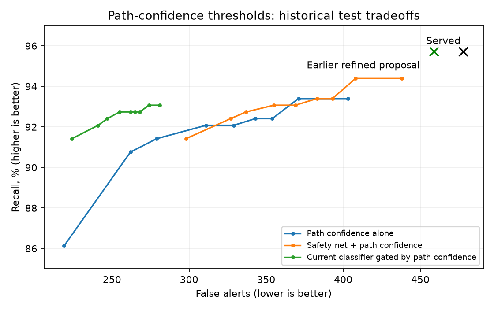

# Path-confidence experiment: evaluation and testing

Rejected/rolled-back all-pairs shadow-policy experiment; no deployed model.

[Latest comparison](../evaluation.md) · [Every original source and cleanup status](source_inventory.json)

This is the single maintained history for this model/component. Records preserve the original bytes, including every numeric field, trial, seed, protocol, selection and caveat. Shared reports are included in each relevant ledger. No fresh inference is implied by consolidation.

## Study: path_confidence_20261101

Historical narrative below retains the recorded results; statements about being uncommitted describe the study date. All studies are now preserved in the checkpoint commit. Links to removed originals now lead to their ledger source register; the evidence appendix retains the exact original prose and links.

# All-pairs path-confidence monitor — 1 November 2026

**Outcome:** the requested background monitor is implemented and exercised locally.
Using multi-path confidence as the required display gate **fails the no-lost-real-case
constraint**. No feasible threshold was found on validation. Live controller behaviour
and the served **271/284 early catches (95.42%)** are unchanged. The prior conservative
filter proposal remains separate at 459 test false alerts / 290 true cases.

## Checkpoint saved before implementation

`checkpoints/20261101_pre_path_confidence/` holds a verified local ZIP of **379 files
(274,608,898 bytes)**: tracked/nonignored working files, all current served artifacts,
selected trajectory candidates, and conflict experiment weights. Its manifest records
per-file SHA-256, branch `fine-tuning` and HEAD `2bcaba1`. It also stores the tracked
binary Git diff. Raw/processed datasets, rejected trajectory artifacts, environments,
secrets and dependencies were not duplicated; they remain in place. This is a filesystem
restore checkpoint, **not a commit or push**. All subsequent work remains uncommitted.

## What was implemented

[path_confidence_monitor.py](../../ml_pipeline/reports/path_confidence_20261101/archived_source/ml_pipeline/utils/path_confidence_monitor.py)
provides an isolated background worker and stateful monitor:

1. Predict up to five paths once per aircraft, then compare every unordered supplied
   aircraft pair. No spatial pair prefilter or pair-count cap is applied by the monitor.
2. Check all 25 combinations when each aircraft has five paths, using the existing
   15-second interpolated geometry and 8 NM / 1,500 ft alert volume.
3. Retain conflicting combinations in background state, including low-confidence ones.
   Aircraft identity and route-pattern IDs identify combinations across updates;
   prediction rank is not used as identity because ranks may change.
4. Compute three candidate confidence scores: sum of conflicting joint path weights,
   largest conflicting joint weight, and largest minimum of the two individual path
   weights among conflicting combinations.
5. Produce `shadow_visible` only after the chosen score meets its threshold for three
   consecutive observed updates. Produce a new notification on the transition, rather
   than interrupting on every repeated update. Missing observations and long gaps reset
   persistence, and stale pairs expire.
6. Keep results separate from the live `AlertFeed`. A single-worker executor runs scans
   off the caller thread. It rejects an overlapping scan instead of building an unbounded
   queue of stale snapshots; the caller must handle backpressure and result age.

The worker has no live server hook and does not send anything to the controller.
The replay runner exercises it as a separate process. This preserves current real-case
warnings while evaluating the proposed replacement gate.

Existing production already performs the 25-way check for selected pairs. It normally
gates alerts with the classifier or straight-line safety net, and selects pairs using
current distance <60 NM, altitude gap <5,000 ft and a cap of 120 pairs per update.
The prototype evaluates all eligible pairs supplied to it, including pairs beyond that cap.
En-route eligibility and sufficient history still determine which aircraft are supplied.

## Meaning of confidence

If aircraft A's path has weight .6 and B's has weight .5, their combination gets weight
**.6 × .5 = .30** under an independent-aircraft approximation. If several combinations
conflict, summing their weights captures the total model-assigned mass of those futures.
The product rule requires independence; see the
[probability-course reference](https://www.probabilitycourse.com/chapter1/1_4_1_independence.php).
Air traffic instructions can couple aircraft behaviour, so independence is a modelling
assumption, not an established property of these encounters.

Only the retained top-five paths are normalized. Their weights and products are
**not calibrated probabilities of a real conflict**, even though the route classifier
uses temperature scaling. A single-combination threshold can also miss risk spread
over several individually low-weight combinations, which is why total mass is tested.
No rule requires confidence to be increasing: a steady or declining score above the
threshold still qualifies. This differs from the previously rejected confidence-trend
filter documented in CLAUDE.md. The worker/state/policy design is our own experimental
design, not a published no-loss guarantee.

## Threshold experiments and result

**135 configurations** test three scores × nine thresholds
`0, .01, .025, .05, .1, .2, .4, .6, .8` × five policy variants:

- Path confidence alone.
- Straight-line safety net OR path confidence.
- Straight-line safety net OR current classifier AND path confidence.
- Straight-line safety net OR the earlier refined classifier/filter AND path confidence.
- Keep all served alerts and add qualifying path alerts.

Thresholds are selected on validation, requiring **each originally detected real pair**
to remain detected. Where no setting passes, the recorded selection is `null`; the
best-F1 diagnostic is not promoted. All settings and selections are frozen before
this batch reads the historical test. This remains a repeatedly examined historical
benchmark, not fresh independent confirmation.

The static policy comparisons reuse existing tier/time eligibility to isolate the
display gate; they do not reconstruct a new tiering algorithm. Snapshot evaluations
do not simulate the stateful worker's real-time confidence evolution.

**Why no exclusive path gate passes:** validation has **15** originally detected real
cases with no conflicting predicted combination; **10** are not rescued by the straight-line
safety net. Test has **11** such cases, **8** not rescued by the safety net. A confidence
threshold cannot expose a combination the model does not predict. Threshold zero still
requires conflicting geometry; treating an empty set as a zero-threshold alert would
discard the meaning of a confidence-gated conflict.

The following **illustrative, rejected** rows use total conflicting mass >=.2. They are
not selected deployment settings:

| Policy | Test TP | Test FP | Original real cases lost | Early catches | Precision | Recall | F1 |
|---|---:|---:|---:|---:|---:|---:|---:|
| Served baseline | 290 | 478 | 0 | 271/284 | 37.76% | 95.71% | .5415 |
| Earlier refined proposal | 290 | 459 | 0 | 271/284 | 38.72% | 95.71% | .5513 |
| path_only | 279 | 311 | 12 | 260/284 | 47.29% | 92.08% | 0.6249 |
| safety_plus_paths | 282 | 355 | 9 | 263/284 | 44.27% | 93.07% | 0.6000 |
| served_with_path_gate | 281 | 255 | 9 | 262/284 | 52.43% | 92.74% | 0.6698 |
| refined_with_path_gate | 281 | 254 | 9 | 262/284 | 52.52% | 92.74% | 0.6706 |
| served_plus_paths | 291 | 578 | 0 | 272/284 | 33.49% | 96.04% | 0.4966 |

Identity checks matter: some policies find different real cases while losing original
ones. For example, safety-net + path evidence at threshold zero detects 286 real pairs
in total, but loses eight originally detected pairs and gains four different pairs.
Comparing only TP totals would hide that loss.

Keeping every served alert and only adding path alerts preserves original true cases
structurally, but increases false alerts. Validation selects threshold .8 for each
additive score family: test false alerts become 552 (total mass), 489 (maximum joint),
or 500 (both-path score), compared with 478 served. No version meets both goals.



Every threshold's classifier-independent confusion matrix, precision, recall, F1,
early catches, tier counts and lost/gained original pair indices is recorded in
[complete results (archived source)](path_confidence.md#source-register) and
[all-threshold CSV (archived source)](path_confidence.md#source-register).
The earlier classifier evaluations and original initial-evaluation archive are preserved.

## Recorded-airspace background replay

Six consecutive ten-second snapshots from `ml_pipeline\data\raw\session_b_20260905_023002_combined.parquet` supplied **16–18** current
eligible aircraft, each with ten valid recent states. The worker assessed **120–153 pairs**
and **3,000–3,825 path combinations** per snapshot, with no spatial filter or pair cap.
All-pairs counts were asserted against N(N-1)/2. Routes used only local cached context.

At total-mass threshold .2 and three qualifying updates, the first two snapshots retained
one pending pair. The third exposed one shadow-visible pair and one new notification.
The pair stayed visible on the remaining snapshots without repeated new notifications.
Inference plus scanning took **0.520–0.775 seconds per snapshot**
in this small replay. These are measured costs, not a scalability guarantee: work grows
as 25×N(N-1)/2, or 123,750 combination checks for 100 aircraft.

This replay has **no labelled pair outcomes**. It verifies background processing,
state retention, persistence and notification transitions; it does not establish
accuracy or real-case warning delay. The labelled encounter benchmark is static and
also cannot establish whether an initially hidden case appears later with enough
warning. A labelled chronological encounter replay is needed for that timing claim.
The prototype's mandatory extra confidence gate already fails snapshot preservation.

## Verification and reproduce

All **50 unit checks** pass, including ten new checks for product/sum arithmetic,
all-pairs coverage, threshold transitions, persistence, background worker results,
rank-independent pattern tracking, gaps, expiry, invalid weights and empty-conflict cases.
Recomputed total confidence matches the previous served geometry tables to 1e-12.
Source served classifier and trajectory hashes remain unchanged.

```powershell
venv\Scripts\python.exe scripts/experiment_path_confidence.py
venv\Scripts\python.exe scripts/replay_path_confidence.py
venv\Scripts\python.exe scripts/report_path_confidence.py
venv\Scripts\python.exe -m unittest discover -s ml_pipeline/tests -q
```

Completed threshold studies refuse overwrite. Use a new directory for an independent
rerun. [Protocol (archived source)](path_confidence.md#source-register),
[validation-frozen selection (archived source)](path_confidence.md#source-register),
[replay details (archived source)](path_confidence.md#source-register),
and [source fingerprints (archived source)](path_confidence.md#source-register)
are retained. The exact threshold-study source snapshot is stored alongside them.
Evidence tables and full pending/visible replay events remain in
`ml_pipeline/data/processed/path_confidence_experiments/20261101/`.

**Decision:** retain the prototype for investigation; reject an exclusive path-confidence
controller gate with current path coverage. No served threshold, model, API response,
controller display, Git commit or remote branch was changed.


## Complete iteration register

| Recorded run | Recorded sections | Details |
| --- | --- | --- |
| ml_pipeline/reports/path_confidence_20261101/results.json | protocol, selections, trials, baselines, zero_path_evidence | Exact configuration, validation/test numbers, guards and rejected trials in evidence record below |

## Source register

| Original path | SHA-256 | Bytes |
| --- | --- | --- |
| docs/experiments/path_confidence_20261101.md | 653449e6f77e0317e60299095326bdb1286f7cf8890252bfcaa25ff1f3ac9b3b | 11235 |
| docs/experiments/path_confidence_20261101_tradeoffs.png | ecf4f3a88126b09f4a8d450dcd9ee77264147089c8d6f16638cc7218ba6478be | 66045 |
| ml_pipeline/data/processed/path_confidence_experiments/20261101/replay_events.jsonl | 533d599c12d543ae70b5f6a127ea4d9c5fab57e6fc9513b54bb984a80b79b816 | 13697 |
| ml_pipeline/reports/path_confidence_20261101/all_thresholds.csv | 53e77195a42975fc01ecfc46ef7977c12a33e978585ce2cc3b9fb636d5daf3e8 | 44570 |
| ml_pipeline/reports/path_confidence_20261101/archived_source/ml_pipeline/tests/test_path_confidence_monitor.py | edc1bcc770efbc59aa3f0db78d6bcdd36f2c6fa155880440be4dd15518cbf671 | 4636 |
| ml_pipeline/reports/path_confidence_20261101/archived_source/ml_pipeline/utils/path_confidence_monitor.py | a380e1da36baec4db75ab491103e63d9ce5c7b6f70ec90ff6a72376ed5312b04 | 8119 |
| ml_pipeline/reports/path_confidence_20261101/archived_source/scripts/experiment_path_confidence.py | 2d7750e5a79a24f8204444fbb8c7c1fa696980b57722cdcbd178ffe48b1dd0e6 | 8201 |
| ml_pipeline/reports/path_confidence_20261101/archived_source/scripts/replay_path_confidence.py | 6371cd19bd37e3c039043823683900ab66a12e92b1c693692c481212be03b60a | 4304 |
| ml_pipeline/reports/path_confidence_20261101/archived_source/scripts/report_path_confidence.py | 27b5f543cc2b5b9f93f95ecbc4d139a206a3ee17a0d9c9dcae79e5822b39e873 | 14094 |
| ml_pipeline/reports/path_confidence_20261101/protocol.json | bc5857021dbab3a5d7a15e713d7b56a75980399ed47f75c6de527500f88b9a2b | 1434 |
| ml_pipeline/reports/path_confidence_20261101/replay.json | 6938bd370fe4f4381498140f5310b571eda49416ad3d258f49bc3ff30318f6b3 | 2233 |
| ml_pipeline/reports/path_confidence_20261101/results.json | 1e6ed1a1a7de6617b5295b801e78884064db52d8532f792e1364053c671b51a2 | 280757 |
| ml_pipeline/reports/path_confidence_20261101/rollback_record.json | 037ada68cbde13f5b199cad3dd1e8cbf0532f37c3eddb3d4eb9ad2126c7a1ed3 | 3460 |
| ml_pipeline/reports/path_confidence_20261101/selection.json | 9309049cdc3aa66fdca95480af13a8be9f328ae8558e10233be51a5c4ec1ae74 | 157760 |
| ml_pipeline/reports/path_confidence_20261101/source_manifest.json | 5b79f0ece8c146dda41f19443739676067bbdc92cc0a43223319872c471c0be7 | 792 |
| ml_pipeline/reports/path_confidence_20261101/source_snapshot.txt | 2d7750e5a79a24f8204444fbb8c7c1fa696980b57722cdcbd178ffe48b1dd0e6 | 8201 |

## Lossless evidence

Machine-readable JSON envelope. `content` is exact UTF-8 text or base64 bytes; numeric payloads remain unchanged, including historical JSON NaN. Use the maintenance script to verify or restore a source.

<!-- evaluation-evidence-v1 -->
```json
{
  "model": "path_confidence",
  "records": [
    {
      "path": "docs/experiments/path_confidence_20261101.md",
      "sha256": "653449e6f77e0317e60299095326bdb1286f7cf8890252bfcaa25ff1f3ac9b3b",
      "bytes": 11235,
      "encoding": "utf-8",
      "content": "# All-pairs path-confidence monitor \u2014 1 November 2026\r\n\r\n**Outcome:** the requested background monitor is implemented and exercised locally.\r\nUsing multi-path confidence as the required display gate **fails the no-lost-real-case\r\nconstraint**. No feasible threshold was found on validation. Live controller behaviour\r\nand the served **271/284 early catches (95.42%)** are unchanged. The prior conservative\r\nfilter proposal remains separate at 459 test false alerts / 290 true cases.\r\n\r\n## Checkpoint saved before implementation\r\n\r\n`checkpoints/20261101_pre_path_confidence/` holds a verified local ZIP of **379 files\r\n(274,608,898 bytes)**: tracked/nonignored working files, all current served artifacts,\r\nselected trajectory candidates, and conflict experiment weights. Its manifest records\r\nper-file SHA-256, branch `fine-tuning` and HEAD `2bcaba1`. It also stores the tracked\r\nbinary Git diff. Raw/processed datasets, rejected trajectory artifacts, environments,\r\nsecrets and dependencies were not duplicated; they remain in place. This is a filesystem\r\nrestore checkpoint, **not a commit or push**. All subsequent work remains uncommitted.\r\n\r\n## What was implemented\r\n\r\n[path_confidence_monitor.py](../../ml_pipeline/utils/path_confidence_monitor.py)\r\nprovides an isolated background worker and stateful monitor:\r\n\r\n1. Predict up to five paths once per aircraft, then compare every unordered supplied\r\n   aircraft pair. No spatial pair prefilter or pair-count cap is applied by the monitor.\r\n2. Check all 25 combinations when each aircraft has five paths, using the existing\r\n   15-second interpolated geometry and 8 NM / 1,500 ft alert volume.\r\n3. Retain conflicting combinations in background state, including low-confidence ones.\r\n   Aircraft identity and route-pattern IDs identify combinations across updates;\r\n   prediction rank is not used as identity because ranks may change.\r\n4. Compute three candidate confidence scores: sum of conflicting joint path weights,\r\n   largest conflicting joint weight, and largest minimum of the two individual path\r\n   weights among conflicting combinations.\r\n5. Produce `shadow_visible` only after the chosen score meets its threshold for three\r\n   consecutive observed updates. Produce a new notification on the transition, rather\r\n   than interrupting on every repeated update. Missing observations and long gaps reset\r\n   persistence, and stale pairs expire.\r\n6. Keep results separate from the live `AlertFeed`. A single-worker executor runs scans\r\n   off the caller thread. It rejects an overlapping scan instead of building an unbounded\r\n   queue of stale snapshots; the caller must handle backpressure and result age.\r\n\r\nThe worker has no live server hook and does not send anything to the controller.\r\nThe replay runner exercises it as a separate process. This preserves current real-case\r\nwarnings while evaluating the proposed replacement gate.\r\n\r\nExisting production already performs the 25-way check for selected pairs. It normally\r\ngates alerts with the classifier or straight-line safety net, and selects pairs using\r\ncurrent distance <60 NM, altitude gap <5,000 ft and a cap of 120 pairs per update.\r\nThe prototype evaluates all eligible pairs supplied to it, including pairs beyond that cap.\r\nEn-route eligibility and sufficient history still determine which aircraft are supplied.\r\n\r\n## Meaning of confidence\r\n\r\nIf aircraft A's path has weight .6 and B's has weight .5, their combination gets weight\r\n**.6 \u00d7 .5 = .30** under an independent-aircraft approximation. If several combinations\r\nconflict, summing their weights captures the total model-assigned mass of those futures.\r\nThe product rule requires independence; see the\r\n[probability-course reference](https://www.probabilitycourse.com/chapter1/1_4_1_independence.php).\r\nAir traffic instructions can couple aircraft behaviour, so independence is a modelling\r\nassumption, not an established property of these encounters.\r\n\r\nOnly the retained top-five paths are normalized. Their weights and products are\r\n**not calibrated probabilities of a real conflict**, even though the route classifier\r\nuses temperature scaling. A single-combination threshold can also miss risk spread\r\nover several individually low-weight combinations, which is why total mass is tested.\r\nNo rule requires confidence to be increasing: a steady or declining score above the\r\nthreshold still qualifies. This differs from the previously rejected confidence-trend\r\nfilter documented in CLAUDE.md. The worker/state/policy design is our own experimental\r\ndesign, not a published no-loss guarantee.\r\n\r\n## Threshold experiments and result\r\n\r\n**135 configurations** test three scores \u00d7 nine thresholds\r\n`0, .01, .025, .05, .1, .2, .4, .6, .8` \u00d7 five policy variants:\r\n\r\n- Path confidence alone.\r\n- Straight-line safety net OR path confidence.\r\n- Straight-line safety net OR current classifier AND path confidence.\r\n- Straight-line safety net OR the earlier refined classifier/filter AND path confidence.\r\n- Keep all served alerts and add qualifying path alerts.\r\n\r\nThresholds are selected on validation, requiring **each originally detected real pair**\r\nto remain detected. Where no setting passes, the recorded selection is `null`; the\r\nbest-F1 diagnostic is not promoted. All settings and selections are frozen before\r\nthis batch reads the historical test. This remains a repeatedly examined historical\r\nbenchmark, not fresh independent confirmation.\r\n\r\nThe static policy comparisons reuse existing tier/time eligibility to isolate the\r\ndisplay gate; they do not reconstruct a new tiering algorithm. Snapshot evaluations\r\ndo not simulate the stateful worker's real-time confidence evolution.\r\n\r\n**Why no exclusive path gate passes:** validation has **15** originally detected real\r\ncases with no conflicting predicted combination; **10** are not rescued by the straight-line\r\nsafety net. Test has **11** such cases, **8** not rescued by the safety net. A confidence\r\nthreshold cannot expose a combination the model does not predict. Threshold zero still\r\nrequires conflicting geometry; treating an empty set as a zero-threshold alert would\r\ndiscard the meaning of a confidence-gated conflict.\r\n\r\nThe following **illustrative, rejected** rows use total conflicting mass >=.2. They are\r\nnot selected deployment settings:\r\n\r\n| Policy | Test TP | Test FP | Original real cases lost | Early catches | Precision | Recall | F1 |\r\n|---|---:|---:|---:|---:|---:|---:|---:|\r\n| Served baseline | 290 | 478 | 0 | 271/284 | 37.76% | 95.71% | .5415 |\r\n| Earlier refined proposal | 290 | 459 | 0 | 271/284 | 38.72% | 95.71% | .5513 |\r\n| path_only | 279 | 311 | 12 | 260/284 | 47.29% | 92.08% | 0.6249 |\r\n| safety_plus_paths | 282 | 355 | 9 | 263/284 | 44.27% | 93.07% | 0.6000 |\r\n| served_with_path_gate | 281 | 255 | 9 | 262/284 | 52.43% | 92.74% | 0.6698 |\r\n| refined_with_path_gate | 281 | 254 | 9 | 262/284 | 52.52% | 92.74% | 0.6706 |\r\n| served_plus_paths | 291 | 578 | 0 | 272/284 | 33.49% | 96.04% | 0.4966 |\r\n\r\nIdentity checks matter: some policies find different real cases while losing original\r\nones. For example, safety-net + path evidence at threshold zero detects 286 real pairs\r\nin total, but loses eight originally detected pairs and gains four different pairs.\r\nComparing only TP totals would hide that loss.\r\n\r\nKeeping every served alert and only adding path alerts preserves original true cases\r\nstructurally, but increases false alerts. Validation selects threshold .8 for each\r\nadditive score family: test false alerts become 552 (total mass), 489 (maximum joint),\r\nor 500 (both-path score), compared with 478 served. No version meets both goals.\r\n\r\n\r\n\r\nEvery threshold's classifier-independent confusion matrix, precision, recall, F1,\r\nearly catches, tier counts and lost/gained original pair indices is recorded in\r\n[complete results](../../ml_pipeline/reports/path_confidence_20261101/results.json) and\r\n[all-threshold CSV](../../ml_pipeline/reports/path_confidence_20261101/all_thresholds.csv).\r\nThe earlier classifier evaluations and original initial-evaluation archive are preserved.\r\n\r\n## Recorded-airspace background replay\r\n\r\nSix consecutive ten-second snapshots from `ml_pipeline\\data\\raw\\session_b_20260905_023002_combined.parquet` supplied **16\u201318** current\r\neligible aircraft, each with ten valid recent states. The worker assessed **120\u2013153 pairs**\r\nand **3,000\u20133,825 path combinations** per snapshot, with no spatial filter or pair cap.\r\nAll-pairs counts were asserted against N(N-1)/2. Routes used only local cached context.\r\n\r\nAt total-mass threshold .2 and three qualifying updates, the first two snapshots retained\r\none pending pair. The third exposed one shadow-visible pair and one new notification.\r\nThe pair stayed visible on the remaining snapshots without repeated new notifications.\r\nInference plus scanning took **0.520\u20130.775 seconds per snapshot**\r\nin this small replay. These are measured costs, not a scalability guarantee: work grows\r\nas 25\u00d7N(N-1)/2, or 123,750 combination checks for 100 aircraft.\r\n\r\nThis replay has **no labelled pair outcomes**. It verifies background processing,\r\nstate retention, persistence and notification transitions; it does not establish\r\naccuracy or real-case warning delay. The labelled encounter benchmark is static and\r\nalso cannot establish whether an initially hidden case appears later with enough\r\nwarning. A labelled chronological encounter replay is needed for that timing claim.\r\nThe prototype's mandatory extra confidence gate already fails snapshot preservation.\r\n\r\n## Verification and reproduce\r\n\r\nAll **50 unit checks** pass, including ten new checks for product/sum arithmetic,\r\nall-pairs coverage, threshold transitions, persistence, background worker results,\r\nrank-independent pattern tracking, gaps, expiry, invalid weights and empty-conflict cases.\r\nRecomputed total confidence matches the previous served geometry tables to 1e-12.\r\nSource served classifier and trajectory hashes remain unchanged.\r\n\r\n```powershell\r\nvenv\\Scripts\\python.exe scripts/experiment_path_confidence.py\r\nvenv\\Scripts\\python.exe scripts/replay_path_confidence.py\r\nvenv\\Scripts\\python.exe scripts/report_path_confidence.py\r\nvenv\\Scripts\\python.exe -m unittest discover -s ml_pipeline/tests -q\r\n```\r\n\r\nCompleted threshold studies refuse overwrite. Use a new directory for an independent\r\nrerun. [Protocol](../../ml_pipeline/reports/path_confidence_20261101/protocol.json),\r\n[validation-frozen selection](../../ml_pipeline/reports/path_confidence_20261101/selection.json),\r\n[replay details](../../ml_pipeline/reports/path_confidence_20261101/replay.json),\r\nand [source fingerprints](../../ml_pipeline/reports/path_confidence_20261101/source_manifest.json)\r\nare retained. The exact threshold-study source snapshot is stored alongside them.\r\nEvidence tables and full pending/visible replay events remain in\r\n`ml_pipeline/data/processed/path_confidence_experiments/20261101/`.\r\n\r\n**Decision:** retain the prototype for investigation; reject an exclusive path-confidence\r\ncontroller gate with current path coverage. No served threshold, model, API response,\r\ncontroller display, Git commit or remote branch was changed.\r\n"
    },
    {
      "path": "docs/experiments/path_confidence_20261101_tradeoffs.png",
      "sha256": "ecf4f3a88126b09f4a8d450dcd9ee77264147089c8d6f16638cc7218ba6478be",
      "bytes": 66045,
      "encoding": "base64",
      "content": ""
    },
    {
      "path": "ml_pipeline/data/processed/path_confidence_experiments/20261101/replay_events.jsonl",
      "sha256": "533d599c12d543ae70b5f6a127ea4d9c5fab57e6fc9513b54bb984a80b79b816",
      "bytes": 13697,
      "encoding": "utf-8",
      "content": "{\"time\": 1788575713, \"result\": {\"aircraft\": 17, \"pairs_checked\": 136, \"combinations_checked\": 3400, \"shadow_visible\": [], \"pending\": [{\"pair\": [\"06a2fd\", \"8005f1\"], \"score\": 0.5592445108442385, \"streak\": 1, \"combinations\": [{\"pattern_a\": 1, \"pattern_b\": 14, \"path_weight_a\": 0.6332575281427699, \"path_weight_b\": 0.5616672463920122, \"joint_weight\": 0.3556800120889617, \"time_to_cpa_seconds\": 510, \"lateral_nm\": 3.4375921399816876, \"vertical_ft\": 993.5553168303366, \"first_seen\": 1788575713, \"last_seen\": 1788575713, \"updates\": 1}, {\"pattern_a\": 1, \"pattern_b\": 3, \"path_weight_a\": 0.6332575281427699, \"path_weight_b\": 0.01856101995693402, \"joint_weight\": 0.011753905617736659, \"time_to_cpa_seconds\": 495, \"lateral_nm\": 6.186215823653618, \"vertical_ft\": 994.1210502180588, \"first_seen\": 1788575713, \"last_seen\": 1788575713, \"updates\": 1}, {\"pattern_a\": 31, \"pattern_b\": 14, \"path_weight_a\": 0.3126119942933993, \"path_weight_b\": 0.5616672463920122, \"joint_weight\": 0.175583918023889, \"time_to_cpa_seconds\": 510, \"lateral_nm\": 6.761555421148875, \"vertical_ft\": 993.3093659795088, \"first_seen\": 1788575713, \"last_seen\": 1788575713, \"updates\": 1}, {\"pattern_a\": 31, \"pattern_b\": 3, \"path_weight_a\": 0.3126119942933993, \"path_weight_b\": 0.01856101995693402, \"joint_weight\": 0.005802397464856729, \"time_to_cpa_seconds\": 495, \"lateral_nm\": 2.944001666447548, \"vertical_ft\": 993.8341075587538, \"first_seen\": 1788575713, \"last_seen\": 1788575713, \"updates\": 1}, {\"pattern_a\": 9, \"pattern_b\": 3, \"path_weight_a\": 0.026238375706883324, \"path_weight_b\": 0.01856101995693402, \"joint_weight\": 0.0004870110151329941, \"time_to_cpa_seconds\": 495, \"lateral_nm\": 1.400635904271315, \"vertical_ft\": 993.8607444928246, \"first_seen\": 1788575713, \"last_seen\": 1788575713, \"updates\": 1}, {\"pattern_a\": 35, \"pattern_b\": 14, \"path_weight_a\": 0.017343864452233092, \"path_weight_b\": 0.5616672463920122, \"joint_weight\": 0.009741480588682065, \"time_to_cpa_seconds\": 510, \"lateral_nm\": 0.9957468973813677, \"vertical_ft\": 993.7681978722306, \"first_seen\": 1788575713, \"last_seen\": 1788575713, \"updates\": 1}, {\"pattern_a\": 22, \"pattern_b\": 3, \"path_weight_a\": 0.010548237404714382, \"path_weight_b\": 0.01856101995693402, \"joint_weight\": 0.00019578604497938156, \"time_to_cpa_seconds\": 495, \"lateral_nm\": 7.2000819544397805, \"vertical_ft\": 993.3699147931114, \"first_seen\": 1788575713, \"last_seen\": 1788575713, \"updates\": 1}], \"protected\": false, \"new_notification\": false}], \"retained_pairs\": 136, \"score_kind\": \"total_weight\", \"threshold\": 0.2, \"live_notifications_changed\": false}}\r\n{\"time\": 1788575723, \"result\": {\"aircraft\": 17, \"pairs_checked\": 136, \"combinations_checked\": 3400, \"shadow_visible\": [], \"pending\": [{\"pair\": [\"06a2fd\", \"8005f1\"], \"score\": 0.7909903912680086, \"streak\": 2, \"combinations\": [{\"pattern_a\": 1, \"pattern_b\": 14, \"path_weight_a\": 0.5495451404439107, \"path_weight_b\": 0.6901761000551092, \"joint_weight\": 0.3792829218358155, \"time_to_cpa_seconds\": 495, \"lateral_nm\": 4.0373321195596725, \"vertical_ft\": 1021.6742931290077, \"first_seen\": 1788575713, \"last_seen\": 1788575723, \"updates\": 2}, {\"pattern_a\": 1, \"pattern_b\": 3, \"path_weight_a\": 0.5495451404439107, \"path_weight_b\": 0.23818659010442828, \"joint_weight\": 0.1308942831107942, \"time_to_cpa_seconds\": 480, \"lateral_nm\": 5.342047181853923, \"vertical_ft\": 1018.5396353170538, \"first_seen\": 1788575713, \"last_seen\": 1788575723, \"updates\": 2}, {\"pattern_a\": 31, \"pattern_b\": 14, \"path_weight_a\": 0.2714345050209387, \"path_weight_b\": 0.6901761000551092, \"joint_weight\": 0.18733760809574043, \"time_to_cpa_seconds\": 495, \"lateral_nm\": 7.471634896220791, \"vertical_ft\": 1021.3873504696967, \"first_seen\": 1788575713, \"last_seen\": 1788575723, \"updates\": 2}, {\"pattern_a\": 31, \"pattern_b\": 3, \"path_weight_a\": 0.2714345050209387, \"path_weight_b\": 0.23818659010442828, \"joint_weight\": 0.06465205918762071, \"time_to_cpa_seconds\": 495, \"lateral_nm\": 2.6872811187525505, \"vertical_ft\": 1020.2484897167105, \"first_seen\": 1788575713, \"last_seen\": 1788575723, \"updates\": 2}, {\"pattern_a\": 9, \"pattern_b\": 3, \"path_weight_a\": 0.08114556377274156, \"path_weight_b\": 0.23818659010442828, \"joint_weight\": 0.019327785137130737, \"time_to_cpa_seconds\": 495, \"lateral_nm\": 2.8828432927601777, \"vertical_ft\": 1020.2751266507872, \"first_seen\": 1788575713, \"last_seen\": 1788575723, \"updates\": 2}, {\"pattern_a\": 35, \"pattern_b\": 14, \"path_weight_a\": 0.013758421800101225, \"path_weight_b\": 0.6901761000551092, \"joint_weight\": 0.009495733900907058, \"time_to_cpa_seconds\": 495, \"lateral_nm\": 0.9595304478942283, \"vertical_ft\": 1022.5349221193345, \"first_seen\": 1788575713, \"last_seen\": 1788575723, \"updates\": 2}], \"protected\": false, \"new_notification\": false}], \"retained_pairs\": 152, \"score_kind\": \"total_weight\", \"threshold\": 0.2, \"live_notifications_changed\": false}}\r\n{\"time\": 1788575733, \"result\": {\"aircraft\": 18, \"pairs_checked\": 153, \"combinations_checked\": 3825, \"shadow_visible\": [{\"pair\": [\"06a2fd\", \"8005f1\"], \"score\": 0.7002222517945145, \"streak\": 3, \"combinations\": [{\"pattern_a\": 1, \"pattern_b\": 3, \"path_weight_a\": 0.5275432336395726, \"path_weight_b\": 0.4794887629196818, \"joint_weight\": 0.2529510524844873, \"time_to_cpa_seconds\": 480, \"lateral_nm\": 4.230698981922974, \"vertical_ft\": 1021.1570120789963, \"first_seen\": 1788575713, \"last_seen\": 1788575733, \"updates\": 3}, {\"pattern_a\": 1, \"pattern_b\": 14, \"path_weight_a\": 0.5275432336395726, \"path_weight_b\": 0.4360761077561092, \"joint_weight\": 0.23004899999861655, \"time_to_cpa_seconds\": 480, \"lateral_nm\": 5.141826413033955, \"vertical_ft\": 1018.2418377351731, \"first_seen\": 1788575713, \"last_seen\": 1788575733, \"updates\": 3}, {\"pattern_a\": 31, \"pattern_b\": 3, \"path_weight_a\": 0.34163352322744667, \"path_weight_b\": 0.4794887629196818, \"joint_weight\": 0.16380943542422077, \"time_to_cpa_seconds\": 480, \"lateral_nm\": 1.2854688002961467, \"vertical_ft\": 1020.82907761122, \"first_seen\": 1788575713, \"last_seen\": 1788575733, \"updates\": 3}, {\"pattern_a\": 9, \"pattern_b\": 3, \"path_weight_a\": 0.08260631675668849, \"path_weight_b\": 0.4794887629196818, \"joint_weight\": 0.03960880063101594, \"time_to_cpa_seconds\": 480, \"lateral_nm\": 2.7459340443260034, \"vertical_ft\": 1020.8595198215925, \"first_seen\": 1788575713, \"last_seen\": 1788575733, \"updates\": 3}, {\"pattern_a\": 35, \"pattern_b\": 3, \"path_weight_a\": 0.01507699093564506, \"path_weight_b\": 0.4794887629196818, \"joint_weight\": 0.007229247732283705, \"time_to_cpa_seconds\": 480, \"lateral_nm\": 7.457429264280016, \"vertical_ft\": 1021.6517003942632, \"first_seen\": 1788575733, \"last_seen\": 1788575733, \"updates\": 1}, {\"pattern_a\": 35, \"pattern_b\": 14, \"path_weight_a\": 0.01507699093564506, \"path_weight_b\": 0.4360761077561092, \"joint_weight\": 0.006574715523890237, \"time_to_cpa_seconds\": 495, \"lateral_nm\": 2.4735637482835537, \"vertical_ft\": 1020.7077117677345, \"first_seen\": 1788575713, \"last_seen\": 1788575733, \"updates\": 3}], \"protected\": false, \"new_notification\": true}], \"pending\": [], \"retained_pairs\": 170, \"score_kind\": \"total_weight\", \"threshold\": 0.2, \"live_notifications_changed\": false}}\r\n{\"time\": 1788575743, \"result\": {\"aircraft\": 17, \"pairs_checked\": 136, \"combinations_checked\": 3400, \"shadow_visible\": [{\"pair\": [\"06a2fd\", \"8005f1\"], \"score\": 0.5941555923033014, \"streak\": 4, \"combinations\": [{\"pattern_a\": 1, \"pattern_b\": 14, \"path_weight_a\": 0.4537339027798263, \"path_weight_b\": 0.45594935655972674, \"joint_weight\": 0.2068796810217954, \"time_to_cpa_seconds\": 480, \"lateral_nm\": 5.645789471363028, \"vertical_ft\": 957.4900703056604, \"first_seen\": 1788575713, \"last_seen\": 1788575743, \"updates\": 4}, {\"pattern_a\": 1, \"pattern_b\": 3, \"path_weight_a\": 0.4537339027798263, \"path_weight_b\": 0.40639329514036876, \"joint_weight\": 0.18439441586759334, \"time_to_cpa_seconds\": 465, \"lateral_nm\": 3.620379076257091, \"vertical_ft\": 962.5306398812755, \"first_seen\": 1788575713, \"last_seen\": 1788575743, \"updates\": 4}, {\"pattern_a\": 31, \"pattern_b\": 3, \"path_weight_a\": 0.39949641262542857, \"path_weight_b\": 0.40639329514036876, \"joint_weight\": 0.16235266352360433, \"time_to_cpa_seconds\": 465, \"lateral_nm\": 1.3130165322587413, \"vertical_ft\": 962.5306398812755, \"first_seen\": 1788575713, \"last_seen\": 1788575743, \"updates\": 4}, {\"pattern_a\": 9, \"pattern_b\": 3, \"path_weight_a\": 0.07536303146720419, \"path_weight_b\": 0.40639329514036876, \"joint_weight\": 0.03062703068972441, \"time_to_cpa_seconds\": 465, \"lateral_nm\": 3.15463537587629, \"vertical_ft\": 962.5306398812755, \"first_seen\": 1788575713, \"last_seen\": 1788575743, \"updates\": 4}, {\"pattern_a\": 35, \"pattern_b\": 14, \"path_weight_a\": 0.011482443992608607, \"path_weight_b\": 0.45594935655972674, \"joint_weight\": 0.0052354129501629935, \"time_to_cpa_seconds\": 480, \"lateral_nm\": 2.3352911699702754, \"vertical_ft\": 957.4900703056604, \"first_seen\": 1788575713, \"last_seen\": 1788575743, \"updates\": 4}, {\"pattern_a\": 35, \"pattern_b\": 3, \"path_weight_a\": 0.011482443992608607, \"path_weight_b\": 0.40639329514036876, \"joint_weight\": 0.004666388250420944, \"time_to_cpa_seconds\": 465, \"lateral_nm\": 6.755430873693633, \"vertical_ft\": 962.5306398812755, \"first_seen\": 1788575733, \"last_seen\": 1788575743, \"updates\": 2}], \"protected\": false, \"new_notification\": false}], \"pending\": [], \"retained_pairs\": 170, \"score_kind\": \"total_weight\", \"threshold\": 0.2, \"live_notifications_changed\": false}}\r\n{\"time\": 1788575753, \"result\": {\"aircraft\": 16, \"pairs_checked\": 120, \"combinations_checked\": 3000, \"shadow_visible\": [{\"pair\": [\"06a2fd\", \"8005f1\"], \"score\": 0.4136676903892356, \"streak\": 5, \"combinations\": [{\"pattern_a\": 1, \"pattern_b\": 14, \"path_weight_a\": 0.44647582774789096, \"path_weight_b\": 0.6854095569600026, \"joint_weight\": 0.3060187992900324, \"time_to_cpa_seconds\": 465, \"lateral_nm\": 6.420803942179241, \"vertical_ft\": 640.7562566827853, \"first_seen\": 1788575713, \"last_seen\": 1788575753, \"updates\": 5}, {\"pattern_a\": 1, \"pattern_b\": 3, \"path_weight_a\": 0.44647582774789096, \"path_weight_b\": 0.08348754824843652, \"joint_weight\": 0.03727517221086268, \"time_to_cpa_seconds\": 465, \"lateral_nm\": 3.113660861400133, \"vertical_ft\": 639.2715306910299, \"first_seen\": 1788575713, \"last_seen\": 1788575753, \"updates\": 5}, {\"pattern_a\": 31, \"pattern_b\": 3, \"path_weight_a\": 0.38411467347115563, \"path_weight_b\": 0.08348754824843652, \"joint_weight\": 0.03206879233435554, \"time_to_cpa_seconds\": 465, \"lateral_nm\": 1.7291215543532965, \"vertical_ft\": 639.2444126258438, \"first_seen\": 1788575713, \"last_seen\": 1788575753, \"updates\": 5}, {\"pattern_a\": 9, \"pattern_b\": 3, \"path_weight_a\": 0.07579549716290006, \"path_weight_b\": 0.08348754824843652, \"joint_weight\": 0.006327980226401852, \"time_to_cpa_seconds\": 465, \"lateral_nm\": 4.000024964953358, \"vertical_ft\": 639.2786601125122, \"first_seen\": 1788575713, \"last_seen\": 1788575753, \"updates\": 5}, {\"pattern_a\": 35, \"pattern_b\": 14, \"path_weight_a\": 0.0415880696012174, \"path_weight_b\": 0.6854095569600026, \"joint_weight\": 0.02850486036019217, \"time_to_cpa_seconds\": 465, \"lateral_nm\": 3.473969418572942, \"vertical_ft\": 640.8973548616002, \"first_seen\": 1788575713, \"last_seen\": 1788575753, \"updates\": 5}, {\"pattern_a\": 35, \"pattern_b\": 3, \"path_weight_a\": 0.0415880696012174, \"path_weight_b\": 0.08348754824843652, \"joint_weight\": 0.0034720859673909735, \"time_to_cpa_seconds\": 465, \"lateral_nm\": 5.796755673475366, \"vertical_ft\": 639.4126288698448, \"first_seen\": 1788575733, \"last_seen\": 1788575753, \"updates\": 3}], \"protected\": false, \"new_notification\": false}], \"pending\": [], \"retained_pairs\": 170, \"score_kind\": \"total_weight\", \"threshold\": 0.2, \"live_notifications_changed\": false}}\r\n{\"time\": 1788575763, \"result\": {\"aircraft\": 16, \"pairs_checked\": 120, \"combinations_checked\": 3000, \"shadow_visible\": [{\"pair\": [\"06a2fd\", \"8005f1\"], \"score\": 0.9494071343329347, \"streak\": 6, \"combinations\": [{\"pattern_a\": 1, \"pattern_b\": 3, \"path_weight_a\": 0.5490146535265401, \"path_weight_b\": 0.984474767810461, \"joint_weight\": 0.5404910735550812, \"time_to_cpa_seconds\": 450, \"lateral_nm\": 1.7466530391721298, \"vertical_ft\": 953.5615879895562, \"first_seen\": 1788575713, \"last_seen\": 1788575763, \"updates\": 6}, {\"pattern_a\": 1, \"pattern_b\": 14, \"path_weight_a\": 0.5490146535265401, \"path_weight_b\": 0.009271237647247715, \"joint_weight\": 0.00509004532466592, \"time_to_cpa_seconds\": 465, \"lateral_nm\": 7.338166385767684, \"vertical_ft\": 948.225408826397, \"first_seen\": 1788575713, \"last_seen\": 1788575763, \"updates\": 6}, {\"pattern_a\": 31, \"pattern_b\": 3, \"path_weight_a\": 0.33556210327467373, \"path_weight_b\": 0.984474767810461, \"joint_weight\": 0.3303524237073243, \"time_to_cpa_seconds\": 450, \"lateral_nm\": 1.0949021304393183, \"vertical_ft\": 953.5615879895562, \"first_seen\": 1788575713, \"last_seen\": 1788575763, \"updates\": 6}, {\"pattern_a\": 9, \"pattern_b\": 3, \"path_weight_a\": 0.0564379328222628, \"path_weight_b\": 0.984474767810461, \"joint_weight\": 0.055561720810899565, \"time_to_cpa_seconds\": 450, \"lateral_nm\": 4.341177012413531, \"vertical_ft\": 953.5615879895562, \"first_seen\": 1788575713, \"last_seen\": 1788575763, \"updates\": 6}, {\"pattern_a\": 35, \"pattern_b\": 3, \"path_weight_a\": 0.01802459666412818, \"path_weight_b\": 0.984474767810461, \"joint_weight\": 0.0177447606157948, \"time_to_cpa_seconds\": 450, \"lateral_nm\": 4.402197407291673, \"vertical_ft\": 953.5615879895562, \"first_seen\": 1788575733, \"last_seen\": 1788575763, \"updates\": 4}, {\"pattern_a\": 35, \"pattern_b\": 14, \"path_weight_a\": 0.01802459666412818, \"path_weight_b\": 0.009271237647247715, \"joint_weight\": 0.00016711031916892078, \"time_to_cpa_seconds\": 465, \"lateral_nm\": 4.501854468798342, \"vertical_ft\": 948.225408826397, \"first_seen\": 1788575713, \"last_seen\": 1788575763, \"updates\": 6}], \"protected\": false, \"new_notification\": false}], \"pending\": [], \"retained_pairs\": 170, \"score_kind\": \"total_weight\", \"threshold\": 0.2, \"live_notifications_changed\": false}}\r\n"
    },
    {
      "path": "ml_pipeline/reports/path_confidence_20261101/all_thresholds.csv",
      "sha256": "53e77195a42975fc01ecfc46ef7977c12a33e978585ce2cc3b9fb636d5daf3e8",
      "bytes": 44570,
      "encoding": "utf-8",
      "content": "policy,score,threshold,split,tp,fp,fn,tn,precision,recall,f1,early_true,early_total,tier1_true,tier1_false,lost_original_cases,gained_original_cases,confusion_matrix\r\npath_only,total_weight,0.0,validation,427,539,23,5575,0.4420289855072464,0.9488888888888889,0.6031073446327684,405,428,29,48,15,9,\"[[5575, 539], [23, 427]]\"\r\npath_only,total_weight,0.0,test,283,403,20,3984,0.41253644314868804,0.933993399339934,0.5722952477249748,264,284,27,33,11,4,\"[[3984, 403], [20, 283]]\"\r\npath_only,total_weight,0.01,validation,425,502,25,5612,0.45846817691477887,0.9444444444444444,0.6172839506172839,403,428,29,43,16,8,\"[[5612, 502], [25, 425]]\"\r\npath_only,total_weight,0.01,test,283,371,20,4016,0.4327217125382263,0.933993399339934,0.5914315569487983,264,284,27,29,11,4,\"[[4016, 371], [20, 283]]\"\r\npath_only,total_weight,0.025,validation,424,480,26,5634,0.4690265486725664,0.9422222222222222,0.6262924667651403,402,428,29,40,16,7,\"[[5634, 480], [26, 424]]\"\r\npath_only,total_weight,0.025,test,280,354,23,4033,0.4416403785488959,0.9240924092409241,0.5976520811099253,261,284,27,26,12,2,\"[[4033, 354], [23, 280]]\"\r\npath_only,total_weight,0.05,validation,423,469,27,5645,0.4742152466367713,0.94,0.6304023845007451,401,428,29,38,16,6,\"[[5645, 469], [27, 423]]\"\r\npath_only,total_weight,0.05,test,280,343,23,4044,0.449438202247191,0.9240924092409241,0.6047516198704104,261,284,27,26,12,2,\"[[4044, 343], [23, 280]]\"\r\npath_only,total_weight,0.1,validation,423,452,27,5662,0.48342857142857143,0.94,0.6384905660377358,401,428,29,36,16,6,\"[[5662, 452], [27, 423]]\"\r\npath_only,total_weight,0.1,test,279,329,24,4058,0.4588815789473684,0.9207920792079208,0.6125137211855104,260,284,27,24,12,1,\"[[4058, 329], [24, 279]]\"\r\npath_only,total_weight,0.2,validation,419,425,31,5689,0.49644549763033174,0.9311111111111111,0.6476043276661515,397,428,29,36,20,6,\"[[5689, 425], [31, 419]]\"\r\npath_only,total_weight,0.2,test,279,311,24,4076,0.4728813559322034,0.9207920792079208,0.6248600223964166,260,284,27,22,12,1,\"[[4076, 311], [24, 279]]\"\r\npath_only,total_weight,0.4,validation,416,384,34,5730,0.52,0.9244444444444444,0.6656,394,428,29,35,23,6,\"[[5730, 384], [34, 416]]\"\r\npath_only,total_weight,0.4,test,277,279,26,4108,0.4982014388489209,0.9141914191419142,0.6449359720605355,258,284,27,18,14,1,\"[[4108, 279], [26, 277]]\"\r\npath_only,total_weight,0.6,validation,406,354,44,5760,0.5342105263157895,0.9022222222222223,0.6710743801652893,384,428,29,35,33,6,\"[[5760, 354], [44, 406]]\"\r\npath_only,total_weight,0.6,test,275,262,28,4125,0.5121042830540037,0.9075907590759076,0.6547619047619048,256,284,27,18,16,1,\"[[4125, 262], [28, 275]]\"\r\npath_only,total_weight,0.8,validation,381,317,69,5797,0.5458452722063037,0.8466666666666667,0.6637630662020906,359,428,29,34,56,4,\"[[5797, 317], [69, 381]]\"\r\npath_only,total_weight,0.8,test,261,219,42,4168,0.54375,0.8613861386138614,0.6666666666666666,242,284,27,18,29,0,\"[[4168, 219], [42, 261]]\"\r\npath_only,max_joint_weight,0.0,validation,427,539,23,5575,0.4420289855072464,0.9488888888888889,0.6031073446327684,405,428,29,48,15,9,\"[[5575, 539], [23, 427]]\"\r\npath_only,max_joint_weight,0.0,test,283,403,20,3984,0.41253644314868804,0.933993399339934,0.5722952477249748,264,284,27,33,11,4,\"[[3984, 403], [20, 283]]\"\r\npath_only,max_joint_weight,0.01,validation,424,494,26,5620,0.46187363834422657,0.9422222222222222,0.6198830409356725,402,428,29,43,16,7,\"[[5620, 494], [26, 424]]\"\r\npath_only,max_joint_weight,0.01,test,281,364,22,4023,0.4356589147286822,0.9273927392739274,0.5928270042194093,262,284,27,28,12,3,\"[[4023, 364], [22, 281]]\"\r\npath_only,max_joint_weight,0.025,validation,424,476,26,5638,0.4711111111111111,0.9422222222222222,0.6281481481481481,402,428,29,40,16,7,\"[[5638, 476], [26, 424]]\"\r\npath_only,max_joint_weight,0.025,test,280,349,23,4038,0.4451510333863275,0.9240924092409241,0.6008583690987125,261,284,27,26,12,2,\"[[4038, 349], [23, 280]]\"\r\npath_only,max_joint_weight,0.05,validation,422,453,28,5661,0.48228571428571426,0.9377777777777778,0.6369811320754717,400,428,29,38,17,6,\"[[5661, 453], [28, 422]]\"\r\npath_only,max_joint_weight,0.05,test,279,330,24,4057,0.458128078817734,0.9207920792079208,0.6118421052631579,260,284,27,24,12,1,\"[[4057, 330], [24, 279]]\"\r\npath_only,max_joint_weight,0.1,validation,419,427,31,5687,0.49527186761229314,0.9311111111111111,0.6466049382716049,397,428,29,36,20,6,\"[[5687, 427], [31, 419]]\"\r\npath_only,max_joint_weight,0.1,test,279,314,24,4073,0.47048903878583476,0.9207920792079208,0.6227678571428571,260,284,27,22,12,1,\"[[4073, 314], [24, 279]]\"\r\npath_only,max_joint_weight,0.2,validation,398,373,52,5741,0.51621271076524,0.8844444444444445,0.6519246519246519,378,428,26,33,41,6,\"[[5741, 373], [52, 398]]\"\r\npath_only,max_joint_weight,0.2,test,267,276,36,4111,0.49171270718232046,0.8811881188118812,0.6312056737588653,249,284,26,18,24,1,\"[[4111, 276], [36, 267]]\"\r\npath_only,max_joint_weight,0.4,validation,302,257,148,5857,0.5402504472271914,0.6711111111111111,0.5986124876114965,287,428,19,25,135,4,\"[[5857, 257], [148, 302]]\"\r\npath_only,max_joint_weight,0.4,test,204,191,99,4196,0.5164556962025316,0.6732673267326733,0.5845272206303725,190,284,22,12,86,0,\"[[4196, 191], [99, 204]]\"\r\npath_only,max_joint_weight,0.6,validation,170,144,280,5970,0.5414012738853503,0.37777777777777777,0.44502617801047123,160,428,12,10,265,2,\"[[5970, 144], [280, 170]]\"\r\npath_only,max_joint_weight,0.6,test,119,101,184,4286,0.5409090909090909,0.3927392739273927,0.45506692160611856,112,284,10,5,171,0,\"[[4286, 101], [184, 119]]\"\r\npath_only,max_joint_weight,0.8,validation,56,38,394,6076,0.5957446808510638,0.12444444444444444,0.20588235294117646,56,428,2,4,377,0,\"[[6076, 38], [394, 56]]\"\r\npath_only,max_joint_weight,0.8,test,31,29,272,4358,0.5166666666666667,0.10231023102310231,0.17079889807162535,28,284,4,1,259,0,\"[[4358, 29], [272, 31]]\"\r\npath_only,both_path_weight,0.0,validation,427,539,23,5575,0.4420289855072464,0.9488888888888889,0.6031073446327684,405,428,29,48,15,9,\"[[5575, 539], [23, 427]]\"\r\npath_only,both_path_weight,0.0,test,283,403,20,3984,0.41253644314868804,0.933993399339934,0.5722952477249748,264,284,27,33,11,4,\"[[3984, 403], [20, 283]]\"\r\npath_only,both_path_weight,0.01,validation,425,522,25,5592,0.44878563885955647,0.9444444444444444,0.6084466714387974,403,428,29,45,16,8,\"[[5592, 522], [25, 425]]\"\r\npath_only,both_path_weight,0.01,test,283,386,20,4001,0.42301943198804187,0.933993399339934,0.5823045267489712,264,284,27,30,11,4,\"[[4001, 386], [20, 283]]\"\r\npath_only,both_path_weight,0.025,validation,424,496,26,5618,0.4608695652173913,0.9422222222222222,0.618978102189781,402,428,29,44,16,7,\"[[5618, 496], [26, 424]]\"\r\npath_only,both_path_weight,0.025,test,281,369,22,4018,0.4323076923076923,0.9273927392739274,0.5897166841552991,262,284,27,27,12,3,\"[[4018, 369], [22, 281]]\"\r\npath_only,both_path_weight,0.05,validation,423,468,27,5646,0.47474747474747475,0.94,0.6308724832214765,401,428,29,40,17,7,\"[[5646, 468], [27, 423]]\"\r\npath_only,both_path_weight,0.05,test,279,342,24,4045,0.4492753623188406,0.9207920792079208,0.6038961038961039,260,284,27,25,12,1,\"[[4045, 342], [24, 279]]\"\r\npath_only,both_path_weight,0.1,validation,421,443,29,5671,0.48726851851851855,0.9355555555555556,0.6407914764079148,399,428,29,38,18,6,\"[[5671, 443], [29, 421]]\"\r\npath_only,both_path_weight,0.1,test,279,327,24,4060,0.4603960396039604,0.9207920792079208,0.6138613861386139,260,284,27,24,12,1,\"[[4060, 327], [24, 279]]\"\r\npath_only,both_path_weight,0.2,validation,419,407,31,5707,0.5072639225181598,0.9311111111111111,0.6567398119122257,397,428,29,36,20,6,\"[[5707, 407], [31, 419]]\"\r\npath_only,both_path_weight,0.2,test,277,305,26,4082,0.47594501718213056,0.9141914191419142,0.6259887005649718,258,284,27,21,14,1,\"[[4082, 305], [26, 277]]\"\r\npath_only,both_path_weight,0.4,validation,362,318,88,5796,0.5323529411764706,0.8044444444444444,0.6407079646017699,344,428,24,31,76,5,\"[[5796, 318], [88, 362]]\"\r\npath_only,both_path_weight,0.4,test,244,228,59,4159,0.5169491525423728,0.8052805280528053,0.6296774193548387,227,284,25,14,47,1,\"[[4159, 228], [59, 244]]\"\r\npath_only,both_path_weight,0.6,validation,233,202,217,5912,0.535632183908046,0.5177777777777778,0.5265536723163842,221,428,14,15,202,2,\"[[5912, 202], [217, 233]]\"\r\npath_only,both_path_weight,0.6,test,163,136,140,4251,0.5451505016722408,0.5379537953795379,0.5415282392026578,152,284,17,8,127,0,\"[[4251, 136], [140, 163]]\"\r\npath_only,both_path_weight,0.8,validation,93,72,357,6042,0.5636363636363636,0.20666666666666667,0.3024390243902439,89,428,6,5,340,0,\"[[6042, 72], [357, 93]]\"\r\npath_only,both_path_weight,0.8,test,64,57,239,4330,0.5289256198347108,0.21122112211221122,0.3018867924528302,61,284,5,3,226,0,\"[[4330, 57], [239, 64]]\"\r\nsafety_plus_paths,total_weight,0.0,validation,432,583,18,5531,0.42561576354679803,0.96,0.5897610921501707,410,428,29,49,10,9,\"[[5531, 583], [18, 432]]\"\r\nsafety_plus_paths,total_weight,0.0,test,286,438,17,3949,0.39502762430939226,0.9438943894389439,0.5569620253164557,267,284,27,33,8,4,\"[[3949, 438], [17, 286]]\"\r\nsafety_plus_paths,total_weight,0.01,validation,430,549,20,5565,0.43922369765066394,0.9555555555555556,0.6018194541637508,408,428,29,44,11,8,\"[[5565, 549], [20, 430]]\"\r\nsafety_plus_paths,total_weight,0.01,test,286,408,17,3979,0.41210374639769454,0.9438943894389439,0.5737211634904714,267,284,27,29,8,4,\"[[3979, 408], [17, 286]]\"\r\nsafety_plus_paths,total_weight,0.025,validation,429,534,21,5580,0.4454828660436137,0.9533333333333334,0.6072186836518046,407,428,29,41,11,7,\"[[5580, 534], [21, 429]]\"\r\nsafety_plus_paths,total_weight,0.025,test,283,393,20,3994,0.41863905325443784,0.933993399339934,0.5781409601634321,264,284,27,26,9,2,\"[[3994, 393], [20, 283]]\"\r\nsafety_plus_paths,total_weight,0.05,validation,428,525,22,5589,0.4491080797481637,0.9511111111111111,0.6101211689237348,406,428,29,39,11,6,\"[[5589, 525], [22, 428]]\"\r\nsafety_plus_paths,total_weight,0.05,test,283,383,20,4004,0.42492492492492495,0.933993399339934,0.5841073271413829,264,284,27,26,9,2,\"[[4004, 383], [20, 283]]\"\r\nsafety_plus_paths,total_weight,0.1,validation,428,513,22,5601,0.45483528161530284,0.9511111111111111,0.6153846153846154,406,428,29,37,11,6,\"[[5601, 513], [22, 428]]\"\r\nsafety_plus_paths,total_weight,0.1,test,282,369,21,4018,0.43317972350230416,0.9306930693069307,0.5911949685534591,263,284,27,24,9,1,\"[[4018, 369], [21, 282]]\"\r\nsafety_plus_paths,total_weight,0.2,validation,427,498,23,5616,0.4616216216216216,0.9488888888888889,0.6210909090909091,405,428,29,37,12,6,\"[[5616, 498], [23, 427]]\"\r\nsafety_plus_paths,total_weight,0.2,test,282,355,21,4032,0.4427001569858713,0.9306930693069307,0.6,263,284,27,22,9,1,\"[[4032, 355], [21, 282]]\"\r\nsafety_plus_paths,total_weight,0.4,validation,427,471,23,5643,0.4755011135857461,0.9488888888888889,0.6335311572700296,405,428,29,36,12,6,\"[[5643, 471], [23, 427]]\"\r\nsafety_plus_paths,total_weight,0.4,test,281,337,22,4050,0.4546925566343042,0.9273927392739274,0.6102062975027145,262,284,27,18,10,1,\"[[4050, 337], [22, 281]]\"\r\nsafety_plus_paths,total_weight,0.6,validation,424,455,26,5659,0.48236632536973834,0.9422222222222222,0.6380737396538751,402,428,29,36,15,6,\"[[5659, 455], [26, 424]]\"\r\nsafety_plus_paths,total_weight,0.6,test,280,327,23,4060,0.4612850082372323,0.9240924092409241,0.6153846153846154,261,284,27,18,11,1,\"[[4060, 327], [23, 280]]\"\r\nsafety_plus_paths,total_weight,0.8,validation,420,433,30,5681,0.492379835873388,0.9333333333333333,0.6446661550268611,398,428,29,35,17,4,\"[[5681, 433], [30, 420]]\"\r\nsafety_plus_paths,total_weight,0.8,test,277,298,26,4089,0.4817391304347826,0.9141914191419142,0.6309794988610479,258,284,27,18,13,0,\"[[4089, 298], [26, 277]]\"\r\nsafety_plus_paths,max_joint_weight,0.0,validation,432,583,18,5531,0.42561576354679803,0.96,0.5897610921501707,410,428,29,49,10,9,\"[[5531, 583], [18, 432]]\"\r\nsafety_plus_paths,max_joint_weight,0.0,test,286,438,17,3949,0.39502762430939226,0.9438943894389439,0.5569620253164557,267,284,27,33,8,4,\"[[3949, 438], [17, 286]]\"\r\nsafety_plus_paths,max_joint_weight,0.01,validation,429,544,21,5570,0.4409044193216855,0.9533333333333334,0.6029515108924807,407,428,29,44,11,7,\"[[5570, 544], [21, 429]]\"\r\nsafety_plus_paths,max_joint_weight,0.01,test,284,402,19,3985,0.4139941690962099,0.9372937293729373,0.5743174924165824,265,284,27,28,9,3,\"[[3985, 402], [19, 284]]\"\r\nsafety_plus_paths,max_joint_weight,0.025,validation,429,531,21,5583,0.446875,0.9533333333333334,0.6085106382978723,407,428,29,41,11,7,\"[[5583, 531], [21, 429]]\"\r\nsafety_plus_paths,max_joint_weight,0.025,test,283,388,20,3999,0.4217585692995529,0.933993399339934,0.5811088295687885,264,284,27,26,9,2,\"[[3999, 388], [20, 283]]\"\r\nsafety_plus_paths,max_joint_weight,0.05,validation,428,515,22,5599,0.45387062566277836,0.9511111111111111,0.6145010768126346,406,428,29,39,11,6,\"[[5599, 515], [22, 428]]\"\r\nsafety_plus_paths,max_joint_weight,0.05,test,282,370,21,4017,0.4325153374233129,0.9306930693069307,0.5905759162303665,263,284,27,24,9,1,\"[[4017, 370], [21, 282]]\"\r\nsafety_plus_paths,max_joint_weight,0.1,validation,428,499,22,5615,0.4617044228694714,0.9511111111111111,0.6216412490922295,406,428,29,37,11,6,\"[[5615, 499], [22, 428]]\"\r\nsafety_plus_paths,max_joint_weight,0.1,test,282,357,21,4030,0.4413145539906103,0.9306930693069307,0.5987261146496815,263,284,27,22,9,1,\"[[4030, 357], [21, 282]]\"\r\nsafety_plus_paths,max_joint_weight,0.2,validation,426,466,24,5648,0.47757847533632286,0.9466666666666667,0.6348733233979136,404,428,29,35,13,6,\"[[5648, 466], [24, 426]]\"\r\nsafety_plus_paths,max_joint_weight,0.2,test,278,338,25,4049,0.4512987012987013,0.9174917491749175,0.6050054406964092,259,284,27,18,13,1,\"[[4049, 338], [25, 278]]\"\r\nsafety_plus_paths,max_joint_weight,0.4,validation,414,396,36,5718,0.5111111111111111,0.92,0.6571428571428571,392,428,29,27,23,4,\"[[5718, 396], [36, 414]]\"\r\nsafety_plus_paths,max_joint_weight,0.4,test,271,279,32,4108,0.49272727272727274,0.8943894389438944,0.6354044548651817,252,284,27,12,19,0,\"[[4108, 279], [32, 271]]\"\r\nsafety_plus_paths,max_joint_weight,0.6,validation,402,316,48,5798,0.5598885793871866,0.8933333333333333,0.6883561643835616,380,428,28,13,33,2,\"[[5798, 316], [48, 402]]\"\r\nsafety_plus_paths,max_joint_weight,0.6,test,265,221,38,4166,0.5452674897119342,0.8745874587458746,0.6717363751584284,247,284,26,8,25,0,\"[[4166, 221], [38, 265]]\"\r\nsafety_plus_paths,max_joint_weight,0.8,validation,390,251,60,5863,0.608424336973479,0.8666666666666667,0.7149404216315307,368,428,28,7,43,0,\"[[5863, 251], [60, 390]]\"\r\nsafety_plus_paths,max_joint_weight,0.8,test,253,173,50,4214,0.5938967136150235,0.834983498349835,0.6941015089163237,235,284,26,4,37,0,\"[[4214, 173], [50, 253]]\"\r\nsafety_plus_paths,both_path_weight,0.0,validation,432,583,18,5531,0.42561576354679803,0.96,0.5897610921501707,410,428,29,49,10,9,\"[[5531, 583], [18, 432]]\"\r\nsafety_plus_paths,both_path_weight,0.0,test,286,438,17,3949,0.39502762430939226,0.9438943894389439,0.5569620253164557,267,284,27,33,8,4,\"[[3949, 438], [17, 286]]\"\r\nsafety_plus_paths,both_path_weight,0.01,validation,430,568,20,5546,0.4308617234468938,0.9555555555555556,0.5939226519337016,408,428,29,46,11,8,\"[[5546, 568], [20, 430]]\"\r\nsafety_plus_paths,both_path_weight,0.01,test,286,423,17,3964,0.4033850493653032,0.9438943894389439,0.5652173913043478,267,284,27,30,8,4,\"[[3964, 423], [17, 286]]\"\r\nsafety_plus_paths,both_path_weight,0.025,validation,429,548,21,5566,0.4390992835209826,0.9533333333333334,0.6012613875262789,407,428,29,45,11,7,\"[[5566, 548], [21, 429]]\"\r\nsafety_plus_paths,both_path_weight,0.025,test,284,407,19,3980,0.4109985528219971,0.9372937293729373,0.5714285714285714,265,284,27,27,9,3,\"[[3980, 407], [19, 284]]\"\r\nsafety_plus_paths,both_path_weight,0.05,validation,429,527,21,5587,0.448744769874477,0.9533333333333334,0.6102418207681366,407,428,29,41,11,7,\"[[5587, 527], [21, 429]]\"\r\nsafety_plus_paths,both_path_weight,0.05,test,282,382,21,4005,0.4246987951807229,0.9306930693069307,0.5832471561530507,263,284,27,25,9,1,\"[[4005, 382], [21, 282]]\"\r\nsafety_plus_paths,both_path_weight,0.1,validation,428,509,22,5605,0.4567769477054429,0.9511111111111111,0.6171593366979091,406,428,29,39,11,6,\"[[5605, 509], [22, 428]]\"\r\nsafety_plus_paths,both_path_weight,0.1,test,282,367,21,4020,0.4345146379044684,0.9306930693069307,0.592436974789916,263,284,27,24,9,1,\"[[4020, 367], [21, 282]]\"\r\nsafety_plus_paths,both_path_weight,0.2,validation,428,486,22,5628,0.4682713347921225,0.9511111111111111,0.6275659824046921,406,428,29,37,11,6,\"[[5628, 486], [22, 428]]\"\r\nsafety_plus_paths,both_path_weight,0.2,test,281,353,22,4034,0.443217665615142,0.9273927392739274,0.5997865528281751,262,284,27,21,10,1,\"[[4034, 353], [22, 281]]\"\r\nsafety_plus_paths,both_path_weight,0.4,validation,420,434,30,5680,0.4918032786885246,0.9333333333333333,0.6441717791411042,398,428,29,33,18,5,\"[[5680, 434], [30, 420]]\"\r\nsafety_plus_paths,both_path_weight,0.4,test,277,305,26,4082,0.47594501718213056,0.9141914191419142,0.6259887005649718,258,284,27,14,14,1,\"[[4082, 305], [26, 277]]\"\r\nsafety_plus_paths,both_path_weight,0.6,validation,410,357,40,5757,0.5345501955671447,0.9111111111111111,0.6737880032867708,388,428,28,18,25,2,\"[[5757, 357], [40, 410]]\"\r\nsafety_plus_paths,both_path_weight,0.6,test,267,242,36,4145,0.5245579567779961,0.8811881188118812,0.6576354679802956,248,284,27,10,23,0,\"[[4145, 242], [36, 267]]\"\r\nsafety_plus_paths,both_path_weight,0.8,validation,390,273,60,5841,0.5882352941176471,0.8666666666666667,0.7008086253369272,368,428,28,8,43,0,\"[[5841, 273], [60, 390]]\"\r\nsafety_plus_paths,both_path_weight,0.8,test,259,191,44,4196,0.5755555555555556,0.8547854785478548,0.6879150066401063,241,284,26,6,31,0,\"[[4196, 191], [44, 259]]\"\r\nserved_with_path_gate,total_weight,0.0,validation,423,401,27,5713,0.5133495145631068,0.94,0.6640502354788069,401,428,29,14,10,0,\"[[5713, 401], [27, 423]]\"\r\nserved_with_path_gate,total_weight,0.0,test,282,281,21,4106,0.5008880994671403,0.9306930693069307,0.651270207852194,263,284,27,9,8,0,\"[[4106, 281], [21, 282]]\"\r\nserved_with_path_gate,total_weight,0.01,validation,422,393,28,5721,0.5177914110429448,0.9377777777777778,0.6671936758893281,400,428,29,14,11,0,\"[[5721, 393], [28, 422]]\"\r\nserved_with_path_gate,total_weight,0.01,test,282,274,21,4113,0.5071942446043165,0.9306930693069307,0.6565774155995343,263,284,27,9,8,0,\"[[4113, 274], [21, 282]]\"\r\nserved_with_path_gate,total_weight,0.025,validation,422,387,28,5727,0.5216316440049443,0.9377777777777778,0.670373312152502,400,428,29,14,11,0,\"[[5727, 387], [28, 422]]\"\r\nserved_with_path_gate,total_weight,0.025,test,281,268,22,4119,0.51183970856102,0.9273927392739274,0.6596244131455399,262,284,27,8,9,0,\"[[4119, 268], [22, 281]]\"\r\nserved_with_path_gate,total_weight,0.05,validation,422,384,28,5730,0.5235732009925558,0.9377777777777778,0.6719745222929936,400,428,29,14,11,0,\"[[5730, 384], [28, 422]]\"\r\nserved_with_path_gate,total_weight,0.05,test,281,265,22,4122,0.5146520146520146,0.9273927392739274,0.6619552414605419,262,284,27,8,9,0,\"[[4122, 265], [22, 281]]\"\r\nserved_with_path_gate,total_weight,0.1,validation,422,378,28,5736,0.5275,0.9377777777777778,0.6752,400,428,29,14,11,0,\"[[5736, 378], [28, 422]]\"\r\nserved_with_path_gate,total_weight,0.1,test,281,262,22,4125,0.5174953959484346,0.9273927392739274,0.6643026004728132,262,284,27,8,9,0,\"[[4125, 262], [22, 281]]\"\r\nserved_with_path_gate,total_weight,0.2,validation,421,370,29,5744,0.5322376738305942,0.9355555555555556,0.6784850926672039,399,428,29,14,12,0,\"[[5744, 370], [29, 421]]\"\r\nserved_with_path_gate,total_weight,0.2,test,281,255,22,4132,0.5242537313432836,0.9273927392739274,0.6698450536352801,262,284,27,8,9,0,\"[[4132, 255], [22, 281]]\"\r\nserved_with_path_gate,total_weight,0.4,validation,421,358,29,5756,0.540436456996149,0.9355555555555556,0.6851098454027664,399,428,29,14,12,0,\"[[5756, 358], [29, 421]]\"\r\nserved_with_path_gate,total_weight,0.4,test,280,247,23,4140,0.5313092979127134,0.9240924092409241,0.6746987951807228,261,284,27,6,10,0,\"[[4140, 247], [23, 280]]\"\r\nserved_with_path_gate,total_weight,0.6,validation,418,348,32,5766,0.5456919060052219,0.9288888888888889,0.6875,396,428,29,14,15,0,\"[[5766, 348], [32, 418]]\"\r\nserved_with_path_gate,total_weight,0.6,test,279,241,24,4146,0.5365384615384615,0.9207920792079208,0.6780072904009721,260,284,27,6,11,0,\"[[4146, 241], [24, 279]]\"\r\nserved_with_path_gate,total_weight,0.8,validation,416,335,34,5779,0.5539280958721704,0.9244444444444444,0.6927560366361366,394,428,29,14,17,0,\"[[5779, 335], [34, 416]]\"\r\nserved_with_path_gate,total_weight,0.8,test,277,224,26,4163,0.5528942115768463,0.9141914191419142,0.6890547263681592,258,284,27,6,13,0,\"[[4163, 224], [26, 277]]\"\r\nserved_with_path_gate,max_joint_weight,0.0,validation,423,401,27,5713,0.5133495145631068,0.94,0.6640502354788069,401,428,29,14,10,0,\"[[5713, 401], [27, 423]]\"\r\nserved_with_path_gate,max_joint_weight,0.0,test,282,281,21,4106,0.5008880994671403,0.9306930693069307,0.651270207852194,263,284,27,9,8,0,\"[[4106, 281], [21, 282]]\"\r\nserved_with_path_gate,max_joint_weight,0.01,validation,422,390,28,5724,0.5197044334975369,0.9377777777777778,0.6687797147385103,400,428,29,14,11,0,\"[[5724, 390], [28, 422]]\"\r\nserved_with_path_gate,max_joint_weight,0.01,test,281,272,22,4115,0.5081374321880651,0.9273927392739274,0.6565420560747663,262,284,27,8,9,0,\"[[4115, 272], [22, 281]]\"\r\nserved_with_path_gate,max_joint_weight,0.025,validation,422,386,28,5728,0.5222772277227723,0.9377777777777778,0.670906200317965,400,428,29,14,11,0,\"[[5728, 386], [28, 422]]\"\r\nserved_with_path_gate,max_joint_weight,0.025,test,281,267,22,4120,0.5127737226277372,0.9273927392739274,0.6603995299647474,262,284,27,8,9,0,\"[[4120, 267], [22, 281]]\"\r\nserved_with_path_gate,max_joint_weight,0.05,validation,422,377,28,5737,0.5281602002503129,0.9377777777777778,0.6757405924739792,400,428,29,14,11,0,\"[[5737, 377], [28, 422]]\"\r\nserved_with_path_gate,max_joint_weight,0.05,test,281,262,22,4125,0.5174953959484346,0.9273927392739274,0.6643026004728132,262,284,27,8,9,0,\"[[4125, 262], [22, 281]]\"\r\nserved_with_path_gate,max_joint_weight,0.1,validation,422,373,28,5741,0.5308176100628931,0.9377777777777778,0.6779116465863454,400,428,29,14,11,0,\"[[5741, 373], [28, 422]]\"\r\nserved_with_path_gate,max_joint_weight,0.1,test,281,255,22,4132,0.5242537313432836,0.9273927392739274,0.6698450536352801,262,284,27,7,9,0,\"[[4132, 255], [22, 281]]\"\r\nserved_with_path_gate,max_joint_weight,0.2,validation,420,354,30,5760,0.5426356589147286,0.9333333333333333,0.6862745098039216,398,428,29,14,13,0,\"[[5760, 354], [30, 420]]\"\r\nserved_with_path_gate,max_joint_weight,0.2,test,277,243,26,4144,0.5326923076923077,0.9141914191419142,0.6731470230862697,258,284,27,6,13,0,\"[[4144, 243], [26, 277]]\"\r\nserved_with_path_gate,max_joint_weight,0.4,validation,410,322,40,5792,0.5601092896174863,0.9111111111111111,0.6937394247038917,388,428,29,12,23,0,\"[[5792, 322], [40, 410]]\"\r\nserved_with_path_gate,max_joint_weight,0.4,test,271,215,32,4172,0.5576131687242798,0.8943894389438944,0.6869455006337135,252,284,27,4,19,0,\"[[4172, 215], [32, 271]]\"\r\nserved_with_path_gate,max_joint_weight,0.6,validation,400,271,50,5843,0.5961251862891207,0.8888888888888888,0.7136485280999108,378,428,28,5,33,0,\"[[5843, 271], [50, 400]]\"\r\nserved_with_path_gate,max_joint_weight,0.6,test,265,186,38,4201,0.5875831485587583,0.8745874587458746,0.7029177718832891,247,284,26,3,25,0,\"[[4201, 186], [38, 265]]\"\r\nserved_with_path_gate,max_joint_weight,0.8,validation,390,239,60,5875,0.6200317965023847,0.8666666666666667,0.7228915662650602,368,428,28,5,43,0,\"[[5875, 239], [60, 390]]\"\r\nserved_with_path_gate,max_joint_weight,0.8,test,253,162,50,4225,0.6096385542168675,0.834983498349835,0.7047353760445683,235,284,26,3,37,0,\"[[4225, 162], [50, 253]]\"\r\nserved_with_path_gate,both_path_weight,0.0,validation,423,401,27,5713,0.5133495145631068,0.94,0.6640502354788069,401,428,29,14,10,0,\"[[5713, 401], [27, 423]]\"\r\nserved_with_path_gate,both_path_weight,0.0,test,282,281,21,4106,0.5008880994671403,0.9306930693069307,0.651270207852194,263,284,27,9,8,0,\"[[4106, 281], [21, 282]]\"\r\nserved_with_path_gate,both_path_weight,0.01,validation,422,397,28,5717,0.5152625152625152,0.9377777777777778,0.665090622537431,400,428,29,14,11,0,\"[[5717, 397], [28, 422]]\"\r\nserved_with_path_gate,both_path_weight,0.01,test,282,278,21,4109,0.5035714285714286,0.9306930693069307,0.6535341830822712,263,284,27,9,8,0,\"[[4109, 278], [21, 282]]\"\r\nserved_with_path_gate,both_path_weight,0.025,validation,422,389,28,5725,0.5203452527743526,0.9377777777777778,0.669310071371927,400,428,29,14,11,0,\"[[5725, 389], [28, 422]]\"\r\nserved_with_path_gate,both_path_weight,0.025,test,281,274,22,4113,0.5063063063063064,0.9273927392739274,0.655011655011655,262,284,27,8,9,0,\"[[4113, 274], [22, 281]]\"\r\nserved_with_path_gate,both_path_weight,0.05,validation,422,382,28,5732,0.5248756218905473,0.9377777777777778,0.6730462519936204,400,428,29,14,11,0,\"[[5732, 382], [28, 422]]\"\r\nserved_with_path_gate,both_path_weight,0.05,test,281,264,22,4123,0.5155963302752293,0.9273927392739274,0.6627358490566038,262,284,27,8,9,0,\"[[4123, 264], [22, 281]]\"\r\nserved_with_path_gate,both_path_weight,0.1,validation,422,375,28,5739,0.5294855708908407,0.9377777777777778,0.6768243785084203,400,428,29,14,11,0,\"[[5739, 375], [28, 422]]\"\r\nserved_with_path_gate,both_path_weight,0.1,test,281,260,22,4127,0.5194085027726433,0.9273927392739274,0.6658767772511849,262,284,27,8,9,0,\"[[4127, 260], [22, 281]]\"\r\nserved_with_path_gate,both_path_weight,0.2,validation,422,364,28,5750,0.5368956743002544,0.9377777777777778,0.6828478964401294,400,428,29,14,11,0,\"[[5750, 364], [28, 422]]\"\r\nserved_with_path_gate,both_path_weight,0.2,test,280,253,23,4134,0.525328330206379,0.9240924092409241,0.6698564593301436,261,284,27,7,10,0,\"[[4134, 253], [23, 280]]\"\r\nserved_with_path_gate,both_path_weight,0.4,validation,415,339,35,5775,0.5503978779840849,0.9222222222222223,0.6893687707641196,393,428,29,13,18,0,\"[[5775, 339], [35, 415]]\"\r\nserved_with_path_gate,both_path_weight,0.4,test,276,229,27,4158,0.5465346534653466,0.9108910891089109,0.6831683168316832,257,284,27,4,14,0,\"[[4158, 229], [27, 276]]\"\r\nserved_with_path_gate,both_path_weight,0.6,validation,408,300,42,5814,0.576271186440678,0.9066666666666666,0.7046632124352331,386,428,28,8,25,0,\"[[5814, 300], [42, 408]]\"\r\nserved_with_path_gate,both_path_weight,0.6,test,267,197,36,4190,0.5754310344827587,0.8811881188118812,0.6962190352020861,248,284,27,3,23,0,\"[[4190, 197], [36, 267]]\"\r\nserved_with_path_gate,both_path_weight,0.8,validation,390,248,60,5866,0.6112852664576802,0.8666666666666667,0.7169117647058824,368,428,28,5,43,0,\"[[5866, 248], [60, 390]]\"\r\nserved_with_path_gate,both_path_weight,0.8,test,259,169,44,4218,0.6051401869158879,0.8547854785478548,0.7086183310533516,241,284,26,3,31,0,\"[[4218, 169], [44, 259]]\"\r\nrefined_with_path_gate,total_weight,0.0,validation,423,395,27,5719,0.5171149144254279,0.94,0.667192429022082,401,428,29,14,10,0,\"[[5719, 395], [27, 423]]\"\r\nrefined_with_path_gate,total_weight,0.0,test,282,278,21,4109,0.5035714285714286,0.9306930693069307,0.6535341830822712,263,284,27,9,8,0,\"[[4109, 278], [21, 282]]\"\r\nrefined_with_path_gate,total_weight,0.01,validation,422,387,28,5727,0.5216316440049443,0.9377777777777778,0.670373312152502,400,428,29,14,11,0,\"[[5727, 387], [28, 422]]\"\r\nrefined_with_path_gate,total_weight,0.01,test,282,272,21,4115,0.5090252707581228,0.9306930693069307,0.6581096849474912,263,284,27,9,8,0,\"[[4115, 272], [21, 282]]\"\r\nrefined_with_path_gate,total_weight,0.025,validation,422,382,28,5732,0.5248756218905473,0.9377777777777778,0.6730462519936204,400,428,29,14,11,0,\"[[5732, 382], [28, 422]]\"\r\nrefined_with_path_gate,total_weight,0.025,test,281,266,22,4121,0.5137111517367459,0.9273927392739274,0.6611764705882353,262,284,27,8,9,0,\"[[4121, 266], [22, 281]]\"\r\nrefined_with_path_gate,total_weight,0.05,validation,422,379,28,5735,0.5268414481897628,0.9377777777777778,0.6746602717825739,400,428,29,14,11,0,\"[[5735, 379], [28, 422]]\"\r\nrefined_with_path_gate,total_weight,0.05,test,281,263,22,4124,0.5165441176470589,0.9273927392739274,0.6635182998819362,262,284,27,8,9,0,\"[[4124, 263], [22, 281]]\"\r\nrefined_with_path_gate,total_weight,0.1,validation,422,373,28,5741,0.5308176100628931,0.9377777777777778,0.6779116465863454,400,428,29,14,11,0,\"[[5741, 373], [28, 422]]\"\r\nrefined_with_path_gate,total_weight,0.1,test,281,260,22,4127,0.5194085027726433,0.9273927392739274,0.6658767772511849,262,284,27,8,9,0,\"[[4127, 260], [22, 281]]\"\r\nrefined_with_path_gate,total_weight,0.2,validation,421,365,29,5749,0.5356234096692112,0.9355555555555556,0.6812297734627831,399,428,29,14,12,0,\"[[5749, 365], [29, 421]]\"\r\nrefined_with_path_gate,total_weight,0.2,test,281,254,22,4133,0.525233644859813,0.9273927392739274,0.6706443914081146,262,284,27,8,9,0,\"[[4133, 254], [22, 281]]\"\r\nrefined_with_path_gate,total_weight,0.4,validation,421,354,29,5760,0.5432258064516129,0.9355555555555556,0.6873469387755102,399,428,29,14,12,0,\"[[5760, 354], [29, 421]]\"\r\nrefined_with_path_gate,total_weight,0.4,test,280,247,23,4140,0.5313092979127134,0.9240924092409241,0.6746987951807228,261,284,27,6,10,0,\"[[4140, 247], [23, 280]]\"\r\nrefined_with_path_gate,total_weight,0.6,validation,418,344,32,5770,0.5485564304461942,0.9288888888888889,0.6897689768976898,396,428,29,14,15,0,\"[[5770, 344], [32, 418]]\"\r\nrefined_with_path_gate,total_weight,0.6,test,279,241,24,4146,0.5365384615384615,0.9207920792079208,0.6780072904009721,260,284,27,6,11,0,\"[[4146, 241], [24, 279]]\"\r\nrefined_with_path_gate,total_weight,0.8,validation,416,332,34,5782,0.5561497326203209,0.9244444444444444,0.6944908180300501,394,428,29,14,17,0,\"[[5782, 332], [34, 416]]\"\r\nrefined_with_path_gate,total_weight,0.8,test,277,224,26,4163,0.5528942115768463,0.9141914191419142,0.6890547263681592,258,284,27,6,13,0,\"[[4163, 224], [26, 277]]\"\r\nrefined_with_path_gate,max_joint_weight,0.0,validation,423,395,27,5719,0.5171149144254279,0.94,0.667192429022082,401,428,29,14,10,0,\"[[5719, 395], [27, 423]]\"\r\nrefined_with_path_gate,max_joint_weight,0.0,test,282,278,21,4109,0.5035714285714286,0.9306930693069307,0.6535341830822712,263,284,27,9,8,0,\"[[4109, 278], [21, 282]]\"\r\nrefined_with_path_gate,max_joint_weight,0.01,validation,422,385,28,5729,0.5229244114002478,0.9377777777777778,0.6714399363564041,400,428,29,14,11,0,\"[[5729, 385], [28, 422]]\"\r\nrefined_with_path_gate,max_joint_weight,0.01,test,281,270,22,4117,0.5099818511796733,0.9273927392739274,0.65807962529274,262,284,27,8,9,0,\"[[4117, 270], [22, 281]]\"\r\nrefined_with_path_gate,max_joint_weight,0.025,validation,422,381,28,5733,0.5255292652552926,0.9377777777777778,0.6735833998403831,400,428,29,14,11,0,\"[[5733, 381], [28, 422]]\"\r\nrefined_with_path_gate,max_joint_weight,0.025,test,281,265,22,4122,0.5146520146520146,0.9273927392739274,0.6619552414605419,262,284,27,8,9,0,\"[[4122, 265], [22, 281]]\"\r\nrefined_with_path_gate,max_joint_weight,0.05,validation,422,372,28,5742,0.5314861460957179,0.9377777777777778,0.6784565916398714,400,428,29,14,11,0,\"[[5742, 372], [28, 422]]\"\r\nrefined_with_path_gate,max_joint_weight,0.05,test,281,260,22,4127,0.5194085027726433,0.9273927392739274,0.6658767772511849,262,284,27,8,9,0,\"[[4127, 260], [22, 281]]\"\r\nrefined_with_path_gate,max_joint_weight,0.1,validation,422,368,28,5746,0.5341772151898734,0.9377777777777778,0.6806451612903226,400,428,29,14,11,0,\"[[5746, 368], [28, 422]]\"\r\nrefined_with_path_gate,max_joint_weight,0.1,test,281,254,22,4133,0.525233644859813,0.9273927392739274,0.6706443914081146,262,284,27,7,9,0,\"[[4133, 254], [22, 281]]\"\r\nrefined_with_path_gate,max_joint_weight,0.2,validation,420,350,30,5764,0.5454545454545454,0.9333333333333333,0.6885245901639344,398,428,29,14,13,0,\"[[5764, 350], [30, 420]]\"\r\nrefined_with_path_gate,max_joint_weight,0.2,test,277,242,26,4145,0.5337186897880539,0.9141914191419142,0.6739659367396593,258,284,27,6,13,0,\"[[4145, 242], [26, 277]]\"\r\nrefined_with_path_gate,max_joint_weight,0.4,validation,410,318,40,5796,0.5631868131868132,0.9111111111111111,0.6960950764006791,388,428,29,12,23,0,\"[[5796, 318], [40, 410]]\"\r\nrefined_with_path_gate,max_joint_weight,0.4,test,271,215,32,4172,0.5576131687242798,0.8943894389438944,0.6869455006337135,252,284,27,4,19,0,\"[[4172, 215], [32, 271]]\"\r\nrefined_with_path_gate,max_joint_weight,0.6,validation,400,270,50,5844,0.5970149253731343,0.8888888888888888,0.7142857142857143,378,428,28,5,33,0,\"[[5844, 270], [50, 400]]\"\r\nrefined_with_path_gate,max_joint_weight,0.6,test,265,186,38,4201,0.5875831485587583,0.8745874587458746,0.7029177718832891,247,284,26,3,25,0,\"[[4201, 186], [38, 265]]\"\r\nrefined_with_path_gate,max_joint_weight,0.8,validation,390,239,60,5875,0.6200317965023847,0.8666666666666667,0.7228915662650602,368,428,28,5,43,0,\"[[5875, 239], [60, 390]]\"\r\nrefined_with_path_gate,max_joint_weight,0.8,test,253,162,50,4225,0.6096385542168675,0.834983498349835,0.7047353760445683,235,284,26,3,37,0,\"[[4225, 162], [50, 253]]\"\r\nrefined_with_path_gate,both_path_weight,0.0,validation,423,395,27,5719,0.5171149144254279,0.94,0.667192429022082,401,428,29,14,10,0,\"[[5719, 395], [27, 423]]\"\r\nrefined_with_path_gate,both_path_weight,0.0,test,282,278,21,4109,0.5035714285714286,0.9306930693069307,0.6535341830822712,263,284,27,9,8,0,\"[[4109, 278], [21, 282]]\"\r\nrefined_with_path_gate,both_path_weight,0.01,validation,422,391,28,5723,0.5190651906519065,0.9377777777777778,0.6682501979414094,400,428,29,14,11,0,\"[[5723, 391], [28, 422]]\"\r\nrefined_with_path_gate,both_path_weight,0.01,test,282,275,21,4112,0.5062836624775583,0.9306930693069307,0.6558139534883721,263,284,27,9,8,0,\"[[4112, 275], [21, 282]]\"\r\nrefined_with_path_gate,both_path_weight,0.025,validation,422,383,28,5731,0.5242236024844721,0.9377777777777778,0.6725099601593626,400,428,29,14,11,0,\"[[5731, 383], [28, 422]]\"\r\nrefined_with_path_gate,both_path_weight,0.025,test,281,271,22,4116,0.5090579710144928,0.9273927392739274,0.6573099415204678,262,284,27,8,9,0,\"[[4116, 271], [22, 281]]\"\r\nrefined_with_path_gate,both_path_weight,0.05,validation,422,377,28,5737,0.5281602002503129,0.9377777777777778,0.6757405924739792,400,428,29,14,11,0,\"[[5737, 377], [28, 422]]\"\r\nrefined_with_path_gate,both_path_weight,0.05,test,281,262,22,4125,0.5174953959484346,0.9273927392739274,0.6643026004728132,262,284,27,8,9,0,\"[[4125, 262], [22, 281]]\"\r\nrefined_with_path_gate,both_path_weight,0.1,validation,422,370,28,5744,0.5328282828282829,0.9377777777777778,0.679549114331723,400,428,29,14,11,0,\"[[5744, 370], [28, 422]]\"\r\nrefined_with_path_gate,both_path_weight,0.1,test,281,258,22,4129,0.5213358070500927,0.9273927392739274,0.667458432304038,262,284,27,8,9,0,\"[[4129, 258], [22, 281]]\"\r\nrefined_with_path_gate,both_path_weight,0.2,validation,422,360,28,5754,0.5396419437340153,0.9377777777777778,0.685064935064935,400,428,29,14,11,0,\"[[5754, 360], [28, 422]]\"\r\nrefined_with_path_gate,both_path_weight,0.2,test,280,252,23,4135,0.5263157894736842,0.9240924092409241,0.6706586826347305,261,284,27,7,10,0,\"[[4135, 252], [23, 280]]\"\r\nrefined_with_path_gate,both_path_weight,0.4,validation,415,335,35,5779,0.5533333333333333,0.9222222222222223,0.6916666666666667,393,428,29,13,18,0,\"[[5779, 335], [35, 415]]\"\r\nrefined_with_path_gate,both_path_weight,0.4,test,276,229,27,4158,0.5465346534653466,0.9108910891089109,0.6831683168316832,257,284,27,4,14,0,\"[[4158, 229], [27, 276]]\"\r\nrefined_with_path_gate,both_path_weight,0.6,validation,408,298,42,5816,0.5779036827195467,0.9066666666666666,0.7058823529411765,386,428,28,8,25,0,\"[[5816, 298], [42, 408]]\"\r\nrefined_with_path_gate,both_path_weight,0.6,test,267,197,36,4190,0.5754310344827587,0.8811881188118812,0.6962190352020861,248,284,27,3,23,0,\"[[4190, 197], [36, 267]]\"\r\nrefined_with_path_gate,both_path_weight,0.8,validation,390,248,60,5866,0.6112852664576802,0.8666666666666667,0.7169117647058824,368,428,28,5,43,0,\"[[5866, 248], [60, 390]]\"\r\nrefined_with_path_gate,both_path_weight,0.8,test,259,169,44,4218,0.6051401869158879,0.8547854785478548,0.7086183310533516,241,284,26,3,31,0,\"[[4218, 169], [44, 259]]\"\r\nserved_plus_paths,total_weight,0.0,validation,442,887,8,5227,0.3325808878856283,0.9822222222222222,0.49690837549184935,420,428,30,59,0,9,\"[[5227, 887], [8, 442]]\"\r\nserved_plus_paths,total_weight,0.0,test,294,635,9,3752,0.31646932185145316,0.9702970297029703,0.4772727272727273,275,284,28,44,0,4,\"[[3752, 635], [9, 294]]\"\r\nserved_plus_paths,total_weight,0.01,validation,441,861,9,5253,0.3387096774193548,0.98,0.5034246575342466,419,428,30,54,0,8,\"[[5253, 861], [9, 441]]\"\r\nserved_plus_paths,total_weight,0.01,test,294,612,9,3775,0.32450331125827814,0.9702970297029703,0.48635235732009924,275,284,28,40,0,4,\"[[3775, 612], [9, 294]]\"\r\nserved_plus_paths,total_weight,0.025,validation,440,852,10,5262,0.34055727554179566,0.9777777777777777,0.505166475315729,418,428,30,51,0,7,\"[[5262, 852], [10, 440]]\"\r\nserved_plus_paths,total_weight,0.025,test,292,603,11,3784,0.32625698324022345,0.9636963696369637,0.48747913188647746,273,284,28,38,0,2,\"[[3784, 603], [11, 292]]\"\r\nserved_plus_paths,total_weight,0.05,validation,439,846,11,5268,0.3416342412451362,0.9755555555555555,0.5060518731988473,417,428,30,49,0,6,\"[[5268, 846], [11, 439]]\"\r\nserved_plus_paths,total_weight,0.05,test,292,596,11,3791,0.32882882882882886,0.9636963696369637,0.4903442485306465,273,284,28,38,0,2,\"[[3791, 596], [11, 292]]\"\r\nserved_plus_paths,total_weight,0.1,validation,439,840,11,5274,0.34323690383111805,0.9755555555555555,0.507807981492192,417,428,30,47,0,6,\"[[5274, 840], [11, 439]]\"\r\nserved_plus_paths,total_weight,0.1,test,291,585,12,3802,0.3321917808219178,0.9603960396039604,0.49363867684478374,272,284,28,36,0,1,\"[[3802, 585], [12, 291]]\"\r\nserved_plus_paths,total_weight,0.2,validation,439,833,11,5281,0.345125786163522,0.9755555555555555,0.5098722415795587,417,428,30,47,0,6,\"[[5281, 833], [11, 439]]\"\r\nserved_plus_paths,total_weight,0.2,test,291,578,12,3809,0.334867663981588,0.9603960396039604,0.49658703071672355,272,284,28,34,0,1,\"[[3809, 578], [12, 291]]\"\r\nserved_plus_paths,total_weight,0.4,validation,439,818,11,5296,0.3492442322991249,0.9755555555555555,0.5143526654950205,417,428,30,46,0,6,\"[[5296, 818], [11, 439]]\"\r\nserved_plus_paths,total_weight,0.4,test,291,568,12,3819,0.33876600698486614,0.9603960396039604,0.5008605851979346,272,284,28,32,0,1,\"[[3819, 568], [12, 291]]\"\r\nserved_plus_paths,total_weight,0.6,validation,439,812,11,5302,0.35091926458832934,0.9755555555555555,0.5161669606114051,417,428,30,46,0,6,\"[[5302, 812], [11, 439]]\"\r\nserved_plus_paths,total_weight,0.6,test,291,564,12,3823,0.34035087719298246,0.9603960396039604,0.5025906735751295,272,284,28,32,0,1,\"[[3823, 564], [12, 291]]\"\r\nserved_plus_paths,total_weight,0.8,validation,437,803,13,5311,0.3524193548387097,0.9711111111111111,0.5171597633136095,415,428,30,45,0,4,\"[[5311, 803], [13, 437]]\"\r\nserved_plus_paths,total_weight,0.8,test,290,552,13,3835,0.34441805225653205,0.9570957095709571,0.5065502183406113,271,284,28,32,0,0,\"[[3835, 552], [13, 290]]\"\r\nserved_plus_paths,max_joint_weight,0.0,validation,442,887,8,5227,0.3325808878856283,0.9822222222222222,0.49690837549184935,420,428,30,59,0,9,\"[[5227, 887], [8, 442]]\"\r\nserved_plus_paths,max_joint_weight,0.0,test,294,635,9,3752,0.31646932185145316,0.9702970297029703,0.4772727272727273,275,284,28,44,0,4,\"[[3752, 635], [9, 294]]\"\r\nserved_plus_paths,max_joint_weight,0.01,validation,440,859,10,5255,0.33872209391839875,0.9777777777777777,0.5031446540880503,418,428,30,54,0,7,\"[[5255, 859], [10, 440]]\"\r\nserved_plus_paths,max_joint_weight,0.01,test,293,608,10,3779,0.32519422863485015,0.966996699669967,0.4867109634551495,274,284,28,40,0,3,\"[[3779, 608], [10, 293]]\"\r\nserved_plus_paths,max_joint_weight,0.025,validation,440,850,10,5264,0.34108527131782945,0.9777777777777777,0.5057471264367817,418,428,30,51,0,7,\"[[5264, 850], [10, 440]]\"\r\nserved_plus_paths,max_joint_weight,0.025,test,292,599,11,3788,0.3277216610549944,0.9636963696369637,0.48911222780569513,273,284,28,38,0,2,\"[[3788, 599], [11, 292]]\"\r\nserved_plus_paths,max_joint_weight,0.05,validation,439,843,11,5271,0.3424336973478939,0.9755555555555555,0.5069284064665127,417,428,30,49,0,6,\"[[5271, 843], [11, 439]]\"\r\nserved_plus_paths,max_joint_weight,0.05,test,291,586,12,3801,0.33181299885974913,0.9603960396039604,0.49322033898305084,272,284,28,36,0,1,\"[[3801, 586], [12, 291]]\"\r\nserved_plus_paths,max_joint_weight,0.1,validation,439,831,11,5283,0.34566929133858265,0.9755555555555555,0.5104651162790698,417,428,30,47,0,6,\"[[5283, 831], [11, 439]]\"\r\nserved_plus_paths,max_joint_weight,0.1,test,291,580,12,3807,0.3340987370838117,0.9603960396039604,0.4957410562180579,272,284,28,35,0,1,\"[[3807, 580], [12, 291]]\"\r\nserved_plus_paths,max_joint_weight,0.2,validation,439,817,11,5297,0.3495222929936306,0.9755555555555555,0.5146541617819461,417,428,30,45,0,6,\"[[5297, 817], [11, 439]]\"\r\nserved_plus_paths,max_joint_weight,0.2,test,291,573,12,3814,0.3368055555555556,0.9603960396039604,0.4987146529562982,272,284,28,32,0,1,\"[[3814, 573], [12, 291]]\"\r\nserved_plus_paths,max_joint_weight,0.4,validation,437,779,13,5335,0.359375,0.9711111111111111,0.524609843937575,415,428,30,39,0,4,\"[[5335, 779], [13, 437]]\"\r\nserved_plus_paths,max_joint_weight,0.4,test,290,542,13,3845,0.3485576923076923,0.9570957095709571,0.5110132158590308,271,284,28,28,0,0,\"[[3845, 542], [13, 290]]\"\r\nserved_plus_paths,max_joint_weight,0.6,validation,435,750,15,5364,0.3670886075949367,0.9666666666666667,0.5321100917431193,413,428,30,32,0,2,\"[[5364, 750], [15, 435]]\"\r\nserved_plus_paths,max_joint_weight,0.6,test,290,513,13,3874,0.36114570361145704,0.9570957095709571,0.5244122965641953,271,284,28,25,0,0,\"[[3874, 513], [13, 290]]\"\r\nserved_plus_paths,max_joint_weight,0.8,validation,433,717,17,5397,0.3765217391304348,0.9622222222222222,0.54125,411,428,30,26,0,0,\"[[5397, 717], [17, 433]]\"\r\nserved_plus_paths,max_joint_weight,0.8,test,290,489,13,3898,0.3722721437740693,0.9570957095709571,0.5360443622920518,271,284,28,21,0,0,\"[[3898, 489], [13, 290]]\"\r\nserved_plus_paths,both_path_weight,0.0,validation,442,887,8,5227,0.3325808878856283,0.9822222222222222,0.49690837549184935,420,428,30,59,0,9,\"[[5227, 887], [8, 442]]\"\r\nserved_plus_paths,both_path_weight,0.0,test,294,635,9,3752,0.31646932185145316,0.9702970297029703,0.4772727272727273,275,284,28,44,0,4,\"[[3752, 635], [9, 294]]\"\r\nserved_plus_paths,both_path_weight,0.01,validation,441,876,9,5238,0.3348519362186788,0.98,0.499151103565365,419,428,30,56,0,8,\"[[5238, 876], [9, 441]]\"\r\nserved_plus_paths,both_path_weight,0.01,test,294,623,9,3764,0.32061068702290074,0.9702970297029703,0.4819672131147541,275,284,28,41,0,4,\"[[3764, 623], [9, 294]]\"\r\nserved_plus_paths,both_path_weight,0.025,validation,440,864,10,5250,0.3374233128834356,0.9777777777777777,0.5017103762827823,418,428,30,55,0,7,\"[[5250, 864], [10, 440]]\"\r\nserved_plus_paths,both_path_weight,0.025,test,293,611,10,3776,0.3241150442477876,0.966996699669967,0.4855012427506214,274,284,28,39,0,3,\"[[3776, 611], [10, 293]]\"\r\nserved_plus_paths,both_path_weight,0.05,validation,440,850,10,5264,0.34108527131782945,0.9777777777777777,0.5057471264367817,418,428,30,51,0,7,\"[[5264, 850], [10, 440]]\"\r\nserved_plus_paths,both_path_weight,0.05,test,291,596,12,3791,0.32807215332581735,0.9603960396039604,0.4890756302521008,272,284,28,37,0,1,\"[[3791, 596], [12, 291]]\"\r\nserved_plus_paths,both_path_weight,0.1,validation,439,839,11,5275,0.3435054773082942,0.9755555555555555,0.5081018518518519,417,428,30,49,0,6,\"[[5275, 839], [11, 439]]\"\r\nserved_plus_paths,both_path_weight,0.1,test,291,585,12,3802,0.3321917808219178,0.9603960396039604,0.49363867684478374,272,284,28,36,0,1,\"[[3802, 585], [12, 291]]\"\r\nserved_plus_paths,both_path_weight,0.2,validation,439,827,11,5287,0.3467614533965245,0.9755555555555555,0.5116550116550117,417,428,30,47,0,6,\"[[5287, 827], [11, 439]]\"\r\nserved_plus_paths,both_path_weight,0.2,test,291,578,12,3809,0.334867663981588,0.9603960396039604,0.49658703071672355,272,284,28,34,0,1,\"[[3809, 578], [12, 291]]\"\r\nserved_plus_paths,both_path_weight,0.4,validation,438,800,12,5314,0.35379644588045234,0.9733333333333334,0.518957345971564,416,428,30,44,0,5,\"[[5314, 800], [12, 438]]\"\r\nserved_plus_paths,both_path_weight,0.4,test,291,554,12,3833,0.34437869822485206,0.9603960396039604,0.5069686411149826,272,284,28,30,0,1,\"[[3833, 554], [12, 291]]\"\r\nserved_plus_paths,both_path_weight,0.6,validation,435,762,15,5352,0.3634085213032581,0.9666666666666667,0.5282331511839709,413,428,30,34,0,2,\"[[5352, 762], [15, 435]]\"\r\nserved_plus_paths,both_path_weight,0.6,test,290,523,13,3864,0.35670356703567035,0.9570957095709571,0.5197132616487455,271,284,28,27,0,0,\"[[3864, 523], [13, 290]]\"\r\nserved_plus_paths,both_path_weight,0.8,validation,433,730,17,5384,0.3723129836629407,0.9622222222222222,0.536887786732796,411,428,30,27,0,0,\"[[5384, 730], [17, 433]]\"\r\nserved_plus_paths,both_path_weight,0.8,test,290,500,13,3887,0.3670886075949367,0.9570957095709571,0.5306495882891126,271,284,28,23,0,0,\"[[3887, 500], [13, 290]]\"\r\n"
    },
    {
      "path": "ml_pipeline/reports/path_confidence_20261101/archived_source/ml_pipeline/tests/test_path_confidence_monitor.py",
      "sha256": "edc1bcc770efbc59aa3f0db78d6bcdd36f2c6fa155880440be4dd15518cbf671",
      "bytes": 4636,
      "encoding": "utf-8",
      "content": "import copy\nimport sys\nimport unittest\nfrom pathlib import Path\nsys.path.insert(0,str(Path(__file__).resolve().parents[2]))\nfrom ml_pipeline.utils.path_confidence_monitor import PathConfidenceMonitor, PathConfidenceWorker, summarize\n\n\ndef aircraft(weights=(.6,.4)):\n    return dict(current=(19.,73.,4000.),patterns=[10,20],\n                paths=[(w,{60:(19.,73.,4000.),600:(19.,73.,4000.)}) for w in weights])\n\n\nclass PathConfidenceTests(unittest.TestCase):\n    def test_joint_products_sum_and_both_marginals(self):\n        r=summarize(aircraft(),aircraft((.5,.5)))\n        self.assertEqual(r['combinations_checked'],4)\n        self.assertAlmostEqual(r['total_weight'],1.)\n        self.assertAlmostEqual(r['max_joint_weight'],.3)\n        self.assertAlmostEqual(r['both_path_weight'],.5)\n\n    def test_all_pairs_and_three_updates_before_display(self):\n        m=PathConfidenceMonitor(.5)\n        snapshot={k:aircraft() for k in ['a','b','c']}\n        r=m.update(snapshot,0)\n        self.assertEqual(r['pairs_checked'],3)\n        self.assertEqual(len(r['pending']),3)\n        self.assertEqual(r['shadow_visible'],[])\n        m.update(snapshot,10)\n        r=m.update(snapshot,20)\n        self.assertEqual(len(r['shadow_visible']),3)\n        self.assertTrue(all(x['new_notification'] for x in r['shadow_visible']))\n        self.assertFalse(any(x['new_notification'] for x in m.update(snapshot,30)['shadow_visible']))\n\n    def test_combination_tracking_uses_pattern_not_rank(self):\n        m=PathConfidenceMonitor(.5)\n        a=aircraft()\n        m.update({'a':a,'b':aircraft()},0)\n        reordered=copy.deepcopy(a)\n        reordered['patterns'].reverse()\n        reordered['paths'].reverse()\n        r=m.update({'a':reordered,'b':aircraft()},10)\n        hits=r['pending'][0]['combinations']\n        self.assertTrue(all(x['updates']==2 for x in hits))\n        self.assertAlmostEqual(next(x for x in hits if x['pattern_a']==10 and x['pattern_b']==10)['joint_weight'],.36)\n\n    def test_low_confidence_stays_pending_and_does_not_require_increasing_trend(self):\n        m=PathConfidenceMonitor(.5,score='max_joint_weight',consecutive=1)\n        s={'a':aircraft(),'b':aircraft()}\n        self.assertEqual(len(m.update(s,0)['pending']),1)\n        s={'a':aircraft((.9,.1)),'b':aircraft((.9,.1))}\n        self.assertEqual(len(m.update(s,10)['shadow_visible']),1)\n        # A decline .81 -> .64 remains above .5 and must still qualify.\n        s={'a':aircraft((.8,.2)),'b':aircraft((.8,.2))}\n        self.assertEqual(len(m.update(s,20)['shadow_visible']),1)\n\n    def test_missing_snapshot_and_long_gap_reset_persistence(self):\n        m=PathConfidenceMonitor(.5,consecutive=2)\n        s={'a':aircraft(),'b':aircraft()}\n        m.update(s,0)\n        self.assertEqual(len(m.update(s,10)['shadow_visible']),1)\n        m.update({},20)\n        self.assertEqual(len(m.update(s,30)['pending']),1)\n        self.assertEqual(len(m.update(s,70)['pending']),1)\n\n    def test_absent_pairs_expire_and_stale_times_reject(self):\n        m=PathConfidenceMonitor(.5)\n        m.update({'a':aircraft(),'b':aircraft()},0)\n        self.assertEqual(m.update({},121)['retained_pairs'],0)\n        with self.assertRaises(ValueError):\n            m.update({},121)\n\n    def test_protected_pair_bypasses_confidence_only(self):\n        m=PathConfidenceMonitor(.99,score='max_joint_weight',consecutive=1)\n        r=m.update({'a':aircraft(),'b':aircraft()},0,protected_pairs={('b','a')})\n        self.assertEqual(len(r['shadow_visible']),1)\n        self.assertTrue(r['shadow_visible'][0]['protected'])\n\n    def test_invalid_probabilities_are_not_silently_normalized(self):\n        with self.assertRaises(ValueError):\n            summarize(aircraft((0.,0.)),aircraft())\n        with self.assertRaises(ValueError):\n            summarize(aircraft((float('nan'),1.)),aircraft())\n\n    def test_zero_score_without_conflicting_geometry_does_not_display_at_zero_threshold(self):\n        far=aircraft()\n        far['current']=(25.,78.,4000.)\n        far['paths']=[(w,{60:(25.,78.,4000.),600:(25.,78.,4000.)}) for w in [.6,.4]]\n        r=PathConfidenceMonitor(0.,consecutive=1).update({'a':aircraft(),'b':far},0)\n        self.assertEqual(r['shadow_visible'],[])\n\n    def test_worker_returns_shadow_results_without_changing_live_feed(self):\n        worker=PathConfidenceWorker(PathConfidenceMonitor(.5,consecutive=1))\n        try:\n            result=worker.submit({'a':aircraft(),'b':aircraft()},0).result(timeout=5)\n            self.assertEqual(len(result['shadow_visible']),1)\n            self.assertFalse(result['live_notifications_changed'])\n        finally:\n            worker.close()\n"
    },
    {
      "path": "ml_pipeline/reports/path_confidence_20261101/archived_source/ml_pipeline/utils/path_confidence_monitor.py",
      "sha256": "a380e1da36baec4db75ab491103e63d9ce5c7b6f70ec90ff6a72376ed5312b04",
      "bytes": 8119,
      "encoding": "utf-8",
      "content": "\"\"\"Experimental all-pairs monitor. Not connected to controller notifications.\n\nScores describe normalized top-five path weights, not calibrated incident risk.\nPair scores use the existing independent-aircraft product approximation. Persistent\ncombination identities use route-pattern IDs, never ranks that change each update.\n\"\"\"\nfrom __future__ import annotations\nfrom itertools import combinations\nimport math\nfrom typing import Mapping\nfrom concurrent.futures import Future, ThreadPoolExecutor\nimport copy\nfrom ml_pipeline.utils.cpa_conflict_detection import compute_cpa_from_paths\n\n\ndef summarize(a: Mapping, b: Mapping) -> dict:\n    \"\"\"Inputs: paths [(weight, horizon->position)], patterns, current (lat,lon,metres).\"\"\"\n    for aircraft in (a, b):\n        paths, patterns = aircraft['paths'], aircraft['patterns']\n        if not 1 <= len(paths) <= 5 or len(patterns) != len(paths) or len(set(map(int, patterns))) != len(patterns):\n            raise ValueError('Need 1..5 paths with distinct matching pattern IDs')\n        weights = [float(p) for p, _ in paths]\n        if any(not math.isfinite(p) or p < 0 for p in weights) or sum(weights) <= 0:\n            raise ValueError('Path weights must be finite, nonnegative and have positive mass')\n        if len(aircraft['current']) != 3 or not all(math.isfinite(float(x)) for x in aircraft['current']):\n            raise ValueError('Current position must be finite latitude, longitude, altitude metres')\n    result = compute_cpa_from_paths(a['paths'], b['paths'], tuple(a['current']), tuple(b['current']))\n    pa = [float(x[0]) / sum(float(p) for p, _ in a['paths']) for x in a['paths']]\n    pb = [float(x[0]) / sum(float(p) for p, _ in b['paths']) for x in b['paths']]\n    hits = []\n    for combo in result['combinations']:\n        if not combo['breaches_alert_volume']:\n            continue\n        i, j = combo['path_a'], combo['path_b']\n        hits.append(dict(pattern_a=int(a['patterns'][i]), pattern_b=int(b['patterns'][j]),\n                         path_weight_a=pa[i], path_weight_b=pb[j], joint_weight=combo['joint_probability'],\n                         time_to_cpa_seconds=combo['cpa']['time_to_cpa_seconds'],\n                         lateral_nm=combo['cpa']['cpa_lateral_distance_nm'],\n                         vertical_ft=combo['cpa']['cpa_vertical_separation_ft']))\n    return dict(combinations_checked=result['combinations_checked'], combinations=hits,\n                total_weight=sum(h['joint_weight'] for h in hits),\n                max_joint_weight=max((h['joint_weight'] for h in hits), default=0.),\n                both_path_weight=max((min(h['path_weight_a'], h['path_weight_b']) for h in hits), default=0.),\n                time_to_cpa_seconds=result['time_to_cpa_seconds'])\n\n\nclass PathConfidenceMonitor:\n    \"\"\"One complete airspace snapshot per update; all unordered supplied pairs.\n\n    This class computes experimental eligibility only. A scheduler can call it off\n    the request thread; it does not spawn threads or change the live AlertFeed.\n    \"\"\"\n    def __init__(self, threshold: float, score: str = 'total_weight', consecutive: int = 3,\n                 max_gap_seconds: float = 30., forget_seconds: float = 120.):\n        if score not in ('total_weight', 'max_joint_weight', 'both_path_weight'):\n            raise ValueError('Unknown score')\n        if not math.isfinite(threshold) or not 0 <= threshold <= 1 or consecutive < 1:\n            raise ValueError('Invalid threshold or consecutive update count')\n        if max_gap_seconds <= 0 or forget_seconds < max_gap_seconds:\n            raise ValueError('Invalid gap/expiry durations')\n        self.threshold, self.score, self.consecutive = threshold, score, consecutive\n        self.max_gap, self.forget = max_gap_seconds, forget_seconds\n        self.states: dict = {}\n        self.last_update: float | None = None\n\n    def update(self, aircraft: Mapping[str, Mapping], now: float,\n               protected_pairs: set[tuple[str, str]] | None = None) -> dict:\n        if not math.isfinite(now) or (self.last_update is not None and now <= self.last_update):\n            raise ValueError('Snapshot times must be finite and strictly increasing')\n        protected = {tuple(sorted(pair)) for pair in (protected_pairs or set())}\n        # Compute before mutating state, so a malformed snapshot cannot partly update it.\n        evidence = {pair: summarize(aircraft[pair[0]], aircraft[pair[1]])\n                    for pair in combinations(sorted(aircraft), 2)}\n        visible, pending, combinations_checked = [], [], 0\n        for pair, item in evidence.items():\n            combinations_checked += item['combinations_checked']\n            in_horizon = 0 <= item['time_to_cpa_seconds'] <= 600\n            qualifies = in_horizon and (pair in protected or (bool(item['combinations']) and item[self.score] >= self.threshold))\n            previous = self.states.get(pair)\n            streak = (previous['streak'] if previous and now-previous['last_seen'] <= self.max_gap else 0)\n            streak = streak + 1 if qualifies else 0\n            ready = qualifies and streak >= self.consecutive\n            old_hits = previous['combinations'] if previous else {}\n            tracked = {}\n            for hit in item['combinations']:\n                identity = (hit['pattern_a'], hit['pattern_b'])\n                old = old_hits.get(identity)\n                continuous = old and now-old['last_seen'] <= self.max_gap\n                tracked[identity] = {**hit, 'first_seen': old['first_seen'] if continuous else now,\n                                     'last_seen': now, 'updates': old['updates']+1 if continuous else 1}\n            state = dict(last_seen=now, first_seen=previous['first_seen'] if previous else now,\n                         streak=streak, ready=ready, score=item[self.score], combinations=tracked)\n            self.states[pair] = state\n            if tracked or pair in protected:\n                row = dict(pair=pair, score=item[self.score], streak=streak, combinations=list(tracked.values()),\n                           protected=pair in protected, new_notification=ready and not (\n                               previous and previous['ready'] and now-previous['last_seen'] <= self.max_gap))\n                (visible if ready else pending).append(row)\n        for pair in list(self.states):\n            if pair not in evidence:\n                self.states[pair]['streak'] = 0\n                self.states[pair]['ready'] = False\n                if now-self.states[pair]['last_seen'] > self.forget:\n                    del self.states[pair]\n        self.last_update = now\n        return dict(aircraft=len(aircraft), pairs_checked=len(evidence), combinations_checked=combinations_checked,\n                    shadow_visible=visible, pending=pending, retained_pairs=len(self.states),\n                    score_kind=self.score, threshold=self.threshold, live_notifications_changed=False)\n\n\nclass PathConfidenceWorker:\n    \"\"\"Isolated background worker; waits for each result before accepting another tick.\n\n    No unbounded queue: a slow all-pairs scan reports busy instead of accumulating\n    stale snapshots. The caller must handle backpressure and stale-result display.\n    This experimental worker is not started by the live server.\n    \"\"\"\n    def __init__(self, monitor: PathConfidenceMonitor):\n        self.monitor = monitor\n        self.executor = ThreadPoolExecutor(max_workers=1, thread_name_prefix='path-confidence-shadow')\n        self.pending: Future | None = None\n\n    def submit(self, aircraft: Mapping[str, Mapping], now: float,\n               protected_pairs: set[tuple[str, str]] | None = None) -> Future:\n        if self.pending is not None and not self.pending.done():\n            raise RuntimeError('Previous scan is still running; do not queue stale airspace snapshots')\n        self.pending = self.executor.submit(self.monitor.update, copy.deepcopy(aircraft), now,\n                                            copy.deepcopy(protected_pairs))\n        return self.pending\n\n    def close(self):\n        self.executor.shutdown(wait=True, cancel_futures=True)\n"
    },
    {
      "path": "ml_pipeline/reports/path_confidence_20261101/archived_source/scripts/experiment_path_confidence.py",
      "sha256": "2d7750e5a79a24f8204444fbb8c7c1fa696980b57722cdcbd178ffe48b1dd0e6",
      "bytes": 8201,
      "encoding": "utf-8",
      "content": "\"\"\"Threshold study for the all-pairs shadow monitor; no live policy changes.\"\"\"\nimport os\nos.environ.setdefault('OMP_NUM_THREADS', '4')\nos.environ.setdefault('LOKY_MAX_CPU_COUNT', '4')\nimport json\nimport sys\nimport hashlib\nfrom pathlib import Path\nfrom datetime import datetime, timezone\nimport numpy as np\nimport pandas as pd\nfrom threadpoolctl import threadpool_limits\nROOT = Path(__file__).resolve().parents[1]\nsys.path.insert(0, str(ROOT))\nsys.path.insert(0, str(ROOT/'scripts'))\nsys.path.insert(0, str(ROOT/'ml_pipeline/utils'))\nimport experiment_conflict_refinement as refine\nfrom offsets_ab_test import inputs\nfrom destination_row import a_callsigns\nfrom server.app.ml.inference import MultiPathPredictor\nfrom ml_pipeline.utils.path_confidence_monitor import summarize\nREPORT = ROOT/'ml_pipeline/reports/path_confidence_20261101'\nWORK = ROOT/'ml_pipeline/data/processed/path_confidence_experiments/20261101'\nTHRESHOLDS = [0., .01, .025, .05, .1, .2, .4, .6, .8]\nSCORES = ['total_weight', 'max_joint_weight', 'both_path_weight']\nMODES = ['path_only', 'safety_plus_paths', 'served_with_path_gate', 'refined_with_path_gate', 'served_plus_paths']\n\n\ndef write(name, value):\n    (REPORT/name).write_text(json.dumps(value, indent=2), encoding='utf-8')\n\n\ndef evidence(split):\n    path = WORK/f'{split}_evidence.parquet'\n    if path.exists():\n        return pd.read_parquet(path)\n    f, X, current = inputs(split)\n    n = len(f)\n    predictor = MultiPathPredictor(offsets='per_mode')\n    calls = a_callsigns(f, current[:n]) + [None]*n\n    p, positions, patterns = predictor.predict(X, extra=predictor.route_inputs(X, calls))\n    rows = []\n    for i in range(n):\n        a = dict(paths=predictor.paths_for_cpa(X,i,p,positions),patterns=patterns[i],current=current[i])\n        b = dict(paths=predictor.paths_for_cpa(X,n+i,p,positions),patterns=patterns[n+i],current=current[n+i])\n        summary = summarize(a,b)\n        rows.append({**{k:summary[k] for k in SCORES}, 'hits':len(summary['combinations']),\n                     'checks':summary['combinations_checked'], 'y':int(f.is_conflict.iloc[i])})\n    out = pd.DataFrame(rows)\n    # Existing served audit tables establish correspondence with the previous geometry.\n    table = pd.read_parquet(refine.first.TABLES/f'alert_prominence_{split}_baseline.parquet')\n    np.testing.assert_allclose(out.total_weight, table.mp_p_alert_volume, atol=1e-12, rtol=1e-12)\n    np.testing.assert_array_equal(out.y, table.y)\n    out.to_parquet(path)\n    print(split, 'evidence cached', len(out), flush=True)\n    return out\n\n\ndef policy(d, ev, score, threshold, mode, refined):\n    paths = (ev.hits.to_numpy()>0) & (ev[score].to_numpy()>=threshold)\n    original = d['raw']>=refine.first.original_threshold\n    if mode == 'path_only':\n        flag = paths\n    elif mode == 'safety_plus_paths':\n        flag = d['hard'] | paths\n    elif mode == 'served_with_path_gate':\n        flag = d['hard'] | (original & paths)\n    elif mode == 'refined_with_path_gate':\n        flag = d['hard'] | (refined & paths)\n    else:\n        flag = d['hard'] | original | paths\n    return flag & d['eligible']\n\n\ndef metrics(d, fired):\n    y, table = d['y'], d['table']\n    return dict(**refine.first.counts(y,fired), lost_original_true_rows=np.flatnonzero(y & d['baseline'] & ~fired).tolist(),\n                gained_original_true_rows=np.flatnonzero(y & ~d['baseline'] & fired).tolist(),\n                early_true=int((fired & y & table.in_time.to_numpy()).sum()),\n                early_total=int((y & table.in_time.to_numpy()).sum()),\n                tier1_true=int((fired & y & (table.tier.to_numpy()==1)).sum()),\n                tier1_false=int((fired & ~y & (table.tier.to_numpy()==1)).sum()))\n\n\ndef main():\n    if (REPORT/'results.json').exists():\n        raise RuntimeError('Preserve completed study; use another experiment directory')\n    REPORT.mkdir(parents=True,exist_ok=True)\n    WORK.mkdir(parents=True,exist_ok=True)\n    refine.setup()\n    prior = json.loads((refine.REPORT/'results.json').read_text())\n    candidate = next(c for c in prior['candidates'] if c['name']==prior['winners']['classifier_training'])\n    protocol = dict(created_utc=datetime.now(timezone.utc).isoformat(), thresholds=THRESHOLDS, scores=SCORES, modes=MODES,\n                    selection='For each score/policy, minimize validation FP preserving every originally detected real pair. If infeasible, record no candidate; best-F1 threshold is diagnostic only.',\n                    caveat='Historical benchmark already examined. Static snapshots cannot measure warning delay or real stream persistence. No live threshold changes.',\n                    checkpoint='checkpoints/20261101_pre_path_confidence',\n                    threshold_zero='Still requires at least one predicted conflicting combination; no combination is not treated as a zero-threshold alert.',\n                    probability='Top-five weights normalized per aircraft; products assume independent choices. Not calibrated conflict probabilities.',\n                    own_design='All-pairs shadow state, threshold policies and persistence are our own experimental design.',\n                    hashes={p.name:refine.first.digest(p) for p in [refine.first.SAVED/'trajectory_multipath.pkl',refine.first.SAVED/'xgboost_conflict.json']})\n    write('protocol.json',protocol)\n    val, ev = refine.first.load('val'), evidence('val')\n    refined = refine.alert_for(candidate,val,prior['protocol']['base_threshold'])\n    trials = []\n    selections = {}\n    for mode in MODES:\n        for score in SCORES:\n            group = []\n            for threshold in THRESHOLDS:\n                fired = policy(val,ev,score,threshold,mode,refined)\n                c = dict(mode=mode,score=score,threshold=threshold,validation=metrics(val,fired))\n                trials.append(c)\n                group.append(c)\n            feasible = [c for c in group if not c['validation']['lost_original_true_rows']]\n            winner = min(feasible,key=lambda c:(c['validation']['fp'],-c['threshold'])) if feasible else None\n            diagnostic = max(group,key=lambda c:(c['validation']['f1'],-c['validation']['fp']))\n            selections[f'{mode}/{score}'] = dict(selected_threshold=winner['threshold'] if winner else None,\n                                                  diagnostic_f1_threshold=diagnostic['threshold'])\n    write('selection.json',dict(selections=selections,trials=trials))\n    test, et = refine.first.load('test'), evidence('test')\n    test_refined = refine.alert_for(candidate,test,prior['protocol']['base_threshold'])\n    for c in trials:\n        c['test'] = metrics(test,policy(test,et,c['score'],c['threshold'],c['mode'],test_refined))\n    summary = dict(protocol=protocol,selections=selections,trials=trials,\n                   baselines=dict(served=metrics(test,test['baseline']),refined=metrics(test,(test['hard']|test_refined)&test['eligible'])),\n                   zero_path_evidence={})\n    for split,d,e in [('val',val,ev),('test',test,et)]:\n        missing = d['y'] & d['baseline'] & (e.hits.to_numpy()==0)\n        missing_unprotected = missing & ~d['hard']\n        summary['zero_path_evidence'][split] = dict(original_true_with_no_conflicting_path=int(missing.sum()),\n                                                   not_rescued_by_safety_net=int(missing_unprotected.sum()),\n                                                   row_indices=np.flatnonzero(missing_unprotected).tolist())\n    assert protocol['hashes']=={p.name:refine.first.digest(p) for p in [refine.first.SAVED/'trajectory_multipath.pkl',refine.first.SAVED/'xgboost_conflict.json']}\n    write('results.json',summary)\n    (REPORT/'source_snapshot.txt').write_bytes(Path(__file__).read_bytes())\n    print('No-path evidence:',summary['zero_path_evidence'],flush=True)\n    for key,selection in selections.items():\n        t = selection['selected_threshold']\n        row = next((c for c in trials if f\"{c['mode']}/{c['score']}\"==key and c['threshold']==t),None)\n        print(key, 'selected',t, 'test', {k:row['test'][k] for k in ['tp','fp','early_true']} if row else 'INFEASIBLE',flush=True)\n\n\nif __name__ == '__main__':\n    with threadpool_limits(4):\n        main()\n"
    },
    {
      "path": "ml_pipeline/reports/path_confidence_20261101/archived_source/scripts/replay_path_confidence.py",
      "sha256": "6371cd19bd37e3c039043823683900ab66a12e92b1c693692c481212be03b60a",
      "bytes": 4304,
      "encoding": "utf-8",
      "content": "\"\"\"Run the isolated monitor over consecutive recorded airspace snapshots, offline.\"\"\"\nimport os\nos.environ.setdefault('OMP_NUM_THREADS','4')\nos.environ.setdefault('LOKY_MAX_CPU_COUNT','4')\nimport sys\nimport json\nimport time\nimport hashlib\nfrom pathlib import Path\nimport numpy as np\nimport pandas as pd\nfrom threadpoolctl import threadpool_limits\nROOT = Path(__file__).resolve().parents[1]\nsys.path.insert(0,str(ROOT))\nsys.path.insert(0,str(ROOT/'ml_pipeline/utils'))\nfrom offsets_ab_test import to_model_window\nfrom server.app.ml.inference import MultiPathPredictor\nfrom ml_pipeline.utils.path_confidence_monitor import PathConfidenceMonitor, PathConfidenceWorker\n\n\ndef main():\n    raw_path = ROOT/'ml_pipeline/data/raw/session_b_20260905_023002_combined.parquet'\n    data = pd.read_parquet(raw_path)\n    columns = ['time_position','latitude','longitude','baro_altitude','velocity','true_track','vertical_rate']\n    data = data.dropna(subset=columns).sort_values('time_position')\n    tracks = {str(k):f.drop_duplicates('time_position',keep='last') for k,f in data.groupby('icao24')}\n    start = int(data.time_position.min()+600)\n    predictor = MultiPathPredictor(offsets='per_mode')\n    monitor = PathConfidenceMonitor(.2,score='total_weight',consecutive=3)\n    worker = PathConfidenceWorker(monitor)\n    ticks = []\n    out = ROOT/'ml_pipeline/data/processed/path_confidence_experiments/20261101/replay_events.jsonl'\n    with out.open('w',encoding='utf-8') as log:\n        for now in range(start,start+60,10):\n            X, keys, calls, current = [], [], [], []\n            excluded = 0\n            for key,track in tracks.items():\n                past = track[track.time_position<=now].tail(10)\n                if len(past)<10 or now-past.time_position.iloc[-1]>15 or np.diff(past.time_position).max()>30:\n                    excluded += 1\n                    continue\n                last = past.iloc[-1]\n                if bool(last.on_ground) or last.baro_altitude<10000/3.28084 or last.velocity<=50:\n                    excluded += 1\n                    continue\n                X.append(to_model_window(past[columns].to_numpy(dtype=float)))\n                keys.append(key)\n                calls.append(str(last.callsign).strip())\n                current.append((float(last.latitude),float(last.longitude),float(last.baro_altitude)))\n            started = time.perf_counter()\n            matrix = np.stack(X)\n            p, positions, patterns = predictor.predict(matrix,extra=predictor.route_inputs(matrix,calls,fetch=False))\n            inputs = {key:dict(paths=predictor.paths_for_cpa(matrix,i,p,positions),patterns=patterns[i],current=current[i])\n                      for i,key in enumerate(keys)}\n            result = worker.submit(inputs,now).result(timeout=60)\n            seconds = time.perf_counter()-started\n            expected = len(keys)*(len(keys)-1)//2\n            assert result['pairs_checked']==expected\n            assert result['combinations_checked']==expected*25\n            log.write(json.dumps(dict(time=now,result=result))+'\\n')\n            ticks.append(dict(time=now,aircraft=len(keys),excluded=excluded,pairs=expected,\n                              combinations=result['combinations_checked'],pending=len(result['pending']),\n                              visible=len(result['shadow_visible']),new_notifications=sum(x['new_notification'] for x in result['shadow_visible']),\n                              inference_and_monitor_seconds=seconds))\n            print(ticks[-1],flush=True)\n    worker.close()\n    report = dict(source=str(raw_path.relative_to(ROOT)),source_sha256=hashlib.sha256(raw_path.read_bytes()).hexdigest(),\n                  threshold=.2,score='total_weight',consecutive=3,ticks=ticks,\n                  label_caveat='Recorded traffic, no labelled pair outcomes here. Demonstrates state/all-pairs/latency, not detection accuracy or warning-time quality.',\n                  scope='All current aircraft with ten valid states, airborne >=10000 ft and >50 m/s. No spatial prefilter or pair cap; no network route lookup.',\n                  live_controller_changed=False)\n    (ROOT/'ml_pipeline/reports/path_confidence_20261101/replay.json').write_text(json.dumps(report,indent=2))\n\n\nif __name__=='__main__':\n    with threadpool_limits(4):\n        main()\n"
    },
    {
      "path": "ml_pipeline/reports/path_confidence_20261101/archived_source/scripts/report_path_confidence.py",
      "sha256": "27b5f543cc2b5b9f93f95ecbc4d139a206a3ee17a0d9c9dcae79e5822b39e873",
      "bytes": 14094,
      "encoding": "utf-8",
      "content": "\"\"\"Report the background-monitor prototype and all threshold tradeoffs.\"\"\"\nimport csv\nimport hashlib\nimport json\nfrom pathlib import Path\nimport matplotlib\nmatplotlib.use('Agg')\nimport matplotlib.pyplot as plt\nROOT=Path(__file__).resolve().parents[1]\nREPORT=ROOT/'ml_pipeline/reports/path_confidence_20261101'\nDOC=ROOT/'docs/experiments/path_confidence_20261101.md'\n\n\ndef main():\n    r=json.loads((REPORT/'results.json').read_text())\n    replay=json.loads((REPORT/'replay.json').read_text())\n    rows=[]\n    for trial in r['trials']:\n        for split in ['validation','test']:\n            m=trial[split]\n            rows.append(dict(policy=trial['mode'],score=trial['score'],threshold=trial['threshold'],split=split,\n                             **{k:m[k] for k in ['tp','fp','fn','tn','precision','recall','f1','early_true','early_total','tier1_true','tier1_false']},\n                             lost_original_cases=len(m['lost_original_true_rows']),gained_original_cases=len(m['gained_original_true_rows']),\n                             confusion_matrix=m['confusion_matrix']))\n    with (REPORT/'all_thresholds.csv').open('w',newline='',encoding='utf-8') as file:\n        writer=csv.DictWriter(file,fieldnames=list(rows[0]))\n        writer.writeheader()\n        writer.writerows(rows)\n    artifacts=[ROOT/'ml_pipeline/utils/path_confidence_monitor.py',ROOT/'scripts/experiment_path_confidence.py',\n               ROOT/'scripts/replay_path_confidence.py',ROOT/'scripts/report_path_confidence.py',\n               ROOT/'ml_pipeline/tests/test_path_confidence_monitor.py']\n    manifest={str(p.relative_to(ROOT)):dict(bytes=p.stat().st_size,sha256=hashlib.sha256(p.read_bytes()).hexdigest()) for p in artifacts}\n    (REPORT/'source_manifest.json').write_text(json.dumps(manifest,indent=2))\n    selected=[]\n    for trial in r['trials']:\n        if trial['score']=='total_weight' and trial['threshold']==.2:\n            m=trial['test']\n            selected.append(f\"| {trial['mode']} | {m['tp']} | {m['fp']} | {len(m['lost_original_true_rows'])} | {m['early_true']}/284 | {100*m['precision']:.2f}% | {100*m['recall']:.2f}% | {m['f1']:.4f} |\")\n    fig,ax=plt.subplots(figsize=(7,4.4))\n    for mode,label in [('path_only','Path confidence alone'),('safety_plus_paths','Safety net + path confidence'),\n                       ('served_with_path_gate','Current classifier gated by path confidence')]:\n        group=[c for c in r['trials'] if c['mode']==mode and c['score']=='total_weight']\n        ax.plot([c['test']['fp'] for c in group],[100*c['test']['recall'] for c in group],'.-',label=label)\n    ax.scatter([478,459],[100*290/303]*2,c=['black','green'],marker='x',s=80)\n    ax.annotate('Served',(478,100*290/303),xytext=(-38,8),textcoords='offset points')\n    ax.annotate('Earlier refined proposal',(459,100*290/303),xytext=(-130,-17),textcoords='offset points')\n    ax.set(xlabel='False alerts (lower is better)',ylabel='Recall, % (higher is better)',\n           title='Path-confidence thresholds: historical test tradeoffs')\n    ax.set_ylim(85,97)\n    ax.grid(alpha=.2)\n    ax.legend(fontsize=8,loc='lower right')\n    fig.tight_layout()\n    fig.savefig(DOC.with_name(DOC.stem+'_tradeoffs.png'),dpi=160)\n    plt.close(fig)\n    seconds=[tick['inference_and_monitor_seconds'] for tick in replay['ticks']]\n    text=f'''# All-pairs path-confidence monitor \u2014 1 November 2026\n\n**Outcome:** the requested background monitor is implemented and exercised locally.\nUsing multi-path confidence as the required display gate **fails the no-lost-real-case\nconstraint**. No feasible threshold was found on validation. Live controller behaviour\nand the served **271/284 early catches (95.42%)** are unchanged. The prior conservative\nfilter proposal remains separate at 459 test false alerts / 290 true cases.\n\n## Checkpoint saved before implementation\n\n`checkpoints/20261101_pre_path_confidence/` holds a verified local ZIP of **379 files\n(274,608,898 bytes)**: tracked/nonignored working files, all current served artifacts,\nselected trajectory candidates, and conflict experiment weights. Its manifest records\nper-file SHA-256, branch `fine-tuning` and HEAD `2bcaba1`. It also stores the tracked\nbinary Git diff. Raw/processed datasets, rejected trajectory artifacts, environments,\nsecrets and dependencies were not duplicated; they remain in place. This is a filesystem\nrestore checkpoint, **not a commit or push**. All subsequent work remains uncommitted.\n\n## What was implemented\n\n[path_confidence_monitor.py](../../ml_pipeline/utils/path_confidence_monitor.py)\nprovides an isolated background worker and stateful monitor:\n\n1. Predict up to five paths once per aircraft, then compare every unordered supplied\n   aircraft pair. No spatial pair prefilter or pair-count cap is applied by the monitor.\n2. Check all 25 combinations when each aircraft has five paths, using the existing\n   15-second interpolated geometry and 8 NM / 1,500 ft alert volume.\n3. Retain conflicting combinations in background state, including low-confidence ones.\n   Aircraft identity and route-pattern IDs identify combinations across updates;\n   prediction rank is not used as identity because ranks may change.\n4. Compute three candidate confidence scores: sum of conflicting joint path weights,\n   largest conflicting joint weight, and largest minimum of the two individual path\n   weights among conflicting combinations.\n5. Produce `shadow_visible` only after the chosen score meets its threshold for three\n   consecutive observed updates. Produce a new notification on the transition, rather\n   than interrupting on every repeated update. Missing observations and long gaps reset\n   persistence, and stale pairs expire.\n6. Keep results separate from the live `AlertFeed`. A single-worker executor runs scans\n   off the caller thread. It rejects an overlapping scan instead of building an unbounded\n   queue of stale snapshots; the caller must handle backpressure and result age.\n\nThe worker has no live server hook and does not send anything to the controller.\nThe replay runner exercises it as a separate process. This preserves current real-case\nwarnings while evaluating the proposed replacement gate.\n\nExisting production already performs the 25-way check for selected pairs. It normally\ngates alerts with the classifier or straight-line safety net, and selects pairs using\ncurrent distance <60 NM, altitude gap <5,000 ft and a cap of 120 pairs per update.\nThe prototype evaluates all eligible pairs supplied to it, including pairs beyond that cap.\nEn-route eligibility and sufficient history still determine which aircraft are supplied.\n\n## Meaning of confidence\n\nIf aircraft A's path has weight .6 and B's has weight .5, their combination gets weight\n**.6 \u00d7 .5 = .30** under an independent-aircraft approximation. If several combinations\nconflict, summing their weights captures the total model-assigned mass of those futures.\nThe product rule requires independence; see the\n[probability-course reference](https://www.probabilitycourse.com/chapter1/1_4_1_independence.php).\nAir traffic instructions can couple aircraft behaviour, so independence is a modelling\nassumption, not an established property of these encounters.\n\nOnly the retained top-five paths are normalized. Their weights and products are\n**not calibrated probabilities of a real conflict**, even though the route classifier\nuses temperature scaling. A single-combination threshold can also miss risk spread\nover several individually low-weight combinations, which is why total mass is tested.\nNo rule requires confidence to be increasing: a steady or declining score above the\nthreshold still qualifies. This differs from the previously rejected confidence-trend\nfilter documented in CLAUDE.md. The worker/state/policy design is our own experimental\ndesign, not a published no-loss guarantee.\n\n## Threshold experiments and result\n\n**135 configurations** test three scores \u00d7 nine thresholds\n`0, .01, .025, .05, .1, .2, .4, .6, .8` \u00d7 five policy variants:\n\n- Path confidence alone.\n- Straight-line safety net OR path confidence.\n- Straight-line safety net OR current classifier AND path confidence.\n- Straight-line safety net OR the earlier refined classifier/filter AND path confidence.\n- Keep all served alerts and add qualifying path alerts.\n\nThresholds are selected on validation, requiring **each originally detected real pair**\nto remain detected. Where no setting passes, the recorded selection is `null`; the\nbest-F1 diagnostic is not promoted. All settings and selections are frozen before\nthis batch reads the historical test. This remains a repeatedly examined historical\nbenchmark, not fresh independent confirmation.\n\nThe static policy comparisons reuse existing tier/time eligibility to isolate the\ndisplay gate; they do not reconstruct a new tiering algorithm. Snapshot evaluations\ndo not simulate the stateful worker's real-time confidence evolution.\n\n**Why no exclusive path gate passes:** validation has **15** originally detected real\ncases with no conflicting predicted combination; **10** are not rescued by the straight-line\nsafety net. Test has **11** such cases, **8** not rescued by the safety net. A confidence\nthreshold cannot expose a combination the model does not predict. Threshold zero still\nrequires conflicting geometry; treating an empty set as a zero-threshold alert would\ndiscard the meaning of a confidence-gated conflict.\n\nThe following **illustrative, rejected** rows use total conflicting mass >=.2. They are\nnot selected deployment settings:\n\n| Policy | Test TP | Test FP | Original real cases lost | Early catches | Precision | Recall | F1 |\n|---|---:|---:|---:|---:|---:|---:|---:|\n| Served baseline | 290 | 478 | 0 | 271/284 | 37.76% | 95.71% | .5415 |\n| Earlier refined proposal | 290 | 459 | 0 | 271/284 | 38.72% | 95.71% | .5513 |\n{chr(10).join(selected)}\n\nIdentity checks matter: some policies find different real cases while losing original\nones. For example, safety-net + path evidence at threshold zero detects 286 real pairs\nin total, but loses eight originally detected pairs and gains four different pairs.\nComparing only TP totals would hide that loss.\n\nKeeping every served alert and only adding path alerts preserves original true cases\nstructurally, but increases false alerts. Validation selects threshold .8 for each\nadditive score family: test false alerts become 552 (total mass), 489 (maximum joint),\nor 500 (both-path score), compared with 478 served. No version meets both goals.\n\n\n\nEvery threshold's classifier-independent confusion matrix, precision, recall, F1,\nearly catches, tier counts and lost/gained original pair indices is recorded in\n[complete results](../../ml_pipeline/reports/path_confidence_20261101/results.json) and\n[all-threshold CSV](../../ml_pipeline/reports/path_confidence_20261101/all_thresholds.csv).\nThe earlier classifier evaluations and original initial-evaluation archive are preserved.\n\n## Recorded-airspace background replay\n\nSix consecutive ten-second snapshots from `{replay['source']}` supplied **16\u201318** current\neligible aircraft, each with ten valid recent states. The worker assessed **120\u2013153 pairs**\nand **3,000\u20133,825 path combinations** per snapshot, with no spatial filter or pair cap.\nAll-pairs counts were asserted against N(N-1)/2. Routes used only local cached context.\n\nAt total-mass threshold .2 and three qualifying updates, the first two snapshots retained\none pending pair. The third exposed one shadow-visible pair and one new notification.\nThe pair stayed visible on the remaining snapshots without repeated new notifications.\nInference plus scanning took **{min(seconds):.3f}\u2013{max(seconds):.3f} seconds per snapshot**\nin this small replay. These are measured costs, not a scalability guarantee: work grows\nas 25\u00d7N(N-1)/2, or 123,750 combination checks for 100 aircraft.\n\nThis replay has **no labelled pair outcomes**. It verifies background processing,\nstate retention, persistence and notification transitions; it does not establish\naccuracy or real-case warning delay. The labelled encounter benchmark is static and\nalso cannot establish whether an initially hidden case appears later with enough\nwarning. A labelled chronological encounter replay is needed for that timing claim.\nThe prototype's mandatory extra confidence gate already fails snapshot preservation.\n\n## Verification and reproduce\n\nAll **50 unit checks** pass, including ten new checks for product/sum arithmetic,\nall-pairs coverage, threshold transitions, persistence, background worker results,\nrank-independent pattern tracking, gaps, expiry, invalid weights and empty-conflict cases.\nRecomputed total confidence matches the previous served geometry tables to 1e-12.\nSource served classifier and trajectory hashes remain unchanged.\n\n```powershell\nvenv\\\\Scripts\\\\python.exe scripts/experiment_path_confidence.py\nvenv\\\\Scripts\\\\python.exe scripts/replay_path_confidence.py\nvenv\\\\Scripts\\\\python.exe scripts/report_path_confidence.py\nvenv\\\\Scripts\\\\python.exe -m unittest discover -s ml_pipeline/tests -q\n```\n\nCompleted threshold studies refuse overwrite. Use a new directory for an independent\nrerun. [Protocol](../../ml_pipeline/reports/path_confidence_20261101/protocol.json),\n[validation-frozen selection](../../ml_pipeline/reports/path_confidence_20261101/selection.json),\n[replay details](../../ml_pipeline/reports/path_confidence_20261101/replay.json),\nand [source fingerprints](../../ml_pipeline/reports/path_confidence_20261101/source_manifest.json)\nare retained. The exact threshold-study source snapshot is stored alongside them.\nEvidence tables and full pending/visible replay events remain in\n`ml_pipeline/data/processed/path_confidence_experiments/20261101/`.\n\n**Decision:** retain the prototype for investigation; reject an exclusive path-confidence\ncontroller gate with current path coverage. No served threshold, model, API response,\ncontroller display, Git commit or remote branch was changed.\n'''\n    DOC.write_text(text,encoding='utf-8')\n\n\nif __name__=='__main__':\n    main()\n"
    },
    {
      "path": "ml_pipeline/reports/path_confidence_20261101/protocol.json",
      "sha256": "bc5857021dbab3a5d7a15e713d7b56a75980399ed47f75c6de527500f88b9a2b",
      "bytes": 1434,
      "encoding": "utf-8",
      "content": "{\r\n  \"created_utc\": \"2026-11-01T14:25:28.474711+00:00\",\r\n  \"thresholds\": [\r\n    0.0,\r\n    0.01,\r\n    0.025,\r\n    0.05,\r\n    0.1,\r\n    0.2,\r\n    0.4,\r\n    0.6,\r\n    0.8\r\n  ],\r\n  \"scores\": [\r\n    \"total_weight\",\r\n    \"max_joint_weight\",\r\n    \"both_path_weight\"\r\n  ],\r\n  \"modes\": [\r\n    \"path_only\",\r\n    \"safety_plus_paths\",\r\n    \"served_with_path_gate\",\r\n    \"refined_with_path_gate\",\r\n    \"served_plus_paths\"\r\n  ],\r\n  \"selection\": \"For each score/policy, minimize validation FP preserving every originally detected real pair. If infeasible, record no candidate; best-F1 threshold is diagnostic only.\",\r\n  \"caveat\": \"Historical benchmark already examined. Static snapshots cannot measure warning delay or real stream persistence. No live threshold changes.\",\r\n  \"checkpoint\": \"checkpoints/20261101_pre_path_confidence\",\r\n  \"threshold_zero\": \"Still requires at least one predicted conflicting combination; no combination is not treated as a zero-threshold alert.\",\r\n  \"probability\": \"Top-five weights normalized per aircraft; products assume independent choices. Not calibrated conflict probabilities.\",\r\n  \"own_design\": \"All-pairs shadow state, threshold policies and persistence are our own experimental design.\",\r\n  \"hashes\": {\r\n    \"trajectory_multipath.pkl\": \"f58a719efb1de245abab1804d7312eb56f2a87d26bf28dde0e0529b0796c3589\",\r\n    \"xgboost_conflict.json\": \"f94a2783d2c9dac3620fc1bc51027b190723a305fbb297e7f217a43ae4c6ab65\"\r\n  }\r\n}"
    },
    {
      "path": "ml_pipeline/reports/path_confidence_20261101/replay.json",
      "sha256": "6938bd370fe4f4381498140f5310b571eda49416ad3d258f49bc3ff30318f6b3",
      "bytes": 2233,
      "encoding": "utf-8",
      "content": "{\r\n  \"source\": \"ml_pipeline\\\\data\\\\raw\\\\session_b_20260905_023002_combined.parquet\",\r\n  \"source_sha256\": \"af68c2d82317e62c856632930bea2840b1a354b07e63f9183f29116569778bb1\",\r\n  \"threshold\": 0.2,\r\n  \"score\": \"total_weight\",\r\n  \"consecutive\": 3,\r\n  \"ticks\": [\r\n    {\r\n      \"time\": 1788575713,\r\n      \"aircraft\": 17,\r\n      \"excluded\": 187,\r\n      \"pairs\": 136,\r\n      \"combinations\": 3400,\r\n      \"pending\": 1,\r\n      \"visible\": 0,\r\n      \"new_notifications\": 0,\r\n      \"inference_and_monitor_seconds\": 0.7467667000018992\r\n    },\r\n    {\r\n      \"time\": 1788575723,\r\n      \"aircraft\": 17,\r\n      \"excluded\": 187,\r\n      \"pairs\": 136,\r\n      \"combinations\": 3400,\r\n      \"pending\": 1,\r\n      \"visible\": 0,\r\n      \"new_notifications\": 0,\r\n      \"inference_and_monitor_seconds\": 0.5340624999953434\r\n    },\r\n    {\r\n      \"time\": 1788575733,\r\n      \"aircraft\": 18,\r\n      \"excluded\": 186,\r\n      \"pairs\": 153,\r\n      \"combinations\": 3825,\r\n      \"pending\": 0,\r\n      \"visible\": 1,\r\n      \"new_notifications\": 1,\r\n      \"inference_and_monitor_seconds\": 0.5621570000075735\r\n    },\r\n    {\r\n      \"time\": 1788575743,\r\n      \"aircraft\": 17,\r\n      \"excluded\": 187,\r\n      \"pairs\": 136,\r\n      \"combinations\": 3400,\r\n      \"pending\": 0,\r\n      \"visible\": 1,\r\n      \"new_notifications\": 0,\r\n      \"inference_and_monitor_seconds\": 0.5204457999789156\r\n    },\r\n    {\r\n      \"time\": 1788575753,\r\n      \"aircraft\": 16,\r\n      \"excluded\": 188,\r\n      \"pairs\": 120,\r\n      \"combinations\": 3000,\r\n      \"pending\": 0,\r\n      \"visible\": 1,\r\n      \"new_notifications\": 0,\r\n      \"inference_and_monitor_seconds\": 0.54562900000019\r\n    },\r\n    {\r\n      \"time\": 1788575763,\r\n      \"aircraft\": 16,\r\n      \"excluded\": 188,\r\n      \"pairs\": 120,\r\n      \"combinations\": 3000,\r\n      \"pending\": 0,\r\n      \"visible\": 1,\r\n      \"new_notifications\": 0,\r\n      \"inference_and_monitor_seconds\": 0.7751912999956403\r\n    }\r\n  ],\r\n  \"label_caveat\": \"Recorded traffic, no labelled pair outcomes here. Demonstrates state/all-pairs/latency, not detection accuracy or warning-time quality.\",\r\n  \"scope\": \"All current aircraft with ten valid states, airborne >=10000 ft and >50 m/s. No spatial prefilter or pair cap; no network route lookup.\",\r\n  \"live_controller_changed\": false\r\n}"
    },
    {
      "path": "ml_pipeline/reports/path_confidence_20261101/results.json",
      "sha256": "1e6ed1a1a7de6617b5295b801e78884064db52d8532f792e1364053c671b51a2",
      "bytes": 280757,
      "encoding": "utf-8",
      "content": "{\r\n  \"protocol\": {\r\n    \"created_utc\": \"2026-11-01T14:25:28.474711+00:00\",\r\n    \"thresholds\": [\r\n      0.0,\r\n      0.01,\r\n      0.025,\r\n      0.05,\r\n      0.1,\r\n      0.2,\r\n      0.4,\r\n      0.6,\r\n      0.8\r\n    ],\r\n    \"scores\": [\r\n      \"total_weight\",\r\n      \"max_joint_weight\",\r\n      \"both_path_weight\"\r\n    ],\r\n    \"modes\": [\r\n      \"path_only\",\r\n      \"safety_plus_paths\",\r\n      \"served_with_path_gate\",\r\n      \"refined_with_path_gate\",\r\n      \"served_plus_paths\"\r\n    ],\r\n    \"selection\": \"For each score/policy, minimize validation FP preserving every originally detected real pair. If infeasible, record no candidate; best-F1 threshold is diagnostic only.\",\r\n    \"caveat\": \"Historical benchmark already examined. Static snapshots cannot measure warning delay or real stream persistence. No live threshold changes.\",\r\n    \"checkpoint\": \"checkpoints/20261101_pre_path_confidence\",\r\n    \"threshold_zero\": \"Still requires at least one predicted conflicting combination; no combination is not treated as a zero-threshold alert.\",\r\n    \"probability\": \"Top-five weights normalized per aircraft; products assume independent choices. Not calibrated conflict probabilities.\",\r\n    \"own_design\": \"All-pairs shadow state, threshold policies and persistence are our own experimental design.\",\r\n    \"hashes\": {\r\n      \"trajectory_multipath.pkl\": \"f58a719efb1de245abab1804d7312eb56f2a87d26bf28dde0e0529b0796c3589\",\r\n      \"xgboost_conflict.json\": \"f94a2783d2c9dac3620fc1bc51027b190723a305fbb297e7f217a43ae4c6ab65\"\r\n    }\r\n  },\r\n  \"selections\": {\r\n    \"path_only/total_weight\": {\r\n      \"selected_threshold\": null,\r\n      \"diagnostic_f1_threshold\": 0.6\r\n    },\r\n    \"path_only/max_joint_weight\": {\r\n      \"selected_threshold\": null,\r\n      \"diagnostic_f1_threshold\": 0.2\r\n    },\r\n    \"path_only/both_path_weight\": {\r\n      \"selected_threshold\": null,\r\n      \"diagnostic_f1_threshold\": 0.2\r\n    },\r\n    \"safety_plus_paths/total_weight\": {\r\n      \"selected_threshold\": null,\r\n      \"diagnostic_f1_threshold\": 0.8\r\n    },\r\n    \"safety_plus_paths/max_joint_weight\": {\r\n      \"selected_threshold\": null,\r\n      \"diagnostic_f1_threshold\": 0.8\r\n    },\r\n    \"safety_plus_paths/both_path_weight\": {\r\n      \"selected_threshold\": null,\r\n      \"diagnostic_f1_threshold\": 0.8\r\n    },\r\n    \"served_with_path_gate/total_weight\": {\r\n      \"selected_threshold\": null,\r\n      \"diagnostic_f1_threshold\": 0.8\r\n    },\r\n    \"served_with_path_gate/max_joint_weight\": {\r\n      \"selected_threshold\": null,\r\n      \"diagnostic_f1_threshold\": 0.8\r\n    },\r\n    \"served_with_path_gate/both_path_weight\": {\r\n      \"selected_threshold\": null,\r\n      \"diagnostic_f1_threshold\": 0.8\r\n    },\r\n    \"refined_with_path_gate/total_weight\": {\r\n      \"selected_threshold\": null,\r\n      \"diagnostic_f1_threshold\": 0.8\r\n    },\r\n    \"refined_with_path_gate/max_joint_weight\": {\r\n      \"selected_threshold\": null,\r\n      \"diagnostic_f1_threshold\": 0.8\r\n    },\r\n    \"refined_with_path_gate/both_path_weight\": {\r\n      \"selected_threshold\": null,\r\n      \"diagnostic_f1_threshold\": 0.8\r\n    },\r\n    \"served_plus_paths/total_weight\": {\r\n      \"selected_threshold\": 0.8,\r\n      \"diagnostic_f1_threshold\": 0.8\r\n    },\r\n    \"served_plus_paths/max_joint_weight\": {\r\n      \"selected_threshold\": 0.8,\r\n      \"diagnostic_f1_threshold\": 0.8\r\n    },\r\n    \"served_plus_paths/both_path_weight\": {\r\n      \"selected_threshold\": 0.8,\r\n      \"diagnostic_f1_threshold\": 0.8\r\n    }\r\n  },\r\n  \"trials\": [\r\n    {\r\n      \"mode\": \"path_only\",\r\n      \"score\": \"total_weight\",\r\n      \"threshold\": 0.0,\r\n      \"validation\": {\r\n        \"tp\": 427,\r\n        \"fp\": 539,\r\n        \"fn\": 23,\r\n        \"tn\": 5575,\r\n        \"precision\": 0.4420289855072464,\r\n        \"recall\": 0.9488888888888889,\r\n        \"f1\": 0.6031073446327684,\r\n        \"confusion_matrix\": [\r\n          [\r\n            5575,\r\n            539\r\n          ],\r\n          [\r\n            23,\r\n            427\r\n          ]\r\n        ],\r\n        \"lost_original_true_rows\": [\r\n          50,\r\n          557,\r\n          879,\r\n          1009,\r\n          1373,\r\n          2663,\r\n          2835,\r\n          3837,\r\n          4136,\r\n          4313,\r\n          4481,\r\n          5594,\r\n          5998,\r\n          6188,\r\n          6301\r\n        ],\r\n        \"gained_original_true_rows\": [\r\n          1014,\r\n          1201,\r\n          1361,\r\n          3288,\r\n          4801,\r\n          5756,\r\n          5762,\r\n          5893,\r\n          6044\r\n        ],\r\n        \"early_true\": 405,\r\n        \"early_total\": 428,\r\n        \"tier1_true\": 29,\r\n        \"tier1_false\": 48\r\n      },\r\n      \"test\": {\r\n        \"tp\": 283,\r\n        \"fp\": 403,\r\n        \"fn\": 20,\r\n        \"tn\": 3984,\r\n        \"precision\": 0.41253644314868804,\r\n        \"recall\": 0.933993399339934,\r\n        \"f1\": 0.5722952477249748,\r\n        \"confusion_matrix\": [\r\n          [\r\n            3984,\r\n            403\r\n          ],\r\n          [\r\n            20,\r\n            283\r\n          ]\r\n        ],\r\n        \"lost_original_true_rows\": [\r\n          101,\r\n          688,\r\n          1332,\r\n          1528,\r\n          1747,\r\n          1977,\r\n          2855,\r\n          3024,\r\n          4232,\r\n          4327,\r\n          4525\r\n        ],\r\n        \"gained_original_true_rows\": [\r\n          3241,\r\n          3563,\r\n          3573,\r\n          4651\r\n        ],\r\n        \"early_true\": 264,\r\n        \"early_total\": 284,\r\n        \"tier1_true\": 27,\r\n        \"tier1_false\": 33\r\n      }\r\n    },\r\n    {\r\n      \"mode\": \"path_only\",\r\n      \"score\": \"total_weight\",\r\n      \"threshold\": 0.01,\r\n      \"validation\": {\r\n        \"tp\": 425,\r\n        \"fp\": 502,\r\n        \"fn\": 25,\r\n        \"tn\": 5612,\r\n        \"precision\": 0.45846817691477887,\r\n        \"recall\": 0.9444444444444444,\r\n        \"f1\": 0.6172839506172839,\r\n        \"confusion_matrix\": [\r\n          [\r\n            5612,\r\n            502\r\n          ],\r\n          [\r\n            25,\r\n            425\r\n          ]\r\n        ],\r\n        \"lost_original_true_rows\": [\r\n          50,\r\n          557,\r\n          879,\r\n          1009,\r\n          1373,\r\n          1761,\r\n          2663,\r\n          2835,\r\n          3837,\r\n          4136,\r\n          4313,\r\n          4481,\r\n          5594,\r\n          5998,\r\n          6188,\r\n          6301\r\n        ],\r\n        \"gained_original_true_rows\": [\r\n          1014,\r\n          1201,\r\n          1361,\r\n          3288,\r\n          4801,\r\n          5756,\r\n          5762,\r\n          6044\r\n        ],\r\n        \"early_true\": 403,\r\n        \"early_total\": 428,\r\n        \"tier1_true\": 29,\r\n        \"tier1_false\": 43\r\n      },\r\n      \"test\": {\r\n        \"tp\": 283,\r\n        \"fp\": 371,\r\n        \"fn\": 20,\r\n        \"tn\": 4016,\r\n        \"precision\": 0.4327217125382263,\r\n        \"recall\": 0.933993399339934,\r\n        \"f1\": 0.5914315569487983,\r\n        \"confusion_matrix\": [\r\n          [\r\n            4016,\r\n            371\r\n          ],\r\n          [\r\n            20,\r\n            283\r\n          ]\r\n        ],\r\n        \"lost_original_true_rows\": [\r\n          101,\r\n          688,\r\n          1332,\r\n          1528,\r\n          1747,\r\n          1977,\r\n          2855,\r\n          3024,\r\n          4232,\r\n          4327,\r\n          4525\r\n        ],\r\n        \"gained_original_true_rows\": [\r\n          3241,\r\n          3563,\r\n          3573,\r\n          4651\r\n        ],\r\n        \"early_true\": 264,\r\n        \"early_total\": 284,\r\n        \"tier1_true\": 27,\r\n        \"tier1_false\": 29\r\n      }\r\n    },\r\n    {\r\n      \"mode\": \"path_only\",\r\n      \"score\": \"total_weight\",\r\n      \"threshold\": 0.025,\r\n      \"validation\": {\r\n        \"tp\": 424,\r\n        \"fp\": 480,\r\n        \"fn\": 26,\r\n        \"tn\": 5634,\r\n        \"precision\": 0.4690265486725664,\r\n        \"recall\": 0.9422222222222222,\r\n        \"f1\": 0.6262924667651403,\r\n        \"confusion_matrix\": [\r\n          [\r\n            5634,\r\n            480\r\n          ],\r\n          [\r\n            26,\r\n            424\r\n          ]\r\n        ],\r\n        \"lost_original_true_rows\": [\r\n          50,\r\n          557,\r\n          879,\r\n          1009,\r\n          1373,\r\n          1761,\r\n          2663,\r\n          2835,\r\n          3837,\r\n          4136,\r\n          4313,\r\n          4481,\r\n          5594,\r\n          5998,\r\n          6188,\r\n          6301\r\n        ],\r\n        \"gained_original_true_rows\": [\r\n          1014,\r\n          1201,\r\n          1361,\r\n          3288,\r\n          5756,\r\n          5762,\r\n          6044\r\n        ],\r\n        \"early_true\": 402,\r\n        \"early_total\": 428,\r\n        \"tier1_true\": 29,\r\n        \"tier1_false\": 40\r\n      },\r\n      \"test\": {\r\n        \"tp\": 280,\r\n        \"fp\": 354,\r\n        \"fn\": 23,\r\n        \"tn\": 4033,\r\n        \"precision\": 0.4416403785488959,\r\n        \"recall\": 0.9240924092409241,\r\n        \"f1\": 0.5976520811099253,\r\n        \"confusion_matrix\": [\r\n          [\r\n            4033,\r\n            354\r\n          ],\r\n          [\r\n            23,\r\n            280\r\n          ]\r\n        ],\r\n        \"lost_original_true_rows\": [\r\n          101,\r\n          293,\r\n          688,\r\n          1332,\r\n          1528,\r\n          1747,\r\n          1977,\r\n          2855,\r\n          3024,\r\n          4232,\r\n          4327,\r\n          4525\r\n        ],\r\n        \"gained_original_true_rows\": [\r\n          3241,\r\n          3563\r\n        ],\r\n        \"early_true\": 261,\r\n        \"early_total\": 284,\r\n        \"tier1_true\": 27,\r\n        \"tier1_false\": 26\r\n      }\r\n    },\r\n    {\r\n      \"mode\": \"path_only\",\r\n      \"score\": \"total_weight\",\r\n      \"threshold\": 0.05,\r\n      \"validation\": {\r\n        \"tp\": 423,\r\n        \"fp\": 469,\r\n        \"fn\": 27,\r\n        \"tn\": 5645,\r\n        \"precision\": 0.4742152466367713,\r\n        \"recall\": 0.94,\r\n        \"f1\": 0.6304023845007451,\r\n        \"confusion_matrix\": [\r\n          [\r\n            5645,\r\n            469\r\n          ],\r\n          [\r\n            27,\r\n            423\r\n          ]\r\n        ],\r\n        \"lost_original_true_rows\": [\r\n          50,\r\n          557,\r\n          879,\r\n          1009,\r\n          1373,\r\n          1761,\r\n          2663,\r\n          2835,\r\n          3837,\r\n          4136,\r\n          4313,\r\n          4481,\r\n          5594,\r\n          5998,\r\n          6188,\r\n          6301\r\n        ],\r\n        \"gained_original_true_rows\": [\r\n          1014,\r\n          1201,\r\n          1361,\r\n          3288,\r\n          5756,\r\n          5762\r\n        ],\r\n        \"early_true\": 401,\r\n        \"early_total\": 428,\r\n        \"tier1_true\": 29,\r\n        \"tier1_false\": 38\r\n      },\r\n      \"test\": {\r\n        \"tp\": 280,\r\n        \"fp\": 343,\r\n        \"fn\": 23,\r\n        \"tn\": 4044,\r\n        \"precision\": 0.449438202247191,\r\n        \"recall\": 0.9240924092409241,\r\n        \"f1\": 0.6047516198704104,\r\n        \"confusion_matrix\": [\r\n          [\r\n            4044,\r\n            343\r\n          ],\r\n          [\r\n            23,\r\n            280\r\n          ]\r\n        ],\r\n        \"lost_original_true_rows\": [\r\n          101,\r\n          293,\r\n          688,\r\n          1332,\r\n          1528,\r\n          1747,\r\n          1977,\r\n          2855,\r\n          3024,\r\n          4232,\r\n          4327,\r\n          4525\r\n        ],\r\n        \"gained_original_true_rows\": [\r\n          3241,\r\n          3563\r\n        ],\r\n        \"early_true\": 261,\r\n        \"early_total\": 284,\r\n        \"tier1_true\": 27,\r\n        \"tier1_false\": 26\r\n      }\r\n    },\r\n    {\r\n      \"mode\": \"path_only\",\r\n      \"score\": \"total_weight\",\r\n      \"threshold\": 0.1,\r\n      \"validation\": {\r\n        \"tp\": 423,\r\n        \"fp\": 452,\r\n        \"fn\": 27,\r\n        \"tn\": 5662,\r\n        \"precision\": 0.48342857142857143,\r\n        \"recall\": 0.94,\r\n        \"f1\": 0.6384905660377358,\r\n        \"confusion_matrix\": [\r\n          [\r\n            5662,\r\n            452\r\n          ],\r\n          [\r\n            27,\r\n            423\r\n          ]\r\n        ],\r\n        \"lost_original_true_rows\": [\r\n          50,\r\n          557,\r\n          879,\r\n          1009,\r\n          1373,\r\n          1761,\r\n          2663,\r\n          2835,\r\n          3837,\r\n          4136,\r\n          4313,\r\n          4481,\r\n          5594,\r\n          5998,\r\n          6188,\r\n          6301\r\n        ],\r\n        \"gained_original_true_rows\": [\r\n          1014,\r\n          1201,\r\n          1361,\r\n          3288,\r\n          5756,\r\n          5762\r\n        ],\r\n        \"early_true\": 401,\r\n        \"early_total\": 428,\r\n        \"tier1_true\": 29,\r\n        \"tier1_false\": 36\r\n      },\r\n      \"test\": {\r\n        \"tp\": 279,\r\n        \"fp\": 329,\r\n        \"fn\": 24,\r\n        \"tn\": 4058,\r\n        \"precision\": 0.4588815789473684,\r\n        \"recall\": 0.9207920792079208,\r\n        \"f1\": 0.6125137211855104,\r\n        \"confusion_matrix\": [\r\n          [\r\n            4058,\r\n            329\r\n          ],\r\n          [\r\n            24,\r\n            279\r\n          ]\r\n        ],\r\n        \"lost_original_true_rows\": [\r\n          101,\r\n          293,\r\n          688,\r\n          1332,\r\n          1528,\r\n          1747,\r\n          1977,\r\n          2855,\r\n          3024,\r\n          4232,\r\n          4327,\r\n          4525\r\n        ],\r\n        \"gained_original_true_rows\": [\r\n          3241\r\n        ],\r\n        \"early_true\": 260,\r\n        \"early_total\": 284,\r\n        \"tier1_true\": 27,\r\n        \"tier1_false\": 24\r\n      }\r\n    },\r\n    {\r\n      \"mode\": \"path_only\",\r\n      \"score\": \"total_weight\",\r\n      \"threshold\": 0.2,\r\n      \"validation\": {\r\n        \"tp\": 419,\r\n        \"fp\": 425,\r\n        \"fn\": 31,\r\n        \"tn\": 5689,\r\n        \"precision\": 0.49644549763033174,\r\n        \"recall\": 0.9311111111111111,\r\n        \"f1\": 0.6476043276661515,\r\n        \"confusion_matrix\": [\r\n          [\r\n            5689,\r\n            425\r\n          ],\r\n          [\r\n            31,\r\n            419\r\n          ]\r\n        ],\r\n        \"lost_original_true_rows\": [\r\n          50,\r\n          557,\r\n          879,\r\n          1009,\r\n          1373,\r\n          1761,\r\n          1810,\r\n          2541,\r\n          2586,\r\n          2663,\r\n          2835,\r\n          3837,\r\n          4136,\r\n          4313,\r\n          4481,\r\n          4912,\r\n          5594,\r\n          5998,\r\n          6188,\r\n          6301\r\n        ],\r\n        \"gained_original_true_rows\": [\r\n          1014,\r\n          1201,\r\n          1361,\r\n          3288,\r\n          5756,\r\n          5762\r\n        ],\r\n        \"early_true\": 397,\r\n        \"early_total\": 428,\r\n        \"tier1_true\": 29,\r\n        \"tier1_false\": 36\r\n      },\r\n      \"test\": {\r\n        \"tp\": 279,\r\n        \"fp\": 311,\r\n        \"fn\": 24,\r\n        \"tn\": 4076,\r\n        \"precision\": 0.4728813559322034,\r\n        \"recall\": 0.9207920792079208,\r\n        \"f1\": 0.6248600223964166,\r\n        \"confusion_matrix\": [\r\n          [\r\n            4076,\r\n            311\r\n          ],\r\n          [\r\n            24,\r\n            279\r\n          ]\r\n        ],\r\n        \"lost_original_true_rows\": [\r\n          101,\r\n          293,\r\n          688,\r\n          1332,\r\n          1528,\r\n          1747,\r\n          1977,\r\n          2855,\r\n          3024,\r\n          4232,\r\n          4327,\r\n          4525\r\n        ],\r\n        \"gained_original_true_rows\": [\r\n          3241\r\n        ],\r\n        \"early_true\": 260,\r\n        \"early_total\": 284,\r\n        \"tier1_true\": 27,\r\n        \"tier1_false\": 22\r\n      }\r\n    },\r\n    {\r\n      \"mode\": \"path_only\",\r\n      \"score\": \"total_weight\",\r\n      \"threshold\": 0.4,\r\n      \"validation\": {\r\n        \"tp\": 416,\r\n        \"fp\": 384,\r\n        \"fn\": 34,\r\n        \"tn\": 5730,\r\n        \"precision\": 0.52,\r\n        \"recall\": 0.9244444444444444,\r\n        \"f1\": 0.6656,\r\n        \"confusion_matrix\": [\r\n          [\r\n            5730,\r\n            384\r\n          ],\r\n          [\r\n            34,\r\n            416\r\n          ]\r\n        ],\r\n        \"lost_original_true_rows\": [\r\n          50,\r\n          491,\r\n          557,\r\n          879,\r\n          1009,\r\n          1373,\r\n          1761,\r\n          1810,\r\n          2541,\r\n          2567,\r\n          2586,\r\n          2663,\r\n          2835,\r\n          3837,\r\n          4136,\r\n          4313,\r\n          4481,\r\n          4912,\r\n          5594,\r\n          5810,\r\n          5998,\r\n          6188,\r\n          6301\r\n        ],\r\n        \"gained_original_true_rows\": [\r\n          1014,\r\n          1201,\r\n          1361,\r\n          3288,\r\n          5756,\r\n          5762\r\n        ],\r\n        \"early_true\": 394,\r\n        \"early_total\": 428,\r\n        \"tier1_true\": 29,\r\n        \"tier1_false\": 35\r\n      },\r\n      \"test\": {\r\n        \"tp\": 277,\r\n        \"fp\": 279,\r\n        \"fn\": 26,\r\n        \"tn\": 4108,\r\n        \"precision\": 0.4982014388489209,\r\n        \"recall\": 0.9141914191419142,\r\n        \"f1\": 0.6449359720605355,\r\n        \"confusion_matrix\": [\r\n          [\r\n            4108,\r\n            279\r\n          ],\r\n          [\r\n            26,\r\n            277\r\n          ]\r\n        ],\r\n        \"lost_original_true_rows\": [\r\n          101,\r\n          293,\r\n          688,\r\n          1332,\r\n          1528,\r\n          1747,\r\n          1977,\r\n          2855,\r\n          3024,\r\n          3366,\r\n          3633,\r\n          4232,\r\n          4327,\r\n          4525\r\n        ],\r\n        \"gained_original_true_rows\": [\r\n          3241\r\n        ],\r\n        \"early_true\": 258,\r\n        \"early_total\": 284,\r\n        \"tier1_true\": 27,\r\n        \"tier1_false\": 18\r\n      }\r\n    },\r\n    {\r\n      \"mode\": \"path_only\",\r\n      \"score\": \"total_weight\",\r\n      \"threshold\": 0.6,\r\n      \"validation\": {\r\n        \"tp\": 406,\r\n        \"fp\": 354,\r\n        \"fn\": 44,\r\n        \"tn\": 5760,\r\n        \"precision\": 0.5342105263157895,\r\n        \"recall\": 0.9022222222222223,\r\n        \"f1\": 0.6710743801652893,\r\n        \"confusion_matrix\": [\r\n          [\r\n            5760,\r\n            354\r\n          ],\r\n          [\r\n            44,\r\n            406\r\n          ]\r\n        ],\r\n        \"lost_original_true_rows\": [\r\n          50,\r\n          491,\r\n          557,\r\n          655,\r\n          879,\r\n          1009,\r\n          1079,\r\n          1373,\r\n          1666,\r\n          1761,\r\n          1810,\r\n          1892,\r\n          1988,\r\n          2541,\r\n          2567,\r\n          2586,\r\n          2663,\r\n          2835,\r\n          3837,\r\n          3917,\r\n          4136,\r\n          4184,\r\n          4313,\r\n          4481,\r\n          4912,\r\n          5335,\r\n          5594,\r\n          5810,\r\n          5998,\r\n          6028,\r\n          6188,\r\n          6301,\r\n          6559\r\n        ],\r\n        \"gained_original_true_rows\": [\r\n          1014,\r\n          1201,\r\n          1361,\r\n          3288,\r\n          5756,\r\n          5762\r\n        ],\r\n        \"early_true\": 384,\r\n        \"early_total\": 428,\r\n        \"tier1_true\": 29,\r\n        \"tier1_false\": 35\r\n      },\r\n      \"test\": {\r\n        \"tp\": 275,\r\n        \"fp\": 262,\r\n        \"fn\": 28,\r\n        \"tn\": 4125,\r\n        \"precision\": 0.5121042830540037,\r\n        \"recall\": 0.9075907590759076,\r\n        \"f1\": 0.6547619047619048,\r\n        \"confusion_matrix\": [\r\n          [\r\n            4125,\r\n            262\r\n          ],\r\n          [\r\n            28,\r\n            275\r\n          ]\r\n        ],\r\n        \"lost_original_true_rows\": [\r\n          101,\r\n          293,\r\n          688,\r\n          1332,\r\n          1528,\r\n          1641,\r\n          1747,\r\n          1977,\r\n          2117,\r\n          2855,\r\n          3024,\r\n          3366,\r\n          3633,\r\n          4232,\r\n          4327,\r\n          4525\r\n        ],\r\n        \"gained_original_true_rows\": [\r\n          3241\r\n        ],\r\n        \"early_true\": 256,\r\n        \"early_total\": 284,\r\n        \"tier1_true\": 27,\r\n        \"tier1_false\": 18\r\n      }\r\n    },\r\n    {\r\n      \"mode\": \"path_only\",\r\n      \"score\": \"total_weight\",\r\n      \"threshold\": 0.8,\r\n      \"validation\": {\r\n        \"tp\": 381,\r\n        \"fp\": 317,\r\n        \"fn\": 69,\r\n        \"tn\": 5797,\r\n        \"precision\": 0.5458452722063037,\r\n        \"recall\": 0.8466666666666667,\r\n        \"f1\": 0.6637630662020906,\r\n        \"confusion_matrix\": [\r\n          [\r\n            5797,\r\n            317\r\n          ],\r\n          [\r\n            69,\r\n            381\r\n          ]\r\n        ],\r\n        \"lost_original_true_rows\": [\r\n          50,\r\n          288,\r\n          491,\r\n          557,\r\n          599,\r\n          655,\r\n          839,\r\n          879,\r\n          914,\r\n          984,\r\n          1009,\r\n          1079,\r\n          1326,\r\n          1373,\r\n          1457,\r\n          1581,\r\n          1603,\r\n          1666,\r\n          1761,\r\n          1810,\r\n          1892,\r\n          1978,\r\n          1988,\r\n          2031,\r\n          2409,\r\n          2541,\r\n          2567,\r\n          2578,\r\n          2586,\r\n          2663,\r\n          2835,\r\n          2869,\r\n          3405,\r\n          3837,\r\n          3845,\r\n          3917,\r\n          3935,\r\n          3982,\r\n          4136,\r\n          4184,\r\n          4233,\r\n          4313,\r\n          4411,\r\n          4481,\r\n          4912,\r\n          5229,\r\n          5335,\r\n          5594,\r\n          5799,\r\n          5810,\r\n          5816,\r\n          5998,\r\n          6028,\r\n          6188,\r\n          6301,\r\n          6559\r\n        ],\r\n        \"gained_original_true_rows\": [\r\n          1014,\r\n          1201,\r\n          1361,\r\n          3288\r\n        ],\r\n        \"early_true\": 359,\r\n        \"early_total\": 428,\r\n        \"tier1_true\": 29,\r\n        \"tier1_false\": 34\r\n      },\r\n      \"test\": {\r\n        \"tp\": 261,\r\n        \"fp\": 219,\r\n        \"fn\": 42,\r\n        \"tn\": 4168,\r\n        \"precision\": 0.54375,\r\n        \"recall\": 0.8613861386138614,\r\n        \"f1\": 0.6666666666666666,\r\n        \"confusion_matrix\": [\r\n          [\r\n            4168,\r\n            219\r\n          ],\r\n          [\r\n            42,\r\n            261\r\n          ]\r\n        ],\r\n        \"lost_original_true_rows\": [\r\n          101,\r\n          293,\r\n          370,\r\n          688,\r\n          1332,\r\n          1525,\r\n          1528,\r\n          1613,\r\n          1641,\r\n          1709,\r\n          1747,\r\n          1789,\r\n          1824,\r\n          1965,\r\n          1977,\r\n          2117,\r\n          2457,\r\n          2786,\r\n          2855,\r\n          3024,\r\n          3265,\r\n          3366,\r\n          3466,\r\n          3633,\r\n          4018,\r\n          4232,\r\n          4327,\r\n          4337,\r\n          4525\r\n        ],\r\n        \"gained_original_true_rows\": [],\r\n        \"early_true\": 242,\r\n        \"early_total\": 284,\r\n        \"tier1_true\": 27,\r\n        \"tier1_false\": 18\r\n      }\r\n    },\r\n    {\r\n      \"mode\": \"path_only\",\r\n      \"score\": \"max_joint_weight\",\r\n      \"threshold\": 0.0,\r\n      \"validation\": {\r\n        \"tp\": 427,\r\n        \"fp\": 539,\r\n        \"fn\": 23,\r\n        \"tn\": 5575,\r\n        \"precision\": 0.4420289855072464,\r\n        \"recall\": 0.9488888888888889,\r\n        \"f1\": 0.6031073446327684,\r\n        \"confusion_matrix\": [\r\n          [\r\n            5575,\r\n            539\r\n          ],\r\n          [\r\n            23,\r\n            427\r\n          ]\r\n        ],\r\n        \"lost_original_true_rows\": [\r\n          50,\r\n          557,\r\n          879,\r\n          1009,\r\n          1373,\r\n          2663,\r\n          2835,\r\n          3837,\r\n          4136,\r\n          4313,\r\n          4481,\r\n          5594,\r\n          5998,\r\n          6188,\r\n          6301\r\n        ],\r\n        \"gained_original_true_rows\": [\r\n          1014,\r\n          1201,\r\n          1361,\r\n          3288,\r\n          4801,\r\n          5756,\r\n          5762,\r\n          5893,\r\n          6044\r\n        ],\r\n        \"early_true\": 405,\r\n        \"early_total\": 428,\r\n        \"tier1_true\": 29,\r\n        \"tier1_false\": 48\r\n      },\r\n      \"test\": {\r\n        \"tp\": 283,\r\n        \"fp\": 403,\r\n        \"fn\": 20,\r\n        \"tn\": 3984,\r\n        \"precision\": 0.41253644314868804,\r\n        \"recall\": 0.933993399339934,\r\n        \"f1\": 0.5722952477249748,\r\n        \"confusion_matrix\": [\r\n          [\r\n            3984,\r\n            403\r\n          ],\r\n          [\r\n            20,\r\n            283\r\n          ]\r\n        ],\r\n        \"lost_original_true_rows\": [\r\n          101,\r\n          688,\r\n          1332,\r\n          1528,\r\n          1747,\r\n          1977,\r\n          2855,\r\n          3024,\r\n          4232,\r\n          4327,\r\n          4525\r\n        ],\r\n        \"gained_original_true_rows\": [\r\n          3241,\r\n          3563,\r\n          3573,\r\n          4651\r\n        ],\r\n        \"early_true\": 264,\r\n        \"early_total\": 284,\r\n        \"tier1_true\": 27,\r\n        \"tier1_false\": 33\r\n      }\r\n    },\r\n    {\r\n      \"mode\": \"path_only\",\r\n      \"score\": \"max_joint_weight\",\r\n      \"threshold\": 0.01,\r\n      \"validation\": {\r\n        \"tp\": 424,\r\n        \"fp\": 494,\r\n        \"fn\": 26,\r\n        \"tn\": 5620,\r\n        \"precision\": 0.46187363834422657,\r\n        \"recall\": 0.9422222222222222,\r\n        \"f1\": 0.6198830409356725,\r\n        \"confusion_matrix\": [\r\n          [\r\n            5620,\r\n            494\r\n          ],\r\n          [\r\n            26,\r\n            424\r\n          ]\r\n        ],\r\n        \"lost_original_true_rows\": [\r\n          50,\r\n          557,\r\n          879,\r\n          1009,\r\n          1373,\r\n          1761,\r\n          2663,\r\n          2835,\r\n          3837,\r\n          4136,\r\n          4313,\r\n          4481,\r\n          5594,\r\n          5998,\r\n          6188,\r\n          6301\r\n        ],\r\n        \"gained_original_true_rows\": [\r\n          1014,\r\n          1201,\r\n          1361,\r\n          3288,\r\n          5756,\r\n          5762,\r\n          6044\r\n        ],\r\n        \"early_true\": 402,\r\n        \"early_total\": 428,\r\n        \"tier1_true\": 29,\r\n        \"tier1_false\": 43\r\n      },\r\n      \"test\": {\r\n        \"tp\": 281,\r\n        \"fp\": 364,\r\n        \"fn\": 22,\r\n        \"tn\": 4023,\r\n        \"precision\": 0.4356589147286822,\r\n        \"recall\": 0.9273927392739274,\r\n        \"f1\": 0.5928270042194093,\r\n        \"confusion_matrix\": [\r\n          [\r\n            4023,\r\n            364\r\n          ],\r\n          [\r\n            22,\r\n            281\r\n          ]\r\n        ],\r\n        \"lost_original_true_rows\": [\r\n          101,\r\n          293,\r\n          688,\r\n          1332,\r\n          1528,\r\n          1747,\r\n          1977,\r\n          2855,\r\n          3024,\r\n          4232,\r\n          4327,\r\n          4525\r\n        ],\r\n        \"gained_original_true_rows\": [\r\n          3241,\r\n          3563,\r\n          4651\r\n        ],\r\n        \"early_true\": 262,\r\n        \"early_total\": 284,\r\n        \"tier1_true\": 27,\r\n        \"tier1_false\": 28\r\n      }\r\n    },\r\n    {\r\n      \"mode\": \"path_only\",\r\n      \"score\": \"max_joint_weight\",\r\n      \"threshold\": 0.025,\r\n      \"validation\": {\r\n        \"tp\": 424,\r\n        \"fp\": 476,\r\n        \"fn\": 26,\r\n        \"tn\": 5638,\r\n        \"precision\": 0.4711111111111111,\r\n        \"recall\": 0.9422222222222222,\r\n        \"f1\": 0.6281481481481481,\r\n        \"confusion_matrix\": [\r\n          [\r\n            5638,\r\n            476\r\n          ],\r\n          [\r\n            26,\r\n            424\r\n          ]\r\n        ],\r\n        \"lost_original_true_rows\": [\r\n          50,\r\n          557,\r\n          879,\r\n          1009,\r\n          1373,\r\n          1761,\r\n          2663,\r\n          2835,\r\n          3837,\r\n          4136,\r\n          4313,\r\n          4481,\r\n          5594,\r\n          5998,\r\n          6188,\r\n          6301\r\n        ],\r\n        \"gained_original_true_rows\": [\r\n          1014,\r\n          1201,\r\n          1361,\r\n          3288,\r\n          5756,\r\n          5762,\r\n          6044\r\n        ],\r\n        \"early_true\": 402,\r\n        \"early_total\": 428,\r\n        \"tier1_true\": 29,\r\n        \"tier1_false\": 40\r\n      },\r\n      \"test\": {\r\n        \"tp\": 280,\r\n        \"fp\": 349,\r\n        \"fn\": 23,\r\n        \"tn\": 4038,\r\n        \"precision\": 0.4451510333863275,\r\n        \"recall\": 0.9240924092409241,\r\n        \"f1\": 0.6008583690987125,\r\n        \"confusion_matrix\": [\r\n          [\r\n            4038,\r\n            349\r\n          ],\r\n          [\r\n            23,\r\n            280\r\n          ]\r\n        ],\r\n        \"lost_original_true_rows\": [\r\n          101,\r\n          293,\r\n          688,\r\n          1332,\r\n          1528,\r\n          1747,\r\n          1977,\r\n          2855,\r\n          3024,\r\n          4232,\r\n          4327,\r\n          4525\r\n        ],\r\n        \"gained_original_true_rows\": [\r\n          3241,\r\n          3563\r\n        ],\r\n        \"early_true\": 261,\r\n        \"early_total\": 284,\r\n        \"tier1_true\": 27,\r\n        \"tier1_false\": 26\r\n      }\r\n    },\r\n    {\r\n      \"mode\": \"path_only\",\r\n      \"score\": \"max_joint_weight\",\r\n      \"threshold\": 0.05,\r\n      \"validation\": {\r\n        \"tp\": 422,\r\n        \"fp\": 453,\r\n        \"fn\": 28,\r\n        \"tn\": 5661,\r\n        \"precision\": 0.48228571428571426,\r\n        \"recall\": 0.9377777777777778,\r\n        \"f1\": 0.6369811320754717,\r\n        \"confusion_matrix\": [\r\n          [\r\n            5661,\r\n            453\r\n          ],\r\n          [\r\n            28,\r\n            422\r\n          ]\r\n        ],\r\n        \"lost_original_true_rows\": [\r\n          50,\r\n          557,\r\n          879,\r\n          1009,\r\n          1373,\r\n          1761,\r\n          2541,\r\n          2663,\r\n          2835,\r\n          3837,\r\n          4136,\r\n          4313,\r\n          4481,\r\n          5594,\r\n          5998,\r\n          6188,\r\n          6301\r\n        ],\r\n        \"gained_original_true_rows\": [\r\n          1014,\r\n          1201,\r\n          1361,\r\n          3288,\r\n          5756,\r\n          5762\r\n        ],\r\n        \"early_true\": 400,\r\n        \"early_total\": 428,\r\n        \"tier1_true\": 29,\r\n        \"tier1_false\": 38\r\n      },\r\n      \"test\": {\r\n        \"tp\": 279,\r\n        \"fp\": 330,\r\n        \"fn\": 24,\r\n        \"tn\": 4057,\r\n        \"precision\": 0.458128078817734,\r\n        \"recall\": 0.9207920792079208,\r\n        \"f1\": 0.6118421052631579,\r\n        \"confusion_matrix\": [\r\n          [\r\n            4057,\r\n            330\r\n          ],\r\n          [\r\n            24,\r\n            279\r\n          ]\r\n        ],\r\n        \"lost_original_true_rows\": [\r\n          101,\r\n          293,\r\n          688,\r\n          1332,\r\n          1528,\r\n          1747,\r\n          1977,\r\n          2855,\r\n          3024,\r\n          4232,\r\n          4327,\r\n          4525\r\n        ],\r\n        \"gained_original_true_rows\": [\r\n          3241\r\n        ],\r\n        \"early_true\": 260,\r\n        \"early_total\": 284,\r\n        \"tier1_true\": 27,\r\n        \"tier1_false\": 24\r\n      }\r\n    },\r\n    {\r\n      \"mode\": \"path_only\",\r\n      \"score\": \"max_joint_weight\",\r\n      \"threshold\": 0.1,\r\n      \"validation\": {\r\n        \"tp\": 419,\r\n        \"fp\": 427,\r\n        \"fn\": 31,\r\n        \"tn\": 5687,\r\n        \"precision\": 0.49527186761229314,\r\n        \"recall\": 0.9311111111111111,\r\n        \"f1\": 0.6466049382716049,\r\n        \"confusion_matrix\": [\r\n          [\r\n            5687,\r\n            427\r\n          ],\r\n          [\r\n            31,\r\n            419\r\n          ]\r\n        ],\r\n        \"lost_original_true_rows\": [\r\n          50,\r\n          491,\r\n          557,\r\n          879,\r\n          1009,\r\n          1373,\r\n          1761,\r\n          2541,\r\n          2586,\r\n          2663,\r\n          2835,\r\n          3837,\r\n          4136,\r\n          4313,\r\n          4481,\r\n          4912,\r\n          5594,\r\n          5998,\r\n          6188,\r\n          6301\r\n        ],\r\n        \"gained_original_true_rows\": [\r\n          1014,\r\n          1201,\r\n          1361,\r\n          3288,\r\n          5756,\r\n          5762\r\n        ],\r\n        \"early_true\": 397,\r\n        \"early_total\": 428,\r\n        \"tier1_true\": 29,\r\n        \"tier1_false\": 36\r\n      },\r\n      \"test\": {\r\n        \"tp\": 279,\r\n        \"fp\": 314,\r\n        \"fn\": 24,\r\n        \"tn\": 4073,\r\n        \"precision\": 0.47048903878583476,\r\n        \"recall\": 0.9207920792079208,\r\n        \"f1\": 0.6227678571428571,\r\n        \"confusion_matrix\": [\r\n          [\r\n            4073,\r\n            314\r\n          ],\r\n          [\r\n            24,\r\n            279\r\n          ]\r\n        ],\r\n        \"lost_original_true_rows\": [\r\n          101,\r\n          293,\r\n          688,\r\n          1332,\r\n          1528,\r\n          1747,\r\n          1977,\r\n          2855,\r\n          3024,\r\n          4232,\r\n          4327,\r\n          4525\r\n        ],\r\n        \"gained_original_true_rows\": [\r\n          3241\r\n        ],\r\n        \"early_true\": 260,\r\n        \"early_total\": 284,\r\n        \"tier1_true\": 27,\r\n        \"tier1_false\": 22\r\n      }\r\n    },\r\n    {\r\n      \"mode\": \"path_only\",\r\n      \"score\": \"max_joint_weight\",\r\n      \"threshold\": 0.2,\r\n      \"validation\": {\r\n        \"tp\": 398,\r\n        \"fp\": 373,\r\n        \"fn\": 52,\r\n        \"tn\": 5741,\r\n        \"precision\": 0.51621271076524,\r\n        \"recall\": 0.8844444444444445,\r\n        \"f1\": 0.6519246519246519,\r\n        \"confusion_matrix\": [\r\n          [\r\n            5741,\r\n            373\r\n          ],\r\n          [\r\n            52,\r\n            398\r\n          ]\r\n        ],\r\n        \"lost_original_true_rows\": [\r\n          26,\r\n          50,\r\n          491,\r\n          557,\r\n          563,\r\n          655,\r\n          879,\r\n          913,\r\n          1009,\r\n          1373,\r\n          1666,\r\n          1761,\r\n          1810,\r\n          1989,\r\n          2013,\r\n          2541,\r\n          2586,\r\n          2663,\r\n          2688,\r\n          2727,\r\n          2790,\r\n          2835,\r\n          3405,\r\n          3587,\r\n          3619,\r\n          3837,\r\n          4136,\r\n          4233,\r\n          4313,\r\n          4416,\r\n          4481,\r\n          4534,\r\n          4912,\r\n          5472,\r\n          5594,\r\n          5810,\r\n          5816,\r\n          5998,\r\n          6028,\r\n          6188,\r\n          6301\r\n        ],\r\n        \"gained_original_true_rows\": [\r\n          1014,\r\n          1201,\r\n          1361,\r\n          3288,\r\n          5756,\r\n          5762\r\n        ],\r\n        \"early_true\": 378,\r\n        \"early_total\": 428,\r\n        \"tier1_true\": 26,\r\n        \"tier1_false\": 33\r\n      },\r\n      \"test\": {\r\n        \"tp\": 267,\r\n        \"fp\": 276,\r\n        \"fn\": 36,\r\n        \"tn\": 4111,\r\n        \"precision\": 0.49171270718232046,\r\n        \"recall\": 0.8811881188118812,\r\n        \"f1\": 0.6312056737588653,\r\n        \"confusion_matrix\": [\r\n          [\r\n            4111,\r\n            276\r\n          ],\r\n          [\r\n            36,\r\n            267\r\n          ]\r\n        ],\r\n        \"lost_original_true_rows\": [\r\n          101,\r\n          293,\r\n          688,\r\n          841,\r\n          1076,\r\n          1332,\r\n          1528,\r\n          1641,\r\n          1747,\r\n          1913,\r\n          1977,\r\n          2198,\r\n          2360,\r\n          2855,\r\n          3024,\r\n          3265,\r\n          3366,\r\n          3540,\r\n          3588,\r\n          3633,\r\n          4232,\r\n          4327,\r\n          4525,\r\n          4659\r\n        ],\r\n        \"gained_original_true_rows\": [\r\n          3241\r\n        ],\r\n        \"early_true\": 249,\r\n        \"early_total\": 284,\r\n        \"tier1_true\": 26,\r\n        \"tier1_false\": 18\r\n      }\r\n    },\r\n    {\r\n      \"mode\": \"path_only\",\r\n      \"score\": \"max_joint_weight\",\r\n      \"threshold\": 0.4,\r\n      \"validation\": {\r\n        \"tp\": 302,\r\n        \"fp\": 257,\r\n        \"fn\": 148,\r\n        \"tn\": 5857,\r\n        \"precision\": 0.5402504472271914,\r\n        \"recall\": 0.6711111111111111,\r\n        \"f1\": 0.5986124876114965,\r\n        \"confusion_matrix\": [\r\n          [\r\n            5857,\r\n            257\r\n          ],\r\n          [\r\n            148,\r\n            302\r\n          ]\r\n        ],\r\n        \"lost_original_true_rows\": [\r\n          26,\r\n          50,\r\n          249,\r\n          382,\r\n          403,\r\n          489,\r\n          491,\r\n          497,\r\n          557,\r\n          563,\r\n          655,\r\n          754,\r\n          768,\r\n          794,\r\n          839,\r\n          847,\r\n          879,\r\n          913,\r\n          984,\r\n          1009,\r\n          1126,\r\n          1205,\r\n          1298,\r\n          1326,\r\n          1373,\r\n          1386,\r\n          1511,\r\n          1532,\r\n          1581,\r\n          1599,\r\n          1603,\r\n          1650,\r\n          1666,\r\n          1680,\r\n          1702,\r\n          1733,\r\n          1735,\r\n          1761,\r\n          1810,\r\n          1875,\r\n          1892,\r\n          1899,\r\n          1946,\r\n          1978,\r\n          1988,\r\n          1989,\r\n          1993,\r\n          2013,\r\n          2092,\r\n          2156,\r\n          2320,\r\n          2519,\r\n          2541,\r\n          2557,\r\n          2567,\r\n          2578,\r\n          2586,\r\n          2637,\r\n          2653,\r\n          2663,\r\n          2664,\r\n          2670,\r\n          2688,\r\n          2727,\r\n          2790,\r\n          2835,\r\n          2856,\r\n          2869,\r\n          2934,\r\n          2987,\r\n          3018,\r\n          3135,\r\n          3159,\r\n          3405,\r\n          3488,\r\n          3508,\r\n          3587,\r\n          3619,\r\n          3638,\r\n          3691,\r\n          3809,\r\n          3837,\r\n          3881,\r\n          4069,\r\n          4076,\r\n          4097,\r\n          4117,\r\n          4136,\r\n          4216,\r\n          4217,\r\n          4233,\r\n          4252,\r\n          4281,\r\n          4288,\r\n          4313,\r\n          4394,\r\n          4411,\r\n          4416,\r\n          4480,\r\n          4481,\r\n          4509,\r\n          4527,\r\n          4534,\r\n          4578,\r\n          4591,\r\n          4686,\r\n          4784,\r\n          4891,\r\n          4912,\r\n          5000,\r\n          5046,\r\n          5082,\r\n          5134,\r\n          5322,\r\n          5329,\r\n          5333,\r\n          5335,\r\n          5458,\r\n          5472,\r\n          5594,\r\n          5747,\r\n          5810,\r\n          5816,\r\n          5930,\r\n          5970,\r\n          5998,\r\n          6028,\r\n          6188,\r\n          6301,\r\n          6348,\r\n          6421,\r\n          6442,\r\n          6513,\r\n          6523,\r\n          6559\r\n        ],\r\n        \"gained_original_true_rows\": [\r\n          1201,\r\n          1361,\r\n          3288,\r\n          5756\r\n        ],\r\n        \"early_true\": 287,\r\n        \"early_total\": 428,\r\n        \"tier1_true\": 19,\r\n        \"tier1_false\": 25\r\n      },\r\n      \"test\": {\r\n        \"tp\": 204,\r\n        \"fp\": 191,\r\n        \"fn\": 99,\r\n        \"tn\": 4196,\r\n        \"precision\": 0.5164556962025316,\r\n        \"recall\": 0.6732673267326733,\r\n        \"f1\": 0.5845272206303725,\r\n        \"confusion_matrix\": [\r\n          [\r\n            4196,\r\n            191\r\n          ],\r\n          [\r\n            99,\r\n            204\r\n          ]\r\n        ],\r\n        \"lost_original_true_rows\": [\r\n          44,\r\n          101,\r\n          255,\r\n          293,\r\n          341,\r\n          350,\r\n          485,\r\n          688,\r\n          840,\r\n          841,\r\n          1028,\r\n          1052,\r\n          1076,\r\n          1250,\r\n          1326,\r\n          1332,\r\n          1372,\r\n          1391,\r\n          1410,\r\n          1504,\r\n          1506,\r\n          1525,\r\n          1528,\r\n          1548,\r\n          1565,\r\n          1568,\r\n          1613,\r\n          1641,\r\n          1647,\r\n          1709,\r\n          1747,\r\n          1758,\r\n          1789,\r\n          1913,\r\n          1923,\r\n          1977,\r\n          1986,\r\n          2116,\r\n          2198,\r\n          2200,\r\n          2360,\r\n          2457,\r\n          2531,\r\n          2573,\r\n          2732,\r\n          2778,\r\n          2835,\r\n          2855,\r\n          2857,\r\n          2860,\r\n          3024,\r\n          3069,\r\n          3070,\r\n          3184,\r\n          3265,\r\n          3366,\r\n          3466,\r\n          3483,\r\n          3501,\r\n          3519,\r\n          3521,\r\n          3540,\r\n          3544,\r\n          3587,\r\n          3588,\r\n          3633,\r\n          3727,\r\n          3752,\r\n          3759,\r\n          3766,\r\n          3942,\r\n          4012,\r\n          4016,\r\n          4018,\r\n          4075,\r\n          4097,\r\n          4201,\r\n          4232,\r\n          4255,\r\n          4327,\r\n          4409,\r\n          4437,\r\n          4456,\r\n          4525,\r\n          4571,\r\n          4659\r\n        ],\r\n        \"gained_original_true_rows\": [],\r\n        \"early_true\": 190,\r\n        \"early_total\": 284,\r\n        \"tier1_true\": 22,\r\n        \"tier1_false\": 12\r\n      }\r\n    },\r\n    {\r\n      \"mode\": \"path_only\",\r\n      \"score\": \"max_joint_weight\",\r\n      \"threshold\": 0.6,\r\n      \"validation\": {\r\n        \"tp\": 170,\r\n        \"fp\": 144,\r\n        \"fn\": 280,\r\n        \"tn\": 5970,\r\n        \"precision\": 0.5414012738853503,\r\n        \"recall\": 0.37777777777777777,\r\n        \"f1\": 0.44502617801047123,\r\n        \"confusion_matrix\": [\r\n          [\r\n            5970,\r\n            144\r\n          ],\r\n          [\r\n            280,\r\n            170\r\n          ]\r\n        ],\r\n        \"lost_original_true_rows\": [\r\n          25,\r\n          26,\r\n          50,\r\n          232,\r\n          249,\r\n          382,\r\n          403,\r\n          439,\r\n          445,\r\n          489,\r\n          491,\r\n          496,\r\n          497,\r\n          549,\r\n          557,\r\n          563,\r\n          567,\r\n          590,\r\n          599,\r\n          655,\r\n          687,\r\n          754,\r\n          768,\r\n          790,\r\n          794,\r\n          801,\r\n          839,\r\n          847,\r\n          879,\r\n          913,\r\n          914,\r\n          928,\r\n          967,\r\n          984,\r\n          1009,\r\n          1079,\r\n          1116,\r\n          1126,\r\n          1205,\r\n          1284,\r\n          1286,\r\n          1298,\r\n          1326,\r\n          1369,\r\n          1373,\r\n          1374,\r\n          1386,\r\n          1457,\r\n          1496,\r\n          1511,\r\n          1532,\r\n          1543,\r\n          1547,\r\n          1574,\r\n          1581,\r\n          1599,\r\n          1601,\r\n          1603,\r\n          1604,\r\n          1650,\r\n          1665,\r\n          1666,\r\n          1680,\r\n          1702,\r\n          1727,\r\n          1733,\r\n          1735,\r\n          1751,\r\n          1761,\r\n          1810,\r\n          1821,\r\n          1875,\r\n          1880,\r\n          1892,\r\n          1895,\r\n          1899,\r\n          1912,\r\n          1921,\r\n          1946,\r\n          1955,\r\n          1971,\r\n          1978,\r\n          1988,\r\n          1989,\r\n          1993,\r\n          2006,\r\n          2013,\r\n          2031,\r\n          2047,\r\n          2061,\r\n          2092,\r\n          2129,\r\n          2156,\r\n          2202,\r\n          2273,\r\n          2320,\r\n          2330,\r\n          2356,\r\n          2409,\r\n          2412,\r\n          2454,\r\n          2510,\r\n          2519,\r\n          2541,\r\n          2544,\r\n          2557,\r\n          2566,\r\n          2567,\r\n          2578,\r\n          2586,\r\n          2637,\r\n          2653,\r\n          2663,\r\n          2664,\r\n          2670,\r\n          2688,\r\n          2727,\r\n          2734,\r\n          2777,\r\n          2790,\r\n          2835,\r\n          2850,\r\n          2856,\r\n          2869,\r\n          2893,\r\n          2934,\r\n          2987,\r\n          3018,\r\n          3036,\r\n          3052,\r\n          3135,\r\n          3141,\r\n          3159,\r\n          3179,\r\n          3188,\r\n          3191,\r\n          3213,\r\n          3218,\r\n          3405,\r\n          3488,\r\n          3508,\r\n          3558,\r\n          3562,\r\n          3564,\r\n          3587,\r\n          3608,\r\n          3619,\r\n          3623,\r\n          3638,\r\n          3664,\r\n          3691,\r\n          3714,\r\n          3809,\r\n          3833,\r\n          3837,\r\n          3845,\r\n          3855,\r\n          3881,\r\n          3917,\r\n          3935,\r\n          3938,\r\n          3964,\r\n          3982,\r\n          4069,\r\n          4076,\r\n          4097,\r\n          4117,\r\n          4131,\r\n          4136,\r\n          4184,\r\n          4210,\r\n          4216,\r\n          4217,\r\n          4233,\r\n          4252,\r\n          4280,\r\n          4281,\r\n          4288,\r\n          4300,\r\n          4313,\r\n          4394,\r\n          4411,\r\n          4416,\r\n          4451,\r\n          4455,\r\n          4475,\r\n          4480,\r\n          4481,\r\n          4509,\r\n          4512,\r\n          4527,\r\n          4534,\r\n          4560,\r\n          4578,\r\n          4591,\r\n          4613,\r\n          4621,\r\n          4686,\r\n          4689,\r\n          4719,\r\n          4746,\r\n          4784,\r\n          4826,\r\n          4891,\r\n          4912,\r\n          4929,\r\n          4936,\r\n          4971,\r\n          4985,\r\n          5000,\r\n          5046,\r\n          5082,\r\n          5092,\r\n          5125,\r\n          5134,\r\n          5158,\r\n          5181,\r\n          5192,\r\n          5193,\r\n          5241,\r\n          5322,\r\n          5329,\r\n          5333,\r\n          5335,\r\n          5340,\r\n          5408,\r\n          5446,\r\n          5458,\r\n          5472,\r\n          5594,\r\n          5603,\r\n          5630,\r\n          5638,\r\n          5704,\r\n          5708,\r\n          5747,\r\n          5757,\r\n          5799,\r\n          5810,\r\n          5816,\r\n          5826,\r\n          5866,\r\n          5898,\r\n          5903,\r\n          5930,\r\n          5951,\r\n          5970,\r\n          5998,\r\n          6028,\r\n          6111,\r\n          6188,\r\n          6192,\r\n          6210,\r\n          6214,\r\n          6269,\r\n          6301,\r\n          6324,\r\n          6348,\r\n          6356,\r\n          6372,\r\n          6421,\r\n          6442,\r\n          6513,\r\n          6523,\r\n          6559\r\n        ],\r\n        \"gained_original_true_rows\": [\r\n          1201,\r\n          1361\r\n        ],\r\n        \"early_true\": 160,\r\n        \"early_total\": 428,\r\n        \"tier1_true\": 12,\r\n        \"tier1_false\": 10\r\n      },\r\n      \"test\": {\r\n        \"tp\": 119,\r\n        \"fp\": 101,\r\n        \"fn\": 184,\r\n        \"tn\": 4286,\r\n        \"precision\": 0.5409090909090909,\r\n        \"recall\": 0.3927392739273927,\r\n        \"f1\": 0.45506692160611856,\r\n        \"confusion_matrix\": [\r\n          [\r\n            4286,\r\n            101\r\n          ],\r\n          [\r\n            184,\r\n            119\r\n          ]\r\n        ],\r\n        \"lost_original_true_rows\": [\r\n          43,\r\n          44,\r\n          72,\r\n          89,\r\n          101,\r\n          255,\r\n          293,\r\n          296,\r\n          341,\r\n          350,\r\n          370,\r\n          431,\r\n          485,\r\n          518,\r\n          602,\r\n          609,\r\n          611,\r\n          682,\r\n          688,\r\n          840,\r\n          841,\r\n          870,\r\n          920,\r\n          946,\r\n          990,\r\n          1028,\r\n          1052,\r\n          1076,\r\n          1191,\r\n          1250,\r\n          1294,\r\n          1326,\r\n          1332,\r\n          1339,\r\n          1372,\r\n          1390,\r\n          1391,\r\n          1410,\r\n          1464,\r\n          1465,\r\n          1504,\r\n          1506,\r\n          1518,\r\n          1525,\r\n          1528,\r\n          1537,\r\n          1548,\r\n          1565,\r\n          1568,\r\n          1591,\r\n          1613,\r\n          1641,\r\n          1647,\r\n          1655,\r\n          1696,\r\n          1709,\r\n          1718,\r\n          1747,\r\n          1758,\r\n          1769,\r\n          1789,\r\n          1796,\r\n          1807,\r\n          1810,\r\n          1824,\r\n          1913,\r\n          1923,\r\n          1965,\r\n          1976,\r\n          1977,\r\n          1986,\r\n          2007,\r\n          2116,\r\n          2117,\r\n          2137,\r\n          2144,\r\n          2149,\r\n          2162,\r\n          2168,\r\n          2198,\r\n          2200,\r\n          2216,\r\n          2263,\r\n          2276,\r\n          2341,\r\n          2346,\r\n          2360,\r\n          2375,\r\n          2457,\r\n          2531,\r\n          2573,\r\n          2657,\r\n          2697,\r\n          2732,\r\n          2778,\r\n          2786,\r\n          2805,\r\n          2810,\r\n          2817,\r\n          2835,\r\n          2836,\r\n          2855,\r\n          2857,\r\n          2860,\r\n          2865,\r\n          2883,\r\n          2902,\r\n          2909,\r\n          3024,\r\n          3069,\r\n          3070,\r\n          3116,\r\n          3184,\r\n          3265,\r\n          3320,\r\n          3366,\r\n          3448,\r\n          3466,\r\n          3467,\r\n          3483,\r\n          3501,\r\n          3516,\r\n          3519,\r\n          3521,\r\n          3540,\r\n          3544,\r\n          3564,\r\n          3581,\r\n          3583,\r\n          3587,\r\n          3588,\r\n          3633,\r\n          3685,\r\n          3727,\r\n          3752,\r\n          3759,\r\n          3766,\r\n          3772,\r\n          3789,\r\n          3867,\r\n          3942,\r\n          3983,\r\n          4008,\r\n          4012,\r\n          4016,\r\n          4018,\r\n          4075,\r\n          4090,\r\n          4097,\r\n          4179,\r\n          4195,\r\n          4201,\r\n          4212,\r\n          4220,\r\n          4232,\r\n          4254,\r\n          4255,\r\n          4327,\r\n          4337,\r\n          4409,\r\n          4437,\r\n          4441,\r\n          4456,\r\n          4469,\r\n          4497,\r\n          4525,\r\n          4571,\r\n          4582,\r\n          4659,\r\n          4667,\r\n          4670\r\n        ],\r\n        \"gained_original_true_rows\": [],\r\n        \"early_true\": 112,\r\n        \"early_total\": 284,\r\n        \"tier1_true\": 10,\r\n        \"tier1_false\": 5\r\n      }\r\n    },\r\n    {\r\n      \"mode\": \"path_only\",\r\n      \"score\": \"max_joint_weight\",\r\n      \"threshold\": 0.8,\r\n      \"validation\": {\r\n        \"tp\": 56,\r\n        \"fp\": 38,\r\n        \"fn\": 394,\r\n        \"tn\": 6076,\r\n        \"precision\": 0.5957446808510638,\r\n        \"recall\": 0.12444444444444444,\r\n        \"f1\": 0.20588235294117646,\r\n        \"confusion_matrix\": [\r\n          [\r\n            6076,\r\n            38\r\n          ],\r\n          [\r\n            394,\r\n            56\r\n          ]\r\n        ],\r\n        \"lost_original_true_rows\": [\r\n          25,\r\n          26,\r\n          50,\r\n          86,\r\n          160,\r\n          210,\r\n          221,\r\n          232,\r\n          241,\r\n          249,\r\n          279,\r\n          288,\r\n          357,\r\n          377,\r\n          382,\r\n          400,\r\n          403,\r\n          439,\r\n          445,\r\n          489,\r\n          491,\r\n          496,\r\n          497,\r\n          542,\r\n          549,\r\n          557,\r\n          561,\r\n          563,\r\n          567,\r\n          585,\r\n          590,\r\n          599,\r\n          650,\r\n          655,\r\n          687,\r\n          754,\r\n          768,\r\n          774,\r\n          790,\r\n          794,\r\n          801,\r\n          839,\r\n          841,\r\n          847,\r\n          879,\r\n          913,\r\n          914,\r\n          928,\r\n          935,\r\n          967,\r\n          984,\r\n          1009,\r\n          1079,\r\n          1110,\r\n          1113,\r\n          1116,\r\n          1126,\r\n          1164,\r\n          1205,\r\n          1284,\r\n          1286,\r\n          1298,\r\n          1326,\r\n          1331,\r\n          1369,\r\n          1373,\r\n          1374,\r\n          1386,\r\n          1457,\r\n          1496,\r\n          1511,\r\n          1532,\r\n          1543,\r\n          1547,\r\n          1568,\r\n          1573,\r\n          1574,\r\n          1581,\r\n          1599,\r\n          1601,\r\n          1603,\r\n          1604,\r\n          1626,\r\n          1650,\r\n          1665,\r\n          1666,\r\n          1680,\r\n          1702,\r\n          1725,\r\n          1727,\r\n          1733,\r\n          1735,\r\n          1751,\r\n          1761,\r\n          1810,\r\n          1821,\r\n          1875,\r\n          1880,\r\n          1892,\r\n          1895,\r\n          1899,\r\n          1912,\r\n          1919,\r\n          1921,\r\n          1946,\r\n          1955,\r\n          1963,\r\n          1971,\r\n          1978,\r\n          1988,\r\n          1989,\r\n          1993,\r\n          1998,\r\n          1999,\r\n          2006,\r\n          2011,\r\n          2013,\r\n          2019,\r\n          2022,\r\n          2031,\r\n          2047,\r\n          2054,\r\n          2061,\r\n          2092,\r\n          2129,\r\n          2156,\r\n          2160,\r\n          2202,\r\n          2273,\r\n          2279,\r\n          2320,\r\n          2330,\r\n          2338,\r\n          2356,\r\n          2379,\r\n          2409,\r\n          2412,\r\n          2428,\r\n          2431,\r\n          2436,\r\n          2448,\r\n          2454,\r\n          2510,\r\n          2511,\r\n          2514,\r\n          2519,\r\n          2541,\r\n          2544,\r\n          2557,\r\n          2566,\r\n          2567,\r\n          2578,\r\n          2586,\r\n          2589,\r\n          2637,\r\n          2653,\r\n          2663,\r\n          2664,\r\n          2670,\r\n          2688,\r\n          2727,\r\n          2734,\r\n          2742,\r\n          2751,\r\n          2777,\r\n          2790,\r\n          2802,\r\n          2835,\r\n          2850,\r\n          2851,\r\n          2856,\r\n          2860,\r\n          2869,\r\n          2892,\r\n          2893,\r\n          2924,\r\n          2934,\r\n          2957,\r\n          2987,\r\n          3018,\r\n          3036,\r\n          3038,\r\n          3052,\r\n          3135,\r\n          3141,\r\n          3159,\r\n          3179,\r\n          3186,\r\n          3188,\r\n          3191,\r\n          3213,\r\n          3218,\r\n          3405,\r\n          3461,\r\n          3488,\r\n          3508,\r\n          3558,\r\n          3562,\r\n          3564,\r\n          3587,\r\n          3608,\r\n          3619,\r\n          3623,\r\n          3638,\r\n          3646,\r\n          3664,\r\n          3691,\r\n          3714,\r\n          3780,\r\n          3809,\r\n          3833,\r\n          3837,\r\n          3845,\r\n          3855,\r\n          3881,\r\n          3917,\r\n          3935,\r\n          3938,\r\n          3939,\r\n          3964,\r\n          3982,\r\n          4003,\r\n          4049,\r\n          4069,\r\n          4076,\r\n          4084,\r\n          4097,\r\n          4117,\r\n          4131,\r\n          4136,\r\n          4176,\r\n          4184,\r\n          4210,\r\n          4216,\r\n          4217,\r\n          4233,\r\n          4252,\r\n          4269,\r\n          4280,\r\n          4281,\r\n          4288,\r\n          4298,\r\n          4300,\r\n          4313,\r\n          4365,\r\n          4394,\r\n          4411,\r\n          4416,\r\n          4451,\r\n          4455,\r\n          4473,\r\n          4475,\r\n          4480,\r\n          4481,\r\n          4483,\r\n          4509,\r\n          4512,\r\n          4527,\r\n          4534,\r\n          4560,\r\n          4578,\r\n          4583,\r\n          4591,\r\n          4613,\r\n          4621,\r\n          4625,\r\n          4631,\r\n          4633,\r\n          4648,\r\n          4679,\r\n          4686,\r\n          4687,\r\n          4689,\r\n          4718,\r\n          4719,\r\n          4746,\r\n          4752,\r\n          4784,\r\n          4795,\r\n          4826,\r\n          4851,\r\n          4864,\r\n          4891,\r\n          4902,\r\n          4912,\r\n          4924,\r\n          4929,\r\n          4934,\r\n          4936,\r\n          4971,\r\n          4985,\r\n          4996,\r\n          5000,\r\n          5013,\r\n          5040,\r\n          5046,\r\n          5082,\r\n          5092,\r\n          5125,\r\n          5134,\r\n          5158,\r\n          5179,\r\n          5181,\r\n          5192,\r\n          5193,\r\n          5229,\r\n          5241,\r\n          5244,\r\n          5311,\r\n          5315,\r\n          5322,\r\n          5329,\r\n          5333,\r\n          5335,\r\n          5340,\r\n          5408,\r\n          5420,\r\n          5422,\r\n          5446,\r\n          5458,\r\n          5470,\r\n          5472,\r\n          5486,\r\n          5563,\r\n          5594,\r\n          5603,\r\n          5630,\r\n          5638,\r\n          5649,\r\n          5651,\r\n          5660,\r\n          5678,\r\n          5704,\r\n          5708,\r\n          5718,\r\n          5747,\r\n          5757,\r\n          5765,\r\n          5787,\r\n          5799,\r\n          5810,\r\n          5816,\r\n          5826,\r\n          5837,\r\n          5856,\r\n          5866,\r\n          5898,\r\n          5903,\r\n          5930,\r\n          5951,\r\n          5970,\r\n          5988,\r\n          5998,\r\n          6013,\r\n          6028,\r\n          6039,\r\n          6111,\r\n          6163,\r\n          6188,\r\n          6192,\r\n          6196,\r\n          6210,\r\n          6214,\r\n          6269,\r\n          6301,\r\n          6304,\r\n          6324,\r\n          6348,\r\n          6356,\r\n          6372,\r\n          6421,\r\n          6440,\r\n          6442,\r\n          6494,\r\n          6513,\r\n          6523,\r\n          6559\r\n        ],\r\n        \"gained_original_true_rows\": [],\r\n        \"early_true\": 56,\r\n        \"early_total\": 428,\r\n        \"tier1_true\": 2,\r\n        \"tier1_false\": 4\r\n      },\r\n      \"test\": {\r\n        \"tp\": 31,\r\n        \"fp\": 29,\r\n        \"fn\": 272,\r\n        \"tn\": 4358,\r\n        \"precision\": 0.5166666666666667,\r\n        \"recall\": 0.10231023102310231,\r\n        \"f1\": 0.17079889807162535,\r\n        \"confusion_matrix\": [\r\n          [\r\n            4358,\r\n            29\r\n          ],\r\n          [\r\n            272,\r\n            31\r\n          ]\r\n        ],\r\n        \"lost_original_true_rows\": [\r\n          43,\r\n          44,\r\n          72,\r\n          89,\r\n          101,\r\n          209,\r\n          255,\r\n          284,\r\n          293,\r\n          296,\r\n          304,\r\n          341,\r\n          350,\r\n          353,\r\n          370,\r\n          388,\r\n          401,\r\n          431,\r\n          485,\r\n          503,\r\n          506,\r\n          518,\r\n          532,\r\n          602,\r\n          609,\r\n          611,\r\n          647,\r\n          682,\r\n          688,\r\n          706,\r\n          711,\r\n          724,\r\n          725,\r\n          737,\r\n          818,\r\n          836,\r\n          840,\r\n          841,\r\n          870,\r\n          889,\r\n          920,\r\n          946,\r\n          950,\r\n          990,\r\n          1027,\r\n          1028,\r\n          1046,\r\n          1052,\r\n          1063,\r\n          1076,\r\n          1191,\r\n          1246,\r\n          1250,\r\n          1294,\r\n          1304,\r\n          1326,\r\n          1332,\r\n          1339,\r\n          1372,\r\n          1390,\r\n          1391,\r\n          1410,\r\n          1464,\r\n          1465,\r\n          1468,\r\n          1504,\r\n          1506,\r\n          1518,\r\n          1525,\r\n          1528,\r\n          1537,\r\n          1548,\r\n          1565,\r\n          1568,\r\n          1591,\r\n          1613,\r\n          1641,\r\n          1647,\r\n          1655,\r\n          1690,\r\n          1696,\r\n          1697,\r\n          1709,\r\n          1718,\r\n          1747,\r\n          1758,\r\n          1769,\r\n          1789,\r\n          1796,\r\n          1807,\r\n          1809,\r\n          1810,\r\n          1824,\r\n          1833,\r\n          1834,\r\n          1844,\r\n          1899,\r\n          1902,\r\n          1913,\r\n          1923,\r\n          1965,\r\n          1970,\r\n          1976,\r\n          1977,\r\n          1986,\r\n          1987,\r\n          2006,\r\n          2007,\r\n          2017,\r\n          2055,\r\n          2095,\r\n          2116,\r\n          2117,\r\n          2137,\r\n          2144,\r\n          2149,\r\n          2162,\r\n          2168,\r\n          2198,\r\n          2200,\r\n          2216,\r\n          2231,\r\n          2263,\r\n          2276,\r\n          2335,\r\n          2341,\r\n          2346,\r\n          2350,\r\n          2360,\r\n          2375,\r\n          2395,\r\n          2403,\r\n          2457,\r\n          2490,\r\n          2531,\r\n          2573,\r\n          2603,\r\n          2649,\r\n          2657,\r\n          2681,\r\n          2697,\r\n          2732,\r\n          2772,\r\n          2778,\r\n          2786,\r\n          2805,\r\n          2810,\r\n          2812,\r\n          2817,\r\n          2835,\r\n          2836,\r\n          2855,\r\n          2857,\r\n          2860,\r\n          2865,\r\n          2883,\r\n          2902,\r\n          2909,\r\n          2943,\r\n          2981,\r\n          3024,\r\n          3043,\r\n          3069,\r\n          3070,\r\n          3071,\r\n          3105,\r\n          3116,\r\n          3159,\r\n          3184,\r\n          3219,\r\n          3226,\r\n          3235,\r\n          3238,\r\n          3249,\r\n          3251,\r\n          3264,\r\n          3265,\r\n          3306,\r\n          3320,\r\n          3366,\r\n          3371,\r\n          3448,\r\n          3466,\r\n          3467,\r\n          3483,\r\n          3501,\r\n          3516,\r\n          3519,\r\n          3521,\r\n          3540,\r\n          3544,\r\n          3564,\r\n          3570,\r\n          3576,\r\n          3581,\r\n          3583,\r\n          3587,\r\n          3588,\r\n          3625,\r\n          3633,\r\n          3685,\r\n          3727,\r\n          3752,\r\n          3759,\r\n          3766,\r\n          3772,\r\n          3789,\r\n          3833,\r\n          3867,\r\n          3900,\r\n          3942,\r\n          3946,\r\n          3974,\r\n          3983,\r\n          3985,\r\n          4008,\r\n          4012,\r\n          4013,\r\n          4016,\r\n          4018,\r\n          4025,\r\n          4031,\r\n          4035,\r\n          4075,\r\n          4090,\r\n          4097,\r\n          4108,\r\n          4118,\r\n          4179,\r\n          4182,\r\n          4195,\r\n          4201,\r\n          4207,\r\n          4212,\r\n          4218,\r\n          4220,\r\n          4226,\r\n          4232,\r\n          4236,\r\n          4254,\r\n          4255,\r\n          4275,\r\n          4327,\r\n          4337,\r\n          4401,\r\n          4409,\r\n          4437,\r\n          4441,\r\n          4456,\r\n          4469,\r\n          4497,\r\n          4505,\r\n          4513,\r\n          4525,\r\n          4571,\r\n          4582,\r\n          4659,\r\n          4667,\r\n          4670\r\n        ],\r\n        \"gained_original_true_rows\": [],\r\n        \"early_true\": 28,\r\n        \"early_total\": 284,\r\n        \"tier1_true\": 4,\r\n        \"tier1_false\": 1\r\n      }\r\n    },\r\n    {\r\n      \"mode\": \"path_only\",\r\n      \"score\": \"both_path_weight\",\r\n      \"threshold\": 0.0,\r\n      \"validation\": {\r\n        \"tp\": 427,\r\n        \"fp\": 539,\r\n        \"fn\": 23,\r\n        \"tn\": 5575,\r\n        \"precision\": 0.4420289855072464,\r\n        \"recall\": 0.9488888888888889,\r\n        \"f1\": 0.6031073446327684,\r\n        \"confusion_matrix\": [\r\n          [\r\n            5575,\r\n            539\r\n          ],\r\n          [\r\n            23,\r\n            427\r\n          ]\r\n        ],\r\n        \"lost_original_true_rows\": [\r\n          50,\r\n          557,\r\n          879,\r\n          1009,\r\n          1373,\r\n          2663,\r\n          2835,\r\n          3837,\r\n          4136,\r\n          4313,\r\n          4481,\r\n          5594,\r\n          5998,\r\n          6188,\r\n          6301\r\n        ],\r\n        \"gained_original_true_rows\": [\r\n          1014,\r\n          1201,\r\n          1361,\r\n          3288,\r\n          4801,\r\n          5756,\r\n          5762,\r\n          5893,\r\n          6044\r\n        ],\r\n        \"early_true\": 405,\r\n        \"early_total\": 428,\r\n        \"tier1_true\": 29,\r\n        \"tier1_false\": 48\r\n      },\r\n      \"test\": {\r\n        \"tp\": 283,\r\n        \"fp\": 403,\r\n        \"fn\": 20,\r\n        \"tn\": 3984,\r\n        \"precision\": 0.41253644314868804,\r\n        \"recall\": 0.933993399339934,\r\n        \"f1\": 0.5722952477249748,\r\n        \"confusion_matrix\": [\r\n          [\r\n            3984,\r\n            403\r\n          ],\r\n          [\r\n            20,\r\n            283\r\n          ]\r\n        ],\r\n        \"lost_original_true_rows\": [\r\n          101,\r\n          688,\r\n          1332,\r\n          1528,\r\n          1747,\r\n          1977,\r\n          2855,\r\n          3024,\r\n          4232,\r\n          4327,\r\n          4525\r\n        ],\r\n        \"gained_original_true_rows\": [\r\n          3241,\r\n          3563,\r\n          3573,\r\n          4651\r\n        ],\r\n        \"early_true\": 264,\r\n        \"early_total\": 284,\r\n        \"tier1_true\": 27,\r\n        \"tier1_false\": 33\r\n      }\r\n    },\r\n    {\r\n      \"mode\": \"path_only\",\r\n      \"score\": \"both_path_weight\",\r\n      \"threshold\": 0.01,\r\n      \"validation\": {\r\n        \"tp\": 425,\r\n        \"fp\": 522,\r\n        \"fn\": 25,\r\n        \"tn\": 5592,\r\n        \"precision\": 0.44878563885955647,\r\n        \"recall\": 0.9444444444444444,\r\n        \"f1\": 0.6084466714387974,\r\n        \"confusion_matrix\": [\r\n          [\r\n            5592,\r\n            522\r\n          ],\r\n          [\r\n            25,\r\n            425\r\n          ]\r\n        ],\r\n        \"lost_original_true_rows\": [\r\n          50,\r\n          557,\r\n          879,\r\n          1009,\r\n          1373,\r\n          1761,\r\n          2663,\r\n          2835,\r\n          3837,\r\n          4136,\r\n          4313,\r\n          4481,\r\n          5594,\r\n          5998,\r\n          6188,\r\n          6301\r\n        ],\r\n        \"gained_original_true_rows\": [\r\n          1014,\r\n          1201,\r\n          1361,\r\n          3288,\r\n          4801,\r\n          5756,\r\n          5762,\r\n          6044\r\n        ],\r\n        \"early_true\": 403,\r\n        \"early_total\": 428,\r\n        \"tier1_true\": 29,\r\n        \"tier1_false\": 45\r\n      },\r\n      \"test\": {\r\n        \"tp\": 283,\r\n        \"fp\": 386,\r\n        \"fn\": 20,\r\n        \"tn\": 4001,\r\n        \"precision\": 0.42301943198804187,\r\n        \"recall\": 0.933993399339934,\r\n        \"f1\": 0.5823045267489712,\r\n        \"confusion_matrix\": [\r\n          [\r\n            4001,\r\n            386\r\n          ],\r\n          [\r\n            20,\r\n            283\r\n          ]\r\n        ],\r\n        \"lost_original_true_rows\": [\r\n          101,\r\n          688,\r\n          1332,\r\n          1528,\r\n          1747,\r\n          1977,\r\n          2855,\r\n          3024,\r\n          4232,\r\n          4327,\r\n          4525\r\n        ],\r\n        \"gained_original_true_rows\": [\r\n          3241,\r\n          3563,\r\n          3573,\r\n          4651\r\n        ],\r\n        \"early_true\": 264,\r\n        \"early_total\": 284,\r\n        \"tier1_true\": 27,\r\n        \"tier1_false\": 30\r\n      }\r\n    },\r\n    {\r\n      \"mode\": \"path_only\",\r\n      \"score\": \"both_path_weight\",\r\n      \"threshold\": 0.025,\r\n      \"validation\": {\r\n        \"tp\": 424,\r\n        \"fp\": 496,\r\n        \"fn\": 26,\r\n        \"tn\": 5618,\r\n        \"precision\": 0.4608695652173913,\r\n        \"recall\": 0.9422222222222222,\r\n        \"f1\": 0.618978102189781,\r\n        \"confusion_matrix\": [\r\n          [\r\n            5618,\r\n            496\r\n          ],\r\n          [\r\n            26,\r\n            424\r\n          ]\r\n        ],\r\n        \"lost_original_true_rows\": [\r\n          50,\r\n          557,\r\n          879,\r\n          1009,\r\n          1373,\r\n          1761,\r\n          2663,\r\n          2835,\r\n          3837,\r\n          4136,\r\n          4313,\r\n          4481,\r\n          5594,\r\n          5998,\r\n          6188,\r\n          6301\r\n        ],\r\n        \"gained_original_true_rows\": [\r\n          1014,\r\n          1201,\r\n          1361,\r\n          3288,\r\n          5756,\r\n          5762,\r\n          6044\r\n        ],\r\n        \"early_true\": 402,\r\n        \"early_total\": 428,\r\n        \"tier1_true\": 29,\r\n        \"tier1_false\": 44\r\n      },\r\n      \"test\": {\r\n        \"tp\": 281,\r\n        \"fp\": 369,\r\n        \"fn\": 22,\r\n        \"tn\": 4018,\r\n        \"precision\": 0.4323076923076923,\r\n        \"recall\": 0.9273927392739274,\r\n        \"f1\": 0.5897166841552991,\r\n        \"confusion_matrix\": [\r\n          [\r\n            4018,\r\n            369\r\n          ],\r\n          [\r\n            22,\r\n            281\r\n          ]\r\n        ],\r\n        \"lost_original_true_rows\": [\r\n          101,\r\n          293,\r\n          688,\r\n          1332,\r\n          1528,\r\n          1747,\r\n          1977,\r\n          2855,\r\n          3024,\r\n          4232,\r\n          4327,\r\n          4525\r\n        ],\r\n        \"gained_original_true_rows\": [\r\n          3241,\r\n          3563,\r\n          3573\r\n        ],\r\n        \"early_true\": 262,\r\n        \"early_total\": 284,\r\n        \"tier1_true\": 27,\r\n        \"tier1_false\": 27\r\n      }\r\n    },\r\n    {\r\n      \"mode\": \"path_only\",\r\n      \"score\": \"both_path_weight\",\r\n      \"threshold\": 0.05,\r\n      \"validation\": {\r\n        \"tp\": 423,\r\n        \"fp\": 468,\r\n        \"fn\": 27,\r\n        \"tn\": 5646,\r\n        \"precision\": 0.47474747474747475,\r\n        \"recall\": 0.94,\r\n        \"f1\": 0.6308724832214765,\r\n        \"confusion_matrix\": [\r\n          [\r\n            5646,\r\n            468\r\n          ],\r\n          [\r\n            27,\r\n            423\r\n          ]\r\n        ],\r\n        \"lost_original_true_rows\": [\r\n          50,\r\n          557,\r\n          879,\r\n          1009,\r\n          1373,\r\n          1761,\r\n          2541,\r\n          2663,\r\n          2835,\r\n          3837,\r\n          4136,\r\n          4313,\r\n          4481,\r\n          5594,\r\n          5998,\r\n          6188,\r\n          6301\r\n        ],\r\n        \"gained_original_true_rows\": [\r\n          1014,\r\n          1201,\r\n          1361,\r\n          3288,\r\n          5756,\r\n          5762,\r\n          6044\r\n        ],\r\n        \"early_true\": 401,\r\n        \"early_total\": 428,\r\n        \"tier1_true\": 29,\r\n        \"tier1_false\": 40\r\n      },\r\n      \"test\": {\r\n        \"tp\": 279,\r\n        \"fp\": 342,\r\n        \"fn\": 24,\r\n        \"tn\": 4045,\r\n        \"precision\": 0.4492753623188406,\r\n        \"recall\": 0.9207920792079208,\r\n        \"f1\": 0.6038961038961039,\r\n        \"confusion_matrix\": [\r\n          [\r\n            4045,\r\n            342\r\n          ],\r\n          [\r\n            24,\r\n            279\r\n          ]\r\n        ],\r\n        \"lost_original_true_rows\": [\r\n          101,\r\n          293,\r\n          688,\r\n          1332,\r\n          1528,\r\n          1747,\r\n          1977,\r\n          2855,\r\n          3024,\r\n          4232,\r\n          4327,\r\n          4525\r\n        ],\r\n        \"gained_original_true_rows\": [\r\n          3241\r\n        ],\r\n        \"early_true\": 260,\r\n        \"early_total\": 284,\r\n        \"tier1_true\": 27,\r\n        \"tier1_false\": 25\r\n      }\r\n    },\r\n    {\r\n      \"mode\": \"path_only\",\r\n      \"score\": \"both_path_weight\",\r\n      \"threshold\": 0.1,\r\n      \"validation\": {\r\n        \"tp\": 421,\r\n        \"fp\": 443,\r\n        \"fn\": 29,\r\n        \"tn\": 5671,\r\n        \"precision\": 0.48726851851851855,\r\n        \"recall\": 0.9355555555555556,\r\n        \"f1\": 0.6407914764079148,\r\n        \"confusion_matrix\": [\r\n          [\r\n            5671,\r\n            443\r\n          ],\r\n          [\r\n            29,\r\n            421\r\n          ]\r\n        ],\r\n        \"lost_original_true_rows\": [\r\n          50,\r\n          557,\r\n          879,\r\n          1009,\r\n          1373,\r\n          1761,\r\n          2541,\r\n          2663,\r\n          2835,\r\n          3837,\r\n          4136,\r\n          4313,\r\n          4481,\r\n          4912,\r\n          5594,\r\n          5998,\r\n          6188,\r\n          6301\r\n        ],\r\n        \"gained_original_true_rows\": [\r\n          1014,\r\n          1201,\r\n          1361,\r\n          3288,\r\n          5756,\r\n          5762\r\n        ],\r\n        \"early_true\": 399,\r\n        \"early_total\": 428,\r\n        \"tier1_true\": 29,\r\n        \"tier1_false\": 38\r\n      },\r\n      \"test\": {\r\n        \"tp\": 279,\r\n        \"fp\": 327,\r\n        \"fn\": 24,\r\n        \"tn\": 4060,\r\n        \"precision\": 0.4603960396039604,\r\n        \"recall\": 0.9207920792079208,\r\n        \"f1\": 0.6138613861386139,\r\n        \"confusion_matrix\": [\r\n          [\r\n            4060,\r\n            327\r\n          ],\r\n          [\r\n            24,\r\n            279\r\n          ]\r\n        ],\r\n        \"lost_original_true_rows\": [\r\n          101,\r\n          293,\r\n          688,\r\n          1332,\r\n          1528,\r\n          1747,\r\n          1977,\r\n          2855,\r\n          3024,\r\n          4232,\r\n          4327,\r\n          4525\r\n        ],\r\n        \"gained_original_true_rows\": [\r\n          3241\r\n        ],\r\n        \"early_true\": 260,\r\n        \"early_total\": 284,\r\n        \"tier1_true\": 27,\r\n        \"tier1_false\": 24\r\n      }\r\n    },\r\n    {\r\n      \"mode\": \"path_only\",\r\n      \"score\": \"both_path_weight\",\r\n      \"threshold\": 0.2,\r\n      \"validation\": {\r\n        \"tp\": 419,\r\n        \"fp\": 407,\r\n        \"fn\": 31,\r\n        \"tn\": 5707,\r\n        \"precision\": 0.5072639225181598,\r\n        \"recall\": 0.9311111111111111,\r\n        \"f1\": 0.6567398119122257,\r\n        \"confusion_matrix\": [\r\n          [\r\n            5707,\r\n            407\r\n          ],\r\n          [\r\n            31,\r\n            419\r\n          ]\r\n        ],\r\n        \"lost_original_true_rows\": [\r\n          50,\r\n          491,\r\n          557,\r\n          879,\r\n          1009,\r\n          1373,\r\n          1761,\r\n          2541,\r\n          2586,\r\n          2663,\r\n          2835,\r\n          3837,\r\n          4136,\r\n          4313,\r\n          4481,\r\n          4912,\r\n          5594,\r\n          5998,\r\n          6188,\r\n          6301\r\n        ],\r\n        \"gained_original_true_rows\": [\r\n          1014,\r\n          1201,\r\n          1361,\r\n          3288,\r\n          5756,\r\n          5762\r\n        ],\r\n        \"early_true\": 397,\r\n        \"early_total\": 428,\r\n        \"tier1_true\": 29,\r\n        \"tier1_false\": 36\r\n      },\r\n      \"test\": {\r\n        \"tp\": 277,\r\n        \"fp\": 305,\r\n        \"fn\": 26,\r\n        \"tn\": 4082,\r\n        \"precision\": 0.47594501718213056,\r\n        \"recall\": 0.9141914191419142,\r\n        \"f1\": 0.6259887005649718,\r\n        \"confusion_matrix\": [\r\n          [\r\n            4082,\r\n            305\r\n          ],\r\n          [\r\n            26,\r\n            277\r\n          ]\r\n        ],\r\n        \"lost_original_true_rows\": [\r\n          101,\r\n          293,\r\n          688,\r\n          1332,\r\n          1528,\r\n          1747,\r\n          1977,\r\n          2855,\r\n          3024,\r\n          3366,\r\n          3633,\r\n          4232,\r\n          4327,\r\n          4525\r\n        ],\r\n        \"gained_original_true_rows\": [\r\n          3241\r\n        ],\r\n        \"early_true\": 258,\r\n        \"early_total\": 284,\r\n        \"tier1_true\": 27,\r\n        \"tier1_false\": 21\r\n      }\r\n    },\r\n    {\r\n      \"mode\": \"path_only\",\r\n      \"score\": \"both_path_weight\",\r\n      \"threshold\": 0.4,\r\n      \"validation\": {\r\n        \"tp\": 362,\r\n        \"fp\": 318,\r\n        \"fn\": 88,\r\n        \"tn\": 5796,\r\n        \"precision\": 0.5323529411764706,\r\n        \"recall\": 0.8044444444444444,\r\n        \"f1\": 0.6407079646017699,\r\n        \"confusion_matrix\": [\r\n          [\r\n            5796,\r\n            318\r\n          ],\r\n          [\r\n            88,\r\n            362\r\n          ]\r\n        ],\r\n        \"lost_original_true_rows\": [\r\n          26,\r\n          50,\r\n          382,\r\n          403,\r\n          489,\r\n          491,\r\n          557,\r\n          563,\r\n          655,\r\n          794,\r\n          839,\r\n          879,\r\n          984,\r\n          1009,\r\n          1205,\r\n          1373,\r\n          1666,\r\n          1735,\r\n          1761,\r\n          1810,\r\n          1892,\r\n          1978,\r\n          1988,\r\n          1989,\r\n          1993,\r\n          2013,\r\n          2541,\r\n          2557,\r\n          2567,\r\n          2578,\r\n          2586,\r\n          2653,\r\n          2663,\r\n          2670,\r\n          2688,\r\n          2727,\r\n          2790,\r\n          2835,\r\n          2869,\r\n          2934,\r\n          3018,\r\n          3405,\r\n          3488,\r\n          3587,\r\n          3691,\r\n          3837,\r\n          4069,\r\n          4076,\r\n          4097,\r\n          4136,\r\n          4217,\r\n          4233,\r\n          4252,\r\n          4288,\r\n          4313,\r\n          4481,\r\n          4509,\r\n          4527,\r\n          4534,\r\n          4591,\r\n          4891,\r\n          4912,\r\n          5000,\r\n          5046,\r\n          5333,\r\n          5335,\r\n          5458,\r\n          5472,\r\n          5594,\r\n          5810,\r\n          5816,\r\n          5998,\r\n          6028,\r\n          6188,\r\n          6301,\r\n          6559\r\n        ],\r\n        \"gained_original_true_rows\": [\r\n          1014,\r\n          1201,\r\n          1361,\r\n          3288,\r\n          5756\r\n        ],\r\n        \"early_true\": 344,\r\n        \"early_total\": 428,\r\n        \"tier1_true\": 24,\r\n        \"tier1_false\": 31\r\n      },\r\n      \"test\": {\r\n        \"tp\": 244,\r\n        \"fp\": 228,\r\n        \"fn\": 59,\r\n        \"tn\": 4159,\r\n        \"precision\": 0.5169491525423728,\r\n        \"recall\": 0.8052805280528053,\r\n        \"f1\": 0.6296774193548387,\r\n        \"confusion_matrix\": [\r\n          [\r\n            4159,\r\n            228\r\n          ],\r\n          [\r\n            59,\r\n            244\r\n          ]\r\n        ],\r\n        \"lost_original_true_rows\": [\r\n          44,\r\n          101,\r\n          293,\r\n          688,\r\n          841,\r\n          1052,\r\n          1076,\r\n          1250,\r\n          1326,\r\n          1332,\r\n          1391,\r\n          1504,\r\n          1528,\r\n          1548,\r\n          1565,\r\n          1568,\r\n          1641,\r\n          1647,\r\n          1709,\r\n          1747,\r\n          1758,\r\n          1789,\r\n          1913,\r\n          1923,\r\n          1977,\r\n          2116,\r\n          2198,\r\n          2200,\r\n          2360,\r\n          2573,\r\n          2778,\r\n          2835,\r\n          2855,\r\n          3024,\r\n          3265,\r\n          3366,\r\n          3540,\r\n          3588,\r\n          3633,\r\n          3727,\r\n          4012,\r\n          4201,\r\n          4232,\r\n          4255,\r\n          4327,\r\n          4456,\r\n          4525\r\n        ],\r\n        \"gained_original_true_rows\": [\r\n          3241\r\n        ],\r\n        \"early_true\": 227,\r\n        \"early_total\": 284,\r\n        \"tier1_true\": 25,\r\n        \"tier1_false\": 14\r\n      }\r\n    },\r\n    {\r\n      \"mode\": \"path_only\",\r\n      \"score\": \"both_path_weight\",\r\n      \"threshold\": 0.6,\r\n      \"validation\": {\r\n        \"tp\": 233,\r\n        \"fp\": 202,\r\n        \"fn\": 217,\r\n        \"tn\": 5912,\r\n        \"precision\": 0.535632183908046,\r\n        \"recall\": 0.5177777777777778,\r\n        \"f1\": 0.5265536723163842,\r\n        \"confusion_matrix\": [\r\n          [\r\n            5912,\r\n            202\r\n          ],\r\n          [\r\n            217,\r\n            233\r\n          ]\r\n        ],\r\n        \"lost_original_true_rows\": [\r\n          25,\r\n          26,\r\n          50,\r\n          232,\r\n          249,\r\n          382,\r\n          403,\r\n          489,\r\n          491,\r\n          497,\r\n          549,\r\n          557,\r\n          563,\r\n          567,\r\n          590,\r\n          599,\r\n          655,\r\n          687,\r\n          754,\r\n          768,\r\n          794,\r\n          801,\r\n          839,\r\n          847,\r\n          879,\r\n          913,\r\n          928,\r\n          984,\r\n          1009,\r\n          1079,\r\n          1116,\r\n          1126,\r\n          1205,\r\n          1284,\r\n          1298,\r\n          1326,\r\n          1369,\r\n          1373,\r\n          1374,\r\n          1386,\r\n          1511,\r\n          1532,\r\n          1543,\r\n          1581,\r\n          1599,\r\n          1603,\r\n          1604,\r\n          1665,\r\n          1666,\r\n          1680,\r\n          1702,\r\n          1733,\r\n          1735,\r\n          1751,\r\n          1761,\r\n          1810,\r\n          1875,\r\n          1892,\r\n          1895,\r\n          1899,\r\n          1946,\r\n          1955,\r\n          1978,\r\n          1988,\r\n          1989,\r\n          1993,\r\n          2013,\r\n          2031,\r\n          2047,\r\n          2092,\r\n          2202,\r\n          2320,\r\n          2330,\r\n          2454,\r\n          2510,\r\n          2519,\r\n          2541,\r\n          2544,\r\n          2557,\r\n          2566,\r\n          2567,\r\n          2578,\r\n          2586,\r\n          2637,\r\n          2653,\r\n          2663,\r\n          2664,\r\n          2670,\r\n          2688,\r\n          2727,\r\n          2734,\r\n          2777,\r\n          2790,\r\n          2835,\r\n          2850,\r\n          2856,\r\n          2869,\r\n          2893,\r\n          2934,\r\n          2987,\r\n          3018,\r\n          3135,\r\n          3159,\r\n          3179,\r\n          3191,\r\n          3213,\r\n          3405,\r\n          3488,\r\n          3508,\r\n          3587,\r\n          3619,\r\n          3623,\r\n          3638,\r\n          3664,\r\n          3691,\r\n          3809,\r\n          3833,\r\n          3837,\r\n          3881,\r\n          3935,\r\n          3938,\r\n          3964,\r\n          3982,\r\n          4069,\r\n          4076,\r\n          4097,\r\n          4117,\r\n          4136,\r\n          4216,\r\n          4217,\r\n          4233,\r\n          4252,\r\n          4280,\r\n          4281,\r\n          4288,\r\n          4300,\r\n          4313,\r\n          4394,\r\n          4411,\r\n          4416,\r\n          4451,\r\n          4455,\r\n          4480,\r\n          4481,\r\n          4509,\r\n          4512,\r\n          4527,\r\n          4534,\r\n          4578,\r\n          4591,\r\n          4613,\r\n          4621,\r\n          4686,\r\n          4719,\r\n          4784,\r\n          4826,\r\n          4891,\r\n          4912,\r\n          4936,\r\n          4971,\r\n          4985,\r\n          5000,\r\n          5046,\r\n          5082,\r\n          5092,\r\n          5125,\r\n          5134,\r\n          5158,\r\n          5193,\r\n          5322,\r\n          5329,\r\n          5333,\r\n          5335,\r\n          5408,\r\n          5446,\r\n          5458,\r\n          5472,\r\n          5594,\r\n          5638,\r\n          5708,\r\n          5747,\r\n          5757,\r\n          5810,\r\n          5816,\r\n          5898,\r\n          5930,\r\n          5951,\r\n          5970,\r\n          5998,\r\n          6028,\r\n          6188,\r\n          6192,\r\n          6214,\r\n          6301,\r\n          6324,\r\n          6348,\r\n          6356,\r\n          6372,\r\n          6421,\r\n          6442,\r\n          6513,\r\n          6559\r\n        ],\r\n        \"gained_original_true_rows\": [\r\n          1201,\r\n          1361\r\n        ],\r\n        \"early_true\": 221,\r\n        \"early_total\": 428,\r\n        \"tier1_true\": 14,\r\n        \"tier1_false\": 15\r\n      },\r\n      \"test\": {\r\n        \"tp\": 163,\r\n        \"fp\": 136,\r\n        \"fn\": 140,\r\n        \"tn\": 4251,\r\n        \"precision\": 0.5451505016722408,\r\n        \"recall\": 0.5379537953795379,\r\n        \"f1\": 0.5415282392026578,\r\n        \"confusion_matrix\": [\r\n          [\r\n            4251,\r\n            136\r\n          ],\r\n          [\r\n            140,\r\n            163\r\n          ]\r\n        ],\r\n        \"lost_original_true_rows\": [\r\n          44,\r\n          72,\r\n          89,\r\n          101,\r\n          255,\r\n          293,\r\n          296,\r\n          341,\r\n          350,\r\n          370,\r\n          485,\r\n          611,\r\n          682,\r\n          688,\r\n          840,\r\n          841,\r\n          920,\r\n          1028,\r\n          1052,\r\n          1076,\r\n          1191,\r\n          1250,\r\n          1294,\r\n          1326,\r\n          1332,\r\n          1372,\r\n          1391,\r\n          1410,\r\n          1464,\r\n          1504,\r\n          1506,\r\n          1525,\r\n          1528,\r\n          1537,\r\n          1548,\r\n          1565,\r\n          1568,\r\n          1591,\r\n          1613,\r\n          1641,\r\n          1647,\r\n          1696,\r\n          1709,\r\n          1747,\r\n          1758,\r\n          1789,\r\n          1796,\r\n          1807,\r\n          1913,\r\n          1923,\r\n          1965,\r\n          1977,\r\n          1986,\r\n          2116,\r\n          2117,\r\n          2144,\r\n          2149,\r\n          2168,\r\n          2198,\r\n          2200,\r\n          2216,\r\n          2263,\r\n          2341,\r\n          2346,\r\n          2360,\r\n          2375,\r\n          2457,\r\n          2531,\r\n          2573,\r\n          2697,\r\n          2732,\r\n          2778,\r\n          2786,\r\n          2817,\r\n          2835,\r\n          2855,\r\n          2857,\r\n          2860,\r\n          2865,\r\n          3024,\r\n          3069,\r\n          3070,\r\n          3184,\r\n          3265,\r\n          3366,\r\n          3448,\r\n          3466,\r\n          3483,\r\n          3501,\r\n          3516,\r\n          3519,\r\n          3521,\r\n          3540,\r\n          3544,\r\n          3564,\r\n          3583,\r\n          3587,\r\n          3588,\r\n          3633,\r\n          3685,\r\n          3727,\r\n          3752,\r\n          3759,\r\n          3766,\r\n          3789,\r\n          3867,\r\n          3942,\r\n          4012,\r\n          4016,\r\n          4018,\r\n          4075,\r\n          4097,\r\n          4201,\r\n          4212,\r\n          4232,\r\n          4255,\r\n          4327,\r\n          4337,\r\n          4409,\r\n          4437,\r\n          4456,\r\n          4525,\r\n          4571,\r\n          4582,\r\n          4659,\r\n          4667,\r\n          4670\r\n        ],\r\n        \"gained_original_true_rows\": [],\r\n        \"early_true\": 152,\r\n        \"early_total\": 284,\r\n        \"tier1_true\": 17,\r\n        \"tier1_false\": 8\r\n      }\r\n    },\r\n    {\r\n      \"mode\": \"path_only\",\r\n      \"score\": \"both_path_weight\",\r\n      \"threshold\": 0.8,\r\n      \"validation\": {\r\n        \"tp\": 93,\r\n        \"fp\": 72,\r\n        \"fn\": 357,\r\n        \"tn\": 6042,\r\n        \"precision\": 0.5636363636363636,\r\n        \"recall\": 0.20666666666666667,\r\n        \"f1\": 0.3024390243902439,\r\n        \"confusion_matrix\": [\r\n          [\r\n            6042,\r\n            72\r\n          ],\r\n          [\r\n            357,\r\n            93\r\n          ]\r\n        ],\r\n        \"lost_original_true_rows\": [\r\n          25,\r\n          26,\r\n          50,\r\n          86,\r\n          210,\r\n          221,\r\n          232,\r\n          241,\r\n          249,\r\n          279,\r\n          357,\r\n          377,\r\n          382,\r\n          400,\r\n          403,\r\n          439,\r\n          445,\r\n          489,\r\n          491,\r\n          496,\r\n          497,\r\n          549,\r\n          557,\r\n          561,\r\n          563,\r\n          567,\r\n          585,\r\n          590,\r\n          599,\r\n          655,\r\n          687,\r\n          754,\r\n          768,\r\n          774,\r\n          790,\r\n          794,\r\n          801,\r\n          839,\r\n          847,\r\n          879,\r\n          913,\r\n          914,\r\n          928,\r\n          935,\r\n          967,\r\n          984,\r\n          1009,\r\n          1079,\r\n          1110,\r\n          1113,\r\n          1116,\r\n          1126,\r\n          1205,\r\n          1284,\r\n          1286,\r\n          1298,\r\n          1326,\r\n          1331,\r\n          1369,\r\n          1373,\r\n          1374,\r\n          1386,\r\n          1457,\r\n          1496,\r\n          1511,\r\n          1532,\r\n          1543,\r\n          1547,\r\n          1573,\r\n          1574,\r\n          1581,\r\n          1599,\r\n          1601,\r\n          1603,\r\n          1604,\r\n          1626,\r\n          1650,\r\n          1665,\r\n          1666,\r\n          1680,\r\n          1702,\r\n          1727,\r\n          1733,\r\n          1735,\r\n          1751,\r\n          1761,\r\n          1810,\r\n          1821,\r\n          1875,\r\n          1880,\r\n          1892,\r\n          1895,\r\n          1899,\r\n          1912,\r\n          1919,\r\n          1921,\r\n          1946,\r\n          1955,\r\n          1963,\r\n          1971,\r\n          1978,\r\n          1988,\r\n          1989,\r\n          1993,\r\n          1998,\r\n          1999,\r\n          2006,\r\n          2011,\r\n          2013,\r\n          2019,\r\n          2022,\r\n          2031,\r\n          2047,\r\n          2061,\r\n          2092,\r\n          2129,\r\n          2156,\r\n          2160,\r\n          2202,\r\n          2273,\r\n          2279,\r\n          2320,\r\n          2330,\r\n          2356,\r\n          2379,\r\n          2409,\r\n          2412,\r\n          2428,\r\n          2431,\r\n          2436,\r\n          2454,\r\n          2510,\r\n          2514,\r\n          2519,\r\n          2541,\r\n          2544,\r\n          2557,\r\n          2566,\r\n          2567,\r\n          2578,\r\n          2586,\r\n          2589,\r\n          2637,\r\n          2653,\r\n          2663,\r\n          2664,\r\n          2670,\r\n          2688,\r\n          2727,\r\n          2734,\r\n          2742,\r\n          2777,\r\n          2790,\r\n          2802,\r\n          2835,\r\n          2850,\r\n          2851,\r\n          2856,\r\n          2869,\r\n          2893,\r\n          2924,\r\n          2934,\r\n          2957,\r\n          2987,\r\n          3018,\r\n          3036,\r\n          3038,\r\n          3052,\r\n          3135,\r\n          3141,\r\n          3159,\r\n          3179,\r\n          3186,\r\n          3188,\r\n          3191,\r\n          3213,\r\n          3218,\r\n          3405,\r\n          3461,\r\n          3488,\r\n          3508,\r\n          3558,\r\n          3562,\r\n          3564,\r\n          3587,\r\n          3608,\r\n          3619,\r\n          3623,\r\n          3638,\r\n          3646,\r\n          3664,\r\n          3691,\r\n          3714,\r\n          3780,\r\n          3809,\r\n          3833,\r\n          3837,\r\n          3845,\r\n          3855,\r\n          3881,\r\n          3917,\r\n          3935,\r\n          3938,\r\n          3964,\r\n          3982,\r\n          4003,\r\n          4069,\r\n          4076,\r\n          4097,\r\n          4117,\r\n          4131,\r\n          4136,\r\n          4176,\r\n          4184,\r\n          4210,\r\n          4216,\r\n          4217,\r\n          4233,\r\n          4252,\r\n          4269,\r\n          4280,\r\n          4281,\r\n          4288,\r\n          4300,\r\n          4313,\r\n          4365,\r\n          4394,\r\n          4411,\r\n          4416,\r\n          4451,\r\n          4455,\r\n          4475,\r\n          4480,\r\n          4481,\r\n          4509,\r\n          4512,\r\n          4527,\r\n          4534,\r\n          4560,\r\n          4578,\r\n          4583,\r\n          4591,\r\n          4613,\r\n          4621,\r\n          4625,\r\n          4679,\r\n          4686,\r\n          4689,\r\n          4718,\r\n          4719,\r\n          4746,\r\n          4784,\r\n          4795,\r\n          4826,\r\n          4851,\r\n          4891,\r\n          4912,\r\n          4924,\r\n          4929,\r\n          4934,\r\n          4936,\r\n          4971,\r\n          4985,\r\n          5000,\r\n          5013,\r\n          5040,\r\n          5046,\r\n          5082,\r\n          5092,\r\n          5125,\r\n          5134,\r\n          5158,\r\n          5179,\r\n          5181,\r\n          5192,\r\n          5193,\r\n          5229,\r\n          5241,\r\n          5311,\r\n          5315,\r\n          5322,\r\n          5329,\r\n          5333,\r\n          5335,\r\n          5340,\r\n          5408,\r\n          5420,\r\n          5422,\r\n          5446,\r\n          5458,\r\n          5470,\r\n          5472,\r\n          5486,\r\n          5563,\r\n          5594,\r\n          5603,\r\n          5630,\r\n          5638,\r\n          5649,\r\n          5651,\r\n          5660,\r\n          5704,\r\n          5708,\r\n          5718,\r\n          5747,\r\n          5757,\r\n          5799,\r\n          5810,\r\n          5816,\r\n          5826,\r\n          5866,\r\n          5898,\r\n          5903,\r\n          5930,\r\n          5951,\r\n          5970,\r\n          5988,\r\n          5998,\r\n          6028,\r\n          6039,\r\n          6111,\r\n          6163,\r\n          6188,\r\n          6192,\r\n          6196,\r\n          6210,\r\n          6214,\r\n          6269,\r\n          6301,\r\n          6324,\r\n          6348,\r\n          6356,\r\n          6372,\r\n          6421,\r\n          6440,\r\n          6442,\r\n          6494,\r\n          6513,\r\n          6523,\r\n          6559\r\n        ],\r\n        \"gained_original_true_rows\": [],\r\n        \"early_true\": 89,\r\n        \"early_total\": 428,\r\n        \"tier1_true\": 6,\r\n        \"tier1_false\": 5\r\n      },\r\n      \"test\": {\r\n        \"tp\": 64,\r\n        \"fp\": 57,\r\n        \"fn\": 239,\r\n        \"tn\": 4330,\r\n        \"precision\": 0.5289256198347108,\r\n        \"recall\": 0.21122112211221122,\r\n        \"f1\": 0.3018867924528302,\r\n        \"confusion_matrix\": [\r\n          [\r\n            4330,\r\n            57\r\n          ],\r\n          [\r\n            239,\r\n            64\r\n          ]\r\n        ],\r\n        \"lost_original_true_rows\": [\r\n          43,\r\n          44,\r\n          72,\r\n          89,\r\n          101,\r\n          255,\r\n          284,\r\n          293,\r\n          296,\r\n          304,\r\n          341,\r\n          350,\r\n          353,\r\n          370,\r\n          431,\r\n          485,\r\n          503,\r\n          506,\r\n          518,\r\n          602,\r\n          609,\r\n          611,\r\n          647,\r\n          682,\r\n          688,\r\n          706,\r\n          711,\r\n          724,\r\n          818,\r\n          836,\r\n          840,\r\n          841,\r\n          870,\r\n          889,\r\n          920,\r\n          946,\r\n          950,\r\n          990,\r\n          1028,\r\n          1046,\r\n          1052,\r\n          1063,\r\n          1076,\r\n          1191,\r\n          1246,\r\n          1250,\r\n          1294,\r\n          1304,\r\n          1326,\r\n          1332,\r\n          1339,\r\n          1372,\r\n          1390,\r\n          1391,\r\n          1410,\r\n          1464,\r\n          1465,\r\n          1468,\r\n          1504,\r\n          1506,\r\n          1518,\r\n          1525,\r\n          1528,\r\n          1537,\r\n          1548,\r\n          1565,\r\n          1568,\r\n          1591,\r\n          1613,\r\n          1641,\r\n          1647,\r\n          1655,\r\n          1690,\r\n          1696,\r\n          1709,\r\n          1718,\r\n          1747,\r\n          1758,\r\n          1769,\r\n          1789,\r\n          1796,\r\n          1807,\r\n          1809,\r\n          1810,\r\n          1824,\r\n          1834,\r\n          1844,\r\n          1899,\r\n          1902,\r\n          1913,\r\n          1923,\r\n          1965,\r\n          1976,\r\n          1977,\r\n          1986,\r\n          2006,\r\n          2007,\r\n          2116,\r\n          2117,\r\n          2137,\r\n          2144,\r\n          2149,\r\n          2162,\r\n          2168,\r\n          2198,\r\n          2200,\r\n          2216,\r\n          2231,\r\n          2263,\r\n          2276,\r\n          2341,\r\n          2346,\r\n          2350,\r\n          2360,\r\n          2375,\r\n          2395,\r\n          2457,\r\n          2490,\r\n          2531,\r\n          2573,\r\n          2603,\r\n          2649,\r\n          2657,\r\n          2681,\r\n          2697,\r\n          2732,\r\n          2772,\r\n          2778,\r\n          2786,\r\n          2805,\r\n          2810,\r\n          2812,\r\n          2817,\r\n          2835,\r\n          2836,\r\n          2855,\r\n          2857,\r\n          2860,\r\n          2865,\r\n          2883,\r\n          2902,\r\n          2909,\r\n          2981,\r\n          3024,\r\n          3069,\r\n          3070,\r\n          3071,\r\n          3105,\r\n          3116,\r\n          3159,\r\n          3184,\r\n          3226,\r\n          3264,\r\n          3265,\r\n          3306,\r\n          3320,\r\n          3366,\r\n          3371,\r\n          3448,\r\n          3466,\r\n          3467,\r\n          3483,\r\n          3501,\r\n          3516,\r\n          3519,\r\n          3521,\r\n          3540,\r\n          3544,\r\n          3564,\r\n          3576,\r\n          3581,\r\n          3583,\r\n          3587,\r\n          3588,\r\n          3625,\r\n          3633,\r\n          3685,\r\n          3727,\r\n          3752,\r\n          3759,\r\n          3766,\r\n          3772,\r\n          3789,\r\n          3833,\r\n          3867,\r\n          3900,\r\n          3942,\r\n          3983,\r\n          3985,\r\n          4008,\r\n          4012,\r\n          4013,\r\n          4016,\r\n          4018,\r\n          4025,\r\n          4031,\r\n          4035,\r\n          4075,\r\n          4090,\r\n          4097,\r\n          4179,\r\n          4195,\r\n          4201,\r\n          4207,\r\n          4212,\r\n          4220,\r\n          4232,\r\n          4236,\r\n          4254,\r\n          4255,\r\n          4327,\r\n          4337,\r\n          4401,\r\n          4409,\r\n          4437,\r\n          4441,\r\n          4456,\r\n          4469,\r\n          4497,\r\n          4513,\r\n          4525,\r\n          4571,\r\n          4582,\r\n          4659,\r\n          4667,\r\n          4670\r\n        ],\r\n        \"gained_original_true_rows\": [],\r\n        \"early_true\": 61,\r\n        \"early_total\": 284,\r\n        \"tier1_true\": 5,\r\n        \"tier1_false\": 3\r\n      }\r\n    },\r\n    {\r\n      \"mode\": \"safety_plus_paths\",\r\n      \"score\": \"total_weight\",\r\n      \"threshold\": 0.0,\r\n      \"validation\": {\r\n        \"tp\": 432,\r\n        \"fp\": 583,\r\n        \"fn\": 18,\r\n        \"tn\": 5531,\r\n        \"precision\": 0.42561576354679803,\r\n        \"recall\": 0.96,\r\n        \"f1\": 0.5897610921501707,\r\n        \"confusion_matrix\": [\r\n          [\r\n            5531,\r\n            583\r\n          ],\r\n          [\r\n            18,\r\n            432\r\n          ]\r\n        ],\r\n        \"lost_original_true_rows\": [\r\n          50,\r\n          557,\r\n          1009,\r\n          3837,\r\n          4136,\r\n          4313,\r\n          4481,\r\n          5594,\r\n          6188,\r\n          6301\r\n        ],\r\n        \"gained_original_true_rows\": [\r\n          1014,\r\n          1201,\r\n          1361,\r\n          3288,\r\n          4801,\r\n          5756,\r\n          5762,\r\n          5893,\r\n          6044\r\n        ],\r\n        \"early_true\": 410,\r\n        \"early_total\": 428,\r\n        \"tier1_true\": 29,\r\n        \"tier1_false\": 49\r\n      },\r\n      \"test\": {\r\n        \"tp\": 286,\r\n        \"fp\": 438,\r\n        \"fn\": 17,\r\n        \"tn\": 3949,\r\n        \"precision\": 0.39502762430939226,\r\n        \"recall\": 0.9438943894389439,\r\n        \"f1\": 0.5569620253164557,\r\n        \"confusion_matrix\": [\r\n          [\r\n            3949,\r\n            438\r\n          ],\r\n          [\r\n            17,\r\n            286\r\n          ]\r\n        ],\r\n        \"lost_original_true_rows\": [\r\n          101,\r\n          1332,\r\n          1528,\r\n          1747,\r\n          1977,\r\n          2855,\r\n          3024,\r\n          4232\r\n        ],\r\n        \"gained_original_true_rows\": [\r\n          3241,\r\n          3563,\r\n          3573,\r\n          4651\r\n        ],\r\n        \"early_true\": 267,\r\n        \"early_total\": 284,\r\n        \"tier1_true\": 27,\r\n        \"tier1_false\": 33\r\n      }\r\n    },\r\n    {\r\n      \"mode\": \"safety_plus_paths\",\r\n      \"score\": \"total_weight\",\r\n      \"threshold\": 0.01,\r\n      \"validation\": {\r\n        \"tp\": 430,\r\n        \"fp\": 549,\r\n        \"fn\": 20,\r\n        \"tn\": 5565,\r\n        \"precision\": 0.43922369765066394,\r\n        \"recall\": 0.9555555555555556,\r\n        \"f1\": 0.6018194541637508,\r\n        \"confusion_matrix\": [\r\n          [\r\n            5565,\r\n            549\r\n          ],\r\n          [\r\n            20,\r\n            430\r\n          ]\r\n        ],\r\n        \"lost_original_true_rows\": [\r\n          50,\r\n          557,\r\n          1009,\r\n          1761,\r\n          3837,\r\n          4136,\r\n          4313,\r\n          4481,\r\n          5594,\r\n          6188,\r\n          6301\r\n        ],\r\n        \"gained_original_true_rows\": [\r\n          1014,\r\n          1201,\r\n          1361,\r\n          3288,\r\n          4801,\r\n          5756,\r\n          5762,\r\n          6044\r\n        ],\r\n        \"early_true\": 408,\r\n        \"early_total\": 428,\r\n        \"tier1_true\": 29,\r\n        \"tier1_false\": 44\r\n      },\r\n      \"test\": {\r\n        \"tp\": 286,\r\n        \"fp\": 408,\r\n        \"fn\": 17,\r\n        \"tn\": 3979,\r\n        \"precision\": 0.41210374639769454,\r\n        \"recall\": 0.9438943894389439,\r\n        \"f1\": 0.5737211634904714,\r\n        \"confusion_matrix\": [\r\n          [\r\n            3979,\r\n            408\r\n          ],\r\n          [\r\n            17,\r\n            286\r\n          ]\r\n        ],\r\n        \"lost_original_true_rows\": [\r\n          101,\r\n          1332,\r\n          1528,\r\n          1747,\r\n          1977,\r\n          2855,\r\n          3024,\r\n          4232\r\n        ],\r\n        \"gained_original_true_rows\": [\r\n          3241,\r\n          3563,\r\n          3573,\r\n          4651\r\n        ],\r\n        \"early_true\": 267,\r\n        \"early_total\": 284,\r\n        \"tier1_true\": 27,\r\n        \"tier1_false\": 29\r\n      }\r\n    },\r\n    {\r\n      \"mode\": \"safety_plus_paths\",\r\n      \"score\": \"total_weight\",\r\n      \"threshold\": 0.025,\r\n      \"validation\": {\r\n        \"tp\": 429,\r\n        \"fp\": 534,\r\n        \"fn\": 21,\r\n        \"tn\": 5580,\r\n        \"precision\": 0.4454828660436137,\r\n        \"recall\": 0.9533333333333334,\r\n        \"f1\": 0.6072186836518046,\r\n        \"confusion_matrix\": [\r\n          [\r\n            5580,\r\n            534\r\n          ],\r\n          [\r\n            21,\r\n            429\r\n          ]\r\n        ],\r\n        \"lost_original_true_rows\": [\r\n          50,\r\n          557,\r\n          1009,\r\n          1761,\r\n          3837,\r\n          4136,\r\n          4313,\r\n          4481,\r\n          5594,\r\n          6188,\r\n          6301\r\n        ],\r\n        \"gained_original_true_rows\": [\r\n          1014,\r\n          1201,\r\n          1361,\r\n          3288,\r\n          5756,\r\n          5762,\r\n          6044\r\n        ],\r\n        \"early_true\": 407,\r\n        \"early_total\": 428,\r\n        \"tier1_true\": 29,\r\n        \"tier1_false\": 41\r\n      },\r\n      \"test\": {\r\n        \"tp\": 283,\r\n        \"fp\": 393,\r\n        \"fn\": 20,\r\n        \"tn\": 3994,\r\n        \"precision\": 0.41863905325443784,\r\n        \"recall\": 0.933993399339934,\r\n        \"f1\": 0.5781409601634321,\r\n        \"confusion_matrix\": [\r\n          [\r\n            3994,\r\n            393\r\n          ],\r\n          [\r\n            20,\r\n            283\r\n          ]\r\n        ],\r\n        \"lost_original_true_rows\": [\r\n          101,\r\n          293,\r\n          1332,\r\n          1528,\r\n          1747,\r\n          1977,\r\n          2855,\r\n          3024,\r\n          4232\r\n        ],\r\n        \"gained_original_true_rows\": [\r\n          3241,\r\n          3563\r\n        ],\r\n        \"early_true\": 264,\r\n        \"early_total\": 284,\r\n        \"tier1_true\": 27,\r\n        \"tier1_false\": 26\r\n      }\r\n    },\r\n    {\r\n      \"mode\": \"safety_plus_paths\",\r\n      \"score\": \"total_weight\",\r\n      \"threshold\": 0.05,\r\n      \"validation\": {\r\n        \"tp\": 428,\r\n        \"fp\": 525,\r\n        \"fn\": 22,\r\n        \"tn\": 5589,\r\n        \"precision\": 0.4491080797481637,\r\n        \"recall\": 0.9511111111111111,\r\n        \"f1\": 0.6101211689237348,\r\n        \"confusion_matrix\": [\r\n          [\r\n            5589,\r\n            525\r\n          ],\r\n          [\r\n            22,\r\n            428\r\n          ]\r\n        ],\r\n        \"lost_original_true_rows\": [\r\n          50,\r\n          557,\r\n          1009,\r\n          1761,\r\n          3837,\r\n          4136,\r\n          4313,\r\n          4481,\r\n          5594,\r\n          6188,\r\n          6301\r\n        ],\r\n        \"gained_original_true_rows\": [\r\n          1014,\r\n          1201,\r\n          1361,\r\n          3288,\r\n          5756,\r\n          5762\r\n        ],\r\n        \"early_true\": 406,\r\n        \"early_total\": 428,\r\n        \"tier1_true\": 29,\r\n        \"tier1_false\": 39\r\n      },\r\n      \"test\": {\r\n        \"tp\": 283,\r\n        \"fp\": 383,\r\n        \"fn\": 20,\r\n        \"tn\": 4004,\r\n        \"precision\": 0.42492492492492495,\r\n        \"recall\": 0.933993399339934,\r\n        \"f1\": 0.5841073271413829,\r\n        \"confusion_matrix\": [\r\n          [\r\n            4004,\r\n            383\r\n          ],\r\n          [\r\n            20,\r\n            283\r\n          ]\r\n        ],\r\n        \"lost_original_true_rows\": [\r\n          101,\r\n          293,\r\n          1332,\r\n          1528,\r\n          1747,\r\n          1977,\r\n          2855,\r\n          3024,\r\n          4232\r\n        ],\r\n        \"gained_original_true_rows\": [\r\n          3241,\r\n          3563\r\n        ],\r\n        \"early_true\": 264,\r\n        \"early_total\": 284,\r\n        \"tier1_true\": 27,\r\n        \"tier1_false\": 26\r\n      }\r\n    },\r\n    {\r\n      \"mode\": \"safety_plus_paths\",\r\n      \"score\": \"total_weight\",\r\n      \"threshold\": 0.1,\r\n      \"validation\": {\r\n        \"tp\": 428,\r\n        \"fp\": 513,\r\n        \"fn\": 22,\r\n        \"tn\": 5601,\r\n        \"precision\": 0.45483528161530284,\r\n        \"recall\": 0.9511111111111111,\r\n        \"f1\": 0.6153846153846154,\r\n        \"confusion_matrix\": [\r\n          [\r\n            5601,\r\n            513\r\n          ],\r\n          [\r\n            22,\r\n            428\r\n          ]\r\n        ],\r\n        \"lost_original_true_rows\": [\r\n          50,\r\n          557,\r\n          1009,\r\n          1761,\r\n          3837,\r\n          4136,\r\n          4313,\r\n          4481,\r\n          5594,\r\n          6188,\r\n          6301\r\n        ],\r\n        \"gained_original_true_rows\": [\r\n          1014,\r\n          1201,\r\n          1361,\r\n          3288,\r\n          5756,\r\n          5762\r\n        ],\r\n        \"early_true\": 406,\r\n        \"early_total\": 428,\r\n        \"tier1_true\": 29,\r\n        \"tier1_false\": 37\r\n      },\r\n      \"test\": {\r\n        \"tp\": 282,\r\n        \"fp\": 369,\r\n        \"fn\": 21,\r\n        \"tn\": 4018,\r\n        \"precision\": 0.43317972350230416,\r\n        \"recall\": 0.9306930693069307,\r\n        \"f1\": 0.5911949685534591,\r\n        \"confusion_matrix\": [\r\n          [\r\n            4018,\r\n            369\r\n          ],\r\n          [\r\n            21,\r\n            282\r\n          ]\r\n        ],\r\n        \"lost_original_true_rows\": [\r\n          101,\r\n          293,\r\n          1332,\r\n          1528,\r\n          1747,\r\n          1977,\r\n          2855,\r\n          3024,\r\n          4232\r\n        ],\r\n        \"gained_original_true_rows\": [\r\n          3241\r\n        ],\r\n        \"early_true\": 263,\r\n        \"early_total\": 284,\r\n        \"tier1_true\": 27,\r\n        \"tier1_false\": 24\r\n      }\r\n    },\r\n    {\r\n      \"mode\": \"safety_plus_paths\",\r\n      \"score\": \"total_weight\",\r\n      \"threshold\": 0.2,\r\n      \"validation\": {\r\n        \"tp\": 427,\r\n        \"fp\": 498,\r\n        \"fn\": 23,\r\n        \"tn\": 5616,\r\n        \"precision\": 0.4616216216216216,\r\n        \"recall\": 0.9488888888888889,\r\n        \"f1\": 0.6210909090909091,\r\n        \"confusion_matrix\": [\r\n          [\r\n            5616,\r\n            498\r\n          ],\r\n          [\r\n            23,\r\n            427\r\n          ]\r\n        ],\r\n        \"lost_original_true_rows\": [\r\n          50,\r\n          557,\r\n          1009,\r\n          1761,\r\n          1810,\r\n          3837,\r\n          4136,\r\n          4313,\r\n          4481,\r\n          5594,\r\n          6188,\r\n          6301\r\n        ],\r\n        \"gained_original_true_rows\": [\r\n          1014,\r\n          1201,\r\n          1361,\r\n          3288,\r\n          5756,\r\n          5762\r\n        ],\r\n        \"early_true\": 405,\r\n        \"early_total\": 428,\r\n        \"tier1_true\": 29,\r\n        \"tier1_false\": 37\r\n      },\r\n      \"test\": {\r\n        \"tp\": 282,\r\n        \"fp\": 355,\r\n        \"fn\": 21,\r\n        \"tn\": 4032,\r\n        \"precision\": 0.4427001569858713,\r\n        \"recall\": 0.9306930693069307,\r\n        \"f1\": 0.6,\r\n        \"confusion_matrix\": [\r\n          [\r\n            4032,\r\n            355\r\n          ],\r\n          [\r\n            21,\r\n            282\r\n          ]\r\n        ],\r\n        \"lost_original_true_rows\": [\r\n          101,\r\n          293,\r\n          1332,\r\n          1528,\r\n          1747,\r\n          1977,\r\n          2855,\r\n          3024,\r\n          4232\r\n        ],\r\n        \"gained_original_true_rows\": [\r\n          3241\r\n        ],\r\n        \"early_true\": 263,\r\n        \"early_total\": 284,\r\n        \"tier1_true\": 27,\r\n        \"tier1_false\": 22\r\n      }\r\n    },\r\n    {\r\n      \"mode\": \"safety_plus_paths\",\r\n      \"score\": \"total_weight\",\r\n      \"threshold\": 0.4,\r\n      \"validation\": {\r\n        \"tp\": 427,\r\n        \"fp\": 471,\r\n        \"fn\": 23,\r\n        \"tn\": 5643,\r\n        \"precision\": 0.4755011135857461,\r\n        \"recall\": 0.9488888888888889,\r\n        \"f1\": 0.6335311572700296,\r\n        \"confusion_matrix\": [\r\n          [\r\n            5643,\r\n            471\r\n          ],\r\n          [\r\n            23,\r\n            427\r\n          ]\r\n        ],\r\n        \"lost_original_true_rows\": [\r\n          50,\r\n          557,\r\n          1009,\r\n          1761,\r\n          1810,\r\n          3837,\r\n          4136,\r\n          4313,\r\n          4481,\r\n          5594,\r\n          6188,\r\n          6301\r\n        ],\r\n        \"gained_original_true_rows\": [\r\n          1014,\r\n          1201,\r\n          1361,\r\n          3288,\r\n          5756,\r\n          5762\r\n        ],\r\n        \"early_true\": 405,\r\n        \"early_total\": 428,\r\n        \"tier1_true\": 29,\r\n        \"tier1_false\": 36\r\n      },\r\n      \"test\": {\r\n        \"tp\": 281,\r\n        \"fp\": 337,\r\n        \"fn\": 22,\r\n        \"tn\": 4050,\r\n        \"precision\": 0.4546925566343042,\r\n        \"recall\": 0.9273927392739274,\r\n        \"f1\": 0.6102062975027145,\r\n        \"confusion_matrix\": [\r\n          [\r\n            4050,\r\n            337\r\n          ],\r\n          [\r\n            22,\r\n            281\r\n          ]\r\n        ],\r\n        \"lost_original_true_rows\": [\r\n          101,\r\n          293,\r\n          1332,\r\n          1528,\r\n          1747,\r\n          1977,\r\n          2855,\r\n          3024,\r\n          3633,\r\n          4232\r\n        ],\r\n        \"gained_original_true_rows\": [\r\n          3241\r\n        ],\r\n        \"early_true\": 262,\r\n        \"early_total\": 284,\r\n        \"tier1_true\": 27,\r\n        \"tier1_false\": 18\r\n      }\r\n    },\r\n    {\r\n      \"mode\": \"safety_plus_paths\",\r\n      \"score\": \"total_weight\",\r\n      \"threshold\": 0.6,\r\n      \"validation\": {\r\n        \"tp\": 424,\r\n        \"fp\": 455,\r\n        \"fn\": 26,\r\n        \"tn\": 5659,\r\n        \"precision\": 0.48236632536973834,\r\n        \"recall\": 0.9422222222222222,\r\n        \"f1\": 0.6380737396538751,\r\n        \"confusion_matrix\": [\r\n          [\r\n            5659,\r\n            455\r\n          ],\r\n          [\r\n            26,\r\n            424\r\n          ]\r\n        ],\r\n        \"lost_original_true_rows\": [\r\n          50,\r\n          557,\r\n          1009,\r\n          1761,\r\n          1810,\r\n          3837,\r\n          3917,\r\n          4136,\r\n          4184,\r\n          4313,\r\n          4481,\r\n          5594,\r\n          6028,\r\n          6188,\r\n          6301\r\n        ],\r\n        \"gained_original_true_rows\": [\r\n          1014,\r\n          1201,\r\n          1361,\r\n          3288,\r\n          5756,\r\n          5762\r\n        ],\r\n        \"early_true\": 402,\r\n        \"early_total\": 428,\r\n        \"tier1_true\": 29,\r\n        \"tier1_false\": 36\r\n      },\r\n      \"test\": {\r\n        \"tp\": 280,\r\n        \"fp\": 327,\r\n        \"fn\": 23,\r\n        \"tn\": 4060,\r\n        \"precision\": 0.4612850082372323,\r\n        \"recall\": 0.9240924092409241,\r\n        \"f1\": 0.6153846153846154,\r\n        \"confusion_matrix\": [\r\n          [\r\n            4060,\r\n            327\r\n          ],\r\n          [\r\n            23,\r\n            280\r\n          ]\r\n        ],\r\n        \"lost_original_true_rows\": [\r\n          101,\r\n          293,\r\n          1332,\r\n          1528,\r\n          1641,\r\n          1747,\r\n          1977,\r\n          2855,\r\n          3024,\r\n          3633,\r\n          4232\r\n        ],\r\n        \"gained_original_true_rows\": [\r\n          3241\r\n        ],\r\n        \"early_true\": 261,\r\n        \"early_total\": 284,\r\n        \"tier1_true\": 27,\r\n        \"tier1_false\": 18\r\n      }\r\n    },\r\n    {\r\n      \"mode\": \"safety_plus_paths\",\r\n      \"score\": \"total_weight\",\r\n      \"threshold\": 0.8,\r\n      \"validation\": {\r\n        \"tp\": 420,\r\n        \"fp\": 433,\r\n        \"fn\": 30,\r\n        \"tn\": 5681,\r\n        \"precision\": 0.492379835873388,\r\n        \"recall\": 0.9333333333333333,\r\n        \"f1\": 0.6446661550268611,\r\n        \"confusion_matrix\": [\r\n          [\r\n            5681,\r\n            433\r\n          ],\r\n          [\r\n            30,\r\n            420\r\n          ]\r\n        ],\r\n        \"lost_original_true_rows\": [\r\n          50,\r\n          557,\r\n          1009,\r\n          1761,\r\n          1810,\r\n          2869,\r\n          3837,\r\n          3845,\r\n          3917,\r\n          4136,\r\n          4184,\r\n          4313,\r\n          4481,\r\n          5594,\r\n          6028,\r\n          6188,\r\n          6301\r\n        ],\r\n        \"gained_original_true_rows\": [\r\n          1014,\r\n          1201,\r\n          1361,\r\n          3288\r\n        ],\r\n        \"early_true\": 398,\r\n        \"early_total\": 428,\r\n        \"tier1_true\": 29,\r\n        \"tier1_false\": 35\r\n      },\r\n      \"test\": {\r\n        \"tp\": 277,\r\n        \"fp\": 298,\r\n        \"fn\": 26,\r\n        \"tn\": 4089,\r\n        \"precision\": 0.4817391304347826,\r\n        \"recall\": 0.9141914191419142,\r\n        \"f1\": 0.6309794988610479,\r\n        \"confusion_matrix\": [\r\n          [\r\n            4089,\r\n            298\r\n          ],\r\n          [\r\n            26,\r\n            277\r\n          ]\r\n        ],\r\n        \"lost_original_true_rows\": [\r\n          101,\r\n          293,\r\n          1332,\r\n          1528,\r\n          1641,\r\n          1747,\r\n          1965,\r\n          1977,\r\n          2855,\r\n          3024,\r\n          3466,\r\n          3633,\r\n          4232\r\n        ],\r\n        \"gained_original_true_rows\": [],\r\n        \"early_true\": 258,\r\n        \"early_total\": 284,\r\n        \"tier1_true\": 27,\r\n        \"tier1_false\": 18\r\n      }\r\n    },\r\n    {\r\n      \"mode\": \"safety_plus_paths\",\r\n      \"score\": \"max_joint_weight\",\r\n      \"threshold\": 0.0,\r\n      \"validation\": {\r\n        \"tp\": 432,\r\n        \"fp\": 583,\r\n        \"fn\": 18,\r\n        \"tn\": 5531,\r\n        \"precision\": 0.42561576354679803,\r\n        \"recall\": 0.96,\r\n        \"f1\": 0.5897610921501707,\r\n        \"confusion_matrix\": [\r\n          [\r\n            5531,\r\n            583\r\n          ],\r\n          [\r\n            18,\r\n            432\r\n          ]\r\n        ],\r\n        \"lost_original_true_rows\": [\r\n          50,\r\n          557,\r\n          1009,\r\n          3837,\r\n          4136,\r\n          4313,\r\n          4481,\r\n          5594,\r\n          6188,\r\n          6301\r\n        ],\r\n        \"gained_original_true_rows\": [\r\n          1014,\r\n          1201,\r\n          1361,\r\n          3288,\r\n          4801,\r\n          5756,\r\n          5762,\r\n          5893,\r\n          6044\r\n        ],\r\n        \"early_true\": 410,\r\n        \"early_total\": 428,\r\n        \"tier1_true\": 29,\r\n        \"tier1_false\": 49\r\n      },\r\n      \"test\": {\r\n        \"tp\": 286,\r\n        \"fp\": 438,\r\n        \"fn\": 17,\r\n        \"tn\": 3949,\r\n        \"precision\": 0.39502762430939226,\r\n        \"recall\": 0.9438943894389439,\r\n        \"f1\": 0.5569620253164557,\r\n        \"confusion_matrix\": [\r\n          [\r\n            3949,\r\n            438\r\n          ],\r\n          [\r\n            17,\r\n            286\r\n          ]\r\n        ],\r\n        \"lost_original_true_rows\": [\r\n          101,\r\n          1332,\r\n          1528,\r\n          1747,\r\n          1977,\r\n          2855,\r\n          3024,\r\n          4232\r\n        ],\r\n        \"gained_original_true_rows\": [\r\n          3241,\r\n          3563,\r\n          3573,\r\n          4651\r\n        ],\r\n        \"early_true\": 267,\r\n        \"early_total\": 284,\r\n        \"tier1_true\": 27,\r\n        \"tier1_false\": 33\r\n      }\r\n    },\r\n    {\r\n      \"mode\": \"safety_plus_paths\",\r\n      \"score\": \"max_joint_weight\",\r\n      \"threshold\": 0.01,\r\n      \"validation\": {\r\n        \"tp\": 429,\r\n        \"fp\": 544,\r\n        \"fn\": 21,\r\n        \"tn\": 5570,\r\n        \"precision\": 0.4409044193216855,\r\n        \"recall\": 0.9533333333333334,\r\n        \"f1\": 0.6029515108924807,\r\n        \"confusion_matrix\": [\r\n          [\r\n            5570,\r\n            544\r\n          ],\r\n          [\r\n            21,\r\n            429\r\n          ]\r\n        ],\r\n        \"lost_original_true_rows\": [\r\n          50,\r\n          557,\r\n          1009,\r\n          1761,\r\n          3837,\r\n          4136,\r\n          4313,\r\n          4481,\r\n          5594,\r\n          6188,\r\n          6301\r\n        ],\r\n        \"gained_original_true_rows\": [\r\n          1014,\r\n          1201,\r\n          1361,\r\n          3288,\r\n          5756,\r\n          5762,\r\n          6044\r\n        ],\r\n        \"early_true\": 407,\r\n        \"early_total\": 428,\r\n        \"tier1_true\": 29,\r\n        \"tier1_false\": 44\r\n      },\r\n      \"test\": {\r\n        \"tp\": 284,\r\n        \"fp\": 402,\r\n        \"fn\": 19,\r\n        \"tn\": 3985,\r\n        \"precision\": 0.4139941690962099,\r\n        \"recall\": 0.9372937293729373,\r\n        \"f1\": 0.5743174924165824,\r\n        \"confusion_matrix\": [\r\n          [\r\n            3985,\r\n            402\r\n          ],\r\n          [\r\n            19,\r\n            284\r\n          ]\r\n        ],\r\n        \"lost_original_true_rows\": [\r\n          101,\r\n          293,\r\n          1332,\r\n          1528,\r\n          1747,\r\n          1977,\r\n          2855,\r\n          3024,\r\n          4232\r\n        ],\r\n        \"gained_original_true_rows\": [\r\n          3241,\r\n          3563,\r\n          4651\r\n        ],\r\n        \"early_true\": 265,\r\n        \"early_total\": 284,\r\n        \"tier1_true\": 27,\r\n        \"tier1_false\": 28\r\n      }\r\n    },\r\n    {\r\n      \"mode\": \"safety_plus_paths\",\r\n      \"score\": \"max_joint_weight\",\r\n      \"threshold\": 0.025,\r\n      \"validation\": {\r\n        \"tp\": 429,\r\n        \"fp\": 531,\r\n        \"fn\": 21,\r\n        \"tn\": 5583,\r\n        \"precision\": 0.446875,\r\n        \"recall\": 0.9533333333333334,\r\n        \"f1\": 0.6085106382978723,\r\n        \"confusion_matrix\": [\r\n          [\r\n            5583,\r\n            531\r\n          ],\r\n          [\r\n            21,\r\n            429\r\n          ]\r\n        ],\r\n        \"lost_original_true_rows\": [\r\n          50,\r\n          557,\r\n          1009,\r\n          1761,\r\n          3837,\r\n          4136,\r\n          4313,\r\n          4481,\r\n          5594,\r\n          6188,\r\n          6301\r\n        ],\r\n        \"gained_original_true_rows\": [\r\n          1014,\r\n          1201,\r\n          1361,\r\n          3288,\r\n          5756,\r\n          5762,\r\n          6044\r\n        ],\r\n        \"early_true\": 407,\r\n        \"early_total\": 428,\r\n        \"tier1_true\": 29,\r\n        \"tier1_false\": 41\r\n      },\r\n      \"test\": {\r\n        \"tp\": 283,\r\n        \"fp\": 388,\r\n        \"fn\": 20,\r\n        \"tn\": 3999,\r\n        \"precision\": 0.4217585692995529,\r\n        \"recall\": 0.933993399339934,\r\n        \"f1\": 0.5811088295687885,\r\n        \"confusion_matrix\": [\r\n          [\r\n            3999,\r\n            388\r\n          ],\r\n          [\r\n            20,\r\n            283\r\n          ]\r\n        ],\r\n        \"lost_original_true_rows\": [\r\n          101,\r\n          293,\r\n          1332,\r\n          1528,\r\n          1747,\r\n          1977,\r\n          2855,\r\n          3024,\r\n          4232\r\n        ],\r\n        \"gained_original_true_rows\": [\r\n          3241,\r\n          3563\r\n        ],\r\n        \"early_true\": 264,\r\n        \"early_total\": 284,\r\n        \"tier1_true\": 27,\r\n        \"tier1_false\": 26\r\n      }\r\n    },\r\n    {\r\n      \"mode\": \"safety_plus_paths\",\r\n      \"score\": \"max_joint_weight\",\r\n      \"threshold\": 0.05,\r\n      \"validation\": {\r\n        \"tp\": 428,\r\n        \"fp\": 515,\r\n        \"fn\": 22,\r\n        \"tn\": 5599,\r\n        \"precision\": 0.45387062566277836,\r\n        \"recall\": 0.9511111111111111,\r\n        \"f1\": 0.6145010768126346,\r\n        \"confusion_matrix\": [\r\n          [\r\n            5599,\r\n            515\r\n          ],\r\n          [\r\n            22,\r\n            428\r\n          ]\r\n        ],\r\n        \"lost_original_true_rows\": [\r\n          50,\r\n          557,\r\n          1009,\r\n          1761,\r\n          3837,\r\n          4136,\r\n          4313,\r\n          4481,\r\n          5594,\r\n          6188,\r\n          6301\r\n        ],\r\n        \"gained_original_true_rows\": [\r\n          1014,\r\n          1201,\r\n          1361,\r\n          3288,\r\n          5756,\r\n          5762\r\n        ],\r\n        \"early_true\": 406,\r\n        \"early_total\": 428,\r\n        \"tier1_true\": 29,\r\n        \"tier1_false\": 39\r\n      },\r\n      \"test\": {\r\n        \"tp\": 282,\r\n        \"fp\": 370,\r\n        \"fn\": 21,\r\n        \"tn\": 4017,\r\n        \"precision\": 0.4325153374233129,\r\n        \"recall\": 0.9306930693069307,\r\n        \"f1\": 0.5905759162303665,\r\n        \"confusion_matrix\": [\r\n          [\r\n            4017,\r\n            370\r\n          ],\r\n          [\r\n            21,\r\n            282\r\n          ]\r\n        ],\r\n        \"lost_original_true_rows\": [\r\n          101,\r\n          293,\r\n          1332,\r\n          1528,\r\n          1747,\r\n          1977,\r\n          2855,\r\n          3024,\r\n          4232\r\n        ],\r\n        \"gained_original_true_rows\": [\r\n          3241\r\n        ],\r\n        \"early_true\": 263,\r\n        \"early_total\": 284,\r\n        \"tier1_true\": 27,\r\n        \"tier1_false\": 24\r\n      }\r\n    },\r\n    {\r\n      \"mode\": \"safety_plus_paths\",\r\n      \"score\": \"max_joint_weight\",\r\n      \"threshold\": 0.1,\r\n      \"validation\": {\r\n        \"tp\": 428,\r\n        \"fp\": 499,\r\n        \"fn\": 22,\r\n        \"tn\": 5615,\r\n        \"precision\": 0.4617044228694714,\r\n        \"recall\": 0.9511111111111111,\r\n        \"f1\": 0.6216412490922295,\r\n        \"confusion_matrix\": [\r\n          [\r\n            5615,\r\n            499\r\n          ],\r\n          [\r\n            22,\r\n            428\r\n          ]\r\n        ],\r\n        \"lost_original_true_rows\": [\r\n          50,\r\n          557,\r\n          1009,\r\n          1761,\r\n          3837,\r\n          4136,\r\n          4313,\r\n          4481,\r\n          5594,\r\n          6188,\r\n          6301\r\n        ],\r\n        \"gained_original_true_rows\": [\r\n          1014,\r\n          1201,\r\n          1361,\r\n          3288,\r\n          5756,\r\n          5762\r\n        ],\r\n        \"early_true\": 406,\r\n        \"early_total\": 428,\r\n        \"tier1_true\": 29,\r\n        \"tier1_false\": 37\r\n      },\r\n      \"test\": {\r\n        \"tp\": 282,\r\n        \"fp\": 357,\r\n        \"fn\": 21,\r\n        \"tn\": 4030,\r\n        \"precision\": 0.4413145539906103,\r\n        \"recall\": 0.9306930693069307,\r\n        \"f1\": 0.5987261146496815,\r\n        \"confusion_matrix\": [\r\n          [\r\n            4030,\r\n            357\r\n          ],\r\n          [\r\n            21,\r\n            282\r\n          ]\r\n        ],\r\n        \"lost_original_true_rows\": [\r\n          101,\r\n          293,\r\n          1332,\r\n          1528,\r\n          1747,\r\n          1977,\r\n          2855,\r\n          3024,\r\n          4232\r\n        ],\r\n        \"gained_original_true_rows\": [\r\n          3241\r\n        ],\r\n        \"early_true\": 263,\r\n        \"early_total\": 284,\r\n        \"tier1_true\": 27,\r\n        \"tier1_false\": 22\r\n      }\r\n    },\r\n    {\r\n      \"mode\": \"safety_plus_paths\",\r\n      \"score\": \"max_joint_weight\",\r\n      \"threshold\": 0.2,\r\n      \"validation\": {\r\n        \"tp\": 426,\r\n        \"fp\": 466,\r\n        \"fn\": 24,\r\n        \"tn\": 5648,\r\n        \"precision\": 0.47757847533632286,\r\n        \"recall\": 0.9466666666666667,\r\n        \"f1\": 0.6348733233979136,\r\n        \"confusion_matrix\": [\r\n          [\r\n            5648,\r\n            466\r\n          ],\r\n          [\r\n            24,\r\n            426\r\n          ]\r\n        ],\r\n        \"lost_original_true_rows\": [\r\n          50,\r\n          557,\r\n          1009,\r\n          1761,\r\n          1810,\r\n          3837,\r\n          4136,\r\n          4313,\r\n          4481,\r\n          5594,\r\n          6028,\r\n          6188,\r\n          6301\r\n        ],\r\n        \"gained_original_true_rows\": [\r\n          1014,\r\n          1201,\r\n          1361,\r\n          3288,\r\n          5756,\r\n          5762\r\n        ],\r\n        \"early_true\": 404,\r\n        \"early_total\": 428,\r\n        \"tier1_true\": 29,\r\n        \"tier1_false\": 35\r\n      },\r\n      \"test\": {\r\n        \"tp\": 278,\r\n        \"fp\": 338,\r\n        \"fn\": 25,\r\n        \"tn\": 4049,\r\n        \"precision\": 0.4512987012987013,\r\n        \"recall\": 0.9174917491749175,\r\n        \"f1\": 0.6050054406964092,\r\n        \"confusion_matrix\": [\r\n          [\r\n            4049,\r\n            338\r\n          ],\r\n          [\r\n            25,\r\n            278\r\n          ]\r\n        ],\r\n        \"lost_original_true_rows\": [\r\n          101,\r\n          293,\r\n          1076,\r\n          1332,\r\n          1528,\r\n          1641,\r\n          1747,\r\n          1977,\r\n          2855,\r\n          3024,\r\n          3588,\r\n          3633,\r\n          4232\r\n        ],\r\n        \"gained_original_true_rows\": [\r\n          3241\r\n        ],\r\n        \"early_true\": 259,\r\n        \"early_total\": 284,\r\n        \"tier1_true\": 27,\r\n        \"tier1_false\": 18\r\n      }\r\n    },\r\n    {\r\n      \"mode\": \"safety_plus_paths\",\r\n      \"score\": \"max_joint_weight\",\r\n      \"threshold\": 0.4,\r\n      \"validation\": {\r\n        \"tp\": 414,\r\n        \"fp\": 396,\r\n        \"fn\": 36,\r\n        \"tn\": 5718,\r\n        \"precision\": 0.5111111111111111,\r\n        \"recall\": 0.92,\r\n        \"f1\": 0.6571428571428571,\r\n        \"confusion_matrix\": [\r\n          [\r\n            5718,\r\n            396\r\n          ],\r\n          [\r\n            36,\r\n            414\r\n          ]\r\n        ],\r\n        \"lost_original_true_rows\": [\r\n          50,\r\n          489,\r\n          557,\r\n          1009,\r\n          1386,\r\n          1511,\r\n          1680,\r\n          1735,\r\n          1761,\r\n          1810,\r\n          1899,\r\n          2557,\r\n          2670,\r\n          2869,\r\n          3837,\r\n          3881,\r\n          4136,\r\n          4313,\r\n          4481,\r\n          5594,\r\n          6028,\r\n          6188,\r\n          6301\r\n        ],\r\n        \"gained_original_true_rows\": [\r\n          1201,\r\n          1361,\r\n          3288,\r\n          5756\r\n        ],\r\n        \"early_true\": 392,\r\n        \"early_total\": 428,\r\n        \"tier1_true\": 29,\r\n        \"tier1_false\": 27\r\n      },\r\n      \"test\": {\r\n        \"tp\": 271,\r\n        \"fp\": 279,\r\n        \"fn\": 32,\r\n        \"tn\": 4108,\r\n        \"precision\": 0.49272727272727274,\r\n        \"recall\": 0.8943894389438944,\r\n        \"f1\": 0.6354044548651817,\r\n        \"confusion_matrix\": [\r\n          [\r\n            4108,\r\n            279\r\n          ],\r\n          [\r\n            32,\r\n            271\r\n          ]\r\n        ],\r\n        \"lost_original_true_rows\": [\r\n          101,\r\n          293,\r\n          1076,\r\n          1250,\r\n          1332,\r\n          1528,\r\n          1641,\r\n          1747,\r\n          1977,\r\n          2732,\r\n          2855,\r\n          3024,\r\n          3466,\r\n          3587,\r\n          3588,\r\n          3633,\r\n          3766,\r\n          4232,\r\n          4409\r\n        ],\r\n        \"gained_original_true_rows\": [],\r\n        \"early_true\": 252,\r\n        \"early_total\": 284,\r\n        \"tier1_true\": 27,\r\n        \"tier1_false\": 12\r\n      }\r\n    },\r\n    {\r\n      \"mode\": \"safety_plus_paths\",\r\n      \"score\": \"max_joint_weight\",\r\n      \"threshold\": 0.6,\r\n      \"validation\": {\r\n        \"tp\": 402,\r\n        \"fp\": 316,\r\n        \"fn\": 48,\r\n        \"tn\": 5798,\r\n        \"precision\": 0.5598885793871866,\r\n        \"recall\": 0.8933333333333333,\r\n        \"f1\": 0.6883561643835616,\r\n        \"confusion_matrix\": [\r\n          [\r\n            5798,\r\n            316\r\n          ],\r\n          [\r\n            48,\r\n            402\r\n          ]\r\n        ],\r\n        \"lost_original_true_rows\": [\r\n          50,\r\n          489,\r\n          557,\r\n          967,\r\n          1009,\r\n          1386,\r\n          1511,\r\n          1680,\r\n          1735,\r\n          1761,\r\n          1810,\r\n          1880,\r\n          1899,\r\n          1971,\r\n          2557,\r\n          2670,\r\n          2869,\r\n          3837,\r\n          3845,\r\n          3881,\r\n          3917,\r\n          4136,\r\n          4184,\r\n          4313,\r\n          4481,\r\n          4971,\r\n          5181,\r\n          5594,\r\n          6028,\r\n          6188,\r\n          6210,\r\n          6301,\r\n          6372\r\n        ],\r\n        \"gained_original_true_rows\": [\r\n          1201,\r\n          1361\r\n        ],\r\n        \"early_true\": 380,\r\n        \"early_total\": 428,\r\n        \"tier1_true\": 28,\r\n        \"tier1_false\": 13\r\n      },\r\n      \"test\": {\r\n        \"tp\": 265,\r\n        \"fp\": 221,\r\n        \"fn\": 38,\r\n        \"tn\": 4166,\r\n        \"precision\": 0.5452674897119342,\r\n        \"recall\": 0.8745874587458746,\r\n        \"f1\": 0.6717363751584284,\r\n        \"confusion_matrix\": [\r\n          [\r\n            4166,\r\n            221\r\n          ],\r\n          [\r\n            38,\r\n            265\r\n          ]\r\n        ],\r\n        \"lost_original_true_rows\": [\r\n          101,\r\n          293,\r\n          431,\r\n          609,\r\n          682,\r\n          1076,\r\n          1191,\r\n          1250,\r\n          1332,\r\n          1528,\r\n          1641,\r\n          1747,\r\n          1965,\r\n          1977,\r\n          2732,\r\n          2855,\r\n          3024,\r\n          3466,\r\n          3583,\r\n          3587,\r\n          3588,\r\n          3633,\r\n          3766,\r\n          4232,\r\n          4409\r\n        ],\r\n        \"gained_original_true_rows\": [],\r\n        \"early_true\": 247,\r\n        \"early_total\": 284,\r\n        \"tier1_true\": 26,\r\n        \"tier1_false\": 8\r\n      }\r\n    },\r\n    {\r\n      \"mode\": \"safety_plus_paths\",\r\n      \"score\": \"max_joint_weight\",\r\n      \"threshold\": 0.8,\r\n      \"validation\": {\r\n        \"tp\": 390,\r\n        \"fp\": 251,\r\n        \"fn\": 60,\r\n        \"tn\": 5863,\r\n        \"precision\": 0.608424336973479,\r\n        \"recall\": 0.8666666666666667,\r\n        \"f1\": 0.7149404216315307,\r\n        \"confusion_matrix\": [\r\n          [\r\n            5863,\r\n            251\r\n          ],\r\n          [\r\n            60,\r\n            390\r\n          ]\r\n        ],\r\n        \"lost_original_true_rows\": [\r\n          50,\r\n          241,\r\n          357,\r\n          489,\r\n          557,\r\n          774,\r\n          967,\r\n          1009,\r\n          1113,\r\n          1386,\r\n          1511,\r\n          1680,\r\n          1735,\r\n          1761,\r\n          1810,\r\n          1880,\r\n          1899,\r\n          1971,\r\n          1998,\r\n          2557,\r\n          2670,\r\n          2869,\r\n          3780,\r\n          3837,\r\n          3845,\r\n          3881,\r\n          3917,\r\n          4136,\r\n          4184,\r\n          4269,\r\n          4313,\r\n          4481,\r\n          4718,\r\n          4971,\r\n          5013,\r\n          5181,\r\n          5420,\r\n          5594,\r\n          6028,\r\n          6188,\r\n          6210,\r\n          6301,\r\n          6372\r\n        ],\r\n        \"gained_original_true_rows\": [],\r\n        \"early_true\": 368,\r\n        \"early_total\": 428,\r\n        \"tier1_true\": 28,\r\n        \"tier1_false\": 7\r\n      },\r\n      \"test\": {\r\n        \"tp\": 253,\r\n        \"fp\": 173,\r\n        \"fn\": 50,\r\n        \"tn\": 4214,\r\n        \"precision\": 0.5938967136150235,\r\n        \"recall\": 0.834983498349835,\r\n        \"f1\": 0.6941015089163237,\r\n        \"confusion_matrix\": [\r\n          [\r\n            4214,\r\n            173\r\n          ],\r\n          [\r\n            50,\r\n            253\r\n          ]\r\n        ],\r\n        \"lost_original_true_rows\": [\r\n          101,\r\n          293,\r\n          304,\r\n          401,\r\n          431,\r\n          503,\r\n          506,\r\n          609,\r\n          682,\r\n          725,\r\n          1027,\r\n          1046,\r\n          1076,\r\n          1191,\r\n          1250,\r\n          1304,\r\n          1332,\r\n          1528,\r\n          1641,\r\n          1747,\r\n          1965,\r\n          1977,\r\n          2055,\r\n          2732,\r\n          2855,\r\n          3024,\r\n          3466,\r\n          3576,\r\n          3583,\r\n          3587,\r\n          3588,\r\n          3633,\r\n          3766,\r\n          3946,\r\n          4232,\r\n          4409,\r\n          4505\r\n        ],\r\n        \"gained_original_true_rows\": [],\r\n        \"early_true\": 235,\r\n        \"early_total\": 284,\r\n        \"tier1_true\": 26,\r\n        \"tier1_false\": 4\r\n      }\r\n    },\r\n    {\r\n      \"mode\": \"safety_plus_paths\",\r\n      \"score\": \"both_path_weight\",\r\n      \"threshold\": 0.0,\r\n      \"validation\": {\r\n        \"tp\": 432,\r\n        \"fp\": 583,\r\n        \"fn\": 18,\r\n        \"tn\": 5531,\r\n        \"precision\": 0.42561576354679803,\r\n        \"recall\": 0.96,\r\n        \"f1\": 0.5897610921501707,\r\n        \"confusion_matrix\": [\r\n          [\r\n            5531,\r\n            583\r\n          ],\r\n          [\r\n            18,\r\n            432\r\n          ]\r\n        ],\r\n        \"lost_original_true_rows\": [\r\n          50,\r\n          557,\r\n          1009,\r\n          3837,\r\n          4136,\r\n          4313,\r\n          4481,\r\n          5594,\r\n          6188,\r\n          6301\r\n        ],\r\n        \"gained_original_true_rows\": [\r\n          1014,\r\n          1201,\r\n          1361,\r\n          3288,\r\n          4801,\r\n          5756,\r\n          5762,\r\n          5893,\r\n          6044\r\n        ],\r\n        \"early_true\": 410,\r\n        \"early_total\": 428,\r\n        \"tier1_true\": 29,\r\n        \"tier1_false\": 49\r\n      },\r\n      \"test\": {\r\n        \"tp\": 286,\r\n        \"fp\": 438,\r\n        \"fn\": 17,\r\n        \"tn\": 3949,\r\n        \"precision\": 0.39502762430939226,\r\n        \"recall\": 0.9438943894389439,\r\n        \"f1\": 0.5569620253164557,\r\n        \"confusion_matrix\": [\r\n          [\r\n            3949,\r\n            438\r\n          ],\r\n          [\r\n            17,\r\n            286\r\n          ]\r\n        ],\r\n        \"lost_original_true_rows\": [\r\n          101,\r\n          1332,\r\n          1528,\r\n          1747,\r\n          1977,\r\n          2855,\r\n          3024,\r\n          4232\r\n        ],\r\n        \"gained_original_true_rows\": [\r\n          3241,\r\n          3563,\r\n          3573,\r\n          4651\r\n        ],\r\n        \"early_true\": 267,\r\n        \"early_total\": 284,\r\n        \"tier1_true\": 27,\r\n        \"tier1_false\": 33\r\n      }\r\n    },\r\n    {\r\n      \"mode\": \"safety_plus_paths\",\r\n      \"score\": \"both_path_weight\",\r\n      \"threshold\": 0.01,\r\n      \"validation\": {\r\n        \"tp\": 430,\r\n        \"fp\": 568,\r\n        \"fn\": 20,\r\n        \"tn\": 5546,\r\n        \"precision\": 0.4308617234468938,\r\n        \"recall\": 0.9555555555555556,\r\n        \"f1\": 0.5939226519337016,\r\n        \"confusion_matrix\": [\r\n          [\r\n            5546,\r\n            568\r\n          ],\r\n          [\r\n            20,\r\n            430\r\n          ]\r\n        ],\r\n        \"lost_original_true_rows\": [\r\n          50,\r\n          557,\r\n          1009,\r\n          1761,\r\n          3837,\r\n          4136,\r\n          4313,\r\n          4481,\r\n          5594,\r\n          6188,\r\n          6301\r\n        ],\r\n        \"gained_original_true_rows\": [\r\n          1014,\r\n          1201,\r\n          1361,\r\n          3288,\r\n          4801,\r\n          5756,\r\n          5762,\r\n          6044\r\n        ],\r\n        \"early_true\": 408,\r\n        \"early_total\": 428,\r\n        \"tier1_true\": 29,\r\n        \"tier1_false\": 46\r\n      },\r\n      \"test\": {\r\n        \"tp\": 286,\r\n        \"fp\": 423,\r\n        \"fn\": 17,\r\n        \"tn\": 3964,\r\n        \"precision\": 0.4033850493653032,\r\n        \"recall\": 0.9438943894389439,\r\n        \"f1\": 0.5652173913043478,\r\n        \"confusion_matrix\": [\r\n          [\r\n            3964,\r\n            423\r\n          ],\r\n          [\r\n            17,\r\n            286\r\n          ]\r\n        ],\r\n        \"lost_original_true_rows\": [\r\n          101,\r\n          1332,\r\n          1528,\r\n          1747,\r\n          1977,\r\n          2855,\r\n          3024,\r\n          4232\r\n        ],\r\n        \"gained_original_true_rows\": [\r\n          3241,\r\n          3563,\r\n          3573,\r\n          4651\r\n        ],\r\n        \"early_true\": 267,\r\n        \"early_total\": 284,\r\n        \"tier1_true\": 27,\r\n        \"tier1_false\": 30\r\n      }\r\n    },\r\n    {\r\n      \"mode\": \"safety_plus_paths\",\r\n      \"score\": \"both_path_weight\",\r\n      \"threshold\": 0.025,\r\n      \"validation\": {\r\n        \"tp\": 429,\r\n        \"fp\": 548,\r\n        \"fn\": 21,\r\n        \"tn\": 5566,\r\n        \"precision\": 0.4390992835209826,\r\n        \"recall\": 0.9533333333333334,\r\n        \"f1\": 0.6012613875262789,\r\n        \"confusion_matrix\": [\r\n          [\r\n            5566,\r\n            548\r\n          ],\r\n          [\r\n            21,\r\n            429\r\n          ]\r\n        ],\r\n        \"lost_original_true_rows\": [\r\n          50,\r\n          557,\r\n          1009,\r\n          1761,\r\n          3837,\r\n          4136,\r\n          4313,\r\n          4481,\r\n          5594,\r\n          6188,\r\n          6301\r\n        ],\r\n        \"gained_original_true_rows\": [\r\n          1014,\r\n          1201,\r\n          1361,\r\n          3288,\r\n          5756,\r\n          5762,\r\n          6044\r\n        ],\r\n        \"early_true\": 407,\r\n        \"early_total\": 428,\r\n        \"tier1_true\": 29,\r\n        \"tier1_false\": 45\r\n      },\r\n      \"test\": {\r\n        \"tp\": 284,\r\n        \"fp\": 407,\r\n        \"fn\": 19,\r\n        \"tn\": 3980,\r\n        \"precision\": 0.4109985528219971,\r\n        \"recall\": 0.9372937293729373,\r\n        \"f1\": 0.5714285714285714,\r\n        \"confusion_matrix\": [\r\n          [\r\n            3980,\r\n            407\r\n          ],\r\n          [\r\n            19,\r\n            284\r\n          ]\r\n        ],\r\n        \"lost_original_true_rows\": [\r\n          101,\r\n          293,\r\n          1332,\r\n          1528,\r\n          1747,\r\n          1977,\r\n          2855,\r\n          3024,\r\n          4232\r\n        ],\r\n        \"gained_original_true_rows\": [\r\n          3241,\r\n          3563,\r\n          3573\r\n        ],\r\n        \"early_true\": 265,\r\n        \"early_total\": 284,\r\n        \"tier1_true\": 27,\r\n        \"tier1_false\": 27\r\n      }\r\n    },\r\n    {\r\n      \"mode\": \"safety_plus_paths\",\r\n      \"score\": \"both_path_weight\",\r\n      \"threshold\": 0.05,\r\n      \"validation\": {\r\n        \"tp\": 429,\r\n        \"fp\": 527,\r\n        \"fn\": 21,\r\n        \"tn\": 5587,\r\n        \"precision\": 0.448744769874477,\r\n        \"recall\": 0.9533333333333334,\r\n        \"f1\": 0.6102418207681366,\r\n        \"confusion_matrix\": [\r\n          [\r\n            5587,\r\n            527\r\n          ],\r\n          [\r\n            21,\r\n            429\r\n          ]\r\n        ],\r\n        \"lost_original_true_rows\": [\r\n          50,\r\n          557,\r\n          1009,\r\n          1761,\r\n          3837,\r\n          4136,\r\n          4313,\r\n          4481,\r\n          5594,\r\n          6188,\r\n          6301\r\n        ],\r\n        \"gained_original_true_rows\": [\r\n          1014,\r\n          1201,\r\n          1361,\r\n          3288,\r\n          5756,\r\n          5762,\r\n          6044\r\n        ],\r\n        \"early_true\": 407,\r\n        \"early_total\": 428,\r\n        \"tier1_true\": 29,\r\n        \"tier1_false\": 41\r\n      },\r\n      \"test\": {\r\n        \"tp\": 282,\r\n        \"fp\": 382,\r\n        \"fn\": 21,\r\n        \"tn\": 4005,\r\n        \"precision\": 0.4246987951807229,\r\n        \"recall\": 0.9306930693069307,\r\n        \"f1\": 0.5832471561530507,\r\n        \"confusion_matrix\": [\r\n          [\r\n            4005,\r\n            382\r\n          ],\r\n          [\r\n            21,\r\n            282\r\n          ]\r\n        ],\r\n        \"lost_original_true_rows\": [\r\n          101,\r\n          293,\r\n          1332,\r\n          1528,\r\n          1747,\r\n          1977,\r\n          2855,\r\n          3024,\r\n          4232\r\n        ],\r\n        \"gained_original_true_rows\": [\r\n          3241\r\n        ],\r\n        \"early_true\": 263,\r\n        \"early_total\": 284,\r\n        \"tier1_true\": 27,\r\n        \"tier1_false\": 25\r\n      }\r\n    },\r\n    {\r\n      \"mode\": \"safety_plus_paths\",\r\n      \"score\": \"both_path_weight\",\r\n      \"threshold\": 0.1,\r\n      \"validation\": {\r\n        \"tp\": 428,\r\n        \"fp\": 509,\r\n        \"fn\": 22,\r\n        \"tn\": 5605,\r\n        \"precision\": 0.4567769477054429,\r\n        \"recall\": 0.9511111111111111,\r\n        \"f1\": 0.6171593366979091,\r\n        \"confusion_matrix\": [\r\n          [\r\n            5605,\r\n            509\r\n          ],\r\n          [\r\n            22,\r\n            428\r\n          ]\r\n        ],\r\n        \"lost_original_true_rows\": [\r\n          50,\r\n          557,\r\n          1009,\r\n          1761,\r\n          3837,\r\n          4136,\r\n          4313,\r\n          4481,\r\n          5594,\r\n          6188,\r\n          6301\r\n        ],\r\n        \"gained_original_true_rows\": [\r\n          1014,\r\n          1201,\r\n          1361,\r\n          3288,\r\n          5756,\r\n          5762\r\n        ],\r\n        \"early_true\": 406,\r\n        \"early_total\": 428,\r\n        \"tier1_true\": 29,\r\n        \"tier1_false\": 39\r\n      },\r\n      \"test\": {\r\n        \"tp\": 282,\r\n        \"fp\": 367,\r\n        \"fn\": 21,\r\n        \"tn\": 4020,\r\n        \"precision\": 0.4345146379044684,\r\n        \"recall\": 0.9306930693069307,\r\n        \"f1\": 0.592436974789916,\r\n        \"confusion_matrix\": [\r\n          [\r\n            4020,\r\n            367\r\n          ],\r\n          [\r\n            21,\r\n            282\r\n          ]\r\n        ],\r\n        \"lost_original_true_rows\": [\r\n          101,\r\n          293,\r\n          1332,\r\n          1528,\r\n          1747,\r\n          1977,\r\n          2855,\r\n          3024,\r\n          4232\r\n        ],\r\n        \"gained_original_true_rows\": [\r\n          3241\r\n        ],\r\n        \"early_true\": 263,\r\n        \"early_total\": 284,\r\n        \"tier1_true\": 27,\r\n        \"tier1_false\": 24\r\n      }\r\n    },\r\n    {\r\n      \"mode\": \"safety_plus_paths\",\r\n      \"score\": \"both_path_weight\",\r\n      \"threshold\": 0.2,\r\n      \"validation\": {\r\n        \"tp\": 428,\r\n        \"fp\": 486,\r\n        \"fn\": 22,\r\n        \"tn\": 5628,\r\n        \"precision\": 0.4682713347921225,\r\n        \"recall\": 0.9511111111111111,\r\n        \"f1\": 0.6275659824046921,\r\n        \"confusion_matrix\": [\r\n          [\r\n            5628,\r\n            486\r\n          ],\r\n          [\r\n            22,\r\n            428\r\n          ]\r\n        ],\r\n        \"lost_original_true_rows\": [\r\n          50,\r\n          557,\r\n          1009,\r\n          1761,\r\n          3837,\r\n          4136,\r\n          4313,\r\n          4481,\r\n          5594,\r\n          6188,\r\n          6301\r\n        ],\r\n        \"gained_original_true_rows\": [\r\n          1014,\r\n          1201,\r\n          1361,\r\n          3288,\r\n          5756,\r\n          5762\r\n        ],\r\n        \"early_true\": 406,\r\n        \"early_total\": 428,\r\n        \"tier1_true\": 29,\r\n        \"tier1_false\": 37\r\n      },\r\n      \"test\": {\r\n        \"tp\": 281,\r\n        \"fp\": 353,\r\n        \"fn\": 22,\r\n        \"tn\": 4034,\r\n        \"precision\": 0.443217665615142,\r\n        \"recall\": 0.9273927392739274,\r\n        \"f1\": 0.5997865528281751,\r\n        \"confusion_matrix\": [\r\n          [\r\n            4034,\r\n            353\r\n          ],\r\n          [\r\n            22,\r\n            281\r\n          ]\r\n        ],\r\n        \"lost_original_true_rows\": [\r\n          101,\r\n          293,\r\n          1332,\r\n          1528,\r\n          1747,\r\n          1977,\r\n          2855,\r\n          3024,\r\n          3633,\r\n          4232\r\n        ],\r\n        \"gained_original_true_rows\": [\r\n          3241\r\n        ],\r\n        \"early_true\": 262,\r\n        \"early_total\": 284,\r\n        \"tier1_true\": 27,\r\n        \"tier1_false\": 21\r\n      }\r\n    },\r\n    {\r\n      \"mode\": \"safety_plus_paths\",\r\n      \"score\": \"both_path_weight\",\r\n      \"threshold\": 0.4,\r\n      \"validation\": {\r\n        \"tp\": 420,\r\n        \"fp\": 434,\r\n        \"fn\": 30,\r\n        \"tn\": 5680,\r\n        \"precision\": 0.4918032786885246,\r\n        \"recall\": 0.9333333333333333,\r\n        \"f1\": 0.6441717791411042,\r\n        \"confusion_matrix\": [\r\n          [\r\n            5680,\r\n            434\r\n          ],\r\n          [\r\n            30,\r\n            420\r\n          ]\r\n        ],\r\n        \"lost_original_true_rows\": [\r\n          50,\r\n          489,\r\n          557,\r\n          1009,\r\n          1735,\r\n          1761,\r\n          1810,\r\n          2557,\r\n          2670,\r\n          2869,\r\n          3837,\r\n          4136,\r\n          4313,\r\n          4481,\r\n          5594,\r\n          6028,\r\n          6188,\r\n          6301\r\n        ],\r\n        \"gained_original_true_rows\": [\r\n          1014,\r\n          1201,\r\n          1361,\r\n          3288,\r\n          5756\r\n        ],\r\n        \"early_true\": 398,\r\n        \"early_total\": 428,\r\n        \"tier1_true\": 29,\r\n        \"tier1_false\": 33\r\n      },\r\n      \"test\": {\r\n        \"tp\": 277,\r\n        \"fp\": 305,\r\n        \"fn\": 26,\r\n        \"tn\": 4082,\r\n        \"precision\": 0.47594501718213056,\r\n        \"recall\": 0.9141914191419142,\r\n        \"f1\": 0.6259887005649718,\r\n        \"confusion_matrix\": [\r\n          [\r\n            4082,\r\n            305\r\n          ],\r\n          [\r\n            26,\r\n            277\r\n          ]\r\n        ],\r\n        \"lost_original_true_rows\": [\r\n          101,\r\n          293,\r\n          1076,\r\n          1250,\r\n          1332,\r\n          1528,\r\n          1641,\r\n          1747,\r\n          1977,\r\n          2855,\r\n          3024,\r\n          3588,\r\n          3633,\r\n          4232\r\n        ],\r\n        \"gained_original_true_rows\": [\r\n          3241\r\n        ],\r\n        \"early_true\": 258,\r\n        \"early_total\": 284,\r\n        \"tier1_true\": 27,\r\n        \"tier1_false\": 14\r\n      }\r\n    },\r\n    {\r\n      \"mode\": \"safety_plus_paths\",\r\n      \"score\": \"both_path_weight\",\r\n      \"threshold\": 0.6,\r\n      \"validation\": {\r\n        \"tp\": 410,\r\n        \"fp\": 357,\r\n        \"fn\": 40,\r\n        \"tn\": 5757,\r\n        \"precision\": 0.5345501955671447,\r\n        \"recall\": 0.9111111111111111,\r\n        \"f1\": 0.6737880032867708,\r\n        \"confusion_matrix\": [\r\n          [\r\n            5757,\r\n            357\r\n          ],\r\n          [\r\n            40,\r\n            410\r\n          ]\r\n        ],\r\n        \"lost_original_true_rows\": [\r\n          50,\r\n          489,\r\n          557,\r\n          1009,\r\n          1386,\r\n          1511,\r\n          1680,\r\n          1735,\r\n          1761,\r\n          1810,\r\n          1899,\r\n          2557,\r\n          2670,\r\n          2869,\r\n          3837,\r\n          3881,\r\n          4136,\r\n          4313,\r\n          4481,\r\n          4971,\r\n          5594,\r\n          6028,\r\n          6188,\r\n          6301,\r\n          6372\r\n        ],\r\n        \"gained_original_true_rows\": [\r\n          1201,\r\n          1361\r\n        ],\r\n        \"early_true\": 388,\r\n        \"early_total\": 428,\r\n        \"tier1_true\": 28,\r\n        \"tier1_false\": 18\r\n      },\r\n      \"test\": {\r\n        \"tp\": 267,\r\n        \"fp\": 242,\r\n        \"fn\": 36,\r\n        \"tn\": 4145,\r\n        \"precision\": 0.5245579567779961,\r\n        \"recall\": 0.8811881188118812,\r\n        \"f1\": 0.6576354679802956,\r\n        \"confusion_matrix\": [\r\n          [\r\n            4145,\r\n            242\r\n          ],\r\n          [\r\n            36,\r\n            267\r\n          ]\r\n        ],\r\n        \"lost_original_true_rows\": [\r\n          101,\r\n          293,\r\n          682,\r\n          1076,\r\n          1191,\r\n          1250,\r\n          1332,\r\n          1528,\r\n          1641,\r\n          1747,\r\n          1965,\r\n          1977,\r\n          2732,\r\n          2855,\r\n          3024,\r\n          3466,\r\n          3583,\r\n          3587,\r\n          3588,\r\n          3633,\r\n          3766,\r\n          4232,\r\n          4409\r\n        ],\r\n        \"gained_original_true_rows\": [],\r\n        \"early_true\": 248,\r\n        \"early_total\": 284,\r\n        \"tier1_true\": 27,\r\n        \"tier1_false\": 10\r\n      }\r\n    },\r\n    {\r\n      \"mode\": \"safety_plus_paths\",\r\n      \"score\": \"both_path_weight\",\r\n      \"threshold\": 0.8,\r\n      \"validation\": {\r\n        \"tp\": 390,\r\n        \"fp\": 273,\r\n        \"fn\": 60,\r\n        \"tn\": 5841,\r\n        \"precision\": 0.5882352941176471,\r\n        \"recall\": 0.8666666666666667,\r\n        \"f1\": 0.7008086253369272,\r\n        \"confusion_matrix\": [\r\n          [\r\n            5841,\r\n            273\r\n          ],\r\n          [\r\n            60,\r\n            390\r\n          ]\r\n        ],\r\n        \"lost_original_true_rows\": [\r\n          50,\r\n          241,\r\n          357,\r\n          489,\r\n          557,\r\n          774,\r\n          967,\r\n          1009,\r\n          1113,\r\n          1386,\r\n          1511,\r\n          1680,\r\n          1735,\r\n          1761,\r\n          1810,\r\n          1880,\r\n          1899,\r\n          1971,\r\n          1998,\r\n          2557,\r\n          2670,\r\n          2869,\r\n          3780,\r\n          3837,\r\n          3845,\r\n          3881,\r\n          3917,\r\n          4136,\r\n          4184,\r\n          4269,\r\n          4313,\r\n          4481,\r\n          4718,\r\n          4971,\r\n          5013,\r\n          5181,\r\n          5420,\r\n          5594,\r\n          6028,\r\n          6188,\r\n          6210,\r\n          6301,\r\n          6372\r\n        ],\r\n        \"gained_original_true_rows\": [],\r\n        \"early_true\": 368,\r\n        \"early_total\": 428,\r\n        \"tier1_true\": 28,\r\n        \"tier1_false\": 8\r\n      },\r\n      \"test\": {\r\n        \"tp\": 259,\r\n        \"fp\": 191,\r\n        \"fn\": 44,\r\n        \"tn\": 4196,\r\n        \"precision\": 0.5755555555555556,\r\n        \"recall\": 0.8547854785478548,\r\n        \"f1\": 0.6879150066401063,\r\n        \"confusion_matrix\": [\r\n          [\r\n            4196,\r\n            191\r\n          ],\r\n          [\r\n            44,\r\n            259\r\n          ]\r\n        ],\r\n        \"lost_original_true_rows\": [\r\n          101,\r\n          293,\r\n          304,\r\n          431,\r\n          503,\r\n          506,\r\n          609,\r\n          682,\r\n          1046,\r\n          1076,\r\n          1191,\r\n          1250,\r\n          1304,\r\n          1332,\r\n          1528,\r\n          1641,\r\n          1747,\r\n          1965,\r\n          1977,\r\n          2732,\r\n          2855,\r\n          3024,\r\n          3466,\r\n          3576,\r\n          3583,\r\n          3587,\r\n          3588,\r\n          3633,\r\n          3766,\r\n          4232,\r\n          4409\r\n        ],\r\n        \"gained_original_true_rows\": [],\r\n        \"early_true\": 241,\r\n        \"early_total\": 284,\r\n        \"tier1_true\": 26,\r\n        \"tier1_false\": 6\r\n      }\r\n    },\r\n    {\r\n      \"mode\": \"served_with_path_gate\",\r\n      \"score\": \"total_weight\",\r\n      \"threshold\": 0.0,\r\n      \"validation\": {\r\n        \"tp\": 423,\r\n        \"fp\": 401,\r\n        \"fn\": 27,\r\n        \"tn\": 5713,\r\n        \"precision\": 0.5133495145631068,\r\n        \"recall\": 0.94,\r\n        \"f1\": 0.6640502354788069,\r\n        \"confusion_matrix\": [\r\n          [\r\n            5713,\r\n            401\r\n          ],\r\n          [\r\n            27,\r\n            423\r\n          ]\r\n        ],\r\n        \"lost_original_true_rows\": [\r\n          50,\r\n          557,\r\n          1009,\r\n          3837,\r\n          4136,\r\n          4313,\r\n          4481,\r\n          5594,\r\n          6188,\r\n          6301\r\n        ],\r\n        \"gained_original_true_rows\": [],\r\n        \"early_true\": 401,\r\n        \"early_total\": 428,\r\n        \"tier1_true\": 29,\r\n        \"tier1_false\": 14\r\n      },\r\n      \"test\": {\r\n        \"tp\": 282,\r\n        \"fp\": 281,\r\n        \"fn\": 21,\r\n        \"tn\": 4106,\r\n        \"precision\": 0.5008880994671403,\r\n        \"recall\": 0.9306930693069307,\r\n        \"f1\": 0.651270207852194,\r\n        \"confusion_matrix\": [\r\n          [\r\n            4106,\r\n            281\r\n          ],\r\n          [\r\n            21,\r\n            282\r\n          ]\r\n        ],\r\n        \"lost_original_true_rows\": [\r\n          101,\r\n          1332,\r\n          1528,\r\n          1747,\r\n          1977,\r\n          2855,\r\n          3024,\r\n          4232\r\n        ],\r\n        \"gained_original_true_rows\": [],\r\n        \"early_true\": 263,\r\n        \"early_total\": 284,\r\n        \"tier1_true\": 27,\r\n        \"tier1_false\": 9\r\n      }\r\n    },\r\n    {\r\n      \"mode\": \"served_with_path_gate\",\r\n      \"score\": \"total_weight\",\r\n      \"threshold\": 0.01,\r\n      \"validation\": {\r\n        \"tp\": 422,\r\n        \"fp\": 393,\r\n        \"fn\": 28,\r\n        \"tn\": 5721,\r\n        \"precision\": 0.5177914110429448,\r\n        \"recall\": 0.9377777777777778,\r\n        \"f1\": 0.6671936758893281,\r\n        \"confusion_matrix\": [\r\n          [\r\n            5721,\r\n            393\r\n          ],\r\n          [\r\n            28,\r\n            422\r\n          ]\r\n        ],\r\n        \"lost_original_true_rows\": [\r\n          50,\r\n          557,\r\n          1009,\r\n          1761,\r\n          3837,\r\n          4136,\r\n          4313,\r\n          4481,\r\n          5594,\r\n          6188,\r\n          6301\r\n        ],\r\n        \"gained_original_true_rows\": [],\r\n        \"early_true\": 400,\r\n        \"early_total\": 428,\r\n        \"tier1_true\": 29,\r\n        \"tier1_false\": 14\r\n      },\r\n      \"test\": {\r\n        \"tp\": 282,\r\n        \"fp\": 274,\r\n        \"fn\": 21,\r\n        \"tn\": 4113,\r\n        \"precision\": 0.5071942446043165,\r\n        \"recall\": 0.9306930693069307,\r\n        \"f1\": 0.6565774155995343,\r\n        \"confusion_matrix\": [\r\n          [\r\n            4113,\r\n            274\r\n          ],\r\n          [\r\n            21,\r\n            282\r\n          ]\r\n        ],\r\n        \"lost_original_true_rows\": [\r\n          101,\r\n          1332,\r\n          1528,\r\n          1747,\r\n          1977,\r\n          2855,\r\n          3024,\r\n          4232\r\n        ],\r\n        \"gained_original_true_rows\": [],\r\n        \"early_true\": 263,\r\n        \"early_total\": 284,\r\n        \"tier1_true\": 27,\r\n        \"tier1_false\": 9\r\n      }\r\n    },\r\n    {\r\n      \"mode\": \"served_with_path_gate\",\r\n      \"score\": \"total_weight\",\r\n      \"threshold\": 0.025,\r\n      \"validation\": {\r\n        \"tp\": 422,\r\n        \"fp\": 387,\r\n        \"fn\": 28,\r\n        \"tn\": 5727,\r\n        \"precision\": 0.5216316440049443,\r\n        \"recall\": 0.9377777777777778,\r\n        \"f1\": 0.670373312152502,\r\n        \"confusion_matrix\": [\r\n          [\r\n            5727,\r\n            387\r\n          ],\r\n          [\r\n            28,\r\n            422\r\n          ]\r\n        ],\r\n        \"lost_original_true_rows\": [\r\n          50,\r\n          557,\r\n          1009,\r\n          1761,\r\n          3837,\r\n          4136,\r\n          4313,\r\n          4481,\r\n          5594,\r\n          6188,\r\n          6301\r\n        ],\r\n        \"gained_original_true_rows\": [],\r\n        \"early_true\": 400,\r\n        \"early_total\": 428,\r\n        \"tier1_true\": 29,\r\n        \"tier1_false\": 14\r\n      },\r\n      \"test\": {\r\n        \"tp\": 281,\r\n        \"fp\": 268,\r\n        \"fn\": 22,\r\n        \"tn\": 4119,\r\n        \"precision\": 0.51183970856102,\r\n        \"recall\": 0.9273927392739274,\r\n        \"f1\": 0.6596244131455399,\r\n        \"confusion_matrix\": [\r\n          [\r\n            4119,\r\n            268\r\n          ],\r\n          [\r\n            22,\r\n            281\r\n          ]\r\n        ],\r\n        \"lost_original_true_rows\": [\r\n          101,\r\n          293,\r\n          1332,\r\n          1528,\r\n          1747,\r\n          1977,\r\n          2855,\r\n          3024,\r\n          4232\r\n        ],\r\n        \"gained_original_true_rows\": [],\r\n        \"early_true\": 262,\r\n        \"early_total\": 284,\r\n        \"tier1_true\": 27,\r\n        \"tier1_false\": 8\r\n      }\r\n    },\r\n    {\r\n      \"mode\": \"served_with_path_gate\",\r\n      \"score\": \"total_weight\",\r\n      \"threshold\": 0.05,\r\n      \"validation\": {\r\n        \"tp\": 422,\r\n        \"fp\": 384,\r\n        \"fn\": 28,\r\n        \"tn\": 5730,\r\n        \"precision\": 0.5235732009925558,\r\n        \"recall\": 0.9377777777777778,\r\n        \"f1\": 0.6719745222929936,\r\n        \"confusion_matrix\": [\r\n          [\r\n            5730,\r\n            384\r\n          ],\r\n          [\r\n            28,\r\n            422\r\n          ]\r\n        ],\r\n        \"lost_original_true_rows\": [\r\n          50,\r\n          557,\r\n          1009,\r\n          1761,\r\n          3837,\r\n          4136,\r\n          4313,\r\n          4481,\r\n          5594,\r\n          6188,\r\n          6301\r\n        ],\r\n        \"gained_original_true_rows\": [],\r\n        \"early_true\": 400,\r\n        \"early_total\": 428,\r\n        \"tier1_true\": 29,\r\n        \"tier1_false\": 14\r\n      },\r\n      \"test\": {\r\n        \"tp\": 281,\r\n        \"fp\": 265,\r\n        \"fn\": 22,\r\n        \"tn\": 4122,\r\n        \"precision\": 0.5146520146520146,\r\n        \"recall\": 0.9273927392739274,\r\n        \"f1\": 0.6619552414605419,\r\n        \"confusion_matrix\": [\r\n          [\r\n            4122,\r\n            265\r\n          ],\r\n          [\r\n            22,\r\n            281\r\n          ]\r\n        ],\r\n        \"lost_original_true_rows\": [\r\n          101,\r\n          293,\r\n          1332,\r\n          1528,\r\n          1747,\r\n          1977,\r\n          2855,\r\n          3024,\r\n          4232\r\n        ],\r\n        \"gained_original_true_rows\": [],\r\n        \"early_true\": 262,\r\n        \"early_total\": 284,\r\n        \"tier1_true\": 27,\r\n        \"tier1_false\": 8\r\n      }\r\n    },\r\n    {\r\n      \"mode\": \"served_with_path_gate\",\r\n      \"score\": \"total_weight\",\r\n      \"threshold\": 0.1,\r\n      \"validation\": {\r\n        \"tp\": 422,\r\n        \"fp\": 378,\r\n        \"fn\": 28,\r\n        \"tn\": 5736,\r\n        \"precision\": 0.5275,\r\n        \"recall\": 0.9377777777777778,\r\n        \"f1\": 0.6752,\r\n        \"confusion_matrix\": [\r\n          [\r\n            5736,\r\n            378\r\n          ],\r\n          [\r\n            28,\r\n            422\r\n          ]\r\n        ],\r\n        \"lost_original_true_rows\": [\r\n          50,\r\n          557,\r\n          1009,\r\n          1761,\r\n          3837,\r\n          4136,\r\n          4313,\r\n          4481,\r\n          5594,\r\n          6188,\r\n          6301\r\n        ],\r\n        \"gained_original_true_rows\": [],\r\n        \"early_true\": 400,\r\n        \"early_total\": 428,\r\n        \"tier1_true\": 29,\r\n        \"tier1_false\": 14\r\n      },\r\n      \"test\": {\r\n        \"tp\": 281,\r\n        \"fp\": 262,\r\n        \"fn\": 22,\r\n        \"tn\": 4125,\r\n        \"precision\": 0.5174953959484346,\r\n        \"recall\": 0.9273927392739274,\r\n        \"f1\": 0.6643026004728132,\r\n        \"confusion_matrix\": [\r\n          [\r\n            4125,\r\n            262\r\n          ],\r\n          [\r\n            22,\r\n            281\r\n          ]\r\n        ],\r\n        \"lost_original_true_rows\": [\r\n          101,\r\n          293,\r\n          1332,\r\n          1528,\r\n          1747,\r\n          1977,\r\n          2855,\r\n          3024,\r\n          4232\r\n        ],\r\n        \"gained_original_true_rows\": [],\r\n        \"early_true\": 262,\r\n        \"early_total\": 284,\r\n        \"tier1_true\": 27,\r\n        \"tier1_false\": 8\r\n      }\r\n    },\r\n    {\r\n      \"mode\": \"served_with_path_gate\",\r\n      \"score\": \"total_weight\",\r\n      \"threshold\": 0.2,\r\n      \"validation\": {\r\n        \"tp\": 421,\r\n        \"fp\": 370,\r\n        \"fn\": 29,\r\n        \"tn\": 5744,\r\n        \"precision\": 0.5322376738305942,\r\n        \"recall\": 0.9355555555555556,\r\n        \"f1\": 0.6784850926672039,\r\n        \"confusion_matrix\": [\r\n          [\r\n            5744,\r\n            370\r\n          ],\r\n          [\r\n            29,\r\n            421\r\n          ]\r\n        ],\r\n        \"lost_original_true_rows\": [\r\n          50,\r\n          557,\r\n          1009,\r\n          1761,\r\n          1810,\r\n          3837,\r\n          4136,\r\n          4313,\r\n          4481,\r\n          5594,\r\n          6188,\r\n          6301\r\n        ],\r\n        \"gained_original_true_rows\": [],\r\n        \"early_true\": 399,\r\n        \"early_total\": 428,\r\n        \"tier1_true\": 29,\r\n        \"tier1_false\": 14\r\n      },\r\n      \"test\": {\r\n        \"tp\": 281,\r\n        \"fp\": 255,\r\n        \"fn\": 22,\r\n        \"tn\": 4132,\r\n        \"precision\": 0.5242537313432836,\r\n        \"recall\": 0.9273927392739274,\r\n        \"f1\": 0.6698450536352801,\r\n        \"confusion_matrix\": [\r\n          [\r\n            4132,\r\n            255\r\n          ],\r\n          [\r\n            22,\r\n            281\r\n          ]\r\n        ],\r\n        \"lost_original_true_rows\": [\r\n          101,\r\n          293,\r\n          1332,\r\n          1528,\r\n          1747,\r\n          1977,\r\n          2855,\r\n          3024,\r\n          4232\r\n        ],\r\n        \"gained_original_true_rows\": [],\r\n        \"early_true\": 262,\r\n        \"early_total\": 284,\r\n        \"tier1_true\": 27,\r\n        \"tier1_false\": 8\r\n      }\r\n    },\r\n    {\r\n      \"mode\": \"served_with_path_gate\",\r\n      \"score\": \"total_weight\",\r\n      \"threshold\": 0.4,\r\n      \"validation\": {\r\n        \"tp\": 421,\r\n        \"fp\": 358,\r\n        \"fn\": 29,\r\n        \"tn\": 5756,\r\n        \"precision\": 0.540436456996149,\r\n        \"recall\": 0.9355555555555556,\r\n        \"f1\": 0.6851098454027664,\r\n        \"confusion_matrix\": [\r\n          [\r\n            5756,\r\n            358\r\n          ],\r\n          [\r\n            29,\r\n            421\r\n          ]\r\n        ],\r\n        \"lost_original_true_rows\": [\r\n          50,\r\n          557,\r\n          1009,\r\n          1761,\r\n          1810,\r\n          3837,\r\n          4136,\r\n          4313,\r\n          4481,\r\n          5594,\r\n          6188,\r\n          6301\r\n        ],\r\n        \"gained_original_true_rows\": [],\r\n        \"early_true\": 399,\r\n        \"early_total\": 428,\r\n        \"tier1_true\": 29,\r\n        \"tier1_false\": 14\r\n      },\r\n      \"test\": {\r\n        \"tp\": 280,\r\n        \"fp\": 247,\r\n        \"fn\": 23,\r\n        \"tn\": 4140,\r\n        \"precision\": 0.5313092979127134,\r\n        \"recall\": 0.9240924092409241,\r\n        \"f1\": 0.6746987951807228,\r\n        \"confusion_matrix\": [\r\n          [\r\n            4140,\r\n            247\r\n          ],\r\n          [\r\n            23,\r\n            280\r\n          ]\r\n        ],\r\n        \"lost_original_true_rows\": [\r\n          101,\r\n          293,\r\n          1332,\r\n          1528,\r\n          1747,\r\n          1977,\r\n          2855,\r\n          3024,\r\n          3633,\r\n          4232\r\n        ],\r\n        \"gained_original_true_rows\": [],\r\n        \"early_true\": 261,\r\n        \"early_total\": 284,\r\n        \"tier1_true\": 27,\r\n        \"tier1_false\": 6\r\n      }\r\n    },\r\n    {\r\n      \"mode\": \"served_with_path_gate\",\r\n      \"score\": \"total_weight\",\r\n      \"threshold\": 0.6,\r\n      \"validation\": {\r\n        \"tp\": 418,\r\n        \"fp\": 348,\r\n        \"fn\": 32,\r\n        \"tn\": 5766,\r\n        \"precision\": 0.5456919060052219,\r\n        \"recall\": 0.9288888888888889,\r\n        \"f1\": 0.6875,\r\n        \"confusion_matrix\": [\r\n          [\r\n            5766,\r\n            348\r\n          ],\r\n          [\r\n            32,\r\n            418\r\n          ]\r\n        ],\r\n        \"lost_original_true_rows\": [\r\n          50,\r\n          557,\r\n          1009,\r\n          1761,\r\n          1810,\r\n          3837,\r\n          3917,\r\n          4136,\r\n          4184,\r\n          4313,\r\n          4481,\r\n          5594,\r\n          6028,\r\n          6188,\r\n          6301\r\n        ],\r\n        \"gained_original_true_rows\": [],\r\n        \"early_true\": 396,\r\n        \"early_total\": 428,\r\n        \"tier1_true\": 29,\r\n        \"tier1_false\": 14\r\n      },\r\n      \"test\": {\r\n        \"tp\": 279,\r\n        \"fp\": 241,\r\n        \"fn\": 24,\r\n        \"tn\": 4146,\r\n        \"precision\": 0.5365384615384615,\r\n        \"recall\": 0.9207920792079208,\r\n        \"f1\": 0.6780072904009721,\r\n        \"confusion_matrix\": [\r\n          [\r\n            4146,\r\n            241\r\n          ],\r\n          [\r\n            24,\r\n            279\r\n          ]\r\n        ],\r\n        \"lost_original_true_rows\": [\r\n          101,\r\n          293,\r\n          1332,\r\n          1528,\r\n          1641,\r\n          1747,\r\n          1977,\r\n          2855,\r\n          3024,\r\n          3633,\r\n          4232\r\n        ],\r\n        \"gained_original_true_rows\": [],\r\n        \"early_true\": 260,\r\n        \"early_total\": 284,\r\n        \"tier1_true\": 27,\r\n        \"tier1_false\": 6\r\n      }\r\n    },\r\n    {\r\n      \"mode\": \"served_with_path_gate\",\r\n      \"score\": \"total_weight\",\r\n      \"threshold\": 0.8,\r\n      \"validation\": {\r\n        \"tp\": 416,\r\n        \"fp\": 335,\r\n        \"fn\": 34,\r\n        \"tn\": 5779,\r\n        \"precision\": 0.5539280958721704,\r\n        \"recall\": 0.9244444444444444,\r\n        \"f1\": 0.6927560366361366,\r\n        \"confusion_matrix\": [\r\n          [\r\n            5779,\r\n            335\r\n          ],\r\n          [\r\n            34,\r\n            416\r\n          ]\r\n        ],\r\n        \"lost_original_true_rows\": [\r\n          50,\r\n          557,\r\n          1009,\r\n          1761,\r\n          1810,\r\n          2869,\r\n          3837,\r\n          3845,\r\n          3917,\r\n          4136,\r\n          4184,\r\n          4313,\r\n          4481,\r\n          5594,\r\n          6028,\r\n          6188,\r\n          6301\r\n        ],\r\n        \"gained_original_true_rows\": [],\r\n        \"early_true\": 394,\r\n        \"early_total\": 428,\r\n        \"tier1_true\": 29,\r\n        \"tier1_false\": 14\r\n      },\r\n      \"test\": {\r\n        \"tp\": 277,\r\n        \"fp\": 224,\r\n        \"fn\": 26,\r\n        \"tn\": 4163,\r\n        \"precision\": 0.5528942115768463,\r\n        \"recall\": 0.9141914191419142,\r\n        \"f1\": 0.6890547263681592,\r\n        \"confusion_matrix\": [\r\n          [\r\n            4163,\r\n            224\r\n          ],\r\n          [\r\n            26,\r\n            277\r\n          ]\r\n        ],\r\n        \"lost_original_true_rows\": [\r\n          101,\r\n          293,\r\n          1332,\r\n          1528,\r\n          1641,\r\n          1747,\r\n          1965,\r\n          1977,\r\n          2855,\r\n          3024,\r\n          3466,\r\n          3633,\r\n          4232\r\n        ],\r\n        \"gained_original_true_rows\": [],\r\n        \"early_true\": 258,\r\n        \"early_total\": 284,\r\n        \"tier1_true\": 27,\r\n        \"tier1_false\": 6\r\n      }\r\n    },\r\n    {\r\n      \"mode\": \"served_with_path_gate\",\r\n      \"score\": \"max_joint_weight\",\r\n      \"threshold\": 0.0,\r\n      \"validation\": {\r\n        \"tp\": 423,\r\n        \"fp\": 401,\r\n        \"fn\": 27,\r\n        \"tn\": 5713,\r\n        \"precision\": 0.5133495145631068,\r\n        \"recall\": 0.94,\r\n        \"f1\": 0.6640502354788069,\r\n        \"confusion_matrix\": [\r\n          [\r\n            5713,\r\n            401\r\n          ],\r\n          [\r\n            27,\r\n            423\r\n          ]\r\n        ],\r\n        \"lost_original_true_rows\": [\r\n          50,\r\n          557,\r\n          1009,\r\n          3837,\r\n          4136,\r\n          4313,\r\n          4481,\r\n          5594,\r\n          6188,\r\n          6301\r\n        ],\r\n        \"gained_original_true_rows\": [],\r\n        \"early_true\": 401,\r\n        \"early_total\": 428,\r\n        \"tier1_true\": 29,\r\n        \"tier1_false\": 14\r\n      },\r\n      \"test\": {\r\n        \"tp\": 282,\r\n        \"fp\": 281,\r\n        \"fn\": 21,\r\n        \"tn\": 4106,\r\n        \"precision\": 0.5008880994671403,\r\n        \"recall\": 0.9306930693069307,\r\n        \"f1\": 0.651270207852194,\r\n        \"confusion_matrix\": [\r\n          [\r\n            4106,\r\n            281\r\n          ],\r\n          [\r\n            21,\r\n            282\r\n          ]\r\n        ],\r\n        \"lost_original_true_rows\": [\r\n          101,\r\n          1332,\r\n          1528,\r\n          1747,\r\n          1977,\r\n          2855,\r\n          3024,\r\n          4232\r\n        ],\r\n        \"gained_original_true_rows\": [],\r\n        \"early_true\": 263,\r\n        \"early_total\": 284,\r\n        \"tier1_true\": 27,\r\n        \"tier1_false\": 9\r\n      }\r\n    },\r\n    {\r\n      \"mode\": \"served_with_path_gate\",\r\n      \"score\": \"max_joint_weight\",\r\n      \"threshold\": 0.01,\r\n      \"validation\": {\r\n        \"tp\": 422,\r\n        \"fp\": 390,\r\n        \"fn\": 28,\r\n        \"tn\": 5724,\r\n        \"precision\": 0.5197044334975369,\r\n        \"recall\": 0.9377777777777778,\r\n        \"f1\": 0.6687797147385103,\r\n        \"confusion_matrix\": [\r\n          [\r\n            5724,\r\n            390\r\n          ],\r\n          [\r\n            28,\r\n            422\r\n          ]\r\n        ],\r\n        \"lost_original_true_rows\": [\r\n          50,\r\n          557,\r\n          1009,\r\n          1761,\r\n          3837,\r\n          4136,\r\n          4313,\r\n          4481,\r\n          5594,\r\n          6188,\r\n          6301\r\n        ],\r\n        \"gained_original_true_rows\": [],\r\n        \"early_true\": 400,\r\n        \"early_total\": 428,\r\n        \"tier1_true\": 29,\r\n        \"tier1_false\": 14\r\n      },\r\n      \"test\": {\r\n        \"tp\": 281,\r\n        \"fp\": 272,\r\n        \"fn\": 22,\r\n        \"tn\": 4115,\r\n        \"precision\": 0.5081374321880651,\r\n        \"recall\": 0.9273927392739274,\r\n        \"f1\": 0.6565420560747663,\r\n        \"confusion_matrix\": [\r\n          [\r\n            4115,\r\n            272\r\n          ],\r\n          [\r\n            22,\r\n            281\r\n          ]\r\n        ],\r\n        \"lost_original_true_rows\": [\r\n          101,\r\n          293,\r\n          1332,\r\n          1528,\r\n          1747,\r\n          1977,\r\n          2855,\r\n          3024,\r\n          4232\r\n        ],\r\n        \"gained_original_true_rows\": [],\r\n        \"early_true\": 262,\r\n        \"early_total\": 284,\r\n        \"tier1_true\": 27,\r\n        \"tier1_false\": 8\r\n      }\r\n    },\r\n    {\r\n      \"mode\": \"served_with_path_gate\",\r\n      \"score\": \"max_joint_weight\",\r\n      \"threshold\": 0.025,\r\n      \"validation\": {\r\n        \"tp\": 422,\r\n        \"fp\": 386,\r\n        \"fn\": 28,\r\n        \"tn\": 5728,\r\n        \"precision\": 0.5222772277227723,\r\n        \"recall\": 0.9377777777777778,\r\n        \"f1\": 0.670906200317965,\r\n        \"confusion_matrix\": [\r\n          [\r\n            5728,\r\n            386\r\n          ],\r\n          [\r\n            28,\r\n            422\r\n          ]\r\n        ],\r\n        \"lost_original_true_rows\": [\r\n          50,\r\n          557,\r\n          1009,\r\n          1761,\r\n          3837,\r\n          4136,\r\n          4313,\r\n          4481,\r\n          5594,\r\n          6188,\r\n          6301\r\n        ],\r\n        \"gained_original_true_rows\": [],\r\n        \"early_true\": 400,\r\n        \"early_total\": 428,\r\n        \"tier1_true\": 29,\r\n        \"tier1_false\": 14\r\n      },\r\n      \"test\": {\r\n        \"tp\": 281,\r\n        \"fp\": 267,\r\n        \"fn\": 22,\r\n        \"tn\": 4120,\r\n        \"precision\": 0.5127737226277372,\r\n        \"recall\": 0.9273927392739274,\r\n        \"f1\": 0.6603995299647474,\r\n        \"confusion_matrix\": [\r\n          [\r\n            4120,\r\n            267\r\n          ],\r\n          [\r\n            22,\r\n            281\r\n          ]\r\n        ],\r\n        \"lost_original_true_rows\": [\r\n          101,\r\n          293,\r\n          1332,\r\n          1528,\r\n          1747,\r\n          1977,\r\n          2855,\r\n          3024,\r\n          4232\r\n        ],\r\n        \"gained_original_true_rows\": [],\r\n        \"early_true\": 262,\r\n        \"early_total\": 284,\r\n        \"tier1_true\": 27,\r\n        \"tier1_false\": 8\r\n      }\r\n    },\r\n    {\r\n      \"mode\": \"served_with_path_gate\",\r\n      \"score\": \"max_joint_weight\",\r\n      \"threshold\": 0.05,\r\n      \"validation\": {\r\n        \"tp\": 422,\r\n        \"fp\": 377,\r\n        \"fn\": 28,\r\n        \"tn\": 5737,\r\n        \"precision\": 0.5281602002503129,\r\n        \"recall\": 0.9377777777777778,\r\n        \"f1\": 0.6757405924739792,\r\n        \"confusion_matrix\": [\r\n          [\r\n            5737,\r\n            377\r\n          ],\r\n          [\r\n            28,\r\n            422\r\n          ]\r\n        ],\r\n        \"lost_original_true_rows\": [\r\n          50,\r\n          557,\r\n          1009,\r\n          1761,\r\n          3837,\r\n          4136,\r\n          4313,\r\n          4481,\r\n          5594,\r\n          6188,\r\n          6301\r\n        ],\r\n        \"gained_original_true_rows\": [],\r\n        \"early_true\": 400,\r\n        \"early_total\": 428,\r\n        \"tier1_true\": 29,\r\n        \"tier1_false\": 14\r\n      },\r\n      \"test\": {\r\n        \"tp\": 281,\r\n        \"fp\": 262,\r\n        \"fn\": 22,\r\n        \"tn\": 4125,\r\n        \"precision\": 0.5174953959484346,\r\n        \"recall\": 0.9273927392739274,\r\n        \"f1\": 0.6643026004728132,\r\n        \"confusion_matrix\": [\r\n          [\r\n            4125,\r\n            262\r\n          ],\r\n          [\r\n            22,\r\n            281\r\n          ]\r\n        ],\r\n        \"lost_original_true_rows\": [\r\n          101,\r\n          293,\r\n          1332,\r\n          1528,\r\n          1747,\r\n          1977,\r\n          2855,\r\n          3024,\r\n          4232\r\n        ],\r\n        \"gained_original_true_rows\": [],\r\n        \"early_true\": 262,\r\n        \"early_total\": 284,\r\n        \"tier1_true\": 27,\r\n        \"tier1_false\": 8\r\n      }\r\n    },\r\n    {\r\n      \"mode\": \"served_with_path_gate\",\r\n      \"score\": \"max_joint_weight\",\r\n      \"threshold\": 0.1,\r\n      \"validation\": {\r\n        \"tp\": 422,\r\n        \"fp\": 373,\r\n        \"fn\": 28,\r\n        \"tn\": 5741,\r\n        \"precision\": 0.5308176100628931,\r\n        \"recall\": 0.9377777777777778,\r\n        \"f1\": 0.6779116465863454,\r\n        \"confusion_matrix\": [\r\n          [\r\n            5741,\r\n            373\r\n          ],\r\n          [\r\n            28,\r\n            422\r\n          ]\r\n        ],\r\n        \"lost_original_true_rows\": [\r\n          50,\r\n          557,\r\n          1009,\r\n          1761,\r\n          3837,\r\n          4136,\r\n          4313,\r\n          4481,\r\n          5594,\r\n          6188,\r\n          6301\r\n        ],\r\n        \"gained_original_true_rows\": [],\r\n        \"early_true\": 400,\r\n        \"early_total\": 428,\r\n        \"tier1_true\": 29,\r\n        \"tier1_false\": 14\r\n      },\r\n      \"test\": {\r\n        \"tp\": 281,\r\n        \"fp\": 255,\r\n        \"fn\": 22,\r\n        \"tn\": 4132,\r\n        \"precision\": 0.5242537313432836,\r\n        \"recall\": 0.9273927392739274,\r\n        \"f1\": 0.6698450536352801,\r\n        \"confusion_matrix\": [\r\n          [\r\n            4132,\r\n            255\r\n          ],\r\n          [\r\n            22,\r\n            281\r\n          ]\r\n        ],\r\n        \"lost_original_true_rows\": [\r\n          101,\r\n          293,\r\n          1332,\r\n          1528,\r\n          1747,\r\n          1977,\r\n          2855,\r\n          3024,\r\n          4232\r\n        ],\r\n        \"gained_original_true_rows\": [],\r\n        \"early_true\": 262,\r\n        \"early_total\": 284,\r\n        \"tier1_true\": 27,\r\n        \"tier1_false\": 7\r\n      }\r\n    },\r\n    {\r\n      \"mode\": \"served_with_path_gate\",\r\n      \"score\": \"max_joint_weight\",\r\n      \"threshold\": 0.2,\r\n      \"validation\": {\r\n        \"tp\": 420,\r\n        \"fp\": 354,\r\n        \"fn\": 30,\r\n        \"tn\": 5760,\r\n        \"precision\": 0.5426356589147286,\r\n        \"recall\": 0.9333333333333333,\r\n        \"f1\": 0.6862745098039216,\r\n        \"confusion_matrix\": [\r\n          [\r\n            5760,\r\n            354\r\n          ],\r\n          [\r\n            30,\r\n            420\r\n          ]\r\n        ],\r\n        \"lost_original_true_rows\": [\r\n          50,\r\n          557,\r\n          1009,\r\n          1761,\r\n          1810,\r\n          3837,\r\n          4136,\r\n          4313,\r\n          4481,\r\n          5594,\r\n          6028,\r\n          6188,\r\n          6301\r\n        ],\r\n        \"gained_original_true_rows\": [],\r\n        \"early_true\": 398,\r\n        \"early_total\": 428,\r\n        \"tier1_true\": 29,\r\n        \"tier1_false\": 14\r\n      },\r\n      \"test\": {\r\n        \"tp\": 277,\r\n        \"fp\": 243,\r\n        \"fn\": 26,\r\n        \"tn\": 4144,\r\n        \"precision\": 0.5326923076923077,\r\n        \"recall\": 0.9141914191419142,\r\n        \"f1\": 0.6731470230862697,\r\n        \"confusion_matrix\": [\r\n          [\r\n            4144,\r\n            243\r\n          ],\r\n          [\r\n            26,\r\n            277\r\n          ]\r\n        ],\r\n        \"lost_original_true_rows\": [\r\n          101,\r\n          293,\r\n          1076,\r\n          1332,\r\n          1528,\r\n          1641,\r\n          1747,\r\n          1977,\r\n          2855,\r\n          3024,\r\n          3588,\r\n          3633,\r\n          4232\r\n        ],\r\n        \"gained_original_true_rows\": [],\r\n        \"early_true\": 258,\r\n        \"early_total\": 284,\r\n        \"tier1_true\": 27,\r\n        \"tier1_false\": 6\r\n      }\r\n    },\r\n    {\r\n      \"mode\": \"served_with_path_gate\",\r\n      \"score\": \"max_joint_weight\",\r\n      \"threshold\": 0.4,\r\n      \"validation\": {\r\n        \"tp\": 410,\r\n        \"fp\": 322,\r\n        \"fn\": 40,\r\n        \"tn\": 5792,\r\n        \"precision\": 0.5601092896174863,\r\n        \"recall\": 0.9111111111111111,\r\n        \"f1\": 0.6937394247038917,\r\n        \"confusion_matrix\": [\r\n          [\r\n            5792,\r\n            322\r\n          ],\r\n          [\r\n            40,\r\n            410\r\n          ]\r\n        ],\r\n        \"lost_original_true_rows\": [\r\n          50,\r\n          489,\r\n          557,\r\n          1009,\r\n          1386,\r\n          1511,\r\n          1680,\r\n          1735,\r\n          1761,\r\n          1810,\r\n          1899,\r\n          2557,\r\n          2670,\r\n          2869,\r\n          3837,\r\n          3881,\r\n          4136,\r\n          4313,\r\n          4481,\r\n          5594,\r\n          6028,\r\n          6188,\r\n          6301\r\n        ],\r\n        \"gained_original_true_rows\": [],\r\n        \"early_true\": 388,\r\n        \"early_total\": 428,\r\n        \"tier1_true\": 29,\r\n        \"tier1_false\": 12\r\n      },\r\n      \"test\": {\r\n        \"tp\": 271,\r\n        \"fp\": 215,\r\n        \"fn\": 32,\r\n        \"tn\": 4172,\r\n        \"precision\": 0.5576131687242798,\r\n        \"recall\": 0.8943894389438944,\r\n        \"f1\": 0.6869455006337135,\r\n        \"confusion_matrix\": [\r\n          [\r\n            4172,\r\n            215\r\n          ],\r\n          [\r\n            32,\r\n            271\r\n          ]\r\n        ],\r\n        \"lost_original_true_rows\": [\r\n          101,\r\n          293,\r\n          1076,\r\n          1250,\r\n          1332,\r\n          1528,\r\n          1641,\r\n          1747,\r\n          1977,\r\n          2732,\r\n          2855,\r\n          3024,\r\n          3466,\r\n          3587,\r\n          3588,\r\n          3633,\r\n          3766,\r\n          4232,\r\n          4409\r\n        ],\r\n        \"gained_original_true_rows\": [],\r\n        \"early_true\": 252,\r\n        \"early_total\": 284,\r\n        \"tier1_true\": 27,\r\n        \"tier1_false\": 4\r\n      }\r\n    },\r\n    {\r\n      \"mode\": \"served_with_path_gate\",\r\n      \"score\": \"max_joint_weight\",\r\n      \"threshold\": 0.6,\r\n      \"validation\": {\r\n        \"tp\": 400,\r\n        \"fp\": 271,\r\n        \"fn\": 50,\r\n        \"tn\": 5843,\r\n        \"precision\": 0.5961251862891207,\r\n        \"recall\": 0.8888888888888888,\r\n        \"f1\": 0.7136485280999108,\r\n        \"confusion_matrix\": [\r\n          [\r\n            5843,\r\n            271\r\n          ],\r\n          [\r\n            50,\r\n            400\r\n          ]\r\n        ],\r\n        \"lost_original_true_rows\": [\r\n          50,\r\n          489,\r\n          557,\r\n          967,\r\n          1009,\r\n          1386,\r\n          1511,\r\n          1680,\r\n          1735,\r\n          1761,\r\n          1810,\r\n          1880,\r\n          1899,\r\n          1971,\r\n          2557,\r\n          2670,\r\n          2869,\r\n          3837,\r\n          3845,\r\n          3881,\r\n          3917,\r\n          4136,\r\n          4184,\r\n          4313,\r\n          4481,\r\n          4971,\r\n          5181,\r\n          5594,\r\n          6028,\r\n          6188,\r\n          6210,\r\n          6301,\r\n          6372\r\n        ],\r\n        \"gained_original_true_rows\": [],\r\n        \"early_true\": 378,\r\n        \"early_total\": 428,\r\n        \"tier1_true\": 28,\r\n        \"tier1_false\": 5\r\n      },\r\n      \"test\": {\r\n        \"tp\": 265,\r\n        \"fp\": 186,\r\n        \"fn\": 38,\r\n        \"tn\": 4201,\r\n        \"precision\": 0.5875831485587583,\r\n        \"recall\": 0.8745874587458746,\r\n        \"f1\": 0.7029177718832891,\r\n        \"confusion_matrix\": [\r\n          [\r\n            4201,\r\n            186\r\n          ],\r\n          [\r\n            38,\r\n            265\r\n          ]\r\n        ],\r\n        \"lost_original_true_rows\": [\r\n          101,\r\n          293,\r\n          431,\r\n          609,\r\n          682,\r\n          1076,\r\n          1191,\r\n          1250,\r\n          1332,\r\n          1528,\r\n          1641,\r\n          1747,\r\n          1965,\r\n          1977,\r\n          2732,\r\n          2855,\r\n          3024,\r\n          3466,\r\n          3583,\r\n          3587,\r\n          3588,\r\n          3633,\r\n          3766,\r\n          4232,\r\n          4409\r\n        ],\r\n        \"gained_original_true_rows\": [],\r\n        \"early_true\": 247,\r\n        \"early_total\": 284,\r\n        \"tier1_true\": 26,\r\n        \"tier1_false\": 3\r\n      }\r\n    },\r\n    {\r\n      \"mode\": \"served_with_path_gate\",\r\n      \"score\": \"max_joint_weight\",\r\n      \"threshold\": 0.8,\r\n      \"validation\": {\r\n        \"tp\": 390,\r\n        \"fp\": 239,\r\n        \"fn\": 60,\r\n        \"tn\": 5875,\r\n        \"precision\": 0.6200317965023847,\r\n        \"recall\": 0.8666666666666667,\r\n        \"f1\": 0.7228915662650602,\r\n        \"confusion_matrix\": [\r\n          [\r\n            5875,\r\n            239\r\n          ],\r\n          [\r\n            60,\r\n            390\r\n          ]\r\n        ],\r\n        \"lost_original_true_rows\": [\r\n          50,\r\n          241,\r\n          357,\r\n          489,\r\n          557,\r\n          774,\r\n          967,\r\n          1009,\r\n          1113,\r\n          1386,\r\n          1511,\r\n          1680,\r\n          1735,\r\n          1761,\r\n          1810,\r\n          1880,\r\n          1899,\r\n          1971,\r\n          1998,\r\n          2557,\r\n          2670,\r\n          2869,\r\n          3780,\r\n          3837,\r\n          3845,\r\n          3881,\r\n          3917,\r\n          4136,\r\n          4184,\r\n          4269,\r\n          4313,\r\n          4481,\r\n          4718,\r\n          4971,\r\n          5013,\r\n          5181,\r\n          5420,\r\n          5594,\r\n          6028,\r\n          6188,\r\n          6210,\r\n          6301,\r\n          6372\r\n        ],\r\n        \"gained_original_true_rows\": [],\r\n        \"early_true\": 368,\r\n        \"early_total\": 428,\r\n        \"tier1_true\": 28,\r\n        \"tier1_false\": 5\r\n      },\r\n      \"test\": {\r\n        \"tp\": 253,\r\n        \"fp\": 162,\r\n        \"fn\": 50,\r\n        \"tn\": 4225,\r\n        \"precision\": 0.6096385542168675,\r\n        \"recall\": 0.834983498349835,\r\n        \"f1\": 0.7047353760445683,\r\n        \"confusion_matrix\": [\r\n          [\r\n            4225,\r\n            162\r\n          ],\r\n          [\r\n            50,\r\n            253\r\n          ]\r\n        ],\r\n        \"lost_original_true_rows\": [\r\n          101,\r\n          293,\r\n          304,\r\n          401,\r\n          431,\r\n          503,\r\n          506,\r\n          609,\r\n          682,\r\n          725,\r\n          1027,\r\n          1046,\r\n          1076,\r\n          1191,\r\n          1250,\r\n          1304,\r\n          1332,\r\n          1528,\r\n          1641,\r\n          1747,\r\n          1965,\r\n          1977,\r\n          2055,\r\n          2732,\r\n          2855,\r\n          3024,\r\n          3466,\r\n          3576,\r\n          3583,\r\n          3587,\r\n          3588,\r\n          3633,\r\n          3766,\r\n          3946,\r\n          4232,\r\n          4409,\r\n          4505\r\n        ],\r\n        \"gained_original_true_rows\": [],\r\n        \"early_true\": 235,\r\n        \"early_total\": 284,\r\n        \"tier1_true\": 26,\r\n        \"tier1_false\": 3\r\n      }\r\n    },\r\n    {\r\n      \"mode\": \"served_with_path_gate\",\r\n      \"score\": \"both_path_weight\",\r\n      \"threshold\": 0.0,\r\n      \"validation\": {\r\n        \"tp\": 423,\r\n        \"fp\": 401,\r\n        \"fn\": 27,\r\n        \"tn\": 5713,\r\n        \"precision\": 0.5133495145631068,\r\n        \"recall\": 0.94,\r\n        \"f1\": 0.6640502354788069,\r\n        \"confusion_matrix\": [\r\n          [\r\n            5713,\r\n            401\r\n          ],\r\n          [\r\n            27,\r\n            423\r\n          ]\r\n        ],\r\n        \"lost_original_true_rows\": [\r\n          50,\r\n          557,\r\n          1009,\r\n          3837,\r\n          4136,\r\n          4313,\r\n          4481,\r\n          5594,\r\n          6188,\r\n          6301\r\n        ],\r\n        \"gained_original_true_rows\": [],\r\n        \"early_true\": 401,\r\n        \"early_total\": 428,\r\n        \"tier1_true\": 29,\r\n        \"tier1_false\": 14\r\n      },\r\n      \"test\": {\r\n        \"tp\": 282,\r\n        \"fp\": 281,\r\n        \"fn\": 21,\r\n        \"tn\": 4106,\r\n        \"precision\": 0.5008880994671403,\r\n        \"recall\": 0.9306930693069307,\r\n        \"f1\": 0.651270207852194,\r\n        \"confusion_matrix\": [\r\n          [\r\n            4106,\r\n            281\r\n          ],\r\n          [\r\n            21,\r\n            282\r\n          ]\r\n        ],\r\n        \"lost_original_true_rows\": [\r\n          101,\r\n          1332,\r\n          1528,\r\n          1747,\r\n          1977,\r\n          2855,\r\n          3024,\r\n          4232\r\n        ],\r\n        \"gained_original_true_rows\": [],\r\n        \"early_true\": 263,\r\n        \"early_total\": 284,\r\n        \"tier1_true\": 27,\r\n        \"tier1_false\": 9\r\n      }\r\n    },\r\n    {\r\n      \"mode\": \"served_with_path_gate\",\r\n      \"score\": \"both_path_weight\",\r\n      \"threshold\": 0.01,\r\n      \"validation\": {\r\n        \"tp\": 422,\r\n        \"fp\": 397,\r\n        \"fn\": 28,\r\n        \"tn\": 5717,\r\n        \"precision\": 0.5152625152625152,\r\n        \"recall\": 0.9377777777777778,\r\n        \"f1\": 0.665090622537431,\r\n        \"confusion_matrix\": [\r\n          [\r\n            5717,\r\n            397\r\n          ],\r\n          [\r\n            28,\r\n            422\r\n          ]\r\n        ],\r\n        \"lost_original_true_rows\": [\r\n          50,\r\n          557,\r\n          1009,\r\n          1761,\r\n          3837,\r\n          4136,\r\n          4313,\r\n          4481,\r\n          5594,\r\n          6188,\r\n          6301\r\n        ],\r\n        \"gained_original_true_rows\": [],\r\n        \"early_true\": 400,\r\n        \"early_total\": 428,\r\n        \"tier1_true\": 29,\r\n        \"tier1_false\": 14\r\n      },\r\n      \"test\": {\r\n        \"tp\": 282,\r\n        \"fp\": 278,\r\n        \"fn\": 21,\r\n        \"tn\": 4109,\r\n        \"precision\": 0.5035714285714286,\r\n        \"recall\": 0.9306930693069307,\r\n        \"f1\": 0.6535341830822712,\r\n        \"confusion_matrix\": [\r\n          [\r\n            4109,\r\n            278\r\n          ],\r\n          [\r\n            21,\r\n            282\r\n          ]\r\n        ],\r\n        \"lost_original_true_rows\": [\r\n          101,\r\n          1332,\r\n          1528,\r\n          1747,\r\n          1977,\r\n          2855,\r\n          3024,\r\n          4232\r\n        ],\r\n        \"gained_original_true_rows\": [],\r\n        \"early_true\": 263,\r\n        \"early_total\": 284,\r\n        \"tier1_true\": 27,\r\n        \"tier1_false\": 9\r\n      }\r\n    },\r\n    {\r\n      \"mode\": \"served_with_path_gate\",\r\n      \"score\": \"both_path_weight\",\r\n      \"threshold\": 0.025,\r\n      \"validation\": {\r\n        \"tp\": 422,\r\n        \"fp\": 389,\r\n        \"fn\": 28,\r\n        \"tn\": 5725,\r\n        \"precision\": 0.5203452527743526,\r\n        \"recall\": 0.9377777777777778,\r\n        \"f1\": 0.669310071371927,\r\n        \"confusion_matrix\": [\r\n          [\r\n            5725,\r\n            389\r\n          ],\r\n          [\r\n            28,\r\n            422\r\n          ]\r\n        ],\r\n        \"lost_original_true_rows\": [\r\n          50,\r\n          557,\r\n          1009,\r\n          1761,\r\n          3837,\r\n          4136,\r\n          4313,\r\n          4481,\r\n          5594,\r\n          6188,\r\n          6301\r\n        ],\r\n        \"gained_original_true_rows\": [],\r\n        \"early_true\": 400,\r\n        \"early_total\": 428,\r\n        \"tier1_true\": 29,\r\n        \"tier1_false\": 14\r\n      },\r\n      \"test\": {\r\n        \"tp\": 281,\r\n        \"fp\": 274,\r\n        \"fn\": 22,\r\n        \"tn\": 4113,\r\n        \"precision\": 0.5063063063063064,\r\n        \"recall\": 0.9273927392739274,\r\n        \"f1\": 0.655011655011655,\r\n        \"confusion_matrix\": [\r\n          [\r\n            4113,\r\n            274\r\n          ],\r\n          [\r\n            22,\r\n            281\r\n          ]\r\n        ],\r\n        \"lost_original_true_rows\": [\r\n          101,\r\n          293,\r\n          1332,\r\n          1528,\r\n          1747,\r\n          1977,\r\n          2855,\r\n          3024,\r\n          4232\r\n        ],\r\n        \"gained_original_true_rows\": [],\r\n        \"early_true\": 262,\r\n        \"early_total\": 284,\r\n        \"tier1_true\": 27,\r\n        \"tier1_false\": 8\r\n      }\r\n    },\r\n    {\r\n      \"mode\": \"served_with_path_gate\",\r\n      \"score\": \"both_path_weight\",\r\n      \"threshold\": 0.05,\r\n      \"validation\": {\r\n        \"tp\": 422,\r\n        \"fp\": 382,\r\n        \"fn\": 28,\r\n        \"tn\": 5732,\r\n        \"precision\": 0.5248756218905473,\r\n        \"recall\": 0.9377777777777778,\r\n        \"f1\": 0.6730462519936204,\r\n        \"confusion_matrix\": [\r\n          [\r\n            5732,\r\n            382\r\n          ],\r\n          [\r\n            28,\r\n            422\r\n          ]\r\n        ],\r\n        \"lost_original_true_rows\": [\r\n          50,\r\n          557,\r\n          1009,\r\n          1761,\r\n          3837,\r\n          4136,\r\n          4313,\r\n          4481,\r\n          5594,\r\n          6188,\r\n          6301\r\n        ],\r\n        \"gained_original_true_rows\": [],\r\n        \"early_true\": 400,\r\n        \"early_total\": 428,\r\n        \"tier1_true\": 29,\r\n        \"tier1_false\": 14\r\n      },\r\n      \"test\": {\r\n        \"tp\": 281,\r\n        \"fp\": 264,\r\n        \"fn\": 22,\r\n        \"tn\": 4123,\r\n        \"precision\": 0.5155963302752293,\r\n        \"recall\": 0.9273927392739274,\r\n        \"f1\": 0.6627358490566038,\r\n        \"confusion_matrix\": [\r\n          [\r\n            4123,\r\n            264\r\n          ],\r\n          [\r\n            22,\r\n            281\r\n          ]\r\n        ],\r\n        \"lost_original_true_rows\": [\r\n          101,\r\n          293,\r\n          1332,\r\n          1528,\r\n          1747,\r\n          1977,\r\n          2855,\r\n          3024,\r\n          4232\r\n        ],\r\n        \"gained_original_true_rows\": [],\r\n        \"early_true\": 262,\r\n        \"early_total\": 284,\r\n        \"tier1_true\": 27,\r\n        \"tier1_false\": 8\r\n      }\r\n    },\r\n    {\r\n      \"mode\": \"served_with_path_gate\",\r\n      \"score\": \"both_path_weight\",\r\n      \"threshold\": 0.1,\r\n      \"validation\": {\r\n        \"tp\": 422,\r\n        \"fp\": 375,\r\n        \"fn\": 28,\r\n        \"tn\": 5739,\r\n        \"precision\": 0.5294855708908407,\r\n        \"recall\": 0.9377777777777778,\r\n        \"f1\": 0.6768243785084203,\r\n        \"confusion_matrix\": [\r\n          [\r\n            5739,\r\n            375\r\n          ],\r\n          [\r\n            28,\r\n            422\r\n          ]\r\n        ],\r\n        \"lost_original_true_rows\": [\r\n          50,\r\n          557,\r\n          1009,\r\n          1761,\r\n          3837,\r\n          4136,\r\n          4313,\r\n          4481,\r\n          5594,\r\n          6188,\r\n          6301\r\n        ],\r\n        \"gained_original_true_rows\": [],\r\n        \"early_true\": 400,\r\n        \"early_total\": 428,\r\n        \"tier1_true\": 29,\r\n        \"tier1_false\": 14\r\n      },\r\n      \"test\": {\r\n        \"tp\": 281,\r\n        \"fp\": 260,\r\n        \"fn\": 22,\r\n        \"tn\": 4127,\r\n        \"precision\": 0.5194085027726433,\r\n        \"recall\": 0.9273927392739274,\r\n        \"f1\": 0.6658767772511849,\r\n        \"confusion_matrix\": [\r\n          [\r\n            4127,\r\n            260\r\n          ],\r\n          [\r\n            22,\r\n            281\r\n          ]\r\n        ],\r\n        \"lost_original_true_rows\": [\r\n          101,\r\n          293,\r\n          1332,\r\n          1528,\r\n          1747,\r\n          1977,\r\n          2855,\r\n          3024,\r\n          4232\r\n        ],\r\n        \"gained_original_true_rows\": [],\r\n        \"early_true\": 262,\r\n        \"early_total\": 284,\r\n        \"tier1_true\": 27,\r\n        \"tier1_false\": 8\r\n      }\r\n    },\r\n    {\r\n      \"mode\": \"served_with_path_gate\",\r\n      \"score\": \"both_path_weight\",\r\n      \"threshold\": 0.2,\r\n      \"validation\": {\r\n        \"tp\": 422,\r\n        \"fp\": 364,\r\n        \"fn\": 28,\r\n        \"tn\": 5750,\r\n        \"precision\": 0.5368956743002544,\r\n        \"recall\": 0.9377777777777778,\r\n        \"f1\": 0.6828478964401294,\r\n        \"confusion_matrix\": [\r\n          [\r\n            5750,\r\n            364\r\n          ],\r\n          [\r\n            28,\r\n            422\r\n          ]\r\n        ],\r\n        \"lost_original_true_rows\": [\r\n          50,\r\n          557,\r\n          1009,\r\n          1761,\r\n          3837,\r\n          4136,\r\n          4313,\r\n          4481,\r\n          5594,\r\n          6188,\r\n          6301\r\n        ],\r\n        \"gained_original_true_rows\": [],\r\n        \"early_true\": 400,\r\n        \"early_total\": 428,\r\n        \"tier1_true\": 29,\r\n        \"tier1_false\": 14\r\n      },\r\n      \"test\": {\r\n        \"tp\": 280,\r\n        \"fp\": 253,\r\n        \"fn\": 23,\r\n        \"tn\": 4134,\r\n        \"precision\": 0.525328330206379,\r\n        \"recall\": 0.9240924092409241,\r\n        \"f1\": 0.6698564593301436,\r\n        \"confusion_matrix\": [\r\n          [\r\n            4134,\r\n            253\r\n          ],\r\n          [\r\n            23,\r\n            280\r\n          ]\r\n        ],\r\n        \"lost_original_true_rows\": [\r\n          101,\r\n          293,\r\n          1332,\r\n          1528,\r\n          1747,\r\n          1977,\r\n          2855,\r\n          3024,\r\n          3633,\r\n          4232\r\n        ],\r\n        \"gained_original_true_rows\": [],\r\n        \"early_true\": 261,\r\n        \"early_total\": 284,\r\n        \"tier1_true\": 27,\r\n        \"tier1_false\": 7\r\n      }\r\n    },\r\n    {\r\n      \"mode\": \"served_with_path_gate\",\r\n      \"score\": \"both_path_weight\",\r\n      \"threshold\": 0.4,\r\n      \"validation\": {\r\n        \"tp\": 415,\r\n        \"fp\": 339,\r\n        \"fn\": 35,\r\n        \"tn\": 5775,\r\n        \"precision\": 0.5503978779840849,\r\n        \"recall\": 0.9222222222222223,\r\n        \"f1\": 0.6893687707641196,\r\n        \"confusion_matrix\": [\r\n          [\r\n            5775,\r\n            339\r\n          ],\r\n          [\r\n            35,\r\n            415\r\n          ]\r\n        ],\r\n        \"lost_original_true_rows\": [\r\n          50,\r\n          489,\r\n          557,\r\n          1009,\r\n          1735,\r\n          1761,\r\n          1810,\r\n          2557,\r\n          2670,\r\n          2869,\r\n          3837,\r\n          4136,\r\n          4313,\r\n          4481,\r\n          5594,\r\n          6028,\r\n          6188,\r\n          6301\r\n        ],\r\n        \"gained_original_true_rows\": [],\r\n        \"early_true\": 393,\r\n        \"early_total\": 428,\r\n        \"tier1_true\": 29,\r\n        \"tier1_false\": 13\r\n      },\r\n      \"test\": {\r\n        \"tp\": 276,\r\n        \"fp\": 229,\r\n        \"fn\": 27,\r\n        \"tn\": 4158,\r\n        \"precision\": 0.5465346534653466,\r\n        \"recall\": 0.9108910891089109,\r\n        \"f1\": 0.6831683168316832,\r\n        \"confusion_matrix\": [\r\n          [\r\n            4158,\r\n            229\r\n          ],\r\n          [\r\n            27,\r\n            276\r\n          ]\r\n        ],\r\n        \"lost_original_true_rows\": [\r\n          101,\r\n          293,\r\n          1076,\r\n          1250,\r\n          1332,\r\n          1528,\r\n          1641,\r\n          1747,\r\n          1977,\r\n          2855,\r\n          3024,\r\n          3588,\r\n          3633,\r\n          4232\r\n        ],\r\n        \"gained_original_true_rows\": [],\r\n        \"early_true\": 257,\r\n        \"early_total\": 284,\r\n        \"tier1_true\": 27,\r\n        \"tier1_false\": 4\r\n      }\r\n    },\r\n    {\r\n      \"mode\": \"served_with_path_gate\",\r\n      \"score\": \"both_path_weight\",\r\n      \"threshold\": 0.6,\r\n      \"validation\": {\r\n        \"tp\": 408,\r\n        \"fp\": 300,\r\n        \"fn\": 42,\r\n        \"tn\": 5814,\r\n        \"precision\": 0.576271186440678,\r\n        \"recall\": 0.9066666666666666,\r\n        \"f1\": 0.7046632124352331,\r\n        \"confusion_matrix\": [\r\n          [\r\n            5814,\r\n            300\r\n          ],\r\n          [\r\n            42,\r\n            408\r\n          ]\r\n        ],\r\n        \"lost_original_true_rows\": [\r\n          50,\r\n          489,\r\n          557,\r\n          1009,\r\n          1386,\r\n          1511,\r\n          1680,\r\n          1735,\r\n          1761,\r\n          1810,\r\n          1899,\r\n          2557,\r\n          2670,\r\n          2869,\r\n          3837,\r\n          3881,\r\n          4136,\r\n          4313,\r\n          4481,\r\n          4971,\r\n          5594,\r\n          6028,\r\n          6188,\r\n          6301,\r\n          6372\r\n        ],\r\n        \"gained_original_true_rows\": [],\r\n        \"early_true\": 386,\r\n        \"early_total\": 428,\r\n        \"tier1_true\": 28,\r\n        \"tier1_false\": 8\r\n      },\r\n      \"test\": {\r\n        \"tp\": 267,\r\n        \"fp\": 197,\r\n        \"fn\": 36,\r\n        \"tn\": 4190,\r\n        \"precision\": 0.5754310344827587,\r\n        \"recall\": 0.8811881188118812,\r\n        \"f1\": 0.6962190352020861,\r\n        \"confusion_matrix\": [\r\n          [\r\n            4190,\r\n            197\r\n          ],\r\n          [\r\n            36,\r\n            267\r\n          ]\r\n        ],\r\n        \"lost_original_true_rows\": [\r\n          101,\r\n          293,\r\n          682,\r\n          1076,\r\n          1191,\r\n          1250,\r\n          1332,\r\n          1528,\r\n          1641,\r\n          1747,\r\n          1965,\r\n          1977,\r\n          2732,\r\n          2855,\r\n          3024,\r\n          3466,\r\n          3583,\r\n          3587,\r\n          3588,\r\n          3633,\r\n          3766,\r\n          4232,\r\n          4409\r\n        ],\r\n        \"gained_original_true_rows\": [],\r\n        \"early_true\": 248,\r\n        \"early_total\": 284,\r\n        \"tier1_true\": 27,\r\n        \"tier1_false\": 3\r\n      }\r\n    },\r\n    {\r\n      \"mode\": \"served_with_path_gate\",\r\n      \"score\": \"both_path_weight\",\r\n      \"threshold\": 0.8,\r\n      \"validation\": {\r\n        \"tp\": 390,\r\n        \"fp\": 248,\r\n        \"fn\": 60,\r\n        \"tn\": 5866,\r\n        \"precision\": 0.6112852664576802,\r\n        \"recall\": 0.8666666666666667,\r\n        \"f1\": 0.7169117647058824,\r\n        \"confusion_matrix\": [\r\n          [\r\n            5866,\r\n            248\r\n          ],\r\n          [\r\n            60,\r\n            390\r\n          ]\r\n        ],\r\n        \"lost_original_true_rows\": [\r\n          50,\r\n          241,\r\n          357,\r\n          489,\r\n          557,\r\n          774,\r\n          967,\r\n          1009,\r\n          1113,\r\n          1386,\r\n          1511,\r\n          1680,\r\n          1735,\r\n          1761,\r\n          1810,\r\n          1880,\r\n          1899,\r\n          1971,\r\n          1998,\r\n          2557,\r\n          2670,\r\n          2869,\r\n          3780,\r\n          3837,\r\n          3845,\r\n          3881,\r\n          3917,\r\n          4136,\r\n          4184,\r\n          4269,\r\n          4313,\r\n          4481,\r\n          4718,\r\n          4971,\r\n          5013,\r\n          5181,\r\n          5420,\r\n          5594,\r\n          6028,\r\n          6188,\r\n          6210,\r\n          6301,\r\n          6372\r\n        ],\r\n        \"gained_original_true_rows\": [],\r\n        \"early_true\": 368,\r\n        \"early_total\": 428,\r\n        \"tier1_true\": 28,\r\n        \"tier1_false\": 5\r\n      },\r\n      \"test\": {\r\n        \"tp\": 259,\r\n        \"fp\": 169,\r\n        \"fn\": 44,\r\n        \"tn\": 4218,\r\n        \"precision\": 0.6051401869158879,\r\n        \"recall\": 0.8547854785478548,\r\n        \"f1\": 0.7086183310533516,\r\n        \"confusion_matrix\": [\r\n          [\r\n            4218,\r\n            169\r\n          ],\r\n          [\r\n            44,\r\n            259\r\n          ]\r\n        ],\r\n        \"lost_original_true_rows\": [\r\n          101,\r\n          293,\r\n          304,\r\n          431,\r\n          503,\r\n          506,\r\n          609,\r\n          682,\r\n          1046,\r\n          1076,\r\n          1191,\r\n          1250,\r\n          1304,\r\n          1332,\r\n          1528,\r\n          1641,\r\n          1747,\r\n          1965,\r\n          1977,\r\n          2732,\r\n          2855,\r\n          3024,\r\n          3466,\r\n          3576,\r\n          3583,\r\n          3587,\r\n          3588,\r\n          3633,\r\n          3766,\r\n          4232,\r\n          4409\r\n        ],\r\n        \"gained_original_true_rows\": [],\r\n        \"early_true\": 241,\r\n        \"early_total\": 284,\r\n        \"tier1_true\": 26,\r\n        \"tier1_false\": 3\r\n      }\r\n    },\r\n    {\r\n      \"mode\": \"refined_with_path_gate\",\r\n      \"score\": \"total_weight\",\r\n      \"threshold\": 0.0,\r\n      \"validation\": {\r\n        \"tp\": 423,\r\n        \"fp\": 395,\r\n        \"fn\": 27,\r\n        \"tn\": 5719,\r\n        \"precision\": 0.5171149144254279,\r\n        \"recall\": 0.94,\r\n        \"f1\": 0.667192429022082,\r\n        \"confusion_matrix\": [\r\n          [\r\n            5719,\r\n            395\r\n          ],\r\n          [\r\n            27,\r\n            423\r\n          ]\r\n        ],\r\n        \"lost_original_true_rows\": [\r\n          50,\r\n          557,\r\n          1009,\r\n          3837,\r\n          4136,\r\n          4313,\r\n          4481,\r\n          5594,\r\n          6188,\r\n          6301\r\n        ],\r\n        \"gained_original_true_rows\": [],\r\n        \"early_true\": 401,\r\n        \"early_total\": 428,\r\n        \"tier1_true\": 29,\r\n        \"tier1_false\": 14\r\n      },\r\n      \"test\": {\r\n        \"tp\": 282,\r\n        \"fp\": 278,\r\n        \"fn\": 21,\r\n        \"tn\": 4109,\r\n        \"precision\": 0.5035714285714286,\r\n        \"recall\": 0.9306930693069307,\r\n        \"f1\": 0.6535341830822712,\r\n        \"confusion_matrix\": [\r\n          [\r\n            4109,\r\n            278\r\n          ],\r\n          [\r\n            21,\r\n            282\r\n          ]\r\n        ],\r\n        \"lost_original_true_rows\": [\r\n          101,\r\n          1332,\r\n          1528,\r\n          1747,\r\n          1977,\r\n          2855,\r\n          3024,\r\n          4232\r\n        ],\r\n        \"gained_original_true_rows\": [],\r\n        \"early_true\": 263,\r\n        \"early_total\": 284,\r\n        \"tier1_true\": 27,\r\n        \"tier1_false\": 9\r\n      }\r\n    },\r\n    {\r\n      \"mode\": \"refined_with_path_gate\",\r\n      \"score\": \"total_weight\",\r\n      \"threshold\": 0.01,\r\n      \"validation\": {\r\n        \"tp\": 422,\r\n        \"fp\": 387,\r\n        \"fn\": 28,\r\n        \"tn\": 5727,\r\n        \"precision\": 0.5216316440049443,\r\n        \"recall\": 0.9377777777777778,\r\n        \"f1\": 0.670373312152502,\r\n        \"confusion_matrix\": [\r\n          [\r\n            5727,\r\n            387\r\n          ],\r\n          [\r\n            28,\r\n            422\r\n          ]\r\n        ],\r\n        \"lost_original_true_rows\": [\r\n          50,\r\n          557,\r\n          1009,\r\n          1761,\r\n          3837,\r\n          4136,\r\n          4313,\r\n          4481,\r\n          5594,\r\n          6188,\r\n          6301\r\n        ],\r\n        \"gained_original_true_rows\": [],\r\n        \"early_true\": 400,\r\n        \"early_total\": 428,\r\n        \"tier1_true\": 29,\r\n        \"tier1_false\": 14\r\n      },\r\n      \"test\": {\r\n        \"tp\": 282,\r\n        \"fp\": 272,\r\n        \"fn\": 21,\r\n        \"tn\": 4115,\r\n        \"precision\": 0.5090252707581228,\r\n        \"recall\": 0.9306930693069307,\r\n        \"f1\": 0.6581096849474912,\r\n        \"confusion_matrix\": [\r\n          [\r\n            4115,\r\n            272\r\n          ],\r\n          [\r\n            21,\r\n            282\r\n          ]\r\n        ],\r\n        \"lost_original_true_rows\": [\r\n          101,\r\n          1332,\r\n          1528,\r\n          1747,\r\n          1977,\r\n          2855,\r\n          3024,\r\n          4232\r\n        ],\r\n        \"gained_original_true_rows\": [],\r\n        \"early_true\": 263,\r\n        \"early_total\": 284,\r\n        \"tier1_true\": 27,\r\n        \"tier1_false\": 9\r\n      }\r\n    },\r\n    {\r\n      \"mode\": \"refined_with_path_gate\",\r\n      \"score\": \"total_weight\",\r\n      \"threshold\": 0.025,\r\n      \"validation\": {\r\n        \"tp\": 422,\r\n        \"fp\": 382,\r\n        \"fn\": 28,\r\n        \"tn\": 5732,\r\n        \"precision\": 0.5248756218905473,\r\n        \"recall\": 0.9377777777777778,\r\n        \"f1\": 0.6730462519936204,\r\n        \"confusion_matrix\": [\r\n          [\r\n            5732,\r\n            382\r\n          ],\r\n          [\r\n            28,\r\n            422\r\n          ]\r\n        ],\r\n        \"lost_original_true_rows\": [\r\n          50,\r\n          557,\r\n          1009,\r\n          1761,\r\n          3837,\r\n          4136,\r\n          4313,\r\n          4481,\r\n          5594,\r\n          6188,\r\n          6301\r\n        ],\r\n        \"gained_original_true_rows\": [],\r\n        \"early_true\": 400,\r\n        \"early_total\": 428,\r\n        \"tier1_true\": 29,\r\n        \"tier1_false\": 14\r\n      },\r\n      \"test\": {\r\n        \"tp\": 281,\r\n        \"fp\": 266,\r\n        \"fn\": 22,\r\n        \"tn\": 4121,\r\n        \"precision\": 0.5137111517367459,\r\n        \"recall\": 0.9273927392739274,\r\n        \"f1\": 0.6611764705882353,\r\n        \"confusion_matrix\": [\r\n          [\r\n            4121,\r\n            266\r\n          ],\r\n          [\r\n            22,\r\n            281\r\n          ]\r\n        ],\r\n        \"lost_original_true_rows\": [\r\n          101,\r\n          293,\r\n          1332,\r\n          1528,\r\n          1747,\r\n          1977,\r\n          2855,\r\n          3024,\r\n          4232\r\n        ],\r\n        \"gained_original_true_rows\": [],\r\n        \"early_true\": 262,\r\n        \"early_total\": 284,\r\n        \"tier1_true\": 27,\r\n        \"tier1_false\": 8\r\n      }\r\n    },\r\n    {\r\n      \"mode\": \"refined_with_path_gate\",\r\n      \"score\": \"total_weight\",\r\n      \"threshold\": 0.05,\r\n      \"validation\": {\r\n        \"tp\": 422,\r\n        \"fp\": 379,\r\n        \"fn\": 28,\r\n        \"tn\": 5735,\r\n        \"precision\": 0.5268414481897628,\r\n        \"recall\": 0.9377777777777778,\r\n        \"f1\": 0.6746602717825739,\r\n        \"confusion_matrix\": [\r\n          [\r\n            5735,\r\n            379\r\n          ],\r\n          [\r\n            28,\r\n            422\r\n          ]\r\n        ],\r\n        \"lost_original_true_rows\": [\r\n          50,\r\n          557,\r\n          1009,\r\n          1761,\r\n          3837,\r\n          4136,\r\n          4313,\r\n          4481,\r\n          5594,\r\n          6188,\r\n          6301\r\n        ],\r\n        \"gained_original_true_rows\": [],\r\n        \"early_true\": 400,\r\n        \"early_total\": 428,\r\n        \"tier1_true\": 29,\r\n        \"tier1_false\": 14\r\n      },\r\n      \"test\": {\r\n        \"tp\": 281,\r\n        \"fp\": 263,\r\n        \"fn\": 22,\r\n        \"tn\": 4124,\r\n        \"precision\": 0.5165441176470589,\r\n        \"recall\": 0.9273927392739274,\r\n        \"f1\": 0.6635182998819362,\r\n        \"confusion_matrix\": [\r\n          [\r\n            4124,\r\n            263\r\n          ],\r\n          [\r\n            22,\r\n            281\r\n          ]\r\n        ],\r\n        \"lost_original_true_rows\": [\r\n          101,\r\n          293,\r\n          1332,\r\n          1528,\r\n          1747,\r\n          1977,\r\n          2855,\r\n          3024,\r\n          4232\r\n        ],\r\n        \"gained_original_true_rows\": [],\r\n        \"early_true\": 262,\r\n        \"early_total\": 284,\r\n        \"tier1_true\": 27,\r\n        \"tier1_false\": 8\r\n      }\r\n    },\r\n    {\r\n      \"mode\": \"refined_with_path_gate\",\r\n      \"score\": \"total_weight\",\r\n      \"threshold\": 0.1,\r\n      \"validation\": {\r\n        \"tp\": 422,\r\n        \"fp\": 373,\r\n        \"fn\": 28,\r\n        \"tn\": 5741,\r\n        \"precision\": 0.5308176100628931,\r\n        \"recall\": 0.9377777777777778,\r\n        \"f1\": 0.6779116465863454,\r\n        \"confusion_matrix\": [\r\n          [\r\n            5741,\r\n            373\r\n          ],\r\n          [\r\n            28,\r\n            422\r\n          ]\r\n        ],\r\n        \"lost_original_true_rows\": [\r\n          50,\r\n          557,\r\n          1009,\r\n          1761,\r\n          3837,\r\n          4136,\r\n          4313,\r\n          4481,\r\n          5594,\r\n          6188,\r\n          6301\r\n        ],\r\n        \"gained_original_true_rows\": [],\r\n        \"early_true\": 400,\r\n        \"early_total\": 428,\r\n        \"tier1_true\": 29,\r\n        \"tier1_false\": 14\r\n      },\r\n      \"test\": {\r\n        \"tp\": 281,\r\n        \"fp\": 260,\r\n        \"fn\": 22,\r\n        \"tn\": 4127,\r\n        \"precision\": 0.5194085027726433,\r\n        \"recall\": 0.9273927392739274,\r\n        \"f1\": 0.6658767772511849,\r\n        \"confusion_matrix\": [\r\n          [\r\n            4127,\r\n            260\r\n          ],\r\n          [\r\n            22,\r\n            281\r\n          ]\r\n        ],\r\n        \"lost_original_true_rows\": [\r\n          101,\r\n          293,\r\n          1332,\r\n          1528,\r\n          1747,\r\n          1977,\r\n          2855,\r\n          3024,\r\n          4232\r\n        ],\r\n        \"gained_original_true_rows\": [],\r\n        \"early_true\": 262,\r\n        \"early_total\": 284,\r\n        \"tier1_true\": 27,\r\n        \"tier1_false\": 8\r\n      }\r\n    },\r\n    {\r\n      \"mode\": \"refined_with_path_gate\",\r\n      \"score\": \"total_weight\",\r\n      \"threshold\": 0.2,\r\n      \"validation\": {\r\n        \"tp\": 421,\r\n        \"fp\": 365,\r\n        \"fn\": 29,\r\n        \"tn\": 5749,\r\n        \"precision\": 0.5356234096692112,\r\n        \"recall\": 0.9355555555555556,\r\n        \"f1\": 0.6812297734627831,\r\n        \"confusion_matrix\": [\r\n          [\r\n            5749,\r\n            365\r\n          ],\r\n          [\r\n            29,\r\n            421\r\n          ]\r\n        ],\r\n        \"lost_original_true_rows\": [\r\n          50,\r\n          557,\r\n          1009,\r\n          1761,\r\n          1810,\r\n          3837,\r\n          4136,\r\n          4313,\r\n          4481,\r\n          5594,\r\n          6188,\r\n          6301\r\n        ],\r\n        \"gained_original_true_rows\": [],\r\n        \"early_true\": 399,\r\n        \"early_total\": 428,\r\n        \"tier1_true\": 29,\r\n        \"tier1_false\": 14\r\n      },\r\n      \"test\": {\r\n        \"tp\": 281,\r\n        \"fp\": 254,\r\n        \"fn\": 22,\r\n        \"tn\": 4133,\r\n        \"precision\": 0.525233644859813,\r\n        \"recall\": 0.9273927392739274,\r\n        \"f1\": 0.6706443914081146,\r\n        \"confusion_matrix\": [\r\n          [\r\n            4133,\r\n            254\r\n          ],\r\n          [\r\n            22,\r\n            281\r\n          ]\r\n        ],\r\n        \"lost_original_true_rows\": [\r\n          101,\r\n          293,\r\n          1332,\r\n          1528,\r\n          1747,\r\n          1977,\r\n          2855,\r\n          3024,\r\n          4232\r\n        ],\r\n        \"gained_original_true_rows\": [],\r\n        \"early_true\": 262,\r\n        \"early_total\": 284,\r\n        \"tier1_true\": 27,\r\n        \"tier1_false\": 8\r\n      }\r\n    },\r\n    {\r\n      \"mode\": \"refined_with_path_gate\",\r\n      \"score\": \"total_weight\",\r\n      \"threshold\": 0.4,\r\n      \"validation\": {\r\n        \"tp\": 421,\r\n        \"fp\": 354,\r\n        \"fn\": 29,\r\n        \"tn\": 5760,\r\n        \"precision\": 0.5432258064516129,\r\n        \"recall\": 0.9355555555555556,\r\n        \"f1\": 0.6873469387755102,\r\n        \"confusion_matrix\": [\r\n          [\r\n            5760,\r\n            354\r\n          ],\r\n          [\r\n            29,\r\n            421\r\n          ]\r\n        ],\r\n        \"lost_original_true_rows\": [\r\n          50,\r\n          557,\r\n          1009,\r\n          1761,\r\n          1810,\r\n          3837,\r\n          4136,\r\n          4313,\r\n          4481,\r\n          5594,\r\n          6188,\r\n          6301\r\n        ],\r\n        \"gained_original_true_rows\": [],\r\n        \"early_true\": 399,\r\n        \"early_total\": 428,\r\n        \"tier1_true\": 29,\r\n        \"tier1_false\": 14\r\n      },\r\n      \"test\": {\r\n        \"tp\": 280,\r\n        \"fp\": 247,\r\n        \"fn\": 23,\r\n        \"tn\": 4140,\r\n        \"precision\": 0.5313092979127134,\r\n        \"recall\": 0.9240924092409241,\r\n        \"f1\": 0.6746987951807228,\r\n        \"confusion_matrix\": [\r\n          [\r\n            4140,\r\n            247\r\n          ],\r\n          [\r\n            23,\r\n            280\r\n          ]\r\n        ],\r\n        \"lost_original_true_rows\": [\r\n          101,\r\n          293,\r\n          1332,\r\n          1528,\r\n          1747,\r\n          1977,\r\n          2855,\r\n          3024,\r\n          3633,\r\n          4232\r\n        ],\r\n        \"gained_original_true_rows\": [],\r\n        \"early_true\": 261,\r\n        \"early_total\": 284,\r\n        \"tier1_true\": 27,\r\n        \"tier1_false\": 6\r\n      }\r\n    },\r\n    {\r\n      \"mode\": \"refined_with_path_gate\",\r\n      \"score\": \"total_weight\",\r\n      \"threshold\": 0.6,\r\n      \"validation\": {\r\n        \"tp\": 418,\r\n        \"fp\": 344,\r\n        \"fn\": 32,\r\n        \"tn\": 5770,\r\n        \"precision\": 0.5485564304461942,\r\n        \"recall\": 0.9288888888888889,\r\n        \"f1\": 0.6897689768976898,\r\n        \"confusion_matrix\": [\r\n          [\r\n            5770,\r\n            344\r\n          ],\r\n          [\r\n            32,\r\n            418\r\n          ]\r\n        ],\r\n        \"lost_original_true_rows\": [\r\n          50,\r\n          557,\r\n          1009,\r\n          1761,\r\n          1810,\r\n          3837,\r\n          3917,\r\n          4136,\r\n          4184,\r\n          4313,\r\n          4481,\r\n          5594,\r\n          6028,\r\n          6188,\r\n          6301\r\n        ],\r\n        \"gained_original_true_rows\": [],\r\n        \"early_true\": 396,\r\n        \"early_total\": 428,\r\n        \"tier1_true\": 29,\r\n        \"tier1_false\": 14\r\n      },\r\n      \"test\": {\r\n        \"tp\": 279,\r\n        \"fp\": 241,\r\n        \"fn\": 24,\r\n        \"tn\": 4146,\r\n        \"precision\": 0.5365384615384615,\r\n        \"recall\": 0.9207920792079208,\r\n        \"f1\": 0.6780072904009721,\r\n        \"confusion_matrix\": [\r\n          [\r\n            4146,\r\n            241\r\n          ],\r\n          [\r\n            24,\r\n            279\r\n          ]\r\n        ],\r\n        \"lost_original_true_rows\": [\r\n          101,\r\n          293,\r\n          1332,\r\n          1528,\r\n          1641,\r\n          1747,\r\n          1977,\r\n          2855,\r\n          3024,\r\n          3633,\r\n          4232\r\n        ],\r\n        \"gained_original_true_rows\": [],\r\n        \"early_true\": 260,\r\n        \"early_total\": 284,\r\n        \"tier1_true\": 27,\r\n        \"tier1_false\": 6\r\n      }\r\n    },\r\n    {\r\n      \"mode\": \"refined_with_path_gate\",\r\n      \"score\": \"total_weight\",\r\n      \"threshold\": 0.8,\r\n      \"validation\": {\r\n        \"tp\": 416,\r\n        \"fp\": 332,\r\n        \"fn\": 34,\r\n        \"tn\": 5782,\r\n        \"precision\": 0.5561497326203209,\r\n        \"recall\": 0.9244444444444444,\r\n        \"f1\": 0.6944908180300501,\r\n        \"confusion_matrix\": [\r\n          [\r\n            5782,\r\n            332\r\n          ],\r\n          [\r\n            34,\r\n            416\r\n          ]\r\n        ],\r\n        \"lost_original_true_rows\": [\r\n          50,\r\n          557,\r\n          1009,\r\n          1761,\r\n          1810,\r\n          2869,\r\n          3837,\r\n          3845,\r\n          3917,\r\n          4136,\r\n          4184,\r\n          4313,\r\n          4481,\r\n          5594,\r\n          6028,\r\n          6188,\r\n          6301\r\n        ],\r\n        \"gained_original_true_rows\": [],\r\n        \"early_true\": 394,\r\n        \"early_total\": 428,\r\n        \"tier1_true\": 29,\r\n        \"tier1_false\": 14\r\n      },\r\n      \"test\": {\r\n        \"tp\": 277,\r\n        \"fp\": 224,\r\n        \"fn\": 26,\r\n        \"tn\": 4163,\r\n        \"precision\": 0.5528942115768463,\r\n        \"recall\": 0.9141914191419142,\r\n        \"f1\": 0.6890547263681592,\r\n        \"confusion_matrix\": [\r\n          [\r\n            4163,\r\n            224\r\n          ],\r\n          [\r\n            26,\r\n            277\r\n          ]\r\n        ],\r\n        \"lost_original_true_rows\": [\r\n          101,\r\n          293,\r\n          1332,\r\n          1528,\r\n          1641,\r\n          1747,\r\n          1965,\r\n          1977,\r\n          2855,\r\n          3024,\r\n          3466,\r\n          3633,\r\n          4232\r\n        ],\r\n        \"gained_original_true_rows\": [],\r\n        \"early_true\": 258,\r\n        \"early_total\": 284,\r\n        \"tier1_true\": 27,\r\n        \"tier1_false\": 6\r\n      }\r\n    },\r\n    {\r\n      \"mode\": \"refined_with_path_gate\",\r\n      \"score\": \"max_joint_weight\",\r\n      \"threshold\": 0.0,\r\n      \"validation\": {\r\n        \"tp\": 423,\r\n        \"fp\": 395,\r\n        \"fn\": 27,\r\n        \"tn\": 5719,\r\n        \"precision\": 0.5171149144254279,\r\n        \"recall\": 0.94,\r\n        \"f1\": 0.667192429022082,\r\n        \"confusion_matrix\": [\r\n          [\r\n            5719,\r\n            395\r\n          ],\r\n          [\r\n            27,\r\n            423\r\n          ]\r\n        ],\r\n        \"lost_original_true_rows\": [\r\n          50,\r\n          557,\r\n          1009,\r\n          3837,\r\n          4136,\r\n          4313,\r\n          4481,\r\n          5594,\r\n          6188,\r\n          6301\r\n        ],\r\n        \"gained_original_true_rows\": [],\r\n        \"early_true\": 401,\r\n        \"early_total\": 428,\r\n        \"tier1_true\": 29,\r\n        \"tier1_false\": 14\r\n      },\r\n      \"test\": {\r\n        \"tp\": 282,\r\n        \"fp\": 278,\r\n        \"fn\": 21,\r\n        \"tn\": 4109,\r\n        \"precision\": 0.5035714285714286,\r\n        \"recall\": 0.9306930693069307,\r\n        \"f1\": 0.6535341830822712,\r\n        \"confusion_matrix\": [\r\n          [\r\n            4109,\r\n            278\r\n          ],\r\n          [\r\n            21,\r\n            282\r\n          ]\r\n        ],\r\n        \"lost_original_true_rows\": [\r\n          101,\r\n          1332,\r\n          1528,\r\n          1747,\r\n          1977,\r\n          2855,\r\n          3024,\r\n          4232\r\n        ],\r\n        \"gained_original_true_rows\": [],\r\n        \"early_true\": 263,\r\n        \"early_total\": 284,\r\n        \"tier1_true\": 27,\r\n        \"tier1_false\": 9\r\n      }\r\n    },\r\n    {\r\n      \"mode\": \"refined_with_path_gate\",\r\n      \"score\": \"max_joint_weight\",\r\n      \"threshold\": 0.01,\r\n      \"validation\": {\r\n        \"tp\": 422,\r\n        \"fp\": 385,\r\n        \"fn\": 28,\r\n        \"tn\": 5729,\r\n        \"precision\": 0.5229244114002478,\r\n        \"recall\": 0.9377777777777778,\r\n        \"f1\": 0.6714399363564041,\r\n        \"confusion_matrix\": [\r\n          [\r\n            5729,\r\n            385\r\n          ],\r\n          [\r\n            28,\r\n            422\r\n          ]\r\n        ],\r\n        \"lost_original_true_rows\": [\r\n          50,\r\n          557,\r\n          1009,\r\n          1761,\r\n          3837,\r\n          4136,\r\n          4313,\r\n          4481,\r\n          5594,\r\n          6188,\r\n          6301\r\n        ],\r\n        \"gained_original_true_rows\": [],\r\n        \"early_true\": 400,\r\n        \"early_total\": 428,\r\n        \"tier1_true\": 29,\r\n        \"tier1_false\": 14\r\n      },\r\n      \"test\": {\r\n        \"tp\": 281,\r\n        \"fp\": 270,\r\n        \"fn\": 22,\r\n        \"tn\": 4117,\r\n        \"precision\": 0.5099818511796733,\r\n        \"recall\": 0.9273927392739274,\r\n        \"f1\": 0.65807962529274,\r\n        \"confusion_matrix\": [\r\n          [\r\n            4117,\r\n            270\r\n          ],\r\n          [\r\n            22,\r\n            281\r\n          ]\r\n        ],\r\n        \"lost_original_true_rows\": [\r\n          101,\r\n          293,\r\n          1332,\r\n          1528,\r\n          1747,\r\n          1977,\r\n          2855,\r\n          3024,\r\n          4232\r\n        ],\r\n        \"gained_original_true_rows\": [],\r\n        \"early_true\": 262,\r\n        \"early_total\": 284,\r\n        \"tier1_true\": 27,\r\n        \"tier1_false\": 8\r\n      }\r\n    },\r\n    {\r\n      \"mode\": \"refined_with_path_gate\",\r\n      \"score\": \"max_joint_weight\",\r\n      \"threshold\": 0.025,\r\n      \"validation\": {\r\n        \"tp\": 422,\r\n        \"fp\": 381,\r\n        \"fn\": 28,\r\n        \"tn\": 5733,\r\n        \"precision\": 0.5255292652552926,\r\n        \"recall\": 0.9377777777777778,\r\n        \"f1\": 0.6735833998403831,\r\n        \"confusion_matrix\": [\r\n          [\r\n            5733,\r\n            381\r\n          ],\r\n          [\r\n            28,\r\n            422\r\n          ]\r\n        ],\r\n        \"lost_original_true_rows\": [\r\n          50,\r\n          557,\r\n          1009,\r\n          1761,\r\n          3837,\r\n          4136,\r\n          4313,\r\n          4481,\r\n          5594,\r\n          6188,\r\n          6301\r\n        ],\r\n        \"gained_original_true_rows\": [],\r\n        \"early_true\": 400,\r\n        \"early_total\": 428,\r\n        \"tier1_true\": 29,\r\n        \"tier1_false\": 14\r\n      },\r\n      \"test\": {\r\n        \"tp\": 281,\r\n        \"fp\": 265,\r\n        \"fn\": 22,\r\n        \"tn\": 4122,\r\n        \"precision\": 0.5146520146520146,\r\n        \"recall\": 0.9273927392739274,\r\n        \"f1\": 0.6619552414605419,\r\n        \"confusion_matrix\": [\r\n          [\r\n            4122,\r\n            265\r\n          ],\r\n          [\r\n            22,\r\n            281\r\n          ]\r\n        ],\r\n        \"lost_original_true_rows\": [\r\n          101,\r\n          293,\r\n          1332,\r\n          1528,\r\n          1747,\r\n          1977,\r\n          2855,\r\n          3024,\r\n          4232\r\n        ],\r\n        \"gained_original_true_rows\": [],\r\n        \"early_true\": 262,\r\n        \"early_total\": 284,\r\n        \"tier1_true\": 27,\r\n        \"tier1_false\": 8\r\n      }\r\n    },\r\n    {\r\n      \"mode\": \"refined_with_path_gate\",\r\n      \"score\": \"max_joint_weight\",\r\n      \"threshold\": 0.05,\r\n      \"validation\": {\r\n        \"tp\": 422,\r\n        \"fp\": 372,\r\n        \"fn\": 28,\r\n        \"tn\": 5742,\r\n        \"precision\": 0.5314861460957179,\r\n        \"recall\": 0.9377777777777778,\r\n        \"f1\": 0.6784565916398714,\r\n        \"confusion_matrix\": [\r\n          [\r\n            5742,\r\n            372\r\n          ],\r\n          [\r\n            28,\r\n            422\r\n          ]\r\n        ],\r\n        \"lost_original_true_rows\": [\r\n          50,\r\n          557,\r\n          1009,\r\n          1761,\r\n          3837,\r\n          4136,\r\n          4313,\r\n          4481,\r\n          5594,\r\n          6188,\r\n          6301\r\n        ],\r\n        \"gained_original_true_rows\": [],\r\n        \"early_true\": 400,\r\n        \"early_total\": 428,\r\n        \"tier1_true\": 29,\r\n        \"tier1_false\": 14\r\n      },\r\n      \"test\": {\r\n        \"tp\": 281,\r\n        \"fp\": 260,\r\n        \"fn\": 22,\r\n        \"tn\": 4127,\r\n        \"precision\": 0.5194085027726433,\r\n        \"recall\": 0.9273927392739274,\r\n        \"f1\": 0.6658767772511849,\r\n        \"confusion_matrix\": [\r\n          [\r\n            4127,\r\n            260\r\n          ],\r\n          [\r\n            22,\r\n            281\r\n          ]\r\n        ],\r\n        \"lost_original_true_rows\": [\r\n          101,\r\n          293,\r\n          1332,\r\n          1528,\r\n          1747,\r\n          1977,\r\n          2855,\r\n          3024,\r\n          4232\r\n        ],\r\n        \"gained_original_true_rows\": [],\r\n        \"early_true\": 262,\r\n        \"early_total\": 284,\r\n        \"tier1_true\": 27,\r\n        \"tier1_false\": 8\r\n      }\r\n    },\r\n    {\r\n      \"mode\": \"refined_with_path_gate\",\r\n      \"score\": \"max_joint_weight\",\r\n      \"threshold\": 0.1,\r\n      \"validation\": {\r\n        \"tp\": 422,\r\n        \"fp\": 368,\r\n        \"fn\": 28,\r\n        \"tn\": 5746,\r\n        \"precision\": 0.5341772151898734,\r\n        \"recall\": 0.9377777777777778,\r\n        \"f1\": 0.6806451612903226,\r\n        \"confusion_matrix\": [\r\n          [\r\n            5746,\r\n            368\r\n          ],\r\n          [\r\n            28,\r\n            422\r\n          ]\r\n        ],\r\n        \"lost_original_true_rows\": [\r\n          50,\r\n          557,\r\n          1009,\r\n          1761,\r\n          3837,\r\n          4136,\r\n          4313,\r\n          4481,\r\n          5594,\r\n          6188,\r\n          6301\r\n        ],\r\n        \"gained_original_true_rows\": [],\r\n        \"early_true\": 400,\r\n        \"early_total\": 428,\r\n        \"tier1_true\": 29,\r\n        \"tier1_false\": 14\r\n      },\r\n      \"test\": {\r\n        \"tp\": 281,\r\n        \"fp\": 254,\r\n        \"fn\": 22,\r\n        \"tn\": 4133,\r\n        \"precision\": 0.525233644859813,\r\n        \"recall\": 0.9273927392739274,\r\n        \"f1\": 0.6706443914081146,\r\n        \"confusion_matrix\": [\r\n          [\r\n            4133,\r\n            254\r\n          ],\r\n          [\r\n            22,\r\n            281\r\n          ]\r\n        ],\r\n        \"lost_original_true_rows\": [\r\n          101,\r\n          293,\r\n          1332,\r\n          1528,\r\n          1747,\r\n          1977,\r\n          2855,\r\n          3024,\r\n          4232\r\n        ],\r\n        \"gained_original_true_rows\": [],\r\n        \"early_true\": 262,\r\n        \"early_total\": 284,\r\n        \"tier1_true\": 27,\r\n        \"tier1_false\": 7\r\n      }\r\n    },\r\n    {\r\n      \"mode\": \"refined_with_path_gate\",\r\n      \"score\": \"max_joint_weight\",\r\n      \"threshold\": 0.2,\r\n      \"validation\": {\r\n        \"tp\": 420,\r\n        \"fp\": 350,\r\n        \"fn\": 30,\r\n        \"tn\": 5764,\r\n        \"precision\": 0.5454545454545454,\r\n        \"recall\": 0.9333333333333333,\r\n        \"f1\": 0.6885245901639344,\r\n        \"confusion_matrix\": [\r\n          [\r\n            5764,\r\n            350\r\n          ],\r\n          [\r\n            30,\r\n            420\r\n          ]\r\n        ],\r\n        \"lost_original_true_rows\": [\r\n          50,\r\n          557,\r\n          1009,\r\n          1761,\r\n          1810,\r\n          3837,\r\n          4136,\r\n          4313,\r\n          4481,\r\n          5594,\r\n          6028,\r\n          6188,\r\n          6301\r\n        ],\r\n        \"gained_original_true_rows\": [],\r\n        \"early_true\": 398,\r\n        \"early_total\": 428,\r\n        \"tier1_true\": 29,\r\n        \"tier1_false\": 14\r\n      },\r\n      \"test\": {\r\n        \"tp\": 277,\r\n        \"fp\": 242,\r\n        \"fn\": 26,\r\n        \"tn\": 4145,\r\n        \"precision\": 0.5337186897880539,\r\n        \"recall\": 0.9141914191419142,\r\n        \"f1\": 0.6739659367396593,\r\n        \"confusion_matrix\": [\r\n          [\r\n            4145,\r\n            242\r\n          ],\r\n          [\r\n            26,\r\n            277\r\n          ]\r\n        ],\r\n        \"lost_original_true_rows\": [\r\n          101,\r\n          293,\r\n          1076,\r\n          1332,\r\n          1528,\r\n          1641,\r\n          1747,\r\n          1977,\r\n          2855,\r\n          3024,\r\n          3588,\r\n          3633,\r\n          4232\r\n        ],\r\n        \"gained_original_true_rows\": [],\r\n        \"early_true\": 258,\r\n        \"early_total\": 284,\r\n        \"tier1_true\": 27,\r\n        \"tier1_false\": 6\r\n      }\r\n    },\r\n    {\r\n      \"mode\": \"refined_with_path_gate\",\r\n      \"score\": \"max_joint_weight\",\r\n      \"threshold\": 0.4,\r\n      \"validation\": {\r\n        \"tp\": 410,\r\n        \"fp\": 318,\r\n        \"fn\": 40,\r\n        \"tn\": 5796,\r\n        \"precision\": 0.5631868131868132,\r\n        \"recall\": 0.9111111111111111,\r\n        \"f1\": 0.6960950764006791,\r\n        \"confusion_matrix\": [\r\n          [\r\n            5796,\r\n            318\r\n          ],\r\n          [\r\n            40,\r\n            410\r\n          ]\r\n        ],\r\n        \"lost_original_true_rows\": [\r\n          50,\r\n          489,\r\n          557,\r\n          1009,\r\n          1386,\r\n          1511,\r\n          1680,\r\n          1735,\r\n          1761,\r\n          1810,\r\n          1899,\r\n          2557,\r\n          2670,\r\n          2869,\r\n          3837,\r\n          3881,\r\n          4136,\r\n          4313,\r\n          4481,\r\n          5594,\r\n          6028,\r\n          6188,\r\n          6301\r\n        ],\r\n        \"gained_original_true_rows\": [],\r\n        \"early_true\": 388,\r\n        \"early_total\": 428,\r\n        \"tier1_true\": 29,\r\n        \"tier1_false\": 12\r\n      },\r\n      \"test\": {\r\n        \"tp\": 271,\r\n        \"fp\": 215,\r\n        \"fn\": 32,\r\n        \"tn\": 4172,\r\n        \"precision\": 0.5576131687242798,\r\n        \"recall\": 0.8943894389438944,\r\n        \"f1\": 0.6869455006337135,\r\n        \"confusion_matrix\": [\r\n          [\r\n            4172,\r\n            215\r\n          ],\r\n          [\r\n            32,\r\n            271\r\n          ]\r\n        ],\r\n        \"lost_original_true_rows\": [\r\n          101,\r\n          293,\r\n          1076,\r\n          1250,\r\n          1332,\r\n          1528,\r\n          1641,\r\n          1747,\r\n          1977,\r\n          2732,\r\n          2855,\r\n          3024,\r\n          3466,\r\n          3587,\r\n          3588,\r\n          3633,\r\n          3766,\r\n          4232,\r\n          4409\r\n        ],\r\n        \"gained_original_true_rows\": [],\r\n        \"early_true\": 252,\r\n        \"early_total\": 284,\r\n        \"tier1_true\": 27,\r\n        \"tier1_false\": 4\r\n      }\r\n    },\r\n    {\r\n      \"mode\": \"refined_with_path_gate\",\r\n      \"score\": \"max_joint_weight\",\r\n      \"threshold\": 0.6,\r\n      \"validation\": {\r\n        \"tp\": 400,\r\n        \"fp\": 270,\r\n        \"fn\": 50,\r\n        \"tn\": 5844,\r\n        \"precision\": 0.5970149253731343,\r\n        \"recall\": 0.8888888888888888,\r\n        \"f1\": 0.7142857142857143,\r\n        \"confusion_matrix\": [\r\n          [\r\n            5844,\r\n            270\r\n          ],\r\n          [\r\n            50,\r\n            400\r\n          ]\r\n        ],\r\n        \"lost_original_true_rows\": [\r\n          50,\r\n          489,\r\n          557,\r\n          967,\r\n          1009,\r\n          1386,\r\n          1511,\r\n          1680,\r\n          1735,\r\n          1761,\r\n          1810,\r\n          1880,\r\n          1899,\r\n          1971,\r\n          2557,\r\n          2670,\r\n          2869,\r\n          3837,\r\n          3845,\r\n          3881,\r\n          3917,\r\n          4136,\r\n          4184,\r\n          4313,\r\n          4481,\r\n          4971,\r\n          5181,\r\n          5594,\r\n          6028,\r\n          6188,\r\n          6210,\r\n          6301,\r\n          6372\r\n        ],\r\n        \"gained_original_true_rows\": [],\r\n        \"early_true\": 378,\r\n        \"early_total\": 428,\r\n        \"tier1_true\": 28,\r\n        \"tier1_false\": 5\r\n      },\r\n      \"test\": {\r\n        \"tp\": 265,\r\n        \"fp\": 186,\r\n        \"fn\": 38,\r\n        \"tn\": 4201,\r\n        \"precision\": 0.5875831485587583,\r\n        \"recall\": 0.8745874587458746,\r\n        \"f1\": 0.7029177718832891,\r\n        \"confusion_matrix\": [\r\n          [\r\n            4201,\r\n            186\r\n          ],\r\n          [\r\n            38,\r\n            265\r\n          ]\r\n        ],\r\n        \"lost_original_true_rows\": [\r\n          101,\r\n          293,\r\n          431,\r\n          609,\r\n          682,\r\n          1076,\r\n          1191,\r\n          1250,\r\n          1332,\r\n          1528,\r\n          1641,\r\n          1747,\r\n          1965,\r\n          1977,\r\n          2732,\r\n          2855,\r\n          3024,\r\n          3466,\r\n          3583,\r\n          3587,\r\n          3588,\r\n          3633,\r\n          3766,\r\n          4232,\r\n          4409\r\n        ],\r\n        \"gained_original_true_rows\": [],\r\n        \"early_true\": 247,\r\n        \"early_total\": 284,\r\n        \"tier1_true\": 26,\r\n        \"tier1_false\": 3\r\n      }\r\n    },\r\n    {\r\n      \"mode\": \"refined_with_path_gate\",\r\n      \"score\": \"max_joint_weight\",\r\n      \"threshold\": 0.8,\r\n      \"validation\": {\r\n        \"tp\": 390,\r\n        \"fp\": 239,\r\n        \"fn\": 60,\r\n        \"tn\": 5875,\r\n        \"precision\": 0.6200317965023847,\r\n        \"recall\": 0.8666666666666667,\r\n        \"f1\": 0.7228915662650602,\r\n        \"confusion_matrix\": [\r\n          [\r\n            5875,\r\n            239\r\n          ],\r\n          [\r\n            60,\r\n            390\r\n          ]\r\n        ],\r\n        \"lost_original_true_rows\": [\r\n          50,\r\n          241,\r\n          357,\r\n          489,\r\n          557,\r\n          774,\r\n          967,\r\n          1009,\r\n          1113,\r\n          1386,\r\n          1511,\r\n          1680,\r\n          1735,\r\n          1761,\r\n          1810,\r\n          1880,\r\n          1899,\r\n          1971,\r\n          1998,\r\n          2557,\r\n          2670,\r\n          2869,\r\n          3780,\r\n          3837,\r\n          3845,\r\n          3881,\r\n          3917,\r\n          4136,\r\n          4184,\r\n          4269,\r\n          4313,\r\n          4481,\r\n          4718,\r\n          4971,\r\n          5013,\r\n          5181,\r\n          5420,\r\n          5594,\r\n          6028,\r\n          6188,\r\n          6210,\r\n          6301,\r\n          6372\r\n        ],\r\n        \"gained_original_true_rows\": [],\r\n        \"early_true\": 368,\r\n        \"early_total\": 428,\r\n        \"tier1_true\": 28,\r\n        \"tier1_false\": 5\r\n      },\r\n      \"test\": {\r\n        \"tp\": 253,\r\n        \"fp\": 162,\r\n        \"fn\": 50,\r\n        \"tn\": 4225,\r\n        \"precision\": 0.6096385542168675,\r\n        \"recall\": 0.834983498349835,\r\n        \"f1\": 0.7047353760445683,\r\n        \"confusion_matrix\": [\r\n          [\r\n            4225,\r\n            162\r\n          ],\r\n          [\r\n            50,\r\n            253\r\n          ]\r\n        ],\r\n        \"lost_original_true_rows\": [\r\n          101,\r\n          293,\r\n          304,\r\n          401,\r\n          431,\r\n          503,\r\n          506,\r\n          609,\r\n          682,\r\n          725,\r\n          1027,\r\n          1046,\r\n          1076,\r\n          1191,\r\n          1250,\r\n          1304,\r\n          1332,\r\n          1528,\r\n          1641,\r\n          1747,\r\n          1965,\r\n          1977,\r\n          2055,\r\n          2732,\r\n          2855,\r\n          3024,\r\n          3466,\r\n          3576,\r\n          3583,\r\n          3587,\r\n          3588,\r\n          3633,\r\n          3766,\r\n          3946,\r\n          4232,\r\n          4409,\r\n          4505\r\n        ],\r\n        \"gained_original_true_rows\": [],\r\n        \"early_true\": 235,\r\n        \"early_total\": 284,\r\n        \"tier1_true\": 26,\r\n        \"tier1_false\": 3\r\n      }\r\n    },\r\n    {\r\n      \"mode\": \"refined_with_path_gate\",\r\n      \"score\": \"both_path_weight\",\r\n      \"threshold\": 0.0,\r\n      \"validation\": {\r\n        \"tp\": 423,\r\n        \"fp\": 395,\r\n        \"fn\": 27,\r\n        \"tn\": 5719,\r\n        \"precision\": 0.5171149144254279,\r\n        \"recall\": 0.94,\r\n        \"f1\": 0.667192429022082,\r\n        \"confusion_matrix\": [\r\n          [\r\n            5719,\r\n            395\r\n          ],\r\n          [\r\n            27,\r\n            423\r\n          ]\r\n        ],\r\n        \"lost_original_true_rows\": [\r\n          50,\r\n          557,\r\n          1009,\r\n          3837,\r\n          4136,\r\n          4313,\r\n          4481,\r\n          5594,\r\n          6188,\r\n          6301\r\n        ],\r\n        \"gained_original_true_rows\": [],\r\n        \"early_true\": 401,\r\n        \"early_total\": 428,\r\n        \"tier1_true\": 29,\r\n        \"tier1_false\": 14\r\n      },\r\n      \"test\": {\r\n        \"tp\": 282,\r\n        \"fp\": 278,\r\n        \"fn\": 21,\r\n        \"tn\": 4109,\r\n        \"precision\": 0.5035714285714286,\r\n        \"recall\": 0.9306930693069307,\r\n        \"f1\": 0.6535341830822712,\r\n        \"confusion_matrix\": [\r\n          [\r\n            4109,\r\n            278\r\n          ],\r\n          [\r\n            21,\r\n            282\r\n          ]\r\n        ],\r\n        \"lost_original_true_rows\": [\r\n          101,\r\n          1332,\r\n          1528,\r\n          1747,\r\n          1977,\r\n          2855,\r\n          3024,\r\n          4232\r\n        ],\r\n        \"gained_original_true_rows\": [],\r\n        \"early_true\": 263,\r\n        \"early_total\": 284,\r\n        \"tier1_true\": 27,\r\n        \"tier1_false\": 9\r\n      }\r\n    },\r\n    {\r\n      \"mode\": \"refined_with_path_gate\",\r\n      \"score\": \"both_path_weight\",\r\n      \"threshold\": 0.01,\r\n      \"validation\": {\r\n        \"tp\": 422,\r\n        \"fp\": 391,\r\n        \"fn\": 28,\r\n        \"tn\": 5723,\r\n        \"precision\": 0.5190651906519065,\r\n        \"recall\": 0.9377777777777778,\r\n        \"f1\": 0.6682501979414094,\r\n        \"confusion_matrix\": [\r\n          [\r\n            5723,\r\n            391\r\n          ],\r\n          [\r\n            28,\r\n            422\r\n          ]\r\n        ],\r\n        \"lost_original_true_rows\": [\r\n          50,\r\n          557,\r\n          1009,\r\n          1761,\r\n          3837,\r\n          4136,\r\n          4313,\r\n          4481,\r\n          5594,\r\n          6188,\r\n          6301\r\n        ],\r\n        \"gained_original_true_rows\": [],\r\n        \"early_true\": 400,\r\n        \"early_total\": 428,\r\n        \"tier1_true\": 29,\r\n        \"tier1_false\": 14\r\n      },\r\n      \"test\": {\r\n        \"tp\": 282,\r\n        \"fp\": 275,\r\n        \"fn\": 21,\r\n        \"tn\": 4112,\r\n        \"precision\": 0.5062836624775583,\r\n        \"recall\": 0.9306930693069307,\r\n        \"f1\": 0.6558139534883721,\r\n        \"confusion_matrix\": [\r\n          [\r\n            4112,\r\n            275\r\n          ],\r\n          [\r\n            21,\r\n            282\r\n          ]\r\n        ],\r\n        \"lost_original_true_rows\": [\r\n          101,\r\n          1332,\r\n          1528,\r\n          1747,\r\n          1977,\r\n          2855,\r\n          3024,\r\n          4232\r\n        ],\r\n        \"gained_original_true_rows\": [],\r\n        \"early_true\": 263,\r\n        \"early_total\": 284,\r\n        \"tier1_true\": 27,\r\n        \"tier1_false\": 9\r\n      }\r\n    },\r\n    {\r\n      \"mode\": \"refined_with_path_gate\",\r\n      \"score\": \"both_path_weight\",\r\n      \"threshold\": 0.025,\r\n      \"validation\": {\r\n        \"tp\": 422,\r\n        \"fp\": 383,\r\n        \"fn\": 28,\r\n        \"tn\": 5731,\r\n        \"precision\": 0.5242236024844721,\r\n        \"recall\": 0.9377777777777778,\r\n        \"f1\": 0.6725099601593626,\r\n        \"confusion_matrix\": [\r\n          [\r\n            5731,\r\n            383\r\n          ],\r\n          [\r\n            28,\r\n            422\r\n          ]\r\n        ],\r\n        \"lost_original_true_rows\": [\r\n          50,\r\n          557,\r\n          1009,\r\n          1761,\r\n          3837,\r\n          4136,\r\n          4313,\r\n          4481,\r\n          5594,\r\n          6188,\r\n          6301\r\n        ],\r\n        \"gained_original_true_rows\": [],\r\n        \"early_true\": 400,\r\n        \"early_total\": 428,\r\n        \"tier1_true\": 29,\r\n        \"tier1_false\": 14\r\n      },\r\n      \"test\": {\r\n        \"tp\": 281,\r\n        \"fp\": 271,\r\n        \"fn\": 22,\r\n        \"tn\": 4116,\r\n        \"precision\": 0.5090579710144928,\r\n        \"recall\": 0.9273927392739274,\r\n        \"f1\": 0.6573099415204678,\r\n        \"confusion_matrix\": [\r\n          [\r\n            4116,\r\n            271\r\n          ],\r\n          [\r\n            22,\r\n            281\r\n          ]\r\n        ],\r\n        \"lost_original_true_rows\": [\r\n          101,\r\n          293,\r\n          1332,\r\n          1528,\r\n          1747,\r\n          1977,\r\n          2855,\r\n          3024,\r\n          4232\r\n        ],\r\n        \"gained_original_true_rows\": [],\r\n        \"early_true\": 262,\r\n        \"early_total\": 284,\r\n        \"tier1_true\": 27,\r\n        \"tier1_false\": 8\r\n      }\r\n    },\r\n    {\r\n      \"mode\": \"refined_with_path_gate\",\r\n      \"score\": \"both_path_weight\",\r\n      \"threshold\": 0.05,\r\n      \"validation\": {\r\n        \"tp\": 422,\r\n        \"fp\": 377,\r\n        \"fn\": 28,\r\n        \"tn\": 5737,\r\n        \"precision\": 0.5281602002503129,\r\n        \"recall\": 0.9377777777777778,\r\n        \"f1\": 0.6757405924739792,\r\n        \"confusion_matrix\": [\r\n          [\r\n            5737,\r\n            377\r\n          ],\r\n          [\r\n            28,\r\n            422\r\n          ]\r\n        ],\r\n        \"lost_original_true_rows\": [\r\n          50,\r\n          557,\r\n          1009,\r\n          1761,\r\n          3837,\r\n          4136,\r\n          4313,\r\n          4481,\r\n          5594,\r\n          6188,\r\n          6301\r\n        ],\r\n        \"gained_original_true_rows\": [],\r\n        \"early_true\": 400,\r\n        \"early_total\": 428,\r\n        \"tier1_true\": 29,\r\n        \"tier1_false\": 14\r\n      },\r\n      \"test\": {\r\n        \"tp\": 281,\r\n        \"fp\": 262,\r\n        \"fn\": 22,\r\n        \"tn\": 4125,\r\n        \"precision\": 0.5174953959484346,\r\n        \"recall\": 0.9273927392739274,\r\n        \"f1\": 0.6643026004728132,\r\n        \"confusion_matrix\": [\r\n          [\r\n            4125,\r\n            262\r\n          ],\r\n          [\r\n            22,\r\n            281\r\n          ]\r\n        ],\r\n        \"lost_original_true_rows\": [\r\n          101,\r\n          293,\r\n          1332,\r\n          1528,\r\n          1747,\r\n          1977,\r\n          2855,\r\n          3024,\r\n          4232\r\n        ],\r\n        \"gained_original_true_rows\": [],\r\n        \"early_true\": 262,\r\n        \"early_total\": 284,\r\n        \"tier1_true\": 27,\r\n        \"tier1_false\": 8\r\n      }\r\n    },\r\n    {\r\n      \"mode\": \"refined_with_path_gate\",\r\n      \"score\": \"both_path_weight\",\r\n      \"threshold\": 0.1,\r\n      \"validation\": {\r\n        \"tp\": 422,\r\n        \"fp\": 370,\r\n        \"fn\": 28,\r\n        \"tn\": 5744,\r\n        \"precision\": 0.5328282828282829,\r\n        \"recall\": 0.9377777777777778,\r\n        \"f1\": 0.679549114331723,\r\n        \"confusion_matrix\": [\r\n          [\r\n            5744,\r\n            370\r\n          ],\r\n          [\r\n            28,\r\n            422\r\n          ]\r\n        ],\r\n        \"lost_original_true_rows\": [\r\n          50,\r\n          557,\r\n          1009,\r\n          1761,\r\n          3837,\r\n          4136,\r\n          4313,\r\n          4481,\r\n          5594,\r\n          6188,\r\n          6301\r\n        ],\r\n        \"gained_original_true_rows\": [],\r\n        \"early_true\": 400,\r\n        \"early_total\": 428,\r\n        \"tier1_true\": 29,\r\n        \"tier1_false\": 14\r\n      },\r\n      \"test\": {\r\n        \"tp\": 281,\r\n        \"fp\": 258,\r\n        \"fn\": 22,\r\n        \"tn\": 4129,\r\n        \"precision\": 0.5213358070500927,\r\n        \"recall\": 0.9273927392739274,\r\n        \"f1\": 0.667458432304038,\r\n        \"confusion_matrix\": [\r\n          [\r\n            4129,\r\n            258\r\n          ],\r\n          [\r\n            22,\r\n            281\r\n          ]\r\n        ],\r\n        \"lost_original_true_rows\": [\r\n          101,\r\n          293,\r\n          1332,\r\n          1528,\r\n          1747,\r\n          1977,\r\n          2855,\r\n          3024,\r\n          4232\r\n        ],\r\n        \"gained_original_true_rows\": [],\r\n        \"early_true\": 262,\r\n        \"early_total\": 284,\r\n        \"tier1_true\": 27,\r\n        \"tier1_false\": 8\r\n      }\r\n    },\r\n    {\r\n      \"mode\": \"refined_with_path_gate\",\r\n      \"score\": \"both_path_weight\",\r\n      \"threshold\": 0.2,\r\n      \"validation\": {\r\n        \"tp\": 422,\r\n        \"fp\": 360,\r\n        \"fn\": 28,\r\n        \"tn\": 5754,\r\n        \"precision\": 0.5396419437340153,\r\n        \"recall\": 0.9377777777777778,\r\n        \"f1\": 0.685064935064935,\r\n        \"confusion_matrix\": [\r\n          [\r\n            5754,\r\n            360\r\n          ],\r\n          [\r\n            28,\r\n            422\r\n          ]\r\n        ],\r\n        \"lost_original_true_rows\": [\r\n          50,\r\n          557,\r\n          1009,\r\n          1761,\r\n          3837,\r\n          4136,\r\n          4313,\r\n          4481,\r\n          5594,\r\n          6188,\r\n          6301\r\n        ],\r\n        \"gained_original_true_rows\": [],\r\n        \"early_true\": 400,\r\n        \"early_total\": 428,\r\n        \"tier1_true\": 29,\r\n        \"tier1_false\": 14\r\n      },\r\n      \"test\": {\r\n        \"tp\": 280,\r\n        \"fp\": 252,\r\n        \"fn\": 23,\r\n        \"tn\": 4135,\r\n        \"precision\": 0.5263157894736842,\r\n        \"recall\": 0.9240924092409241,\r\n        \"f1\": 0.6706586826347305,\r\n        \"confusion_matrix\": [\r\n          [\r\n            4135,\r\n            252\r\n          ],\r\n          [\r\n            23,\r\n            280\r\n          ]\r\n        ],\r\n        \"lost_original_true_rows\": [\r\n          101,\r\n          293,\r\n          1332,\r\n          1528,\r\n          1747,\r\n          1977,\r\n          2855,\r\n          3024,\r\n          3633,\r\n          4232\r\n        ],\r\n        \"gained_original_true_rows\": [],\r\n        \"early_true\": 261,\r\n        \"early_total\": 284,\r\n        \"tier1_true\": 27,\r\n        \"tier1_false\": 7\r\n      }\r\n    },\r\n    {\r\n      \"mode\": \"refined_with_path_gate\",\r\n      \"score\": \"both_path_weight\",\r\n      \"threshold\": 0.4,\r\n      \"validation\": {\r\n        \"tp\": 415,\r\n        \"fp\": 335,\r\n        \"fn\": 35,\r\n        \"tn\": 5779,\r\n        \"precision\": 0.5533333333333333,\r\n        \"recall\": 0.9222222222222223,\r\n        \"f1\": 0.6916666666666667,\r\n        \"confusion_matrix\": [\r\n          [\r\n            5779,\r\n            335\r\n          ],\r\n          [\r\n            35,\r\n            415\r\n          ]\r\n        ],\r\n        \"lost_original_true_rows\": [\r\n          50,\r\n          489,\r\n          557,\r\n          1009,\r\n          1735,\r\n          1761,\r\n          1810,\r\n          2557,\r\n          2670,\r\n          2869,\r\n          3837,\r\n          4136,\r\n          4313,\r\n          4481,\r\n          5594,\r\n          6028,\r\n          6188,\r\n          6301\r\n        ],\r\n        \"gained_original_true_rows\": [],\r\n        \"early_true\": 393,\r\n        \"early_total\": 428,\r\n        \"tier1_true\": 29,\r\n        \"tier1_false\": 13\r\n      },\r\n      \"test\": {\r\n        \"tp\": 276,\r\n        \"fp\": 229,\r\n        \"fn\": 27,\r\n        \"tn\": 4158,\r\n        \"precision\": 0.5465346534653466,\r\n        \"recall\": 0.9108910891089109,\r\n        \"f1\": 0.6831683168316832,\r\n        \"confusion_matrix\": [\r\n          [\r\n            4158,\r\n            229\r\n          ],\r\n          [\r\n            27,\r\n            276\r\n          ]\r\n        ],\r\n        \"lost_original_true_rows\": [\r\n          101,\r\n          293,\r\n          1076,\r\n          1250,\r\n          1332,\r\n          1528,\r\n          1641,\r\n          1747,\r\n          1977,\r\n          2855,\r\n          3024,\r\n          3588,\r\n          3633,\r\n          4232\r\n        ],\r\n        \"gained_original_true_rows\": [],\r\n        \"early_true\": 257,\r\n        \"early_total\": 284,\r\n        \"tier1_true\": 27,\r\n        \"tier1_false\": 4\r\n      }\r\n    },\r\n    {\r\n      \"mode\": \"refined_with_path_gate\",\r\n      \"score\": \"both_path_weight\",\r\n      \"threshold\": 0.6,\r\n      \"validation\": {\r\n        \"tp\": 408,\r\n        \"fp\": 298,\r\n        \"fn\": 42,\r\n        \"tn\": 5816,\r\n        \"precision\": 0.5779036827195467,\r\n        \"recall\": 0.9066666666666666,\r\n        \"f1\": 0.7058823529411765,\r\n        \"confusion_matrix\": [\r\n          [\r\n            5816,\r\n            298\r\n          ],\r\n          [\r\n            42,\r\n            408\r\n          ]\r\n        ],\r\n        \"lost_original_true_rows\": [\r\n          50,\r\n          489,\r\n          557,\r\n          1009,\r\n          1386,\r\n          1511,\r\n          1680,\r\n          1735,\r\n          1761,\r\n          1810,\r\n          1899,\r\n          2557,\r\n          2670,\r\n          2869,\r\n          3837,\r\n          3881,\r\n          4136,\r\n          4313,\r\n          4481,\r\n          4971,\r\n          5594,\r\n          6028,\r\n          6188,\r\n          6301,\r\n          6372\r\n        ],\r\n        \"gained_original_true_rows\": [],\r\n        \"early_true\": 386,\r\n        \"early_total\": 428,\r\n        \"tier1_true\": 28,\r\n        \"tier1_false\": 8\r\n      },\r\n      \"test\": {\r\n        \"tp\": 267,\r\n        \"fp\": 197,\r\n        \"fn\": 36,\r\n        \"tn\": 4190,\r\n        \"precision\": 0.5754310344827587,\r\n        \"recall\": 0.8811881188118812,\r\n        \"f1\": 0.6962190352020861,\r\n        \"confusion_matrix\": [\r\n          [\r\n            4190,\r\n            197\r\n          ],\r\n          [\r\n            36,\r\n            267\r\n          ]\r\n        ],\r\n        \"lost_original_true_rows\": [\r\n          101,\r\n          293,\r\n          682,\r\n          1076,\r\n          1191,\r\n          1250,\r\n          1332,\r\n          1528,\r\n          1641,\r\n          1747,\r\n          1965,\r\n          1977,\r\n          2732,\r\n          2855,\r\n          3024,\r\n          3466,\r\n          3583,\r\n          3587,\r\n          3588,\r\n          3633,\r\n          3766,\r\n          4232,\r\n          4409\r\n        ],\r\n        \"gained_original_true_rows\": [],\r\n        \"early_true\": 248,\r\n        \"early_total\": 284,\r\n        \"tier1_true\": 27,\r\n        \"tier1_false\": 3\r\n      }\r\n    },\r\n    {\r\n      \"mode\": \"refined_with_path_gate\",\r\n      \"score\": \"both_path_weight\",\r\n      \"threshold\": 0.8,\r\n      \"validation\": {\r\n        \"tp\": 390,\r\n        \"fp\": 248,\r\n        \"fn\": 60,\r\n        \"tn\": 5866,\r\n        \"precision\": 0.6112852664576802,\r\n        \"recall\": 0.8666666666666667,\r\n        \"f1\": 0.7169117647058824,\r\n        \"confusion_matrix\": [\r\n          [\r\n            5866,\r\n            248\r\n          ],\r\n          [\r\n            60,\r\n            390\r\n          ]\r\n        ],\r\n        \"lost_original_true_rows\": [\r\n          50,\r\n          241,\r\n          357,\r\n          489,\r\n          557,\r\n          774,\r\n          967,\r\n          1009,\r\n          1113,\r\n          1386,\r\n          1511,\r\n          1680,\r\n          1735,\r\n          1761,\r\n          1810,\r\n          1880,\r\n          1899,\r\n          1971,\r\n          1998,\r\n          2557,\r\n          2670,\r\n          2869,\r\n          3780,\r\n          3837,\r\n          3845,\r\n          3881,\r\n          3917,\r\n          4136,\r\n          4184,\r\n          4269,\r\n          4313,\r\n          4481,\r\n          4718,\r\n          4971,\r\n          5013,\r\n          5181,\r\n          5420,\r\n          5594,\r\n          6028,\r\n          6188,\r\n          6210,\r\n          6301,\r\n          6372\r\n        ],\r\n        \"gained_original_true_rows\": [],\r\n        \"early_true\": 368,\r\n        \"early_total\": 428,\r\n        \"tier1_true\": 28,\r\n        \"tier1_false\": 5\r\n      },\r\n      \"test\": {\r\n        \"tp\": 259,\r\n        \"fp\": 169,\r\n        \"fn\": 44,\r\n        \"tn\": 4218,\r\n        \"precision\": 0.6051401869158879,\r\n        \"recall\": 0.8547854785478548,\r\n        \"f1\": 0.7086183310533516,\r\n        \"confusion_matrix\": [\r\n          [\r\n            4218,\r\n            169\r\n          ],\r\n          [\r\n            44,\r\n            259\r\n          ]\r\n        ],\r\n        \"lost_original_true_rows\": [\r\n          101,\r\n          293,\r\n          304,\r\n          431,\r\n          503,\r\n          506,\r\n          609,\r\n          682,\r\n          1046,\r\n          1076,\r\n          1191,\r\n          1250,\r\n          1304,\r\n          1332,\r\n          1528,\r\n          1641,\r\n          1747,\r\n          1965,\r\n          1977,\r\n          2732,\r\n          2855,\r\n          3024,\r\n          3466,\r\n          3576,\r\n          3583,\r\n          3587,\r\n          3588,\r\n          3633,\r\n          3766,\r\n          4232,\r\n          4409\r\n        ],\r\n        \"gained_original_true_rows\": [],\r\n        \"early_true\": 241,\r\n        \"early_total\": 284,\r\n        \"tier1_true\": 26,\r\n        \"tier1_false\": 3\r\n      }\r\n    },\r\n    {\r\n      \"mode\": \"served_plus_paths\",\r\n      \"score\": \"total_weight\",\r\n      \"threshold\": 0.0,\r\n      \"validation\": {\r\n        \"tp\": 442,\r\n        \"fp\": 887,\r\n        \"fn\": 8,\r\n        \"tn\": 5227,\r\n        \"precision\": 0.3325808878856283,\r\n        \"recall\": 0.9822222222222222,\r\n        \"f1\": 0.49690837549184935,\r\n        \"confusion_matrix\": [\r\n          [\r\n            5227,\r\n            887\r\n          ],\r\n          [\r\n            8,\r\n            442\r\n          ]\r\n        ],\r\n        \"lost_original_true_rows\": [],\r\n        \"gained_original_true_rows\": [\r\n          1014,\r\n          1201,\r\n          1361,\r\n          3288,\r\n          4801,\r\n          5756,\r\n          5762,\r\n          5893,\r\n          6044\r\n        ],\r\n        \"early_true\": 420,\r\n        \"early_total\": 428,\r\n        \"tier1_true\": 30,\r\n        \"tier1_false\": 59\r\n      },\r\n      \"test\": {\r\n        \"tp\": 294,\r\n        \"fp\": 635,\r\n        \"fn\": 9,\r\n        \"tn\": 3752,\r\n        \"precision\": 0.31646932185145316,\r\n        \"recall\": 0.9702970297029703,\r\n        \"f1\": 0.4772727272727273,\r\n        \"confusion_matrix\": [\r\n          [\r\n            3752,\r\n            635\r\n          ],\r\n          [\r\n            9,\r\n            294\r\n          ]\r\n        ],\r\n        \"lost_original_true_rows\": [],\r\n        \"gained_original_true_rows\": [\r\n          3241,\r\n          3563,\r\n          3573,\r\n          4651\r\n        ],\r\n        \"early_true\": 275,\r\n        \"early_total\": 284,\r\n        \"tier1_true\": 28,\r\n        \"tier1_false\": 44\r\n      }\r\n    },\r\n    {\r\n      \"mode\": \"served_plus_paths\",\r\n      \"score\": \"total_weight\",\r\n      \"threshold\": 0.01,\r\n      \"validation\": {\r\n        \"tp\": 441,\r\n        \"fp\": 861,\r\n        \"fn\": 9,\r\n        \"tn\": 5253,\r\n        \"precision\": 0.3387096774193548,\r\n        \"recall\": 0.98,\r\n        \"f1\": 0.5034246575342466,\r\n        \"confusion_matrix\": [\r\n          [\r\n            5253,\r\n            861\r\n          ],\r\n          [\r\n            9,\r\n            441\r\n          ]\r\n        ],\r\n        \"lost_original_true_rows\": [],\r\n        \"gained_original_true_rows\": [\r\n          1014,\r\n          1201,\r\n          1361,\r\n          3288,\r\n          4801,\r\n          5756,\r\n          5762,\r\n          6044\r\n        ],\r\n        \"early_true\": 419,\r\n        \"early_total\": 428,\r\n        \"tier1_true\": 30,\r\n        \"tier1_false\": 54\r\n      },\r\n      \"test\": {\r\n        \"tp\": 294,\r\n        \"fp\": 612,\r\n        \"fn\": 9,\r\n        \"tn\": 3775,\r\n        \"precision\": 0.32450331125827814,\r\n        \"recall\": 0.9702970297029703,\r\n        \"f1\": 0.48635235732009924,\r\n        \"confusion_matrix\": [\r\n          [\r\n            3775,\r\n            612\r\n          ],\r\n          [\r\n            9,\r\n            294\r\n          ]\r\n        ],\r\n        \"lost_original_true_rows\": [],\r\n        \"gained_original_true_rows\": [\r\n          3241,\r\n          3563,\r\n          3573,\r\n          4651\r\n        ],\r\n        \"early_true\": 275,\r\n        \"early_total\": 284,\r\n        \"tier1_true\": 28,\r\n        \"tier1_false\": 40\r\n      }\r\n    },\r\n    {\r\n      \"mode\": \"served_plus_paths\",\r\n      \"score\": \"total_weight\",\r\n      \"threshold\": 0.025,\r\n      \"validation\": {\r\n        \"tp\": 440,\r\n        \"fp\": 852,\r\n        \"fn\": 10,\r\n        \"tn\": 5262,\r\n        \"precision\": 0.34055727554179566,\r\n        \"recall\": 0.9777777777777777,\r\n        \"f1\": 0.505166475315729,\r\n        \"confusion_matrix\": [\r\n          [\r\n            5262,\r\n            852\r\n          ],\r\n          [\r\n            10,\r\n            440\r\n          ]\r\n        ],\r\n        \"lost_original_true_rows\": [],\r\n        \"gained_original_true_rows\": [\r\n          1014,\r\n          1201,\r\n          1361,\r\n          3288,\r\n          5756,\r\n          5762,\r\n          6044\r\n        ],\r\n        \"early_true\": 418,\r\n        \"early_total\": 428,\r\n        \"tier1_true\": 30,\r\n        \"tier1_false\": 51\r\n      },\r\n      \"test\": {\r\n        \"tp\": 292,\r\n        \"fp\": 603,\r\n        \"fn\": 11,\r\n        \"tn\": 3784,\r\n        \"precision\": 0.32625698324022345,\r\n        \"recall\": 0.9636963696369637,\r\n        \"f1\": 0.48747913188647746,\r\n        \"confusion_matrix\": [\r\n          [\r\n            3784,\r\n            603\r\n          ],\r\n          [\r\n            11,\r\n            292\r\n          ]\r\n        ],\r\n        \"lost_original_true_rows\": [],\r\n        \"gained_original_true_rows\": [\r\n          3241,\r\n          3563\r\n        ],\r\n        \"early_true\": 273,\r\n        \"early_total\": 284,\r\n        \"tier1_true\": 28,\r\n        \"tier1_false\": 38\r\n      }\r\n    },\r\n    {\r\n      \"mode\": \"served_plus_paths\",\r\n      \"score\": \"total_weight\",\r\n      \"threshold\": 0.05,\r\n      \"validation\": {\r\n        \"tp\": 439,\r\n        \"fp\": 846,\r\n        \"fn\": 11,\r\n        \"tn\": 5268,\r\n        \"precision\": 0.3416342412451362,\r\n        \"recall\": 0.9755555555555555,\r\n        \"f1\": 0.5060518731988473,\r\n        \"confusion_matrix\": [\r\n          [\r\n            5268,\r\n            846\r\n          ],\r\n          [\r\n            11,\r\n            439\r\n          ]\r\n        ],\r\n        \"lost_original_true_rows\": [],\r\n        \"gained_original_true_rows\": [\r\n          1014,\r\n          1201,\r\n          1361,\r\n          3288,\r\n          5756,\r\n          5762\r\n        ],\r\n        \"early_true\": 417,\r\n        \"early_total\": 428,\r\n        \"tier1_true\": 30,\r\n        \"tier1_false\": 49\r\n      },\r\n      \"test\": {\r\n        \"tp\": 292,\r\n        \"fp\": 596,\r\n        \"fn\": 11,\r\n        \"tn\": 3791,\r\n        \"precision\": 0.32882882882882886,\r\n        \"recall\": 0.9636963696369637,\r\n        \"f1\": 0.4903442485306465,\r\n        \"confusion_matrix\": [\r\n          [\r\n            3791,\r\n            596\r\n          ],\r\n          [\r\n            11,\r\n            292\r\n          ]\r\n        ],\r\n        \"lost_original_true_rows\": [],\r\n        \"gained_original_true_rows\": [\r\n          3241,\r\n          3563\r\n        ],\r\n        \"early_true\": 273,\r\n        \"early_total\": 284,\r\n        \"tier1_true\": 28,\r\n        \"tier1_false\": 38\r\n      }\r\n    },\r\n    {\r\n      \"mode\": \"served_plus_paths\",\r\n      \"score\": \"total_weight\",\r\n      \"threshold\": 0.1,\r\n      \"validation\": {\r\n        \"tp\": 439,\r\n        \"fp\": 840,\r\n        \"fn\": 11,\r\n        \"tn\": 5274,\r\n        \"precision\": 0.34323690383111805,\r\n        \"recall\": 0.9755555555555555,\r\n        \"f1\": 0.507807981492192,\r\n        \"confusion_matrix\": [\r\n          [\r\n            5274,\r\n            840\r\n          ],\r\n          [\r\n            11,\r\n            439\r\n          ]\r\n        ],\r\n        \"lost_original_true_rows\": [],\r\n        \"gained_original_true_rows\": [\r\n          1014,\r\n          1201,\r\n          1361,\r\n          3288,\r\n          5756,\r\n          5762\r\n        ],\r\n        \"early_true\": 417,\r\n        \"early_total\": 428,\r\n        \"tier1_true\": 30,\r\n        \"tier1_false\": 47\r\n      },\r\n      \"test\": {\r\n        \"tp\": 291,\r\n        \"fp\": 585,\r\n        \"fn\": 12,\r\n        \"tn\": 3802,\r\n        \"precision\": 0.3321917808219178,\r\n        \"recall\": 0.9603960396039604,\r\n        \"f1\": 0.49363867684478374,\r\n        \"confusion_matrix\": [\r\n          [\r\n            3802,\r\n            585\r\n          ],\r\n          [\r\n            12,\r\n            291\r\n          ]\r\n        ],\r\n        \"lost_original_true_rows\": [],\r\n        \"gained_original_true_rows\": [\r\n          3241\r\n        ],\r\n        \"early_true\": 272,\r\n        \"early_total\": 284,\r\n        \"tier1_true\": 28,\r\n        \"tier1_false\": 36\r\n      }\r\n    },\r\n    {\r\n      \"mode\": \"served_plus_paths\",\r\n      \"score\": \"total_weight\",\r\n      \"threshold\": 0.2,\r\n      \"validation\": {\r\n        \"tp\": 439,\r\n        \"fp\": 833,\r\n        \"fn\": 11,\r\n        \"tn\": 5281,\r\n        \"precision\": 0.345125786163522,\r\n        \"recall\": 0.9755555555555555,\r\n        \"f1\": 0.5098722415795587,\r\n        \"confusion_matrix\": [\r\n          [\r\n            5281,\r\n            833\r\n          ],\r\n          [\r\n            11,\r\n            439\r\n          ]\r\n        ],\r\n        \"lost_original_true_rows\": [],\r\n        \"gained_original_true_rows\": [\r\n          1014,\r\n          1201,\r\n          1361,\r\n          3288,\r\n          5756,\r\n          5762\r\n        ],\r\n        \"early_true\": 417,\r\n        \"early_total\": 428,\r\n        \"tier1_true\": 30,\r\n        \"tier1_false\": 47\r\n      },\r\n      \"test\": {\r\n        \"tp\": 291,\r\n        \"fp\": 578,\r\n        \"fn\": 12,\r\n        \"tn\": 3809,\r\n        \"precision\": 0.334867663981588,\r\n        \"recall\": 0.9603960396039604,\r\n        \"f1\": 0.49658703071672355,\r\n        \"confusion_matrix\": [\r\n          [\r\n            3809,\r\n            578\r\n          ],\r\n          [\r\n            12,\r\n            291\r\n          ]\r\n        ],\r\n        \"lost_original_true_rows\": [],\r\n        \"gained_original_true_rows\": [\r\n          3241\r\n        ],\r\n        \"early_true\": 272,\r\n        \"early_total\": 284,\r\n        \"tier1_true\": 28,\r\n        \"tier1_false\": 34\r\n      }\r\n    },\r\n    {\r\n      \"mode\": \"served_plus_paths\",\r\n      \"score\": \"total_weight\",\r\n      \"threshold\": 0.4,\r\n      \"validation\": {\r\n        \"tp\": 439,\r\n        \"fp\": 818,\r\n        \"fn\": 11,\r\n        \"tn\": 5296,\r\n        \"precision\": 0.3492442322991249,\r\n        \"recall\": 0.9755555555555555,\r\n        \"f1\": 0.5143526654950205,\r\n        \"confusion_matrix\": [\r\n          [\r\n            5296,\r\n            818\r\n          ],\r\n          [\r\n            11,\r\n            439\r\n          ]\r\n        ],\r\n        \"lost_original_true_rows\": [],\r\n        \"gained_original_true_rows\": [\r\n          1014,\r\n          1201,\r\n          1361,\r\n          3288,\r\n          5756,\r\n          5762\r\n        ],\r\n        \"early_true\": 417,\r\n        \"early_total\": 428,\r\n        \"tier1_true\": 30,\r\n        \"tier1_false\": 46\r\n      },\r\n      \"test\": {\r\n        \"tp\": 291,\r\n        \"fp\": 568,\r\n        \"fn\": 12,\r\n        \"tn\": 3819,\r\n        \"precision\": 0.33876600698486614,\r\n        \"recall\": 0.9603960396039604,\r\n        \"f1\": 0.5008605851979346,\r\n        \"confusion_matrix\": [\r\n          [\r\n            3819,\r\n            568\r\n          ],\r\n          [\r\n            12,\r\n            291\r\n          ]\r\n        ],\r\n        \"lost_original_true_rows\": [],\r\n        \"gained_original_true_rows\": [\r\n          3241\r\n        ],\r\n        \"early_true\": 272,\r\n        \"early_total\": 284,\r\n        \"tier1_true\": 28,\r\n        \"tier1_false\": 32\r\n      }\r\n    },\r\n    {\r\n      \"mode\": \"served_plus_paths\",\r\n      \"score\": \"total_weight\",\r\n      \"threshold\": 0.6,\r\n      \"validation\": {\r\n        \"tp\": 439,\r\n        \"fp\": 812,\r\n        \"fn\": 11,\r\n        \"tn\": 5302,\r\n        \"precision\": 0.35091926458832934,\r\n        \"recall\": 0.9755555555555555,\r\n        \"f1\": 0.5161669606114051,\r\n        \"confusion_matrix\": [\r\n          [\r\n            5302,\r\n            812\r\n          ],\r\n          [\r\n            11,\r\n            439\r\n          ]\r\n        ],\r\n        \"lost_original_true_rows\": [],\r\n        \"gained_original_true_rows\": [\r\n          1014,\r\n          1201,\r\n          1361,\r\n          3288,\r\n          5756,\r\n          5762\r\n        ],\r\n        \"early_true\": 417,\r\n        \"early_total\": 428,\r\n        \"tier1_true\": 30,\r\n        \"tier1_false\": 46\r\n      },\r\n      \"test\": {\r\n        \"tp\": 291,\r\n        \"fp\": 564,\r\n        \"fn\": 12,\r\n        \"tn\": 3823,\r\n        \"precision\": 0.34035087719298246,\r\n        \"recall\": 0.9603960396039604,\r\n        \"f1\": 0.5025906735751295,\r\n        \"confusion_matrix\": [\r\n          [\r\n            3823,\r\n            564\r\n          ],\r\n          [\r\n            12,\r\n            291\r\n          ]\r\n        ],\r\n        \"lost_original_true_rows\": [],\r\n        \"gained_original_true_rows\": [\r\n          3241\r\n        ],\r\n        \"early_true\": 272,\r\n        \"early_total\": 284,\r\n        \"tier1_true\": 28,\r\n        \"tier1_false\": 32\r\n      }\r\n    },\r\n    {\r\n      \"mode\": \"served_plus_paths\",\r\n      \"score\": \"total_weight\",\r\n      \"threshold\": 0.8,\r\n      \"validation\": {\r\n        \"tp\": 437,\r\n        \"fp\": 803,\r\n        \"fn\": 13,\r\n        \"tn\": 5311,\r\n        \"precision\": 0.3524193548387097,\r\n        \"recall\": 0.9711111111111111,\r\n        \"f1\": 0.5171597633136095,\r\n        \"confusion_matrix\": [\r\n          [\r\n            5311,\r\n            803\r\n          ],\r\n          [\r\n            13,\r\n            437\r\n          ]\r\n        ],\r\n        \"lost_original_true_rows\": [],\r\n        \"gained_original_true_rows\": [\r\n          1014,\r\n          1201,\r\n          1361,\r\n          3288\r\n        ],\r\n        \"early_true\": 415,\r\n        \"early_total\": 428,\r\n        \"tier1_true\": 30,\r\n        \"tier1_false\": 45\r\n      },\r\n      \"test\": {\r\n        \"tp\": 290,\r\n        \"fp\": 552,\r\n        \"fn\": 13,\r\n        \"tn\": 3835,\r\n        \"precision\": 0.34441805225653205,\r\n        \"recall\": 0.9570957095709571,\r\n        \"f1\": 0.5065502183406113,\r\n        \"confusion_matrix\": [\r\n          [\r\n            3835,\r\n            552\r\n          ],\r\n          [\r\n            13,\r\n            290\r\n          ]\r\n        ],\r\n        \"lost_original_true_rows\": [],\r\n        \"gained_original_true_rows\": [],\r\n        \"early_true\": 271,\r\n        \"early_total\": 284,\r\n        \"tier1_true\": 28,\r\n        \"tier1_false\": 32\r\n      }\r\n    },\r\n    {\r\n      \"mode\": \"served_plus_paths\",\r\n      \"score\": \"max_joint_weight\",\r\n      \"threshold\": 0.0,\r\n      \"validation\": {\r\n        \"tp\": 442,\r\n        \"fp\": 887,\r\n        \"fn\": 8,\r\n        \"tn\": 5227,\r\n        \"precision\": 0.3325808878856283,\r\n        \"recall\": 0.9822222222222222,\r\n        \"f1\": 0.49690837549184935,\r\n        \"confusion_matrix\": [\r\n          [\r\n            5227,\r\n            887\r\n          ],\r\n          [\r\n            8,\r\n            442\r\n          ]\r\n        ],\r\n        \"lost_original_true_rows\": [],\r\n        \"gained_original_true_rows\": [\r\n          1014,\r\n          1201,\r\n          1361,\r\n          3288,\r\n          4801,\r\n          5756,\r\n          5762,\r\n          5893,\r\n          6044\r\n        ],\r\n        \"early_true\": 420,\r\n        \"early_total\": 428,\r\n        \"tier1_true\": 30,\r\n        \"tier1_false\": 59\r\n      },\r\n      \"test\": {\r\n        \"tp\": 294,\r\n        \"fp\": 635,\r\n        \"fn\": 9,\r\n        \"tn\": 3752,\r\n        \"precision\": 0.31646932185145316,\r\n        \"recall\": 0.9702970297029703,\r\n        \"f1\": 0.4772727272727273,\r\n        \"confusion_matrix\": [\r\n          [\r\n            3752,\r\n            635\r\n          ],\r\n          [\r\n            9,\r\n            294\r\n          ]\r\n        ],\r\n        \"lost_original_true_rows\": [],\r\n        \"gained_original_true_rows\": [\r\n          3241,\r\n          3563,\r\n          3573,\r\n          4651\r\n        ],\r\n        \"early_true\": 275,\r\n        \"early_total\": 284,\r\n        \"tier1_true\": 28,\r\n        \"tier1_false\": 44\r\n      }\r\n    },\r\n    {\r\n      \"mode\": \"served_plus_paths\",\r\n      \"score\": \"max_joint_weight\",\r\n      \"threshold\": 0.01,\r\n      \"validation\": {\r\n        \"tp\": 440,\r\n        \"fp\": 859,\r\n        \"fn\": 10,\r\n        \"tn\": 5255,\r\n        \"precision\": 0.33872209391839875,\r\n        \"recall\": 0.9777777777777777,\r\n        \"f1\": 0.5031446540880503,\r\n        \"confusion_matrix\": [\r\n          [\r\n            5255,\r\n            859\r\n          ],\r\n          [\r\n            10,\r\n            440\r\n          ]\r\n        ],\r\n        \"lost_original_true_rows\": [],\r\n        \"gained_original_true_rows\": [\r\n          1014,\r\n          1201,\r\n          1361,\r\n          3288,\r\n          5756,\r\n          5762,\r\n          6044\r\n        ],\r\n        \"early_true\": 418,\r\n        \"early_total\": 428,\r\n        \"tier1_true\": 30,\r\n        \"tier1_false\": 54\r\n      },\r\n      \"test\": {\r\n        \"tp\": 293,\r\n        \"fp\": 608,\r\n        \"fn\": 10,\r\n        \"tn\": 3779,\r\n        \"precision\": 0.32519422863485015,\r\n        \"recall\": 0.966996699669967,\r\n        \"f1\": 0.4867109634551495,\r\n        \"confusion_matrix\": [\r\n          [\r\n            3779,\r\n            608\r\n          ],\r\n          [\r\n            10,\r\n            293\r\n          ]\r\n        ],\r\n        \"lost_original_true_rows\": [],\r\n        \"gained_original_true_rows\": [\r\n          3241,\r\n          3563,\r\n          4651\r\n        ],\r\n        \"early_true\": 274,\r\n        \"early_total\": 284,\r\n        \"tier1_true\": 28,\r\n        \"tier1_false\": 40\r\n      }\r\n    },\r\n    {\r\n      \"mode\": \"served_plus_paths\",\r\n      \"score\": \"max_joint_weight\",\r\n      \"threshold\": 0.025,\r\n      \"validation\": {\r\n        \"tp\": 440,\r\n        \"fp\": 850,\r\n        \"fn\": 10,\r\n        \"tn\": 5264,\r\n        \"precision\": 0.34108527131782945,\r\n        \"recall\": 0.9777777777777777,\r\n        \"f1\": 0.5057471264367817,\r\n        \"confusion_matrix\": [\r\n          [\r\n            5264,\r\n            850\r\n          ],\r\n          [\r\n            10,\r\n            440\r\n          ]\r\n        ],\r\n        \"lost_original_true_rows\": [],\r\n        \"gained_original_true_rows\": [\r\n          1014,\r\n          1201,\r\n          1361,\r\n          3288,\r\n          5756,\r\n          5762,\r\n          6044\r\n        ],\r\n        \"early_true\": 418,\r\n        \"early_total\": 428,\r\n        \"tier1_true\": 30,\r\n        \"tier1_false\": 51\r\n      },\r\n      \"test\": {\r\n        \"tp\": 292,\r\n        \"fp\": 599,\r\n        \"fn\": 11,\r\n        \"tn\": 3788,\r\n        \"precision\": 0.3277216610549944,\r\n        \"recall\": 0.9636963696369637,\r\n        \"f1\": 0.48911222780569513,\r\n        \"confusion_matrix\": [\r\n          [\r\n            3788,\r\n            599\r\n          ],\r\n          [\r\n            11,\r\n            292\r\n          ]\r\n        ],\r\n        \"lost_original_true_rows\": [],\r\n        \"gained_original_true_rows\": [\r\n          3241,\r\n          3563\r\n        ],\r\n        \"early_true\": 273,\r\n        \"early_total\": 284,\r\n        \"tier1_true\": 28,\r\n        \"tier1_false\": 38\r\n      }\r\n    },\r\n    {\r\n      \"mode\": \"served_plus_paths\",\r\n      \"score\": \"max_joint_weight\",\r\n      \"threshold\": 0.05,\r\n      \"validation\": {\r\n        \"tp\": 439,\r\n        \"fp\": 843,\r\n        \"fn\": 11,\r\n        \"tn\": 5271,\r\n        \"precision\": 0.3424336973478939,\r\n        \"recall\": 0.9755555555555555,\r\n        \"f1\": 0.5069284064665127,\r\n        \"confusion_matrix\": [\r\n          [\r\n            5271,\r\n            843\r\n          ],\r\n          [\r\n            11,\r\n            439\r\n          ]\r\n        ],\r\n        \"lost_original_true_rows\": [],\r\n        \"gained_original_true_rows\": [\r\n          1014,\r\n          1201,\r\n          1361,\r\n          3288,\r\n          5756,\r\n          5762\r\n        ],\r\n        \"early_true\": 417,\r\n        \"early_total\": 428,\r\n        \"tier1_true\": 30,\r\n        \"tier1_false\": 49\r\n      },\r\n      \"test\": {\r\n        \"tp\": 291,\r\n        \"fp\": 586,\r\n        \"fn\": 12,\r\n        \"tn\": 3801,\r\n        \"precision\": 0.33181299885974913,\r\n        \"recall\": 0.9603960396039604,\r\n        \"f1\": 0.49322033898305084,\r\n        \"confusion_matrix\": [\r\n          [\r\n            3801,\r\n            586\r\n          ],\r\n          [\r\n            12,\r\n            291\r\n          ]\r\n        ],\r\n        \"lost_original_true_rows\": [],\r\n        \"gained_original_true_rows\": [\r\n          3241\r\n        ],\r\n        \"early_true\": 272,\r\n        \"early_total\": 284,\r\n        \"tier1_true\": 28,\r\n        \"tier1_false\": 36\r\n      }\r\n    },\r\n    {\r\n      \"mode\": \"served_plus_paths\",\r\n      \"score\": \"max_joint_weight\",\r\n      \"threshold\": 0.1,\r\n      \"validation\": {\r\n        \"tp\": 439,\r\n        \"fp\": 831,\r\n        \"fn\": 11,\r\n        \"tn\": 5283,\r\n        \"precision\": 0.34566929133858265,\r\n        \"recall\": 0.9755555555555555,\r\n        \"f1\": 0.5104651162790698,\r\n        \"confusion_matrix\": [\r\n          [\r\n            5283,\r\n            831\r\n          ],\r\n          [\r\n            11,\r\n            439\r\n          ]\r\n        ],\r\n        \"lost_original_true_rows\": [],\r\n        \"gained_original_true_rows\": [\r\n          1014,\r\n          1201,\r\n          1361,\r\n          3288,\r\n          5756,\r\n          5762\r\n        ],\r\n        \"early_true\": 417,\r\n        \"early_total\": 428,\r\n        \"tier1_true\": 30,\r\n        \"tier1_false\": 47\r\n      },\r\n      \"test\": {\r\n        \"tp\": 291,\r\n        \"fp\": 580,\r\n        \"fn\": 12,\r\n        \"tn\": 3807,\r\n        \"precision\": 0.3340987370838117,\r\n        \"recall\": 0.9603960396039604,\r\n        \"f1\": 0.4957410562180579,\r\n        \"confusion_matrix\": [\r\n          [\r\n            3807,\r\n            580\r\n          ],\r\n          [\r\n            12,\r\n            291\r\n          ]\r\n        ],\r\n        \"lost_original_true_rows\": [],\r\n        \"gained_original_true_rows\": [\r\n          3241\r\n        ],\r\n        \"early_true\": 272,\r\n        \"early_total\": 284,\r\n        \"tier1_true\": 28,\r\n        \"tier1_false\": 35\r\n      }\r\n    },\r\n    {\r\n      \"mode\": \"served_plus_paths\",\r\n      \"score\": \"max_joint_weight\",\r\n      \"threshold\": 0.2,\r\n      \"validation\": {\r\n        \"tp\": 439,\r\n        \"fp\": 817,\r\n        \"fn\": 11,\r\n        \"tn\": 5297,\r\n        \"precision\": 0.3495222929936306,\r\n        \"recall\": 0.9755555555555555,\r\n        \"f1\": 0.5146541617819461,\r\n        \"confusion_matrix\": [\r\n          [\r\n            5297,\r\n            817\r\n          ],\r\n          [\r\n            11,\r\n            439\r\n          ]\r\n        ],\r\n        \"lost_original_true_rows\": [],\r\n        \"gained_original_true_rows\": [\r\n          1014,\r\n          1201,\r\n          1361,\r\n          3288,\r\n          5756,\r\n          5762\r\n        ],\r\n        \"early_true\": 417,\r\n        \"early_total\": 428,\r\n        \"tier1_true\": 30,\r\n        \"tier1_false\": 45\r\n      },\r\n      \"test\": {\r\n        \"tp\": 291,\r\n        \"fp\": 573,\r\n        \"fn\": 12,\r\n        \"tn\": 3814,\r\n        \"precision\": 0.3368055555555556,\r\n        \"recall\": 0.9603960396039604,\r\n        \"f1\": 0.4987146529562982,\r\n        \"confusion_matrix\": [\r\n          [\r\n            3814,\r\n            573\r\n          ],\r\n          [\r\n            12,\r\n            291\r\n          ]\r\n        ],\r\n        \"lost_original_true_rows\": [],\r\n        \"gained_original_true_rows\": [\r\n          3241\r\n        ],\r\n        \"early_true\": 272,\r\n        \"early_total\": 284,\r\n        \"tier1_true\": 28,\r\n        \"tier1_false\": 32\r\n      }\r\n    },\r\n    {\r\n      \"mode\": \"served_plus_paths\",\r\n      \"score\": \"max_joint_weight\",\r\n      \"threshold\": 0.4,\r\n      \"validation\": {\r\n        \"tp\": 437,\r\n        \"fp\": 779,\r\n        \"fn\": 13,\r\n        \"tn\": 5335,\r\n        \"precision\": 0.359375,\r\n        \"recall\": 0.9711111111111111,\r\n        \"f1\": 0.524609843937575,\r\n        \"confusion_matrix\": [\r\n          [\r\n            5335,\r\n            779\r\n          ],\r\n          [\r\n            13,\r\n            437\r\n          ]\r\n        ],\r\n        \"lost_original_true_rows\": [],\r\n        \"gained_original_true_rows\": [\r\n          1201,\r\n          1361,\r\n          3288,\r\n          5756\r\n        ],\r\n        \"early_true\": 415,\r\n        \"early_total\": 428,\r\n        \"tier1_true\": 30,\r\n        \"tier1_false\": 39\r\n      },\r\n      \"test\": {\r\n        \"tp\": 290,\r\n        \"fp\": 542,\r\n        \"fn\": 13,\r\n        \"tn\": 3845,\r\n        \"precision\": 0.3485576923076923,\r\n        \"recall\": 0.9570957095709571,\r\n        \"f1\": 0.5110132158590308,\r\n        \"confusion_matrix\": [\r\n          [\r\n            3845,\r\n            542\r\n          ],\r\n          [\r\n            13,\r\n            290\r\n          ]\r\n        ],\r\n        \"lost_original_true_rows\": [],\r\n        \"gained_original_true_rows\": [],\r\n        \"early_true\": 271,\r\n        \"early_total\": 284,\r\n        \"tier1_true\": 28,\r\n        \"tier1_false\": 28\r\n      }\r\n    },\r\n    {\r\n      \"mode\": \"served_plus_paths\",\r\n      \"score\": \"max_joint_weight\",\r\n      \"threshold\": 0.6,\r\n      \"validation\": {\r\n        \"tp\": 435,\r\n        \"fp\": 750,\r\n        \"fn\": 15,\r\n        \"tn\": 5364,\r\n        \"precision\": 0.3670886075949367,\r\n        \"recall\": 0.9666666666666667,\r\n        \"f1\": 0.5321100917431193,\r\n        \"confusion_matrix\": [\r\n          [\r\n            5364,\r\n            750\r\n          ],\r\n          [\r\n            15,\r\n            435\r\n          ]\r\n        ],\r\n        \"lost_original_true_rows\": [],\r\n        \"gained_original_true_rows\": [\r\n          1201,\r\n          1361\r\n        ],\r\n        \"early_true\": 413,\r\n        \"early_total\": 428,\r\n        \"tier1_true\": 30,\r\n        \"tier1_false\": 32\r\n      },\r\n      \"test\": {\r\n        \"tp\": 290,\r\n        \"fp\": 513,\r\n        \"fn\": 13,\r\n        \"tn\": 3874,\r\n        \"precision\": 0.36114570361145704,\r\n        \"recall\": 0.9570957095709571,\r\n        \"f1\": 0.5244122965641953,\r\n        \"confusion_matrix\": [\r\n          [\r\n            3874,\r\n            513\r\n          ],\r\n          [\r\n            13,\r\n            290\r\n          ]\r\n        ],\r\n        \"lost_original_true_rows\": [],\r\n        \"gained_original_true_rows\": [],\r\n        \"early_true\": 271,\r\n        \"early_total\": 284,\r\n        \"tier1_true\": 28,\r\n        \"tier1_false\": 25\r\n      }\r\n    },\r\n    {\r\n      \"mode\": \"served_plus_paths\",\r\n      \"score\": \"max_joint_weight\",\r\n      \"threshold\": 0.8,\r\n      \"validation\": {\r\n        \"tp\": 433,\r\n        \"fp\": 717,\r\n        \"fn\": 17,\r\n        \"tn\": 5397,\r\n        \"precision\": 0.3765217391304348,\r\n        \"recall\": 0.9622222222222222,\r\n        \"f1\": 0.54125,\r\n        \"confusion_matrix\": [\r\n          [\r\n            5397,\r\n            717\r\n          ],\r\n          [\r\n            17,\r\n            433\r\n          ]\r\n        ],\r\n        \"lost_original_true_rows\": [],\r\n        \"gained_original_true_rows\": [],\r\n        \"early_true\": 411,\r\n        \"early_total\": 428,\r\n        \"tier1_true\": 30,\r\n        \"tier1_false\": 26\r\n      },\r\n      \"test\": {\r\n        \"tp\": 290,\r\n        \"fp\": 489,\r\n        \"fn\": 13,\r\n        \"tn\": 3898,\r\n        \"precision\": 0.3722721437740693,\r\n        \"recall\": 0.9570957095709571,\r\n        \"f1\": 0.5360443622920518,\r\n        \"confusion_matrix\": [\r\n          [\r\n            3898,\r\n            489\r\n          ],\r\n          [\r\n            13,\r\n            290\r\n          ]\r\n        ],\r\n        \"lost_original_true_rows\": [],\r\n        \"gained_original_true_rows\": [],\r\n        \"early_true\": 271,\r\n        \"early_total\": 284,\r\n        \"tier1_true\": 28,\r\n        \"tier1_false\": 21\r\n      }\r\n    },\r\n    {\r\n      \"mode\": \"served_plus_paths\",\r\n      \"score\": \"both_path_weight\",\r\n      \"threshold\": 0.0,\r\n      \"validation\": {\r\n        \"tp\": 442,\r\n        \"fp\": 887,\r\n        \"fn\": 8,\r\n        \"tn\": 5227,\r\n        \"precision\": 0.3325808878856283,\r\n        \"recall\": 0.9822222222222222,\r\n        \"f1\": 0.49690837549184935,\r\n        \"confusion_matrix\": [\r\n          [\r\n            5227,\r\n            887\r\n          ],\r\n          [\r\n            8,\r\n            442\r\n          ]\r\n        ],\r\n        \"lost_original_true_rows\": [],\r\n        \"gained_original_true_rows\": [\r\n          1014,\r\n          1201,\r\n          1361,\r\n          3288,\r\n          4801,\r\n          5756,\r\n          5762,\r\n          5893,\r\n          6044\r\n        ],\r\n        \"early_true\": 420,\r\n        \"early_total\": 428,\r\n        \"tier1_true\": 30,\r\n        \"tier1_false\": 59\r\n      },\r\n      \"test\": {\r\n        \"tp\": 294,\r\n        \"fp\": 635,\r\n        \"fn\": 9,\r\n        \"tn\": 3752,\r\n        \"precision\": 0.31646932185145316,\r\n        \"recall\": 0.9702970297029703,\r\n        \"f1\": 0.4772727272727273,\r\n        \"confusion_matrix\": [\r\n          [\r\n            3752,\r\n            635\r\n          ],\r\n          [\r\n            9,\r\n            294\r\n          ]\r\n        ],\r\n        \"lost_original_true_rows\": [],\r\n        \"gained_original_true_rows\": [\r\n          3241,\r\n          3563,\r\n          3573,\r\n          4651\r\n        ],\r\n        \"early_true\": 275,\r\n        \"early_total\": 284,\r\n        \"tier1_true\": 28,\r\n        \"tier1_false\": 44\r\n      }\r\n    },\r\n    {\r\n      \"mode\": \"served_plus_paths\",\r\n      \"score\": \"both_path_weight\",\r\n      \"threshold\": 0.01,\r\n      \"validation\": {\r\n        \"tp\": 441,\r\n        \"fp\": 876,\r\n        \"fn\": 9,\r\n        \"tn\": 5238,\r\n        \"precision\": 0.3348519362186788,\r\n        \"recall\": 0.98,\r\n        \"f1\": 0.499151103565365,\r\n        \"confusion_matrix\": [\r\n          [\r\n            5238,\r\n            876\r\n          ],\r\n          [\r\n            9,\r\n            441\r\n          ]\r\n        ],\r\n        \"lost_original_true_rows\": [],\r\n        \"gained_original_true_rows\": [\r\n          1014,\r\n          1201,\r\n          1361,\r\n          3288,\r\n          4801,\r\n          5756,\r\n          5762,\r\n          6044\r\n        ],\r\n        \"early_true\": 419,\r\n        \"early_total\": 428,\r\n        \"tier1_true\": 30,\r\n        \"tier1_false\": 56\r\n      },\r\n      \"test\": {\r\n        \"tp\": 294,\r\n        \"fp\": 623,\r\n        \"fn\": 9,\r\n        \"tn\": 3764,\r\n        \"precision\": 0.32061068702290074,\r\n        \"recall\": 0.9702970297029703,\r\n        \"f1\": 0.4819672131147541,\r\n        \"confusion_matrix\": [\r\n          [\r\n            3764,\r\n            623\r\n          ],\r\n          [\r\n            9,\r\n            294\r\n          ]\r\n        ],\r\n        \"lost_original_true_rows\": [],\r\n        \"gained_original_true_rows\": [\r\n          3241,\r\n          3563,\r\n          3573,\r\n          4651\r\n        ],\r\n        \"early_true\": 275,\r\n        \"early_total\": 284,\r\n        \"tier1_true\": 28,\r\n        \"tier1_false\": 41\r\n      }\r\n    },\r\n    {\r\n      \"mode\": \"served_plus_paths\",\r\n      \"score\": \"both_path_weight\",\r\n      \"threshold\": 0.025,\r\n      \"validation\": {\r\n        \"tp\": 440,\r\n        \"fp\": 864,\r\n        \"fn\": 10,\r\n        \"tn\": 5250,\r\n        \"precision\": 0.3374233128834356,\r\n        \"recall\": 0.9777777777777777,\r\n        \"f1\": 0.5017103762827823,\r\n        \"confusion_matrix\": [\r\n          [\r\n            5250,\r\n            864\r\n          ],\r\n          [\r\n            10,\r\n            440\r\n          ]\r\n        ],\r\n        \"lost_original_true_rows\": [],\r\n        \"gained_original_true_rows\": [\r\n          1014,\r\n          1201,\r\n          1361,\r\n          3288,\r\n          5756,\r\n          5762,\r\n          6044\r\n        ],\r\n        \"early_true\": 418,\r\n        \"early_total\": 428,\r\n        \"tier1_true\": 30,\r\n        \"tier1_false\": 55\r\n      },\r\n      \"test\": {\r\n        \"tp\": 293,\r\n        \"fp\": 611,\r\n        \"fn\": 10,\r\n        \"tn\": 3776,\r\n        \"precision\": 0.3241150442477876,\r\n        \"recall\": 0.966996699669967,\r\n        \"f1\": 0.4855012427506214,\r\n        \"confusion_matrix\": [\r\n          [\r\n            3776,\r\n            611\r\n          ],\r\n          [\r\n            10,\r\n            293\r\n          ]\r\n        ],\r\n        \"lost_original_true_rows\": [],\r\n        \"gained_original_true_rows\": [\r\n          3241,\r\n          3563,\r\n          3573\r\n        ],\r\n        \"early_true\": 274,\r\n        \"early_total\": 284,\r\n        \"tier1_true\": 28,\r\n        \"tier1_false\": 39\r\n      }\r\n    },\r\n    {\r\n      \"mode\": \"served_plus_paths\",\r\n      \"score\": \"both_path_weight\",\r\n      \"threshold\": 0.05,\r\n      \"validation\": {\r\n        \"tp\": 440,\r\n        \"fp\": 850,\r\n        \"fn\": 10,\r\n        \"tn\": 5264,\r\n        \"precision\": 0.34108527131782945,\r\n        \"recall\": 0.9777777777777777,\r\n        \"f1\": 0.5057471264367817,\r\n        \"confusion_matrix\": [\r\n          [\r\n            5264,\r\n            850\r\n          ],\r\n          [\r\n            10,\r\n            440\r\n          ]\r\n        ],\r\n        \"lost_original_true_rows\": [],\r\n        \"gained_original_true_rows\": [\r\n          1014,\r\n          1201,\r\n          1361,\r\n          3288,\r\n          5756,\r\n          5762,\r\n          6044\r\n        ],\r\n        \"early_true\": 418,\r\n        \"early_total\": 428,\r\n        \"tier1_true\": 30,\r\n        \"tier1_false\": 51\r\n      },\r\n      \"test\": {\r\n        \"tp\": 291,\r\n        \"fp\": 596,\r\n        \"fn\": 12,\r\n        \"tn\": 3791,\r\n        \"precision\": 0.32807215332581735,\r\n        \"recall\": 0.9603960396039604,\r\n        \"f1\": 0.4890756302521008,\r\n        \"confusion_matrix\": [\r\n          [\r\n            3791,\r\n            596\r\n          ],\r\n          [\r\n            12,\r\n            291\r\n          ]\r\n        ],\r\n        \"lost_original_true_rows\": [],\r\n        \"gained_original_true_rows\": [\r\n          3241\r\n        ],\r\n        \"early_true\": 272,\r\n        \"early_total\": 284,\r\n        \"tier1_true\": 28,\r\n        \"tier1_false\": 37\r\n      }\r\n    },\r\n    {\r\n      \"mode\": \"served_plus_paths\",\r\n      \"score\": \"both_path_weight\",\r\n      \"threshold\": 0.1,\r\n      \"validation\": {\r\n        \"tp\": 439,\r\n        \"fp\": 839,\r\n        \"fn\": 11,\r\n        \"tn\": 5275,\r\n        \"precision\": 0.3435054773082942,\r\n        \"recall\": 0.9755555555555555,\r\n        \"f1\": 0.5081018518518519,\r\n        \"confusion_matrix\": [\r\n          [\r\n            5275,\r\n            839\r\n          ],\r\n          [\r\n            11,\r\n            439\r\n          ]\r\n        ],\r\n        \"lost_original_true_rows\": [],\r\n        \"gained_original_true_rows\": [\r\n          1014,\r\n          1201,\r\n          1361,\r\n          3288,\r\n          5756,\r\n          5762\r\n        ],\r\n        \"early_true\": 417,\r\n        \"early_total\": 428,\r\n        \"tier1_true\": 30,\r\n        \"tier1_false\": 49\r\n      },\r\n      \"test\": {\r\n        \"tp\": 291,\r\n        \"fp\": 585,\r\n        \"fn\": 12,\r\n        \"tn\": 3802,\r\n        \"precision\": 0.3321917808219178,\r\n        \"recall\": 0.9603960396039604,\r\n        \"f1\": 0.49363867684478374,\r\n        \"confusion_matrix\": [\r\n          [\r\n            3802,\r\n            585\r\n          ],\r\n          [\r\n            12,\r\n            291\r\n          ]\r\n        ],\r\n        \"lost_original_true_rows\": [],\r\n        \"gained_original_true_rows\": [\r\n          3241\r\n        ],\r\n        \"early_true\": 272,\r\n        \"early_total\": 284,\r\n        \"tier1_true\": 28,\r\n        \"tier1_false\": 36\r\n      }\r\n    },\r\n    {\r\n      \"mode\": \"served_plus_paths\",\r\n      \"score\": \"both_path_weight\",\r\n      \"threshold\": 0.2,\r\n      \"validation\": {\r\n        \"tp\": 439,\r\n        \"fp\": 827,\r\n        \"fn\": 11,\r\n        \"tn\": 5287,\r\n        \"precision\": 0.3467614533965245,\r\n        \"recall\": 0.9755555555555555,\r\n        \"f1\": 0.5116550116550117,\r\n        \"confusion_matrix\": [\r\n          [\r\n            5287,\r\n            827\r\n          ],\r\n          [\r\n            11,\r\n            439\r\n          ]\r\n        ],\r\n        \"lost_original_true_rows\": [],\r\n        \"gained_original_true_rows\": [\r\n          1014,\r\n          1201,\r\n          1361,\r\n          3288,\r\n          5756,\r\n          5762\r\n        ],\r\n        \"early_true\": 417,\r\n        \"early_total\": 428,\r\n        \"tier1_true\": 30,\r\n        \"tier1_false\": 47\r\n      },\r\n      \"test\": {\r\n        \"tp\": 291,\r\n        \"fp\": 578,\r\n        \"fn\": 12,\r\n        \"tn\": 3809,\r\n        \"precision\": 0.334867663981588,\r\n        \"recall\": 0.9603960396039604,\r\n        \"f1\": 0.49658703071672355,\r\n        \"confusion_matrix\": [\r\n          [\r\n            3809,\r\n            578\r\n          ],\r\n          [\r\n            12,\r\n            291\r\n          ]\r\n        ],\r\n        \"lost_original_true_rows\": [],\r\n        \"gained_original_true_rows\": [\r\n          3241\r\n        ],\r\n        \"early_true\": 272,\r\n        \"early_total\": 284,\r\n        \"tier1_true\": 28,\r\n        \"tier1_false\": 34\r\n      }\r\n    },\r\n    {\r\n      \"mode\": \"served_plus_paths\",\r\n      \"score\": \"both_path_weight\",\r\n      \"threshold\": 0.4,\r\n      \"validation\": {\r\n        \"tp\": 438,\r\n        \"fp\": 800,\r\n        \"fn\": 12,\r\n        \"tn\": 5314,\r\n        \"precision\": 0.35379644588045234,\r\n        \"recall\": 0.9733333333333334,\r\n        \"f1\": 0.518957345971564,\r\n        \"confusion_matrix\": [\r\n          [\r\n            5314,\r\n            800\r\n          ],\r\n          [\r\n            12,\r\n            438\r\n          ]\r\n        ],\r\n        \"lost_original_true_rows\": [],\r\n        \"gained_original_true_rows\": [\r\n          1014,\r\n          1201,\r\n          1361,\r\n          3288,\r\n          5756\r\n        ],\r\n        \"early_true\": 416,\r\n        \"early_total\": 428,\r\n        \"tier1_true\": 30,\r\n        \"tier1_false\": 44\r\n      },\r\n      \"test\": {\r\n        \"tp\": 291,\r\n        \"fp\": 554,\r\n        \"fn\": 12,\r\n        \"tn\": 3833,\r\n        \"precision\": 0.34437869822485206,\r\n        \"recall\": 0.9603960396039604,\r\n        \"f1\": 0.5069686411149826,\r\n        \"confusion_matrix\": [\r\n          [\r\n            3833,\r\n            554\r\n          ],\r\n          [\r\n            12,\r\n            291\r\n          ]\r\n        ],\r\n        \"lost_original_true_rows\": [],\r\n        \"gained_original_true_rows\": [\r\n          3241\r\n        ],\r\n        \"early_true\": 272,\r\n        \"early_total\": 284,\r\n        \"tier1_true\": 28,\r\n        \"tier1_false\": 30\r\n      }\r\n    },\r\n    {\r\n      \"mode\": \"served_plus_paths\",\r\n      \"score\": \"both_path_weight\",\r\n      \"threshold\": 0.6,\r\n      \"validation\": {\r\n        \"tp\": 435,\r\n        \"fp\": 762,\r\n        \"fn\": 15,\r\n        \"tn\": 5352,\r\n        \"precision\": 0.3634085213032581,\r\n        \"recall\": 0.9666666666666667,\r\n        \"f1\": 0.5282331511839709,\r\n        \"confusion_matrix\": [\r\n          [\r\n            5352,\r\n            762\r\n          ],\r\n          [\r\n            15,\r\n            435\r\n          ]\r\n        ],\r\n        \"lost_original_true_rows\": [],\r\n        \"gained_original_true_rows\": [\r\n          1201,\r\n          1361\r\n        ],\r\n        \"early_true\": 413,\r\n        \"early_total\": 428,\r\n        \"tier1_true\": 30,\r\n        \"tier1_false\": 34\r\n      },\r\n      \"test\": {\r\n        \"tp\": 290,\r\n        \"fp\": 523,\r\n        \"fn\": 13,\r\n        \"tn\": 3864,\r\n        \"precision\": 0.35670356703567035,\r\n        \"recall\": 0.9570957095709571,\r\n        \"f1\": 0.5197132616487455,\r\n        \"confusion_matrix\": [\r\n          [\r\n            3864,\r\n            523\r\n          ],\r\n          [\r\n            13,\r\n            290\r\n          ]\r\n        ],\r\n        \"lost_original_true_rows\": [],\r\n        \"gained_original_true_rows\": [],\r\n        \"early_true\": 271,\r\n        \"early_total\": 284,\r\n        \"tier1_true\": 28,\r\n        \"tier1_false\": 27\r\n      }\r\n    },\r\n    {\r\n      \"mode\": \"served_plus_paths\",\r\n      \"score\": \"both_path_weight\",\r\n      \"threshold\": 0.8,\r\n      \"validation\": {\r\n        \"tp\": 433,\r\n        \"fp\": 730,\r\n        \"fn\": 17,\r\n        \"tn\": 5384,\r\n        \"precision\": 0.3723129836629407,\r\n        \"recall\": 0.9622222222222222,\r\n        \"f1\": 0.536887786732796,\r\n        \"confusion_matrix\": [\r\n          [\r\n            5384,\r\n            730\r\n          ],\r\n          [\r\n            17,\r\n            433\r\n          ]\r\n        ],\r\n        \"lost_original_true_rows\": [],\r\n        \"gained_original_true_rows\": [],\r\n        \"early_true\": 411,\r\n        \"early_total\": 428,\r\n        \"tier1_true\": 30,\r\n        \"tier1_false\": 27\r\n      },\r\n      \"test\": {\r\n        \"tp\": 290,\r\n        \"fp\": 500,\r\n        \"fn\": 13,\r\n        \"tn\": 3887,\r\n        \"precision\": 0.3670886075949367,\r\n        \"recall\": 0.9570957095709571,\r\n        \"f1\": 0.5306495882891126,\r\n        \"confusion_matrix\": [\r\n          [\r\n            3887,\r\n            500\r\n          ],\r\n          [\r\n            13,\r\n            290\r\n          ]\r\n        ],\r\n        \"lost_original_true_rows\": [],\r\n        \"gained_original_true_rows\": [],\r\n        \"early_true\": 271,\r\n        \"early_total\": 284,\r\n        \"tier1_true\": 28,\r\n        \"tier1_false\": 23\r\n      }\r\n    }\r\n  ],\r\n  \"baselines\": {\r\n    \"served\": {\r\n      \"tp\": 290,\r\n      \"fp\": 478,\r\n      \"fn\": 13,\r\n      \"tn\": 3909,\r\n      \"precision\": 0.3776041666666667,\r\n      \"recall\": 0.9570957095709571,\r\n      \"f1\": 0.5415499533146592,\r\n      \"confusion_matrix\": [\r\n        [\r\n          3909,\r\n          478\r\n        ],\r\n        [\r\n          13,\r\n          290\r\n        ]\r\n      ],\r\n      \"lost_original_true_rows\": [],\r\n      \"gained_original_true_rows\": [],\r\n      \"early_true\": 271,\r\n      \"early_total\": 284,\r\n      \"tier1_true\": 28,\r\n      \"tier1_false\": 20\r\n    },\r\n    \"refined\": {\r\n      \"tp\": 290,\r\n      \"fp\": 459,\r\n      \"fn\": 13,\r\n      \"tn\": 3928,\r\n      \"precision\": 0.3871829105473965,\r\n      \"recall\": 0.9570957095709571,\r\n      \"f1\": 0.5513307984790875,\r\n      \"confusion_matrix\": [\r\n        [\r\n          3928,\r\n          459\r\n        ],\r\n        [\r\n          13,\r\n          290\r\n        ]\r\n      ],\r\n      \"lost_original_true_rows\": [],\r\n      \"gained_original_true_rows\": [],\r\n      \"early_true\": 271,\r\n      \"early_total\": 284,\r\n      \"tier1_true\": 28,\r\n      \"tier1_false\": 19\r\n    }\r\n  },\r\n  \"zero_path_evidence\": {\r\n    \"val\": {\r\n      \"original_true_with_no_conflicting_path\": 15,\r\n      \"not_rescued_by_safety_net\": 10,\r\n      \"row_indices\": [\r\n        50,\r\n        557,\r\n        1009,\r\n        3837,\r\n        4136,\r\n        4313,\r\n        4481,\r\n        5594,\r\n        6188,\r\n        6301\r\n      ]\r\n    },\r\n    \"test\": {\r\n      \"original_true_with_no_conflicting_path\": 11,\r\n      \"not_rescued_by_safety_net\": 8,\r\n      \"row_indices\": [\r\n        101,\r\n        1332,\r\n        1528,\r\n        1747,\r\n        1977,\r\n        2855,\r\n        3024,\r\n        4232\r\n      ]\r\n    }\r\n  }\r\n}"
    },
    {
      "path": "ml_pipeline/reports/path_confidence_20261101/rollback_record.json",
      "sha256": "037ada68cbde13f5b199cad3dd1e8cbf0532f37c3eddb3d4eb9ad2126c7a1ed3",
      "bytes": 3460,
      "encoding": "utf-8",
      "content": "{\r\n  \"restored_checkpoint\": \"checkpoints\\\\20261101_pre_path_confidence\",\r\n  \"restored_head\": \"2bcaba1729bc303af033db2a0dfce4c4e32baff9\",\r\n  \"restored_branch\": \"fine-tuning\",\r\n  \"all_checkpoint_files_verified\": 379,\r\n  \"preserved_reports\": true,\r\n  \"preserved_recorded_outputs\": \"ml_pipeline/data/processed/path_confidence_experiments/20261101\",\r\n  \"implementation_sources_archived_under\": \"archived_source\",\r\n  \"served_and_fine_tuned_checkpoint_artifacts_restored\": true,\r\n  \"committed_or_pushed\": false,\r\n  \"verified_utc\": \"2026-11-01T16:27:04.296208+00:00\",\r\n  \"removed_from_active_code\": [\r\n    \"ml_pipeline/utils/path_confidence_monitor.py\",\r\n    \"scripts/experiment_path_confidence.py\",\r\n    \"scripts/replay_path_confidence.py\",\r\n    \"scripts/report_path_confidence.py\",\r\n    \"ml_pipeline/tests/test_path_confidence_monitor.py\"\r\n  ],\r\n  \"preserved_file_sha256\": {\r\n    \"ml_pipeline/reports/path_confidence_20261101/all_thresholds.csv\": \"53e77195a42975fc01ecfc46ef7977c12a33e978585ce2cc3b9fb636d5daf3e8\",\r\n    \"ml_pipeline/reports/path_confidence_20261101/protocol.json\": \"bc5857021dbab3a5d7a15e713d7b56a75980399ed47f75c6de527500f88b9a2b\",\r\n    \"ml_pipeline/reports/path_confidence_20261101/replay.json\": \"6938bd370fe4f4381498140f5310b571eda49416ad3d258f49bc3ff30318f6b3\",\r\n    \"ml_pipeline/reports/path_confidence_20261101/results.json\": \"1e6ed1a1a7de6617b5295b801e78884064db52d8532f792e1364053c671b51a2\",\r\n    \"ml_pipeline/reports/path_confidence_20261101/selection.json\": \"9309049cdc3aa66fdca95480af13a8be9f328ae8558e10233be51a5c4ec1ae74\",\r\n    \"ml_pipeline/reports/path_confidence_20261101/source_manifest.json\": \"5b79f0ece8c146dda41f19443739676067bbdc92cc0a43223319872c471c0be7\",\r\n    \"ml_pipeline/reports/path_confidence_20261101/source_snapshot.txt\": \"2d7750e5a79a24f8204444fbb8c7c1fa696980b57722cdcbd178ffe48b1dd0e6\",\r\n    \"ml_pipeline/reports/path_confidence_20261101/archived_source/scripts/experiment_path_confidence.py\": \"2d7750e5a79a24f8204444fbb8c7c1fa696980b57722cdcbd178ffe48b1dd0e6\",\r\n    \"ml_pipeline/reports/path_confidence_20261101/archived_source/scripts/replay_path_confidence.py\": \"6371cd19bd37e3c039043823683900ab66a12e92b1c693692c481212be03b60a\",\r\n    \"ml_pipeline/reports/path_confidence_20261101/archived_source/scripts/report_path_confidence.py\": \"27b5f543cc2b5b9f93f95ecbc4d139a206a3ee17a0d9c9dcae79e5822b39e873\",\r\n    \"ml_pipeline/reports/path_confidence_20261101/archived_source/ml_pipeline/tests/test_path_confidence_monitor.py\": \"edc1bcc770efbc59aa3f0db78d6bcdd36f2c6fa155880440be4dd15518cbf671\",\r\n    \"ml_pipeline/reports/path_confidence_20261101/archived_source/ml_pipeline/utils/path_confidence_monitor.py\": \"a380e1da36baec4db75ab491103e63d9ce5c7b6f70ec90ff6a72376ed5312b04\",\r\n    \"ml_pipeline/data/processed/path_confidence_experiments/20261101/replay_events.jsonl\": \"533d599c12d543ae70b5f6a127ea4d9c5fab57e6fc9513b54bb984a80b79b816\",\r\n    \"ml_pipeline/data/processed/path_confidence_experiments/20261101/test_evidence.parquet\": \"73e0b1729098c0be928bc16cfcf2d936b12611a98f117a17b5a0105f14b24938\",\r\n    \"ml_pipeline/data/processed/path_confidence_experiments/20261101/val_evidence.parquet\": \"05d19943cd0cdcc457095c9d30fe01a7aadd7ffe6b5e34889b8b527b519b9dbf\",\r\n    \"docs/experiments/path_confidence_20261101.md\": \"653449e6f77e0317e60299095326bdb1286f7cf8890252bfcaa25ff1f3ac9b3b\",\r\n    \"docs/experiments/path_confidence_20261101_tradeoffs.png\": \"ecf4f3a88126b09f4a8d450dcd9ee77264147089c8d6f16638cc7218ba6478be\"\r\n  }\r\n}\r\n"
    },
    {
      "path": "ml_pipeline/reports/path_confidence_20261101/selection.json",
      "sha256": "9309049cdc3aa66fdca95480af13a8be9f328ae8558e10233be51a5c4ec1ae74",
      "bytes": 157760,
      "encoding": "utf-8",
      "content": "{\r\n  \"selections\": {\r\n    \"path_only/total_weight\": {\r\n      \"selected_threshold\": null,\r\n      \"diagnostic_f1_threshold\": 0.6\r\n    },\r\n    \"path_only/max_joint_weight\": {\r\n      \"selected_threshold\": null,\r\n      \"diagnostic_f1_threshold\": 0.2\r\n    },\r\n    \"path_only/both_path_weight\": {\r\n      \"selected_threshold\": null,\r\n      \"diagnostic_f1_threshold\": 0.2\r\n    },\r\n    \"safety_plus_paths/total_weight\": {\r\n      \"selected_threshold\": null,\r\n      \"diagnostic_f1_threshold\": 0.8\r\n    },\r\n    \"safety_plus_paths/max_joint_weight\": {\r\n      \"selected_threshold\": null,\r\n      \"diagnostic_f1_threshold\": 0.8\r\n    },\r\n    \"safety_plus_paths/both_path_weight\": {\r\n      \"selected_threshold\": null,\r\n      \"diagnostic_f1_threshold\": 0.8\r\n    },\r\n    \"served_with_path_gate/total_weight\": {\r\n      \"selected_threshold\": null,\r\n      \"diagnostic_f1_threshold\": 0.8\r\n    },\r\n    \"served_with_path_gate/max_joint_weight\": {\r\n      \"selected_threshold\": null,\r\n      \"diagnostic_f1_threshold\": 0.8\r\n    },\r\n    \"served_with_path_gate/both_path_weight\": {\r\n      \"selected_threshold\": null,\r\n      \"diagnostic_f1_threshold\": 0.8\r\n    },\r\n    \"refined_with_path_gate/total_weight\": {\r\n      \"selected_threshold\": null,\r\n      \"diagnostic_f1_threshold\": 0.8\r\n    },\r\n    \"refined_with_path_gate/max_joint_weight\": {\r\n      \"selected_threshold\": null,\r\n      \"diagnostic_f1_threshold\": 0.8\r\n    },\r\n    \"refined_with_path_gate/both_path_weight\": {\r\n      \"selected_threshold\": null,\r\n      \"diagnostic_f1_threshold\": 0.8\r\n    },\r\n    \"served_plus_paths/total_weight\": {\r\n      \"selected_threshold\": 0.8,\r\n      \"diagnostic_f1_threshold\": 0.8\r\n    },\r\n    \"served_plus_paths/max_joint_weight\": {\r\n      \"selected_threshold\": 0.8,\r\n      \"diagnostic_f1_threshold\": 0.8\r\n    },\r\n    \"served_plus_paths/both_path_weight\": {\r\n      \"selected_threshold\": 0.8,\r\n      \"diagnostic_f1_threshold\": 0.8\r\n    }\r\n  },\r\n  \"trials\": [\r\n    {\r\n      \"mode\": \"path_only\",\r\n      \"score\": \"total_weight\",\r\n      \"threshold\": 0.0,\r\n      \"validation\": {\r\n        \"tp\": 427,\r\n        \"fp\": 539,\r\n        \"fn\": 23,\r\n        \"tn\": 5575,\r\n        \"precision\": 0.4420289855072464,\r\n        \"recall\": 0.9488888888888889,\r\n        \"f1\": 0.6031073446327684,\r\n        \"confusion_matrix\": [\r\n          [\r\n            5575,\r\n            539\r\n          ],\r\n          [\r\n            23,\r\n            427\r\n          ]\r\n        ],\r\n        \"lost_original_true_rows\": [\r\n          50,\r\n          557,\r\n          879,\r\n          1009,\r\n          1373,\r\n          2663,\r\n          2835,\r\n          3837,\r\n          4136,\r\n          4313,\r\n          4481,\r\n          5594,\r\n          5998,\r\n          6188,\r\n          6301\r\n        ],\r\n        \"gained_original_true_rows\": [\r\n          1014,\r\n          1201,\r\n          1361,\r\n          3288,\r\n          4801,\r\n          5756,\r\n          5762,\r\n          5893,\r\n          6044\r\n        ],\r\n        \"early_true\": 405,\r\n        \"early_total\": 428,\r\n        \"tier1_true\": 29,\r\n        \"tier1_false\": 48\r\n      }\r\n    },\r\n    {\r\n      \"mode\": \"path_only\",\r\n      \"score\": \"total_weight\",\r\n      \"threshold\": 0.01,\r\n      \"validation\": {\r\n        \"tp\": 425,\r\n        \"fp\": 502,\r\n        \"fn\": 25,\r\n        \"tn\": 5612,\r\n        \"precision\": 0.45846817691477887,\r\n        \"recall\": 0.9444444444444444,\r\n        \"f1\": 0.6172839506172839,\r\n        \"confusion_matrix\": [\r\n          [\r\n            5612,\r\n            502\r\n          ],\r\n          [\r\n            25,\r\n            425\r\n          ]\r\n        ],\r\n        \"lost_original_true_rows\": [\r\n          50,\r\n          557,\r\n          879,\r\n          1009,\r\n          1373,\r\n          1761,\r\n          2663,\r\n          2835,\r\n          3837,\r\n          4136,\r\n          4313,\r\n          4481,\r\n          5594,\r\n          5998,\r\n          6188,\r\n          6301\r\n        ],\r\n        \"gained_original_true_rows\": [\r\n          1014,\r\n          1201,\r\n          1361,\r\n          3288,\r\n          4801,\r\n          5756,\r\n          5762,\r\n          6044\r\n        ],\r\n        \"early_true\": 403,\r\n        \"early_total\": 428,\r\n        \"tier1_true\": 29,\r\n        \"tier1_false\": 43\r\n      }\r\n    },\r\n    {\r\n      \"mode\": \"path_only\",\r\n      \"score\": \"total_weight\",\r\n      \"threshold\": 0.025,\r\n      \"validation\": {\r\n        \"tp\": 424,\r\n        \"fp\": 480,\r\n        \"fn\": 26,\r\n        \"tn\": 5634,\r\n        \"precision\": 0.4690265486725664,\r\n        \"recall\": 0.9422222222222222,\r\n        \"f1\": 0.6262924667651403,\r\n        \"confusion_matrix\": [\r\n          [\r\n            5634,\r\n            480\r\n          ],\r\n          [\r\n            26,\r\n            424\r\n          ]\r\n        ],\r\n        \"lost_original_true_rows\": [\r\n          50,\r\n          557,\r\n          879,\r\n          1009,\r\n          1373,\r\n          1761,\r\n          2663,\r\n          2835,\r\n          3837,\r\n          4136,\r\n          4313,\r\n          4481,\r\n          5594,\r\n          5998,\r\n          6188,\r\n          6301\r\n        ],\r\n        \"gained_original_true_rows\": [\r\n          1014,\r\n          1201,\r\n          1361,\r\n          3288,\r\n          5756,\r\n          5762,\r\n          6044\r\n        ],\r\n        \"early_true\": 402,\r\n        \"early_total\": 428,\r\n        \"tier1_true\": 29,\r\n        \"tier1_false\": 40\r\n      }\r\n    },\r\n    {\r\n      \"mode\": \"path_only\",\r\n      \"score\": \"total_weight\",\r\n      \"threshold\": 0.05,\r\n      \"validation\": {\r\n        \"tp\": 423,\r\n        \"fp\": 469,\r\n        \"fn\": 27,\r\n        \"tn\": 5645,\r\n        \"precision\": 0.4742152466367713,\r\n        \"recall\": 0.94,\r\n        \"f1\": 0.6304023845007451,\r\n        \"confusion_matrix\": [\r\n          [\r\n            5645,\r\n            469\r\n          ],\r\n          [\r\n            27,\r\n            423\r\n          ]\r\n        ],\r\n        \"lost_original_true_rows\": [\r\n          50,\r\n          557,\r\n          879,\r\n          1009,\r\n          1373,\r\n          1761,\r\n          2663,\r\n          2835,\r\n          3837,\r\n          4136,\r\n          4313,\r\n          4481,\r\n          5594,\r\n          5998,\r\n          6188,\r\n          6301\r\n        ],\r\n        \"gained_original_true_rows\": [\r\n          1014,\r\n          1201,\r\n          1361,\r\n          3288,\r\n          5756,\r\n          5762\r\n        ],\r\n        \"early_true\": 401,\r\n        \"early_total\": 428,\r\n        \"tier1_true\": 29,\r\n        \"tier1_false\": 38\r\n      }\r\n    },\r\n    {\r\n      \"mode\": \"path_only\",\r\n      \"score\": \"total_weight\",\r\n      \"threshold\": 0.1,\r\n      \"validation\": {\r\n        \"tp\": 423,\r\n        \"fp\": 452,\r\n        \"fn\": 27,\r\n        \"tn\": 5662,\r\n        \"precision\": 0.48342857142857143,\r\n        \"recall\": 0.94,\r\n        \"f1\": 0.6384905660377358,\r\n        \"confusion_matrix\": [\r\n          [\r\n            5662,\r\n            452\r\n          ],\r\n          [\r\n            27,\r\n            423\r\n          ]\r\n        ],\r\n        \"lost_original_true_rows\": [\r\n          50,\r\n          557,\r\n          879,\r\n          1009,\r\n          1373,\r\n          1761,\r\n          2663,\r\n          2835,\r\n          3837,\r\n          4136,\r\n          4313,\r\n          4481,\r\n          5594,\r\n          5998,\r\n          6188,\r\n          6301\r\n        ],\r\n        \"gained_original_true_rows\": [\r\n          1014,\r\n          1201,\r\n          1361,\r\n          3288,\r\n          5756,\r\n          5762\r\n        ],\r\n        \"early_true\": 401,\r\n        \"early_total\": 428,\r\n        \"tier1_true\": 29,\r\n        \"tier1_false\": 36\r\n      }\r\n    },\r\n    {\r\n      \"mode\": \"path_only\",\r\n      \"score\": \"total_weight\",\r\n      \"threshold\": 0.2,\r\n      \"validation\": {\r\n        \"tp\": 419,\r\n        \"fp\": 425,\r\n        \"fn\": 31,\r\n        \"tn\": 5689,\r\n        \"precision\": 0.49644549763033174,\r\n        \"recall\": 0.9311111111111111,\r\n        \"f1\": 0.6476043276661515,\r\n        \"confusion_matrix\": [\r\n          [\r\n            5689,\r\n            425\r\n          ],\r\n          [\r\n            31,\r\n            419\r\n          ]\r\n        ],\r\n        \"lost_original_true_rows\": [\r\n          50,\r\n          557,\r\n          879,\r\n          1009,\r\n          1373,\r\n          1761,\r\n          1810,\r\n          2541,\r\n          2586,\r\n          2663,\r\n          2835,\r\n          3837,\r\n          4136,\r\n          4313,\r\n          4481,\r\n          4912,\r\n          5594,\r\n          5998,\r\n          6188,\r\n          6301\r\n        ],\r\n        \"gained_original_true_rows\": [\r\n          1014,\r\n          1201,\r\n          1361,\r\n          3288,\r\n          5756,\r\n          5762\r\n        ],\r\n        \"early_true\": 397,\r\n        \"early_total\": 428,\r\n        \"tier1_true\": 29,\r\n        \"tier1_false\": 36\r\n      }\r\n    },\r\n    {\r\n      \"mode\": \"path_only\",\r\n      \"score\": \"total_weight\",\r\n      \"threshold\": 0.4,\r\n      \"validation\": {\r\n        \"tp\": 416,\r\n        \"fp\": 384,\r\n        \"fn\": 34,\r\n        \"tn\": 5730,\r\n        \"precision\": 0.52,\r\n        \"recall\": 0.9244444444444444,\r\n        \"f1\": 0.6656,\r\n        \"confusion_matrix\": [\r\n          [\r\n            5730,\r\n            384\r\n          ],\r\n          [\r\n            34,\r\n            416\r\n          ]\r\n        ],\r\n        \"lost_original_true_rows\": [\r\n          50,\r\n          491,\r\n          557,\r\n          879,\r\n          1009,\r\n          1373,\r\n          1761,\r\n          1810,\r\n          2541,\r\n          2567,\r\n          2586,\r\n          2663,\r\n          2835,\r\n          3837,\r\n          4136,\r\n          4313,\r\n          4481,\r\n          4912,\r\n          5594,\r\n          5810,\r\n          5998,\r\n          6188,\r\n          6301\r\n        ],\r\n        \"gained_original_true_rows\": [\r\n          1014,\r\n          1201,\r\n          1361,\r\n          3288,\r\n          5756,\r\n          5762\r\n        ],\r\n        \"early_true\": 394,\r\n        \"early_total\": 428,\r\n        \"tier1_true\": 29,\r\n        \"tier1_false\": 35\r\n      }\r\n    },\r\n    {\r\n      \"mode\": \"path_only\",\r\n      \"score\": \"total_weight\",\r\n      \"threshold\": 0.6,\r\n      \"validation\": {\r\n        \"tp\": 406,\r\n        \"fp\": 354,\r\n        \"fn\": 44,\r\n        \"tn\": 5760,\r\n        \"precision\": 0.5342105263157895,\r\n        \"recall\": 0.9022222222222223,\r\n        \"f1\": 0.6710743801652893,\r\n        \"confusion_matrix\": [\r\n          [\r\n            5760,\r\n            354\r\n          ],\r\n          [\r\n            44,\r\n            406\r\n          ]\r\n        ],\r\n        \"lost_original_true_rows\": [\r\n          50,\r\n          491,\r\n          557,\r\n          655,\r\n          879,\r\n          1009,\r\n          1079,\r\n          1373,\r\n          1666,\r\n          1761,\r\n          1810,\r\n          1892,\r\n          1988,\r\n          2541,\r\n          2567,\r\n          2586,\r\n          2663,\r\n          2835,\r\n          3837,\r\n          3917,\r\n          4136,\r\n          4184,\r\n          4313,\r\n          4481,\r\n          4912,\r\n          5335,\r\n          5594,\r\n          5810,\r\n          5998,\r\n          6028,\r\n          6188,\r\n          6301,\r\n          6559\r\n        ],\r\n        \"gained_original_true_rows\": [\r\n          1014,\r\n          1201,\r\n          1361,\r\n          3288,\r\n          5756,\r\n          5762\r\n        ],\r\n        \"early_true\": 384,\r\n        \"early_total\": 428,\r\n        \"tier1_true\": 29,\r\n        \"tier1_false\": 35\r\n      }\r\n    },\r\n    {\r\n      \"mode\": \"path_only\",\r\n      \"score\": \"total_weight\",\r\n      \"threshold\": 0.8,\r\n      \"validation\": {\r\n        \"tp\": 381,\r\n        \"fp\": 317,\r\n        \"fn\": 69,\r\n        \"tn\": 5797,\r\n        \"precision\": 0.5458452722063037,\r\n        \"recall\": 0.8466666666666667,\r\n        \"f1\": 0.6637630662020906,\r\n        \"confusion_matrix\": [\r\n          [\r\n            5797,\r\n            317\r\n          ],\r\n          [\r\n            69,\r\n            381\r\n          ]\r\n        ],\r\n        \"lost_original_true_rows\": [\r\n          50,\r\n          288,\r\n          491,\r\n          557,\r\n          599,\r\n          655,\r\n          839,\r\n          879,\r\n          914,\r\n          984,\r\n          1009,\r\n          1079,\r\n          1326,\r\n          1373,\r\n          1457,\r\n          1581,\r\n          1603,\r\n          1666,\r\n          1761,\r\n          1810,\r\n          1892,\r\n          1978,\r\n          1988,\r\n          2031,\r\n          2409,\r\n          2541,\r\n          2567,\r\n          2578,\r\n          2586,\r\n          2663,\r\n          2835,\r\n          2869,\r\n          3405,\r\n          3837,\r\n          3845,\r\n          3917,\r\n          3935,\r\n          3982,\r\n          4136,\r\n          4184,\r\n          4233,\r\n          4313,\r\n          4411,\r\n          4481,\r\n          4912,\r\n          5229,\r\n          5335,\r\n          5594,\r\n          5799,\r\n          5810,\r\n          5816,\r\n          5998,\r\n          6028,\r\n          6188,\r\n          6301,\r\n          6559\r\n        ],\r\n        \"gained_original_true_rows\": [\r\n          1014,\r\n          1201,\r\n          1361,\r\n          3288\r\n        ],\r\n        \"early_true\": 359,\r\n        \"early_total\": 428,\r\n        \"tier1_true\": 29,\r\n        \"tier1_false\": 34\r\n      }\r\n    },\r\n    {\r\n      \"mode\": \"path_only\",\r\n      \"score\": \"max_joint_weight\",\r\n      \"threshold\": 0.0,\r\n      \"validation\": {\r\n        \"tp\": 427,\r\n        \"fp\": 539,\r\n        \"fn\": 23,\r\n        \"tn\": 5575,\r\n        \"precision\": 0.4420289855072464,\r\n        \"recall\": 0.9488888888888889,\r\n        \"f1\": 0.6031073446327684,\r\n        \"confusion_matrix\": [\r\n          [\r\n            5575,\r\n            539\r\n          ],\r\n          [\r\n            23,\r\n            427\r\n          ]\r\n        ],\r\n        \"lost_original_true_rows\": [\r\n          50,\r\n          557,\r\n          879,\r\n          1009,\r\n          1373,\r\n          2663,\r\n          2835,\r\n          3837,\r\n          4136,\r\n          4313,\r\n          4481,\r\n          5594,\r\n          5998,\r\n          6188,\r\n          6301\r\n        ],\r\n        \"gained_original_true_rows\": [\r\n          1014,\r\n          1201,\r\n          1361,\r\n          3288,\r\n          4801,\r\n          5756,\r\n          5762,\r\n          5893,\r\n          6044\r\n        ],\r\n        \"early_true\": 405,\r\n        \"early_total\": 428,\r\n        \"tier1_true\": 29,\r\n        \"tier1_false\": 48\r\n      }\r\n    },\r\n    {\r\n      \"mode\": \"path_only\",\r\n      \"score\": \"max_joint_weight\",\r\n      \"threshold\": 0.01,\r\n      \"validation\": {\r\n        \"tp\": 424,\r\n        \"fp\": 494,\r\n        \"fn\": 26,\r\n        \"tn\": 5620,\r\n        \"precision\": 0.46187363834422657,\r\n        \"recall\": 0.9422222222222222,\r\n        \"f1\": 0.6198830409356725,\r\n        \"confusion_matrix\": [\r\n          [\r\n            5620,\r\n            494\r\n          ],\r\n          [\r\n            26,\r\n            424\r\n          ]\r\n        ],\r\n        \"lost_original_true_rows\": [\r\n          50,\r\n          557,\r\n          879,\r\n          1009,\r\n          1373,\r\n          1761,\r\n          2663,\r\n          2835,\r\n          3837,\r\n          4136,\r\n          4313,\r\n          4481,\r\n          5594,\r\n          5998,\r\n          6188,\r\n          6301\r\n        ],\r\n        \"gained_original_true_rows\": [\r\n          1014,\r\n          1201,\r\n          1361,\r\n          3288,\r\n          5756,\r\n          5762,\r\n          6044\r\n        ],\r\n        \"early_true\": 402,\r\n        \"early_total\": 428,\r\n        \"tier1_true\": 29,\r\n        \"tier1_false\": 43\r\n      }\r\n    },\r\n    {\r\n      \"mode\": \"path_only\",\r\n      \"score\": \"max_joint_weight\",\r\n      \"threshold\": 0.025,\r\n      \"validation\": {\r\n        \"tp\": 424,\r\n        \"fp\": 476,\r\n        \"fn\": 26,\r\n        \"tn\": 5638,\r\n        \"precision\": 0.4711111111111111,\r\n        \"recall\": 0.9422222222222222,\r\n        \"f1\": 0.6281481481481481,\r\n        \"confusion_matrix\": [\r\n          [\r\n            5638,\r\n            476\r\n          ],\r\n          [\r\n            26,\r\n            424\r\n          ]\r\n        ],\r\n        \"lost_original_true_rows\": [\r\n          50,\r\n          557,\r\n          879,\r\n          1009,\r\n          1373,\r\n          1761,\r\n          2663,\r\n          2835,\r\n          3837,\r\n          4136,\r\n          4313,\r\n          4481,\r\n          5594,\r\n          5998,\r\n          6188,\r\n          6301\r\n        ],\r\n        \"gained_original_true_rows\": [\r\n          1014,\r\n          1201,\r\n          1361,\r\n          3288,\r\n          5756,\r\n          5762,\r\n          6044\r\n        ],\r\n        \"early_true\": 402,\r\n        \"early_total\": 428,\r\n        \"tier1_true\": 29,\r\n        \"tier1_false\": 40\r\n      }\r\n    },\r\n    {\r\n      \"mode\": \"path_only\",\r\n      \"score\": \"max_joint_weight\",\r\n      \"threshold\": 0.05,\r\n      \"validation\": {\r\n        \"tp\": 422,\r\n        \"fp\": 453,\r\n        \"fn\": 28,\r\n        \"tn\": 5661,\r\n        \"precision\": 0.48228571428571426,\r\n        \"recall\": 0.9377777777777778,\r\n        \"f1\": 0.6369811320754717,\r\n        \"confusion_matrix\": [\r\n          [\r\n            5661,\r\n            453\r\n          ],\r\n          [\r\n            28,\r\n            422\r\n          ]\r\n        ],\r\n        \"lost_original_true_rows\": [\r\n          50,\r\n          557,\r\n          879,\r\n          1009,\r\n          1373,\r\n          1761,\r\n          2541,\r\n          2663,\r\n          2835,\r\n          3837,\r\n          4136,\r\n          4313,\r\n          4481,\r\n          5594,\r\n          5998,\r\n          6188,\r\n          6301\r\n        ],\r\n        \"gained_original_true_rows\": [\r\n          1014,\r\n          1201,\r\n          1361,\r\n          3288,\r\n          5756,\r\n          5762\r\n        ],\r\n        \"early_true\": 400,\r\n        \"early_total\": 428,\r\n        \"tier1_true\": 29,\r\n        \"tier1_false\": 38\r\n      }\r\n    },\r\n    {\r\n      \"mode\": \"path_only\",\r\n      \"score\": \"max_joint_weight\",\r\n      \"threshold\": 0.1,\r\n      \"validation\": {\r\n        \"tp\": 419,\r\n        \"fp\": 427,\r\n        \"fn\": 31,\r\n        \"tn\": 5687,\r\n        \"precision\": 0.49527186761229314,\r\n        \"recall\": 0.9311111111111111,\r\n        \"f1\": 0.6466049382716049,\r\n        \"confusion_matrix\": [\r\n          [\r\n            5687,\r\n            427\r\n          ],\r\n          [\r\n            31,\r\n            419\r\n          ]\r\n        ],\r\n        \"lost_original_true_rows\": [\r\n          50,\r\n          491,\r\n          557,\r\n          879,\r\n          1009,\r\n          1373,\r\n          1761,\r\n          2541,\r\n          2586,\r\n          2663,\r\n          2835,\r\n          3837,\r\n          4136,\r\n          4313,\r\n          4481,\r\n          4912,\r\n          5594,\r\n          5998,\r\n          6188,\r\n          6301\r\n        ],\r\n        \"gained_original_true_rows\": [\r\n          1014,\r\n          1201,\r\n          1361,\r\n          3288,\r\n          5756,\r\n          5762\r\n        ],\r\n        \"early_true\": 397,\r\n        \"early_total\": 428,\r\n        \"tier1_true\": 29,\r\n        \"tier1_false\": 36\r\n      }\r\n    },\r\n    {\r\n      \"mode\": \"path_only\",\r\n      \"score\": \"max_joint_weight\",\r\n      \"threshold\": 0.2,\r\n      \"validation\": {\r\n        \"tp\": 398,\r\n        \"fp\": 373,\r\n        \"fn\": 52,\r\n        \"tn\": 5741,\r\n        \"precision\": 0.51621271076524,\r\n        \"recall\": 0.8844444444444445,\r\n        \"f1\": 0.6519246519246519,\r\n        \"confusion_matrix\": [\r\n          [\r\n            5741,\r\n            373\r\n          ],\r\n          [\r\n            52,\r\n            398\r\n          ]\r\n        ],\r\n        \"lost_original_true_rows\": [\r\n          26,\r\n          50,\r\n          491,\r\n          557,\r\n          563,\r\n          655,\r\n          879,\r\n          913,\r\n          1009,\r\n          1373,\r\n          1666,\r\n          1761,\r\n          1810,\r\n          1989,\r\n          2013,\r\n          2541,\r\n          2586,\r\n          2663,\r\n          2688,\r\n          2727,\r\n          2790,\r\n          2835,\r\n          3405,\r\n          3587,\r\n          3619,\r\n          3837,\r\n          4136,\r\n          4233,\r\n          4313,\r\n          4416,\r\n          4481,\r\n          4534,\r\n          4912,\r\n          5472,\r\n          5594,\r\n          5810,\r\n          5816,\r\n          5998,\r\n          6028,\r\n          6188,\r\n          6301\r\n        ],\r\n        \"gained_original_true_rows\": [\r\n          1014,\r\n          1201,\r\n          1361,\r\n          3288,\r\n          5756,\r\n          5762\r\n        ],\r\n        \"early_true\": 378,\r\n        \"early_total\": 428,\r\n        \"tier1_true\": 26,\r\n        \"tier1_false\": 33\r\n      }\r\n    },\r\n    {\r\n      \"mode\": \"path_only\",\r\n      \"score\": \"max_joint_weight\",\r\n      \"threshold\": 0.4,\r\n      \"validation\": {\r\n        \"tp\": 302,\r\n        \"fp\": 257,\r\n        \"fn\": 148,\r\n        \"tn\": 5857,\r\n        \"precision\": 0.5402504472271914,\r\n        \"recall\": 0.6711111111111111,\r\n        \"f1\": 0.5986124876114965,\r\n        \"confusion_matrix\": [\r\n          [\r\n            5857,\r\n            257\r\n          ],\r\n          [\r\n            148,\r\n            302\r\n          ]\r\n        ],\r\n        \"lost_original_true_rows\": [\r\n          26,\r\n          50,\r\n          249,\r\n          382,\r\n          403,\r\n          489,\r\n          491,\r\n          497,\r\n          557,\r\n          563,\r\n          655,\r\n          754,\r\n          768,\r\n          794,\r\n          839,\r\n          847,\r\n          879,\r\n          913,\r\n          984,\r\n          1009,\r\n          1126,\r\n          1205,\r\n          1298,\r\n          1326,\r\n          1373,\r\n          1386,\r\n          1511,\r\n          1532,\r\n          1581,\r\n          1599,\r\n          1603,\r\n          1650,\r\n          1666,\r\n          1680,\r\n          1702,\r\n          1733,\r\n          1735,\r\n          1761,\r\n          1810,\r\n          1875,\r\n          1892,\r\n          1899,\r\n          1946,\r\n          1978,\r\n          1988,\r\n          1989,\r\n          1993,\r\n          2013,\r\n          2092,\r\n          2156,\r\n          2320,\r\n          2519,\r\n          2541,\r\n          2557,\r\n          2567,\r\n          2578,\r\n          2586,\r\n          2637,\r\n          2653,\r\n          2663,\r\n          2664,\r\n          2670,\r\n          2688,\r\n          2727,\r\n          2790,\r\n          2835,\r\n          2856,\r\n          2869,\r\n          2934,\r\n          2987,\r\n          3018,\r\n          3135,\r\n          3159,\r\n          3405,\r\n          3488,\r\n          3508,\r\n          3587,\r\n          3619,\r\n          3638,\r\n          3691,\r\n          3809,\r\n          3837,\r\n          3881,\r\n          4069,\r\n          4076,\r\n          4097,\r\n          4117,\r\n          4136,\r\n          4216,\r\n          4217,\r\n          4233,\r\n          4252,\r\n          4281,\r\n          4288,\r\n          4313,\r\n          4394,\r\n          4411,\r\n          4416,\r\n          4480,\r\n          4481,\r\n          4509,\r\n          4527,\r\n          4534,\r\n          4578,\r\n          4591,\r\n          4686,\r\n          4784,\r\n          4891,\r\n          4912,\r\n          5000,\r\n          5046,\r\n          5082,\r\n          5134,\r\n          5322,\r\n          5329,\r\n          5333,\r\n          5335,\r\n          5458,\r\n          5472,\r\n          5594,\r\n          5747,\r\n          5810,\r\n          5816,\r\n          5930,\r\n          5970,\r\n          5998,\r\n          6028,\r\n          6188,\r\n          6301,\r\n          6348,\r\n          6421,\r\n          6442,\r\n          6513,\r\n          6523,\r\n          6559\r\n        ],\r\n        \"gained_original_true_rows\": [\r\n          1201,\r\n          1361,\r\n          3288,\r\n          5756\r\n        ],\r\n        \"early_true\": 287,\r\n        \"early_total\": 428,\r\n        \"tier1_true\": 19,\r\n        \"tier1_false\": 25\r\n      }\r\n    },\r\n    {\r\n      \"mode\": \"path_only\",\r\n      \"score\": \"max_joint_weight\",\r\n      \"threshold\": 0.6,\r\n      \"validation\": {\r\n        \"tp\": 170,\r\n        \"fp\": 144,\r\n        \"fn\": 280,\r\n        \"tn\": 5970,\r\n        \"precision\": 0.5414012738853503,\r\n        \"recall\": 0.37777777777777777,\r\n        \"f1\": 0.44502617801047123,\r\n        \"confusion_matrix\": [\r\n          [\r\n            5970,\r\n            144\r\n          ],\r\n          [\r\n            280,\r\n            170\r\n          ]\r\n        ],\r\n        \"lost_original_true_rows\": [\r\n          25,\r\n          26,\r\n          50,\r\n          232,\r\n          249,\r\n          382,\r\n          403,\r\n          439,\r\n          445,\r\n          489,\r\n          491,\r\n          496,\r\n          497,\r\n          549,\r\n          557,\r\n          563,\r\n          567,\r\n          590,\r\n          599,\r\n          655,\r\n          687,\r\n          754,\r\n          768,\r\n          790,\r\n          794,\r\n          801,\r\n          839,\r\n          847,\r\n          879,\r\n          913,\r\n          914,\r\n          928,\r\n          967,\r\n          984,\r\n          1009,\r\n          1079,\r\n          1116,\r\n          1126,\r\n          1205,\r\n          1284,\r\n          1286,\r\n          1298,\r\n          1326,\r\n          1369,\r\n          1373,\r\n          1374,\r\n          1386,\r\n          1457,\r\n          1496,\r\n          1511,\r\n          1532,\r\n          1543,\r\n          1547,\r\n          1574,\r\n          1581,\r\n          1599,\r\n          1601,\r\n          1603,\r\n          1604,\r\n          1650,\r\n          1665,\r\n          1666,\r\n          1680,\r\n          1702,\r\n          1727,\r\n          1733,\r\n          1735,\r\n          1751,\r\n          1761,\r\n          1810,\r\n          1821,\r\n          1875,\r\n          1880,\r\n          1892,\r\n          1895,\r\n          1899,\r\n          1912,\r\n          1921,\r\n          1946,\r\n          1955,\r\n          1971,\r\n          1978,\r\n          1988,\r\n          1989,\r\n          1993,\r\n          2006,\r\n          2013,\r\n          2031,\r\n          2047,\r\n          2061,\r\n          2092,\r\n          2129,\r\n          2156,\r\n          2202,\r\n          2273,\r\n          2320,\r\n          2330,\r\n          2356,\r\n          2409,\r\n          2412,\r\n          2454,\r\n          2510,\r\n          2519,\r\n          2541,\r\n          2544,\r\n          2557,\r\n          2566,\r\n          2567,\r\n          2578,\r\n          2586,\r\n          2637,\r\n          2653,\r\n          2663,\r\n          2664,\r\n          2670,\r\n          2688,\r\n          2727,\r\n          2734,\r\n          2777,\r\n          2790,\r\n          2835,\r\n          2850,\r\n          2856,\r\n          2869,\r\n          2893,\r\n          2934,\r\n          2987,\r\n          3018,\r\n          3036,\r\n          3052,\r\n          3135,\r\n          3141,\r\n          3159,\r\n          3179,\r\n          3188,\r\n          3191,\r\n          3213,\r\n          3218,\r\n          3405,\r\n          3488,\r\n          3508,\r\n          3558,\r\n          3562,\r\n          3564,\r\n          3587,\r\n          3608,\r\n          3619,\r\n          3623,\r\n          3638,\r\n          3664,\r\n          3691,\r\n          3714,\r\n          3809,\r\n          3833,\r\n          3837,\r\n          3845,\r\n          3855,\r\n          3881,\r\n          3917,\r\n          3935,\r\n          3938,\r\n          3964,\r\n          3982,\r\n          4069,\r\n          4076,\r\n          4097,\r\n          4117,\r\n          4131,\r\n          4136,\r\n          4184,\r\n          4210,\r\n          4216,\r\n          4217,\r\n          4233,\r\n          4252,\r\n          4280,\r\n          4281,\r\n          4288,\r\n          4300,\r\n          4313,\r\n          4394,\r\n          4411,\r\n          4416,\r\n          4451,\r\n          4455,\r\n          4475,\r\n          4480,\r\n          4481,\r\n          4509,\r\n          4512,\r\n          4527,\r\n          4534,\r\n          4560,\r\n          4578,\r\n          4591,\r\n          4613,\r\n          4621,\r\n          4686,\r\n          4689,\r\n          4719,\r\n          4746,\r\n          4784,\r\n          4826,\r\n          4891,\r\n          4912,\r\n          4929,\r\n          4936,\r\n          4971,\r\n          4985,\r\n          5000,\r\n          5046,\r\n          5082,\r\n          5092,\r\n          5125,\r\n          5134,\r\n          5158,\r\n          5181,\r\n          5192,\r\n          5193,\r\n          5241,\r\n          5322,\r\n          5329,\r\n          5333,\r\n          5335,\r\n          5340,\r\n          5408,\r\n          5446,\r\n          5458,\r\n          5472,\r\n          5594,\r\n          5603,\r\n          5630,\r\n          5638,\r\n          5704,\r\n          5708,\r\n          5747,\r\n          5757,\r\n          5799,\r\n          5810,\r\n          5816,\r\n          5826,\r\n          5866,\r\n          5898,\r\n          5903,\r\n          5930,\r\n          5951,\r\n          5970,\r\n          5998,\r\n          6028,\r\n          6111,\r\n          6188,\r\n          6192,\r\n          6210,\r\n          6214,\r\n          6269,\r\n          6301,\r\n          6324,\r\n          6348,\r\n          6356,\r\n          6372,\r\n          6421,\r\n          6442,\r\n          6513,\r\n          6523,\r\n          6559\r\n        ],\r\n        \"gained_original_true_rows\": [\r\n          1201,\r\n          1361\r\n        ],\r\n        \"early_true\": 160,\r\n        \"early_total\": 428,\r\n        \"tier1_true\": 12,\r\n        \"tier1_false\": 10\r\n      }\r\n    },\r\n    {\r\n      \"mode\": \"path_only\",\r\n      \"score\": \"max_joint_weight\",\r\n      \"threshold\": 0.8,\r\n      \"validation\": {\r\n        \"tp\": 56,\r\n        \"fp\": 38,\r\n        \"fn\": 394,\r\n        \"tn\": 6076,\r\n        \"precision\": 0.5957446808510638,\r\n        \"recall\": 0.12444444444444444,\r\n        \"f1\": 0.20588235294117646,\r\n        \"confusion_matrix\": [\r\n          [\r\n            6076,\r\n            38\r\n          ],\r\n          [\r\n            394,\r\n            56\r\n          ]\r\n        ],\r\n        \"lost_original_true_rows\": [\r\n          25,\r\n          26,\r\n          50,\r\n          86,\r\n          160,\r\n          210,\r\n          221,\r\n          232,\r\n          241,\r\n          249,\r\n          279,\r\n          288,\r\n          357,\r\n          377,\r\n          382,\r\n          400,\r\n          403,\r\n          439,\r\n          445,\r\n          489,\r\n          491,\r\n          496,\r\n          497,\r\n          542,\r\n          549,\r\n          557,\r\n          561,\r\n          563,\r\n          567,\r\n          585,\r\n          590,\r\n          599,\r\n          650,\r\n          655,\r\n          687,\r\n          754,\r\n          768,\r\n          774,\r\n          790,\r\n          794,\r\n          801,\r\n          839,\r\n          841,\r\n          847,\r\n          879,\r\n          913,\r\n          914,\r\n          928,\r\n          935,\r\n          967,\r\n          984,\r\n          1009,\r\n          1079,\r\n          1110,\r\n          1113,\r\n          1116,\r\n          1126,\r\n          1164,\r\n          1205,\r\n          1284,\r\n          1286,\r\n          1298,\r\n          1326,\r\n          1331,\r\n          1369,\r\n          1373,\r\n          1374,\r\n          1386,\r\n          1457,\r\n          1496,\r\n          1511,\r\n          1532,\r\n          1543,\r\n          1547,\r\n          1568,\r\n          1573,\r\n          1574,\r\n          1581,\r\n          1599,\r\n          1601,\r\n          1603,\r\n          1604,\r\n          1626,\r\n          1650,\r\n          1665,\r\n          1666,\r\n          1680,\r\n          1702,\r\n          1725,\r\n          1727,\r\n          1733,\r\n          1735,\r\n          1751,\r\n          1761,\r\n          1810,\r\n          1821,\r\n          1875,\r\n          1880,\r\n          1892,\r\n          1895,\r\n          1899,\r\n          1912,\r\n          1919,\r\n          1921,\r\n          1946,\r\n          1955,\r\n          1963,\r\n          1971,\r\n          1978,\r\n          1988,\r\n          1989,\r\n          1993,\r\n          1998,\r\n          1999,\r\n          2006,\r\n          2011,\r\n          2013,\r\n          2019,\r\n          2022,\r\n          2031,\r\n          2047,\r\n          2054,\r\n          2061,\r\n          2092,\r\n          2129,\r\n          2156,\r\n          2160,\r\n          2202,\r\n          2273,\r\n          2279,\r\n          2320,\r\n          2330,\r\n          2338,\r\n          2356,\r\n          2379,\r\n          2409,\r\n          2412,\r\n          2428,\r\n          2431,\r\n          2436,\r\n          2448,\r\n          2454,\r\n          2510,\r\n          2511,\r\n          2514,\r\n          2519,\r\n          2541,\r\n          2544,\r\n          2557,\r\n          2566,\r\n          2567,\r\n          2578,\r\n          2586,\r\n          2589,\r\n          2637,\r\n          2653,\r\n          2663,\r\n          2664,\r\n          2670,\r\n          2688,\r\n          2727,\r\n          2734,\r\n          2742,\r\n          2751,\r\n          2777,\r\n          2790,\r\n          2802,\r\n          2835,\r\n          2850,\r\n          2851,\r\n          2856,\r\n          2860,\r\n          2869,\r\n          2892,\r\n          2893,\r\n          2924,\r\n          2934,\r\n          2957,\r\n          2987,\r\n          3018,\r\n          3036,\r\n          3038,\r\n          3052,\r\n          3135,\r\n          3141,\r\n          3159,\r\n          3179,\r\n          3186,\r\n          3188,\r\n          3191,\r\n          3213,\r\n          3218,\r\n          3405,\r\n          3461,\r\n          3488,\r\n          3508,\r\n          3558,\r\n          3562,\r\n          3564,\r\n          3587,\r\n          3608,\r\n          3619,\r\n          3623,\r\n          3638,\r\n          3646,\r\n          3664,\r\n          3691,\r\n          3714,\r\n          3780,\r\n          3809,\r\n          3833,\r\n          3837,\r\n          3845,\r\n          3855,\r\n          3881,\r\n          3917,\r\n          3935,\r\n          3938,\r\n          3939,\r\n          3964,\r\n          3982,\r\n          4003,\r\n          4049,\r\n          4069,\r\n          4076,\r\n          4084,\r\n          4097,\r\n          4117,\r\n          4131,\r\n          4136,\r\n          4176,\r\n          4184,\r\n          4210,\r\n          4216,\r\n          4217,\r\n          4233,\r\n          4252,\r\n          4269,\r\n          4280,\r\n          4281,\r\n          4288,\r\n          4298,\r\n          4300,\r\n          4313,\r\n          4365,\r\n          4394,\r\n          4411,\r\n          4416,\r\n          4451,\r\n          4455,\r\n          4473,\r\n          4475,\r\n          4480,\r\n          4481,\r\n          4483,\r\n          4509,\r\n          4512,\r\n          4527,\r\n          4534,\r\n          4560,\r\n          4578,\r\n          4583,\r\n          4591,\r\n          4613,\r\n          4621,\r\n          4625,\r\n          4631,\r\n          4633,\r\n          4648,\r\n          4679,\r\n          4686,\r\n          4687,\r\n          4689,\r\n          4718,\r\n          4719,\r\n          4746,\r\n          4752,\r\n          4784,\r\n          4795,\r\n          4826,\r\n          4851,\r\n          4864,\r\n          4891,\r\n          4902,\r\n          4912,\r\n          4924,\r\n          4929,\r\n          4934,\r\n          4936,\r\n          4971,\r\n          4985,\r\n          4996,\r\n          5000,\r\n          5013,\r\n          5040,\r\n          5046,\r\n          5082,\r\n          5092,\r\n          5125,\r\n          5134,\r\n          5158,\r\n          5179,\r\n          5181,\r\n          5192,\r\n          5193,\r\n          5229,\r\n          5241,\r\n          5244,\r\n          5311,\r\n          5315,\r\n          5322,\r\n          5329,\r\n          5333,\r\n          5335,\r\n          5340,\r\n          5408,\r\n          5420,\r\n          5422,\r\n          5446,\r\n          5458,\r\n          5470,\r\n          5472,\r\n          5486,\r\n          5563,\r\n          5594,\r\n          5603,\r\n          5630,\r\n          5638,\r\n          5649,\r\n          5651,\r\n          5660,\r\n          5678,\r\n          5704,\r\n          5708,\r\n          5718,\r\n          5747,\r\n          5757,\r\n          5765,\r\n          5787,\r\n          5799,\r\n          5810,\r\n          5816,\r\n          5826,\r\n          5837,\r\n          5856,\r\n          5866,\r\n          5898,\r\n          5903,\r\n          5930,\r\n          5951,\r\n          5970,\r\n          5988,\r\n          5998,\r\n          6013,\r\n          6028,\r\n          6039,\r\n          6111,\r\n          6163,\r\n          6188,\r\n          6192,\r\n          6196,\r\n          6210,\r\n          6214,\r\n          6269,\r\n          6301,\r\n          6304,\r\n          6324,\r\n          6348,\r\n          6356,\r\n          6372,\r\n          6421,\r\n          6440,\r\n          6442,\r\n          6494,\r\n          6513,\r\n          6523,\r\n          6559\r\n        ],\r\n        \"gained_original_true_rows\": [],\r\n        \"early_true\": 56,\r\n        \"early_total\": 428,\r\n        \"tier1_true\": 2,\r\n        \"tier1_false\": 4\r\n      }\r\n    },\r\n    {\r\n      \"mode\": \"path_only\",\r\n      \"score\": \"both_path_weight\",\r\n      \"threshold\": 0.0,\r\n      \"validation\": {\r\n        \"tp\": 427,\r\n        \"fp\": 539,\r\n        \"fn\": 23,\r\n        \"tn\": 5575,\r\n        \"precision\": 0.4420289855072464,\r\n        \"recall\": 0.9488888888888889,\r\n        \"f1\": 0.6031073446327684,\r\n        \"confusion_matrix\": [\r\n          [\r\n            5575,\r\n            539\r\n          ],\r\n          [\r\n            23,\r\n            427\r\n          ]\r\n        ],\r\n        \"lost_original_true_rows\": [\r\n          50,\r\n          557,\r\n          879,\r\n          1009,\r\n          1373,\r\n          2663,\r\n          2835,\r\n          3837,\r\n          4136,\r\n          4313,\r\n          4481,\r\n          5594,\r\n          5998,\r\n          6188,\r\n          6301\r\n        ],\r\n        \"gained_original_true_rows\": [\r\n          1014,\r\n          1201,\r\n          1361,\r\n          3288,\r\n          4801,\r\n          5756,\r\n          5762,\r\n          5893,\r\n          6044\r\n        ],\r\n        \"early_true\": 405,\r\n        \"early_total\": 428,\r\n        \"tier1_true\": 29,\r\n        \"tier1_false\": 48\r\n      }\r\n    },\r\n    {\r\n      \"mode\": \"path_only\",\r\n      \"score\": \"both_path_weight\",\r\n      \"threshold\": 0.01,\r\n      \"validation\": {\r\n        \"tp\": 425,\r\n        \"fp\": 522,\r\n        \"fn\": 25,\r\n        \"tn\": 5592,\r\n        \"precision\": 0.44878563885955647,\r\n        \"recall\": 0.9444444444444444,\r\n        \"f1\": 0.6084466714387974,\r\n        \"confusion_matrix\": [\r\n          [\r\n            5592,\r\n            522\r\n          ],\r\n          [\r\n            25,\r\n            425\r\n          ]\r\n        ],\r\n        \"lost_original_true_rows\": [\r\n          50,\r\n          557,\r\n          879,\r\n          1009,\r\n          1373,\r\n          1761,\r\n          2663,\r\n          2835,\r\n          3837,\r\n          4136,\r\n          4313,\r\n          4481,\r\n          5594,\r\n          5998,\r\n          6188,\r\n          6301\r\n        ],\r\n        \"gained_original_true_rows\": [\r\n          1014,\r\n          1201,\r\n          1361,\r\n          3288,\r\n          4801,\r\n          5756,\r\n          5762,\r\n          6044\r\n        ],\r\n        \"early_true\": 403,\r\n        \"early_total\": 428,\r\n        \"tier1_true\": 29,\r\n        \"tier1_false\": 45\r\n      }\r\n    },\r\n    {\r\n      \"mode\": \"path_only\",\r\n      \"score\": \"both_path_weight\",\r\n      \"threshold\": 0.025,\r\n      \"validation\": {\r\n        \"tp\": 424,\r\n        \"fp\": 496,\r\n        \"fn\": 26,\r\n        \"tn\": 5618,\r\n        \"precision\": 0.4608695652173913,\r\n        \"recall\": 0.9422222222222222,\r\n        \"f1\": 0.618978102189781,\r\n        \"confusion_matrix\": [\r\n          [\r\n            5618,\r\n            496\r\n          ],\r\n          [\r\n            26,\r\n            424\r\n          ]\r\n        ],\r\n        \"lost_original_true_rows\": [\r\n          50,\r\n          557,\r\n          879,\r\n          1009,\r\n          1373,\r\n          1761,\r\n          2663,\r\n          2835,\r\n          3837,\r\n          4136,\r\n          4313,\r\n          4481,\r\n          5594,\r\n          5998,\r\n          6188,\r\n          6301\r\n        ],\r\n        \"gained_original_true_rows\": [\r\n          1014,\r\n          1201,\r\n          1361,\r\n          3288,\r\n          5756,\r\n          5762,\r\n          6044\r\n        ],\r\n        \"early_true\": 402,\r\n        \"early_total\": 428,\r\n        \"tier1_true\": 29,\r\n        \"tier1_false\": 44\r\n      }\r\n    },\r\n    {\r\n      \"mode\": \"path_only\",\r\n      \"score\": \"both_path_weight\",\r\n      \"threshold\": 0.05,\r\n      \"validation\": {\r\n        \"tp\": 423,\r\n        \"fp\": 468,\r\n        \"fn\": 27,\r\n        \"tn\": 5646,\r\n        \"precision\": 0.47474747474747475,\r\n        \"recall\": 0.94,\r\n        \"f1\": 0.6308724832214765,\r\n        \"confusion_matrix\": [\r\n          [\r\n            5646,\r\n            468\r\n          ],\r\n          [\r\n            27,\r\n            423\r\n          ]\r\n        ],\r\n        \"lost_original_true_rows\": [\r\n          50,\r\n          557,\r\n          879,\r\n          1009,\r\n          1373,\r\n          1761,\r\n          2541,\r\n          2663,\r\n          2835,\r\n          3837,\r\n          4136,\r\n          4313,\r\n          4481,\r\n          5594,\r\n          5998,\r\n          6188,\r\n          6301\r\n        ],\r\n        \"gained_original_true_rows\": [\r\n          1014,\r\n          1201,\r\n          1361,\r\n          3288,\r\n          5756,\r\n          5762,\r\n          6044\r\n        ],\r\n        \"early_true\": 401,\r\n        \"early_total\": 428,\r\n        \"tier1_true\": 29,\r\n        \"tier1_false\": 40\r\n      }\r\n    },\r\n    {\r\n      \"mode\": \"path_only\",\r\n      \"score\": \"both_path_weight\",\r\n      \"threshold\": 0.1,\r\n      \"validation\": {\r\n        \"tp\": 421,\r\n        \"fp\": 443,\r\n        \"fn\": 29,\r\n        \"tn\": 5671,\r\n        \"precision\": 0.48726851851851855,\r\n        \"recall\": 0.9355555555555556,\r\n        \"f1\": 0.6407914764079148,\r\n        \"confusion_matrix\": [\r\n          [\r\n            5671,\r\n            443\r\n          ],\r\n          [\r\n            29,\r\n            421\r\n          ]\r\n        ],\r\n        \"lost_original_true_rows\": [\r\n          50,\r\n          557,\r\n          879,\r\n          1009,\r\n          1373,\r\n          1761,\r\n          2541,\r\n          2663,\r\n          2835,\r\n          3837,\r\n          4136,\r\n          4313,\r\n          4481,\r\n          4912,\r\n          5594,\r\n          5998,\r\n          6188,\r\n          6301\r\n        ],\r\n        \"gained_original_true_rows\": [\r\n          1014,\r\n          1201,\r\n          1361,\r\n          3288,\r\n          5756,\r\n          5762\r\n        ],\r\n        \"early_true\": 399,\r\n        \"early_total\": 428,\r\n        \"tier1_true\": 29,\r\n        \"tier1_false\": 38\r\n      }\r\n    },\r\n    {\r\n      \"mode\": \"path_only\",\r\n      \"score\": \"both_path_weight\",\r\n      \"threshold\": 0.2,\r\n      \"validation\": {\r\n        \"tp\": 419,\r\n        \"fp\": 407,\r\n        \"fn\": 31,\r\n        \"tn\": 5707,\r\n        \"precision\": 0.5072639225181598,\r\n        \"recall\": 0.9311111111111111,\r\n        \"f1\": 0.6567398119122257,\r\n        \"confusion_matrix\": [\r\n          [\r\n            5707,\r\n            407\r\n          ],\r\n          [\r\n            31,\r\n            419\r\n          ]\r\n        ],\r\n        \"lost_original_true_rows\": [\r\n          50,\r\n          491,\r\n          557,\r\n          879,\r\n          1009,\r\n          1373,\r\n          1761,\r\n          2541,\r\n          2586,\r\n          2663,\r\n          2835,\r\n          3837,\r\n          4136,\r\n          4313,\r\n          4481,\r\n          4912,\r\n          5594,\r\n          5998,\r\n          6188,\r\n          6301\r\n        ],\r\n        \"gained_original_true_rows\": [\r\n          1014,\r\n          1201,\r\n          1361,\r\n          3288,\r\n          5756,\r\n          5762\r\n        ],\r\n        \"early_true\": 397,\r\n        \"early_total\": 428,\r\n        \"tier1_true\": 29,\r\n        \"tier1_false\": 36\r\n      }\r\n    },\r\n    {\r\n      \"mode\": \"path_only\",\r\n      \"score\": \"both_path_weight\",\r\n      \"threshold\": 0.4,\r\n      \"validation\": {\r\n        \"tp\": 362,\r\n        \"fp\": 318,\r\n        \"fn\": 88,\r\n        \"tn\": 5796,\r\n        \"precision\": 0.5323529411764706,\r\n        \"recall\": 0.8044444444444444,\r\n        \"f1\": 0.6407079646017699,\r\n        \"confusion_matrix\": [\r\n          [\r\n            5796,\r\n            318\r\n          ],\r\n          [\r\n            88,\r\n            362\r\n          ]\r\n        ],\r\n        \"lost_original_true_rows\": [\r\n          26,\r\n          50,\r\n          382,\r\n          403,\r\n          489,\r\n          491,\r\n          557,\r\n          563,\r\n          655,\r\n          794,\r\n          839,\r\n          879,\r\n          984,\r\n          1009,\r\n          1205,\r\n          1373,\r\n          1666,\r\n          1735,\r\n          1761,\r\n          1810,\r\n          1892,\r\n          1978,\r\n          1988,\r\n          1989,\r\n          1993,\r\n          2013,\r\n          2541,\r\n          2557,\r\n          2567,\r\n          2578,\r\n          2586,\r\n          2653,\r\n          2663,\r\n          2670,\r\n          2688,\r\n          2727,\r\n          2790,\r\n          2835,\r\n          2869,\r\n          2934,\r\n          3018,\r\n          3405,\r\n          3488,\r\n          3587,\r\n          3691,\r\n          3837,\r\n          4069,\r\n          4076,\r\n          4097,\r\n          4136,\r\n          4217,\r\n          4233,\r\n          4252,\r\n          4288,\r\n          4313,\r\n          4481,\r\n          4509,\r\n          4527,\r\n          4534,\r\n          4591,\r\n          4891,\r\n          4912,\r\n          5000,\r\n          5046,\r\n          5333,\r\n          5335,\r\n          5458,\r\n          5472,\r\n          5594,\r\n          5810,\r\n          5816,\r\n          5998,\r\n          6028,\r\n          6188,\r\n          6301,\r\n          6559\r\n        ],\r\n        \"gained_original_true_rows\": [\r\n          1014,\r\n          1201,\r\n          1361,\r\n          3288,\r\n          5756\r\n        ],\r\n        \"early_true\": 344,\r\n        \"early_total\": 428,\r\n        \"tier1_true\": 24,\r\n        \"tier1_false\": 31\r\n      }\r\n    },\r\n    {\r\n      \"mode\": \"path_only\",\r\n      \"score\": \"both_path_weight\",\r\n      \"threshold\": 0.6,\r\n      \"validation\": {\r\n        \"tp\": 233,\r\n        \"fp\": 202,\r\n        \"fn\": 217,\r\n        \"tn\": 5912,\r\n        \"precision\": 0.535632183908046,\r\n        \"recall\": 0.5177777777777778,\r\n        \"f1\": 0.5265536723163842,\r\n        \"confusion_matrix\": [\r\n          [\r\n            5912,\r\n            202\r\n          ],\r\n          [\r\n            217,\r\n            233\r\n          ]\r\n        ],\r\n        \"lost_original_true_rows\": [\r\n          25,\r\n          26,\r\n          50,\r\n          232,\r\n          249,\r\n          382,\r\n          403,\r\n          489,\r\n          491,\r\n          497,\r\n          549,\r\n          557,\r\n          563,\r\n          567,\r\n          590,\r\n          599,\r\n          655,\r\n          687,\r\n          754,\r\n          768,\r\n          794,\r\n          801,\r\n          839,\r\n          847,\r\n          879,\r\n          913,\r\n          928,\r\n          984,\r\n          1009,\r\n          1079,\r\n          1116,\r\n          1126,\r\n          1205,\r\n          1284,\r\n          1298,\r\n          1326,\r\n          1369,\r\n          1373,\r\n          1374,\r\n          1386,\r\n          1511,\r\n          1532,\r\n          1543,\r\n          1581,\r\n          1599,\r\n          1603,\r\n          1604,\r\n          1665,\r\n          1666,\r\n          1680,\r\n          1702,\r\n          1733,\r\n          1735,\r\n          1751,\r\n          1761,\r\n          1810,\r\n          1875,\r\n          1892,\r\n          1895,\r\n          1899,\r\n          1946,\r\n          1955,\r\n          1978,\r\n          1988,\r\n          1989,\r\n          1993,\r\n          2013,\r\n          2031,\r\n          2047,\r\n          2092,\r\n          2202,\r\n          2320,\r\n          2330,\r\n          2454,\r\n          2510,\r\n          2519,\r\n          2541,\r\n          2544,\r\n          2557,\r\n          2566,\r\n          2567,\r\n          2578,\r\n          2586,\r\n          2637,\r\n          2653,\r\n          2663,\r\n          2664,\r\n          2670,\r\n          2688,\r\n          2727,\r\n          2734,\r\n          2777,\r\n          2790,\r\n          2835,\r\n          2850,\r\n          2856,\r\n          2869,\r\n          2893,\r\n          2934,\r\n          2987,\r\n          3018,\r\n          3135,\r\n          3159,\r\n          3179,\r\n          3191,\r\n          3213,\r\n          3405,\r\n          3488,\r\n          3508,\r\n          3587,\r\n          3619,\r\n          3623,\r\n          3638,\r\n          3664,\r\n          3691,\r\n          3809,\r\n          3833,\r\n          3837,\r\n          3881,\r\n          3935,\r\n          3938,\r\n          3964,\r\n          3982,\r\n          4069,\r\n          4076,\r\n          4097,\r\n          4117,\r\n          4136,\r\n          4216,\r\n          4217,\r\n          4233,\r\n          4252,\r\n          4280,\r\n          4281,\r\n          4288,\r\n          4300,\r\n          4313,\r\n          4394,\r\n          4411,\r\n          4416,\r\n          4451,\r\n          4455,\r\n          4480,\r\n          4481,\r\n          4509,\r\n          4512,\r\n          4527,\r\n          4534,\r\n          4578,\r\n          4591,\r\n          4613,\r\n          4621,\r\n          4686,\r\n          4719,\r\n          4784,\r\n          4826,\r\n          4891,\r\n          4912,\r\n          4936,\r\n          4971,\r\n          4985,\r\n          5000,\r\n          5046,\r\n          5082,\r\n          5092,\r\n          5125,\r\n          5134,\r\n          5158,\r\n          5193,\r\n          5322,\r\n          5329,\r\n          5333,\r\n          5335,\r\n          5408,\r\n          5446,\r\n          5458,\r\n          5472,\r\n          5594,\r\n          5638,\r\n          5708,\r\n          5747,\r\n          5757,\r\n          5810,\r\n          5816,\r\n          5898,\r\n          5930,\r\n          5951,\r\n          5970,\r\n          5998,\r\n          6028,\r\n          6188,\r\n          6192,\r\n          6214,\r\n          6301,\r\n          6324,\r\n          6348,\r\n          6356,\r\n          6372,\r\n          6421,\r\n          6442,\r\n          6513,\r\n          6559\r\n        ],\r\n        \"gained_original_true_rows\": [\r\n          1201,\r\n          1361\r\n        ],\r\n        \"early_true\": 221,\r\n        \"early_total\": 428,\r\n        \"tier1_true\": 14,\r\n        \"tier1_false\": 15\r\n      }\r\n    },\r\n    {\r\n      \"mode\": \"path_only\",\r\n      \"score\": \"both_path_weight\",\r\n      \"threshold\": 0.8,\r\n      \"validation\": {\r\n        \"tp\": 93,\r\n        \"fp\": 72,\r\n        \"fn\": 357,\r\n        \"tn\": 6042,\r\n        \"precision\": 0.5636363636363636,\r\n        \"recall\": 0.20666666666666667,\r\n        \"f1\": 0.3024390243902439,\r\n        \"confusion_matrix\": [\r\n          [\r\n            6042,\r\n            72\r\n          ],\r\n          [\r\n            357,\r\n            93\r\n          ]\r\n        ],\r\n        \"lost_original_true_rows\": [\r\n          25,\r\n          26,\r\n          50,\r\n          86,\r\n          210,\r\n          221,\r\n          232,\r\n          241,\r\n          249,\r\n          279,\r\n          357,\r\n          377,\r\n          382,\r\n          400,\r\n          403,\r\n          439,\r\n          445,\r\n          489,\r\n          491,\r\n          496,\r\n          497,\r\n          549,\r\n          557,\r\n          561,\r\n          563,\r\n          567,\r\n          585,\r\n          590,\r\n          599,\r\n          655,\r\n          687,\r\n          754,\r\n          768,\r\n          774,\r\n          790,\r\n          794,\r\n          801,\r\n          839,\r\n          847,\r\n          879,\r\n          913,\r\n          914,\r\n          928,\r\n          935,\r\n          967,\r\n          984,\r\n          1009,\r\n          1079,\r\n          1110,\r\n          1113,\r\n          1116,\r\n          1126,\r\n          1205,\r\n          1284,\r\n          1286,\r\n          1298,\r\n          1326,\r\n          1331,\r\n          1369,\r\n          1373,\r\n          1374,\r\n          1386,\r\n          1457,\r\n          1496,\r\n          1511,\r\n          1532,\r\n          1543,\r\n          1547,\r\n          1573,\r\n          1574,\r\n          1581,\r\n          1599,\r\n          1601,\r\n          1603,\r\n          1604,\r\n          1626,\r\n          1650,\r\n          1665,\r\n          1666,\r\n          1680,\r\n          1702,\r\n          1727,\r\n          1733,\r\n          1735,\r\n          1751,\r\n          1761,\r\n          1810,\r\n          1821,\r\n          1875,\r\n          1880,\r\n          1892,\r\n          1895,\r\n          1899,\r\n          1912,\r\n          1919,\r\n          1921,\r\n          1946,\r\n          1955,\r\n          1963,\r\n          1971,\r\n          1978,\r\n          1988,\r\n          1989,\r\n          1993,\r\n          1998,\r\n          1999,\r\n          2006,\r\n          2011,\r\n          2013,\r\n          2019,\r\n          2022,\r\n          2031,\r\n          2047,\r\n          2061,\r\n          2092,\r\n          2129,\r\n          2156,\r\n          2160,\r\n          2202,\r\n          2273,\r\n          2279,\r\n          2320,\r\n          2330,\r\n          2356,\r\n          2379,\r\n          2409,\r\n          2412,\r\n          2428,\r\n          2431,\r\n          2436,\r\n          2454,\r\n          2510,\r\n          2514,\r\n          2519,\r\n          2541,\r\n          2544,\r\n          2557,\r\n          2566,\r\n          2567,\r\n          2578,\r\n          2586,\r\n          2589,\r\n          2637,\r\n          2653,\r\n          2663,\r\n          2664,\r\n          2670,\r\n          2688,\r\n          2727,\r\n          2734,\r\n          2742,\r\n          2777,\r\n          2790,\r\n          2802,\r\n          2835,\r\n          2850,\r\n          2851,\r\n          2856,\r\n          2869,\r\n          2893,\r\n          2924,\r\n          2934,\r\n          2957,\r\n          2987,\r\n          3018,\r\n          3036,\r\n          3038,\r\n          3052,\r\n          3135,\r\n          3141,\r\n          3159,\r\n          3179,\r\n          3186,\r\n          3188,\r\n          3191,\r\n          3213,\r\n          3218,\r\n          3405,\r\n          3461,\r\n          3488,\r\n          3508,\r\n          3558,\r\n          3562,\r\n          3564,\r\n          3587,\r\n          3608,\r\n          3619,\r\n          3623,\r\n          3638,\r\n          3646,\r\n          3664,\r\n          3691,\r\n          3714,\r\n          3780,\r\n          3809,\r\n          3833,\r\n          3837,\r\n          3845,\r\n          3855,\r\n          3881,\r\n          3917,\r\n          3935,\r\n          3938,\r\n          3964,\r\n          3982,\r\n          4003,\r\n          4069,\r\n          4076,\r\n          4097,\r\n          4117,\r\n          4131,\r\n          4136,\r\n          4176,\r\n          4184,\r\n          4210,\r\n          4216,\r\n          4217,\r\n          4233,\r\n          4252,\r\n          4269,\r\n          4280,\r\n          4281,\r\n          4288,\r\n          4300,\r\n          4313,\r\n          4365,\r\n          4394,\r\n          4411,\r\n          4416,\r\n          4451,\r\n          4455,\r\n          4475,\r\n          4480,\r\n          4481,\r\n          4509,\r\n          4512,\r\n          4527,\r\n          4534,\r\n          4560,\r\n          4578,\r\n          4583,\r\n          4591,\r\n          4613,\r\n          4621,\r\n          4625,\r\n          4679,\r\n          4686,\r\n          4689,\r\n          4718,\r\n          4719,\r\n          4746,\r\n          4784,\r\n          4795,\r\n          4826,\r\n          4851,\r\n          4891,\r\n          4912,\r\n          4924,\r\n          4929,\r\n          4934,\r\n          4936,\r\n          4971,\r\n          4985,\r\n          5000,\r\n          5013,\r\n          5040,\r\n          5046,\r\n          5082,\r\n          5092,\r\n          5125,\r\n          5134,\r\n          5158,\r\n          5179,\r\n          5181,\r\n          5192,\r\n          5193,\r\n          5229,\r\n          5241,\r\n          5311,\r\n          5315,\r\n          5322,\r\n          5329,\r\n          5333,\r\n          5335,\r\n          5340,\r\n          5408,\r\n          5420,\r\n          5422,\r\n          5446,\r\n          5458,\r\n          5470,\r\n          5472,\r\n          5486,\r\n          5563,\r\n          5594,\r\n          5603,\r\n          5630,\r\n          5638,\r\n          5649,\r\n          5651,\r\n          5660,\r\n          5704,\r\n          5708,\r\n          5718,\r\n          5747,\r\n          5757,\r\n          5799,\r\n          5810,\r\n          5816,\r\n          5826,\r\n          5866,\r\n          5898,\r\n          5903,\r\n          5930,\r\n          5951,\r\n          5970,\r\n          5988,\r\n          5998,\r\n          6028,\r\n          6039,\r\n          6111,\r\n          6163,\r\n          6188,\r\n          6192,\r\n          6196,\r\n          6210,\r\n          6214,\r\n          6269,\r\n          6301,\r\n          6324,\r\n          6348,\r\n          6356,\r\n          6372,\r\n          6421,\r\n          6440,\r\n          6442,\r\n          6494,\r\n          6513,\r\n          6523,\r\n          6559\r\n        ],\r\n        \"gained_original_true_rows\": [],\r\n        \"early_true\": 89,\r\n        \"early_total\": 428,\r\n        \"tier1_true\": 6,\r\n        \"tier1_false\": 5\r\n      }\r\n    },\r\n    {\r\n      \"mode\": \"safety_plus_paths\",\r\n      \"score\": \"total_weight\",\r\n      \"threshold\": 0.0,\r\n      \"validation\": {\r\n        \"tp\": 432,\r\n        \"fp\": 583,\r\n        \"fn\": 18,\r\n        \"tn\": 5531,\r\n        \"precision\": 0.42561576354679803,\r\n        \"recall\": 0.96,\r\n        \"f1\": 0.5897610921501707,\r\n        \"confusion_matrix\": [\r\n          [\r\n            5531,\r\n            583\r\n          ],\r\n          [\r\n            18,\r\n            432\r\n          ]\r\n        ],\r\n        \"lost_original_true_rows\": [\r\n          50,\r\n          557,\r\n          1009,\r\n          3837,\r\n          4136,\r\n          4313,\r\n          4481,\r\n          5594,\r\n          6188,\r\n          6301\r\n        ],\r\n        \"gained_original_true_rows\": [\r\n          1014,\r\n          1201,\r\n          1361,\r\n          3288,\r\n          4801,\r\n          5756,\r\n          5762,\r\n          5893,\r\n          6044\r\n        ],\r\n        \"early_true\": 410,\r\n        \"early_total\": 428,\r\n        \"tier1_true\": 29,\r\n        \"tier1_false\": 49\r\n      }\r\n    },\r\n    {\r\n      \"mode\": \"safety_plus_paths\",\r\n      \"score\": \"total_weight\",\r\n      \"threshold\": 0.01,\r\n      \"validation\": {\r\n        \"tp\": 430,\r\n        \"fp\": 549,\r\n        \"fn\": 20,\r\n        \"tn\": 5565,\r\n        \"precision\": 0.43922369765066394,\r\n        \"recall\": 0.9555555555555556,\r\n        \"f1\": 0.6018194541637508,\r\n        \"confusion_matrix\": [\r\n          [\r\n            5565,\r\n            549\r\n          ],\r\n          [\r\n            20,\r\n            430\r\n          ]\r\n        ],\r\n        \"lost_original_true_rows\": [\r\n          50,\r\n          557,\r\n          1009,\r\n          1761,\r\n          3837,\r\n          4136,\r\n          4313,\r\n          4481,\r\n          5594,\r\n          6188,\r\n          6301\r\n        ],\r\n        \"gained_original_true_rows\": [\r\n          1014,\r\n          1201,\r\n          1361,\r\n          3288,\r\n          4801,\r\n          5756,\r\n          5762,\r\n          6044\r\n        ],\r\n        \"early_true\": 408,\r\n        \"early_total\": 428,\r\n        \"tier1_true\": 29,\r\n        \"tier1_false\": 44\r\n      }\r\n    },\r\n    {\r\n      \"mode\": \"safety_plus_paths\",\r\n      \"score\": \"total_weight\",\r\n      \"threshold\": 0.025,\r\n      \"validation\": {\r\n        \"tp\": 429,\r\n        \"fp\": 534,\r\n        \"fn\": 21,\r\n        \"tn\": 5580,\r\n        \"precision\": 0.4454828660436137,\r\n        \"recall\": 0.9533333333333334,\r\n        \"f1\": 0.6072186836518046,\r\n        \"confusion_matrix\": [\r\n          [\r\n            5580,\r\n            534\r\n          ],\r\n          [\r\n            21,\r\n            429\r\n          ]\r\n        ],\r\n        \"lost_original_true_rows\": [\r\n          50,\r\n          557,\r\n          1009,\r\n          1761,\r\n          3837,\r\n          4136,\r\n          4313,\r\n          4481,\r\n          5594,\r\n          6188,\r\n          6301\r\n        ],\r\n        \"gained_original_true_rows\": [\r\n          1014,\r\n          1201,\r\n          1361,\r\n          3288,\r\n          5756,\r\n          5762,\r\n          6044\r\n        ],\r\n        \"early_true\": 407,\r\n        \"early_total\": 428,\r\n        \"tier1_true\": 29,\r\n        \"tier1_false\": 41\r\n      }\r\n    },\r\n    {\r\n      \"mode\": \"safety_plus_paths\",\r\n      \"score\": \"total_weight\",\r\n      \"threshold\": 0.05,\r\n      \"validation\": {\r\n        \"tp\": 428,\r\n        \"fp\": 525,\r\n        \"fn\": 22,\r\n        \"tn\": 5589,\r\n        \"precision\": 0.4491080797481637,\r\n        \"recall\": 0.9511111111111111,\r\n        \"f1\": 0.6101211689237348,\r\n        \"confusion_matrix\": [\r\n          [\r\n            5589,\r\n            525\r\n          ],\r\n          [\r\n            22,\r\n            428\r\n          ]\r\n        ],\r\n        \"lost_original_true_rows\": [\r\n          50,\r\n          557,\r\n          1009,\r\n          1761,\r\n          3837,\r\n          4136,\r\n          4313,\r\n          4481,\r\n          5594,\r\n          6188,\r\n          6301\r\n        ],\r\n        \"gained_original_true_rows\": [\r\n          1014,\r\n          1201,\r\n          1361,\r\n          3288,\r\n          5756,\r\n          5762\r\n        ],\r\n        \"early_true\": 406,\r\n        \"early_total\": 428,\r\n        \"tier1_true\": 29,\r\n        \"tier1_false\": 39\r\n      }\r\n    },\r\n    {\r\n      \"mode\": \"safety_plus_paths\",\r\n      \"score\": \"total_weight\",\r\n      \"threshold\": 0.1,\r\n      \"validation\": {\r\n        \"tp\": 428,\r\n        \"fp\": 513,\r\n        \"fn\": 22,\r\n        \"tn\": 5601,\r\n        \"precision\": 0.45483528161530284,\r\n        \"recall\": 0.9511111111111111,\r\n        \"f1\": 0.6153846153846154,\r\n        \"confusion_matrix\": [\r\n          [\r\n            5601,\r\n            513\r\n          ],\r\n          [\r\n            22,\r\n            428\r\n          ]\r\n        ],\r\n        \"lost_original_true_rows\": [\r\n          50,\r\n          557,\r\n          1009,\r\n          1761,\r\n          3837,\r\n          4136,\r\n          4313,\r\n          4481,\r\n          5594,\r\n          6188,\r\n          6301\r\n        ],\r\n        \"gained_original_true_rows\": [\r\n          1014,\r\n          1201,\r\n          1361,\r\n          3288,\r\n          5756,\r\n          5762\r\n        ],\r\n        \"early_true\": 406,\r\n        \"early_total\": 428,\r\n        \"tier1_true\": 29,\r\n        \"tier1_false\": 37\r\n      }\r\n    },\r\n    {\r\n      \"mode\": \"safety_plus_paths\",\r\n      \"score\": \"total_weight\",\r\n      \"threshold\": 0.2,\r\n      \"validation\": {\r\n        \"tp\": 427,\r\n        \"fp\": 498,\r\n        \"fn\": 23,\r\n        \"tn\": 5616,\r\n        \"precision\": 0.4616216216216216,\r\n        \"recall\": 0.9488888888888889,\r\n        \"f1\": 0.6210909090909091,\r\n        \"confusion_matrix\": [\r\n          [\r\n            5616,\r\n            498\r\n          ],\r\n          [\r\n            23,\r\n            427\r\n          ]\r\n        ],\r\n        \"lost_original_true_rows\": [\r\n          50,\r\n          557,\r\n          1009,\r\n          1761,\r\n          1810,\r\n          3837,\r\n          4136,\r\n          4313,\r\n          4481,\r\n          5594,\r\n          6188,\r\n          6301\r\n        ],\r\n        \"gained_original_true_rows\": [\r\n          1014,\r\n          1201,\r\n          1361,\r\n          3288,\r\n          5756,\r\n          5762\r\n        ],\r\n        \"early_true\": 405,\r\n        \"early_total\": 428,\r\n        \"tier1_true\": 29,\r\n        \"tier1_false\": 37\r\n      }\r\n    },\r\n    {\r\n      \"mode\": \"safety_plus_paths\",\r\n      \"score\": \"total_weight\",\r\n      \"threshold\": 0.4,\r\n      \"validation\": {\r\n        \"tp\": 427,\r\n        \"fp\": 471,\r\n        \"fn\": 23,\r\n        \"tn\": 5643,\r\n        \"precision\": 0.4755011135857461,\r\n        \"recall\": 0.9488888888888889,\r\n        \"f1\": 0.6335311572700296,\r\n        \"confusion_matrix\": [\r\n          [\r\n            5643,\r\n            471\r\n          ],\r\n          [\r\n            23,\r\n            427\r\n          ]\r\n        ],\r\n        \"lost_original_true_rows\": [\r\n          50,\r\n          557,\r\n          1009,\r\n          1761,\r\n          1810,\r\n          3837,\r\n          4136,\r\n          4313,\r\n          4481,\r\n          5594,\r\n          6188,\r\n          6301\r\n        ],\r\n        \"gained_original_true_rows\": [\r\n          1014,\r\n          1201,\r\n          1361,\r\n          3288,\r\n          5756,\r\n          5762\r\n        ],\r\n        \"early_true\": 405,\r\n        \"early_total\": 428,\r\n        \"tier1_true\": 29,\r\n        \"tier1_false\": 36\r\n      }\r\n    },\r\n    {\r\n      \"mode\": \"safety_plus_paths\",\r\n      \"score\": \"total_weight\",\r\n      \"threshold\": 0.6,\r\n      \"validation\": {\r\n        \"tp\": 424,\r\n        \"fp\": 455,\r\n        \"fn\": 26,\r\n        \"tn\": 5659,\r\n        \"precision\": 0.48236632536973834,\r\n        \"recall\": 0.9422222222222222,\r\n        \"f1\": 0.6380737396538751,\r\n        \"confusion_matrix\": [\r\n          [\r\n            5659,\r\n            455\r\n          ],\r\n          [\r\n            26,\r\n            424\r\n          ]\r\n        ],\r\n        \"lost_original_true_rows\": [\r\n          50,\r\n          557,\r\n          1009,\r\n          1761,\r\n          1810,\r\n          3837,\r\n          3917,\r\n          4136,\r\n          4184,\r\n          4313,\r\n          4481,\r\n          5594,\r\n          6028,\r\n          6188,\r\n          6301\r\n        ],\r\n        \"gained_original_true_rows\": [\r\n          1014,\r\n          1201,\r\n          1361,\r\n          3288,\r\n          5756,\r\n          5762\r\n        ],\r\n        \"early_true\": 402,\r\n        \"early_total\": 428,\r\n        \"tier1_true\": 29,\r\n        \"tier1_false\": 36\r\n      }\r\n    },\r\n    {\r\n      \"mode\": \"safety_plus_paths\",\r\n      \"score\": \"total_weight\",\r\n      \"threshold\": 0.8,\r\n      \"validation\": {\r\n        \"tp\": 420,\r\n        \"fp\": 433,\r\n        \"fn\": 30,\r\n        \"tn\": 5681,\r\n        \"precision\": 0.492379835873388,\r\n        \"recall\": 0.9333333333333333,\r\n        \"f1\": 0.6446661550268611,\r\n        \"confusion_matrix\": [\r\n          [\r\n            5681,\r\n            433\r\n          ],\r\n          [\r\n            30,\r\n            420\r\n          ]\r\n        ],\r\n        \"lost_original_true_rows\": [\r\n          50,\r\n          557,\r\n          1009,\r\n          1761,\r\n          1810,\r\n          2869,\r\n          3837,\r\n          3845,\r\n          3917,\r\n          4136,\r\n          4184,\r\n          4313,\r\n          4481,\r\n          5594,\r\n          6028,\r\n          6188,\r\n          6301\r\n        ],\r\n        \"gained_original_true_rows\": [\r\n          1014,\r\n          1201,\r\n          1361,\r\n          3288\r\n        ],\r\n        \"early_true\": 398,\r\n        \"early_total\": 428,\r\n        \"tier1_true\": 29,\r\n        \"tier1_false\": 35\r\n      }\r\n    },\r\n    {\r\n      \"mode\": \"safety_plus_paths\",\r\n      \"score\": \"max_joint_weight\",\r\n      \"threshold\": 0.0,\r\n      \"validation\": {\r\n        \"tp\": 432,\r\n        \"fp\": 583,\r\n        \"fn\": 18,\r\n        \"tn\": 5531,\r\n        \"precision\": 0.42561576354679803,\r\n        \"recall\": 0.96,\r\n        \"f1\": 0.5897610921501707,\r\n        \"confusion_matrix\": [\r\n          [\r\n            5531,\r\n            583\r\n          ],\r\n          [\r\n            18,\r\n            432\r\n          ]\r\n        ],\r\n        \"lost_original_true_rows\": [\r\n          50,\r\n          557,\r\n          1009,\r\n          3837,\r\n          4136,\r\n          4313,\r\n          4481,\r\n          5594,\r\n          6188,\r\n          6301\r\n        ],\r\n        \"gained_original_true_rows\": [\r\n          1014,\r\n          1201,\r\n          1361,\r\n          3288,\r\n          4801,\r\n          5756,\r\n          5762,\r\n          5893,\r\n          6044\r\n        ],\r\n        \"early_true\": 410,\r\n        \"early_total\": 428,\r\n        \"tier1_true\": 29,\r\n        \"tier1_false\": 49\r\n      }\r\n    },\r\n    {\r\n      \"mode\": \"safety_plus_paths\",\r\n      \"score\": \"max_joint_weight\",\r\n      \"threshold\": 0.01,\r\n      \"validation\": {\r\n        \"tp\": 429,\r\n        \"fp\": 544,\r\n        \"fn\": 21,\r\n        \"tn\": 5570,\r\n        \"precision\": 0.4409044193216855,\r\n        \"recall\": 0.9533333333333334,\r\n        \"f1\": 0.6029515108924807,\r\n        \"confusion_matrix\": [\r\n          [\r\n            5570,\r\n            544\r\n          ],\r\n          [\r\n            21,\r\n            429\r\n          ]\r\n        ],\r\n        \"lost_original_true_rows\": [\r\n          50,\r\n          557,\r\n          1009,\r\n          1761,\r\n          3837,\r\n          4136,\r\n          4313,\r\n          4481,\r\n          5594,\r\n          6188,\r\n          6301\r\n        ],\r\n        \"gained_original_true_rows\": [\r\n          1014,\r\n          1201,\r\n          1361,\r\n          3288,\r\n          5756,\r\n          5762,\r\n          6044\r\n        ],\r\n        \"early_true\": 407,\r\n        \"early_total\": 428,\r\n        \"tier1_true\": 29,\r\n        \"tier1_false\": 44\r\n      }\r\n    },\r\n    {\r\n      \"mode\": \"safety_plus_paths\",\r\n      \"score\": \"max_joint_weight\",\r\n      \"threshold\": 0.025,\r\n      \"validation\": {\r\n        \"tp\": 429,\r\n        \"fp\": 531,\r\n        \"fn\": 21,\r\n        \"tn\": 5583,\r\n        \"precision\": 0.446875,\r\n        \"recall\": 0.9533333333333334,\r\n        \"f1\": 0.6085106382978723,\r\n        \"confusion_matrix\": [\r\n          [\r\n            5583,\r\n            531\r\n          ],\r\n          [\r\n            21,\r\n            429\r\n          ]\r\n        ],\r\n        \"lost_original_true_rows\": [\r\n          50,\r\n          557,\r\n          1009,\r\n          1761,\r\n          3837,\r\n          4136,\r\n          4313,\r\n          4481,\r\n          5594,\r\n          6188,\r\n          6301\r\n        ],\r\n        \"gained_original_true_rows\": [\r\n          1014,\r\n          1201,\r\n          1361,\r\n          3288,\r\n          5756,\r\n          5762,\r\n          6044\r\n        ],\r\n        \"early_true\": 407,\r\n        \"early_total\": 428,\r\n        \"tier1_true\": 29,\r\n        \"tier1_false\": 41\r\n      }\r\n    },\r\n    {\r\n      \"mode\": \"safety_plus_paths\",\r\n      \"score\": \"max_joint_weight\",\r\n      \"threshold\": 0.05,\r\n      \"validation\": {\r\n        \"tp\": 428,\r\n        \"fp\": 515,\r\n        \"fn\": 22,\r\n        \"tn\": 5599,\r\n        \"precision\": 0.45387062566277836,\r\n        \"recall\": 0.9511111111111111,\r\n        \"f1\": 0.6145010768126346,\r\n        \"confusion_matrix\": [\r\n          [\r\n            5599,\r\n            515\r\n          ],\r\n          [\r\n            22,\r\n            428\r\n          ]\r\n        ],\r\n        \"lost_original_true_rows\": [\r\n          50,\r\n          557,\r\n          1009,\r\n          1761,\r\n          3837,\r\n          4136,\r\n          4313,\r\n          4481,\r\n          5594,\r\n          6188,\r\n          6301\r\n        ],\r\n        \"gained_original_true_rows\": [\r\n          1014,\r\n          1201,\r\n          1361,\r\n          3288,\r\n          5756,\r\n          5762\r\n        ],\r\n        \"early_true\": 406,\r\n        \"early_total\": 428,\r\n        \"tier1_true\": 29,\r\n        \"tier1_false\": 39\r\n      }\r\n    },\r\n    {\r\n      \"mode\": \"safety_plus_paths\",\r\n      \"score\": \"max_joint_weight\",\r\n      \"threshold\": 0.1,\r\n      \"validation\": {\r\n        \"tp\": 428,\r\n        \"fp\": 499,\r\n        \"fn\": 22,\r\n        \"tn\": 5615,\r\n        \"precision\": 0.4617044228694714,\r\n        \"recall\": 0.9511111111111111,\r\n        \"f1\": 0.6216412490922295,\r\n        \"confusion_matrix\": [\r\n          [\r\n            5615,\r\n            499\r\n          ],\r\n          [\r\n            22,\r\n            428\r\n          ]\r\n        ],\r\n        \"lost_original_true_rows\": [\r\n          50,\r\n          557,\r\n          1009,\r\n          1761,\r\n          3837,\r\n          4136,\r\n          4313,\r\n          4481,\r\n          5594,\r\n          6188,\r\n          6301\r\n        ],\r\n        \"gained_original_true_rows\": [\r\n          1014,\r\n          1201,\r\n          1361,\r\n          3288,\r\n          5756,\r\n          5762\r\n        ],\r\n        \"early_true\": 406,\r\n        \"early_total\": 428,\r\n        \"tier1_true\": 29,\r\n        \"tier1_false\": 37\r\n      }\r\n    },\r\n    {\r\n      \"mode\": \"safety_plus_paths\",\r\n      \"score\": \"max_joint_weight\",\r\n      \"threshold\": 0.2,\r\n      \"validation\": {\r\n        \"tp\": 426,\r\n        \"fp\": 466,\r\n        \"fn\": 24,\r\n        \"tn\": 5648,\r\n        \"precision\": 0.47757847533632286,\r\n        \"recall\": 0.9466666666666667,\r\n        \"f1\": 0.6348733233979136,\r\n        \"confusion_matrix\": [\r\n          [\r\n            5648,\r\n            466\r\n          ],\r\n          [\r\n            24,\r\n            426\r\n          ]\r\n        ],\r\n        \"lost_original_true_rows\": [\r\n          50,\r\n          557,\r\n          1009,\r\n          1761,\r\n          1810,\r\n          3837,\r\n          4136,\r\n          4313,\r\n          4481,\r\n          5594,\r\n          6028,\r\n          6188,\r\n          6301\r\n        ],\r\n        \"gained_original_true_rows\": [\r\n          1014,\r\n          1201,\r\n          1361,\r\n          3288,\r\n          5756,\r\n          5762\r\n        ],\r\n        \"early_true\": 404,\r\n        \"early_total\": 428,\r\n        \"tier1_true\": 29,\r\n        \"tier1_false\": 35\r\n      }\r\n    },\r\n    {\r\n      \"mode\": \"safety_plus_paths\",\r\n      \"score\": \"max_joint_weight\",\r\n      \"threshold\": 0.4,\r\n      \"validation\": {\r\n        \"tp\": 414,\r\n        \"fp\": 396,\r\n        \"fn\": 36,\r\n        \"tn\": 5718,\r\n        \"precision\": 0.5111111111111111,\r\n        \"recall\": 0.92,\r\n        \"f1\": 0.6571428571428571,\r\n        \"confusion_matrix\": [\r\n          [\r\n            5718,\r\n            396\r\n          ],\r\n          [\r\n            36,\r\n            414\r\n          ]\r\n        ],\r\n        \"lost_original_true_rows\": [\r\n          50,\r\n          489,\r\n          557,\r\n          1009,\r\n          1386,\r\n          1511,\r\n          1680,\r\n          1735,\r\n          1761,\r\n          1810,\r\n          1899,\r\n          2557,\r\n          2670,\r\n          2869,\r\n          3837,\r\n          3881,\r\n          4136,\r\n          4313,\r\n          4481,\r\n          5594,\r\n          6028,\r\n          6188,\r\n          6301\r\n        ],\r\n        \"gained_original_true_rows\": [\r\n          1201,\r\n          1361,\r\n          3288,\r\n          5756\r\n        ],\r\n        \"early_true\": 392,\r\n        \"early_total\": 428,\r\n        \"tier1_true\": 29,\r\n        \"tier1_false\": 27\r\n      }\r\n    },\r\n    {\r\n      \"mode\": \"safety_plus_paths\",\r\n      \"score\": \"max_joint_weight\",\r\n      \"threshold\": 0.6,\r\n      \"validation\": {\r\n        \"tp\": 402,\r\n        \"fp\": 316,\r\n        \"fn\": 48,\r\n        \"tn\": 5798,\r\n        \"precision\": 0.5598885793871866,\r\n        \"recall\": 0.8933333333333333,\r\n        \"f1\": 0.6883561643835616,\r\n        \"confusion_matrix\": [\r\n          [\r\n            5798,\r\n            316\r\n          ],\r\n          [\r\n            48,\r\n            402\r\n          ]\r\n        ],\r\n        \"lost_original_true_rows\": [\r\n          50,\r\n          489,\r\n          557,\r\n          967,\r\n          1009,\r\n          1386,\r\n          1511,\r\n          1680,\r\n          1735,\r\n          1761,\r\n          1810,\r\n          1880,\r\n          1899,\r\n          1971,\r\n          2557,\r\n          2670,\r\n          2869,\r\n          3837,\r\n          3845,\r\n          3881,\r\n          3917,\r\n          4136,\r\n          4184,\r\n          4313,\r\n          4481,\r\n          4971,\r\n          5181,\r\n          5594,\r\n          6028,\r\n          6188,\r\n          6210,\r\n          6301,\r\n          6372\r\n        ],\r\n        \"gained_original_true_rows\": [\r\n          1201,\r\n          1361\r\n        ],\r\n        \"early_true\": 380,\r\n        \"early_total\": 428,\r\n        \"tier1_true\": 28,\r\n        \"tier1_false\": 13\r\n      }\r\n    },\r\n    {\r\n      \"mode\": \"safety_plus_paths\",\r\n      \"score\": \"max_joint_weight\",\r\n      \"threshold\": 0.8,\r\n      \"validation\": {\r\n        \"tp\": 390,\r\n        \"fp\": 251,\r\n        \"fn\": 60,\r\n        \"tn\": 5863,\r\n        \"precision\": 0.608424336973479,\r\n        \"recall\": 0.8666666666666667,\r\n        \"f1\": 0.7149404216315307,\r\n        \"confusion_matrix\": [\r\n          [\r\n            5863,\r\n            251\r\n          ],\r\n          [\r\n            60,\r\n            390\r\n          ]\r\n        ],\r\n        \"lost_original_true_rows\": [\r\n          50,\r\n          241,\r\n          357,\r\n          489,\r\n          557,\r\n          774,\r\n          967,\r\n          1009,\r\n          1113,\r\n          1386,\r\n          1511,\r\n          1680,\r\n          1735,\r\n          1761,\r\n          1810,\r\n          1880,\r\n          1899,\r\n          1971,\r\n          1998,\r\n          2557,\r\n          2670,\r\n          2869,\r\n          3780,\r\n          3837,\r\n          3845,\r\n          3881,\r\n          3917,\r\n          4136,\r\n          4184,\r\n          4269,\r\n          4313,\r\n          4481,\r\n          4718,\r\n          4971,\r\n          5013,\r\n          5181,\r\n          5420,\r\n          5594,\r\n          6028,\r\n          6188,\r\n          6210,\r\n          6301,\r\n          6372\r\n        ],\r\n        \"gained_original_true_rows\": [],\r\n        \"early_true\": 368,\r\n        \"early_total\": 428,\r\n        \"tier1_true\": 28,\r\n        \"tier1_false\": 7\r\n      }\r\n    },\r\n    {\r\n      \"mode\": \"safety_plus_paths\",\r\n      \"score\": \"both_path_weight\",\r\n      \"threshold\": 0.0,\r\n      \"validation\": {\r\n        \"tp\": 432,\r\n        \"fp\": 583,\r\n        \"fn\": 18,\r\n        \"tn\": 5531,\r\n        \"precision\": 0.42561576354679803,\r\n        \"recall\": 0.96,\r\n        \"f1\": 0.5897610921501707,\r\n        \"confusion_matrix\": [\r\n          [\r\n            5531,\r\n            583\r\n          ],\r\n          [\r\n            18,\r\n            432\r\n          ]\r\n        ],\r\n        \"lost_original_true_rows\": [\r\n          50,\r\n          557,\r\n          1009,\r\n          3837,\r\n          4136,\r\n          4313,\r\n          4481,\r\n          5594,\r\n          6188,\r\n          6301\r\n        ],\r\n        \"gained_original_true_rows\": [\r\n          1014,\r\n          1201,\r\n          1361,\r\n          3288,\r\n          4801,\r\n          5756,\r\n          5762,\r\n          5893,\r\n          6044\r\n        ],\r\n        \"early_true\": 410,\r\n        \"early_total\": 428,\r\n        \"tier1_true\": 29,\r\n        \"tier1_false\": 49\r\n      }\r\n    },\r\n    {\r\n      \"mode\": \"safety_plus_paths\",\r\n      \"score\": \"both_path_weight\",\r\n      \"threshold\": 0.01,\r\n      \"validation\": {\r\n        \"tp\": 430,\r\n        \"fp\": 568,\r\n        \"fn\": 20,\r\n        \"tn\": 5546,\r\n        \"precision\": 0.4308617234468938,\r\n        \"recall\": 0.9555555555555556,\r\n        \"f1\": 0.5939226519337016,\r\n        \"confusion_matrix\": [\r\n          [\r\n            5546,\r\n            568\r\n          ],\r\n          [\r\n            20,\r\n            430\r\n          ]\r\n        ],\r\n        \"lost_original_true_rows\": [\r\n          50,\r\n          557,\r\n          1009,\r\n          1761,\r\n          3837,\r\n          4136,\r\n          4313,\r\n          4481,\r\n          5594,\r\n          6188,\r\n          6301\r\n        ],\r\n        \"gained_original_true_rows\": [\r\n          1014,\r\n          1201,\r\n          1361,\r\n          3288,\r\n          4801,\r\n          5756,\r\n          5762,\r\n          6044\r\n        ],\r\n        \"early_true\": 408,\r\n        \"early_total\": 428,\r\n        \"tier1_true\": 29,\r\n        \"tier1_false\": 46\r\n      }\r\n    },\r\n    {\r\n      \"mode\": \"safety_plus_paths\",\r\n      \"score\": \"both_path_weight\",\r\n      \"threshold\": 0.025,\r\n      \"validation\": {\r\n        \"tp\": 429,\r\n        \"fp\": 548,\r\n        \"fn\": 21,\r\n        \"tn\": 5566,\r\n        \"precision\": 0.4390992835209826,\r\n        \"recall\": 0.9533333333333334,\r\n        \"f1\": 0.6012613875262789,\r\n        \"confusion_matrix\": [\r\n          [\r\n            5566,\r\n            548\r\n          ],\r\n          [\r\n            21,\r\n            429\r\n          ]\r\n        ],\r\n        \"lost_original_true_rows\": [\r\n          50,\r\n          557,\r\n          1009,\r\n          1761,\r\n          3837,\r\n          4136,\r\n          4313,\r\n          4481,\r\n          5594,\r\n          6188,\r\n          6301\r\n        ],\r\n        \"gained_original_true_rows\": [\r\n          1014,\r\n          1201,\r\n          1361,\r\n          3288,\r\n          5756,\r\n          5762,\r\n          6044\r\n        ],\r\n        \"early_true\": 407,\r\n        \"early_total\": 428,\r\n        \"tier1_true\": 29,\r\n        \"tier1_false\": 45\r\n      }\r\n    },\r\n    {\r\n      \"mode\": \"safety_plus_paths\",\r\n      \"score\": \"both_path_weight\",\r\n      \"threshold\": 0.05,\r\n      \"validation\": {\r\n        \"tp\": 429,\r\n        \"fp\": 527,\r\n        \"fn\": 21,\r\n        \"tn\": 5587,\r\n        \"precision\": 0.448744769874477,\r\n        \"recall\": 0.9533333333333334,\r\n        \"f1\": 0.6102418207681366,\r\n        \"confusion_matrix\": [\r\n          [\r\n            5587,\r\n            527\r\n          ],\r\n          [\r\n            21,\r\n            429\r\n          ]\r\n        ],\r\n        \"lost_original_true_rows\": [\r\n          50,\r\n          557,\r\n          1009,\r\n          1761,\r\n          3837,\r\n          4136,\r\n          4313,\r\n          4481,\r\n          5594,\r\n          6188,\r\n          6301\r\n        ],\r\n        \"gained_original_true_rows\": [\r\n          1014,\r\n          1201,\r\n          1361,\r\n          3288,\r\n          5756,\r\n          5762,\r\n          6044\r\n        ],\r\n        \"early_true\": 407,\r\n        \"early_total\": 428,\r\n        \"tier1_true\": 29,\r\n        \"tier1_false\": 41\r\n      }\r\n    },\r\n    {\r\n      \"mode\": \"safety_plus_paths\",\r\n      \"score\": \"both_path_weight\",\r\n      \"threshold\": 0.1,\r\n      \"validation\": {\r\n        \"tp\": 428,\r\n        \"fp\": 509,\r\n        \"fn\": 22,\r\n        \"tn\": 5605,\r\n        \"precision\": 0.4567769477054429,\r\n        \"recall\": 0.9511111111111111,\r\n        \"f1\": 0.6171593366979091,\r\n        \"confusion_matrix\": [\r\n          [\r\n            5605,\r\n            509\r\n          ],\r\n          [\r\n            22,\r\n            428\r\n          ]\r\n        ],\r\n        \"lost_original_true_rows\": [\r\n          50,\r\n          557,\r\n          1009,\r\n          1761,\r\n          3837,\r\n          4136,\r\n          4313,\r\n          4481,\r\n          5594,\r\n          6188,\r\n          6301\r\n        ],\r\n        \"gained_original_true_rows\": [\r\n          1014,\r\n          1201,\r\n          1361,\r\n          3288,\r\n          5756,\r\n          5762\r\n        ],\r\n        \"early_true\": 406,\r\n        \"early_total\": 428,\r\n        \"tier1_true\": 29,\r\n        \"tier1_false\": 39\r\n      }\r\n    },\r\n    {\r\n      \"mode\": \"safety_plus_paths\",\r\n      \"score\": \"both_path_weight\",\r\n      \"threshold\": 0.2,\r\n      \"validation\": {\r\n        \"tp\": 428,\r\n        \"fp\": 486,\r\n        \"fn\": 22,\r\n        \"tn\": 5628,\r\n        \"precision\": 0.4682713347921225,\r\n        \"recall\": 0.9511111111111111,\r\n        \"f1\": 0.6275659824046921,\r\n        \"confusion_matrix\": [\r\n          [\r\n            5628,\r\n            486\r\n          ],\r\n          [\r\n            22,\r\n            428\r\n          ]\r\n        ],\r\n        \"lost_original_true_rows\": [\r\n          50,\r\n          557,\r\n          1009,\r\n          1761,\r\n          3837,\r\n          4136,\r\n          4313,\r\n          4481,\r\n          5594,\r\n          6188,\r\n          6301\r\n        ],\r\n        \"gained_original_true_rows\": [\r\n          1014,\r\n          1201,\r\n          1361,\r\n          3288,\r\n          5756,\r\n          5762\r\n        ],\r\n        \"early_true\": 406,\r\n        \"early_total\": 428,\r\n        \"tier1_true\": 29,\r\n        \"tier1_false\": 37\r\n      }\r\n    },\r\n    {\r\n      \"mode\": \"safety_plus_paths\",\r\n      \"score\": \"both_path_weight\",\r\n      \"threshold\": 0.4,\r\n      \"validation\": {\r\n        \"tp\": 420,\r\n        \"fp\": 434,\r\n        \"fn\": 30,\r\n        \"tn\": 5680,\r\n        \"precision\": 0.4918032786885246,\r\n        \"recall\": 0.9333333333333333,\r\n        \"f1\": 0.6441717791411042,\r\n        \"confusion_matrix\": [\r\n          [\r\n            5680,\r\n            434\r\n          ],\r\n          [\r\n            30,\r\n            420\r\n          ]\r\n        ],\r\n        \"lost_original_true_rows\": [\r\n          50,\r\n          489,\r\n          557,\r\n          1009,\r\n          1735,\r\n          1761,\r\n          1810,\r\n          2557,\r\n          2670,\r\n          2869,\r\n          3837,\r\n          4136,\r\n          4313,\r\n          4481,\r\n          5594,\r\n          6028,\r\n          6188,\r\n          6301\r\n        ],\r\n        \"gained_original_true_rows\": [\r\n          1014,\r\n          1201,\r\n          1361,\r\n          3288,\r\n          5756\r\n        ],\r\n        \"early_true\": 398,\r\n        \"early_total\": 428,\r\n        \"tier1_true\": 29,\r\n        \"tier1_false\": 33\r\n      }\r\n    },\r\n    {\r\n      \"mode\": \"safety_plus_paths\",\r\n      \"score\": \"both_path_weight\",\r\n      \"threshold\": 0.6,\r\n      \"validation\": {\r\n        \"tp\": 410,\r\n        \"fp\": 357,\r\n        \"fn\": 40,\r\n        \"tn\": 5757,\r\n        \"precision\": 0.5345501955671447,\r\n        \"recall\": 0.9111111111111111,\r\n        \"f1\": 0.6737880032867708,\r\n        \"confusion_matrix\": [\r\n          [\r\n            5757,\r\n            357\r\n          ],\r\n          [\r\n            40,\r\n            410\r\n          ]\r\n        ],\r\n        \"lost_original_true_rows\": [\r\n          50,\r\n          489,\r\n          557,\r\n          1009,\r\n          1386,\r\n          1511,\r\n          1680,\r\n          1735,\r\n          1761,\r\n          1810,\r\n          1899,\r\n          2557,\r\n          2670,\r\n          2869,\r\n          3837,\r\n          3881,\r\n          4136,\r\n          4313,\r\n          4481,\r\n          4971,\r\n          5594,\r\n          6028,\r\n          6188,\r\n          6301,\r\n          6372\r\n        ],\r\n        \"gained_original_true_rows\": [\r\n          1201,\r\n          1361\r\n        ],\r\n        \"early_true\": 388,\r\n        \"early_total\": 428,\r\n        \"tier1_true\": 28,\r\n        \"tier1_false\": 18\r\n      }\r\n    },\r\n    {\r\n      \"mode\": \"safety_plus_paths\",\r\n      \"score\": \"both_path_weight\",\r\n      \"threshold\": 0.8,\r\n      \"validation\": {\r\n        \"tp\": 390,\r\n        \"fp\": 273,\r\n        \"fn\": 60,\r\n        \"tn\": 5841,\r\n        \"precision\": 0.5882352941176471,\r\n        \"recall\": 0.8666666666666667,\r\n        \"f1\": 0.7008086253369272,\r\n        \"confusion_matrix\": [\r\n          [\r\n            5841,\r\n            273\r\n          ],\r\n          [\r\n            60,\r\n            390\r\n          ]\r\n        ],\r\n        \"lost_original_true_rows\": [\r\n          50,\r\n          241,\r\n          357,\r\n          489,\r\n          557,\r\n          774,\r\n          967,\r\n          1009,\r\n          1113,\r\n          1386,\r\n          1511,\r\n          1680,\r\n          1735,\r\n          1761,\r\n          1810,\r\n          1880,\r\n          1899,\r\n          1971,\r\n          1998,\r\n          2557,\r\n          2670,\r\n          2869,\r\n          3780,\r\n          3837,\r\n          3845,\r\n          3881,\r\n          3917,\r\n          4136,\r\n          4184,\r\n          4269,\r\n          4313,\r\n          4481,\r\n          4718,\r\n          4971,\r\n          5013,\r\n          5181,\r\n          5420,\r\n          5594,\r\n          6028,\r\n          6188,\r\n          6210,\r\n          6301,\r\n          6372\r\n        ],\r\n        \"gained_original_true_rows\": [],\r\n        \"early_true\": 368,\r\n        \"early_total\": 428,\r\n        \"tier1_true\": 28,\r\n        \"tier1_false\": 8\r\n      }\r\n    },\r\n    {\r\n      \"mode\": \"served_with_path_gate\",\r\n      \"score\": \"total_weight\",\r\n      \"threshold\": 0.0,\r\n      \"validation\": {\r\n        \"tp\": 423,\r\n        \"fp\": 401,\r\n        \"fn\": 27,\r\n        \"tn\": 5713,\r\n        \"precision\": 0.5133495145631068,\r\n        \"recall\": 0.94,\r\n        \"f1\": 0.6640502354788069,\r\n        \"confusion_matrix\": [\r\n          [\r\n            5713,\r\n            401\r\n          ],\r\n          [\r\n            27,\r\n            423\r\n          ]\r\n        ],\r\n        \"lost_original_true_rows\": [\r\n          50,\r\n          557,\r\n          1009,\r\n          3837,\r\n          4136,\r\n          4313,\r\n          4481,\r\n          5594,\r\n          6188,\r\n          6301\r\n        ],\r\n        \"gained_original_true_rows\": [],\r\n        \"early_true\": 401,\r\n        \"early_total\": 428,\r\n        \"tier1_true\": 29,\r\n        \"tier1_false\": 14\r\n      }\r\n    },\r\n    {\r\n      \"mode\": \"served_with_path_gate\",\r\n      \"score\": \"total_weight\",\r\n      \"threshold\": 0.01,\r\n      \"validation\": {\r\n        \"tp\": 422,\r\n        \"fp\": 393,\r\n        \"fn\": 28,\r\n        \"tn\": 5721,\r\n        \"precision\": 0.5177914110429448,\r\n        \"recall\": 0.9377777777777778,\r\n        \"f1\": 0.6671936758893281,\r\n        \"confusion_matrix\": [\r\n          [\r\n            5721,\r\n            393\r\n          ],\r\n          [\r\n            28,\r\n            422\r\n          ]\r\n        ],\r\n        \"lost_original_true_rows\": [\r\n          50,\r\n          557,\r\n          1009,\r\n          1761,\r\n          3837,\r\n          4136,\r\n          4313,\r\n          4481,\r\n          5594,\r\n          6188,\r\n          6301\r\n        ],\r\n        \"gained_original_true_rows\": [],\r\n        \"early_true\": 400,\r\n        \"early_total\": 428,\r\n        \"tier1_true\": 29,\r\n        \"tier1_false\": 14\r\n      }\r\n    },\r\n    {\r\n      \"mode\": \"served_with_path_gate\",\r\n      \"score\": \"total_weight\",\r\n      \"threshold\": 0.025,\r\n      \"validation\": {\r\n        \"tp\": 422,\r\n        \"fp\": 387,\r\n        \"fn\": 28,\r\n        \"tn\": 5727,\r\n        \"precision\": 0.5216316440049443,\r\n        \"recall\": 0.9377777777777778,\r\n        \"f1\": 0.670373312152502,\r\n        \"confusion_matrix\": [\r\n          [\r\n            5727,\r\n            387\r\n          ],\r\n          [\r\n            28,\r\n            422\r\n          ]\r\n        ],\r\n        \"lost_original_true_rows\": [\r\n          50,\r\n          557,\r\n          1009,\r\n          1761,\r\n          3837,\r\n          4136,\r\n          4313,\r\n          4481,\r\n          5594,\r\n          6188,\r\n          6301\r\n        ],\r\n        \"gained_original_true_rows\": [],\r\n        \"early_true\": 400,\r\n        \"early_total\": 428,\r\n        \"tier1_true\": 29,\r\n        \"tier1_false\": 14\r\n      }\r\n    },\r\n    {\r\n      \"mode\": \"served_with_path_gate\",\r\n      \"score\": \"total_weight\",\r\n      \"threshold\": 0.05,\r\n      \"validation\": {\r\n        \"tp\": 422,\r\n        \"fp\": 384,\r\n        \"fn\": 28,\r\n        \"tn\": 5730,\r\n        \"precision\": 0.5235732009925558,\r\n        \"recall\": 0.9377777777777778,\r\n        \"f1\": 0.6719745222929936,\r\n        \"confusion_matrix\": [\r\n          [\r\n            5730,\r\n            384\r\n          ],\r\n          [\r\n            28,\r\n            422\r\n          ]\r\n        ],\r\n        \"lost_original_true_rows\": [\r\n          50,\r\n          557,\r\n          1009,\r\n          1761,\r\n          3837,\r\n          4136,\r\n          4313,\r\n          4481,\r\n          5594,\r\n          6188,\r\n          6301\r\n        ],\r\n        \"gained_original_true_rows\": [],\r\n        \"early_true\": 400,\r\n        \"early_total\": 428,\r\n        \"tier1_true\": 29,\r\n        \"tier1_false\": 14\r\n      }\r\n    },\r\n    {\r\n      \"mode\": \"served_with_path_gate\",\r\n      \"score\": \"total_weight\",\r\n      \"threshold\": 0.1,\r\n      \"validation\": {\r\n        \"tp\": 422,\r\n        \"fp\": 378,\r\n        \"fn\": 28,\r\n        \"tn\": 5736,\r\n        \"precision\": 0.5275,\r\n        \"recall\": 0.9377777777777778,\r\n        \"f1\": 0.6752,\r\n        \"confusion_matrix\": [\r\n          [\r\n            5736,\r\n            378\r\n          ],\r\n          [\r\n            28,\r\n            422\r\n          ]\r\n        ],\r\n        \"lost_original_true_rows\": [\r\n          50,\r\n          557,\r\n          1009,\r\n          1761,\r\n          3837,\r\n          4136,\r\n          4313,\r\n          4481,\r\n          5594,\r\n          6188,\r\n          6301\r\n        ],\r\n        \"gained_original_true_rows\": [],\r\n        \"early_true\": 400,\r\n        \"early_total\": 428,\r\n        \"tier1_true\": 29,\r\n        \"tier1_false\": 14\r\n      }\r\n    },\r\n    {\r\n      \"mode\": \"served_with_path_gate\",\r\n      \"score\": \"total_weight\",\r\n      \"threshold\": 0.2,\r\n      \"validation\": {\r\n        \"tp\": 421,\r\n        \"fp\": 370,\r\n        \"fn\": 29,\r\n        \"tn\": 5744,\r\n        \"precision\": 0.5322376738305942,\r\n        \"recall\": 0.9355555555555556,\r\n        \"f1\": 0.6784850926672039,\r\n        \"confusion_matrix\": [\r\n          [\r\n            5744,\r\n            370\r\n          ],\r\n          [\r\n            29,\r\n            421\r\n          ]\r\n        ],\r\n        \"lost_original_true_rows\": [\r\n          50,\r\n          557,\r\n          1009,\r\n          1761,\r\n          1810,\r\n          3837,\r\n          4136,\r\n          4313,\r\n          4481,\r\n          5594,\r\n          6188,\r\n          6301\r\n        ],\r\n        \"gained_original_true_rows\": [],\r\n        \"early_true\": 399,\r\n        \"early_total\": 428,\r\n        \"tier1_true\": 29,\r\n        \"tier1_false\": 14\r\n      }\r\n    },\r\n    {\r\n      \"mode\": \"served_with_path_gate\",\r\n      \"score\": \"total_weight\",\r\n      \"threshold\": 0.4,\r\n      \"validation\": {\r\n        \"tp\": 421,\r\n        \"fp\": 358,\r\n        \"fn\": 29,\r\n        \"tn\": 5756,\r\n        \"precision\": 0.540436456996149,\r\n        \"recall\": 0.9355555555555556,\r\n        \"f1\": 0.6851098454027664,\r\n        \"confusion_matrix\": [\r\n          [\r\n            5756,\r\n            358\r\n          ],\r\n          [\r\n            29,\r\n            421\r\n          ]\r\n        ],\r\n        \"lost_original_true_rows\": [\r\n          50,\r\n          557,\r\n          1009,\r\n          1761,\r\n          1810,\r\n          3837,\r\n          4136,\r\n          4313,\r\n          4481,\r\n          5594,\r\n          6188,\r\n          6301\r\n        ],\r\n        \"gained_original_true_rows\": [],\r\n        \"early_true\": 399,\r\n        \"early_total\": 428,\r\n        \"tier1_true\": 29,\r\n        \"tier1_false\": 14\r\n      }\r\n    },\r\n    {\r\n      \"mode\": \"served_with_path_gate\",\r\n      \"score\": \"total_weight\",\r\n      \"threshold\": 0.6,\r\n      \"validation\": {\r\n        \"tp\": 418,\r\n        \"fp\": 348,\r\n        \"fn\": 32,\r\n        \"tn\": 5766,\r\n        \"precision\": 0.5456919060052219,\r\n        \"recall\": 0.9288888888888889,\r\n        \"f1\": 0.6875,\r\n        \"confusion_matrix\": [\r\n          [\r\n            5766,\r\n            348\r\n          ],\r\n          [\r\n            32,\r\n            418\r\n          ]\r\n        ],\r\n        \"lost_original_true_rows\": [\r\n          50,\r\n          557,\r\n          1009,\r\n          1761,\r\n          1810,\r\n          3837,\r\n          3917,\r\n          4136,\r\n          4184,\r\n          4313,\r\n          4481,\r\n          5594,\r\n          6028,\r\n          6188,\r\n          6301\r\n        ],\r\n        \"gained_original_true_rows\": [],\r\n        \"early_true\": 396,\r\n        \"early_total\": 428,\r\n        \"tier1_true\": 29,\r\n        \"tier1_false\": 14\r\n      }\r\n    },\r\n    {\r\n      \"mode\": \"served_with_path_gate\",\r\n      \"score\": \"total_weight\",\r\n      \"threshold\": 0.8,\r\n      \"validation\": {\r\n        \"tp\": 416,\r\n        \"fp\": 335,\r\n        \"fn\": 34,\r\n        \"tn\": 5779,\r\n        \"precision\": 0.5539280958721704,\r\n        \"recall\": 0.9244444444444444,\r\n        \"f1\": 0.6927560366361366,\r\n        \"confusion_matrix\": [\r\n          [\r\n            5779,\r\n            335\r\n          ],\r\n          [\r\n            34,\r\n            416\r\n          ]\r\n        ],\r\n        \"lost_original_true_rows\": [\r\n          50,\r\n          557,\r\n          1009,\r\n          1761,\r\n          1810,\r\n          2869,\r\n          3837,\r\n          3845,\r\n          3917,\r\n          4136,\r\n          4184,\r\n          4313,\r\n          4481,\r\n          5594,\r\n          6028,\r\n          6188,\r\n          6301\r\n        ],\r\n        \"gained_original_true_rows\": [],\r\n        \"early_true\": 394,\r\n        \"early_total\": 428,\r\n        \"tier1_true\": 29,\r\n        \"tier1_false\": 14\r\n      }\r\n    },\r\n    {\r\n      \"mode\": \"served_with_path_gate\",\r\n      \"score\": \"max_joint_weight\",\r\n      \"threshold\": 0.0,\r\n      \"validation\": {\r\n        \"tp\": 423,\r\n        \"fp\": 401,\r\n        \"fn\": 27,\r\n        \"tn\": 5713,\r\n        \"precision\": 0.5133495145631068,\r\n        \"recall\": 0.94,\r\n        \"f1\": 0.6640502354788069,\r\n        \"confusion_matrix\": [\r\n          [\r\n            5713,\r\n            401\r\n          ],\r\n          [\r\n            27,\r\n            423\r\n          ]\r\n        ],\r\n        \"lost_original_true_rows\": [\r\n          50,\r\n          557,\r\n          1009,\r\n          3837,\r\n          4136,\r\n          4313,\r\n          4481,\r\n          5594,\r\n          6188,\r\n          6301\r\n        ],\r\n        \"gained_original_true_rows\": [],\r\n        \"early_true\": 401,\r\n        \"early_total\": 428,\r\n        \"tier1_true\": 29,\r\n        \"tier1_false\": 14\r\n      }\r\n    },\r\n    {\r\n      \"mode\": \"served_with_path_gate\",\r\n      \"score\": \"max_joint_weight\",\r\n      \"threshold\": 0.01,\r\n      \"validation\": {\r\n        \"tp\": 422,\r\n        \"fp\": 390,\r\n        \"fn\": 28,\r\n        \"tn\": 5724,\r\n        \"precision\": 0.5197044334975369,\r\n        \"recall\": 0.9377777777777778,\r\n        \"f1\": 0.6687797147385103,\r\n        \"confusion_matrix\": [\r\n          [\r\n            5724,\r\n            390\r\n          ],\r\n          [\r\n            28,\r\n            422\r\n          ]\r\n        ],\r\n        \"lost_original_true_rows\": [\r\n          50,\r\n          557,\r\n          1009,\r\n          1761,\r\n          3837,\r\n          4136,\r\n          4313,\r\n          4481,\r\n          5594,\r\n          6188,\r\n          6301\r\n        ],\r\n        \"gained_original_true_rows\": [],\r\n        \"early_true\": 400,\r\n        \"early_total\": 428,\r\n        \"tier1_true\": 29,\r\n        \"tier1_false\": 14\r\n      }\r\n    },\r\n    {\r\n      \"mode\": \"served_with_path_gate\",\r\n      \"score\": \"max_joint_weight\",\r\n      \"threshold\": 0.025,\r\n      \"validation\": {\r\n        \"tp\": 422,\r\n        \"fp\": 386,\r\n        \"fn\": 28,\r\n        \"tn\": 5728,\r\n        \"precision\": 0.5222772277227723,\r\n        \"recall\": 0.9377777777777778,\r\n        \"f1\": 0.670906200317965,\r\n        \"confusion_matrix\": [\r\n          [\r\n            5728,\r\n            386\r\n          ],\r\n          [\r\n            28,\r\n            422\r\n          ]\r\n        ],\r\n        \"lost_original_true_rows\": [\r\n          50,\r\n          557,\r\n          1009,\r\n          1761,\r\n          3837,\r\n          4136,\r\n          4313,\r\n          4481,\r\n          5594,\r\n          6188,\r\n          6301\r\n        ],\r\n        \"gained_original_true_rows\": [],\r\n        \"early_true\": 400,\r\n        \"early_total\": 428,\r\n        \"tier1_true\": 29,\r\n        \"tier1_false\": 14\r\n      }\r\n    },\r\n    {\r\n      \"mode\": \"served_with_path_gate\",\r\n      \"score\": \"max_joint_weight\",\r\n      \"threshold\": 0.05,\r\n      \"validation\": {\r\n        \"tp\": 422,\r\n        \"fp\": 377,\r\n        \"fn\": 28,\r\n        \"tn\": 5737,\r\n        \"precision\": 0.5281602002503129,\r\n        \"recall\": 0.9377777777777778,\r\n        \"f1\": 0.6757405924739792,\r\n        \"confusion_matrix\": [\r\n          [\r\n            5737,\r\n            377\r\n          ],\r\n          [\r\n            28,\r\n            422\r\n          ]\r\n        ],\r\n        \"lost_original_true_rows\": [\r\n          50,\r\n          557,\r\n          1009,\r\n          1761,\r\n          3837,\r\n          4136,\r\n          4313,\r\n          4481,\r\n          5594,\r\n          6188,\r\n          6301\r\n        ],\r\n        \"gained_original_true_rows\": [],\r\n        \"early_true\": 400,\r\n        \"early_total\": 428,\r\n        \"tier1_true\": 29,\r\n        \"tier1_false\": 14\r\n      }\r\n    },\r\n    {\r\n      \"mode\": \"served_with_path_gate\",\r\n      \"score\": \"max_joint_weight\",\r\n      \"threshold\": 0.1,\r\n      \"validation\": {\r\n        \"tp\": 422,\r\n        \"fp\": 373,\r\n        \"fn\": 28,\r\n        \"tn\": 5741,\r\n        \"precision\": 0.5308176100628931,\r\n        \"recall\": 0.9377777777777778,\r\n        \"f1\": 0.6779116465863454,\r\n        \"confusion_matrix\": [\r\n          [\r\n            5741,\r\n            373\r\n          ],\r\n          [\r\n            28,\r\n            422\r\n          ]\r\n        ],\r\n        \"lost_original_true_rows\": [\r\n          50,\r\n          557,\r\n          1009,\r\n          1761,\r\n          3837,\r\n          4136,\r\n          4313,\r\n          4481,\r\n          5594,\r\n          6188,\r\n          6301\r\n        ],\r\n        \"gained_original_true_rows\": [],\r\n        \"early_true\": 400,\r\n        \"early_total\": 428,\r\n        \"tier1_true\": 29,\r\n        \"tier1_false\": 14\r\n      }\r\n    },\r\n    {\r\n      \"mode\": \"served_with_path_gate\",\r\n      \"score\": \"max_joint_weight\",\r\n      \"threshold\": 0.2,\r\n      \"validation\": {\r\n        \"tp\": 420,\r\n        \"fp\": 354,\r\n        \"fn\": 30,\r\n        \"tn\": 5760,\r\n        \"precision\": 0.5426356589147286,\r\n        \"recall\": 0.9333333333333333,\r\n        \"f1\": 0.6862745098039216,\r\n        \"confusion_matrix\": [\r\n          [\r\n            5760,\r\n            354\r\n          ],\r\n          [\r\n            30,\r\n            420\r\n          ]\r\n        ],\r\n        \"lost_original_true_rows\": [\r\n          50,\r\n          557,\r\n          1009,\r\n          1761,\r\n          1810,\r\n          3837,\r\n          4136,\r\n          4313,\r\n          4481,\r\n          5594,\r\n          6028,\r\n          6188,\r\n          6301\r\n        ],\r\n        \"gained_original_true_rows\": [],\r\n        \"early_true\": 398,\r\n        \"early_total\": 428,\r\n        \"tier1_true\": 29,\r\n        \"tier1_false\": 14\r\n      }\r\n    },\r\n    {\r\n      \"mode\": \"served_with_path_gate\",\r\n      \"score\": \"max_joint_weight\",\r\n      \"threshold\": 0.4,\r\n      \"validation\": {\r\n        \"tp\": 410,\r\n        \"fp\": 322,\r\n        \"fn\": 40,\r\n        \"tn\": 5792,\r\n        \"precision\": 0.5601092896174863,\r\n        \"recall\": 0.9111111111111111,\r\n        \"f1\": 0.6937394247038917,\r\n        \"confusion_matrix\": [\r\n          [\r\n            5792,\r\n            322\r\n          ],\r\n          [\r\n            40,\r\n            410\r\n          ]\r\n        ],\r\n        \"lost_original_true_rows\": [\r\n          50,\r\n          489,\r\n          557,\r\n          1009,\r\n          1386,\r\n          1511,\r\n          1680,\r\n          1735,\r\n          1761,\r\n          1810,\r\n          1899,\r\n          2557,\r\n          2670,\r\n          2869,\r\n          3837,\r\n          3881,\r\n          4136,\r\n          4313,\r\n          4481,\r\n          5594,\r\n          6028,\r\n          6188,\r\n          6301\r\n        ],\r\n        \"gained_original_true_rows\": [],\r\n        \"early_true\": 388,\r\n        \"early_total\": 428,\r\n        \"tier1_true\": 29,\r\n        \"tier1_false\": 12\r\n      }\r\n    },\r\n    {\r\n      \"mode\": \"served_with_path_gate\",\r\n      \"score\": \"max_joint_weight\",\r\n      \"threshold\": 0.6,\r\n      \"validation\": {\r\n        \"tp\": 400,\r\n        \"fp\": 271,\r\n        \"fn\": 50,\r\n        \"tn\": 5843,\r\n        \"precision\": 0.5961251862891207,\r\n        \"recall\": 0.8888888888888888,\r\n        \"f1\": 0.7136485280999108,\r\n        \"confusion_matrix\": [\r\n          [\r\n            5843,\r\n            271\r\n          ],\r\n          [\r\n            50,\r\n            400\r\n          ]\r\n        ],\r\n        \"lost_original_true_rows\": [\r\n          50,\r\n          489,\r\n          557,\r\n          967,\r\n          1009,\r\n          1386,\r\n          1511,\r\n          1680,\r\n          1735,\r\n          1761,\r\n          1810,\r\n          1880,\r\n          1899,\r\n          1971,\r\n          2557,\r\n          2670,\r\n          2869,\r\n          3837,\r\n          3845,\r\n          3881,\r\n          3917,\r\n          4136,\r\n          4184,\r\n          4313,\r\n          4481,\r\n          4971,\r\n          5181,\r\n          5594,\r\n          6028,\r\n          6188,\r\n          6210,\r\n          6301,\r\n          6372\r\n        ],\r\n        \"gained_original_true_rows\": [],\r\n        \"early_true\": 378,\r\n        \"early_total\": 428,\r\n        \"tier1_true\": 28,\r\n        \"tier1_false\": 5\r\n      }\r\n    },\r\n    {\r\n      \"mode\": \"served_with_path_gate\",\r\n      \"score\": \"max_joint_weight\",\r\n      \"threshold\": 0.8,\r\n      \"validation\": {\r\n        \"tp\": 390,\r\n        \"fp\": 239,\r\n        \"fn\": 60,\r\n        \"tn\": 5875,\r\n        \"precision\": 0.6200317965023847,\r\n        \"recall\": 0.8666666666666667,\r\n        \"f1\": 0.7228915662650602,\r\n        \"confusion_matrix\": [\r\n          [\r\n            5875,\r\n            239\r\n          ],\r\n          [\r\n            60,\r\n            390\r\n          ]\r\n        ],\r\n        \"lost_original_true_rows\": [\r\n          50,\r\n          241,\r\n          357,\r\n          489,\r\n          557,\r\n          774,\r\n          967,\r\n          1009,\r\n          1113,\r\n          1386,\r\n          1511,\r\n          1680,\r\n          1735,\r\n          1761,\r\n          1810,\r\n          1880,\r\n          1899,\r\n          1971,\r\n          1998,\r\n          2557,\r\n          2670,\r\n          2869,\r\n          3780,\r\n          3837,\r\n          3845,\r\n          3881,\r\n          3917,\r\n          4136,\r\n          4184,\r\n          4269,\r\n          4313,\r\n          4481,\r\n          4718,\r\n          4971,\r\n          5013,\r\n          5181,\r\n          5420,\r\n          5594,\r\n          6028,\r\n          6188,\r\n          6210,\r\n          6301,\r\n          6372\r\n        ],\r\n        \"gained_original_true_rows\": [],\r\n        \"early_true\": 368,\r\n        \"early_total\": 428,\r\n        \"tier1_true\": 28,\r\n        \"tier1_false\": 5\r\n      }\r\n    },\r\n    {\r\n      \"mode\": \"served_with_path_gate\",\r\n      \"score\": \"both_path_weight\",\r\n      \"threshold\": 0.0,\r\n      \"validation\": {\r\n        \"tp\": 423,\r\n        \"fp\": 401,\r\n        \"fn\": 27,\r\n        \"tn\": 5713,\r\n        \"precision\": 0.5133495145631068,\r\n        \"recall\": 0.94,\r\n        \"f1\": 0.6640502354788069,\r\n        \"confusion_matrix\": [\r\n          [\r\n            5713,\r\n            401\r\n          ],\r\n          [\r\n            27,\r\n            423\r\n          ]\r\n        ],\r\n        \"lost_original_true_rows\": [\r\n          50,\r\n          557,\r\n          1009,\r\n          3837,\r\n          4136,\r\n          4313,\r\n          4481,\r\n          5594,\r\n          6188,\r\n          6301\r\n        ],\r\n        \"gained_original_true_rows\": [],\r\n        \"early_true\": 401,\r\n        \"early_total\": 428,\r\n        \"tier1_true\": 29,\r\n        \"tier1_false\": 14\r\n      }\r\n    },\r\n    {\r\n      \"mode\": \"served_with_path_gate\",\r\n      \"score\": \"both_path_weight\",\r\n      \"threshold\": 0.01,\r\n      \"validation\": {\r\n        \"tp\": 422,\r\n        \"fp\": 397,\r\n        \"fn\": 28,\r\n        \"tn\": 5717,\r\n        \"precision\": 0.5152625152625152,\r\n        \"recall\": 0.9377777777777778,\r\n        \"f1\": 0.665090622537431,\r\n        \"confusion_matrix\": [\r\n          [\r\n            5717,\r\n            397\r\n          ],\r\n          [\r\n            28,\r\n            422\r\n          ]\r\n        ],\r\n        \"lost_original_true_rows\": [\r\n          50,\r\n          557,\r\n          1009,\r\n          1761,\r\n          3837,\r\n          4136,\r\n          4313,\r\n          4481,\r\n          5594,\r\n          6188,\r\n          6301\r\n        ],\r\n        \"gained_original_true_rows\": [],\r\n        \"early_true\": 400,\r\n        \"early_total\": 428,\r\n        \"tier1_true\": 29,\r\n        \"tier1_false\": 14\r\n      }\r\n    },\r\n    {\r\n      \"mode\": \"served_with_path_gate\",\r\n      \"score\": \"both_path_weight\",\r\n      \"threshold\": 0.025,\r\n      \"validation\": {\r\n        \"tp\": 422,\r\n        \"fp\": 389,\r\n        \"fn\": 28,\r\n        \"tn\": 5725,\r\n        \"precision\": 0.5203452527743526,\r\n        \"recall\": 0.9377777777777778,\r\n        \"f1\": 0.669310071371927,\r\n        \"confusion_matrix\": [\r\n          [\r\n            5725,\r\n            389\r\n          ],\r\n          [\r\n            28,\r\n            422\r\n          ]\r\n        ],\r\n        \"lost_original_true_rows\": [\r\n          50,\r\n          557,\r\n          1009,\r\n          1761,\r\n          3837,\r\n          4136,\r\n          4313,\r\n          4481,\r\n          5594,\r\n          6188,\r\n          6301\r\n        ],\r\n        \"gained_original_true_rows\": [],\r\n        \"early_true\": 400,\r\n        \"early_total\": 428,\r\n        \"tier1_true\": 29,\r\n        \"tier1_false\": 14\r\n      }\r\n    },\r\n    {\r\n      \"mode\": \"served_with_path_gate\",\r\n      \"score\": \"both_path_weight\",\r\n      \"threshold\": 0.05,\r\n      \"validation\": {\r\n        \"tp\": 422,\r\n        \"fp\": 382,\r\n        \"fn\": 28,\r\n        \"tn\": 5732,\r\n        \"precision\": 0.5248756218905473,\r\n        \"recall\": 0.9377777777777778,\r\n        \"f1\": 0.6730462519936204,\r\n        \"confusion_matrix\": [\r\n          [\r\n            5732,\r\n            382\r\n          ],\r\n          [\r\n            28,\r\n            422\r\n          ]\r\n        ],\r\n        \"lost_original_true_rows\": [\r\n          50,\r\n          557,\r\n          1009,\r\n          1761,\r\n          3837,\r\n          4136,\r\n          4313,\r\n          4481,\r\n          5594,\r\n          6188,\r\n          6301\r\n        ],\r\n        \"gained_original_true_rows\": [],\r\n        \"early_true\": 400,\r\n        \"early_total\": 428,\r\n        \"tier1_true\": 29,\r\n        \"tier1_false\": 14\r\n      }\r\n    },\r\n    {\r\n      \"mode\": \"served_with_path_gate\",\r\n      \"score\": \"both_path_weight\",\r\n      \"threshold\": 0.1,\r\n      \"validation\": {\r\n        \"tp\": 422,\r\n        \"fp\": 375,\r\n        \"fn\": 28,\r\n        \"tn\": 5739,\r\n        \"precision\": 0.5294855708908407,\r\n        \"recall\": 0.9377777777777778,\r\n        \"f1\": 0.6768243785084203,\r\n        \"confusion_matrix\": [\r\n          [\r\n            5739,\r\n            375\r\n          ],\r\n          [\r\n            28,\r\n            422\r\n          ]\r\n        ],\r\n        \"lost_original_true_rows\": [\r\n          50,\r\n          557,\r\n          1009,\r\n          1761,\r\n          3837,\r\n          4136,\r\n          4313,\r\n          4481,\r\n          5594,\r\n          6188,\r\n          6301\r\n        ],\r\n        \"gained_original_true_rows\": [],\r\n        \"early_true\": 400,\r\n        \"early_total\": 428,\r\n        \"tier1_true\": 29,\r\n        \"tier1_false\": 14\r\n      }\r\n    },\r\n    {\r\n      \"mode\": \"served_with_path_gate\",\r\n      \"score\": \"both_path_weight\",\r\n      \"threshold\": 0.2,\r\n      \"validation\": {\r\n        \"tp\": 422,\r\n        \"fp\": 364,\r\n        \"fn\": 28,\r\n        \"tn\": 5750,\r\n        \"precision\": 0.5368956743002544,\r\n        \"recall\": 0.9377777777777778,\r\n        \"f1\": 0.6828478964401294,\r\n        \"confusion_matrix\": [\r\n          [\r\n            5750,\r\n            364\r\n          ],\r\n          [\r\n            28,\r\n            422\r\n          ]\r\n        ],\r\n        \"lost_original_true_rows\": [\r\n          50,\r\n          557,\r\n          1009,\r\n          1761,\r\n          3837,\r\n          4136,\r\n          4313,\r\n          4481,\r\n          5594,\r\n          6188,\r\n          6301\r\n        ],\r\n        \"gained_original_true_rows\": [],\r\n        \"early_true\": 400,\r\n        \"early_total\": 428,\r\n        \"tier1_true\": 29,\r\n        \"tier1_false\": 14\r\n      }\r\n    },\r\n    {\r\n      \"mode\": \"served_with_path_gate\",\r\n      \"score\": \"both_path_weight\",\r\n      \"threshold\": 0.4,\r\n      \"validation\": {\r\n        \"tp\": 415,\r\n        \"fp\": 339,\r\n        \"fn\": 35,\r\n        \"tn\": 5775,\r\n        \"precision\": 0.5503978779840849,\r\n        \"recall\": 0.9222222222222223,\r\n        \"f1\": 0.6893687707641196,\r\n        \"confusion_matrix\": [\r\n          [\r\n            5775,\r\n            339\r\n          ],\r\n          [\r\n            35,\r\n            415\r\n          ]\r\n        ],\r\n        \"lost_original_true_rows\": [\r\n          50,\r\n          489,\r\n          557,\r\n          1009,\r\n          1735,\r\n          1761,\r\n          1810,\r\n          2557,\r\n          2670,\r\n          2869,\r\n          3837,\r\n          4136,\r\n          4313,\r\n          4481,\r\n          5594,\r\n          6028,\r\n          6188,\r\n          6301\r\n        ],\r\n        \"gained_original_true_rows\": [],\r\n        \"early_true\": 393,\r\n        \"early_total\": 428,\r\n        \"tier1_true\": 29,\r\n        \"tier1_false\": 13\r\n      }\r\n    },\r\n    {\r\n      \"mode\": \"served_with_path_gate\",\r\n      \"score\": \"both_path_weight\",\r\n      \"threshold\": 0.6,\r\n      \"validation\": {\r\n        \"tp\": 408,\r\n        \"fp\": 300,\r\n        \"fn\": 42,\r\n        \"tn\": 5814,\r\n        \"precision\": 0.576271186440678,\r\n        \"recall\": 0.9066666666666666,\r\n        \"f1\": 0.7046632124352331,\r\n        \"confusion_matrix\": [\r\n          [\r\n            5814,\r\n            300\r\n          ],\r\n          [\r\n            42,\r\n            408\r\n          ]\r\n        ],\r\n        \"lost_original_true_rows\": [\r\n          50,\r\n          489,\r\n          557,\r\n          1009,\r\n          1386,\r\n          1511,\r\n          1680,\r\n          1735,\r\n          1761,\r\n          1810,\r\n          1899,\r\n          2557,\r\n          2670,\r\n          2869,\r\n          3837,\r\n          3881,\r\n          4136,\r\n          4313,\r\n          4481,\r\n          4971,\r\n          5594,\r\n          6028,\r\n          6188,\r\n          6301,\r\n          6372\r\n        ],\r\n        \"gained_original_true_rows\": [],\r\n        \"early_true\": 386,\r\n        \"early_total\": 428,\r\n        \"tier1_true\": 28,\r\n        \"tier1_false\": 8\r\n      }\r\n    },\r\n    {\r\n      \"mode\": \"served_with_path_gate\",\r\n      \"score\": \"both_path_weight\",\r\n      \"threshold\": 0.8,\r\n      \"validation\": {\r\n        \"tp\": 390,\r\n        \"fp\": 248,\r\n        \"fn\": 60,\r\n        \"tn\": 5866,\r\n        \"precision\": 0.6112852664576802,\r\n        \"recall\": 0.8666666666666667,\r\n        \"f1\": 0.7169117647058824,\r\n        \"confusion_matrix\": [\r\n          [\r\n            5866,\r\n            248\r\n          ],\r\n          [\r\n            60,\r\n            390\r\n          ]\r\n        ],\r\n        \"lost_original_true_rows\": [\r\n          50,\r\n          241,\r\n          357,\r\n          489,\r\n          557,\r\n          774,\r\n          967,\r\n          1009,\r\n          1113,\r\n          1386,\r\n          1511,\r\n          1680,\r\n          1735,\r\n          1761,\r\n          1810,\r\n          1880,\r\n          1899,\r\n          1971,\r\n          1998,\r\n          2557,\r\n          2670,\r\n          2869,\r\n          3780,\r\n          3837,\r\n          3845,\r\n          3881,\r\n          3917,\r\n          4136,\r\n          4184,\r\n          4269,\r\n          4313,\r\n          4481,\r\n          4718,\r\n          4971,\r\n          5013,\r\n          5181,\r\n          5420,\r\n          5594,\r\n          6028,\r\n          6188,\r\n          6210,\r\n          6301,\r\n          6372\r\n        ],\r\n        \"gained_original_true_rows\": [],\r\n        \"early_true\": 368,\r\n        \"early_total\": 428,\r\n        \"tier1_true\": 28,\r\n        \"tier1_false\": 5\r\n      }\r\n    },\r\n    {\r\n      \"mode\": \"refined_with_path_gate\",\r\n      \"score\": \"total_weight\",\r\n      \"threshold\": 0.0,\r\n      \"validation\": {\r\n        \"tp\": 423,\r\n        \"fp\": 395,\r\n        \"fn\": 27,\r\n        \"tn\": 5719,\r\n        \"precision\": 0.5171149144254279,\r\n        \"recall\": 0.94,\r\n        \"f1\": 0.667192429022082,\r\n        \"confusion_matrix\": [\r\n          [\r\n            5719,\r\n            395\r\n          ],\r\n          [\r\n            27,\r\n            423\r\n          ]\r\n        ],\r\n        \"lost_original_true_rows\": [\r\n          50,\r\n          557,\r\n          1009,\r\n          3837,\r\n          4136,\r\n          4313,\r\n          4481,\r\n          5594,\r\n          6188,\r\n          6301\r\n        ],\r\n        \"gained_original_true_rows\": [],\r\n        \"early_true\": 401,\r\n        \"early_total\": 428,\r\n        \"tier1_true\": 29,\r\n        \"tier1_false\": 14\r\n      }\r\n    },\r\n    {\r\n      \"mode\": \"refined_with_path_gate\",\r\n      \"score\": \"total_weight\",\r\n      \"threshold\": 0.01,\r\n      \"validation\": {\r\n        \"tp\": 422,\r\n        \"fp\": 387,\r\n        \"fn\": 28,\r\n        \"tn\": 5727,\r\n        \"precision\": 0.5216316440049443,\r\n        \"recall\": 0.9377777777777778,\r\n        \"f1\": 0.670373312152502,\r\n        \"confusion_matrix\": [\r\n          [\r\n            5727,\r\n            387\r\n          ],\r\n          [\r\n            28,\r\n            422\r\n          ]\r\n        ],\r\n        \"lost_original_true_rows\": [\r\n          50,\r\n          557,\r\n          1009,\r\n          1761,\r\n          3837,\r\n          4136,\r\n          4313,\r\n          4481,\r\n          5594,\r\n          6188,\r\n          6301\r\n        ],\r\n        \"gained_original_true_rows\": [],\r\n        \"early_true\": 400,\r\n        \"early_total\": 428,\r\n        \"tier1_true\": 29,\r\n        \"tier1_false\": 14\r\n      }\r\n    },\r\n    {\r\n      \"mode\": \"refined_with_path_gate\",\r\n      \"score\": \"total_weight\",\r\n      \"threshold\": 0.025,\r\n      \"validation\": {\r\n        \"tp\": 422,\r\n        \"fp\": 382,\r\n        \"fn\": 28,\r\n        \"tn\": 5732,\r\n        \"precision\": 0.5248756218905473,\r\n        \"recall\": 0.9377777777777778,\r\n        \"f1\": 0.6730462519936204,\r\n        \"confusion_matrix\": [\r\n          [\r\n            5732,\r\n            382\r\n          ],\r\n          [\r\n            28,\r\n            422\r\n          ]\r\n        ],\r\n        \"lost_original_true_rows\": [\r\n          50,\r\n          557,\r\n          1009,\r\n          1761,\r\n          3837,\r\n          4136,\r\n          4313,\r\n          4481,\r\n          5594,\r\n          6188,\r\n          6301\r\n        ],\r\n        \"gained_original_true_rows\": [],\r\n        \"early_true\": 400,\r\n        \"early_total\": 428,\r\n        \"tier1_true\": 29,\r\n        \"tier1_false\": 14\r\n      }\r\n    },\r\n    {\r\n      \"mode\": \"refined_with_path_gate\",\r\n      \"score\": \"total_weight\",\r\n      \"threshold\": 0.05,\r\n      \"validation\": {\r\n        \"tp\": 422,\r\n        \"fp\": 379,\r\n        \"fn\": 28,\r\n        \"tn\": 5735,\r\n        \"precision\": 0.5268414481897628,\r\n        \"recall\": 0.9377777777777778,\r\n        \"f1\": 0.6746602717825739,\r\n        \"confusion_matrix\": [\r\n          [\r\n            5735,\r\n            379\r\n          ],\r\n          [\r\n            28,\r\n            422\r\n          ]\r\n        ],\r\n        \"lost_original_true_rows\": [\r\n          50,\r\n          557,\r\n          1009,\r\n          1761,\r\n          3837,\r\n          4136,\r\n          4313,\r\n          4481,\r\n          5594,\r\n          6188,\r\n          6301\r\n        ],\r\n        \"gained_original_true_rows\": [],\r\n        \"early_true\": 400,\r\n        \"early_total\": 428,\r\n        \"tier1_true\": 29,\r\n        \"tier1_false\": 14\r\n      }\r\n    },\r\n    {\r\n      \"mode\": \"refined_with_path_gate\",\r\n      \"score\": \"total_weight\",\r\n      \"threshold\": 0.1,\r\n      \"validation\": {\r\n        \"tp\": 422,\r\n        \"fp\": 373,\r\n        \"fn\": 28,\r\n        \"tn\": 5741,\r\n        \"precision\": 0.5308176100628931,\r\n        \"recall\": 0.9377777777777778,\r\n        \"f1\": 0.6779116465863454,\r\n        \"confusion_matrix\": [\r\n          [\r\n            5741,\r\n            373\r\n          ],\r\n          [\r\n            28,\r\n            422\r\n          ]\r\n        ],\r\n        \"lost_original_true_rows\": [\r\n          50,\r\n          557,\r\n          1009,\r\n          1761,\r\n          3837,\r\n          4136,\r\n          4313,\r\n          4481,\r\n          5594,\r\n          6188,\r\n          6301\r\n        ],\r\n        \"gained_original_true_rows\": [],\r\n        \"early_true\": 400,\r\n        \"early_total\": 428,\r\n        \"tier1_true\": 29,\r\n        \"tier1_false\": 14\r\n      }\r\n    },\r\n    {\r\n      \"mode\": \"refined_with_path_gate\",\r\n      \"score\": \"total_weight\",\r\n      \"threshold\": 0.2,\r\n      \"validation\": {\r\n        \"tp\": 421,\r\n        \"fp\": 365,\r\n        \"fn\": 29,\r\n        \"tn\": 5749,\r\n        \"precision\": 0.5356234096692112,\r\n        \"recall\": 0.9355555555555556,\r\n        \"f1\": 0.6812297734627831,\r\n        \"confusion_matrix\": [\r\n          [\r\n            5749,\r\n            365\r\n          ],\r\n          [\r\n            29,\r\n            421\r\n          ]\r\n        ],\r\n        \"lost_original_true_rows\": [\r\n          50,\r\n          557,\r\n          1009,\r\n          1761,\r\n          1810,\r\n          3837,\r\n          4136,\r\n          4313,\r\n          4481,\r\n          5594,\r\n          6188,\r\n          6301\r\n        ],\r\n        \"gained_original_true_rows\": [],\r\n        \"early_true\": 399,\r\n        \"early_total\": 428,\r\n        \"tier1_true\": 29,\r\n        \"tier1_false\": 14\r\n      }\r\n    },\r\n    {\r\n      \"mode\": \"refined_with_path_gate\",\r\n      \"score\": \"total_weight\",\r\n      \"threshold\": 0.4,\r\n      \"validation\": {\r\n        \"tp\": 421,\r\n        \"fp\": 354,\r\n        \"fn\": 29,\r\n        \"tn\": 5760,\r\n        \"precision\": 0.5432258064516129,\r\n        \"recall\": 0.9355555555555556,\r\n        \"f1\": 0.6873469387755102,\r\n        \"confusion_matrix\": [\r\n          [\r\n            5760,\r\n            354\r\n          ],\r\n          [\r\n            29,\r\n            421\r\n          ]\r\n        ],\r\n        \"lost_original_true_rows\": [\r\n          50,\r\n          557,\r\n          1009,\r\n          1761,\r\n          1810,\r\n          3837,\r\n          4136,\r\n          4313,\r\n          4481,\r\n          5594,\r\n          6188,\r\n          6301\r\n        ],\r\n        \"gained_original_true_rows\": [],\r\n        \"early_true\": 399,\r\n        \"early_total\": 428,\r\n        \"tier1_true\": 29,\r\n        \"tier1_false\": 14\r\n      }\r\n    },\r\n    {\r\n      \"mode\": \"refined_with_path_gate\",\r\n      \"score\": \"total_weight\",\r\n      \"threshold\": 0.6,\r\n      \"validation\": {\r\n        \"tp\": 418,\r\n        \"fp\": 344,\r\n        \"fn\": 32,\r\n        \"tn\": 5770,\r\n        \"precision\": 0.5485564304461942,\r\n        \"recall\": 0.9288888888888889,\r\n        \"f1\": 0.6897689768976898,\r\n        \"confusion_matrix\": [\r\n          [\r\n            5770,\r\n            344\r\n          ],\r\n          [\r\n            32,\r\n            418\r\n          ]\r\n        ],\r\n        \"lost_original_true_rows\": [\r\n          50,\r\n          557,\r\n          1009,\r\n          1761,\r\n          1810,\r\n          3837,\r\n          3917,\r\n          4136,\r\n          4184,\r\n          4313,\r\n          4481,\r\n          5594,\r\n          6028,\r\n          6188,\r\n          6301\r\n        ],\r\n        \"gained_original_true_rows\": [],\r\n        \"early_true\": 396,\r\n        \"early_total\": 428,\r\n        \"tier1_true\": 29,\r\n        \"tier1_false\": 14\r\n      }\r\n    },\r\n    {\r\n      \"mode\": \"refined_with_path_gate\",\r\n      \"score\": \"total_weight\",\r\n      \"threshold\": 0.8,\r\n      \"validation\": {\r\n        \"tp\": 416,\r\n        \"fp\": 332,\r\n        \"fn\": 34,\r\n        \"tn\": 5782,\r\n        \"precision\": 0.5561497326203209,\r\n        \"recall\": 0.9244444444444444,\r\n        \"f1\": 0.6944908180300501,\r\n        \"confusion_matrix\": [\r\n          [\r\n            5782,\r\n            332\r\n          ],\r\n          [\r\n            34,\r\n            416\r\n          ]\r\n        ],\r\n        \"lost_original_true_rows\": [\r\n          50,\r\n          557,\r\n          1009,\r\n          1761,\r\n          1810,\r\n          2869,\r\n          3837,\r\n          3845,\r\n          3917,\r\n          4136,\r\n          4184,\r\n          4313,\r\n          4481,\r\n          5594,\r\n          6028,\r\n          6188,\r\n          6301\r\n        ],\r\n        \"gained_original_true_rows\": [],\r\n        \"early_true\": 394,\r\n        \"early_total\": 428,\r\n        \"tier1_true\": 29,\r\n        \"tier1_false\": 14\r\n      }\r\n    },\r\n    {\r\n      \"mode\": \"refined_with_path_gate\",\r\n      \"score\": \"max_joint_weight\",\r\n      \"threshold\": 0.0,\r\n      \"validation\": {\r\n        \"tp\": 423,\r\n        \"fp\": 395,\r\n        \"fn\": 27,\r\n        \"tn\": 5719,\r\n        \"precision\": 0.5171149144254279,\r\n        \"recall\": 0.94,\r\n        \"f1\": 0.667192429022082,\r\n        \"confusion_matrix\": [\r\n          [\r\n            5719,\r\n            395\r\n          ],\r\n          [\r\n            27,\r\n            423\r\n          ]\r\n        ],\r\n        \"lost_original_true_rows\": [\r\n          50,\r\n          557,\r\n          1009,\r\n          3837,\r\n          4136,\r\n          4313,\r\n          4481,\r\n          5594,\r\n          6188,\r\n          6301\r\n        ],\r\n        \"gained_original_true_rows\": [],\r\n        \"early_true\": 401,\r\n        \"early_total\": 428,\r\n        \"tier1_true\": 29,\r\n        \"tier1_false\": 14\r\n      }\r\n    },\r\n    {\r\n      \"mode\": \"refined_with_path_gate\",\r\n      \"score\": \"max_joint_weight\",\r\n      \"threshold\": 0.01,\r\n      \"validation\": {\r\n        \"tp\": 422,\r\n        \"fp\": 385,\r\n        \"fn\": 28,\r\n        \"tn\": 5729,\r\n        \"precision\": 0.5229244114002478,\r\n        \"recall\": 0.9377777777777778,\r\n        \"f1\": 0.6714399363564041,\r\n        \"confusion_matrix\": [\r\n          [\r\n            5729,\r\n            385\r\n          ],\r\n          [\r\n            28,\r\n            422\r\n          ]\r\n        ],\r\n        \"lost_original_true_rows\": [\r\n          50,\r\n          557,\r\n          1009,\r\n          1761,\r\n          3837,\r\n          4136,\r\n          4313,\r\n          4481,\r\n          5594,\r\n          6188,\r\n          6301\r\n        ],\r\n        \"gained_original_true_rows\": [],\r\n        \"early_true\": 400,\r\n        \"early_total\": 428,\r\n        \"tier1_true\": 29,\r\n        \"tier1_false\": 14\r\n      }\r\n    },\r\n    {\r\n      \"mode\": \"refined_with_path_gate\",\r\n      \"score\": \"max_joint_weight\",\r\n      \"threshold\": 0.025,\r\n      \"validation\": {\r\n        \"tp\": 422,\r\n        \"fp\": 381,\r\n        \"fn\": 28,\r\n        \"tn\": 5733,\r\n        \"precision\": 0.5255292652552926,\r\n        \"recall\": 0.9377777777777778,\r\n        \"f1\": 0.6735833998403831,\r\n        \"confusion_matrix\": [\r\n          [\r\n            5733,\r\n            381\r\n          ],\r\n          [\r\n            28,\r\n            422\r\n          ]\r\n        ],\r\n        \"lost_original_true_rows\": [\r\n          50,\r\n          557,\r\n          1009,\r\n          1761,\r\n          3837,\r\n          4136,\r\n          4313,\r\n          4481,\r\n          5594,\r\n          6188,\r\n          6301\r\n        ],\r\n        \"gained_original_true_rows\": [],\r\n        \"early_true\": 400,\r\n        \"early_total\": 428,\r\n        \"tier1_true\": 29,\r\n        \"tier1_false\": 14\r\n      }\r\n    },\r\n    {\r\n      \"mode\": \"refined_with_path_gate\",\r\n      \"score\": \"max_joint_weight\",\r\n      \"threshold\": 0.05,\r\n      \"validation\": {\r\n        \"tp\": 422,\r\n        \"fp\": 372,\r\n        \"fn\": 28,\r\n        \"tn\": 5742,\r\n        \"precision\": 0.5314861460957179,\r\n        \"recall\": 0.9377777777777778,\r\n        \"f1\": 0.6784565916398714,\r\n        \"confusion_matrix\": [\r\n          [\r\n            5742,\r\n            372\r\n          ],\r\n          [\r\n            28,\r\n            422\r\n          ]\r\n        ],\r\n        \"lost_original_true_rows\": [\r\n          50,\r\n          557,\r\n          1009,\r\n          1761,\r\n          3837,\r\n          4136,\r\n          4313,\r\n          4481,\r\n          5594,\r\n          6188,\r\n          6301\r\n        ],\r\n        \"gained_original_true_rows\": [],\r\n        \"early_true\": 400,\r\n        \"early_total\": 428,\r\n        \"tier1_true\": 29,\r\n        \"tier1_false\": 14\r\n      }\r\n    },\r\n    {\r\n      \"mode\": \"refined_with_path_gate\",\r\n      \"score\": \"max_joint_weight\",\r\n      \"threshold\": 0.1,\r\n      \"validation\": {\r\n        \"tp\": 422,\r\n        \"fp\": 368,\r\n        \"fn\": 28,\r\n        \"tn\": 5746,\r\n        \"precision\": 0.5341772151898734,\r\n        \"recall\": 0.9377777777777778,\r\n        \"f1\": 0.6806451612903226,\r\n        \"confusion_matrix\": [\r\n          [\r\n            5746,\r\n            368\r\n          ],\r\n          [\r\n            28,\r\n            422\r\n          ]\r\n        ],\r\n        \"lost_original_true_rows\": [\r\n          50,\r\n          557,\r\n          1009,\r\n          1761,\r\n          3837,\r\n          4136,\r\n          4313,\r\n          4481,\r\n          5594,\r\n          6188,\r\n          6301\r\n        ],\r\n        \"gained_original_true_rows\": [],\r\n        \"early_true\": 400,\r\n        \"early_total\": 428,\r\n        \"tier1_true\": 29,\r\n        \"tier1_false\": 14\r\n      }\r\n    },\r\n    {\r\n      \"mode\": \"refined_with_path_gate\",\r\n      \"score\": \"max_joint_weight\",\r\n      \"threshold\": 0.2,\r\n      \"validation\": {\r\n        \"tp\": 420,\r\n        \"fp\": 350,\r\n        \"fn\": 30,\r\n        \"tn\": 5764,\r\n        \"precision\": 0.5454545454545454,\r\n        \"recall\": 0.9333333333333333,\r\n        \"f1\": 0.6885245901639344,\r\n        \"confusion_matrix\": [\r\n          [\r\n            5764,\r\n            350\r\n          ],\r\n          [\r\n            30,\r\n            420\r\n          ]\r\n        ],\r\n        \"lost_original_true_rows\": [\r\n          50,\r\n          557,\r\n          1009,\r\n          1761,\r\n          1810,\r\n          3837,\r\n          4136,\r\n          4313,\r\n          4481,\r\n          5594,\r\n          6028,\r\n          6188,\r\n          6301\r\n        ],\r\n        \"gained_original_true_rows\": [],\r\n        \"early_true\": 398,\r\n        \"early_total\": 428,\r\n        \"tier1_true\": 29,\r\n        \"tier1_false\": 14\r\n      }\r\n    },\r\n    {\r\n      \"mode\": \"refined_with_path_gate\",\r\n      \"score\": \"max_joint_weight\",\r\n      \"threshold\": 0.4,\r\n      \"validation\": {\r\n        \"tp\": 410,\r\n        \"fp\": 318,\r\n        \"fn\": 40,\r\n        \"tn\": 5796,\r\n        \"precision\": 0.5631868131868132,\r\n        \"recall\": 0.9111111111111111,\r\n        \"f1\": 0.6960950764006791,\r\n        \"confusion_matrix\": [\r\n          [\r\n            5796,\r\n            318\r\n          ],\r\n          [\r\n            40,\r\n            410\r\n          ]\r\n        ],\r\n        \"lost_original_true_rows\": [\r\n          50,\r\n          489,\r\n          557,\r\n          1009,\r\n          1386,\r\n          1511,\r\n          1680,\r\n          1735,\r\n          1761,\r\n          1810,\r\n          1899,\r\n          2557,\r\n          2670,\r\n          2869,\r\n          3837,\r\n          3881,\r\n          4136,\r\n          4313,\r\n          4481,\r\n          5594,\r\n          6028,\r\n          6188,\r\n          6301\r\n        ],\r\n        \"gained_original_true_rows\": [],\r\n        \"early_true\": 388,\r\n        \"early_total\": 428,\r\n        \"tier1_true\": 29,\r\n        \"tier1_false\": 12\r\n      }\r\n    },\r\n    {\r\n      \"mode\": \"refined_with_path_gate\",\r\n      \"score\": \"max_joint_weight\",\r\n      \"threshold\": 0.6,\r\n      \"validation\": {\r\n        \"tp\": 400,\r\n        \"fp\": 270,\r\n        \"fn\": 50,\r\n        \"tn\": 5844,\r\n        \"precision\": 0.5970149253731343,\r\n        \"recall\": 0.8888888888888888,\r\n        \"f1\": 0.7142857142857143,\r\n        \"confusion_matrix\": [\r\n          [\r\n            5844,\r\n            270\r\n          ],\r\n          [\r\n            50,\r\n            400\r\n          ]\r\n        ],\r\n        \"lost_original_true_rows\": [\r\n          50,\r\n          489,\r\n          557,\r\n          967,\r\n          1009,\r\n          1386,\r\n          1511,\r\n          1680,\r\n          1735,\r\n          1761,\r\n          1810,\r\n          1880,\r\n          1899,\r\n          1971,\r\n          2557,\r\n          2670,\r\n          2869,\r\n          3837,\r\n          3845,\r\n          3881,\r\n          3917,\r\n          4136,\r\n          4184,\r\n          4313,\r\n          4481,\r\n          4971,\r\n          5181,\r\n          5594,\r\n          6028,\r\n          6188,\r\n          6210,\r\n          6301,\r\n          6372\r\n        ],\r\n        \"gained_original_true_rows\": [],\r\n        \"early_true\": 378,\r\n        \"early_total\": 428,\r\n        \"tier1_true\": 28,\r\n        \"tier1_false\": 5\r\n      }\r\n    },\r\n    {\r\n      \"mode\": \"refined_with_path_gate\",\r\n      \"score\": \"max_joint_weight\",\r\n      \"threshold\": 0.8,\r\n      \"validation\": {\r\n        \"tp\": 390,\r\n        \"fp\": 239,\r\n        \"fn\": 60,\r\n        \"tn\": 5875,\r\n        \"precision\": 0.6200317965023847,\r\n        \"recall\": 0.8666666666666667,\r\n        \"f1\": 0.7228915662650602,\r\n        \"confusion_matrix\": [\r\n          [\r\n            5875,\r\n            239\r\n          ],\r\n          [\r\n            60,\r\n            390\r\n          ]\r\n        ],\r\n        \"lost_original_true_rows\": [\r\n          50,\r\n          241,\r\n          357,\r\n          489,\r\n          557,\r\n          774,\r\n          967,\r\n          1009,\r\n          1113,\r\n          1386,\r\n          1511,\r\n          1680,\r\n          1735,\r\n          1761,\r\n          1810,\r\n          1880,\r\n          1899,\r\n          1971,\r\n          1998,\r\n          2557,\r\n          2670,\r\n          2869,\r\n          3780,\r\n          3837,\r\n          3845,\r\n          3881,\r\n          3917,\r\n          4136,\r\n          4184,\r\n          4269,\r\n          4313,\r\n          4481,\r\n          4718,\r\n          4971,\r\n          5013,\r\n          5181,\r\n          5420,\r\n          5594,\r\n          6028,\r\n          6188,\r\n          6210,\r\n          6301,\r\n          6372\r\n        ],\r\n        \"gained_original_true_rows\": [],\r\n        \"early_true\": 368,\r\n        \"early_total\": 428,\r\n        \"tier1_true\": 28,\r\n        \"tier1_false\": 5\r\n      }\r\n    },\r\n    {\r\n      \"mode\": \"refined_with_path_gate\",\r\n      \"score\": \"both_path_weight\",\r\n      \"threshold\": 0.0,\r\n      \"validation\": {\r\n        \"tp\": 423,\r\n        \"fp\": 395,\r\n        \"fn\": 27,\r\n        \"tn\": 5719,\r\n        \"precision\": 0.5171149144254279,\r\n        \"recall\": 0.94,\r\n        \"f1\": 0.667192429022082,\r\n        \"confusion_matrix\": [\r\n          [\r\n            5719,\r\n            395\r\n          ],\r\n          [\r\n            27,\r\n            423\r\n          ]\r\n        ],\r\n        \"lost_original_true_rows\": [\r\n          50,\r\n          557,\r\n          1009,\r\n          3837,\r\n          4136,\r\n          4313,\r\n          4481,\r\n          5594,\r\n          6188,\r\n          6301\r\n        ],\r\n        \"gained_original_true_rows\": [],\r\n        \"early_true\": 401,\r\n        \"early_total\": 428,\r\n        \"tier1_true\": 29,\r\n        \"tier1_false\": 14\r\n      }\r\n    },\r\n    {\r\n      \"mode\": \"refined_with_path_gate\",\r\n      \"score\": \"both_path_weight\",\r\n      \"threshold\": 0.01,\r\n      \"validation\": {\r\n        \"tp\": 422,\r\n        \"fp\": 391,\r\n        \"fn\": 28,\r\n        \"tn\": 5723,\r\n        \"precision\": 0.5190651906519065,\r\n        \"recall\": 0.9377777777777778,\r\n        \"f1\": 0.6682501979414094,\r\n        \"confusion_matrix\": [\r\n          [\r\n            5723,\r\n            391\r\n          ],\r\n          [\r\n            28,\r\n            422\r\n          ]\r\n        ],\r\n        \"lost_original_true_rows\": [\r\n          50,\r\n          557,\r\n          1009,\r\n          1761,\r\n          3837,\r\n          4136,\r\n          4313,\r\n          4481,\r\n          5594,\r\n          6188,\r\n          6301\r\n        ],\r\n        \"gained_original_true_rows\": [],\r\n        \"early_true\": 400,\r\n        \"early_total\": 428,\r\n        \"tier1_true\": 29,\r\n        \"tier1_false\": 14\r\n      }\r\n    },\r\n    {\r\n      \"mode\": \"refined_with_path_gate\",\r\n      \"score\": \"both_path_weight\",\r\n      \"threshold\": 0.025,\r\n      \"validation\": {\r\n        \"tp\": 422,\r\n        \"fp\": 383,\r\n        \"fn\": 28,\r\n        \"tn\": 5731,\r\n        \"precision\": 0.5242236024844721,\r\n        \"recall\": 0.9377777777777778,\r\n        \"f1\": 0.6725099601593626,\r\n        \"confusion_matrix\": [\r\n          [\r\n            5731,\r\n            383\r\n          ],\r\n          [\r\n            28,\r\n            422\r\n          ]\r\n        ],\r\n        \"lost_original_true_rows\": [\r\n          50,\r\n          557,\r\n          1009,\r\n          1761,\r\n          3837,\r\n          4136,\r\n          4313,\r\n          4481,\r\n          5594,\r\n          6188,\r\n          6301\r\n        ],\r\n        \"gained_original_true_rows\": [],\r\n        \"early_true\": 400,\r\n        \"early_total\": 428,\r\n        \"tier1_true\": 29,\r\n        \"tier1_false\": 14\r\n      }\r\n    },\r\n    {\r\n      \"mode\": \"refined_with_path_gate\",\r\n      \"score\": \"both_path_weight\",\r\n      \"threshold\": 0.05,\r\n      \"validation\": {\r\n        \"tp\": 422,\r\n        \"fp\": 377,\r\n        \"fn\": 28,\r\n        \"tn\": 5737,\r\n        \"precision\": 0.5281602002503129,\r\n        \"recall\": 0.9377777777777778,\r\n        \"f1\": 0.6757405924739792,\r\n        \"confusion_matrix\": [\r\n          [\r\n            5737,\r\n            377\r\n          ],\r\n          [\r\n            28,\r\n            422\r\n          ]\r\n        ],\r\n        \"lost_original_true_rows\": [\r\n          50,\r\n          557,\r\n          1009,\r\n          1761,\r\n          3837,\r\n          4136,\r\n          4313,\r\n          4481,\r\n          5594,\r\n          6188,\r\n          6301\r\n        ],\r\n        \"gained_original_true_rows\": [],\r\n        \"early_true\": 400,\r\n        \"early_total\": 428,\r\n        \"tier1_true\": 29,\r\n        \"tier1_false\": 14\r\n      }\r\n    },\r\n    {\r\n      \"mode\": \"refined_with_path_gate\",\r\n      \"score\": \"both_path_weight\",\r\n      \"threshold\": 0.1,\r\n      \"validation\": {\r\n        \"tp\": 422,\r\n        \"fp\": 370,\r\n        \"fn\": 28,\r\n        \"tn\": 5744,\r\n        \"precision\": 0.5328282828282829,\r\n        \"recall\": 0.9377777777777778,\r\n        \"f1\": 0.679549114331723,\r\n        \"confusion_matrix\": [\r\n          [\r\n            5744,\r\n            370\r\n          ],\r\n          [\r\n            28,\r\n            422\r\n          ]\r\n        ],\r\n        \"lost_original_true_rows\": [\r\n          50,\r\n          557,\r\n          1009,\r\n          1761,\r\n          3837,\r\n          4136,\r\n          4313,\r\n          4481,\r\n          5594,\r\n          6188,\r\n          6301\r\n        ],\r\n        \"gained_original_true_rows\": [],\r\n        \"early_true\": 400,\r\n        \"early_total\": 428,\r\n        \"tier1_true\": 29,\r\n        \"tier1_false\": 14\r\n      }\r\n    },\r\n    {\r\n      \"mode\": \"refined_with_path_gate\",\r\n      \"score\": \"both_path_weight\",\r\n      \"threshold\": 0.2,\r\n      \"validation\": {\r\n        \"tp\": 422,\r\n        \"fp\": 360,\r\n        \"fn\": 28,\r\n        \"tn\": 5754,\r\n        \"precision\": 0.5396419437340153,\r\n        \"recall\": 0.9377777777777778,\r\n        \"f1\": 0.685064935064935,\r\n        \"confusion_matrix\": [\r\n          [\r\n            5754,\r\n            360\r\n          ],\r\n          [\r\n            28,\r\n            422\r\n          ]\r\n        ],\r\n        \"lost_original_true_rows\": [\r\n          50,\r\n          557,\r\n          1009,\r\n          1761,\r\n          3837,\r\n          4136,\r\n          4313,\r\n          4481,\r\n          5594,\r\n          6188,\r\n          6301\r\n        ],\r\n        \"gained_original_true_rows\": [],\r\n        \"early_true\": 400,\r\n        \"early_total\": 428,\r\n        \"tier1_true\": 29,\r\n        \"tier1_false\": 14\r\n      }\r\n    },\r\n    {\r\n      \"mode\": \"refined_with_path_gate\",\r\n      \"score\": \"both_path_weight\",\r\n      \"threshold\": 0.4,\r\n      \"validation\": {\r\n        \"tp\": 415,\r\n        \"fp\": 335,\r\n        \"fn\": 35,\r\n        \"tn\": 5779,\r\n        \"precision\": 0.5533333333333333,\r\n        \"recall\": 0.9222222222222223,\r\n        \"f1\": 0.6916666666666667,\r\n        \"confusion_matrix\": [\r\n          [\r\n            5779,\r\n            335\r\n          ],\r\n          [\r\n            35,\r\n            415\r\n          ]\r\n        ],\r\n        \"lost_original_true_rows\": [\r\n          50,\r\n          489,\r\n          557,\r\n          1009,\r\n          1735,\r\n          1761,\r\n          1810,\r\n          2557,\r\n          2670,\r\n          2869,\r\n          3837,\r\n          4136,\r\n          4313,\r\n          4481,\r\n          5594,\r\n          6028,\r\n          6188,\r\n          6301\r\n        ],\r\n        \"gained_original_true_rows\": [],\r\n        \"early_true\": 393,\r\n        \"early_total\": 428,\r\n        \"tier1_true\": 29,\r\n        \"tier1_false\": 13\r\n      }\r\n    },\r\n    {\r\n      \"mode\": \"refined_with_path_gate\",\r\n      \"score\": \"both_path_weight\",\r\n      \"threshold\": 0.6,\r\n      \"validation\": {\r\n        \"tp\": 408,\r\n        \"fp\": 298,\r\n        \"fn\": 42,\r\n        \"tn\": 5816,\r\n        \"precision\": 0.5779036827195467,\r\n        \"recall\": 0.9066666666666666,\r\n        \"f1\": 0.7058823529411765,\r\n        \"confusion_matrix\": [\r\n          [\r\n            5816,\r\n            298\r\n          ],\r\n          [\r\n            42,\r\n            408\r\n          ]\r\n        ],\r\n        \"lost_original_true_rows\": [\r\n          50,\r\n          489,\r\n          557,\r\n          1009,\r\n          1386,\r\n          1511,\r\n          1680,\r\n          1735,\r\n          1761,\r\n          1810,\r\n          1899,\r\n          2557,\r\n          2670,\r\n          2869,\r\n          3837,\r\n          3881,\r\n          4136,\r\n          4313,\r\n          4481,\r\n          4971,\r\n          5594,\r\n          6028,\r\n          6188,\r\n          6301,\r\n          6372\r\n        ],\r\n        \"gained_original_true_rows\": [],\r\n        \"early_true\": 386,\r\n        \"early_total\": 428,\r\n        \"tier1_true\": 28,\r\n        \"tier1_false\": 8\r\n      }\r\n    },\r\n    {\r\n      \"mode\": \"refined_with_path_gate\",\r\n      \"score\": \"both_path_weight\",\r\n      \"threshold\": 0.8,\r\n      \"validation\": {\r\n        \"tp\": 390,\r\n        \"fp\": 248,\r\n        \"fn\": 60,\r\n        \"tn\": 5866,\r\n        \"precision\": 0.6112852664576802,\r\n        \"recall\": 0.8666666666666667,\r\n        \"f1\": 0.7169117647058824,\r\n        \"confusion_matrix\": [\r\n          [\r\n            5866,\r\n            248\r\n          ],\r\n          [\r\n            60,\r\n            390\r\n          ]\r\n        ],\r\n        \"lost_original_true_rows\": [\r\n          50,\r\n          241,\r\n          357,\r\n          489,\r\n          557,\r\n          774,\r\n          967,\r\n          1009,\r\n          1113,\r\n          1386,\r\n          1511,\r\n          1680,\r\n          1735,\r\n          1761,\r\n          1810,\r\n          1880,\r\n          1899,\r\n          1971,\r\n          1998,\r\n          2557,\r\n          2670,\r\n          2869,\r\n          3780,\r\n          3837,\r\n          3845,\r\n          3881,\r\n          3917,\r\n          4136,\r\n          4184,\r\n          4269,\r\n          4313,\r\n          4481,\r\n          4718,\r\n          4971,\r\n          5013,\r\n          5181,\r\n          5420,\r\n          5594,\r\n          6028,\r\n          6188,\r\n          6210,\r\n          6301,\r\n          6372\r\n        ],\r\n        \"gained_original_true_rows\": [],\r\n        \"early_true\": 368,\r\n        \"early_total\": 428,\r\n        \"tier1_true\": 28,\r\n        \"tier1_false\": 5\r\n      }\r\n    },\r\n    {\r\n      \"mode\": \"served_plus_paths\",\r\n      \"score\": \"total_weight\",\r\n      \"threshold\": 0.0,\r\n      \"validation\": {\r\n        \"tp\": 442,\r\n        \"fp\": 887,\r\n        \"fn\": 8,\r\n        \"tn\": 5227,\r\n        \"precision\": 0.3325808878856283,\r\n        \"recall\": 0.9822222222222222,\r\n        \"f1\": 0.49690837549184935,\r\n        \"confusion_matrix\": [\r\n          [\r\n            5227,\r\n            887\r\n          ],\r\n          [\r\n            8,\r\n            442\r\n          ]\r\n        ],\r\n        \"lost_original_true_rows\": [],\r\n        \"gained_original_true_rows\": [\r\n          1014,\r\n          1201,\r\n          1361,\r\n          3288,\r\n          4801,\r\n          5756,\r\n          5762,\r\n          5893,\r\n          6044\r\n        ],\r\n        \"early_true\": 420,\r\n        \"early_total\": 428,\r\n        \"tier1_true\": 30,\r\n        \"tier1_false\": 59\r\n      }\r\n    },\r\n    {\r\n      \"mode\": \"served_plus_paths\",\r\n      \"score\": \"total_weight\",\r\n      \"threshold\": 0.01,\r\n      \"validation\": {\r\n        \"tp\": 441,\r\n        \"fp\": 861,\r\n        \"fn\": 9,\r\n        \"tn\": 5253,\r\n        \"precision\": 0.3387096774193548,\r\n        \"recall\": 0.98,\r\n        \"f1\": 0.5034246575342466,\r\n        \"confusion_matrix\": [\r\n          [\r\n            5253,\r\n            861\r\n          ],\r\n          [\r\n            9,\r\n            441\r\n          ]\r\n        ],\r\n        \"lost_original_true_rows\": [],\r\n        \"gained_original_true_rows\": [\r\n          1014,\r\n          1201,\r\n          1361,\r\n          3288,\r\n          4801,\r\n          5756,\r\n          5762,\r\n          6044\r\n        ],\r\n        \"early_true\": 419,\r\n        \"early_total\": 428,\r\n        \"tier1_true\": 30,\r\n        \"tier1_false\": 54\r\n      }\r\n    },\r\n    {\r\n      \"mode\": \"served_plus_paths\",\r\n      \"score\": \"total_weight\",\r\n      \"threshold\": 0.025,\r\n      \"validation\": {\r\n        \"tp\": 440,\r\n        \"fp\": 852,\r\n        \"fn\": 10,\r\n        \"tn\": 5262,\r\n        \"precision\": 0.34055727554179566,\r\n        \"recall\": 0.9777777777777777,\r\n        \"f1\": 0.505166475315729,\r\n        \"confusion_matrix\": [\r\n          [\r\n            5262,\r\n            852\r\n          ],\r\n          [\r\n            10,\r\n            440\r\n          ]\r\n        ],\r\n        \"lost_original_true_rows\": [],\r\n        \"gained_original_true_rows\": [\r\n          1014,\r\n          1201,\r\n          1361,\r\n          3288,\r\n          5756,\r\n          5762,\r\n          6044\r\n        ],\r\n        \"early_true\": 418,\r\n        \"early_total\": 428,\r\n        \"tier1_true\": 30,\r\n        \"tier1_false\": 51\r\n      }\r\n    },\r\n    {\r\n      \"mode\": \"served_plus_paths\",\r\n      \"score\": \"total_weight\",\r\n      \"threshold\": 0.05,\r\n      \"validation\": {\r\n        \"tp\": 439,\r\n        \"fp\": 846,\r\n        \"fn\": 11,\r\n        \"tn\": 5268,\r\n        \"precision\": 0.3416342412451362,\r\n        \"recall\": 0.9755555555555555,\r\n        \"f1\": 0.5060518731988473,\r\n        \"confusion_matrix\": [\r\n          [\r\n            5268,\r\n            846\r\n          ],\r\n          [\r\n            11,\r\n            439\r\n          ]\r\n        ],\r\n        \"lost_original_true_rows\": [],\r\n        \"gained_original_true_rows\": [\r\n          1014,\r\n          1201,\r\n          1361,\r\n          3288,\r\n          5756,\r\n          5762\r\n        ],\r\n        \"early_true\": 417,\r\n        \"early_total\": 428,\r\n        \"tier1_true\": 30,\r\n        \"tier1_false\": 49\r\n      }\r\n    },\r\n    {\r\n      \"mode\": \"served_plus_paths\",\r\n      \"score\": \"total_weight\",\r\n      \"threshold\": 0.1,\r\n      \"validation\": {\r\n        \"tp\": 439,\r\n        \"fp\": 840,\r\n        \"fn\": 11,\r\n        \"tn\": 5274,\r\n        \"precision\": 0.34323690383111805,\r\n        \"recall\": 0.9755555555555555,\r\n        \"f1\": 0.507807981492192,\r\n        \"confusion_matrix\": [\r\n          [\r\n            5274,\r\n            840\r\n          ],\r\n          [\r\n            11,\r\n            439\r\n          ]\r\n        ],\r\n        \"lost_original_true_rows\": [],\r\n        \"gained_original_true_rows\": [\r\n          1014,\r\n          1201,\r\n          1361,\r\n          3288,\r\n          5756,\r\n          5762\r\n        ],\r\n        \"early_true\": 417,\r\n        \"early_total\": 428,\r\n        \"tier1_true\": 30,\r\n        \"tier1_false\": 47\r\n      }\r\n    },\r\n    {\r\n      \"mode\": \"served_plus_paths\",\r\n      \"score\": \"total_weight\",\r\n      \"threshold\": 0.2,\r\n      \"validation\": {\r\n        \"tp\": 439,\r\n        \"fp\": 833,\r\n        \"fn\": 11,\r\n        \"tn\": 5281,\r\n        \"precision\": 0.345125786163522,\r\n        \"recall\": 0.9755555555555555,\r\n        \"f1\": 0.5098722415795587,\r\n        \"confusion_matrix\": [\r\n          [\r\n            5281,\r\n            833\r\n          ],\r\n          [\r\n            11,\r\n            439\r\n          ]\r\n        ],\r\n        \"lost_original_true_rows\": [],\r\n        \"gained_original_true_rows\": [\r\n          1014,\r\n          1201,\r\n          1361,\r\n          3288,\r\n          5756,\r\n          5762\r\n        ],\r\n        \"early_true\": 417,\r\n        \"early_total\": 428,\r\n        \"tier1_true\": 30,\r\n        \"tier1_false\": 47\r\n      }\r\n    },\r\n    {\r\n      \"mode\": \"served_plus_paths\",\r\n      \"score\": \"total_weight\",\r\n      \"threshold\": 0.4,\r\n      \"validation\": {\r\n        \"tp\": 439,\r\n        \"fp\": 818,\r\n        \"fn\": 11,\r\n        \"tn\": 5296,\r\n        \"precision\": 0.3492442322991249,\r\n        \"recall\": 0.9755555555555555,\r\n        \"f1\": 0.5143526654950205,\r\n        \"confusion_matrix\": [\r\n          [\r\n            5296,\r\n            818\r\n          ],\r\n          [\r\n            11,\r\n            439\r\n          ]\r\n        ],\r\n        \"lost_original_true_rows\": [],\r\n        \"gained_original_true_rows\": [\r\n          1014,\r\n          1201,\r\n          1361,\r\n          3288,\r\n          5756,\r\n          5762\r\n        ],\r\n        \"early_true\": 417,\r\n        \"early_total\": 428,\r\n        \"tier1_true\": 30,\r\n        \"tier1_false\": 46\r\n      }\r\n    },\r\n    {\r\n      \"mode\": \"served_plus_paths\",\r\n      \"score\": \"total_weight\",\r\n      \"threshold\": 0.6,\r\n      \"validation\": {\r\n        \"tp\": 439,\r\n        \"fp\": 812,\r\n        \"fn\": 11,\r\n        \"tn\": 5302,\r\n        \"precision\": 0.35091926458832934,\r\n        \"recall\": 0.9755555555555555,\r\n        \"f1\": 0.5161669606114051,\r\n        \"confusion_matrix\": [\r\n          [\r\n            5302,\r\n            812\r\n          ],\r\n          [\r\n            11,\r\n            439\r\n          ]\r\n        ],\r\n        \"lost_original_true_rows\": [],\r\n        \"gained_original_true_rows\": [\r\n          1014,\r\n          1201,\r\n          1361,\r\n          3288,\r\n          5756,\r\n          5762\r\n        ],\r\n        \"early_true\": 417,\r\n        \"early_total\": 428,\r\n        \"tier1_true\": 30,\r\n        \"tier1_false\": 46\r\n      }\r\n    },\r\n    {\r\n      \"mode\": \"served_plus_paths\",\r\n      \"score\": \"total_weight\",\r\n      \"threshold\": 0.8,\r\n      \"validation\": {\r\n        \"tp\": 437,\r\n        \"fp\": 803,\r\n        \"fn\": 13,\r\n        \"tn\": 5311,\r\n        \"precision\": 0.3524193548387097,\r\n        \"recall\": 0.9711111111111111,\r\n        \"f1\": 0.5171597633136095,\r\n        \"confusion_matrix\": [\r\n          [\r\n            5311,\r\n            803\r\n          ],\r\n          [\r\n            13,\r\n            437\r\n          ]\r\n        ],\r\n        \"lost_original_true_rows\": [],\r\n        \"gained_original_true_rows\": [\r\n          1014,\r\n          1201,\r\n          1361,\r\n          3288\r\n        ],\r\n        \"early_true\": 415,\r\n        \"early_total\": 428,\r\n        \"tier1_true\": 30,\r\n        \"tier1_false\": 45\r\n      }\r\n    },\r\n    {\r\n      \"mode\": \"served_plus_paths\",\r\n      \"score\": \"max_joint_weight\",\r\n      \"threshold\": 0.0,\r\n      \"validation\": {\r\n        \"tp\": 442,\r\n        \"fp\": 887,\r\n        \"fn\": 8,\r\n        \"tn\": 5227,\r\n        \"precision\": 0.3325808878856283,\r\n        \"recall\": 0.9822222222222222,\r\n        \"f1\": 0.49690837549184935,\r\n        \"confusion_matrix\": [\r\n          [\r\n            5227,\r\n            887\r\n          ],\r\n          [\r\n            8,\r\n            442\r\n          ]\r\n        ],\r\n        \"lost_original_true_rows\": [],\r\n        \"gained_original_true_rows\": [\r\n          1014,\r\n          1201,\r\n          1361,\r\n          3288,\r\n          4801,\r\n          5756,\r\n          5762,\r\n          5893,\r\n          6044\r\n        ],\r\n        \"early_true\": 420,\r\n        \"early_total\": 428,\r\n        \"tier1_true\": 30,\r\n        \"tier1_false\": 59\r\n      }\r\n    },\r\n    {\r\n      \"mode\": \"served_plus_paths\",\r\n      \"score\": \"max_joint_weight\",\r\n      \"threshold\": 0.01,\r\n      \"validation\": {\r\n        \"tp\": 440,\r\n        \"fp\": 859,\r\n        \"fn\": 10,\r\n        \"tn\": 5255,\r\n        \"precision\": 0.33872209391839875,\r\n        \"recall\": 0.9777777777777777,\r\n        \"f1\": 0.5031446540880503,\r\n        \"confusion_matrix\": [\r\n          [\r\n            5255,\r\n            859\r\n          ],\r\n          [\r\n            10,\r\n            440\r\n          ]\r\n        ],\r\n        \"lost_original_true_rows\": [],\r\n        \"gained_original_true_rows\": [\r\n          1014,\r\n          1201,\r\n          1361,\r\n          3288,\r\n          5756,\r\n          5762,\r\n          6044\r\n        ],\r\n        \"early_true\": 418,\r\n        \"early_total\": 428,\r\n        \"tier1_true\": 30,\r\n        \"tier1_false\": 54\r\n      }\r\n    },\r\n    {\r\n      \"mode\": \"served_plus_paths\",\r\n      \"score\": \"max_joint_weight\",\r\n      \"threshold\": 0.025,\r\n      \"validation\": {\r\n        \"tp\": 440,\r\n        \"fp\": 850,\r\n        \"fn\": 10,\r\n        \"tn\": 5264,\r\n        \"precision\": 0.34108527131782945,\r\n        \"recall\": 0.9777777777777777,\r\n        \"f1\": 0.5057471264367817,\r\n        \"confusion_matrix\": [\r\n          [\r\n            5264,\r\n            850\r\n          ],\r\n          [\r\n            10,\r\n            440\r\n          ]\r\n        ],\r\n        \"lost_original_true_rows\": [],\r\n        \"gained_original_true_rows\": [\r\n          1014,\r\n          1201,\r\n          1361,\r\n          3288,\r\n          5756,\r\n          5762,\r\n          6044\r\n        ],\r\n        \"early_true\": 418,\r\n        \"early_total\": 428,\r\n        \"tier1_true\": 30,\r\n        \"tier1_false\": 51\r\n      }\r\n    },\r\n    {\r\n      \"mode\": \"served_plus_paths\",\r\n      \"score\": \"max_joint_weight\",\r\n      \"threshold\": 0.05,\r\n      \"validation\": {\r\n        \"tp\": 439,\r\n        \"fp\": 843,\r\n        \"fn\": 11,\r\n        \"tn\": 5271,\r\n        \"precision\": 0.3424336973478939,\r\n        \"recall\": 0.9755555555555555,\r\n        \"f1\": 0.5069284064665127,\r\n        \"confusion_matrix\": [\r\n          [\r\n            5271,\r\n            843\r\n          ],\r\n          [\r\n            11,\r\n            439\r\n          ]\r\n        ],\r\n        \"lost_original_true_rows\": [],\r\n        \"gained_original_true_rows\": [\r\n          1014,\r\n          1201,\r\n          1361,\r\n          3288,\r\n          5756,\r\n          5762\r\n        ],\r\n        \"early_true\": 417,\r\n        \"early_total\": 428,\r\n        \"tier1_true\": 30,\r\n        \"tier1_false\": 49\r\n      }\r\n    },\r\n    {\r\n      \"mode\": \"served_plus_paths\",\r\n      \"score\": \"max_joint_weight\",\r\n      \"threshold\": 0.1,\r\n      \"validation\": {\r\n        \"tp\": 439,\r\n        \"fp\": 831,\r\n        \"fn\": 11,\r\n        \"tn\": 5283,\r\n        \"precision\": 0.34566929133858265,\r\n        \"recall\": 0.9755555555555555,\r\n        \"f1\": 0.5104651162790698,\r\n        \"confusion_matrix\": [\r\n          [\r\n            5283,\r\n            831\r\n          ],\r\n          [\r\n            11,\r\n            439\r\n          ]\r\n        ],\r\n        \"lost_original_true_rows\": [],\r\n        \"gained_original_true_rows\": [\r\n          1014,\r\n          1201,\r\n          1361,\r\n          3288,\r\n          5756,\r\n          5762\r\n        ],\r\n        \"early_true\": 417,\r\n        \"early_total\": 428,\r\n        \"tier1_true\": 30,\r\n        \"tier1_false\": 47\r\n      }\r\n    },\r\n    {\r\n      \"mode\": \"served_plus_paths\",\r\n      \"score\": \"max_joint_weight\",\r\n      \"threshold\": 0.2,\r\n      \"validation\": {\r\n        \"tp\": 439,\r\n        \"fp\": 817,\r\n        \"fn\": 11,\r\n        \"tn\": 5297,\r\n        \"precision\": 0.3495222929936306,\r\n        \"recall\": 0.9755555555555555,\r\n        \"f1\": 0.5146541617819461,\r\n        \"confusion_matrix\": [\r\n          [\r\n            5297,\r\n            817\r\n          ],\r\n          [\r\n            11,\r\n            439\r\n          ]\r\n        ],\r\n        \"lost_original_true_rows\": [],\r\n        \"gained_original_true_rows\": [\r\n          1014,\r\n          1201,\r\n          1361,\r\n          3288,\r\n          5756,\r\n          5762\r\n        ],\r\n        \"early_true\": 417,\r\n        \"early_total\": 428,\r\n        \"tier1_true\": 30,\r\n        \"tier1_false\": 45\r\n      }\r\n    },\r\n    {\r\n      \"mode\": \"served_plus_paths\",\r\n      \"score\": \"max_joint_weight\",\r\n      \"threshold\": 0.4,\r\n      \"validation\": {\r\n        \"tp\": 437,\r\n        \"fp\": 779,\r\n        \"fn\": 13,\r\n        \"tn\": 5335,\r\n        \"precision\": 0.359375,\r\n        \"recall\": 0.9711111111111111,\r\n        \"f1\": 0.524609843937575,\r\n        \"confusion_matrix\": [\r\n          [\r\n            5335,\r\n            779\r\n          ],\r\n          [\r\n            13,\r\n            437\r\n          ]\r\n        ],\r\n        \"lost_original_true_rows\": [],\r\n        \"gained_original_true_rows\": [\r\n          1201,\r\n          1361,\r\n          3288,\r\n          5756\r\n        ],\r\n        \"early_true\": 415,\r\n        \"early_total\": 428,\r\n        \"tier1_true\": 30,\r\n        \"tier1_false\": 39\r\n      }\r\n    },\r\n    {\r\n      \"mode\": \"served_plus_paths\",\r\n      \"score\": \"max_joint_weight\",\r\n      \"threshold\": 0.6,\r\n      \"validation\": {\r\n        \"tp\": 435,\r\n        \"fp\": 750,\r\n        \"fn\": 15,\r\n        \"tn\": 5364,\r\n        \"precision\": 0.3670886075949367,\r\n        \"recall\": 0.9666666666666667,\r\n        \"f1\": 0.5321100917431193,\r\n        \"confusion_matrix\": [\r\n          [\r\n            5364,\r\n            750\r\n          ],\r\n          [\r\n            15,\r\n            435\r\n          ]\r\n        ],\r\n        \"lost_original_true_rows\": [],\r\n        \"gained_original_true_rows\": [\r\n          1201,\r\n          1361\r\n        ],\r\n        \"early_true\": 413,\r\n        \"early_total\": 428,\r\n        \"tier1_true\": 30,\r\n        \"tier1_false\": 32\r\n      }\r\n    },\r\n    {\r\n      \"mode\": \"served_plus_paths\",\r\n      \"score\": \"max_joint_weight\",\r\n      \"threshold\": 0.8,\r\n      \"validation\": {\r\n        \"tp\": 433,\r\n        \"fp\": 717,\r\n        \"fn\": 17,\r\n        \"tn\": 5397,\r\n        \"precision\": 0.3765217391304348,\r\n        \"recall\": 0.9622222222222222,\r\n        \"f1\": 0.54125,\r\n        \"confusion_matrix\": [\r\n          [\r\n            5397,\r\n            717\r\n          ],\r\n          [\r\n            17,\r\n            433\r\n          ]\r\n        ],\r\n        \"lost_original_true_rows\": [],\r\n        \"gained_original_true_rows\": [],\r\n        \"early_true\": 411,\r\n        \"early_total\": 428,\r\n        \"tier1_true\": 30,\r\n        \"tier1_false\": 26\r\n      }\r\n    },\r\n    {\r\n      \"mode\": \"served_plus_paths\",\r\n      \"score\": \"both_path_weight\",\r\n      \"threshold\": 0.0,\r\n      \"validation\": {\r\n        \"tp\": 442,\r\n        \"fp\": 887,\r\n        \"fn\": 8,\r\n        \"tn\": 5227,\r\n        \"precision\": 0.3325808878856283,\r\n        \"recall\": 0.9822222222222222,\r\n        \"f1\": 0.49690837549184935,\r\n        \"confusion_matrix\": [\r\n          [\r\n            5227,\r\n            887\r\n          ],\r\n          [\r\n            8,\r\n            442\r\n          ]\r\n        ],\r\n        \"lost_original_true_rows\": [],\r\n        \"gained_original_true_rows\": [\r\n          1014,\r\n          1201,\r\n          1361,\r\n          3288,\r\n          4801,\r\n          5756,\r\n          5762,\r\n          5893,\r\n          6044\r\n        ],\r\n        \"early_true\": 420,\r\n        \"early_total\": 428,\r\n        \"tier1_true\": 30,\r\n        \"tier1_false\": 59\r\n      }\r\n    },\r\n    {\r\n      \"mode\": \"served_plus_paths\",\r\n      \"score\": \"both_path_weight\",\r\n      \"threshold\": 0.01,\r\n      \"validation\": {\r\n        \"tp\": 441,\r\n        \"fp\": 876,\r\n        \"fn\": 9,\r\n        \"tn\": 5238,\r\n        \"precision\": 0.3348519362186788,\r\n        \"recall\": 0.98,\r\n        \"f1\": 0.499151103565365,\r\n        \"confusion_matrix\": [\r\n          [\r\n            5238,\r\n            876\r\n          ],\r\n          [\r\n            9,\r\n            441\r\n          ]\r\n        ],\r\n        \"lost_original_true_rows\": [],\r\n        \"gained_original_true_rows\": [\r\n          1014,\r\n          1201,\r\n          1361,\r\n          3288,\r\n          4801,\r\n          5756,\r\n          5762,\r\n          6044\r\n        ],\r\n        \"early_true\": 419,\r\n        \"early_total\": 428,\r\n        \"tier1_true\": 30,\r\n        \"tier1_false\": 56\r\n      }\r\n    },\r\n    {\r\n      \"mode\": \"served_plus_paths\",\r\n      \"score\": \"both_path_weight\",\r\n      \"threshold\": 0.025,\r\n      \"validation\": {\r\n        \"tp\": 440,\r\n        \"fp\": 864,\r\n        \"fn\": 10,\r\n        \"tn\": 5250,\r\n        \"precision\": 0.3374233128834356,\r\n        \"recall\": 0.9777777777777777,\r\n        \"f1\": 0.5017103762827823,\r\n        \"confusion_matrix\": [\r\n          [\r\n            5250,\r\n            864\r\n          ],\r\n          [\r\n            10,\r\n            440\r\n          ]\r\n        ],\r\n        \"lost_original_true_rows\": [],\r\n        \"gained_original_true_rows\": [\r\n          1014,\r\n          1201,\r\n          1361,\r\n          3288,\r\n          5756,\r\n          5762,\r\n          6044\r\n        ],\r\n        \"early_true\": 418,\r\n        \"early_total\": 428,\r\n        \"tier1_true\": 30,\r\n        \"tier1_false\": 55\r\n      }\r\n    },\r\n    {\r\n      \"mode\": \"served_plus_paths\",\r\n      \"score\": \"both_path_weight\",\r\n      \"threshold\": 0.05,\r\n      \"validation\": {\r\n        \"tp\": 440,\r\n        \"fp\": 850,\r\n        \"fn\": 10,\r\n        \"tn\": 5264,\r\n        \"precision\": 0.34108527131782945,\r\n        \"recall\": 0.9777777777777777,\r\n        \"f1\": 0.5057471264367817,\r\n        \"confusion_matrix\": [\r\n          [\r\n            5264,\r\n            850\r\n          ],\r\n          [\r\n            10,\r\n            440\r\n          ]\r\n        ],\r\n        \"lost_original_true_rows\": [],\r\n        \"gained_original_true_rows\": [\r\n          1014,\r\n          1201,\r\n          1361,\r\n          3288,\r\n          5756,\r\n          5762,\r\n          6044\r\n        ],\r\n        \"early_true\": 418,\r\n        \"early_total\": 428,\r\n        \"tier1_true\": 30,\r\n        \"tier1_false\": 51\r\n      }\r\n    },\r\n    {\r\n      \"mode\": \"served_plus_paths\",\r\n      \"score\": \"both_path_weight\",\r\n      \"threshold\": 0.1,\r\n      \"validation\": {\r\n        \"tp\": 439,\r\n        \"fp\": 839,\r\n        \"fn\": 11,\r\n        \"tn\": 5275,\r\n        \"precision\": 0.3435054773082942,\r\n        \"recall\": 0.9755555555555555,\r\n        \"f1\": 0.5081018518518519,\r\n        \"confusion_matrix\": [\r\n          [\r\n            5275,\r\n            839\r\n          ],\r\n          [\r\n            11,\r\n            439\r\n          ]\r\n        ],\r\n        \"lost_original_true_rows\": [],\r\n        \"gained_original_true_rows\": [\r\n          1014,\r\n          1201,\r\n          1361,\r\n          3288,\r\n          5756,\r\n          5762\r\n        ],\r\n        \"early_true\": 417,\r\n        \"early_total\": 428,\r\n        \"tier1_true\": 30,\r\n        \"tier1_false\": 49\r\n      }\r\n    },\r\n    {\r\n      \"mode\": \"served_plus_paths\",\r\n      \"score\": \"both_path_weight\",\r\n      \"threshold\": 0.2,\r\n      \"validation\": {\r\n        \"tp\": 439,\r\n        \"fp\": 827,\r\n        \"fn\": 11,\r\n        \"tn\": 5287,\r\n        \"precision\": 0.3467614533965245,\r\n        \"recall\": 0.9755555555555555,\r\n        \"f1\": 0.5116550116550117,\r\n        \"confusion_matrix\": [\r\n          [\r\n            5287,\r\n            827\r\n          ],\r\n          [\r\n            11,\r\n            439\r\n          ]\r\n        ],\r\n        \"lost_original_true_rows\": [],\r\n        \"gained_original_true_rows\": [\r\n          1014,\r\n          1201,\r\n          1361,\r\n          3288,\r\n          5756,\r\n          5762\r\n        ],\r\n        \"early_true\": 417,\r\n        \"early_total\": 428,\r\n        \"tier1_true\": 30,\r\n        \"tier1_false\": 47\r\n      }\r\n    },\r\n    {\r\n      \"mode\": \"served_plus_paths\",\r\n      \"score\": \"both_path_weight\",\r\n      \"threshold\": 0.4,\r\n      \"validation\": {\r\n        \"tp\": 438,\r\n        \"fp\": 800,\r\n        \"fn\": 12,\r\n        \"tn\": 5314,\r\n        \"precision\": 0.35379644588045234,\r\n        \"recall\": 0.9733333333333334,\r\n        \"f1\": 0.518957345971564,\r\n        \"confusion_matrix\": [\r\n          [\r\n            5314,\r\n            800\r\n          ],\r\n          [\r\n            12,\r\n            438\r\n          ]\r\n        ],\r\n        \"lost_original_true_rows\": [],\r\n        \"gained_original_true_rows\": [\r\n          1014,\r\n          1201,\r\n          1361,\r\n          3288,\r\n          5756\r\n        ],\r\n        \"early_true\": 416,\r\n        \"early_total\": 428,\r\n        \"tier1_true\": 30,\r\n        \"tier1_false\": 44\r\n      }\r\n    },\r\n    {\r\n      \"mode\": \"served_plus_paths\",\r\n      \"score\": \"both_path_weight\",\r\n      \"threshold\": 0.6,\r\n      \"validation\": {\r\n        \"tp\": 435,\r\n        \"fp\": 762,\r\n        \"fn\": 15,\r\n        \"tn\": 5352,\r\n        \"precision\": 0.3634085213032581,\r\n        \"recall\": 0.9666666666666667,\r\n        \"f1\": 0.5282331511839709,\r\n        \"confusion_matrix\": [\r\n          [\r\n            5352,\r\n            762\r\n          ],\r\n          [\r\n            15,\r\n            435\r\n          ]\r\n        ],\r\n        \"lost_original_true_rows\": [],\r\n        \"gained_original_true_rows\": [\r\n          1201,\r\n          1361\r\n        ],\r\n        \"early_true\": 413,\r\n        \"early_total\": 428,\r\n        \"tier1_true\": 30,\r\n        \"tier1_false\": 34\r\n      }\r\n    },\r\n    {\r\n      \"mode\": \"served_plus_paths\",\r\n      \"score\": \"both_path_weight\",\r\n      \"threshold\": 0.8,\r\n      \"validation\": {\r\n        \"tp\": 433,\r\n        \"fp\": 730,\r\n        \"fn\": 17,\r\n        \"tn\": 5384,\r\n        \"precision\": 0.3723129836629407,\r\n        \"recall\": 0.9622222222222222,\r\n        \"f1\": 0.536887786732796,\r\n        \"confusion_matrix\": [\r\n          [\r\n            5384,\r\n            730\r\n          ],\r\n          [\r\n            17,\r\n            433\r\n          ]\r\n        ],\r\n        \"lost_original_true_rows\": [],\r\n        \"gained_original_true_rows\": [],\r\n        \"early_true\": 411,\r\n        \"early_total\": 428,\r\n        \"tier1_true\": 30,\r\n        \"tier1_false\": 27\r\n      }\r\n    }\r\n  ]\r\n}"
    },
    {
      "path": "ml_pipeline/reports/path_confidence_20261101/source_manifest.json",
      "sha256": "5b79f0ece8c146dda41f19443739676067bbdc92cc0a43223319872c471c0be7",
      "bytes": 792,
      "encoding": "utf-8",
      "content": "{\r\n  \"ml_pipeline\\\\utils\\\\path_confidence_monitor.py\": {\r\n    \"bytes\": 8119,\r\n    \"sha256\": \"a380e1da36baec4db75ab491103e63d9ce5c7b6f70ec90ff6a72376ed5312b04\"\r\n  },\r\n  \"scripts\\\\experiment_path_confidence.py\": {\r\n    \"bytes\": 8201,\r\n    \"sha256\": \"2d7750e5a79a24f8204444fbb8c7c1fa696980b57722cdcbd178ffe48b1dd0e6\"\r\n  },\r\n  \"scripts\\\\replay_path_confidence.py\": {\r\n    \"bytes\": 4304,\r\n    \"sha256\": \"6371cd19bd37e3c039043823683900ab66a12e92b1c693692c481212be03b60a\"\r\n  },\r\n  \"scripts\\\\report_path_confidence.py\": {\r\n    \"bytes\": 14094,\r\n    \"sha256\": \"27b5f543cc2b5b9f93f95ecbc4d139a206a3ee17a0d9c9dcae79e5822b39e873\"\r\n  },\r\n  \"ml_pipeline\\\\tests\\\\test_path_confidence_monitor.py\": {\r\n    \"bytes\": 4636,\r\n    \"sha256\": \"edc1bcc770efbc59aa3f0db78d6bcdd36f2c6fa155880440be4dd15518cbf671\"\r\n  }\r\n}"
    },
    {
      "path": "ml_pipeline/reports/path_confidence_20261101/source_snapshot.txt",
      "sha256": "2d7750e5a79a24f8204444fbb8c7c1fa696980b57722cdcbd178ffe48b1dd0e6",
      "bytes": 8201,
      "encoding": "utf-8",
      "content": "\"\"\"Threshold study for the all-pairs shadow monitor; no live policy changes.\"\"\"\nimport os\nos.environ.setdefault('OMP_NUM_THREADS', '4')\nos.environ.setdefault('LOKY_MAX_CPU_COUNT', '4')\nimport json\nimport sys\nimport hashlib\nfrom pathlib import Path\nfrom datetime import datetime, timezone\nimport numpy as np\nimport pandas as pd\nfrom threadpoolctl import threadpool_limits\nROOT = Path(__file__).resolve().parents[1]\nsys.path.insert(0, str(ROOT))\nsys.path.insert(0, str(ROOT/'scripts'))\nsys.path.insert(0, str(ROOT/'ml_pipeline/utils'))\nimport experiment_conflict_refinement as refine\nfrom offsets_ab_test import inputs\nfrom destination_row import a_callsigns\nfrom server.app.ml.inference import MultiPathPredictor\nfrom ml_pipeline.utils.path_confidence_monitor import summarize\nREPORT = ROOT/'ml_pipeline/reports/path_confidence_20261101'\nWORK = ROOT/'ml_pipeline/data/processed/path_confidence_experiments/20261101'\nTHRESHOLDS = [0., .01, .025, .05, .1, .2, .4, .6, .8]\nSCORES = ['total_weight', 'max_joint_weight', 'both_path_weight']\nMODES = ['path_only', 'safety_plus_paths', 'served_with_path_gate', 'refined_with_path_gate', 'served_plus_paths']\n\n\ndef write(name, value):\n    (REPORT/name).write_text(json.dumps(value, indent=2), encoding='utf-8')\n\n\ndef evidence(split):\n    path = WORK/f'{split}_evidence.parquet'\n    if path.exists():\n        return pd.read_parquet(path)\n    f, X, current = inputs(split)\n    n = len(f)\n    predictor = MultiPathPredictor(offsets='per_mode')\n    calls = a_callsigns(f, current[:n]) + [None]*n\n    p, positions, patterns = predictor.predict(X, extra=predictor.route_inputs(X, calls))\n    rows = []\n    for i in range(n):\n        a = dict(paths=predictor.paths_for_cpa(X,i,p,positions),patterns=patterns[i],current=current[i])\n        b = dict(paths=predictor.paths_for_cpa(X,n+i,p,positions),patterns=patterns[n+i],current=current[n+i])\n        summary = summarize(a,b)\n        rows.append({**{k:summary[k] for k in SCORES}, 'hits':len(summary['combinations']),\n                     'checks':summary['combinations_checked'], 'y':int(f.is_conflict.iloc[i])})\n    out = pd.DataFrame(rows)\n    # Existing served audit tables establish correspondence with the previous geometry.\n    table = pd.read_parquet(refine.first.TABLES/f'alert_prominence_{split}_baseline.parquet')\n    np.testing.assert_allclose(out.total_weight, table.mp_p_alert_volume, atol=1e-12, rtol=1e-12)\n    np.testing.assert_array_equal(out.y, table.y)\n    out.to_parquet(path)\n    print(split, 'evidence cached', len(out), flush=True)\n    return out\n\n\ndef policy(d, ev, score, threshold, mode, refined):\n    paths = (ev.hits.to_numpy()>0) & (ev[score].to_numpy()>=threshold)\n    original = d['raw']>=refine.first.original_threshold\n    if mode == 'path_only':\n        flag = paths\n    elif mode == 'safety_plus_paths':\n        flag = d['hard'] | paths\n    elif mode == 'served_with_path_gate':\n        flag = d['hard'] | (original & paths)\n    elif mode == 'refined_with_path_gate':\n        flag = d['hard'] | (refined & paths)\n    else:\n        flag = d['hard'] | original | paths\n    return flag & d['eligible']\n\n\ndef metrics(d, fired):\n    y, table = d['y'], d['table']\n    return dict(**refine.first.counts(y,fired), lost_original_true_rows=np.flatnonzero(y & d['baseline'] & ~fired).tolist(),\n                gained_original_true_rows=np.flatnonzero(y & ~d['baseline'] & fired).tolist(),\n                early_true=int((fired & y & table.in_time.to_numpy()).sum()),\n                early_total=int((y & table.in_time.to_numpy()).sum()),\n                tier1_true=int((fired & y & (table.tier.to_numpy()==1)).sum()),\n                tier1_false=int((fired & ~y & (table.tier.to_numpy()==1)).sum()))\n\n\ndef main():\n    if (REPORT/'results.json').exists():\n        raise RuntimeError('Preserve completed study; use another experiment directory')\n    REPORT.mkdir(parents=True,exist_ok=True)\n    WORK.mkdir(parents=True,exist_ok=True)\n    refine.setup()\n    prior = json.loads((refine.REPORT/'results.json').read_text())\n    candidate = next(c for c in prior['candidates'] if c['name']==prior['winners']['classifier_training'])\n    protocol = dict(created_utc=datetime.now(timezone.utc).isoformat(), thresholds=THRESHOLDS, scores=SCORES, modes=MODES,\n                    selection='For each score/policy, minimize validation FP preserving every originally detected real pair. If infeasible, record no candidate; best-F1 threshold is diagnostic only.',\n                    caveat='Historical benchmark already examined. Static snapshots cannot measure warning delay or real stream persistence. No live threshold changes.',\n                    checkpoint='checkpoints/20261101_pre_path_confidence',\n                    threshold_zero='Still requires at least one predicted conflicting combination; no combination is not treated as a zero-threshold alert.',\n                    probability='Top-five weights normalized per aircraft; products assume independent choices. Not calibrated conflict probabilities.',\n                    own_design='All-pairs shadow state, threshold policies and persistence are our own experimental design.',\n                    hashes={p.name:refine.first.digest(p) for p in [refine.first.SAVED/'trajectory_multipath.pkl',refine.first.SAVED/'xgboost_conflict.json']})\n    write('protocol.json',protocol)\n    val, ev = refine.first.load('val'), evidence('val')\n    refined = refine.alert_for(candidate,val,prior['protocol']['base_threshold'])\n    trials = []\n    selections = {}\n    for mode in MODES:\n        for score in SCORES:\n            group = []\n            for threshold in THRESHOLDS:\n                fired = policy(val,ev,score,threshold,mode,refined)\n                c = dict(mode=mode,score=score,threshold=threshold,validation=metrics(val,fired))\n                trials.append(c)\n                group.append(c)\n            feasible = [c for c in group if not c['validation']['lost_original_true_rows']]\n            winner = min(feasible,key=lambda c:(c['validation']['fp'],-c['threshold'])) if feasible else None\n            diagnostic = max(group,key=lambda c:(c['validation']['f1'],-c['validation']['fp']))\n            selections[f'{mode}/{score}'] = dict(selected_threshold=winner['threshold'] if winner else None,\n                                                  diagnostic_f1_threshold=diagnostic['threshold'])\n    write('selection.json',dict(selections=selections,trials=trials))\n    test, et = refine.first.load('test'), evidence('test')\n    test_refined = refine.alert_for(candidate,test,prior['protocol']['base_threshold'])\n    for c in trials:\n        c['test'] = metrics(test,policy(test,et,c['score'],c['threshold'],c['mode'],test_refined))\n    summary = dict(protocol=protocol,selections=selections,trials=trials,\n                   baselines=dict(served=metrics(test,test['baseline']),refined=metrics(test,(test['hard']|test_refined)&test['eligible'])),\n                   zero_path_evidence={})\n    for split,d,e in [('val',val,ev),('test',test,et)]:\n        missing = d['y'] & d['baseline'] & (e.hits.to_numpy()==0)\n        missing_unprotected = missing & ~d['hard']\n        summary['zero_path_evidence'][split] = dict(original_true_with_no_conflicting_path=int(missing.sum()),\n                                                   not_rescued_by_safety_net=int(missing_unprotected.sum()),\n                                                   row_indices=np.flatnonzero(missing_unprotected).tolist())\n    assert protocol['hashes']=={p.name:refine.first.digest(p) for p in [refine.first.SAVED/'trajectory_multipath.pkl',refine.first.SAVED/'xgboost_conflict.json']}\n    write('results.json',summary)\n    (REPORT/'source_snapshot.txt').write_bytes(Path(__file__).read_bytes())\n    print('No-path evidence:',summary['zero_path_evidence'],flush=True)\n    for key,selection in selections.items():\n        t = selection['selected_threshold']\n        row = next((c for c in trials if f\"{c['mode']}/{c['score']}\"==key and c['threshold']==t),None)\n        print(key, 'selected',t, 'test', {k:row['test'][k] for k in ['tp','fp','early_true']} if row else 'INFEASIBLE',flush=True)\n\n\nif __name__ == '__main__':\n    with threadpool_limits(4):\n        main()\n"
    }
  ]
}
```
