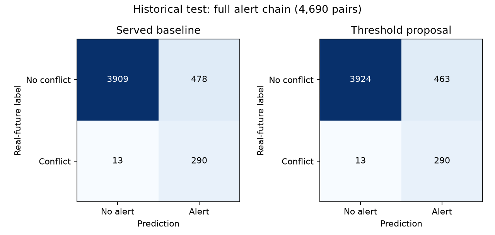

# Conflict false-alert experiments — 1 November 2026

The full-chain historical test's three-minute catch remains **271/284 (95.42%)**.
A validation-selected operating threshold reduces false alerts **478 → 463 (3.14%)**,
retaining the **same 290 true-positive pairs**, including all 28 real tier-1 alerts.
The learned multi-path filter chosen on validation failed the no-lost-true-pair audit;
it is rejected. Everything here is local and uncommitted. The served system is unchanged.

## What actually enters conflict detection

The served XGBoost classifier receives **27 numerical inputs**: current aircraft-pair
geometry and motion; straight-line predicted closest-approach distance, vertical gap
and time; recent turning/acceleration summaries; and three selected-altitude inputs.
It does **not** receive the five predicted paths or summaries of those paths.
See [inference](../../server/app/ml/inference.py), `InferenceEngine.assess_pair`.

The multi-path predictor separately supplies five paths per aircraft. The geometry
code evaluates **25 path combinations**, with interpolation at 15-second intervals.
That geometry affects alert tiering and resolution checks. The classifier is explicitly
built using `rule_cpa`, the straight-line CPA, rather than multi-path CPA.
The deterministic straight-line 5 NM / 1,000 ft safety net can independently raise an
alert. It remains intact in every experiment. It accounts for **153 false alerts and
250 true alerts** on this test, so classifier-only changes cannot remove those 153.

## Threshold result

No weights were changed for this proposal. The raw threshold changes from
**0.074656464159 → 0.079328127205**. The existing Platt mapping
is retained; the corresponding calibrated threshold is 0.027143828104.
The inclusive threshold is the smallest baseline true-positive score on validation:
the highest threshold retaining every baseline classifier true-positive validation pair.
The separately tested full-system preservation criterion picked the same value.
Test labels were not used to choose the value.

| Historical test | TP | FP | FN | TN | Precision | Recall | F1 |
|---|---:|---:|---:|---:|---:|---:|---:|
| Served classifier | 289 | 460 | 14 | 3927 | 38.585% | 95.380% | 0.549430 |
| Proposed classifier | 289 | 444 | 14 | 3943 | 39.427% | 95.380% | 0.557915 |
| Served full chain | 290 | 478 | 13 | 3909 | 37.760% | 95.710% | 0.541550 |
| Proposed full chain | 290 | 463 | 13 | 3924 | 38.513% | 95.710% | 0.549242 |

The standalone classifier loses **zero** previously detected true pairs as well.
Its false positives fall 460 → 444; one removed classifier false positive still triggers
the independent safety net, explaining why system false positives fall by 15, not 16.
Full-chain tier-1 counts stay **28 real / 20 false**. This improves detection counts,
not merely display prominence or collapsing rows. Ranking PR-AUC/ROC-AUC and probability
calibration do not change when only an operating threshold changes.
Validation system false alerts fall 705 → 679, with the same 433 true positives.



## Learned conflict filters with multi-path summaries

To test new multi-path inputs without training a stacked classifier on upstream models'
own training examples, the upstream served trajectory model and classifier were frozen.
Early validation sessions **21–23** supplied **3,375 fitting pairs** (239 positive);
later sessions **24–25** supplied **3,189 selection pairs** (211 positive), separated by
more than the 600-second prediction horizon. Thus the classifier's original 28,746
training pairs were not reused for fitting the new filters. This smaller fitting set
is a limitation; it is not a like-for-like replacement training run.

Six XGBoost filters were fitted: depths 2/3/4 with stronger minimum-child and L2
regularization, 150/250/300 trees, learning rate .04, seed 42. Each of three settings was
tested with existing inputs plus the frozen classifier raw score (28 columns), and
again with four multi-path summaries added (32 columns):

- Probability mass of the 25 combinations breaching the alert volume.
- Probability mass breaching the legal separation minimum.
- Probability mass breaching the alert volume within 180 seconds.
- Time of the multi-path representative closest approach.

These are inference-time predicted summaries; no actual-future distance or outcome time
enters a learned feature. Top-five weights are normalized and joint weights are products
of aircraft path probabilities. They are model-derived summaries, not calibrated real
conflict probabilities. The served original multi-path artifact is used, keeping the
candidate trajectory update out of this ablation.

A filter can veto only a baseline classifier alert; it cannot veto the hard safety net.
Each filter's inclusive score threshold retains every safety-net-unprotected true pair
in the later selection sessions. Configurations are ranked on selection false alerts;
the winner is frozen before loading the historical test. This is a learned downstream
filter experiment, not in-place fine-tuning of the served classifier's weights.

| Experiment | Threshold | Selection FP* | Test FP | Test TP | Lost test true pairs | Test precision | Test recall | Test F1 | Status |
|---|---:|---:|---:|---:|---:|---:|---:|---:|---|
| threshold_classifier | 0.079328127 | 679 | 463 | 290 | 0 | 0.385126 | 0.957096 | 0.549242 | Threshold proposal |
| threshold_system | 0.079328127 | 679 | 463 | 290 | 0 | 0.385126 | 0.957096 | 0.549242 | Threshold proposal |
| existing_inputs_depth2 | 0.031376667 | 313 | 440 | 289 | 1 | 0.396433 | 0.953795 | 0.560078 | Unselected diagnostic |
| existing_inputs_depth3 | 0.033277754 | 265 | 396 | 286 | 4 | 0.419355 | 0.943894 | 0.580711 | Frozen selection; rejected |
| existing_inputs_depth4 | 0.021695804 | 313 | 443 | 290 | 0 | 0.395634 | 0.957096 | 0.559846 | Unselected diagnostic |
| multipath_depth2 | 0.021982910 | 299 | 422 | 288 | 2 | 0.405634 | 0.950495 | 0.568608 | Unselected diagnostic |
| multipath_depth3 | 0.020438127 | 277 | 404 | 288 | 2 | 0.416185 | 0.950495 | 0.578894 | Frozen selection; rejected |
| multipath_depth4 | 0.012492881 | 316 | 460 | 290 | 0 | 0.386667 | 0.957096 | 0.550807 | Unselected diagnostic |

*Threshold-only rows use the entire validation split; learned rows use only later
selection sessions, so their selection FP counts cannot be compared directly.
Every row reports full-chain counts. Full classifier and system confusion matrices,
precision/recall/F1, ranking metrics, and lost-pair indices are retained in raw results.
Full-validation scores for learned filters mix fitting and selection rows and must not
be presented as held-out model performance.

The best learned existing-input filter (`existing_inputs_depth3`) loses four true test
conflicts. The best multi-path filter (`multipath_depth3`) loses two.
Both fail the user's constraint. Some unselected depth-4 diagnostics retain all test
true pairs, but choosing them because of their test results would tune on test; they
are not promoted. No test-led retry was used to claim a learned winner.

## Verification, limits and reproduction

The original historical test contains 4,690 pairs / 303 positive labels. It has been
examined in earlier project studies, so this is a shared historical audit, not a new
independent dataset. Scenarios relocate real aircraft tracks and obtain labels from
their real future movements; they are not a corpus of observed operational near misses.
Zero observed lost true pairs on these data cannot guarantee zero loss on future traffic.
Additional dates with labelled encounters are needed before deployment.

The [production gate audit](../../ml_pipeline/reports/conflict_false_alerts_20261101/production_gate_audit.json)
regenerates served five-path geometry, then checks the baseline and threshold proposal
against actual `escalate_pair` on every validation and test pair. It holds geometry for
three updates, matching the earlier evaluations; it does not evaluate live persistence
transitions. Source served classifier and trajectory SHA-256 hashes remain identical.
All 37 unit checks pass, including three new recall-constraint/counting checks.
Input files, source scripts and cached summary tables have recorded SHA-256 fingerprints
in the [reproducibility manifest](../../ml_pipeline/reports/conflict_false_alerts_20261101/input_source_manifest.json).

Commands, from the project root with its virtual environment:

```powershell
venv\Scripts\python.exe scripts/experiment_conflict_false_alerts.py
venv\Scripts\python.exe scripts/audit_conflict_false_alerts.py
venv\Scripts\python.exe scripts/report_conflict_false_alerts.py
```

Retained artifacts: [protocol](../../ml_pipeline/reports/conflict_false_alerts_20261101/protocol.json),
[frozen selection](../../ml_pipeline/reports/conflict_false_alerts_20261101/selection.json),
[complete results](../../ml_pipeline/reports/conflict_false_alerts_20261101/results.json),
[threshold proposal](../../ml_pipeline/reports/conflict_false_alerts_20261101/threshold_proposal.json),
and exact source snapshot in the same report directory. All six learned filters and
prediction arrays remain in `ml_pipeline/data/processed/conflict_experiments/20261101/`.
The original evaluation and its initial archived version are preserved.

Method reference: scikit-learn's [decision-threshold guidance](https://scikit-learn.org/stable/modules/classification_threshold.html)
requires separate fitting and threshold-selection data. This study uses chronological
sessions for that separation rather than random cross-validation.
