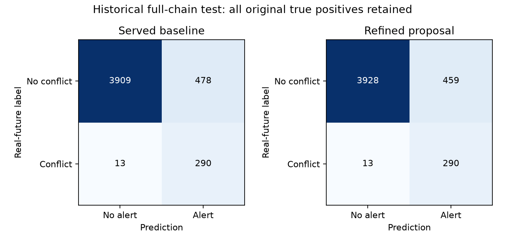

# Further false-alert experiments — 1 November 2026

Full-chain early catches remain **271/284 (95.42%)**. The validation-selected refined
proposal reduces historical test false alerts **478 → 459 (3.97%)**, improving on the
previous threshold-only proposal's 463. It retains exactly the same **290 full-chain
true-positive pairs** and **289 classifier true-positive pairs**. False tier-1 alarms
fall **20 → 19**, with **all 28 real tier-1 alarms retained**. Existing missed cases remain:
the full chain still misses 13 of the 303 labelled conflicts.

This is a **local, uncommitted, undeployed experiment**. Served weights, thresholds,
safety net and alert behaviour are unchanged. The initial evaluation and
[first false-alert study](conflict_false_alerts_20261101.md) remain intact.

## Problem and proposed change

False alerts interrupt a controller even when aircraft subsequently stay separated.
This is a real detection problem. Hiding alerts or removing repeated notifications
does not fix a wrongly predicted conflict, so this study measures pair-level decisions.

The new proposal keeps the earlier raw classifier threshold
0.079328127205, then adds a conservative second learned filter.
The selected filter (`refit_unweighted`) is trained from scratch on the original 28,746 classifier
training pairs, using the same 27 inputs. It uses 400 depth-3 XGBoost trees, learning
rate .04, minimum child weight 20, L2 regularization 20, subsample .9 and seed 42.
Positive training examples receive no extra class weighting, unlike the original model.

Only when this filter's score is below **0.009285068139** may it suppress a
baseline classifier alert. This score is half the lowest filter score among the
original classifier's true-positive validation pairs; the fixed half-score margin
is deliberately more conservative than suppressing up to that observed boundary.
The straight-line legal-separation safety net always bypasses this filter.
These raw scores are ranking outputs, **not calibrated real-world conflict probabilities**.
The filter cannot replace the production classifier by copying its file; it requires
the specified combined decision rule and deployment review.

**Source:** The conservative veto design, score margins and multi-path conjunctions
are our own design. They are not a published no-loss guarantee. Their support is the
paired validation/historical-test measurements below. XGBoost's
[official API](https://xgboost.readthedocs.io/en/stable/python/python_api.html) documents
continuing training with `xgb_model`; its [parameter documentation](https://xgboost.readthedocs.io/en/stable/parameter.html)
defines class weights and the regularization controls used in the training experiments.

## All approaches tried

**28 configurations** were declared before loading the test for this batch:

- **18 multi-path conjunction rules:** require both low original classifier score and
  low predicted path-combination conflict mass before suppressing an alert. Three
  probability summaries × six mass cutoffs; raw-score ceilings use an .8 validation
  safety factor and a .25 cap. These rules add no reduction beyond the prior proposal.
- **4 conservative ensembles:** combine the three earlier depth-2/3/4 filters with
  either a maximum or mean score, with and without multi-path inputs. A maximum keeps
  the alert if any filter remains concerned. They use half the minimum protected
  validation score. Earlier filters fit early validation sessions; only later sessions
  rank these ensembles. Full-validation summaries include those fitting rows and are
  not held-out performance for this family.
- **6 classifier training configurations:** two continuations of the original model
  with 150 additional depth-3 trees, and four fresh fits testing depths 2/3/4 and
  weighted versus unweighted training. These fit only the original training split;
  the entire validation split is separate for threshold selection and family ranking.

One candidate per family is frozen on validation before opening this batch's test.
Every candidate must retain each original classifier and full-system true-positive
validation pair, rather than merely retain the same number. No test scores are used
to choose family winners.

| Family | Validation-selected candidate | Test false alerts | Test true alerts | Lost true pairs |
|---|---|---:|---:|---:|
| classifier_training | `refit_unweighted` | 459 | 290 | 0 |
| conservative_ensembles | `ensemble_existing_max` | 463 | 290 | 0 |
| multipath_rules | `rule_mp_p_alert_volume_0` | 463 | 290 | 0 |

Some unselected ensembles remove another one or two false test alerts. They are
reported as diagnostics, not selected using their test results. The original test
was already examined in earlier rounds, so this entire follow-up is an **exploratory
repeated-benchmark study**, not a fresh independent confirmation.

## Evaluation

| Historical test | TP | FP | FN | TN | Precision | Recall | F1 |
|---|---:|---:|---:|---:|---:|---:|---:|
| Served full chain | 290 | 478 | 13 | 3909 | 37.760% | 95.710% | 0.541550 |
| Previous threshold proposal | 290 | 463 | 13 | 3924 | 38.513% | 95.710% | 0.549242 |
| Refined full-chain proposal | 290 | 459 | 13 | 3928 | 38.718% | 95.710% | 0.551331 |
| Served classifier | 289 | 460 | 14 | 3927 | 38.585% | 95.380% | 0.549430 |
| Refined classifier/filter | 289 | 440 | 14 | 3947 | 39.643% | 95.380% | 0.560078 |

The refined proposal loses zero original true-pair identities on both validation and
test, for both the standalone classifier and the full chain. Validation full-chain
false alerts fall 705 → 671; its 433 true detections and
411/428 early catches remain intact. Test early catches are unchanged at 271/284.
Real tier-1 detections remain 28, while false tier-1 alarms fall 20 → 19.
This improvement changes which false pairs are detected, not merely their display.



The full-chain confusion matrix is **[[3928, 459], [13, 290]]**, with rows actual
non-conflict/conflict and columns no-alert/alert. Full confusion counts, precision,
recall, F1 and lost-pair indices for every configuration are retained in raw JSON and
the [all-trial CSV](../../ml_pipeline/reports/conflict_refinement_20261101/all_trials.csv).
The hard safety net still accounts for 153 false alerts and cannot be suppressed here.

## Tiering and resolution checks, simply

**Tiering means urgency.** If a predicted closest approach is within three minutes,
the pair is tier 1: after the alert gate and persistence checks pass, it may sound an
alarm and offer manoeuvre suggestions. From three to ten minutes it is tier 2: a
watch-list warning. Outside ten minutes it is tier 0, not a controller notification.
A tier alone is not sufficient to notify; the pair must also qualify and persist.

**Resolution checks mean testing a possible way out.** For a confirmed tier-1 alert,
the engine simulates candidate instructions such as a turn, climb or descent. It
checks whether the change clears the original pair and whether it creates another
conflict with nearby aircraft, using available predicted paths for the other traffic.
For example, a right turn may clear aircraft B but approach aircraft C, so that turn
should be rejected. These are suggestions for a controller, not automatic aircraft control.

The conflict classifier still receives straight-line CPA plus current/history/selected
altitude inputs. Five paths per aircraft are evaluated separately as 25 combinations
for geometry/tiering and resolution checks. The selected refined filter uses the same
27 classifier features; the multi-path-input approaches did not win this round.

## Verification and limitations

The [actual production-gate audit](../../ml_pipeline/reports/conflict_refinement_20261101/production_gate_audit.json)
recomputes served five-path geometry and compares the proposal with `escalate_pair` on
every validation and test pair. It assumes the geometry persists for three updates,
as in earlier evaluations; it is not a live alert-transition replay. Source served
model hashes remain unchanged. All 40 unit checks pass, including three new checks
for conservative-rule protection and threshold boundaries.

There is no mathematical guarantee of never losing a future conflict. Real-future
labels on relocated-track scenarios differ from observed operational incidents, and
reusing the historical benchmark limits generalization claims. A fresh labelled
encounter cohort is needed before treating this small improvement as deployment-ready.
Probability calibration for the combined filtered output is also not established.

Reproduce from the project root:

```powershell
venv\Scripts\python.exe scripts/experiment_conflict_refinement.py
venv\Scripts\python.exe scripts/audit_conflict_refinement.py
venv\Scripts\python.exe scripts/report_conflict_refinement.py
```

The training script refuses to overwrite completed results. Use a distinct experiment
directory for a new run. [Protocol](../../ml_pipeline/reports/conflict_refinement_20261101/protocol.json),
[frozen selection](../../ml_pipeline/reports/conflict_refinement_20261101/selection.json),
[complete results](../../ml_pipeline/reports/conflict_refinement_20261101/results.json),
[candidate card](../../ml_pipeline/reports/conflict_refinement_20261101/candidate_model_card.json),
and [source/artifact fingerprints](../../ml_pipeline/reports/conflict_refinement_20261101/source_artifact_manifest.json)
are preserved. Encounter and cached-input fingerprints are in the
[first study's input manifest](../../ml_pipeline/reports/conflict_false_alerts_20261101/input_source_manifest.json).
The exact experiment source snapshot is retained alongside the new reports.
Weights and decision arrays remain local under
`ml_pipeline/data/processed/conflict_experiments/20261101_refinement/`.
