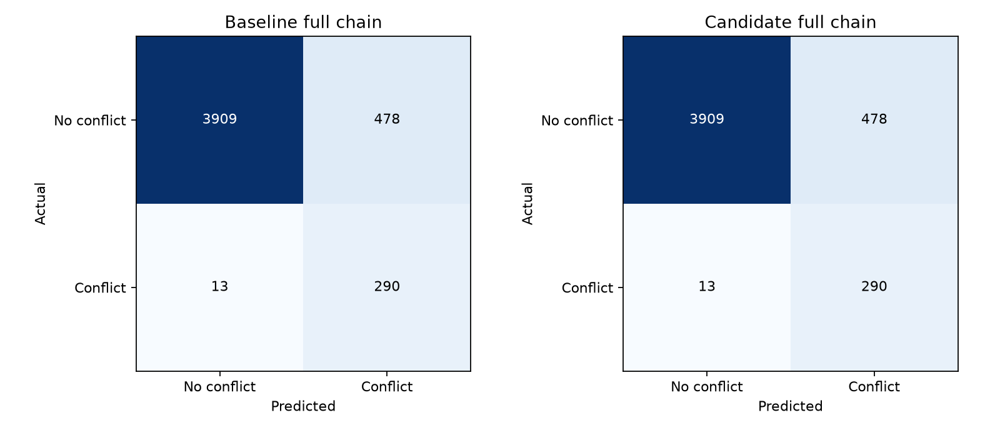

# Multi-path tuning — 1 November 2026

The candidate passes the recorded trajectory, alert-chain, later-date and inference-cost checks. It is packaged separately for review; it has not replaced the served model.

All new work is **local and uncommitted** on `fine-tuning`, based on `2bcaba1`. At Archit's instruction, no new commits or pushes have been made. The original checkpoint is preserved in that branch's history at `a502c7e`; the obsolete checkpoint and LSTM experiment branch names were removed.

## Scope and predeclared method

This studies Model 1b, the multi-path predictor used by the alert chain. Only the three ten-minute per-mode offset regressors change. Forty learned route patterns, the route classifier, temperature calibration, top-K=5, destination features, earlier horizons, labels, conflict classifier and alert thresholds stay fixed. Best-of-five is coverage, not single-guess accuracy.

`arrivals` retains the project's existing near-airport bucket: distance less than 40 NM from VABB. It is not an independently labelled arrival/departure classification.

The existing archive-augmented training split has 605,757 windows, including 342,606 ten-minute targets. The five chronological validation collection blocks are divided into 20,091 early windows (10,192 ten-minute targets) for fresh-refit early stopping, and 25,546 later windows (12,499 ten-minute targets) for ranking. Their gap exceeds the 600-second target horizon. Continuation keeps the original identical training data and seed-0 legacy internal random holdout, as required for a valid scikit-learn warm start. It is not claimed to replace that original holdout with chronological early stopping. The fresh refit does use explicit chronological early validation.

The fixed objective averages relative changes in top-1 mean/RMSE/P90 horizontal errors, altitude MAE and energy score, plus rate gaps divided by 100 for within-1-NM, top-1/best-of-five within-5-NM and top-1/best-of-five joint 3-D hits, equally over arrivals and all traffic. Lower is better; the baseline scores zero. These weights and tolerances are our experimental design, not aviation standards.

Trajectory guards: errors may rise at most 2% plus 0.01 NM, 1 ft altitude or 0.001 energy; coverage may fall at most 0.5 percentage points. Regimes with at least 100 examples allow at most 5%+0.01 NM mean-error rise or a one-point top-1 hit-rate drop. Earlier-horizon predictions remain identical. A trajectory candidate also faces a validation alert-chain veto before selection is frozen for test.

## Trials and validation selection

| Trial | Hypothesis | Fitted trees: along / cross / altitude | Objective | Trajectory guards | Validation alert guards |
|---|---|---|---|---|---|
| continue_600 | Continue the original capped models without changing training data | 600 / 600 / 468 | -0.00217 | True | not evaluated after earlier passing selection |
| continue_800 | Continue the original capped models without changing training data | 800 / 800 / 468 | -0.00320 | True | True |
| regularized31 | 31 leaves, minimum 80 samples per leaf, L2=5, chronological early stopping | 265 / 400 / 292 | +0.03038 | False | not evaluated after earlier passing selection |

Validation-frozen choice: **continue_800**, seed **0**. Eligible from validation: **True**.

Continuation is deterministic from a fixed fitted source. Its original training seed is retained; this study does **not** claim independent multi-seed replication. Fresh-model seeds cannot be substituted without changing the warm-start data partition and requiring full baseline retraining.

### Rejected and diagnostic results

- continue_600: no recorded failure in the checks evaluated
- continue_800: no recorded failure in the checks evaluated
- regularized31: all/top1_altitude_mae_ft: error increased >2% + slack; all/energy_score: error increased >2% + slack; all/top1_within_1nm: rate fell >0.5 pp; all/best5_within_5nm: rate fell >0.5 pp; all/top1_both: rate fell >0.5 pp; all/best5_both: rate fell >0.5 pp; arrivals/top1_altitude_mae_ft: error increased >2% + slack; arrivals/energy_score: error increased >2% + slack; arrivals/top1_within_1nm: rate fell >0.5 pp; arrivals/top1_within_5nm: rate fell >0.5 pp; arrivals/best5_within_5nm: rate fell >0.5 pp; arrivals/top1_both: rate fell >0.5 pp; arrivals/best5_both: rate fell >0.5 pp; regime vertical/gentle climb/descent: mean error >5% or hit drop >1 pp; regime vertical/fast climb/descent: mean error >5% or hit drop >1 pp; regime distance to VABB/terminal: mean error >5% or hit drop >1 pp

## Historical held-out trajectory audit

No rejected candidate was selected using test results. The historical split has been examined in earlier project studies, so it is not a new untouched benchmark. Joint 3-D coverage requires the **same candidate** to be within 5 NM horizontally and 1,000 ft vertically.

| Group | Metric at ten minutes | Baseline | Candidate | Difference |
|---|---|---|---|---|
| all (n=18662) | top1_mean_nm | 5.53280 | 5.49463 | -0.03817 |
| all (n=18662) | top1_rmse_nm | 9.99827 | 9.97686 | -0.02141 |
| all (n=18662) | top1_median_nm | 2.05195 | 1.98789 | -0.06407 |
| all (n=18662) | top1_p90_nm | 15.89795 | 15.87455 | -0.02340 |
| all (n=18662) | top1_altitude_mae_ft | 889.18759 | 888.14280 | -1.04479 |
| all (n=18662) | best5_mean_nm | 2.57870 | 2.53530 | -0.04340 |
| all (n=18662) | top1_within_1nm | 37.77194 | 38.34530 | +0.57336 |
| all (n=18662) | top1_within_5nm | 68.06880 | 68.26707 | +0.19826 |
| all (n=18662) | best5_within_5nm | 88.43104 | 88.64538 | +0.21434 |
| all (n=18662) | top1_within_1000ft | 72.87536 | 72.87536 | +0.00000 |
| all (n=18662) | best5_within_1000ft | 77.90698 | 77.92841 | +0.02143 |
| all (n=18662) | top1_both | 55.89969 | 56.02829 | +0.12860 |
| all (n=18662) | best5_both | 68.19205 | 68.31529 | +0.12325 |
| all (n=18662) | energy_score | 1.35628 | 1.35153 | -0.00475 |
| arrivals (n=2923) | top1_mean_nm | 9.93943 | 9.89244 | -0.04699 |
| arrivals (n=2923) | top1_rmse_nm | 15.41122 | 15.39838 | -0.01284 |
| arrivals (n=2923) | top1_median_nm | 5.47821 | 5.36089 | -0.11732 |
| arrivals (n=2923) | top1_p90_nm | 26.01240 | 26.00515 | -0.00725 |
| arrivals (n=2923) | top1_altitude_mae_ft | 1289.81773 | 1288.77336 | -1.04436 |
| arrivals (n=2923) | best5_mean_nm | 4.29989 | 4.22899 | -0.07089 |
| arrivals (n=2923) | top1_within_1nm | 17.03729 | 17.31098 | +0.27369 |
| arrivals (n=2923) | top1_within_5nm | 47.21177 | 47.51967 | +0.30790 |
| arrivals (n=2923) | best5_within_5nm | 76.46254 | 76.90729 | +0.44475 |
| arrivals (n=2923) | top1_within_1000ft | 56.24359 | 56.27780 | +0.03421 |
| arrivals (n=2923) | best5_within_1000ft | 68.14916 | 68.25180 | +0.10263 |
| arrivals (n=2923) | top1_both | 34.45091 | 34.65618 | +0.20527 |
| arrivals (n=2923) | best5_both | 48.78549 | 49.02497 | +0.23948 |
| arrivals (n=2923) | energy_score | 2.03300 | 2.02671 | -0.00629 |

### Per-horizon top-1 metrics

| Horizon | Model | Mean NM | RMSE NM | P90 NM | Altitude MAE ft | Within 5 NM |
|---|---|---|---|---|---|---|
| 1 min | Baseline | 0.4385 | 1.7088 | 0.9432 | 96.7 | 98.47% |
| 1 min | Candidate | 0.4385 | 1.7088 | 0.9432 | 96.7 | 98.47% |
| 3 min | Baseline | 1.3371 | 3.0130 | 4.2739 | 297.6 | 91.73% |
| 3 min | Candidate | 1.3371 | 3.0130 | 4.2739 | 297.6 | 91.73% |
| 5 min | Baseline | 2.5413 | 5.2593 | 7.7133 | 494.3 | 83.75% |
| 5 min | Candidate | 2.5413 | 5.2593 | 7.7133 | 494.3 | 83.75% |
| 10 min | Baseline | 5.5328 | 9.9983 | 15.8979 | 889.2 | 68.07% |
| 10 min | Candidate | 5.4946 | 9.9769 | 15.8745 | 888.1 | 68.27% |

## Full alert-chain audit

The existing constructed encounter set relocates one real track while preserving its recorded future manoeuvres; these are not observed real-world near misses. The audit includes the multi-path step and verifies the actual escalation function pair by pair, assuming unchanged geometry for three updates to satisfy persistence. It is not a full live-tick timing test.

| Split/model | Precision | Recall | F1 | TN | FP | FN | TP | ≥3-minute catches | Tier 1 real / false |
|---|---|---|---|---|---|---|---|---|---|
| Validation baseline | 0.3805 | 0.9622 | 0.5453 | 5409 | 705 | 17 | 433 | 411/428 | 30 / 24 |
| Validation candidate | 0.3805 | 0.9622 | 0.5453 | 5409 | 705 | 17 | 433 | 411/428 | 30 / 24 |
| Test baseline | 0.3776 | 0.9571 | 0.5415 | 3909 | 478 | 13 | 290 | 271/284 | 28 / 20 |
| Test candidate | 0.3776 | 0.9571 | 0.5415 | 3909 | 478 | 13 | 290 | 271/284 | 28 / 20 |

The classification target here is conflict/no conflict after the full chain. The standalone conflict classifier is unchanged; its previously recorded 95.1% warning figure must not be conflated with this full-chain rate. Alert guard failures: none.

Display/prominence and collapse counts are also retained in the JSON. Validation acceptance requires no lost early real catches or real tier-1 alarms and no increase in the specified false-alert/collapse counts; it does not tune controller thresholds.

### Pair-level identity check

Counts alone could hide a lost real case offset by a gained one. This additional post-selection check compares the individual pair decisions and real tier-1 memberships.

| Split | Changed alert decisions | Changed computed tiers | Lost real alerts | Lost real tier 1 |
|---|---|---|---|---|
| val | 0 | 1 | 0 | 0 |
| test | 0 | 0 | 0 | 0 |

## Route classification and probability calibration

The route classifier, cluster identities and temperature are frozen. These values therefore apply equally to the baseline and candidate, not an improvement caused by offset tuning.

| Average | Precision | Recall | F1 |
|---|---|---|---|
| macro avg | 0.5155 | 0.4147 | 0.4413 |
| weighted avg | 0.6170 | 0.6355 | 0.6100 |

Multiclass negative log likelihood: 1.30870; Brier score: 0.50224; top-1 ten-bin calibration error: 0.06370. These score the actual ten-minute residual's KMeans cluster. They do not establish calibration of geometric within-distance hits or the probability of a conflict.

[Full route-cluster confusion counts](../../ml_pipeline/reports/multipath_tuning_20261101/route_confusion.csv) and per-class precision/recall/F1 are retained in the raw summary.

## Distribution quality: energy score

The lower-is-better score is E||Z−y|| − 0.5 E||Z−Z′|| for independent draws from the normalized retained five-path distribution. Local residual coordinates are scaled by 5 NM along/cross track and 1,000 ft altitude. This fixed scaling is our design, not an aviation standard. A low best-of-five distance alone can hide poor probabilities or unhelpful other modes; the energy score evaluates the mixture. It is not a score for the discarded probability tail or for the conflict event.

## Shared later-date trajectory audit

10 and 20 September 2026: 213,482 windows. Destination is known in the existing local route cache for 75.3% of windows. No online lookups were made. These dates were used in prior LSTM studies and form a shared exploratory audit, not a fresh independent test for each follow-up. Labels were not used for parameter or candidate selection. This cohort has no labelled encounter outcomes; it supports trajectory, not alert-chain, conclusions.

| Group | Metric at ten minutes | Baseline | Candidate | Difference |
|---|---|---|---|---|
| all (n=120679) | top1_mean_nm | 5.77170 | 5.74494 | -0.02675 |
| all (n=120679) | top1_p90_nm | 16.77225 | 16.77645 | +0.00421 |
| all (n=120679) | top1_altitude_mae_ft | 668.23764 | 667.88143 | -0.35621 |
| all (n=120679) | best5_within_5nm | 87.86119 | 88.03189 | +0.17070 |
| all (n=120679) | best5_both | 73.89355 | 74.01951 | +0.12595 |
| all (n=120679) | energy_score | 1.31141 | 1.30825 | -0.00316 |
| arrivals (n=7480) | top1_mean_nm | 10.63095 | 10.60985 | -0.02110 |
| arrivals (n=7480) | top1_p90_nm | 26.91853 | 27.01920 | +0.10067 |
| arrivals (n=7480) | top1_altitude_mae_ft | 1555.36698 | 1555.00193 | -0.36505 |
| arrivals (n=7480) | best5_within_5nm | 74.58556 | 74.78610 | +0.20053 |
| arrivals (n=7480) | best5_both | 41.55080 | 41.65775 | +0.10695 |
| arrivals (n=7480) | energy_score | 2.23091 | 2.22797 | -0.00294 |

Later-date trajectory guard failures: none.

## Inference and artifact cost

Production loader, CPU limited to four threads, batch 64, two warmups and seven interleaved measurements: median 350.48 ms baseline → 390.30 ms candidate. Recorded practical cost guard passes: True. Raw model size: 116.0 → 121.8 MiB. This measures isolated prediction, not the full ingestion/update loop. Timing varies with laptop load.

## Paired uncertainty diagnostic

1,000 paired resamples of whole aircraft on the later-date cohort, seed 20261101. Differences are candidate minus baseline: negative errors/energy or positive coverage favor the candidate. Intervals crossing zero are inconclusive within this diagnostic. This post-selection check was not used for ranking; it does not measure between-day or airport generalization from only two shared dates.

| Group | Metric | Mean difference | 95% percentile interval |
|---|---|---|---|
| all (925 aircraft) | top1_mean_nm | -0.02675 | -0.03001 to -0.02373 |
| all (925 aircraft) | top1_altitude_mae_ft | -0.35621 | -0.54391 to -0.22142 |
| all (925 aircraft) | best5_within_5nm | +0.17070 | +0.11971 to +0.22857 |
| all (925 aircraft) | best5_both | +0.12595 | +0.07839 to +0.17099 |
| all (925 aircraft) | energy_score | -0.00316 | -0.00365 to -0.00268 |
| arrivals (247 aircraft) | top1_mean_nm | -0.02110 | -0.03290 to -0.01028 |
| arrivals (247 aircraft) | top1_altitude_mae_ft | -0.36505 | -0.69882 to -0.03363 |
| arrivals (247 aircraft) | best5_within_5nm | +0.20053 | -0.09874 to +0.48592 |
| arrivals (247 aircraft) | best5_both | +0.10695 | -0.10833 to +0.30705 |
| arrivals (247 aircraft) | energy_score | -0.00294 | -0.00432 to -0.00166 |

## Acceptance and reproducibility

| Check | Passed |
|---|---|
| validation_eligible | True |
| all_test_trajectory_guards | True |
| all_test_alert_guards | True |
| all_available_finalists_validation_guards | True |
| pair_identity_safety_check | True |
| later_date_guards | True |
| inference_cost_guard | True |
| served_files_unchanged | True |

Passing practical tolerances is not a claim that every individual component or regime improved. No served weights, alert thresholds, original data splits or historical evaluation tables were overwritten.

- [Protocol](../../ml_pipeline/reports/multipath_tuning_20261101/protocol.json)
- [Exact training source](../../ml_pipeline/reports/multipath_tuning_20261101/source_snapshot.txt)
- [Data/source fingerprints](../../ml_pipeline/reports/multipath_tuning_20261101/reproducibility_manifest.json)
- [Validation-frozen selection](../../ml_pipeline/reports/multipath_tuning_20261101/selection_frozen_before_test.json)
- [Full results, including rejected trials](../../ml_pipeline/reports/multipath_tuning_20261101/summary.json)
- [Candidate card](../../ml_pipeline/reports/multipath_tuning_20261101/candidate_model_card.json)

Local trial models: `ml_pipeline/data/processed/multipath_experiments/20261101/`. If all checks pass, the packaged file is `trajectory_multipath_candidate.pkl` in that directory. Binary models are local, not committed or uploaded.

## Research basis

- [scikit-learn HistGradientBoostingRegressor](https://scikit-learn.org/stable/modules/generated/sklearn.ensemble.HistGradientBoostingRegressor.html): warm-start same-data requirement, regularization and explicit early-stopping validation.
- [Early stopping example](https://scikit-learn.org/stable/auto_examples/ensemble/plot_gradient_boosting_early_stopping.html): motivation for testing iteration limits against validation performance.
- [Gneiting and Raftery (2007), Section 4.3](https://sites.stat.washington.edu/people/raftery/Research/PDF/Gneiting2007jasa.pdf): energy score for multivariate distributions; this report uses negative orientation so lower is better.

The candidate grids, coordinate scaling, objective weights and regression tolerances are our own experimental choices. These sources describe the mechanisms, not evidence that these settings improve Mumbai traffic. All reported benefits and failures come from the local measurements.
