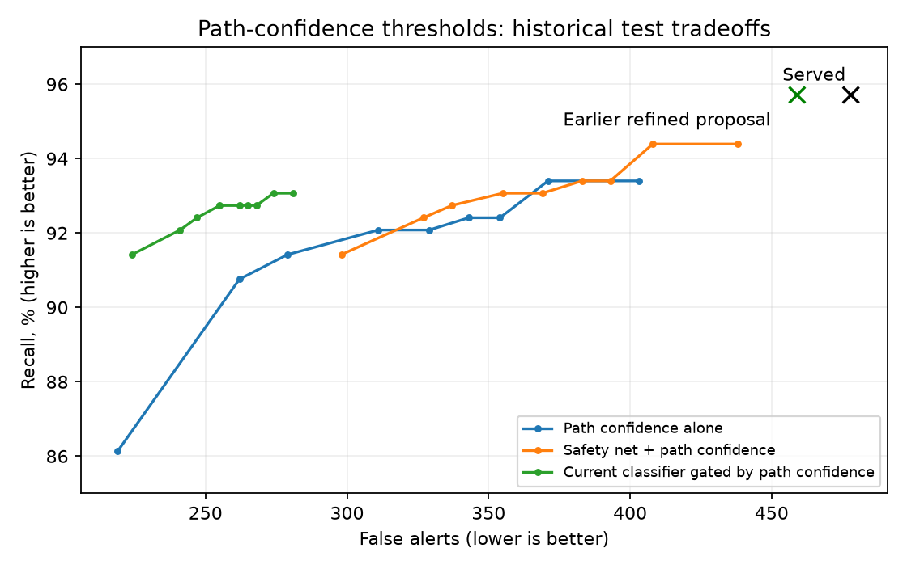

# All-pairs path-confidence monitor — 1 November 2026

**Outcome:** the requested background monitor is implemented and exercised locally.
Using multi-path confidence as the required display gate **fails the no-lost-real-case
constraint**. No feasible threshold was found on validation. Live controller behaviour
and the served **271/284 early catches (95.42%)** are unchanged. The prior conservative
filter proposal remains separate at 459 test false alerts / 290 true cases.

## Checkpoint saved before implementation

`checkpoints/20261101_pre_path_confidence/` holds a verified local ZIP of **379 files
(274,608,898 bytes)**: tracked/nonignored working files, all current served artifacts,
selected trajectory candidates, and conflict experiment weights. Its manifest records
per-file SHA-256, branch `fine-tuning` and HEAD `2bcaba1`. It also stores the tracked
binary Git diff. Raw/processed datasets, rejected trajectory artifacts, environments,
secrets and dependencies were not duplicated; they remain in place. This is a filesystem
restore checkpoint, **not a commit or push**. All subsequent work remains uncommitted.

## What was implemented

[path_confidence_monitor.py](../../ml_pipeline/utils/path_confidence_monitor.py)
provides an isolated background worker and stateful monitor:

1. Predict up to five paths once per aircraft, then compare every unordered supplied
   aircraft pair. No spatial pair prefilter or pair-count cap is applied by the monitor.
2. Check all 25 combinations when each aircraft has five paths, using the existing
   15-second interpolated geometry and 8 NM / 1,500 ft alert volume.
3. Retain conflicting combinations in background state, including low-confidence ones.
   Aircraft identity and route-pattern IDs identify combinations across updates;
   prediction rank is not used as identity because ranks may change.
4. Compute three candidate confidence scores: sum of conflicting joint path weights,
   largest conflicting joint weight, and largest minimum of the two individual path
   weights among conflicting combinations.
5. Produce `shadow_visible` only after the chosen score meets its threshold for three
   consecutive observed updates. Produce a new notification on the transition, rather
   than interrupting on every repeated update. Missing observations and long gaps reset
   persistence, and stale pairs expire.
6. Keep results separate from the live `AlertFeed`. A single-worker executor runs scans
   off the caller thread. It rejects an overlapping scan instead of building an unbounded
   queue of stale snapshots; the caller must handle backpressure and result age.

The worker has no live server hook and does not send anything to the controller.
The replay runner exercises it as a separate process. This preserves current real-case
warnings while evaluating the proposed replacement gate.

Existing production already performs the 25-way check for selected pairs. It normally
gates alerts with the classifier or straight-line safety net, and selects pairs using
current distance <60 NM, altitude gap <5,000 ft and a cap of 120 pairs per update.
The prototype evaluates all eligible pairs supplied to it, including pairs beyond that cap.
En-route eligibility and sufficient history still determine which aircraft are supplied.

## Meaning of confidence

If aircraft A's path has weight .6 and B's has weight .5, their combination gets weight
**.6 × .5 = .30** under an independent-aircraft approximation. If several combinations
conflict, summing their weights captures the total model-assigned mass of those futures.
The product rule requires independence; see the
[probability-course reference](https://www.probabilitycourse.com/chapter1/1_4_1_independence.php).
Air traffic instructions can couple aircraft behaviour, so independence is a modelling
assumption, not an established property of these encounters.

Only the retained top-five paths are normalized. Their weights and products are
**not calibrated probabilities of a real conflict**, even though the route classifier
uses temperature scaling. A single-combination threshold can also miss risk spread
over several individually low-weight combinations, which is why total mass is tested.
No rule requires confidence to be increasing: a steady or declining score above the
threshold still qualifies. This differs from the previously rejected confidence-trend
filter documented in CLAUDE.md. The worker/state/policy design is our own experimental
design, not a published no-loss guarantee.

## Threshold experiments and result

**135 configurations** test three scores × nine thresholds
`0, .01, .025, .05, .1, .2, .4, .6, .8` × five policy variants:

- Path confidence alone.
- Straight-line safety net OR path confidence.
- Straight-line safety net OR current classifier AND path confidence.
- Straight-line safety net OR the earlier refined classifier/filter AND path confidence.
- Keep all served alerts and add qualifying path alerts.

Thresholds are selected on validation, requiring **each originally detected real pair**
to remain detected. Where no setting passes, the recorded selection is `null`; the
best-F1 diagnostic is not promoted. All settings and selections are frozen before
this batch reads the historical test. This remains a repeatedly examined historical
benchmark, not fresh independent confirmation.

The static policy comparisons reuse existing tier/time eligibility to isolate the
display gate; they do not reconstruct a new tiering algorithm. Snapshot evaluations
do not simulate the stateful worker's real-time confidence evolution.

**Why no exclusive path gate passes:** validation has **15** originally detected real
cases with no conflicting predicted combination; **10** are not rescued by the straight-line
safety net. Test has **11** such cases, **8** not rescued by the safety net. A confidence
threshold cannot expose a combination the model does not predict. Threshold zero still
requires conflicting geometry; treating an empty set as a zero-threshold alert would
discard the meaning of a confidence-gated conflict.

The following **illustrative, rejected** rows use total conflicting mass >=.2. They are
not selected deployment settings:

| Policy | Test TP | Test FP | Original real cases lost | Early catches | Precision | Recall | F1 |
|---|---:|---:|---:|---:|---:|---:|---:|
| Served baseline | 290 | 478 | 0 | 271/284 | 37.76% | 95.71% | .5415 |
| Earlier refined proposal | 290 | 459 | 0 | 271/284 | 38.72% | 95.71% | .5513 |
| path_only | 279 | 311 | 12 | 260/284 | 47.29% | 92.08% | 0.6249 |
| safety_plus_paths | 282 | 355 | 9 | 263/284 | 44.27% | 93.07% | 0.6000 |
| served_with_path_gate | 281 | 255 | 9 | 262/284 | 52.43% | 92.74% | 0.6698 |
| refined_with_path_gate | 281 | 254 | 9 | 262/284 | 52.52% | 92.74% | 0.6706 |
| served_plus_paths | 291 | 578 | 0 | 272/284 | 33.49% | 96.04% | 0.4966 |

Identity checks matter: some policies find different real cases while losing original
ones. For example, safety-net + path evidence at threshold zero detects 286 real pairs
in total, but loses eight originally detected pairs and gains four different pairs.
Comparing only TP totals would hide that loss.

Keeping every served alert and only adding path alerts preserves original true cases
structurally, but increases false alerts. Validation selects threshold .8 for each
additive score family: test false alerts become 552 (total mass), 489 (maximum joint),
or 500 (both-path score), compared with 478 served. No version meets both goals.



Every threshold's classifier-independent confusion matrix, precision, recall, F1,
early catches, tier counts and lost/gained original pair indices is recorded in
[complete results](../../ml_pipeline/reports/path_confidence_20261101/results.json) and
[all-threshold CSV](../../ml_pipeline/reports/path_confidence_20261101/all_thresholds.csv).
The earlier classifier evaluations and original initial-evaluation archive are preserved.

## Recorded-airspace background replay

Six consecutive ten-second snapshots from `ml_pipeline\data\raw\session_b_20260905_023002_combined.parquet` supplied **16–18** current
eligible aircraft, each with ten valid recent states. The worker assessed **120–153 pairs**
and **3,000–3,825 path combinations** per snapshot, with no spatial filter or pair cap.
All-pairs counts were asserted against N(N-1)/2. Routes used only local cached context.

At total-mass threshold .2 and three qualifying updates, the first two snapshots retained
one pending pair. The third exposed one shadow-visible pair and one new notification.
The pair stayed visible on the remaining snapshots without repeated new notifications.
Inference plus scanning took **0.520–0.775 seconds per snapshot**
in this small replay. These are measured costs, not a scalability guarantee: work grows
as 25×N(N-1)/2, or 123,750 combination checks for 100 aircraft.

This replay has **no labelled pair outcomes**. It verifies background processing,
state retention, persistence and notification transitions; it does not establish
accuracy or real-case warning delay. The labelled encounter benchmark is static and
also cannot establish whether an initially hidden case appears later with enough
warning. A labelled chronological encounter replay is needed for that timing claim.
The prototype's mandatory extra confidence gate already fails snapshot preservation.

## Verification and reproduce

All **50 unit checks** pass, including ten new checks for product/sum arithmetic,
all-pairs coverage, threshold transitions, persistence, background worker results,
rank-independent pattern tracking, gaps, expiry, invalid weights and empty-conflict cases.
Recomputed total confidence matches the previous served geometry tables to 1e-12.
Source served classifier and trajectory hashes remain unchanged.

```powershell
venv\Scripts\python.exe scripts/experiment_path_confidence.py
venv\Scripts\python.exe scripts/replay_path_confidence.py
venv\Scripts\python.exe scripts/report_path_confidence.py
venv\Scripts\python.exe -m unittest discover -s ml_pipeline/tests -q
```

Completed threshold studies refuse overwrite. Use a new directory for an independent
rerun. [Protocol](../../ml_pipeline/reports/path_confidence_20261101/protocol.json),
[validation-frozen selection](../../ml_pipeline/reports/path_confidence_20261101/selection.json),
[replay details](../../ml_pipeline/reports/path_confidence_20261101/replay.json),
and [source fingerprints](../../ml_pipeline/reports/path_confidence_20261101/source_manifest.json)
are retained. The exact threshold-study source snapshot is stored alongside them.
Evidence tables and full pending/visible replay events remain in
`ml_pipeline/data/processed/path_confidence_experiments/20261101/`.

**Decision:** retain the prototype for investigation; reject an exclusive path-confidence
controller gate with current path coverage. No served threshold, model, API response,
controller display, Git commit or remote branch was changed.
