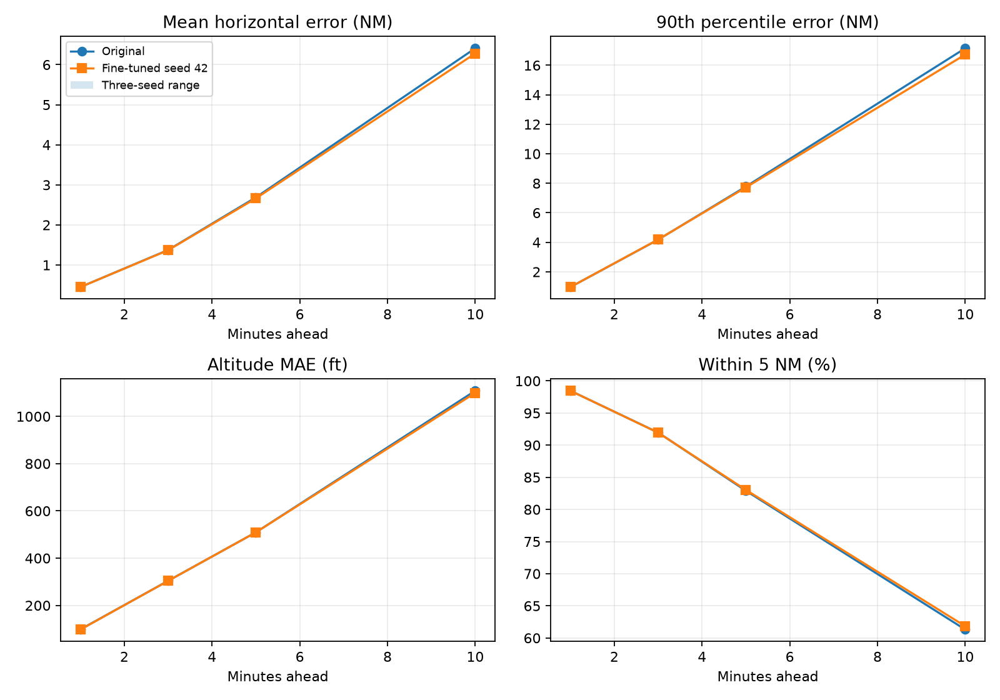

# Trajectory tuning — 1 November 2026

This round does not establish an improvement that passes every recorded validation and three-seed test guard. Retain the deployed baseline; inspect the regressions below before another experiment.

The checkpoint is preserved remotely at [checkpoint/pre-trajectory-tuning-20261101](https://github.com/Amrit-Nigam/flight-right/commit/a502c7e), commit `a502c7e`. Experiments are on `fine-tuning`.

## Scope and method

This round fine-tunes **Model 1, the residual LSTM** from the existing checkpoint. Model 1b, the multi-path model used by the served alert chain, is separate and is unchanged. The LSTM has no probability output, so probability calibration is not a defined metric for this round.

Training uses all 205,757 existing training windows. The 45,637 later validation windows choose hyperparameters and epochs. One configuration is frozen before the 39,614 historical test windows are opened by the experiment. The already-frozen configuration is repeated at seeds 43 and 44, in addition to selection seed 42. No seed is selected based on its test score. The historical test split has been examined in earlier project work, so this is not a new untouched external evaluation.

Architecture, feature normalization, inputs, targets, SmoothL1 beta 0.05 and the constant-velocity baseline are held fixed. All trials use batch size 256, gradient norm cap 1 and a validation-loss learning-rate scheduler (factor 0.5, patience 1). Maximum six epochs; early stopping after three epochs without improving the guarded validation ranking. Heads-only freezes the LSTM encoder; the shared output block and horizon heads remain trainable.

The fixed validation objective averages six relative error changes (horizontal mean, RMSE, median, 90th percentile, cross-track MAE and altitude MAE) and three hit-rate gaps divided by 100 (within 1 NM, within 5 NM and the joint 5-NM/1,000-ft hit) at each horizon. Lower is better; the original checkpoint scores zero. This is our experimental ranking, not a standard aviation metric.

Guardrails: each per-horizon error may rise at most 2% plus 0.01 NM (1 ft for altitude); a hit rate may fall at most 0.5 percentage points. For regime buckets with at least 100 examples, mean error may rise at most 5% plus 0.01 NM and within-5-NM may fall at most one point. These practical tolerances were declared before training; passing does not mean every metric improves.

## Validation search

| Trial | Optimizer | Learning rate | Weight decay | Best epoch | Objective | Guards pass |
|---|---|---|---|---|---|---|
| adam_lr1e4 | adam | 0.0001 | 0.0 | 6 | -0.01003 | True |
| adamw_lr1e4_wd1e3 | adamw | 0.0001 | 0.001 | 6 | -0.01000 | True |
| adamw_lr3e4_wd1e2 | adamw | 0.0003 | 0.01 | 6 | -0.00961 | True |
| heads_adamw_lr3e4 | adamw | 0.0003 | 0.001 | 3 | -0.00925 | False |

Frozen configuration: **adam_lr1e4**. Validation guards pass: True; objective improves: True.

## Test audit: original checkpoint versus fixed seed-42 finalist

Within-3-D means the same prediction is within 5 NM horizontally and 1,000 ft vertically. All horizons use only windows with available ground truth. Percentages below are hit rates, not classification accuracy.

| Horizon | Model | Mean NM | RMSE NM | Median NM | P90 NM | Altitude MAE ft | Within 1 NM | Within 5 NM | Within 3-D |
|---|---|---|---|---|---|---|---|---|---|
| 1 min | Original | 0.4503 | 1.7310 | 0.0733 | 0.9672 | 98.6 | 90.28% | 98.46% | 97.74% |
| 1 min | Fine-tuned | 0.4494 | 1.7302 | 0.0732 | 0.9692 | 97.9 | 90.26% | 98.46% | 97.75% |
| 3 min | Original | 1.3755 | 3.1039 | 0.2348 | 4.1816 | 304.3 | 71.71% | 91.96% | 83.74% |
| 3 min | Fine-tuned | 1.3703 | 3.0910 | 0.2319 | 4.1912 | 304.1 | 71.61% | 91.94% | 83.79% |
| 5 min | Original | 2.6879 | 5.3719 | 0.6719 | 7.7785 | 509.6 | 56.11% | 82.90% | 71.71% |
| 5 min | Fine-tuned | 2.6644 | 5.3290 | 0.6688 | 7.7219 | 509.5 | 55.96% | 83.04% | 71.69% |
| 10 min | Original | 6.4093 | 10.4673 | 3.2340 | 17.1508 | 1108.6 | 24.73% | 61.31% | 50.46% |
| 10 min | Fine-tuned | 6.2798 | 10.2865 | 3.1436 | 16.7227 | 1099.7 | 26.51% | 61.83% | 50.82% |

### Complete ten-minute metric audit

Every existing per-horizon metric is listed, including small regressions. Error values are better when lower; hit rates (percent) are better when higher.

| Metric | Original historical | Candidate historical | Original later dates | Candidate later dates |
|---|---|---|---|---|
| mean_nm | 6.40930 | 6.27981 | — | — |
| rmse_nm | 10.46733 | 10.28647 | — | — |
| median_nm | 3.23403 | 3.14357 | — | — |
| p90_nm | 17.15084 | 16.72265 | — | — |
| within_1_nm | 24.72940 | 26.50841 | — | — |
| within_2_5_nm | 43.97171 | 44.72189 | — | — |
| within_5_nm | 61.31176 | 61.83153 | — | — |
| along_mae_nm | 2.80660 | 2.78946 | — | — |
| cross_mae_nm | 4.95698 | 4.82585 | — | — |
| altitude_mae_ft | 1108.57338 | 1099.69335 | — | — |
| within_500_ft | 64.84835 | 65.08949 | — | — |
| within_1000_ft | 71.92155 | 72.34487 | — | — |
| within_3d | 50.46083 | 50.81985 | — | — |

Along-track and cross-track are errors parallel and perpendicular to the aircraft's current heading. The aggregate position error can improve while one directional component worsens slightly. Passing the practical guardrails is not a claim that every component or regime improves.

## Repeated-seed check

Same fixed configuration for every seed. This measures fine-tuning randomness, not full retraining variability.

| Seed | Validation guards pass | Test objective | Test guards pass | 10-min mean NM | 10-min P90 NM | 10-min altitude MAE ft | 10-min within 5 NM |
|---|---|---|---|---|---|---|---|
| 42 | True | -0.00680 | False | 6.2798 | 16.7227 | 1099.7 | 61.83% |
| 43 | True | -0.00614 | False | 6.2890 | 16.7650 | 1100.6 | 61.85% |
| 44 | True | -0.00689 | False | 6.2804 | 16.8349 | 1099.2 | 61.85% |

### Regression details

- Seed 42: regime turn/sharp turn/5 min: error >5% or hit-rate drop >1 pp
- Seed 43: regime turn/sharp turn/5 min: error >5% or hit-rate drop >1 pp
- Seed 44: regime turn/sharp turn/5 min: error >5% or hit-rate drop >1 pp

### Manoeuvring and terminal traffic at ten minutes

The original bucket definitions are retained. These are separate, sometimes overlapping slices.

| Regime | n | Original mean NM | Fine-tuned mean NM | Original within 5 NM | Fine-tuned within 5 NM |
|---|---|---|---|---|---|
| turn: straight | 14302 | 5.899 | 5.754 | 64.33% | 64.98% |
| turn: gentle turn | 2268 | 5.884 | 5.849 | 63.14% | 62.39% |
| turn: moderate turn | 1273 | 7.562 | 7.564 | 49.88% | 50.35% |
| turn: sharp turn | 819 | 14.986 | 14.650 | 21.25% | 23.08% |
| vertical: level | 13320 | 5.061 | 4.978 | 70.05% | 70.51% |
| vertical: gentle climb/descent | 3602 | 9.186 | 8.868 | 42.81% | 43.14% |
| vertical: fast climb/descent | 1740 | 10.983 | 10.891 | 32.76% | 34.08% |
| distance to VABB: terminal | 2923 | 10.812 | 10.463 | 34.79% | 35.44% |
| distance to VABB: intermediate | 2744 | 7.682 | 7.644 | 56.56% | 56.27% |
| distance to VABB: en-route | 12995 | 5.150 | 5.051 | 68.28% | 68.94% |

## Paired uncertainty diagnostic

Dataset: historical test. At ten minutes: 18,662 windows, grouped into 324 aircraft. 1,000 paired bootstrap resamples retain all windows of an aircraft together. The table gives candidate-minus-original percentile 95% intervals for seed 42. Negative error differences and positive hit-rate differences favor the candidate. Intervals crossing zero do not provide a clear direction in this diagnostic. This does not measure generalization to a new date, airport or traffic source and was not used for selection.

| Metric | 95% interval of difference |
|---|---|
| mean_nm | -0.2004 to -0.0584 |
| rmse_nm | -0.3129 to -0.0562 |
| altitude_mae_ft | -21.4128 to +3.7240 |
| within_1_nm | +1.0579 to +2.5337 |
| within_5_nm | -0.0439 to +1.0865 |
| within_3d | -0.1331 to +0.8957 |

## Research basis and reproducibility

- [AdamW](https://docs.pytorch.org/docs/main/generated/torch.optim.AdamW.html): tests decoupled weight decay against the current Adam optimizer.
- [ReduceLROnPlateau](https://docs.pytorch.org/docs/main/generated/torch.optim.lr_scheduler.ReduceLROnPlateau.html): lowers learning rate when validation loss stalls.
- [Gradient norm clipping](https://docs.pytorch.org/docs/main/generated/torch.nn.utils.clip_grad_norm_.html): caps update gradients; it is tested here rather than assumed to improve this dataset.
- [Data leakage guidance](https://scikit-learn.org/stable/common_pitfalls.html): selection and preprocessing must not fit on test data.

The exact learning rates, grid size, ranking and tolerance values are our own predeclared design. The sources explain the mechanisms, not evidence that these settings work for Mumbai traffic.

- [Checkpoint averaging research](https://proceedings.mlr.press/r16/izmailov18a.html): motivation for the averaging ablation, not proof that this adaptation will work.

- [Protocol recorded before training](../../ml_pipeline/reports/trajectory_tuning_20261101/protocol.json)
- [Selection frozen before test audit](../../ml_pipeline/reports/trajectory_tuning_20261101/selection_frozen_before_test.json)
- [All raw results and histories](../../ml_pipeline/reports/trajectory_tuning_20261101/summary.json)
- [Bootstrap diagnostic](../../ml_pipeline/reports/trajectory_tuning_20261101/bootstrap_diagnostics.json)

Local fine-tuned checkpoints and predictions: `ml_pipeline/data/processed/trajectory_experiments/20261101/` (gitignored, retained on this computer). Run `venv\Scripts\python.exe ml_pipeline/training/trajectory/tune_trajectory.py --epochs 6 --run-id 20261101 --trial-set initial` only in a fresh experiment directory; the script refuses to overwrite a completed run. Then generate this report with `venv\Scripts\python.exe scripts/report_trajectory_tuning.py --run-id 20261101`.

Served artifact hashes unchanged: **True**. The recorded 95.1% conflict-warning headline is unchanged; this experiment does not evaluate or improve the deployed alert chain.

